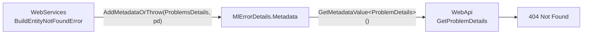

# MoralesLarios.OOFP.Shared

Proyecto **transversal de constantes compartidas** del ecosistema **MoralesLarios.FOOP**.

Su única razón de existir es evitar los *literales mágicos duplicados*: cuando dos o más
proyectos necesitan ponerse de acuerdo sobre una clave, un nombre o un identificador de texto,
esa constante vive aquí y no repetida en cada uno.

---

## Índice

1. [Por qué existe este proyecto](#1-por-qué-existe-este-proyecto)
2. [Contenido actual](#2-contenido-actual)
3. [`WebErrorDetailsKeys`](#3-weberrordetailskeys)
4. [Reglas de diseño del proyecto](#4-reglas-de-diseño-del-proyecto)
5. [Cómo añadir una constante nueva](#5-cómo-añadir-una-constante-nueva)
6. [Compatibilidad](#compatibilidad)

---

## 1. Por qué existe este proyecto

El caso que motivó su creación fue un bug real: el diccionario `Details` de `MlErrorDetails`
se usaba como canal de transporte entre capas, pero **la clave se escribía a mano en cada
extremo**. Un proyecto guardaba el `ProblemDetails` bajo una clave y otro lo leía bajo otra,
de modo que el consumidor no encontraba nada y un **404 se degradaba silenciosamente a 500**.

El compilador no puede detectar ese tipo de error cuando la clave es un `string` literal
repetido. Sí puede detectarlo cuando es una **constante única y compartida**:

```csharp
// ❌ Antes: cada proyecto escribía su propio literal
details.AddMetadataOrThrow("NotFound", problemDetails);        // capa de servicios
var pd = details.GetMetadataValue<ProblemDetails>();    // capa web buscaba "ProblemsDetails"

// ✅ Ahora: una sola fuente de verdad
details.AddMetadataOrThrow(WebErrorDetailsKeys.ProblemsDetails, problemDetails);
```

Además, este proyecto permite que dos proyectos compartan vocabulario **sin que uno tenga que
referenciar al otro**, evitando dependencias circulares o acoplamientos innecesarios entre,
por ejemplo, `MoralesLarios.OOFP.Application` y `MoralesLarios.OOFP.AspNetCore.Results`.

---

## 2. Contenido actual

| Carpeta | Tipo | Contenido |
|---------|------|-----------|
| `Web/` | [`WebErrorDetailsKeys`](#3-weberrordetailskeys) | Claves del diccionario `Details` usadas en el flujo HTTP |

El proyecto es deliberadamente **mínimo**: `net8.0`, sin `PackageReference` y
**sin ningún `ProjectReference`**. Es la hoja del grafo de dependencias.

```text
MoralesLarios.OOFP.Shared/
├── MoralesLarios.OOFP.Shared.csproj   # net8.0, sin dependencias
└── Web/
    └── WebErrorDetailsKeys.cs         # claves de Details del flujo web
```

---

## 3. `WebErrorDetailsKeys`

Namespace: `MoralesLarios.OOFP.Shared.Web`

```csharp
public static class WebErrorDetailsKeys
{
    public const string ProblemsDetails = "ProblemsDetails";
}
```

| Constante | Valor | Para qué sirve |
|-----------|-------|----------------|
| `ProblemsDetails` | `"ProblemsDetails"` | Clave bajo la que se guarda en `MlErrorDetails.Metadata` el `ProblemDetails` (RFC 7807) que la capa web debe devolver tal cual, preservando el código de estado HTTP original. |

### Quién la escribe y quién la lee



- **Escritura** — `MoralesLarios.OOFP.Application\Helpers\Extensions.cs`, al construir el error
  de «entidad no encontrada por clave primaria».
- **Lectura** — `MoralesLarios.OOFP.AspNetCore.Results\Helpers\MlErrorDetailsExtensions.cs`, al traducir un
  `MlResult` en fallo a un `IActionResult`.

> 🔑 **Regla:** nunca escribas el literal `"ProblemsDetails"` en tu código. Usa siempre la
> constante. Si aparece un literal, el enlace entre las dos capas puede romperse sin que el
> compilador avise.

---

## 4. Reglas de diseño del proyecto

1. **Cero dependencias.** Este proyecto no referencia a nadie. Cualquiera puede referenciarlo
   sin arrastrar transitivamente el núcleo, EF Core ni ASP.NET.
2. **Sólo constantes y contratos de texto.** No hay lógica, no hay estado, no hay servicios.
   Si necesitas comportamiento, ese código pertenece al proyecto que lo usa.
3. **`public const`, no `static readonly`.** Las claves son literales estables que interesa que
   se puedan usar en atributos, `switch` y expresiones constantes.
4. **Organización por dominio.** Una carpeta por área funcional (`Web/`, y las que vengan),
   con una clase estática por grupo cohesivo de constantes.
5. **Nombres descriptivos del *contrato*, no del *valor*.** `WebErrorDetailsKeys.ProblemsDetails`
   dice dónde se usa; `PROBLEMS_DETAILS` sólo repetiría el literal.
6. **Nunca cambies el valor de una constante publicada** sin tratarlo como *breaking change*:
   los consumidores compilados contra el valor antiguo seguirían usándolo (los `const` se
   incrustan en el ensamblado que los consume).

---

## 5. Cómo añadir una constante nueva

Antes de añadir algo aquí, comprueba que se cumplan **las tres condiciones**:

- [ ] El valor lo necesitan **dos o más proyectos** distintos.
- [ ] Un desacuerdo entre esos proyectos produciría un **bug silencioso** (no un error de compilación).
- [ ] El valor es un **literal estable**, no configuración que deba poder cambiarse en despliegue.

Si sólo lo usa un proyecto, la constante debe vivir en ese proyecto. Si es configurable, su
sitio es `appsettings.json` o las opciones fuertemente tipadas correspondientes.

Pasos:

1. Elige o crea la carpeta de dominio (`Web/`, `Data/`, …).
2. Añade la constante a la clase estática correspondiente, o crea una nueva clase
   `…Keys` / `…Names` si el grupo no existe.
3. Documenta la constante con XML docs indicando **quién la escribe y quién la lee**.
4. Añade la fila correspondiente a la tabla de este README.
5. Sustituye **todos** los literales existentes por la constante y ejecuta la suite de pruebas.

---

## Compatibilidad

- `.NET 8`

---

## Ver también

- 📘 [README general de la solución](../README.md)
- 📘 [README del núcleo `MoralesLarios.OOFP`](../MoralesLarios.OOFP.Core/README.md)
- 📘 [MoralesLarios.OOFP.Application](../MoralesLarios.OOFP.Application/README.md) — productor de la clave
- 📘 [MoralesLarios.OOFP.AspNetCore.Results](../MoralesLarios.OOFP.AspNetCore.Results/README.md) — consumidor de la clave
- 📘 [Modelo de errores: `MlErrorDetails` y su diccionario `Details`](../docs/core-types/MlResultErrors.md)

---

<!-- Contenido fusionado desde el antiguo proyecto MoralesLarios.OOFP.Internals (v2.0.0) -->

# MoralesLarios.OOFP.Shared — tipos compartidos de paginación

Librería **muy pequeña y sin lógica de negocio** cuyo único cometido es ofrecer un **contrato común de paginación** para todo el ecosistema `MoralesLarios.OOFP`.

Es la pieza que permite que un repositorio de EF Core, un servicio de aplicación, un controlador REST y un cliente HTTP **hablen el mismo idioma** cuando se trata de "página 2, de 20 en 20, sobre un total de 350 registros", sin que ninguno de ellos tenga que depender de los demás.

---

## Índice

1. [¿Qué problema resuelve?](#qué-problema-resuelve)
2. [Instalación y dependencias](#instalación-y-dependencias)
3. [Estructura del proyecto](#estructura-del-proyecto)
4. [`PageRequest` — la petición de página](#paginationinfo--la-petición-de-página)
5. [`PagedResult<T>` — la respuesta paginada](#paginationresultinfot--la-respuesta-paginada)
6. [Conversiones implícitas desde tuplas](#conversiones-implícitas-desde-tuplas)
7. [⚠️ Particularidades reales del código fuente](#️-particularidades-reales-del-código-fuente)
8. [⚠️ Lo que estos tipos NO incluyen](#️-lo-que-estos-tipos-no-incluyen)
9. [Ejemplos prácticos](#ejemplos-prácticos)
10. [Tabla de decisión rápida](#tabla-de-decisión-rápida)
11. [Mejores prácticas](#mejores-prácticas)
12. [Resumen](#resumen)
13. [Ver también](#ver-también)

---

## ¿Qué problema resuelve?

Sin un tipo compartido, la paginación se propaga por la aplicación como una nube de parámetros suelos que **nadie valida** y que cada capa interpreta a su manera:

❌ **Sin `Internals`:**

```csharp
// El repositorio recibe enteros crudos: nada garantiza que sean válidos.
Task<IEnumerable<User>> GetPageAsync(int pageNumber, int pageSize);

// ...y en cada capa hay que repetir la misma defensa a mano:
if (pageNumber < 1)   pageNumber = 1;
if (pageSize  < 1)    pageSize   = 10;
if (pageSize  > 1000) pageSize   = 1000;   // ¿y si aquí alguien pone 5000?

// El resultado se devuelve troceado en piezas que hay que volver a casar:
var items      = await GetPageAsync(2, 20);
var totalCount = await CountAsync();       // dos viajes, dos verdades
```

✅ **Con `Internals`:**

```csharp
// Un único parámetro que YA viene normalizado y es imposible de construir mal.
Task<MlResult<PagedResult<User>>> GetPageAsync(PageRequest pagination);

// La llamada es una tupla: legible y sin ceremonia.
var resultado = await repo.GetPageAsync((pageNumber: 2, pageSize: 20));

// Y la respuesta viaja completa: datos + posición + total, en un solo objeto.
```

> 💡 **La idea de fondo**: `Internals` no valida "reglas de negocio", **normaliza**. Un `PageRequest` recién construido es siempre coherente, así que ninguna capa posterior necesita volver a comprobarlo. Es el mismo espíritu que los [value objects](../MoralesLarios.OOFP.ValueObjects/README.md): *estados imposibles, imposibles de representar*.

---

## Instalación y dependencias

| Dependencia | Para qué |
|---|---|
| [`MoralesLarios.OOFP.ValueObjects`](../MoralesLarios.OOFP.ValueObjects/README.md) | Aporta `IntNonNegative`, usado en una de las conversiones implícitas. |
| `System.ComponentModel.DataAnnotations` | Atributos `[Range]` sobre los parámetros del record. |

`GlobalUsings.cs` del proyecto ya expone `MoralesLarios.OOFP.ValueObjects` y `System.ComponentModel.DataAnnotations`, por lo que dentro de esta librería no hacen falta `using` explícitos.

**Namespace de todos los tipos:**

```csharp
using MoralesLarios.OOFP.Shared.Pagination;
```

> ⚠️ Ojo: el namespace **no** es `MoralesLarios.OOFP.Shared`, sino `MoralesLarios.OOFP.Shared.Pagination` (los tipos viven en la carpeta `Info/`). Es el error de importación más frecuente al empezar a usar esta librería.

---

## Estructura del proyecto

```
MoralesLarios.OOFP.Shared/
├── GlobalUsings.cs
└── Info/
    ├── PageRequest.cs          → PageRequest
    └── PagedResult.cs    → PagedResult<T>
```

Solo **dos tipos**, ambos `record`. La librería es deliberadamente mínima: cuanto menos contenga, más proyectos pueden depender de ella sin arrastrar peso.

---

## `PageRequest` — la petición de página

Representa **lo que pide el cliente**: qué página quiere y de cuántos elementos.

### Firma real

```csharp
namespace MoralesLarios.OOFP.Shared.Pagination;

public record PageRequest([property: Range(0, int.MinValue)] int PageNumber,
                            [property: Range(0, int.MinValue)] int PageSize)
{
    private const int MaxPageSize = 1000;

    public int PageNumber { get; init; } = Math.Max(1, PageNumber);
    public int PageSize   { get; init; } = Math.Clamp(PageSize, 1, MaxPageSize);

    public static implicit operator PageRequest((int pageNumber, int pageSize) value)
        => new PageRequest(value.pageNumber, value.pageSize);

    public static implicit operator PageRequest((IntNonNegative pageNumber, IntNonNegative pageSize) value)
        => new PageRequest(value.pageNumber, value.pageSize);
}
```

### Reglas de normalización (esto es lo importante)

El record **redeclara** sus propiedades para no usar los valores crudos del constructor, sino versiones saneadas:

| Propiedad | Regla | Efecto |
|---|---|---|
| `PageNumber` | `Math.Max(1, PageNumber)` | Cualquier valor `≤ 0` (incluidos negativos) se convierte en **1**. La paginación es 1-based. |
| `PageSize` | `Math.Clamp(PageSize, 1, 1000)` | Valores `≤ 0` → **1**. Valores `> 1000` → **1000**. Es un tope de seguridad frente a `?pageSize=999999`. |

**Nunca lanza excepción**: siempre "corrige" en silencio.

```csharp
var p1 = new PageRequest(0,     20);      // → PageNumber = 1,   PageSize = 20
var p2 = new PageRequest(-7,    20);      // → PageNumber = 1,   PageSize = 20
var p3 = new PageRequest(3,      0);      // → PageNumber = 3,   PageSize = 1
var p4 = new PageRequest(3,  50_000);     // → PageNumber = 3,   PageSize = 1000  ← tope
var p5 = new PageRequest(3,   1000);      // → PageNumber = 3,   PageSize = 1000  ← límite exacto, se respeta
```

> 💡 **`MaxPageSize` es `private const` = 1000** y no es configurable. Si necesitas otro tope, envuelve el tipo en tu propia validación antes de construirlo (por ejemplo con [`EnsureFp`](../docs/EnsureFp/EnsureFp.md)).

### Cómo traducirlo a una consulta

La conversión a `Skip`/`Take` es directa, porque `PageNumber` es 1-based:

```csharp
var query = origen.Skip((pagination.PageNumber - 1) * pagination.PageSize)
                  .Take(pagination.PageSize);
```

---

## `PagedResult<T>` — la respuesta paginada

Representa **lo que se devuelve**: los elementos de esa página más el contexto necesario para que el consumidor pueda pintar un paginador.

### Firma real

```csharp
public record PagedResult<T>(                         IEnumerable<T> Items,
                                      [Range(0, int.MaxValue)] int            PageNumber,
                                      [Range(0, int.MinValue)] int            PageSize,
                                      [Range(0, int.MinValue)] int            TotalCount)
    : PageRequest(PageNumber, PageSize)
{
    public static implicit operator PagedResult<T>((IEnumerable<T> items,
                                                            int            pageNumber,
                                                            int            pageSize,
                                                            int            totalCount) value)
        => new PagedResult<T>(value.items, value.pageNumber, value.pageSize, value.totalCount);
}
```

### Miembros

| Miembro | Origen | Notas |
|---|---|---|
| `Items` | Propio | Los elementos **de esta página**, no la colección completa. |
| `TotalCount` | Propio | Total de registros que existen **sin paginar**. Sirve para calcular el número de páginas. |
| `PageNumber` | **Heredado** de `PageRequest` | Llega ya normalizado (`Math.Max(1, …)`). |
| `PageSize` | **Heredado** de `PageRequest` | Llega ya normalizado (`Math.Clamp(…, 1, 1000)`). |

> 🔑 **Detalle clave**: como `PageNumber` y `PageSize` se pasan al constructor base, `PagedResult<T>` **hereda gratis la normalización**. No hay dos comportamientos distintos entre la petición y la respuesta.

### Cálculos derivados que tendrás que hacer tú

El tipo es un contenedor puro; no ofrece propiedades calculadas. Si las necesitas, un método de extensión propio es la vía limpia:

```csharp
public static class PaginationResultInfoExtensions
{
    public static int TotalPages<T>(this PagedResult<T> source)
        => (int)Math.Ceiling(source.TotalCount / (double)source.PageSize);

    public static bool HasPreviousPage<T>(this PagedResult<T> source)
        => source.PageNumber > 1;

    public static bool HasNextPage<T>(this PagedResult<T> source)
        => source.PageNumber < source.TotalPages();
}
```

---

## Conversiones implícitas desde tuplas

Las tres conversiones implícitas existen para que **las llamadas queden legibles** sin escribir `new` ni repetir el nombre del tipo.

| Desde | Hacia | Definido en |
|---|---|---|
| `(int pageNumber, int pageSize)` | `PageRequest` | `PageRequest` |
| `(IntNonNegative pageNumber, IntNonNegative pageSize)` | `PageRequest` | `PageRequest` |
| `(IEnumerable<T> items, int pageNumber, int pageSize, int totalCount)` | `PagedResult<T>` | `PagedResult<T>` |

```csharp
// 1) Tupla de enteros → petición
PageRequest peticion = (pageNumber: 2, pageSize: 20);

// 2) Tupla de value objects → petición (ya validados en origen)
IntNonNegative pagina  = 2;
IntNonNegative tamanyo = 20;
PageRequest peticionVO = (pagina, tamanyo);

// 3) Tupla de 4 elementos → respuesta
PagedResult<User> respuesta = (usuariosDeLaPagina, 2, 20, 350);
```

> 💡 **Nombra los elementos de la tupla** (`pageNumber:`, `pageSize:`) cuando ambos sean `int`. Es la única defensa real contra el clásico error de invertir el orden: `(20, 2)` compila igual de bien que `(2, 20)`, pero significa algo muy distinto.

---

## ⚠️ Particularidades reales del código fuente

Estas son observaciones sobre el código tal y como está hoy. Conviene conocerlas para no llevarse sorpresas.

### 1. Los atributos `[Range(0, int.MinValue)]` no validan nada

Aparecen escritos como `Range(0, int.MinValue)`, es decir **mínimo 0 y máximo `int.MinValue` (−2.147.483.648)**. Al ser el máximo menor que el mínimo, el rango es vacío: si alguien pasara estos tipos por un validador de DataAnnotations, **ningún valor lo cumpliría**.

> ⚠️ **Consecuencia práctica**: no confíes en los `[Range]` de estos records. **La garantía real la dan `Math.Max` y `Math.Clamp`**, que sí funcionan correctamente y son los que protegen de verdad. Los atributos parecen una errata (probablemente se pretendía `int.MaxValue`).

### 2. `TotalCount` no se normaliza

`PageNumber` y `PageSize` se sanean; **`TotalCount` no**. Se acepta tal cual, incluso negativo:

```csharp
PagedResult<string> raro = (new[] { "a" }, 1, 20, -5);   // TotalCount = -5, se acepta
```

Si `TotalCount` viene de un `CountAsync()` esto nunca ocurre, pero si lo calculas a mano, asegúralo tú.

### 3. `Items` puede ser `null`

No hay comprobación de nulidad. Para una página vacía **usa una colección vacía, no `null`**:

```csharp
// ✅ Página sin resultados, pero segura de recorrer
PagedResult<User> vacia = (Enumerable.Empty<User>(), 1, 20, 0);
```

### 4. Igualdad de `record` sobre `IEnumerable<T>`

`PagedResult<T>` es un `record`, así que su `Equals` compara `Items` **por referencia** (no elemento a elemento, porque `IEnumerable<T>` no implementa igualdad estructural). Dos respuestas con los mismos elementos en listas distintas **no serán iguales**.

---

## ⚠️ Lo que estos tipos NO incluyen

Para evitar buscar miembros que no existen:

> ⚠️ **No existen** en `PageRequest` ni en `PagedResult<T>`: `TotalPages`, `HasNextPage`, `HasPreviousPage`, `IsFirstPage`, `IsLastPage`, `Skip`, `Take`, `Offset`, ni ningún método `Validate()`. Tampoco hay conversión implícita hacia `MlResult<T>`. Son **records de datos**, no objetos con comportamiento.

Si necesitas esas ayudas, créalas como extensiones en tu propio proyecto (ver el ejemplo de la sección anterior).

---

## Ejemplos prácticos

### Ejemplo 1 — Paginar en memoria y devolver un resultado completo

```csharp
using MoralesLarios.OOFP.Shared.Pagination;

public static PagedResult<T> Paginar<T>(IEnumerable<T> origen, PageRequest pagination)
{
    var lista = origen as IList<T> ?? origen.ToList();

    var pagina = lista.Skip((pagination.PageNumber - 1) * pagination.PageSize)
                      .Take(pagination.PageSize)
                      .ToList();

    // Tupla → PagedResult<T> por conversión implícita
    return (pagina, pagination.PageNumber, pagination.PageSize, lista.Count);
}

// Uso
var resultado = Paginar(todosLosUsuarios, (pageNumber: 2, pageSize: 20));

Console.WriteLine($"Página {resultado.PageNumber} de {Math.Ceiling(resultado.TotalCount / (double)resultado.PageSize)}");
Console.WriteLine($"Mostrando {resultado.Items.Count()} de {resultado.TotalCount} registros");
```

### Ejemplo 2 — Paginar sobre EF Core devolviendo `MlResult<T>`

Aquí se ve por qué `Internals` es una librería aparte: el repositorio la usa como contrato de entrada y salida, y el núcleo funcional aporta el manejo de errores.

```csharp
using MoralesLarios.OOFP.Shared.Pagination;
using MoralesLarios.OOFP.Types;

public async Task<MlResult<PagedResult<UserDto>>> ObtenerPaginaAsync(PageRequest pagination)
{
    var total = await _context.Users.CountAsync();

    var items = await _context.Users
                              .OrderBy(u => u.Id)
                              .Skip((pagination.PageNumber - 1) * pagination.PageSize)
                              .Take(pagination.PageSize)
                              .Select(u => new UserDto(u.Id, u.Name))
                              .ToListAsync();

    PagedResult<UserDto> resultado = (items, pagination.PageNumber, pagination.PageSize, total);

    return resultado.ToMlResultValid();
}
```

### Ejemplo 3 — Endpoint de API con paginación robusta

El caso donde la normalización brilla: la entrada viene de la query string, es decir, de un usuario que puede escribir cualquier cosa.

```csharp
[HttpGet]
public async Task<IActionResult> Get([FromQuery] int page = 1, [FromQuery] int size = 20)
{
    // Aunque llegue ?page=-3&size=999999, PageRequest lo deja en (1, 1000).
    PageRequest pagination = (pageNumber: page, pageSize: size);

    var resultado = await _service.ObtenerPaginaAsync(pagination);

    return resultado.Match(
        valid: r => Ok(new
        {
            r.Items,
            r.PageNumber,
            r.PageSize,
            r.TotalCount,
            TotalPages = (int)Math.Ceiling(r.TotalCount / (double)r.PageSize)
        }),
        fail: errores => BadRequest(errores.GetErrorMessages()));
}
```

> 💡 Fíjate en que **no hay una sola comprobación defensiva** de `page` ni de `size`. Está toda encapsulada en el tipo, en un único sitio.

### Ejemplo 4 — Encadenar la paginación en una tubería funcional

```csharp
using MoralesLarios.OOFP.Types;

public async Task<MlResult<PagedResult<UserDto>>> BuscarAsync(string filtro, int page, int size)
    => await EnsureFp.NotNullEmptyOrWhitespace(filtro, "El filtro de búsqueda es obligatorio")
                     .MapAsync(async f =>
                     {
                         PageRequest pagination = (pageNumber: page, pageSize: size);
                         return (filtro: f, pagination);
                     })
                     .BindAsync(async x => await _repo.BuscarPaginadoAsync(x.filtro, x.pagination))
                     .ExecSelfIfFailAsync(async errores =>
                         _logger.LogWarning("Búsqueda fallida: {Errores}", errores.GetErrorsSummary()));
```

### Ejemplo 5 — ❌ Qué no hacer / ✅ qué hacer

```csharp
// ❌ MAL: volver a validar lo que el tipo ya garantiza
PageRequest p = (page, size);
if (p.PageNumber < 1)   p = p with { PageNumber = 1 };      // imposible: ya es ≥ 1
if (p.PageSize  > 1000) p = p with { PageSize  = 1000 };    // imposible: ya está limitado

// ✅ BIEN: confiar en la normalización
PageRequest p = (pageNumber: page, pageSize: size);


// ❌ MAL: tupla posicional ambigua — fácil invertir los valores
PageRequest p = (20, 2);          // ¿página 20 de 2 en 2? Probablemente no era la intención

// ✅ BIEN: tupla con nombres
PageRequest p = (pageNumber: 2, pageSize: 20);


// ❌ MAL: devolver null en Items para una página vacía
PagedResult<User> r = (null!, 1, 20, 0);           // reventará al recorrer

// ✅ BIEN: colección vacía
PagedResult<User> r = (Enumerable.Empty<User>(), 1, 20, 0);


// ❌ MAL: apoyarse en los atributos [Range] como si validaran
// (Range(0, int.MinValue) define un rango vacío: no valida nada)

// ✅ BIEN: si necesitas reglas propias, usa EnsureFp antes de construir
var validada = EnsureFp.That(size, size <= 100, "El tamaño de página máximo permitido es 100");


// ❌ MAL: importar el namespace equivocado
using MoralesLarios.OOFP.Shared;          // no contiene los tipos

// ✅ BIEN
using MoralesLarios.OOFP.Shared.Pagination;
```

---

## Tabla de decisión rápida

| Necesito… | Uso |
|---|---|
| Recibir "qué página quiero" desde una API o un servicio | `PageRequest` (o directamente una tupla `(pageNumber:, pageSize:)`) |
| Devolver los elementos de una página **con su contexto** | `PagedResult<T>` |
| Que un `?pageSize=999999` no tumbe la base de datos | Nada extra: `PageRequest` lo limita a 1000 |
| Partir de valores ya validados como no negativos | Conversión implícita desde `(IntNonNegative, IntNonNegative)` |
| `TotalPages`, `HasNextPage`, etc. | Métodos de extensión propios (no existen en la librería) |
| Un tope de página distinto de 1000 | Validación propia con `EnsureFp` antes de construir el `PageRequest` |

---

## Mejores prácticas

1. **Importa `MoralesLarios.OOFP.Shared.Pagination`**, no `MoralesLarios.OOFP.Shared`. Es el fallo de arranque más habitual.
2. **Acepta `PageRequest` en las firmas públicas**, no dos `int` sueltos. Así la normalización ocurre una sola vez, en el borde de la aplicación.
3. **Nombra siempre los elementos de la tupla** (`pageNumber:`, `pageSize:`). Evita invertir valores sin que el compilador se queje.
4. **No repitas comprobaciones** de `PageNumber`/`PageSize` aguas abajo: el tipo ya las garantiza.
5. **No confíes en los `[Range]`** de estos records (definen un rango vacío). La garantía real es `Math.Max`/`Math.Clamp`.
6. **Devuelve colecciones vacías, nunca `null`**, en `Items`.
7. **Calcula `TotalCount` con el mismo filtro** que los `Items`, o el paginador de la interfaz mentirá.
8. **Envuelve el resultado en `MlResult<T>`** (`MlResult<PagedResult<T>>`) para que el error de consulta viaje por el mismo canal que el resto de la aplicación.
9. **Materializa `Items`** (`ToList()`) antes de construir el resultado si la fuente es un `IQueryable` diferido: evitarás que la consulta se ejecute varias veces al leer `Items` más de una vez.

---

## Resumen

`MoralesLarios.OOFP.Shared` es la librería más pequeña del ecosistema y, precisamente por eso, una de las más usadas: define **el vocabulario común de la paginación**.

- **`PageRequest`** → la petición. `PageNumber` mínimo 1; `PageSize` acotado entre 1 y 1000. **Nunca lanza; siempre normaliza.**
- **`PagedResult<T>`** → la respuesta. Añade `Items` y `TotalCount`, y **hereda la normalización** del tipo base.
- **Conversiones implícitas desde tuplas** para que las llamadas queden legibles.
- **Sin lógica de negocio, sin propiedades calculadas, sin dependencias pesadas**: solo el contrato.

La consumen principalmente [`EFCore`](../MoralesLarios.OOFP.EntityFrameworkCore/README.md) (repositorios paginados), [`WebServices`](../MoralesLarios.OOFP.Application/README.md) (servicios de aplicación), [`WebControllers`](../MoralesLarios.OOFP.AspNetCore.Controllers/README.md) (endpoints REST genéricos) y [`HttpClients`](../MoralesLarios.OOFP.Http/README.md) (consumo tipado).

---

## Ver también

### Navegación general

- [README de la solución completa](../README.md)
- [README del núcleo `MoralesLarios.OOFP`](../MoralesLarios.OOFP.Core/README.md)
- [Introducción general al núcleo funcional](../docs/1_Intro.md)

### Proyectos relacionados

- [`MoralesLarios.OOFP.ValueObjects`](../MoralesLarios.OOFP.ValueObjects/README.md) — de aquí sale `IntNonNegative`
- [`MoralesLarios.OOFP.EntityFrameworkCore`](../MoralesLarios.OOFP.EntityFrameworkCore/README.md) — repositorios con consultas paginadas
- [`MoralesLarios.OOFP.Application`](../MoralesLarios.OOFP.Application/README.md) — servicios genéricos que propagan la paginación
- [`MoralesLarios.OOFP.AspNetCore.Controllers`](../MoralesLarios.OOFP.AspNetCore.Controllers/README.md) — controladores REST genéricos
- [`MoralesLarios.OOFP.Http`](../MoralesLarios.OOFP.Http/README.md) — clientes tipados que consumen respuestas paginadas

### Documentación del núcleo útil aquí

- [`MlResult<T>` — el contenedor de éxito/error](../docs/core-types/MlResult.md)
- [`EnsureFp` — validaciones previas](../docs/EnsureFp/EnsureFp.md)
- [`Map` — transformar el valor](../docs/Map/1_Map.md)
- [`Bind` — encadenar operaciones que pueden fallar](../docs/Bind/3_Bind.md)
- [`Match` — salir del mundo `MlResult`](../docs/Match/1_Match.md)
