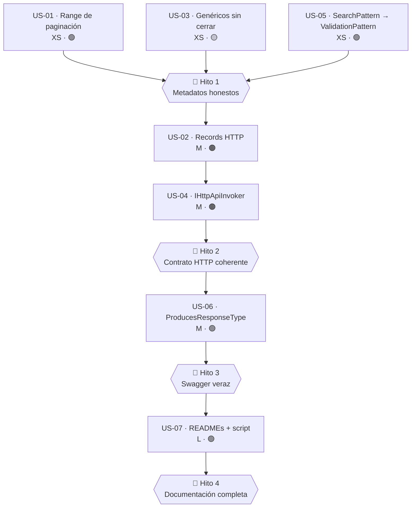

# Épica · Coherencia de contratos y documentación (`Shared`, `Http`, `AspNetCore.Controllers`)

> **Versión destino:** 2.1.0
> **Origen:** [`Temas Pendientes/Mejoras-Prioridad-Baja.md`](../../Temas%20Pendientes/Mejoras-Prioridad-Baja.md) — puntos **81-89**
> **Plan del que se desgaja:** bloque «Coherencia y documentación» (81-89)
> **Estado:** ⬜ No iniciada
> **Esfuerzo:** M (~1 jornada el tramo mecánico; ~2 jornadas con los `README` y los `[ProducesResponseType]`)
> **Riesgo:** 🟢 bajo en US-01, US-05, US-06 y US-07 · 🟡 medio en US-03 · 🟠 alto en US-02 y US-04 (cambian firmas públicas)

---

## Índice

1. [Contexto y problema](#1-contexto-y-problema)
2. [Hallazgos colaterales](#2-hallazgos-colaterales)
3. [Alcance](#3-alcance)
4. [Historias de usuario](#4-historias-de-usuario)
5. [Orden de ejecución](#5-orden-de-ejecución)
6. [Decisiones abiertas](#6-decisiones-abiertas)
7. [Definición de terminado](#7-definición-de-terminado)
8. [Apéndice · código actual y propuesto](#8-apéndice--código-actual-y-propuesto)

---

## 1. Contexto y problema

El bloque «Coherencia y documentación» del inventario de prioridad baja recoge nueve observaciones heterogéneas que comparten una misma raíz: **el contrato que la biblioteca publica no coincide con lo que la biblioteca hace**. Un `[Range(0, int.MinValue)]` promete una validación que nunca puede pasar; un `<returns>` promete `200 OK` donde el código devuelve `204 No Content`; un parámetro opcional declarado `null!` promete no-nulabilidad donde se admite nulo; y trece proyectos de la solución no publican `README.md`, de modo que el único contrato visible es el código.

El inventario se escribió **antes** de la campaña de renombrados de la 2.0.0, así que varios puntos apuntan a tipos que ya no existen con ese nombre. La auditoría previa a esta épica los ha reubicado uno a uno; la tabla siguiente refleja el estado **real** del código a día de hoy, no el del inventario.

| Punto | Fichero | Líneas | Naturaleza |
|---|---|---|---|
| 81 | `MoralesLarios.OOFP.Shared/Pagination/PageRequest.cs` | 8-9 | 🟢 Metadato imposible · rango `[0, int.MinValue]` |
| 81 | `MoralesLarios.OOFP.Shared/Pagination/PagedResult.cs` | 13-15 | 🟢 Metadato imposible + mínimo `0` donde debería ser `1` |
| 82 | `MoralesLarios.OOFP.Http/Requests/ApiCallOptions.cs` | 11, 41 | 🟠 `Dictionary<string,string>? Headers = null!` · jerarquía incoherente |
| 82 | `MoralesLarios.OOFP.Http/Requests/PagedApiCallOptions.cs` | 16, 54 | 🟠 Mismo defecto · herencia cruzada sin contrato común |
| 83 | `MoralesLarios.OOFP.Http/HttpApiInvoker.cs` | 256, 365, 394 | 🟡 Literal interpolado con genérico sin cerrar |
| 84 | `MoralesLarios.OOFP.Http/IHttpApiInvoker.cs` | 23-25, 50, 61, 72, 83, 93, 105 | 🟠 Nulabilidad y valores por defecto inconsistentes |
| 85 | — | — | ✅ Resuelto en 2.0.0 (0 apariciones de `PostGetAsync`) |
| 86 | `MoralesLarios.OOFP.ValueObjects.FileSystem/FilePath.cs` | 15, 21, 34 | 🟡 `SearchPattern` nombra una regex de validación |
| 86 | `MoralesLarios.OOFP.ValueObjects.FileSystem/DirectoryPath.cs` | 15, 21, 34 | 🟡 Mismo caso |
| 87 | `MoralesLarios.OOFP.AspNetCore.Controllers/Controllers/MlCompositeKeyCrudControllerBase.cs` | 119, 282 | 🟢 XML dice «200 OK», el código devuelve `204` |
| 87 | `MoralesLarios.OOFP.AspNetCore.Controllers/Controllers/MlCrudControllerBase.cs` | 109, 127, 252, 270 | 🟢 XML genérico sin status · 0 `[ProducesResponseType]` |
| 88 | `**/GlobalUsings.cs` (27 ficheros) | — | ✅ Resuelto · 0 duplicados literales |
| 89 | 13 de los 30 proyectos de la solución | — | 🟢 Sin `README.md` en la raíz |

### Punto 81 — `[Range(0, int.MinValue)]`, una validación que nunca se cumple

`PageRequest` es el contrato de entrada de toda la paginación de la biblioteca. Sus dos propiedades llevan un `[Range]` cuyo **máximo es menor que el mínimo**, de modo que `Validator.TryValidateObject` rechaza *cualquier* valor, incluido el valor correcto.

```csharp
// MoralesLarios.OOFP.Shared/Pagination/PageRequest.cs, L8-20
public record PageRequest([property: Range(0, int.MinValue)] int PageNumber,   // ← máximo = -2 147 483 648 < mínimo = 0
                             [property: Range(0, int.MinValue)] int PageSize)  // ← idéntico defecto
{
    private const int MaxPageSize = 1000;

    public int PageNumber { get; init; } = Math.Max(1, PageNumber);            // ← el cuerpo sí normaliza a >= 1
    public int PageSize   { get; init; } = Math.Clamp(PageSize, 1, MaxPageSize); // ← y aquí a [1, 1000]
}
```

Hay una segunda incoherencia, más sutil: **el atributo y el cuerpo dicen cosas distintas**. El atributo admite `0` como mínimo; el cuerpo lo eleva a `1` con `Math.Max`. Y el `MaxPageSize = 1000` que el cuerpo impone no aparece en ningún metadato, por lo que ni Swagger ni un validador externo pueden conocerlo.

`PagedResult<T>` repite el problema y añade un tercer caso:

```csharp
// MoralesLarios.OOFP.Shared/Pagination/PagedResult.cs, L12-16
public record PagedResult<T>(                         IEnumerable<T> Items,
                                      [Range(0, int.MaxValue)] int            PageNumber,  // ← rango válido, pero admite 0 y la base normaliza a 1
                                      [Range(0, int.MinValue)] int            PageSize,    // ← rango imposible
                                      [Range(0, int.MinValue)] int            TotalCount)  // ← rango imposible
    : PageRequest(PageNumber, PageSize)
```

Nótese además que los tres `[Range]` de `PagedResult<T>` se aplican **al parámetro**, no a la propiedad (`[Range(...)]` en lugar de `[property: Range(...)]`), mientras que los de `PageRequest` sí usan `[property: ...]`. Sobre un `record`, un atributo sin `property:` va al parámetro del constructor primario y **no** acaba en la propiedad sintetizada, de modo que la validación por DataAnnotations ni siquiera llega a ejecutarse. Son dos bugs apilados: el rango es imposible **y** el atributo está en el sitio equivocado.

### Punto 82 — `ApiCallOptions` / `PagedApiCallOptions`: cuatro records sin contrato común

El inventario hablaba de `CallRequest*ParamsInfo`; esos tipos desaparecieron en la 2.0.0. Sus sucesores son cuatro `record` en `MoralesLarios.OOFP.Http/Requests`, y heredan los mismos defectos:

```csharp
// MoralesLarios.OOFP.Http/Requests/ApiCallOptions.cs, L11-13
public record ApiCallOptions(string                      Url,
                             ServiceKey                  ClientName,
                             Dictionary<string, string>? Headers           = null!,  // ← anulable Y perdonado a la vez
                             CancellationToken           CancellationToken = default);
```

`Dictionary<string,string>? Headers = null!` es una contradicción en términos: el `?` declara que el valor **puede** ser nulo y el `!` silencia al compilador como si **no** pudiera. La forma correcta de un parámetro opcional anulable es `= null`, sin `!`.

La jerarquía tampoco cierra. Hay dos pares de tipos —genérico y no genérico— y cada `Paged` hereda de su `ApiCallOptions` correspondiente, pero **las dos ramas no comparten ningún contrato**:

```csharp
// MoralesLarios.OOFP.Http/Requests/ApiCallOptions.cs, L41
public record ApiCallOptions<TRequest>(string Url, ServiceKey ClientName,
                                       [property: Required] TRequest RequestBody,       // ← [Required] que nadie ejecuta
                                       Dictionary<string, string>? Headers = null!,
                                       CancellationToken CancellationToken = default);

// MoralesLarios.OOFP.Http/Requests/PagedApiCallOptions.cs, L16
public record PagedApiCallOptions(string Url, ServiceKey ClientName,
                                  IntNonNegative PageNumber,                            // ← Value Object, no int: bien
                                  IntNonNegative PageSize,
                                  Dictionary<string, string>? Headers = null!,
                                  CancellationToken CancellationToken = default)
    : ApiCallOptions(Url, ClientName, Headers, CancellationToken);                      // ← hereda del NO genérico
```

`ApiCallOptions<TRequest>` **no** deriva de `ApiCallOptions`, así que un método que acepte `ApiCallOptions` no puede recibir la variante con cuerpo. No existe interfaz común (`IApiCallOptions`) que permita escribir un *helper* único de validación o de construcción de la petición.

Por último, el `[Required]` sobre `RequestBody` es **metadato muerto**: los records no ejecutan DataAnnotations por sí mismos y `HttpApiInvoker` no llama a ningún validador antes de usar el valor; lo que sí hay son comprobaciones manuales dispersas (`$"{nameof(parameters.RequestBody)} no puede ser nulo"`, `HttpApiInvoker.cs` L328 y L525).

### Punto 83 — Tres literales con un genérico sin cerrar

Tres mensajes de log/error abren el `<` del genérico y nunca lo cierran. El resultado es una cadena que parece HTML a medias y que, en un *sink* estructurado, puede llegar a escaparse o truncarse:

```csharp
// MoralesLarios.OOFP.Http/HttpApiInvoker.cs, L256 / L365 / L394
$"{nameof(DeleteByIdAsync)}<{typeof(T).Name}"    // ← falta el '>' · método público
$"{nameof(PostAsync)}<{typeof(T).Name}"          // ← falta el '>' · protected
$"{nameof(ActionEmptyAsync)}<{typeof(T).Name}"   // ← falta el '>' · protected
```

Los otros cuatro usos de `<{typeof` en el mismo fichero (líneas 66, 312, 338 y 537) **sí** cierran el `>`, lo que confirma que son tres erratas y no una convención. Este punto solapa con la US de plantillas de log de la [épica de mensajes](Epica-Mensajes-Y-Localizacion.md): la solución definitiva es dejar de interpolar y pasar `typeof(T).Name` como parámetro estructurado.

### Punto 84 — `IHttpApiInvoker`: tres convenciones distintas para «parámetro opcional»

El inventario citaba `IHttpClientFactoryManager`; esa interfaz ya no existe (solo sobrevive el puente obsoleto `GetIHttpClientFactoryManager` en `RestClientFp.Obsolete.cs` L27). Su sucesora es `IHttpApiInvoker`, y la inconsistencia de nulabilidad **sigue viva**: en diez firmas conviven tres convenciones para expresar lo mismo.

```csharp
// MoralesLarios.OOFP.Http/IHttpApiInvoker.cs, L50 / L61 / L93 / L105
Task<MlResult<T>>          GetAsync<T>(ServiceKey clientName, string url = "",    Dictionary<string, string> headers = null,  CancellationToken ct = default);  // ← "" y null
Task<MlResult<T>>          PostAsync<T>(ServiceKey clientName, T itemBody, string url = null!, Dictionary<string, string> headers = null!, CancellationToken ct = default);  // ← null! y null!
Task<MlResult<EmptyValue>> DeleteByIdAsync<T>(ServiceKey clientName, NotEmptyString url, Dictionary<string, string> headers = null!, CancellationToken ct = default);        // ← url obligatoria aquí
Task<MlResult<TResponse>>  PostAsync<T, TResponse>(ServiceKey clientName, T itemBody, string url = null, Dictionary<string, string> headers = null, CancellationToken ct = default);  // ← null y null
```

Tres formas de decir «sin url»: `""`, `null!` y `null`. Dos formas de decir «sin cabeceras»: `null` y `null!`. Y un único método (`DeleteByIdAsync`) donde `url` es obligatoria y además tipada como `NotEmptyString`, que es precisamente la convención correcta del repositorio… pero aplicada en un solo sitio.

La buena noticia del punto 84 es que **el parámetro genérico `K` ya no existe**: la interfaz usa `T`, `TResult`, `TRequest`, `TItem` y `TResponse`, todos con el prefijo `T`. Ese tramo del punto está resuelto.

### Punto 86 — `SearchPattern` nombra algo que no es un patrón de búsqueda

`MlFile` y `MlDirectory` se renombraron a `FilePath` y `DirectoryPath`, y `EndpointPattern` pasó a `SearchPattern`. El nuevo nombre **tampoco describe lo que el miembro contiene**:

```csharp
// MoralesLarios.OOFP.ValueObjects.FileSystem/FilePath.cs, L15-34
public const string SearchPattern = @"...";                 // ← es una EXPRESIÓN REGULAR que valida una ruta
public FilePath(string value) : base(value, SearchPattern)  // ← se entrega a RegexValue
public static bool IsValid(string value) => ...             // ← y se usa para validar, no para buscar
```

`SearchPattern`, en el vocabulario de .NET, es el tercer parámetro de `Directory.GetFiles` / `EnumerateFiles`: un comodín tipo `*.txt`. Aquí es una regex de validación. La confusión es real y verificable: `MlFileSystem` enumera ficheros **sin** pasar ese valor —`Directory.EnumerateFiles(directoryStr)`, `MlFileSystem.cs` L21—, prueba de que nadie lo ha confundido todavía con un comodín, pero nada impide que ocurra. El nombre correcto es `ValidationPattern`, que es exactamente el que ya usan `Endpoint` y `Mail` (ver `Endpoint.Obsolete.cs` L24, donde `EndpointPattern` es ya un puente hacia `ValidationPattern`).

### Punto 87 — El XML promete `200 OK` y el código devuelve `204 No Content`

Hay ocho `DeleteAsync` en las dos clases base de controlador. **Ninguno** lleva `[ProducesResponseType]`, y dos de ellos documentan explícitamente un status que el código no produce:

```csharp
// MoralesLarios.OOFP.AspNetCore.Controllers/Controllers/MlCompositeKeyCrudControllerBase.cs, L119 y L282
/// <returns>Resultado de la eliminación (200 OK o error).</returns>   // ← promete 200
...
// MoralesLarios.OOFP.AspNetCore.Results/Helpers/MlResultActionResultExtensions.cs, L220
=> new NoContentResult();                                              // ← devuelve 204
```

Los otros seis `DeleteAsync` no mienten, pero no dicen nada: su `<returns>` es el texto genérico «*Tarea que produce el valor de tipo `IActionResult` obtenido por la operación*». Lo mismo ocurre con el resto de verbos: POST acaba en `CreatedResult` (201), PUT en `NoContentResult` (204) y GET en el conversor OK (200), y **ninguno** lo declara ni en XML ni en atributos. Como consecuencia, el Swagger generado a partir de estas clases base documenta únicamente `200` por convención de ASP.NET Core, que es falso en cuatro de los cinco verbos.

### Puntos 85 y 88 — ya resueltos

- **Punto 85** (sobrecarga `PostGetAsync` comentada en una interfaz pública): **0 apariciones** del literal `PostGetAsync` en todo el código fuente. El miembro se eliminó en la limpieza de la 2.0.0; el punto se mantiene citado también en la [épica de código muerto](Epica-Limpieza-Codigo-Muerto.md) para dejar constancia.
- **Punto 88** (`using` duplicado en `GlobalUsings.cs`): **27 ficheros, 0 líneas `global using` literalmente duplicadas**. `global using MoralesLarios.OOFP.Types;` aparece como máximo una vez por fichero; `MoralesLarios.OOFP.Types.Errors` es un espacio de nombres distinto, no un duplicado. No hay nada que hacer.

### Punto 89 — Trece proyectos sin `README.md`

Las dos carpetas que citaba el inventario (`MoralesLarios.OOFP.EFCore.WebApi` y `MoralesLarios.OOFP.WebControllers.Cache`) **ya no existen**: desaparecieron con las 25 carpetas heredadas que se borraron en la 2.0.0. Pero el problema de fondo persiste y es más grande de lo que decía el punto: **13 de los 30 proyectos de la solución no tienen `README.md`**.

| Proyecto sin `README.md` | Tipo |
|---|---|
| `MoralesLarios.OOFP.Application.Tests.Unit` | Tests |
| `MoralesLarios.OOFP.AspNetCore.Results.Tests.Unit` | Tests |
| `MoralesLarios.OOFP.Configuration.Tests.Unit` | Tests |
| `MoralesLarios.OOFP.Core.Tests.Unit` | Tests |
| `MoralesLarios.OOFP.EntityFrameworkCore.Tests.Integration` | Tests |
| `MoralesLarios.OOFP.Http.Tests.Integration` | Tests |
| `MoralesLarios.OOFP.Http.Tests.Unit` | Tests |
| `MoralesLarios.OOFP.Validation.DataAnnotations.Tests.Unit` | Tests |
| `MoralesLarios.OOFP.Validation.FluentValidation.Tests.Unit` | Tests |
| `MoralesLarios.OOFP.ValueObjects.Tests.Unit` | Tests |
| `MoralesLarios.OOFP.ValueObjects.FileSystem.Tests.Unit` | Tests |
| `MoralesLarios.OOFP.EntityFrameworkCore.TestSupport` | Soporte de tests |
| `MoralesLarios.OOFP.Logging.Sample` | Muestra |

El reparto no es casual: **los 17 proyectos de biblioteca publicable sí tienen `README.md`**; los que faltan son los 11 de test, el de soporte de tests y la muestra de logging. Eso convierte el punto en una decisión, no en una tarea mecánica: ¿merece un proyecto de tests un `README`? La recomendación de esta épica es **sí, pero mínimo** —qué cubre, cómo se ejecuta, qué fixtures comparte— y **sí, extenso** para `Logging.Sample`, que es documentación de cara al usuario y hoy no explica cómo arrancar.

---

## 2. Hallazgos colaterales

Durante la auditoría aparecieron defectos que el inventario no recogía:

1. **`[Range]` en el sitio equivocado.** En `PagedResult<T>` (L13-15) los tres atributos carecen de `property:`, así que decoran el parámetro del constructor primario y **no** la propiedad. Ni siquiera corrigiendo el rango se validaría nada. En `PageRequest` (L8-9) sí llevan `property:`. Hay que arreglar ambas cosas a la vez.

2. **`MaxPageSize` invisible.** `PageRequest.MaxPageSize = 1000` es `private const` y no se refleja en ningún metadato. Un cliente que envíe `PageSize = 5000` recibe silenciosamente 1000 elementos sin aviso ni error. Candidato a `public const` + `[Range(1, MaxPageSize)]`.

3. **Dos operadores implícitos por tipo de paginación.** `PageRequest` expone conversión implícita desde `(int, int)` y desde `(IntNonNegative, IntNonNegative)` (L27 y L35). La primera **salta la validación** de los Value Objects, lo que vuelve irrelevante la segunda. Decisión abierta D-04.

4. **`[Required]` muerto en los records HTTP.** `ApiCallOptions<TRequest>.RequestBody` y `PagedApiCallOptions<TRequest>.RequestBody` llevan `[property: Required]`, pero nadie ejecuta DataAnnotations sobre ellos; la comprobación real es un `if` manual en `HttpApiInvoker` (L328 y L525). O se valida de verdad en el constructor, o se quita el atributo.

5. **`params object[] pk` tras parámetros opcionales.** El punto 82 lo atribuía a los records HTTP; en realidad está en `ICrudServiceFp`, con **12 declaraciones** (`ICrudServiceFp.cs` líneas 45, 61, 93, 106, 146, 156, 198, 217, 227, 238, 249 y 271). Esa firma es legal pero traicionera: `CreateAsync(dto, ct: token, 1, 2)` no compila como el llamante espera. **Pertenece al alcance de la [épica de servicio y paginación](Epica-Servicio-y-Paginacion.md)**, no a esta; se deja anotado para que no se pierda.

6. **Un `GlobalUsing.cs` en singular.** `MoralesLarios.OOFP.FileSystem/GlobalUsing.cs` (sin `s`) queda fuera de cualquier búsqueda `**/GlobalUsings.cs`. Renombrarlo es gratis y evita que una comprobación automatizada lo ignore para siempre.

7. **El `SearchPattern` correcto ya existe en el repositorio.** `Endpoint` y `Mail` usan `ValidationPattern` y conservan `EndpointPattern` como puente `[Obsolete]` (`Endpoint.Obsolete.cs` L24, `Mail.Obsolete.cs` L24). `FilePath`/`DirectoryPath` deberían alinearse con esa convención, que ya es la de la casa.

8. **32 `.csproj` en disco, 30 en la solución.** Los dos de fuera son `scripts/tools/MlDoc` y `scripts/tools/MlRename`, deliberadamente excluidos. Cualquier comprobación de «todo proyecto tiene README» debe iterar la **solución**, no el disco.

---

## 3. Alcance

### Dentro

- Corregir los cinco `[Range]` de `Shared/Pagination` (rango, posición `property:` y mínimo `1`).
- Publicar `MaxPageSize` y reflejarlo en los metadatos.
- Normalizar la nulabilidad y los valores por defecto de los cuatro records de `Http/Requests` y de las diez firmas de `IHttpApiInvoker`.
- Introducir un contrato común para los records de petición HTTP.
- Cerrar los tres genéricos de `HttpApiInvoker.cs` (L256, L365, L394).
- Renombrar `SearchPattern` → `ValidationPattern` en `FilePath` y `DirectoryPath`, con puente `[Obsolete]`.
- Declarar los status HTTP reales con `[ProducesResponseType]` en las dos clases base de controlador y alinear el XML.
- Crear los 13 `README.md` que faltan.
- Renombrar `FileSystem/GlobalUsing.cs` → `GlobalUsings.cs`.
- Añadir una comprobación automatizada «todo proyecto de la solución tiene `README.md`».

### Fuera

- El `params object[] pk` de `ICrudServiceFp` → [épica de servicio y paginación](Epica-Servicio-y-Paginacion.md).
- La conversión de los literales de log a plantillas con nombre y `EventId` → [épica de mensajes y localización](Epica-Mensajes-Y-Localizacion.md). Esta épica solo cierra el `>` que falta.
- La eliminación de los puentes `[Obsolete]` de la 2.0.0 → 3.0.0.
- Rediseñar el contrato REST completo (verbos, rutas, `ProblemDetails`) → [épica de contrato REST](Epica-Contrato-Rest.md). Aquí solo se **declara** el status que el código ya devuelve.
- Activar analizadores y `.editorconfig` → [`Profesionalizacion-Ingenieria-y-Calidad.md`](../../Temas%20Pendientes/Profesionalizacion-Ingenieria-y-Calidad.md).

---

## 4. Historias de usuario

### US-01 · Arreglar los `[Range]` de la paginación

> **Como** consumidor de la biblioteca
> **quiero** que la validación por DataAnnotations de `PageRequest` y `PagedResult<T>` acepte los valores correctos y rechace los incorrectos
> **para** poder confiar en `Validator.TryValidateObject` y en el Swagger generado.

- **Esfuerzo:** XS (<2 h)
- **Riesgo:** 🟢 bajo
- **Depende de:** nada

**Criterios de aceptación**

- [ ] No queda ningún `Range(0, int.MinValue)` en la solución.
- [ ] Los cinco atributos usan `[property: Range(...)]`, de modo que decoran la propiedad sintetizada.
- [ ] `PageNumber` y `PageSize` tienen mínimo `1`, coherente con el `Math.Max(1, ...)` / `Math.Clamp(..., 1, ...)` del cuerpo.
- [ ] `PageSize` tiene máximo `MaxPageSize`, coherente con el `Math.Clamp`.
- [ ] `TotalCount` tiene rango `[0, int.MaxValue]` (cero resultados es legítimo).
- [ ] `MaxPageSize` pasa a `public const` y se documenta.

**API propuesta**

```csharp
public record PageRequest([property: Range(1, int.MaxValue)]   int PageNumber,
                          [property: Range(1, MaxPageSize)]    int PageSize)
{
    public const int MaxPageSize = 1000;
    ...
}

public record PagedResult<T>(                                       IEnumerable<T> Items,
                             [property: Range(1, int.MaxValue)]     int            PageNumber,
                             [property: Range(1, PageRequest.MaxPageSize)] int     PageSize,
                             [property: Range(0, int.MaxValue)]     int            TotalCount)
    : PageRequest(PageNumber, PageSize);
```

**Notas técnicas**

`MaxPageSize` debe ser `const` (no `static readonly`) para poder usarse como argumento de atributo. Pasarlo de `private` a `public` es una ampliación de superficie, no una ruptura.

**Tests mínimos**

| Caso | Entrada | Esperado |
|---|---|---|
| Página válida | `new PageRequest(1, 50)` | `TryValidateObject` → `true` |
| Página cero | `new PageRequest(0, 50)` | `PageNumber` normalizado a `1`, validación `true` |
| Tamaño excesivo | `new PageRequest(1, 5000)` | `PageSize` recortado a `1000`, validación `true` |
| Resultado vacío | `new PagedResult<int>([], 1, 50, 0)` | `TryValidateObject` → `true` |
| Atributo en la propiedad | reflexión sobre `PagedResult<T>.PageSize` | el `RangeAttribute` está presente |

**Riesgo principal**

Si algún test existente construye un `PageRequest` con `PageSize` fuera de `[1, 1000]` y comprueba el valor crudo, pasará a fallar. Son 1.060 tests; hay que ejecutarlos completos tras el cambio.

---

### US-02 · Normalizar los records de petición HTTP

> **Como** mantenedor
> **quiero** que `ApiCallOptions` y `PagedApiCallOptions` tengan nulabilidad coherente y un contrato común
> **para** poder escribir validación y construcción de peticiones una sola vez.

- **Esfuerzo:** M (1 jornada)
- **Riesgo:** 🟠 alto — cambia la firma de cuatro records públicos
- **Depende de:** nada

**Criterios de aceptación**

- [ ] Ningún parámetro opcional de los cuatro records usa `= null!`.
- [ ] `Headers` se declara `IReadOnlyDictionary<string, string>? Headers = null`.
- [ ] Existe `IApiCallOptions` con `Url`, `ClientName`, `Headers` y `CancellationToken`, implementada por los cuatro records.
- [ ] `ApiCallOptions<TRequest>` deriva de `ApiCallOptions` o, al menos, implementa `IApiCallOptions`.
- [ ] El `[Required]` sobre `RequestBody` o se ejecuta de verdad o se elimina (decisión D-02).
- [ ] `HttpApiInvoker` compila sin cambios de comportamiento observables.

**API propuesta**

```csharp
public interface IApiCallOptions
{
    string                                  Url               { get; }
    ServiceKey                              ClientName        { get; }
    IReadOnlyDictionary<string, string>?    Headers           { get; }
    CancellationToken                       CancellationToken { get; }
}
```

**Notas técnicas**

Pasar `Dictionary<string,string>?` a `IReadOnlyDictionary<string,string>?` **rompe** a quien asigne la propiedad a una variable `Dictionary<string,string>`, pero no a quien la construya con un *collection initializer*. Si se considera demasiado agresivo, la alternativa (b) del apéndice conserva `Dictionary` y solo quita el `!`.

**Tests mínimos**

| Caso | Entrada | Esperado |
|---|---|---|
| Sin cabeceras | `new ApiCallOptions(url, key)` | `Headers is null`, sin advertencia de nulabilidad |
| Con cabeceras | `new ApiCallOptions(url, key, new() { ["A"] = "1" })` | `Headers["A"] == "1"` |
| Contrato común | `typeof(ApiCallOptions<int>)` | asignable a `IApiCallOptions` |
| Paginada genérica | `new PagedApiCallOptions<int>(...)` | asignable a `IApiCallOptions` |
| Cuerpo nulo | `new ApiCallOptions<string>(url, key, null!)` | según D-02: excepción o resultado fallido |

**Riesgo principal**

Los cuatro records son públicos y forman el parámetro de entrada de `PostAndReadPagedAsync`. Cualquier cambio de tipo en `Headers` es una ruptura detectable por el compilador, pero ruptura. Debe quedar registrada (ver §8).

---

### US-03 · Cerrar los tres genéricos sin cerrar

> **Como** operador que lee los logs
> **quiero** que los mensajes no contengan `<Tipo` sin cerrar
> **para** que no se escapen ni se trunquen en el *sink*.

- **Esfuerzo:** XS (<2 h)
- **Riesgo:** 🟡 medio — el literal forma parte de un mensaje público
- **Depende de:** nada

**Criterios de aceptación**

- [ ] Las tres líneas (`HttpApiInvoker.cs` 256, 365, 394) producen un texto con el genérico cerrado.
- [ ] No queda en la solución ningún `<{typeof(` ni `<{nameof(` sin su `>` correspondiente.
- [ ] La descripción del método se construye con un único patrón, reutilizable, en lugar de tres interpolaciones a mano.

**API propuesta**

```csharp
// Helper interno, en Http/Helpers
internal static string DescribeGenericMethod(string methodName, Type arg) => $"{methodName}<{arg.Name}>";
```

**Notas técnicas**

Si se adopta la US de plantillas con nombre de la [épica de mensajes](Epica-Mensajes-Y-Localizacion.md), el helper desaparece y el tipo viaja como parámetro estructurado. Mientras esa épica no se ejecute, el helper evita que la errata vuelva.

**Tests mínimos**

| Caso | Entrada | Esperado |
|---|---|---|
| Descripción simple | `DescribeGenericMethod("PostAsync", typeof(int))` | `"PostAsync<Int32>"` |
| Sin `<` huérfano | regex sobre todos los `.cs` | 0 coincidencias de `<\{(typeof|nameof)[^>]*"` |

**Riesgo principal**

Si alguna prueba o consumidor compara el mensaje exacto, cambiará. Búsqueda previa del literal antes de tocar.

---

### US-04 · Unificar nulabilidad y valores por defecto en `IHttpApiInvoker`

> **Como** consumidor de `IHttpApiInvoker`
> **quiero** una única convención para los parámetros opcionales
> **para** saber sin leer la implementación qué puedo omitir y qué no.

- **Esfuerzo:** M (1 jornada)
- **Riesgo:** 🟠 alto — diez firmas públicas
- **Depende de:** US-02 (comparten el tipo de `Headers`)

**Criterios de aceptación**

- [ ] Ningún parámetro de la interfaz usa `= null!`.
- [ ] `url` se declara siempre con la misma convención: o `string? url = null` en todas, o `NotEmptyString url` obligatoria en todas (decisión D-03).
- [ ] `headers` se declara siempre `IReadOnlyDictionary<string, string>? headers = null`.
- [ ] `ct` se declara siempre `CancellationToken ct = default`.
- [ ] `HttpApiInvoker` y `RestClientFp` siguen compilando y los 33 tests de `Http.Tests.Integration` siguen verdes.
- [ ] Los parámetros genéricos mantienen el prefijo `T` (ya cumplido: no hay `K`).

**API propuesta**

Ver apéndice §8.4, opción (a): `string? url = null` uniforme, documentando en el XML que `null` significa «usar el `BaseAddress` del cliente registrado» — que es justamente lo que el comentario inline de la L23 explica hoy en un solo método.

**Notas técnicas**

El `""` de `GetAsync` (L50) y el `null!` de los demás se comportan igual en tiempo de ejecución porque `HttpApiInvoker` concatena contra el `BaseAddress`; el cambio es de contrato, no de comportamiento. Conviene verificarlo con los tests de integración antes y después.

**Tests mínimos**

| Caso | Entrada | Esperado |
|---|---|---|
| GET sin url | `GetAsync<T>(key)` | misma url resultante que con `url: ""` |
| POST sin url | `PostAsync<T>(key, body)` | misma url resultante que con `url: null!` |
| Sin cabeceras | cualquier método omitiendo `headers` | petición sin cabeceras adicionales |
| Contrato uniforme | reflexión sobre los 10 métodos | 0 parámetros con valor por defecto `null!` |

**Riesgo principal**

`DeleteByIdAsync` tipa `url` como `NotEmptyString` **obligatoria**. Uniformar hacia `string?` relajaría esa garantía; uniformar hacia `NotEmptyString` rompería los nueve métodos restantes. De ahí la decisión D-03.

---

### US-05 · `SearchPattern` → `ValidationPattern`

> **Como** consumidor de `FilePath` y `DirectoryPath`
> **quiero** que la constante se llame como lo que es
> **para** no confundirla con el comodín de `Directory.EnumerateFiles`.

- **Esfuerzo:** XS (<2 h)
- **Riesgo:** 🟢 bajo — ruptura detectada por el compilador y cubierta por puente `[Obsolete]`
- **Depende de:** nada

**Criterios de aceptación**

- [ ] `FilePath.ValidationPattern` y `DirectoryPath.ValidationPattern` existen y se usan en el constructor y en `IsValid`.
- [ ] `FilePath.SearchPattern` y `DirectoryPath.SearchPattern` sobreviven como `[Obsolete]` apuntando al nuevo nombre, siguiendo el patrón de los 73 ficheros `*.Obsolete.cs`.
- [ ] El nombre queda alineado con `Endpoint.ValidationPattern` y `Mail.ValidationPattern`.
- [ ] Los 22 tests de `ValueObjects.FileSystem.Tests.Unit` siguen verdes.

**API propuesta**

```csharp
// FilePath.cs
public const string ValidationPattern = @"...";

// FilePath.Obsolete.cs
[global::System.Obsolete("Renamed to ValidationPattern. Will be removed in 3.0.0.", false),
 global::System.ComponentModel.EditorBrowsable(global::System.ComponentModel.EditorBrowsableState.Never)]
public const string SearchPattern = ValidationPattern;
```

**Notas técnicas**

Es un `const`, de modo que el valor queda **incrustado** en los ensamblados que lo consumieron. Un consumidor ya compilado no se entera del cambio; solo lo nota al recompilar. Eso hace la ruptura especialmente benigna.

**Tests mínimos**

| Caso | Entrada | Esperado |
|---|---|---|
| Nombre nuevo | `FilePath.ValidationPattern` | regex no vacía |
| Puente | `FilePath.SearchPattern` | mismo valor que `ValidationPattern` |
| Validación intacta | `FilePath.IsValid(@"C:\a\b.txt")` | `true` |
| Validación negativa | `FilePath.IsValid("??")` | `false` |
| Coherencia | `DirectoryPath.ValidationPattern` | regex no vacía |

**Riesgo principal**

Ninguno significativo: el puente `[Obsolete]` mantiene la compatibilidad de fuente y el `const` la de binario.

---

### US-06 · Declarar los status HTTP reales

> **Como** consumidor de la API REST generada
> **quiero** que el Swagger y el XML digan el código de estado que el endpoint devuelve de verdad
> **para** no programar contra `200` cuando llega `204`.

- **Esfuerzo:** M (1 jornada)
- **Riesgo:** 🟢 bajo — solo añade atributos y corrige texto
- **Depende de:** nada

**Criterios de aceptación**

- [ ] Los dos `<returns>` que dicen «200 OK» (`MlCompositeKeyCrudControllerBase.cs` L119 y L282) pasan a decir «204 No Content».
- [ ] Los ocho `DeleteAsync` llevan `[ProducesResponseType(StatusCodes.Status204NoContent)]` + `[ProducesResponseType<ProblemDetails>(StatusCodes.Status400BadRequest)]` + `404` donde aplique.
- [ ] Los `CreateAsync` declaran `201`, los `UpdateAsync` `204`, los `GetAsync` `200` y `404`.
- [ ] El `[ProducesResponseType]` es la **única fuente de verdad**; el `<returns>` describe el contenido, no el código.
- [ ] Ningún `<returns>` de las dos clases base menciona un status que el conversor no produzca.

**API propuesta**

```csharp
[HttpDelete("{ids}")]
[ProducesResponseType(StatusCodes.Status204NoContent)]
[ProducesResponseType<ProblemDetails>(StatusCodes.Status400BadRequest)]
[ProducesResponseType<ProblemDetails>(StatusCodes.Status404NotFound)]
/// <returns>Sin contenido si la eliminación tuvo éxito; <c>ProblemDetails</c> en caso de error.</returns>
public virtual Task<IActionResult> DeleteAsync(string ids, CancellationToken ct = default) => ...
```

**Notas técnicas**

`ProducesResponseType<T>` requiere ASP.NET Core 7+. Hay que confirmar el `TargetFramework` de `AspNetCore.Controllers`; si fuese inferior, usar la forma `[ProducesResponseType(typeof(ProblemDetails), 400)]`.

**Tests mínimos**

| Caso | Entrada | Esperado |
|---|---|---|
| Delete correcto | `DELETE /api/x/1` | `204`, cuerpo vacío |
| Delete inexistente | `DELETE /api/x/999` | `404` + `ProblemDetails` |
| Create correcto | `POST /api/x` | `201` + `Location` |
| Metadatos | reflexión sobre los 8 `DeleteAsync` | todos con `ProducesResponseType(204)` |
| XML coherente | búsqueda de «200 OK» en las dos clases base | 0 coincidencias |

**Riesgo principal**

Si el Swagger publicado ya se usa para generar clientes, el cambio de `200` a `204` regenerará esos clientes. Es exactamente el objetivo, pero debe anunciarse.

---

### US-07 · Crear los `README.md` que faltan y automatizar la comprobación

> **Como** persona que entra por primera vez en un proyecto de la solución
> **quiero** encontrar un `README.md` que explique qué cubre y cómo se ejecuta
> **para** no tener que deducirlo del código.

- **Esfuerzo:** L (2 jornadas)
- **Riesgo:** 🟢 bajo — solo documentación
- **Depende de:** D-05 (plantilla y profundidad)

**Criterios de aceptación**

- [ ] Los 13 proyectos listados en §1 tienen `README.md` en su raíz.
- [ ] Los `README` de test siguen una plantilla corta: propósito, qué cubre, cómo ejecutar, fixtures compartidos, número de tests.
- [ ] `Logging.Sample` tiene un `README` extenso: qué demuestra, cómo arrancarlo, qué salida esperar.
- [ ] `MoralesLarios.OOFP.FileSystem/GlobalUsing.cs` pasa a llamarse `GlobalUsings.cs`.
- [ ] Existe `scripts/check-project-readmes.ps1` que itera los **30 proyectos de la solución** (no los 32 `.csproj` del disco) y falla si falta algún `README.md`.
- [ ] El `README.md` raíz enlaza a los 30.

**API propuesta**

No aplica. Plantilla sugerida para proyectos de test:

```markdown
# NombreDelProyecto.Tests.Unit

Pruebas unitarias o de integración> de `NombreDelProyecto` (ruta relativa al README del proyecto bajo prueba).

## Qué cubre
## Cómo ejecutar
## Fixtures compartidos
## Ver también
```

**Notas técnicas**

El script debe parsear `MoralesLarios.OOFP.sln` (líneas `Project(`), no hacer `Get-ChildItem *.csproj -Recurse`, para no exigir `README` a `MlDoc` ni `MlRename`. Debe escribirse en **ASCII puro** o con BOM, según la convención de `scripts/` de este repositorio.

**Tests mínimos**

| Caso | Entrada | Esperado |
|---|---|---|
| Cobertura completa | `check-project-readmes.ps1` | 30/30, exit 0 |
| Falta uno | renombrar un `README.md` temporalmente | exit distinto de 0, nombre del proyecto en la salida |
| Fuera de la solución | `MlDoc`, `MlRename` | no se exigen |
| Enlaces | `check-md-links2.ps1` | 0 enlaces nuevos roto |
| Codificación | `check-md-encoding.ps1` | 0 mojibake en los 13 nuevos |

**Riesgo principal**

Volumen: 13 documentos. El riesgo es escribir `README` vacíos de contenido real que envejezcan mal. Mejor cortos y verdaderos que largos y falsos.

---

## 5. Orden de ejecución



| # | Historia | Esfuerzo | Riesgo | Hito | Por qué aquí |
|---|---|---|---|---|---|
| 1 | US-01 · `[Range]` de paginación | XS | 🟢 | | Aislada, sin dependencias, arregla un bug funcional |
| 2 | US-03 · Genéricos sin cerrar | XS | 🟡 | | Tres líneas, sin impacto estructural |
| 3 | US-05 · `SearchPattern` | XS | 🟢 | 🎯 **Hito 1** | Renombrado mecánico con puente; cierra el tramo barato |
| 4 | US-02 · Records HTTP | M | 🟠 | | Define el tipo de `Headers` que US-04 necesita |
| 5 | US-04 · `IHttpApiInvoker` | M | 🟠 | 🎯 **Hito 2** | Consume la decisión de US-02; cierra el contrato HTTP |
| 6 | US-06 · `[ProducesResponseType]` | M | 🟢 | 🎯 **Hito 3** | Depende de que el contrato HTTP esté estable |
| 7 | US-07 · `README` + script | L | 🟢 | 🎯 **Hito 4** | Documenta el estado final, no un estado intermedio |

**Total: ~5-6 jornadas** (≈1 jornada el tramo XS de US-01/03/05, ≈2 jornadas US-02 + US-04, ≈1 jornada US-06, ≈2 jornadas US-07).

Si hay que recortar, el tramo **US-01 + US-03 + US-05 + US-06** (≈2 jornadas, riesgo 🟢-🟡) entrega el 70 % del valor sin tocar ninguna firma de `Http`.

---

## 6. Decisiones abiertas

| Id | Decisión | Opciones | Recomendación |
|---|---|---|---|
| **D-01** | ¿`PageSize` máximo en el metadato? | (a) `[Range(1, MaxPageSize)]` y `MaxPageSize` público · (b) `[Range(1, int.MaxValue)]` y dejar el recorte silencioso · (c) devolver resultado fallido si se excede | **(a)** — el límite existe; ocultarlo es lo único indefendible |
| **D-02** | ¿Qué hacer con el `[Required]` de `RequestBody`? | (a) eliminarlo y mantener el `if` manual · (b) ejecutar `Validator` en el constructor del record · (c) cambiar el tipo a un Value Object no nulo | **(a)** en 2.1.0 — (b) y (c) pertenecen al rediseño de validación |
| **D-03** | ¿Convención única para `url`? | (a) `string? url = null` en los 10 métodos · (b) `NotEmptyString url` obligatoria en los 10 · (c) dejar `DeleteByIdAsync` como excepción documentada | **(a)** — (b) rompe nueve firmas; (c) perpetúa la inconsistencia |
| **D-04** | ¿Se mantiene el operador implícito `(int, int) → PageRequest`? | (a) mantener ambos · (b) eliminar el de `int` y dejar solo el de `IntNonNegative` · (c) marcar el de `int` como `[Obsolete]` | **(c)** — permite la migración sin romper hoy |
| **D-05** | ¿Profundidad de los `README` de test? | (a) plantilla corta de 4 secciones · (b) `README` completo por proyecto · (c) un único `README` en `docs/` que los describa todos | **(a)** — el `README` debe vivir junto al código que describe |
| **D-06** | ¿`Headers` como `IReadOnlyDictionary`? | (a) sí, es el tipo correcto para un parámetro de entrada · (b) mantener `Dictionary` y solo quitar el `!` | **(a)** si se acepta la ruptura; **(b)** si 2.1.0 debe ser lo más suave posible |
| **D-07** | ¿`FileSystem/GlobalUsing.cs` se renombra? | (a) sí, a `GlobalUsings.cs` · (b) no, y se ajustan los scripts | **(a)** — gratis y permanente |

---

## 7. Definición de terminado

- [ ] No queda ningún `Range(0, int.MinValue)` en la solución.
- [ ] Los cinco `[Range]` de `Shared/Pagination` usan `property:` y rangos coherentes con el cuerpo del `record`.
- [ ] Ningún parámetro opcional de `Http/Requests` ni de `IHttpApiInvoker` usa `= null!`.
- [ ] Existe un contrato común (`IApiCallOptions`) implementado por los cuatro records de petición.
- [ ] 0 literales con `<{typeof(` o `<{nameof(` sin cerrar.
- [ ] `FilePath.ValidationPattern` y `DirectoryPath.ValidationPattern` existen, con puente `[Obsolete]` para `SearchPattern`.
- [ ] Los ocho `DeleteAsync` declaran `204` con `[ProducesResponseType]` y ningún `<returns>` de las clases base menciona «200 OK».
- [ ] Los 30 proyectos de la solución tienen `README.md` y `scripts/check-project-readmes.ps1` devuelve exit 0.
- [ ] `MoralesLarios.OOFP.FileSystem/GlobalUsings.cs` (en plural) existe.
- [ ] Toda ruptura de compatibilidad está registrada en [`oofp-upgrade-2.prompt.md`](../../Copilot/.github/prompts/oofp-upgrade-2.prompt.md) §3.3 y, si es un renombrado, en el anexo [`oofp-upgrade-2.renames.md`](../../Copilot/.github/prompts/oofp-upgrade-2.renames.md).
- [ ] La solución **compila en `Release --no-incremental` con 0 errores y `CS1591 = 0`**.
- [ ] **Los 1.060 tests en verde**, más los nuevos de esta épica.
- [ ] `scripts/check-md-links2.ps1`, `check-md-anchors4.ps1` y `check-md-encoding.ps1` sin regresiones.
- [ ] Los puntos 81-89 del inventario quedan marcados con su veredicto y el enlace a esta épica.

---

## 8. Apéndice · código actual y propuesto

### 8.1 · `[Range]` de la paginación

**Hoy — `MoralesLarios.OOFP.Shared/Pagination/PageRequest.cs`, L8-20**

```csharp
// ───── 2.0.0 ─────
public record PageRequest([property: Range(0, int.MinValue)] int PageNumber,
                             [property: Range(0, int.MinValue)] int PageSize)
{
    private const int MaxPageSize = 1000;

    public int PageNumber { get; init; } = Math.Max(1, PageNumber);
    public int PageSize   { get; init; } = Math.Clamp(PageSize, 1, MaxPageSize);
}
```

**Después — opción (a), recomendada**

```csharp
// ───── 2.1.0 ─────
public record PageRequest([property: Range(1, int.MaxValue)] int PageNumber,
                          [property: Range(1, MaxPageSize)]  int PageSize)
{
    /// <summary>Número máximo de elementos que se devuelven en una página.</summary>
    public const int MaxPageSize = 1000;

    public int PageNumber { get; init; } = Math.Max(1, PageNumber);
    public int PageSize   { get; init; } = Math.Clamp(PageSize, 1, MaxPageSize);
}
```

**Hoy — `MoralesLarios.OOFP.Shared/Pagination/PagedResult.cs`, L12-16**

```csharp
// ───── 2.0.0 ─────
public record PagedResult<T>(                         IEnumerable<T> Items,
                                      [Range(0, int.MaxValue)] int            PageNumber,
                                      [Range(0, int.MinValue)] int            PageSize,
                                      [Range(0, int.MinValue)] int            TotalCount)
    : PageRequest(PageNumber, PageSize)
```

**Después — opción (a), recomendada**

```csharp
// ───── 2.1.0 ─────
public record PagedResult<T>(                                               IEnumerable<T> Items,
                             [property: Range(1, int.MaxValue)]             int            PageNumber,
                             [property: Range(1, PageRequest.MaxPageSize)]  int            PageSize,
                             [property: Range(0, int.MaxValue)]             int            TotalCount)
    : PageRequest(PageNumber, PageSize)
```

### 8.2 · Records de petición HTTP

**Hoy — `MoralesLarios.OOFP.Http/Requests/ApiCallOptions.cs`, L11-13 y L41**

```csharp
// ───── 2.0.0 ─────
public record ApiCallOptions(string                      Url,
                             ServiceKey                  ClientName,
                             Dictionary<string, string>? Headers           = null!,
                             CancellationToken           CancellationToken = default);

public record ApiCallOptions<TRequest>(string                      Url,
                                       ServiceKey                  ClientName,
                                       [property: Required] TRequest RequestBody,
                                       Dictionary<string, string>? Headers           = null!,
                                       CancellationToken           CancellationToken = default);
// ← las dos ramas NO comparten ni herencia ni interfaz
```

**Después — opción (a), recomendada**

```csharp
// ───── 2.1.0 ─────
public interface IApiCallOptions
{
    string                               Url               { get; }
    ServiceKey                           ClientName        { get; }
    IReadOnlyDictionary<string, string>? Headers           { get; }
    CancellationToken                    CancellationToken { get; }
}

public record ApiCallOptions(string                               Url,
                             ServiceKey                           ClientName,
                             IReadOnlyDictionary<string, string>? Headers           = null,
                             CancellationToken                    CancellationToken = default)
    : IApiCallOptions;

public record ApiCallOptions<TRequest>(string                               Url,
                                       ServiceKey                           ClientName,
                                       TRequest                             RequestBody,
                                       IReadOnlyDictionary<string, string>? Headers           = null,
                                       CancellationToken                    CancellationToken = default)
    : ApiCallOptions(Url, ClientName, Headers, CancellationToken);
```

**Después — opción (b), mínima ruptura**

```csharp
// ───── 2.1.0 ─────
public record ApiCallOptions(string                      Url,
                             ServiceKey                  ClientName,
                             Dictionary<string, string>? Headers           = null,   // ← solo desaparece el '!'
                             CancellationToken           CancellationToken = default)
    : IApiCallOptions;
```

### 8.3 · Literales con genérico sin cerrar

**Hoy — `MoralesLarios.OOFP.Http/HttpApiInvoker.cs`, L256, L365 y L394**

```csharp
// ───── 2.0.0 ─────
$"{nameof(DeleteByIdAsync)}<{typeof(T).Name}"
$"{nameof(PostAsync)}<{typeof(T).Name}"
$"{nameof(ActionEmptyAsync)}<{typeof(T).Name}"
```

**Después — opción (a), recomendada**

```csharp
// ───── 2.1.0 ─────
DescribeGenericMethod(nameof(DeleteByIdAsync), typeof(T))   // → "DeleteByIdAsync<Customer>"
DescribeGenericMethod(nameof(PostAsync),       typeof(T))
DescribeGenericMethod(nameof(ActionEmptyAsync),typeof(T))
```

### 8.4 · `IHttpApiInvoker`

**Hoy — `MoralesLarios.OOFP.Http/IHttpApiInvoker.cs`, L50, L61, L93 y L105**

```csharp
// ───── 2.0.0 ─────
Task<MlResult<T>>          GetAsync<T>(ServiceKey clientName, string url = "",    Dictionary<string, string> headers = null,  CancellationToken ct = default);
Task<MlResult<T>>          PostAsync<T>(ServiceKey clientName, T itemBody, string url = null!, Dictionary<string, string> headers = null!, CancellationToken ct = default);
Task<MlResult<EmptyValue>> DeleteByIdAsync<T>(ServiceKey clientName, NotEmptyString url, Dictionary<string, string> headers = null!, CancellationToken ct = default);
Task<MlResult<TResponse>>  PostAsync<T, TResponse>(ServiceKey clientName, T itemBody, string url = null, Dictionary<string, string> headers = null, CancellationToken ct = default);
```

**Después — opción (a), recomendada**

```csharp
// ───── 2.1.0 ─────
Task<MlResult<T>>          GetAsync<T>(ServiceKey clientName, string? url = null, IReadOnlyDictionary<string, string>? headers = null, CancellationToken ct = default);
Task<MlResult<T>>          PostAsync<T>(ServiceKey clientName, T itemBody, string? url = null, IReadOnlyDictionary<string, string>? headers = null, CancellationToken ct = default);
Task<MlResult<EmptyValue>> DeleteByIdAsync<T>(ServiceKey clientName, NotEmptyString url, IReadOnlyDictionary<string, string>? headers = null, CancellationToken ct = default);
Task<MlResult<TResponse>>  PostAsync<T, TResponse>(ServiceKey clientName, T itemBody, string? url = null, IReadOnlyDictionary<string, string>? headers = null, CancellationToken ct = default);
```

### 8.5 · `SearchPattern` → `ValidationPattern`

**Hoy — `MoralesLarios.OOFP.ValueObjects.FileSystem/FilePath.cs`, L15-34**

```csharp
// ───── 2.0.0 ─────
public const string SearchPattern = @"...";                  // ← regex de validación, no comodín
public FilePath(string value) : base(value, SearchPattern) { }
public static bool IsValid(string value) => Regex.IsMatch(value, SearchPattern);
```

**Después — opción (a), recomendada**

```csharp
// ───── 2.1.0 ─────
public const string ValidationPattern = @"...";
public FilePath(string value) : base(value, ValidationPattern) { }
public static bool IsValid(string value) => Regex.IsMatch(value, ValidationPattern);

// FilePath.Obsolete.cs
[global::System.Obsolete("Renamed to ValidationPattern. Will be removed in 3.0.0.", false),
 global::System.ComponentModel.EditorBrowsable(global::System.ComponentModel.EditorBrowsableState.Never)]
public const string SearchPattern = ValidationPattern;
```

### 8.6 · Status HTTP de `DeleteAsync`

**Hoy — `MoralesLarios.OOFP.AspNetCore.Controllers/Controllers/MlCompositeKeyCrudControllerBase.cs`, L119-126**

```csharp
// ───── 2.0.0 ─────
/// <returns>Resultado de la eliminación (200 OK o error).</returns>   // ← dice 200
public virtual async Task<IActionResult> DeleteAsync(string ids, CancellationToken ct = default)
    => await ... .ToDeletedProblemDetailsResultAsync();                // ← devuelve NoContentResult (204)
```

**Después — opción (a), recomendada**

```csharp
// ───── 2.1.0 ─────
/// <returns>Sin contenido si la eliminación tuvo éxito; <c>ProblemDetails</c> en caso de error.</returns>
[ProducesResponseType(StatusCodes.Status204NoContent)]
[ProducesResponseType<ProblemDetails>(StatusCodes.Status400BadRequest)]
[ProducesResponseType<ProblemDetails>(StatusCodes.Status404NotFound)]
public virtual async Task<IActionResult> DeleteAsync(string ids, CancellationToken ct = default)
    => await ... .ToDeletedProblemDetailsResultAsync();
```

### 8.7 · Resumen de rupturas

| Elemento | 2.0.0 | 2.1.0 | ¿Lo detecta el compilador? |
|---|---|---|---|
| `PageRequest.PageNumber` / `PageSize` (`[Range]`) | `Range(0, int.MinValue)` | `Range(1, …)` | ❌ No — cambia el resultado de la validación en tiempo de ejecución |
| `PagedResult<T>` (`[Range]`) | atributo en el parámetro | `[property: Range(...)]` | ❌ No — empieza a validar donde antes no validaba |
| `PageRequest.MaxPageSize` | `private const` | `public const` | ✅ Sí — solo amplía la superficie, no rompe |
| `ApiCallOptions.Headers` | `Dictionary<string,string>? = null!` | `IReadOnlyDictionary<string,string>? = null` | ✅ Sí — error de conversión en el llamante |
| `PagedApiCallOptions.Headers` | `Dictionary<string,string>? = null!` | `IReadOnlyDictionary<string,string>? = null` | ✅ Sí |
| `ApiCallOptions<TRequest>` | sin base común | deriva de `ApiCallOptions` | ✅ Sí — si alguien sobrescribía miembros |
| `ApiCallOptions<TRequest>.RequestBody` | `[property: Required]` | sin atributo (D-02 opción a) | ❌ No — desaparece metadato que nadie ejecutaba |
| `IHttpApiInvoker.GetAsync` (`url`) | `string url = ""` | `string? url = null` | ⚠️ Parcial — compila, pero cambia el valor por defecto |
| `IHttpApiInvoker` (`headers`) | `Dictionary<…> = null!` / `= null` | `IReadOnlyDictionary<…>? = null` | ✅ Sí — error de conversión |
| `FilePath.SearchPattern` | `public const` | `[Obsolete]` → `ValidationPattern` | ⚠️ Advertencia — y el `const` queda incrustado en el binario del consumidor |
| `DirectoryPath.SearchPattern` | `public const` | `[Obsolete]` → `ValidationPattern` | ⚠️ Advertencia |
| `DeleteAsync` (contrato HTTP) | Swagger documenta `200` | Swagger documenta `204` | ❌ No — rompe clientes generados, no código C# |
| `FileSystem/GlobalUsing.cs` | nombre singular | `GlobalUsings.cs` | ❌ No — fichero interno |

> ⚠️ **Obligatorio.** Cada fila de esta tabla debe quedar registrada en [`Copilot/.github/prompts/oofp-upgrade-2.prompt.md`](../../Copilot/.github/prompts/oofp-upgrade-2.prompt.md), apartado **§3.3 «Rupturas de compatibilidad»**, antes de cerrar la épica. Las dos filas de renombrado (`SearchPattern` → `ValidationPattern` en `FilePath` y en `DirectoryPath`) deben constar además en el anexo [`oofp-upgrade-2.renames.md`](../../Copilot/.github/prompts/oofp-upgrade-2.renames.md). Las filas marcadas con ❌ en la columna del compilador son las **más peligrosas**: no hay error ni advertencia que avise al consumidor, así que necesitan una entrada destacada en la guía de migración.

---

## Ver también

- [`Next_Versions/2.1/README.md`](README.md) — índice de todas las épicas de la versión 2.1.0
- [`Temas Pendientes/Mejoras-Prioridad-Baja.md`](../../Temas%20Pendientes/Mejoras-Prioridad-Baja.md) — documento de origen (puntos 64-89)
- [`Next_Versions/2.1/Epica-Mensajes-Y-Localizacion.md`](Epica-Mensajes-Y-Localizacion.md) — plantillas de log con nombre y `EventId` (solapa con el punto 83)
- [`Next_Versions/2.1/Epica-Limpieza-Codigo-Muerto.md`](Epica-Limpieza-Codigo-Muerto.md) — punto 85, compartido con esta épica
- [`Next_Versions/2.1/Epica-Servicio-y-Paginacion.md`](Epica-Servicio-y-Paginacion.md) — `params object[] pk` de `ICrudServiceFp` (hallazgo colateral 5)
- [`Next_Versions/2.1/Epica-Contrato-Rest.md`](Epica-Contrato-Rest.md) — rediseño completo del contrato REST (US-06 solo declara el status actual)
- [`Temas Pendientes/Profesionalizacion-Ingenieria-y-Calidad.md`](../../Temas%20Pendientes/Profesionalizacion-Ingenieria-y-Calidad.md) — analizadores y `.editorconfig`
- [`Copilot/.github/prompts/oofp-upgrade-2.prompt.md`](../../Copilot/.github/prompts/oofp-upgrade-2.prompt.md) — §3.3, registro de rupturas de compatibilidad
