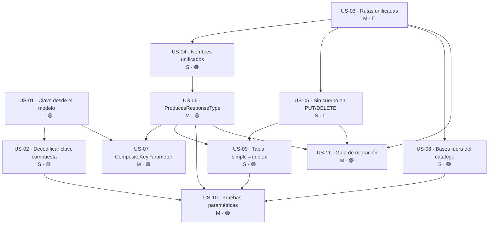

# Épica · Contrato REST en `MoralesLarios.OOFP.AspNetCore.Controllers`

> **Versión destino:** `2.1.0`
> **Origen:** puntos **43**, **48**, **49**, **50**, **51**, **52**, **60** y **61** de
> [`Temas Pendientes/Mejoras-Prioridad-Media.md`](../../Temas%20Pendientes/Mejoras-Prioridad-Media.md)
> (*"Rutas incoherentes entre verbos"*, *"Nombres de parámetro distintos entre simple y dúplex"*,
> *"PUT y DELETE con cuerpo"*, *"`[ApiController]` en la clase base"*, *"Sin `[ProducesResponseType]`"*,
> *"`Activator.CreateInstance` para descubrir la clave primaria"*, *"Clave compuesta sin decodificar"*,
> *"Atributo que nadie lee"*).
> **Plan del que se desgaja:** [`Temas Pendientes/Plan-Ejecucion-Prioridad-Media.md`](../../Temas%20Pendientes/Plan-Ejecucion-Prioridad-Media.md) · fase 3, tareas 3.1 a 3.6.
> **Estado:** ⬜ No iniciada
> **Esfuerzo estimado:** **XL** (~3-4 jornadas) · **Riesgo:** 🔴 Muy alto (**rompe URLs y clientes publicados**)

---

> ⚠️ **AVISO CENTRAL DE ESTA ÉPICA**
> Los ocho puntos tocan **las mismas 4 clases base**. No se pueden repartir entre versiones: hay que hacerlos
> **en un solo golpe** y publicarlos juntos. Publicar la mitad significa dos rupturas de URL seguidas en vez
> de una, que es el peor resultado posible para el consumidor.

---

## Índice

1. [Contexto y problema](#1-contexto-y-problema)
2. [Hallazgo colateral · la clave primaria se adivina instanciando la entidad](#2-hallazgo-colateral--la-clave-primaria-se-adivina-instanciando-la-entidad)
3. [Alcance](#3-alcance)
4. [Historias de usuario](#4-historias-de-usuario)
5. [Orden de ejecución y dependencias](#5-orden-de-ejecución-y-dependencias)
6. [Decisiones de diseño abiertas](#6-decisiones-de-diseño-abiertas)
7. [Definición de terminado (DoD)](#7-definición-de-terminado-dod)
8. [Apéndice · Ejemplos de código y explicación detallada](#8-apéndice--ejemplos-de-código-y-explicación-detallada)

---

## 1. Contexto y problema

`MoralesLarios.OOFP.AspNetCore.Controllers` ofrece **4 clases base** de controlador CRUD que el consumidor
hereda para obtener un recurso REST completo sin escribir código:

| Clase base | Fichero | Clave |
|---|---|---|
| `MlCrudControllerBase<TEntity, TDto, TPk>` | `Controllers/MlCrudControllerBase.cs` L15 | simple |
| `MlCrudControllerBase<TEntity, TRequest, TResponse, TPk>` | `Controllers/MlCrudControllerBase.cs` L156 | simple, dúplex |
| `MlCompositeKeyCrudControllerBase<TEntity, TDto>` | `Controllers/MlCompositeKeyCrudControllerBase.cs` | compuesta |
| `MlCompositeKeyCrudControllerBase<TEntity, TRequest, TResponse>` | `Controllers/MlCompositeKeyCrudControllerBase.cs` | compuesta, dúplex |

**El problema es que esas 4 clases no publican el mismo contrato.** Lo que una API expone al heredar depende
de qué base haya elegido, y las diferencias no son de diseño: son de descuido acumulado.

| Fichero | Líneas relevantes |
|---|---|
| `Controllers/MlCrudControllerBase.cs` | L13, L24, L38, L61, L75, L81, L95, L109, L128, L155, L167, L182, L219, L224, L239, L253, L272 |
| `Controllers/MlCompositeKeyCrudControllerBase.cs` | mismo patrón, claves compuestas |
| `Helpers/Extensions.cs` | L109-156 (`ParseKeyValues`), L119 (`Split(',')`), L143 (`Activator.CreateInstance`), L145 |
| `Attributes/CompositeKeyParameterAttribute.cs` | L12 (declaración), 12 usos, **0 lectores** |

La prueba más corta del problema cabe en cuatro atributos del mismo fichero:

```csharp
[HttpGet("id-str/{id}", Name = $"[controller]_[action]")]   // L38  ← prefijo "id-str/"
[HttpPut("{id}")]                                           // L75  ← SIN prefijo
[HttpDelete("{id}")]                                        // L109 ← SIN prefijo
[HttpPut]                                                   // L95  ← además, cuerpo sin clave en la ruta
```

**Para leer una factura hay que llamar a `GET /facturas/id-str/42`, pero para modificarla a
`PUT /facturas/42`.** No hay ninguna razón funcional para esa diferencia: es el resultado de haber añadido los
verbos en momentos distintos.

### Consecuencias

1. **El consumidor no puede deducir la URL: tiene que consultarla verbo a verbo.**
   La asimetría se propaga al cliente: `RestClientFp.cs` L51 construye `$"id-str/{idStr}"` para el GET y L89
   manda `idStr` crudo para el PUT. **El cliente de la biblioteca tiene codificada la incoherencia del
   servidor de la biblioteca.** Cualquiera que escriba un cliente distinto (JavaScript, Python, Postman) la
   descubrirá por ensayo y error.

2. **Hay un `DELETE` con cuerpo, y eso no sobrevive a la infraestructura real.**

   ```csharp
   [HttpDelete]                                             // L128
   public virtual async Task<IActionResult> DeleteAsync([FromBody] TDto dto, …)
   ```

   La RFC 9110 permite cuerpo en `DELETE` pero no le asigna semántica, y **los intermediarios lo descartan**:
   muchos proxies inversos, CDN y balanceadores eliminan el cuerpo de un `DELETE`, y algunos clientes HTTP
   (incluido `fetch` del navegador con ciertas configuraciones) ni lo envían. El resultado no es un error
   claro: es un `400` intermitente que sólo ocurre en producción, detrás del proxy, y nunca en desarrollo.

3. **OpenAPI no sabe qué devuelve ninguna acción.**
   Recuento en el proyecto: **0 `[ProducesResponseType]`** y **0 `[Produces]`**. Todas las acciones devuelven
   `Task<IActionResult>`. Consecuencia directa: el `swagger.json` declara `200: application/json` con esquema
   vacío para todo, y cualquier generador de clientes (NSwag, Kiota, `openapi-generator`) produce métodos que
   devuelven `object`. **La biblioteca cuyo propósito es generar APIs tipadas genera clientes sin tipos.**

4. **Hay un atributo que documenta algo y nadie lo lee.**
   `CompositeKeyParameterAttribute` está aplicado en **12 sitios** y la búsqueda de `IOperationFilter`,
   `ISchemaFilter` e `IDocumentFilter` en la solución da **0 resultados**. Es decoración inerte: el
   desarrollador que lo aplica cree estar documentando la forma de la clave compuesta en Swagger y no está
   documentando nada.

5. **Las clases base aparecen —o pueden aparecer— en el catálogo de endpoints.**
   `[ApiController]` está en la base (L13, L155). Las 4 bases ya son `abstract`, lo que en la práctica evita
   el registro, pero **nada lo verifica**: basta con que alguien quite el `abstract` de una base para que su
   `GET`, `PUT` y `DELETE` se publiquen sin entidad detrás. No hay ningún test que vigile el catálogo.

---

## 2. Hallazgo colateral · la clave primaria se adivina instanciando la entidad

> ⚠️ **Esto es el punto 43 y es, con diferencia, el defecto más grave de la épica: no es una incoherencia de
> contrato, es un fallo de corrección que se manifiesta en ejecución.**

`Helpers/Extensions.cs`, L137-156:

```csharp
public static object[] ParseKeyValues<TEntity>(string[] values, Func<TEntity, object[]> pkFields)
    where TEntity : class
{
    var sample  = Activator.CreateInstance<TEntity>();   // ← L143
    var sampleP = pkFields(sample);                      // todos serán default/null
    if (values.Length != sampleP.Length)
        throw new ArgumentException($"The number of provided values ({values.Length}) does not match the number of primary key fields ({sampleP.Length}).", nameof(values));   // L145
    var result = new object[values.Length];
    for (int i = 0; i < values.Length; i++)
    {
        var t = sampleP[i]?.GetType() ?? typeof(string);   // ← el tipo se saca del VALOR, no del MODELO
        result[i] = Convert.ChangeType(values[i], t, CultureInfo.InvariantCulture);
    }
    return result;
}
```

El mecanismo es: *instancio la entidad vacía, invoco el selector de claves, miro de qué tipo es cada valor
obtenido y convierto la cadena a ese tipo.* **Pero una entidad recién instanciada tiene todas sus propiedades
en su valor por defecto.** Y el valor por defecto de un tipo de referencia es `null`, cuyo `GetType()` no
existe — de ahí el `?? typeof(string)`.

Efectos:

| # | Efecto | Detalle |
|---|---|---|
| 1 | Toda clave `string?`, `Guid?` o `DateTime?` se trata como `string` | `sampleP[i]` es `null` → `?? typeof(string)` → `Convert.ChangeType(v, typeof(string))` no convierte nada |
| 2 | `Activator.CreateInstance<TEntity>()` exige constructor público sin parámetros | Una entidad con constructor privado (patrón habitual en DDD) o con parámetros **lanza `MissingMethodException`** en ejecución, no en compilación |
| 3 | Un `record` posicional sin constructor vacío falla igual | Es el caso más común en código moderno |
| 4 | El selector `pkFields` se ejecuta sobre un objeto no inicializado | Si accede a una propiedad calculada o navega una relación → `NullReferenceException` |
| 5 | Se paga una instanciación por reflexión en **cada petición** con clave | `Activator.CreateInstance<T>()` no está cacheado |
| 6 | **La fuente de verdad es el objeto, no el modelo** | EF Core **ya sabe** cuál es la clave primaria y de qué tipo es cada componente: `IEntityType.FindPrimaryKey()` |

Y encima, en L119, la cadena de clave compuesta se parte **sin decodificar**:

```csharp
var result = ParseKeyValues(ids.Split(','), pkFields);      // ← sin Uri.UnescapeDataString
```

Una clave compuesta cuyo primer componente contenga una coma codificada (`%2C`) se parte mal; una que
contenga un espacio codificado (`%20`) llega con el `%20` literal dentro del valor.

Por tanto **US-01 (clave primaria desde el modelo) es prerrequisito técnico de todo lo relativo a claves
compuestas**: no tiene sentido unificar rutas que luego interpretan mal sus propios parámetros.

---

## 3. Alcance

### Dentro del alcance

- Un **único patrón de ruta** para los 4 verbos, idéntico en las 4 clases base.
- **Nombres de parámetro unificados** entre la variante simple y la dúplex.
- Retirada (o marcado `[Obsolete]`) de las sobrecargas de `PUT` y `DELETE` que reciben el cuerpo sin clave en la ruta.
- `[Produces("application/json")]` y `[ProducesResponseType]` para 200/201/204/400/404/500 en las 4 bases.
- Cambio de `Task<IActionResult>` a `Task<ActionResult<TDto>>` donde el tipo de retorno sea conocido.
- Resolución de la clave primaria con `IEntityType.FindPrimaryKey()` **cacheado**, no con `Activator.CreateInstance`.
- Separador de clave compuesta documentado y `Uri.UnescapeDataString` aplicado.
- Decisión sobre `CompositeKeyParameterAttribute`: implementar el `IOperationFilter` **o** eliminarlo.
- `[ApiController]` fuera de las bases; test que verifica que las bases **no** aparecen en el catálogo de endpoints.
- Tabla de equivalencias simple↔dúplex en el README y prueba paramétrica de URLs.
- Guía de migración con la correspondencia URL vieja → URL nueva.

### Fuera del alcance

- Paginación en el `GET` de colección: es la [épica de servicio y paginación](Epica-Servicio-y-Paginacion.md) (punto 41).
- La forma de los errores que devuelven las acciones: es la [épica de serialización y errores HTTP](Epica-Serializacion-y-Errores-Http.md) (punto 46).
- Versionado de API (`Asp.Versioning`), autorización y `RateLimiting`.
- Reescribir `MoralesLarios.OOFP.Http` para que consuma las rutas nuevas: **se hace aquí lo imprescindible**
  (L51 y L89 de `RestClientFp.cs`), el resto es de la épica de serialización.

---

## 4. Historias de usuario

> **Leyenda de esfuerzo:** XS (<2 h) · S (½ jornada) · M (1 jornada) · L (2 jornadas) · XL (3+ jornadas)
> **Leyenda de riesgo:** 🟢 bajo · 🟡 medio · 🟠 alto · 🔴 muy alto (rompe compatibilidad)

### US-01 · Resolver la clave primaria desde el modelo, no instanciando la entidad

> **Como** desarrollador cuya entidad es un `record` posicional sin constructor vacío,
> **quiero** que la biblioteca descubra la clave primaria preguntándole a EF Core,
> **para** que mi controlador no lance `MissingMethodException` en la primera petición.

- **Esfuerzo:** L · **Riesgo:** 🟡 (cambia la conversión de tipos; puede aceptar claves que antes rechazaba y viceversa)
- **Depende de:** —
- **Prerrequisito de:** US-02, US-07
- **Proyecto afectado:** `MoralesLarios.OOFP.AspNetCore.Controllers`
- **Justificación:** punto 43. `Helpers/Extensions.cs` L143 `Activator.CreateInstance<TEntity>()`.

**Criterios de aceptación**

- [ ] La clave primaria y el tipo de cada componente se obtienen de `IEntityType.FindPrimaryKey()`.
- [ ] El resultado se **cachea** por tipo de entidad (`ConcurrentDictionary<Type, …>` o `IMemoryCache`, ver D-5).
- [ ] `Activator.CreateInstance<TEntity>()` desaparece del proyecto (`grep` → 0 resultados).
- [ ] Una entidad `record Pedido(int Id, string Codigo)` sin constructor vacío funciona.
- [ ] Una entidad con constructor privado funciona.
- [ ] Una clave `Guid` se convierte a `Guid`, no a `string`.
- [ ] Una clave `DateOnly` se convierte correctamente (`Convert.ChangeType` **no** la soporta: hace falta `TypeConverter` o `IParsable`).
- [ ] El orden de los componentes de la clave compuesta es el que declara el modelo, no el del selector `pkFields`.
- [ ] Si la entidad no está en el modelo, el error es claro y es un `MlResult` fallido, no una excepción.

**API propuesta**

```csharp
/// <summary>Describe la clave primaria de una entidad según el modelo de EF Core.</summary>
public sealed record MlPrimaryKeyInfo(string EntityName, IReadOnlyList<MlPrimaryKeyPart> Parts);

/// <summary>Un componente de la clave primaria: su nombre y su tipo según el modelo.</summary>
public sealed record MlPrimaryKeyPart(string Name, Type ClrType);

public interface IMlPrimaryKeyResolver
{
    /// <summary>Devuelve la clave primaria de <typeparamref name="TEntity"/>, cacheada por tipo.</summary>
    MlResult<MlPrimaryKeyInfo> Resolve<TEntity>() where TEntity : class;

    /// <summary>Convierte los componentes textuales de la ruta a los tipos del modelo.</summary>
    MlResult<object[]> ParseKey<TEntity>(string rawKey) where TEntity : class;
}
```

**⚠️ Riesgo principal**
`Convert.ChangeType` **no soporta** `Guid`, `DateOnly`, `TimeOnly` ni `enum` por nombre. Hoy eso no se nota
porque casi todo acaba tratado como `string`. Al resolver bien el tipo, esas conversiones pasarán por el camino
correcto y hay que implementarlas explícitamente (`TypeDescriptor.GetConverter` o `IParsable<T>.TryParse`).
**Es muy probable que aparezcan claves que hoy "funcionan" por accidente y que dejarán de hacerlo.**

---

### US-02 · Decodificar y separar bien la clave compuesta

> **Como** consumidor con una clave compuesta cuyo componente contiene una coma o un espacio,
> **quiero** que la biblioteca decodifique la URL antes de partirla,
> **para** que mi clave llegue íntegra al repositorio.

- **Esfuerzo:** S · **Riesgo:** 🟡 (cambia la interpretación de claves ya en uso)
- **Depende de:** US-01
- **Proyecto afectado:** `MoralesLarios.OOFP.AspNetCore.Controllers`
- **Justificación:** punto 60. `Helpers/Extensions.cs` L119 `ids.Split(',')` sin decodificar. L145 ya valida
  el número de componentes (parte 🟨 del punto).

**Criterios de aceptación**

- [ ] El separador de clave compuesta es una **constante pública documentada** (ver D-4).
- [ ] Cada componente pasa por `Uri.UnescapeDataString` **después** de partir, nunca antes.
- [ ] Una clave `ACME%2CSL,42` se interpreta como dos componentes: `ACME,SL` y `42`.
- [ ] Un número de componentes distinto del esperado produce un `400` con mensaje claro (ya lo hace L145: conservarlo).
- [ ] El cliente (`MoralesLarios.OOFP.Http`) codifica con el mismo criterio con el que el servidor decodifica.
- [ ] Hay un test paramétrico con, al menos: valor con coma, con espacio, con `/`, con `+`, con acento y vacío.

**Notas técnicas**
Decodificar **antes** de partir es el error clásico: `Uri.UnescapeDataString("ACME%2CSL,42")` devuelve
`"ACME,SL,42"`, que ya no se puede partir. El orden correcto es: partir por el separador → decodificar cada
trozo.

---

### US-03 · Una sola forma de ruta para los cuatro verbos

> **Como** consumidor que escribe un cliente a mano,
> **quiero** que la URL de un recurso sea la misma independientemente del verbo,
> **para** poder deducirla en lugar de consultarla acción por acción.

- **Esfuerzo:** M · **Riesgo:** 🔴 (**rompe todas las URLs publicadas**)
- **Depende de:** —
- **Prerrequisito de:** US-04, US-10, US-11
- **Proyectos afectados:** `MoralesLarios.OOFP.AspNetCore.Controllers`, `MoralesLarios.OOFP.Http`
- **Justificación:** puntos 49 y 48. `[HttpGet("id-str/{id}")]` (L38, L182) frente a `[HttpPut("{id}")]`
  (L75, L219) y `[HttpDelete("{id}")]` (L110, L253).

**Criterios de aceptación**

- [ ] Las 4 clases base usan **el mismo** patrón de ruta para `GET` por clave, `PUT` y `DELETE`.
- [ ] El patrón elegido está documentado y justificado (ver D-1).
- [ ] La variante dúplex usa exactamente las mismas rutas que la simple.
- [ ] `RestClientFp.cs` L51 y L89 se alinean con el patrón nuevo.
- [ ] Ningún atributo de ruta queda sin su equivalente en la tabla de migración de US-11.
- [ ] El nombre de ruta (`Name = $"[controller]_[action]"`) sigue generándose igual o se documenta su cambio.

**Tests mínimos**

| Escenario | Resultado esperado |
|---|---|
| `GET /facturas/42` | 200 con la factura |
| `GET /facturas/id-str/42` | **404** (o 301 si se decide redirigir, ver D-2) |
| `PUT /facturas/42` | 204 |
| `DELETE /facturas/42` | 204 |
| `GET /pedidos/ACME,42` (clave compuesta) | 200 |
| Las 4 rutas, en las 4 bases | mismo patrón, verificado por reflexión |

**⚠️ Riesgo principal**
Esta es **la** ruptura de la épica. Cualquier consumidor con un cliente en producción deja de funcionar al
actualizar. No hay forma de que el compilador lo detecte: el fallo es un `404` en ejecución. La única
mitigación real es la guía de US-11 y, opcionalmente, un periodo de rutas duplicadas (ver D-2).

---

### US-04 · Un solo nombre para el mismo parámetro

> **Como** consumidor que lee el `swagger.json` o usa un generador de clientes,
> **quiero** que el parámetro de cuerpo se llame igual en la variante simple y en la dúplex,
> **para** que el cliente generado no cambie de nombre según la base que haya elegido el servidor.

- **Esfuerzo:** S · **Riesgo:** 🟠 (cambia los nombres en el contrato OpenAPI y en los clientes generados)
- **Depende de:** US-03
- **Proyecto afectado:** `MoralesLarios.OOFP.AspNetCore.Controllers`
- **Justificación:** punto 48. `MlCrudControllerBase.cs` L81 usa `dto:` y L224 usa `dtoRequest:`.

**Criterios de aceptación**

- [ ] El parámetro de cuerpo se llama igual en las 4 bases (ver D-3).
- [ ] El parámetro de clave se llama igual en las 4 bases.
- [ ] Un test por reflexión compara los nombres de parámetro de las acciones homólogas de las 4 bases.
- [ ] La tabla de equivalencias simple↔dúplex del README refleja los nombres finales.

---

### US-05 · Retirar `PUT` y `DELETE` con el cuerpo como portador de la clave

> **Como** operador que despliega detrás de un proxy inverso,
> **quiero** que la clave viaje siempre en la ruta,
> **para** que las operaciones no fallen de forma intermitente cuando el intermediario descarta el cuerpo.

- **Esfuerzo:** S · **Riesgo:** 🔴 (**rompe clientes que hoy usan esas sobrecargas**)
- **Depende de:** US-03
- **Prerrequisito de:** US-11
- **Proyecto afectado:** `MoralesLarios.OOFP.AspNetCore.Controllers`
- **Justificación:** punto 50. Sobrecargas de L95, L128, L239 y L272.

**Criterios de aceptación**

- [ ] Las 4 sobrecargas quedan retiradas o marcadas `[Obsolete]` + `[ApiExplorerSettings(IgnoreApi = true)]` (ver D-6).
- [ ] Toda operación sobre un recurso concreto tiene la clave en la ruta.
- [ ] Si se conservan marcadas, **no aparecen en OpenAPI**.
- [ ] La guía de migración indica, para cada una, la llamada equivalente.
- [ ] Un test comprueba que `DELETE` sin clave en la ruta devuelve `405` o `404`, nunca `200`.

**Notas técnicas**
El matiz del punto 50 es importante: estas sobrecargas **no reciben "una clave suelta"**, reciben el **DTO
completo** en `[FromBody]`, y de él se extrae la clave. Para `PUT` eso es casi defendible (el cuerpo ya lleva
el recurso completo); **para `DELETE` no lo es en absoluto**, porque no hay nada que enviar más que la clave.
La recomendación es asimétrica: retirar los dos `DELETE` sin excusa, y dar un ciclo de margen a los dos `PUT`.

---

### US-06 · Que OpenAPI diga qué devuelve cada acción

> **Como** consumidor que genera un cliente con NSwag o Kiota,
> **quiero** que el `swagger.json` declare el tipo y los códigos de respuesta de cada acción,
> **para** obtener un cliente tipado en lugar de métodos que devuelven `object`.

- **Esfuerzo:** M · **Riesgo:** 🟡 (mejora el contrato; cambia los clientes generados)
- **Depende de:** US-03, US-04
- **Prerrequisito de:** US-10
- **Proyecto afectado:** `MoralesLarios.OOFP.AspNetCore.Controllers`
- **Justificación:** punto 52. **0 `[ProducesResponseType]`** y **0 `[Produces]`** en el proyecto.

**Criterios de aceptación**

- [ ] `[Produces("application/json")]` en las 4 clases base.
- [ ] `[ProducesResponseType]` con el tipo correcto para 200, 201, 204, 400, 404 y 500 en cada acción.
- [ ] Los códigos de error declaran `ProblemDetails` (la biblioteca ya devuelve `MlProblemDetails`).
- [ ] Las acciones con tipo de retorno conocido pasan a `Task<ActionResult<TDto>>` / `Task<ActionResult<TResponse>>`.
- [ ] Las acciones sin cuerpo de respuesta (`PUT`, `DELETE`) siguen devolviendo `Task<IActionResult>` y declaran 204.
- [ ] El `swagger.json` generado no contiene ningún esquema vacío para las acciones de las bases.
- [ ] Un test de contrato compara el `swagger.json` generado con uno aprobado (*snapshot*).

**API propuesta**

```csharp
[Produces(MediaTypeNames.Application.Json)]
public abstract class MlCrudControllerBase<TEntity, TDto, TPk>(ICrudServiceFp<TEntity, TDto> _genServiceFp)
    : ControllerBase
    where TEntity : class
    where TDto    : class
{
    [HttpGet("{id}", Name = "[controller]_[action]")]
    [ProducesResponseType<TDto>(StatusCodes.Status200OK)]
    [ProducesResponseType<ProblemDetails>(StatusCodes.Status400BadRequest)]
    [ProducesResponseType<ProblemDetails>(StatusCodes.Status404NotFound)]
    [ProducesResponseType<ProblemDetails>(StatusCodes.Status500InternalServerError)]
    public virtual async Task<ActionResult<TDto>> GetByIdAsync(string id, CancellationToken ct = default!)
    { … }
}
```

**Notas técnicas**
`[ProducesResponseType<T>]` genérico existe desde .NET 7 y acepta parámetros de tipo genéricos de la clase
contenedora, por lo que `[ProducesResponseType<TDto>(200)]` compila en una base genérica. Ésa es la razón por
la que el punto 52 es viable sin duplicar las 4 bases.

---

### US-07 · Decidir qué hacer con el atributo que nadie lee

> **Como** desarrollador que aplica `[CompositeKeyParameter]` creyendo que documenta Swagger,
> **quiero** que el atributo haga lo que promete o que no exista,
> **para** no decorar código con algo inerte.

- **Esfuerzo:** M · **Riesgo:** 🟡 (si se elimina, rompe compilación de quien lo use)
- **Depende de:** US-01, US-06
- **Proyecto afectado:** `MoralesLarios.OOFP.AspNetCore.Controllers`
- **Justificación:** punto 61. `CompositeKeyParameterAttribute` (L12), **12 usos**, 0 lectores. Búsqueda de
  `IOperationFilter` / `ISchemaFilter` / `IDocumentFilter`: **0 resultados**.

**Criterios de aceptación**

- [ ] Decisión tomada y documentada (ver D-7).
- [ ] **Si se implementa:** existe un `IOperationFilter` registrado que, para cada parámetro con el atributo,
      escribe en OpenAPI el separador, el número de componentes, el nombre y el tipo de cada uno, y un ejemplo.
- [ ] **Si se implementa:** la información sale de `IMlPrimaryKeyResolver` (US-01), no del atributo, para que
      no pueda desincronizarse del modelo.
- [ ] **Si se elimina:** los 12 usos desaparecen y el tipo se marca `[Obsolete]` un ciclo antes de borrarse.
- [ ] Un test comprueba el resultado elegido (presencia del `description` en el `swagger.json`, o ausencia del tipo).

**API propuesta (si se implementa)**

```csharp
internal sealed class CompositeKeyOperationFilter(IMlPrimaryKeyResolver _resolver) : IOperationFilter
{
    public void Apply(OpenApiOperation operation, OperationFilterContext context)
    {
        foreach (var parameter in context.ApiDescription.ParameterDescriptions)
        {
            var attribute = parameter.ParameterDescriptor
                                     .ParameterType.GetCustomAttribute<CompositeKeyParameterAttribute>();
            if (attribute is null) continue;

            var info = _resolver.Resolve(context.MethodInfo.DeclaringType!.GetGenericArguments()[0]);
            if (info.IsFail) continue;

            var target = operation.Parameters.FirstOrDefault(p => p.Name == parameter.Name);
            if (target is null) continue;

            var parts = info.SecureValidValue().Parts;
            target.Description = $"Clave compuesta de {parts.Count} componentes separados por "
                               + $"'{MlCompositeKey.Separator}': "
                               + string.Join(", ", parts.Select(p => $"{p.Name} ({p.ClrType.Name})"));
            target.Example     = new OpenApiString(string.Join(MlCompositeKey.Separator,
                                                              parts.Select(p => SampleFor(p.ClrType))));
        }
    }
}
```

---

### US-08 · Que las clases base no puedan publicarse como endpoints

> **Como** mantenedor,
> **quiero** una garantía automática de que las clases base nunca aparecen en el catálogo de endpoints,
> **para** que un `abstract` eliminado por descuido no publique una API sin entidad detrás.

- **Esfuerzo:** S · **Riesgo:** 🟢 (bajo)
- **Depende de:** US-03
- **Proyecto afectado:** `MoralesLarios.OOFP.AspNetCore.Controllers`
- **Justificación:** punto 51. `[ApiController]` está en la base (L13, L155); las 4 bases ya son `abstract`
  (parte 🟨); **falta el test de catálogo**.

**Criterios de aceptación**

- [ ] `[ApiController]` deja de estar en las clases base (pasa a documentarse como responsabilidad del derivado, ver D-8).
- [ ] Las 4 bases siguen siendo `abstract`.
- [ ] Ninguna base declara `[Route]` (hoy ya es así: verificar que sigue siéndolo).
- [ ] Existe un test que arranca un `WebApplicationFactory`, consulta
      `IActionDescriptorCollectionProvider.ActionDescriptors` y comprueba que **ninguna** acción pertenece a
      una de las 4 clases base.
- [ ] El test falla si alguien quita el `abstract` de cualquiera de las 4.

**API propuesta**

```csharp
[Fact]
public void BaseControllers_AreNotRegisteredAsEndpoints()
{
    using var factory  = new WebApplicationFactory<Program>();
    var provider       = factory.Services.GetRequiredService<IActionDescriptorCollectionProvider>();

    var basesPublicadas = provider.ActionDescriptors.Items
        .OfType<ControllerActionDescriptor>()
        .Where(d => d.ControllerTypeInfo.IsGenericType
                 && TiposBase.Contains(d.ControllerTypeInfo.GetGenericTypeDefinition()))
        .Select(d => $"{d.ControllerTypeInfo.Name}.{d.ActionName}")
        .ToArray();

    basesPublicadas.Should().BeEmpty();
}

private static readonly Type[] TiposBase =
[
    typeof(MlCrudControllerBase<,,>),
    typeof(MlCrudControllerBase<,,,>),
    typeof(MlCompositeKeyCrudControllerBase<,>),
    typeof(MlCompositeKeyCrudControllerBase<,,>),
];
```

---

### US-09 · Tabla de equivalencias simple↔dúplex

> **Como** desarrollador que debe elegir entre la base simple y la dúplex,
> **quiero** una tabla que me diga qué acción de una corresponde a qué acción de la otra,
> **para** poder cambiar de variante sin releer el código fuente.

- **Esfuerzo:** S · **Riesgo:** 🟢 (documental)
- **Depende de:** US-03, US-04, US-05, US-06
- **Justificación:** entregable explícito de la fase 3 del plan de ejecución.

**Criterios de aceptación**

- [ ] Tabla en el README con: verbo, ruta, parámetros, tipo de petición, tipo de respuesta y códigos, para
      las 4 bases en paralelo.
- [ ] Toda celda distinta entre simple y dúplex lleva una justificación.
- [ ] La tabla se genera o se verifica con el test de US-10 (no se mantiene a mano).

---

### US-10 · Prueba paramétrica de URLs y catálogo

> **Como** mantenedor,
> **quiero** una batería que recorra las 4 bases y verifique verbo, ruta, nombres de parámetro y atributos
> de respuesta,
> **para** que la próxima asimetría falle en integración continua y no en la API de un consumidor.

- **Esfuerzo:** M · **Riesgo:** 🟢 (bajo)
- **Depende de:** US-03, US-04, US-05, US-06, US-08
- **Justificación:** entregable explícito de la fase 3 del plan de ejecución.

**Criterios de aceptación**

- [ ] Test por reflexión: para cada par de bases homólogas, las acciones tienen el mismo verbo y la misma plantilla de ruta.
- [ ] Test por reflexión: los nombres de parámetro coinciden entre simple y dúplex.
- [ ] Test por reflexión: toda acción pública tiene al menos un `[ProducesResponseType]`.
- [ ] Test de integración con `WebApplicationFactory` y un controlador derivado real para los 4 verbos.
- [ ] Test paramétrico de clave compuesta con los 6 casos de US-02.
- [ ] Los **1.027 tests** existentes siguen en verde.

---

### US-11 · Guía de migración de URLs

> **Como** consumidor con una API publicada sobre la `2.0.0`,
> **quiero** la correspondencia exacta entre mis URLs actuales y las nuevas,
> **para** actualizar mis clientes antes de desplegar en lugar de descubrirlo con un `404`.

- **Esfuerzo:** M · **Riesgo:** 🟢 (documental, pero es la única mitigación real de US-03 y US-05)
- **Depende de:** US-03, US-05, US-06
- **Justificación:** US-03 y US-05 son rupturas **que el compilador no detecta**.

**Criterios de aceptación**

- [ ] Tabla `URL 2.0.0 → URL 2.1.0` para los 4 verbos y las 2 formas de clave.
- [ ] Sección específica para las sobrecargas con cuerpo retiradas, con la llamada equivalente.
- [ ] Aviso destacado de que es una ruptura silenciosa en ejecución.
- [ ] Documentada la política de rutas duplicadas, si se adopta (D-2), con su fecha de retirada.
- [ ] Documentación XML generada con **MlDoc** y `CS1591 = 0`.

---

## 5. Orden de ejecución y dependencias



### Secuencia recomendada

| Orden | Historia | Esfuerzo | Hito |
|---:|---|---|---|
| 1 | US-01 · Clave primaria desde el modelo | L | 🎯 Las entidades `record` dejan de reventar |
| 2 | US-02 · Decodificar la clave compuesta | S | |
| 3 | US-03 · Un solo patrón de ruta | M | ⚠️ Punto de no retorno: a partir de aquí hay ruptura |
| 4 | US-04 · Nombres de parámetro unificados | S | |
| 5 | US-05 · Retirar cuerpo en `PUT`/`DELETE` | S | |
| 6 | US-06 · `[ProducesResponseType]` y `ActionResult<T>` | M | 🎯 Los clientes generados pasan a estar tipados |
| 7 | US-07 · `CompositeKeyParameterAttribute` | M | |
| 8 | US-08 · Bases fuera del catálogo | S | |
| 9 | US-09 · Tabla de equivalencias | S | |
| 10 | US-10 · Pruebas paramétricas | M | 🎯 La asimetría no puede volver |
| 11 | US-11 · Guía de migración | M | Entregable publicable |

**Total: ~3-4 jornadas.**

> 💡 **Entrega incremental sugerida**
> - **`2.0.x`:** US-01 → US-02 solas. Son corrección de un fallo de ejecución, **no rompen URLs** y el
>   consumidor gana que sus entidades `record` funcionen. Es el único trozo publicable por separado.
> - **`2.1.0`:** US-03 → US-11, **todo junto y en el mismo paquete**. La ruptura de contrato se paga una sola
>   vez, con guía y con el catálogo OpenAPI ya correcto.
>
> ⚠️ **Lo que NO se puede hacer:** publicar US-03 sin US-06, ni US-05 sin US-11. Serían dos rupturas
> consecutivas y una ruptura sin documentación, respectivamente.

---

## 6. Decisiones de diseño abiertas

| Id | Decisión | Opciones | Recomendación |
|---|---|---|---|
| D-1 | ¿Qué patrón de ruta se elige? | (a) `{id}` para todos (eliminar `id-str/`) · (b) `id-str/{id}` para todos · (c) `{id}` para clave simple y `key/{ids}` para compuesta | **(a)**: es la convención REST universal, la más corta y la que esperan los generadores de clientes. `id-str/` sólo existe por un accidente histórico |
| D-2 | ¿Se mantienen las rutas antiguas un ciclo? | (a) no, ruptura limpia · (b) sí, duplicadas y marcadas `[ApiExplorerSettings(IgnoreApi = true)]` hasta `3.0.0` · (c) sí, con `301` a la nueva | **(b)**: duplicar el atributo de ruta cuesta una línea, no aparece en OpenAPI y da un ciclo completo de margen. La opción (c) es incorrecta: `301` no preserva el verbo en todos los clientes |
| D-3 | ¿Cómo se llama el parámetro de cuerpo? | (a) `dto` en las 4 (lo de la simple) · (b) `dtoRequest` en las 4 (lo de la dúplex) · (c) `request` / `body`, neutro | **(c) `request`**: `dto` no dice nada del sentido, `dtoRequest` mezcla dos conceptos. `request` es el término del dominio HTTP y es el que usan los generadores |
| D-4 | ¿Cuál es el separador de clave compuesta? | (a) `,` (lo actual) · (b) `/` con ruta `{*ids}` · (c) `--` o `~`, poco probable en datos | **(a) documentado como constante**, con `Uri.EscapeDataString` obligatorio en el cliente. Cambiarlo añadiría una ruptura más a una épica que ya tiene dos |
| D-5 | ¿Dónde se cachea la clave primaria? | (a) `ConcurrentDictionary<Type, MlPrimaryKeyInfo>` estático · (b) `IMemoryCache` inyectado · (c) `Lazy<T>` por tipo genérico cerrado | **(a)**: el modelo de EF Core no cambia en ejecución; un diccionario estático es lo más simple y no añade dependencia. Ojo con las pruebas que usan varios modelos: la clave del diccionario debe incluir el tipo de `DbContext` |
| D-6 | ¿Las sobrecargas con cuerpo se eliminan o se marcan? | (a) eliminar las 4 · (b) marcar las 4 `[Obsolete]` un ciclo · (c) eliminar los 2 `DELETE`, marcar los 2 `PUT` | **(c)**: el `DELETE` con cuerpo no tiene defensa posible y su uso es residual; el `PUT` con el recurso completo en el cuerpo es un patrón con cierto sentido y merece un ciclo de aviso |
| D-7 | ¿Se implementa o se elimina `CompositeKeyParameterAttribute`? | (a) implementar el `IOperationFilter` · (b) eliminar el atributo y sus 12 usos · (c) implementarlo generando la info desde el modelo, sin datos en el atributo | **(c)**: documentar la clave compuesta en OpenAPI tiene valor real, pero los datos deben venir de `IMlPrimaryKeyResolver` (US-01). Un atributo con datos duplicados del modelo se desincroniza el primer día |
| D-8 | ¿Dónde va `[ApiController]`? | (a) en la base (actual) · (b) en el derivado, documentado · (c) en un `ApplicationModelConvention` que lo aplique a los derivados | **(b)**: es explícito, es lo que hace la plantilla de ASP.NET Core y deja al derivado el control sobre el comportamiento de validación automática de `ModelState` |
| D-9 | ¿La fase 3 entra en `2.1.0` o se posterga a `3.0.0`? | (a) `2.1.0` con guía · (b) `3.0.0` · (c) US-01/US-02 en `2.0.x` y el resto en `3.0.0` | **(c)**: por semántica de versiones, romper URLs publicadas es un cambio mayor. Esta es la **decisión de mayor impacto del documento** y requiere confirmación explícita |

---

## 7. Definición de terminado (DoD)

- [ ] La solución compila en `Release --no-incremental` con **0 errores y `CS1591 = 0`**.
- [ ] Los **1.027 tests** existentes siguen en verde.
- [ ] `grep` de `Activator.CreateInstance` en `AspNetCore.Controllers`: **0 resultados**.
- [ ] `grep` de `id-str` en toda la solución: **0 resultados** (o sólo en las rutas de compatibilidad de D-2).
- [ ] `grep` de `dtoRequest` en `AspNetCore.Controllers`: **0 resultados**.
- [ ] Toda acción pública de las 4 bases tiene `[ProducesResponseType]` para al menos 200/204, 400, 404 y 500.
- [ ] El test de catálogo de endpoints está en verde y falla si se quita un `abstract`.
- [ ] El `swagger.json` de la aplicación de muestra no contiene ningún esquema vacío.
- [ ] Tabla de equivalencias simple↔dúplex publicada en el README y verificada por test.
- [ ] Guía de migración de URLs publicada, con la tabla antes/después completa.
- [ ] Las 9 decisiones (D-1 … D-9) cerradas y anotadas en este documento, **con D-9 confirmada por el responsable del producto**.
- [ ] Documentación XML generada con **MlDoc** para todos los miembros públicos nuevos.
- [ ] Los puntos **43**, **48**, **49**, **50**, **51**, **52**, **60** y **61** marcados como resueltos en
      `Mejoras-Prioridad-Media.md`, con fichero y línea de la solución.

---

## 8. Apéndice · Ejemplos de código y explicación detallada

> Este apéndice contiene **el código real de hoy** (con fichero y línea) y **el código propuesto**
> para cada historia. Todo el código "después" es *ilustrativo*: fija la intención y el contrato, no
> la implementación definitiva.

### Índice del apéndice

- [8.1 · El contrato que publica hoy un controlador heredado](#81--el-contrato-que-publica-hoy-un-controlador-heredado)
- [8.2 · US-01 · La clave primaria, del `Activator` al modelo](#82--us-01--la-clave-primaria-del-activator-al-modelo)
- [8.3 · US-02 · Partir y decodificar, en ese orden](#83--us-02--partir-y-decodificar-en-ese-orden)
- [8.4 · US-03 y US-04 · Un solo patrón, un solo nombre](#84--us-03-y-us-04--un-solo-patrón-un-solo-nombre)
- [8.5 · US-05 · El `DELETE` con cuerpo, visto desde el proxy](#85--us-05--el-delete-con-cuerpo-visto-desde-el-proxy)
- [8.6 · US-06 · De `IActionResult` a un contrato tipado](#86--us-06--de-iactionresult-a-un-contrato-tipado)
- [8.7 · US-07 · El atributo inerte](#87--us-07--el-atributo-inerte)
- [8.8 · US-08 · El test de catálogo de endpoints](#88--us-08--el-test-de-catálogo-de-endpoints)
- [8.9 · US-09 · La tabla de equivalencias](#89--us-09--la-tabla-de-equivalencias)
- [8.10 · US-11 · Antes y después para el consumidor](#810--us-11--antes-y-después-para-el-consumidor)
- [8.11 · US-10 · Tests propuestos](#811--us-10--tests-propuestos)

---

### 8.1 · El contrato que publica hoy un controlador heredado

**Hoy — `Controllers/MlCrudControllerBase.cs`, L13-137 (variante simple):**

```csharp
[ApiController]                                                       // L13  ← en la BASE (punto 51)
public abstract class MlCrudControllerBase<TEntity, TDto, TPk>(ICrudServiceFp<TEntity, TDto> _genServiceFp) : ControllerBase
    where TEntity : class
    where TDto    : class
{
    [HttpGet]                                                         // L24  ← sin paginación (punto 41)
    public virtual async Task<IActionResult> GetAllAsync(CancellationToken ct = default!)
    {
        var result = await _genServiceFp.GetPagedAsync(ct: ct).ToOkProblemDetailsResultAsync();
        return result;
    }

    [HttpGet("id-str/{id}", Name = $"[controller]_[action]")]          // L38  ← ruta "id-str/{id}" (punto 49)
    public virtual async Task<IActionResult> GetByIdAsync(string id, CancellationToken ct = default!)
    {
        var result = await EnsureFp.NotNullAsync(id, $"{nameof(id)} must not be null")
            .TryMapAsync( _ => id.ConvertToType(typeof(TPk)), ex => $"{nameof(id)} can't be converted to {typeof(TPk).Name}. ex: {ex.Message}")
            .MatchAsync(
                fail      : _     => MlResults.NotFound(detail: $"Path {id} not exists or is of a different type than PK of '{typeof(TPk).Name}' was not found."),
                validAsync: idObj => _genServiceFp.FindByIdProblemsDetailsAsync(
                                        notFoundErrorDetails: MlProblemDetails.NotFoundError(), ct: ct, pk: idObj)
                                     .ToOkProblemDetailsResultAsync());
        return result;
    }

    [HttpPost]                                                        // L61
    [HttpPut("{id}")]                                                 // L75  ← "{id}" SIN "id-str/"; usa dto: (L81)
    [HttpPut]                                                         // L95  ← sobrecarga con DTO en el cuerpo (punto 50)
    [HttpDelete("{id}")]                                              // L109
    [HttpDelete]                                                      // L128 ← DELETE con CUERPO (punto 50)
}
```

Y la variante dúplex, a partir de L139:

```csharp
/*********************************************************************************
 *                                      DUPLEX
 * ********************************************************************************/    // L139-145
[ApiController]                                                                 // L155
public abstract class MlCrudControllerBase<TEntity, TRequest, TResponse, TPk>(ICrudServiceFp<TEntity, TRequest, TResponse> _genServiceFp) : ControllerBase
// [HttpGet] L167 · [HttpGet("id-str/{id}")] L182 · [HttpPut("{id}")] L219 · [HttpPut] L239 · [HttpDelete("{id}")] L253 · [HttpDelete] L272
// usa dtoRequest: (asimetría del punto 48 frente a dto: de L81)
```

**Esto es lo que publica, literalmente, un `FacturasController : MlCrudControllerBase<Factura, FacturaDto, int>`:**

| Verbo | Ruta publicada | Parámetro de cuerpo | Tipo declarado en OpenAPI |
|---|---|---|---|
| `GET` | `/facturas` | — | *(ninguno: `IActionResult`)* |
| `GET` | `/facturas/id-str/{id}` | — | *(ninguno)* |
| `POST` | `/facturas` | `dto` | *(ninguno)* |
| `PUT` | `/facturas/{id}` | `dto` | *(ninguno)* |
| `PUT` | `/facturas` | `dto` ← **lleva la clave dentro** | *(ninguno)* |
| `DELETE` | `/facturas/{id}` | — | *(ninguno)* |
| `DELETE` | `/facturas` | `dto` ← **cuerpo en un DELETE** | *(ninguno)* |

Y lo que publica un `PedidosController : MlCrudControllerBase<Pedido, PedidoRequest, PedidoResponse, int>`:
**las mismas rutas, pero el parámetro de cuerpo se llama `dtoRequest`.**

> **Regla general que esto incumple:** *dos clases base que resuelven el mismo problema deben publicar el
> mismo contrato; si difieren, la diferencia debe ser una decisión documentada, no un residuo.*

---

### 8.2 · US-01 · La clave primaria, del `Activator` al modelo

**Hoy — `Helpers/Extensions.cs`, L109-156:**

```csharp
public static object[] ParseKeyValues<TEntity>(this string ids, Func<TEntity, object[]> pkFields)
    where TEntity : class
{
    var result = ParseKeyValues(ids.Split(','), pkFields);      // L119 ← Split(',') sin Uri.UnescapeDataString
    return result;
}

public static string BuildKeyParseErrorMessage(this Exception ex, string ids)
    => $"{ids} not be extract values of pkFields. Ids string array not converted to pkFields. ex: {ex.Message}";

public static object[] ParseKeyValues<TEntity>(string[] values, Func<TEntity, object[]> pkFields)
    where TEntity : class
{
    var sample  = Activator.CreateInstance<TEntity>();   // ← L143
    var sampleP = pkFields(sample);                      // todos serán default/null
    if (values.Length != sampleP.Length)
        throw new ArgumentException($"The number of provided values ({values.Length}) does not match the number of primary key fields ({sampleP.Length}).", nameof(values));   // L145
    var result = new object[values.Length];
    for (int i = 0; i < values.Length; i++)
    {
        var t = sampleP[i]?.GetType() ?? typeof(string);
        result[i] = Convert.ChangeType(values[i], t, CultureInfo.InvariantCulture);
    }
    return result;
}
```

Traza con una entidad moderna:

```text
Entidad:  public record Pedido(int Id, string Codigo);     // sin constructor sin parámetros
Petición: GET /pedidos/42,ACME

1. ParseKeyValues("42,ACME", p => [p.Id, p.Codigo])
2. ids.Split(',')              → ["42", "ACME"]
3. Activator.CreateInstance<Pedido>()
     → MissingMethodException: No parameterless constructor defined for type 'Pedido'.
       ← LA PETICIÓN MUERE AQUÍ, en producción, con un 500
```

Y con una entidad que sí tiene constructor vacío:

```text
Entidad:  public class Pedido { public int Id { get; set; } public string Codigo { get; set; } = ""; }

3. Activator.CreateInstance<Pedido>()  → Pedido { Id = 0, Codigo = "" }
4. pkFields(sample)                    → [0, ""]
5. sampleP[0].GetType()                → Int32   ✔ (por casualidad: 0 es un int)
   sampleP[1].GetType()                → String  ✔ (por casualidad: "" es un string)
6. Convert.ChangeType("42", typeof(Int32))  → 42   ✔
```

**Funciona por accidente: porque el valor por defecto de `int` conserva el tipo.** Con `Guid Id`:

```text
4. pkFields(sample)       → [Guid.Empty, ""]
5. Guid.Empty.GetType()   → Guid
6. Convert.ChangeType("3fa85f64-...", typeof(Guid))
     → InvalidCastException: Invalid cast from 'System.String' to 'System.Guid'.
       ← Convert.ChangeType NO soporta Guid
```

Y con `string? Codigo`:

```text
4. pkFields(sample)       → [0, null]
5. null?.GetType()        → null  → ?? typeof(string)
6. Convert.ChangeType("ACME", typeof(string))  → "ACME"   ✔ (por el fallback, no por el modelo)
```

| Tipo de clave | Hoy | Por qué |
|---|---|---|
| `int` | ✔ | El default `0` conserva el tipo |
| `long`, `short` | ✔ | Igual |
| `string` no nulo | ✔ | El default `""` conserva el tipo |
| `string?` nulo | ✔ por el `?? typeof(string)` | No por el modelo |
| `Guid` | ✘ `InvalidCastException` | `Convert.ChangeType` no la soporta |
| `DateOnly` / `TimeOnly` | ✘ | Idem |
| `enum` por nombre | ✘ | Idem |
| Entidad sin constructor vacío | ✘ `MissingMethodException` | `Activator.CreateInstance<T>()` |
| Entidad con constructor privado | ✘ | Idem |
| `pkFields` con propiedad calculada | ✘ `NullReferenceException` | El objeto no está inicializado |

**Después — preguntarle al modelo, que es quien lo sabe:**

```csharp
public sealed record MlPrimaryKeyPart(string Name, Type ClrType);
public sealed record MlPrimaryKeyInfo(string EntityName, IReadOnlyList<MlPrimaryKeyPart> Parts);

internal sealed class MlPrimaryKeyResolver(IModel _model) : IMlPrimaryKeyResolver
{
    private static readonly ConcurrentDictionary<(Type Model, Type Entity), MlPrimaryKeyInfo> Cache = new();

    public MlResult<MlPrimaryKeyInfo> Resolve<TEntity>() where TEntity : class
        => Resolve(typeof(TEntity));

    public MlResult<MlPrimaryKeyInfo> Resolve(Type entityType)
    {
        if (Cache.TryGetValue((_model.GetType(), entityType), out var cached))
            return cached.ToMlResultValid();

        var efType = _model.FindEntityType(entityType);
        if (efType is null)
            return $"Entity '{entityType.Name}' is not part of the EF Core model.".ToMlResultFail<MlPrimaryKeyInfo>();

        var key = efType.FindPrimaryKey();
        if (key is null)
            return $"Entity '{entityType.Name}' has no primary key defined.".ToMlResultFail<MlPrimaryKeyInfo>();

        var info = new MlPrimaryKeyInfo(
            efType.DisplayName(),
            [.. key.Properties.Select(p => new MlPrimaryKeyPart(p.Name, p.ClrType))]);   // ← ORDEN del modelo

        Cache[(_model.GetType(), entityType)] = info;                                     // ← cacheado
        return info.ToMlResultValid();
    }
}
```

**Lectura clave de este bloque.** `key.Properties` devuelve los componentes **en el orden en que el modelo los
declara**. Hoy el orden lo decide el `Func<TEntity, object[]> pkFields` que escribe el consumidor, y nada
garantiza que coincida con el orden de la base de datos. Es un fallo latente que esta historia elimina de paso.

**Y la conversión, que `Convert.ChangeType` no cubre:**

```csharp
private static MlResult<object> ConvertPart(string raw, Type target)
{
    var effective = Nullable.GetUnderlyingType(target) ?? target;

    if (effective == typeof(string))   return raw.ToMlResultValid<object>();
    if (effective == typeof(Guid))     return Guid.TryParse(raw, out var g)
                                                 ? ((object)g).ToMlResultValid()
                                                 : Fail(raw, effective);
    if (effective == typeof(DateOnly)) return DateOnly.TryParse(raw, CultureInfo.InvariantCulture, out var d)
                                                 ? ((object)d).ToMlResultValid()
                                                 : Fail(raw, effective);
    if (effective.IsEnum)              return Enum.TryParse(effective, raw, ignoreCase: true, out var e)
                                                 ? e!.ToMlResultValid()
                                                 : Fail(raw, effective);

    var converter = TypeDescriptor.GetConverter(effective);        // ← cubre el resto de forma genérica
    return converter.CanConvertFrom(typeof(string))
               ? MlResult.Empty().TryMap(_ => converter.ConvertFromInvariantString(raw)!)
               : Fail(raw, effective);

    static MlResult<object> Fail(string raw, Type t)
        => $"Value '{raw}' cannot be converted to {t.Name}.".ToMlResultFail<object>();
}
```

| Criterio | Cómo se cumple |
|---|---|
| Sin `Activator.CreateInstance` | El tipo viene de `IProperty.ClrType` |
| Cacheado | `ConcurrentDictionary` con clave `(modelo, entidad)` |
| Entidades `record` y constructores privados | Nunca se instancia la entidad |
| `Guid`, `DateOnly`, `enum` | Rutas explícitas + `TypeDescriptor` para el resto |
| Orden correcto | `key.Properties`, no el selector del consumidor |
| Error como `MlResult`, no excepción | Todas las ramas devuelven `MlResult` |

---

### 8.3 · US-02 · Partir y decodificar, en ese orden

**Hoy — `Helpers/Extensions.cs` L119:**

```csharp
var result = ParseKeyValues(ids.Split(','), pkFields);      // ← sin decodificar
```

Traza con una clave que contiene una coma:

```text
Clave real:  Codigo = "ACME,SL",  Id = 42
URL correcta (codificada): GET /pedidos/ACME%2CSL,42

1. El enrutador de ASP.NET Core decodifica el segmento de ruta
     → ids == "ACME,SL,42"            ← ¡ya viene decodificado!
2. ids.Split(',')  → ["ACME", "SL", "42"]        ← TRES componentes
3. L145: values.Length (3) != sampleP.Length (2)
     → ArgumentException → 500
```

**El problema es doble:** el enrutador decodifica antes de que llegue el valor, y el `Split` se hace sobre el
texto ya decodificado. Para que esto funcione, el separador y los valores tienen que distinguirse **antes** de
la decodificación, lo que obliga a leer el valor en bruto.

**Después — constante pública, lectura en bruto y decodificación por componente:**

```csharp
/// <summary>Contrato del formato de clave compuesta en la ruta.</summary>
public static class MlCompositeKey
{
    /// <summary>Separador de los componentes de una clave compuesta en la ruta.
    /// Los valores deben ir codificados con <see cref="Uri.EscapeDataString"/>.</summary>
    public const string Separator = ",";

    /// <summary>Compone la parte de ruta de una clave compuesta, codificando cada componente.</summary>
    public static string Build(params object?[] parts)
        => string.Join(Separator, parts.Select(p => Uri.EscapeDataString(p?.ToString() ?? string.Empty)));

    /// <summary>Parte una clave compuesta y decodifica cada componente, en ese orden.</summary>
    public static string[] Split(string raw)
        => raw.Split(Separator)                                 // 1. partir
              .Select(Uri.UnescapeDataString)                   // 2. decodificar CADA trozo
              .ToArray();
}
```

Y en el controlador, leyendo el valor sin decodificar:

```csharp
[HttpGet("{*key}")]                                             // ← comodín: ASP.NET Core no decodifica
public virtual async Task<ActionResult<TDto>> GetByKeyAsync(string key, CancellationToken ct = default!)
{
    var result = await _keyResolver.ParseKey<TEntity>(key)       // ← US-01 + US-02
                                   .MatchAsync(
                                        fail      : errors => MlResults.BadRequest(detail: errors.Message),
                                        validAsync: parts  => _genServiceFp
                                            .FindByIdProblemsDetailsAsync(MlProblemDetails.NotFoundError(), ct, parts)
                                            .ToOkProblemDetailsResultAsync());
    return result;
}
```

| Caso | Entrada en la URL | `Split` devuelve | ¿Correcto? |
|---|---|---|---|
| Normal | `ACME,42` | `["ACME", "42"]` | ✔ |
| Coma en el valor | `ACME%2CSL,42` | `["ACME,SL", "42"]` | ✔ |
| Espacio | `ACME%20SL,42` | `["ACME SL", "42"]` | ✔ |
| Barra | `A%2FB,42` | `["A/B", "42"]` | ✔ |
| Más | `A%2BB,42` | `["A+B", "42"]` | ✔ |
| Acento | `Espa%C3%B1a,42` | `["España", "42"]` | ✔ |
| Componente vacío | `,42` | `["", "42"]` | ✔ (y el `400` lo da la validación de tipo) |

---

### 8.4 · US-03 y US-04 · Un solo patrón, un solo nombre

**Hoy — los atributos de ruta de las dos variantes, en paralelo:**

| Acción | Simple | Dúplex |
|---|---|---|
| Colección | `[HttpGet]` L24 | `[HttpGet]` L167 |
| Por clave | `[HttpGet("id-str/{id}")]` L38 | `[HttpGet("id-str/{id}")]` L182 |
| Crear | `[HttpPost]` L61 · param `dto` | `[HttpPost]` · param `dtoRequest` |
| Modificar | `[HttpPut("{id}")]` L75 · param `dto` L81 | `[HttpPut("{id}")]` L219 · param `dtoRequest` L224 |
| Modificar (cuerpo) | `[HttpPut]` L95 | `[HttpPut]` L239 |
| Borrar | `[HttpDelete("{id}")]` L109 | `[HttpDelete("{id}")]` L253 |
| Borrar (cuerpo) | `[HttpDelete]` L128 | `[HttpDelete]` L272 |

**Después:**

```csharp
// ───── 2.0.0 ─────
[HttpGet("id-str/{id}", Name = $"[controller]_[action]")]
public virtual async Task<IActionResult> GetByIdAsync(string id, CancellationToken ct = default!)

[HttpPut("{id}")]
public virtual async Task<IActionResult> PutAsync(string id, [FromBody] TDto dto, CancellationToken ct = default!)

// ───── 2.1.0 ─────
[HttpGet("{id}", Name = "[controller]_[action]")]
[HttpGet("id-str/{id}")]                                 // ← compatibilidad, D-2
[ApiExplorerSettings(IgnoreApi = false)]
public virtual async Task<ActionResult<TDto>> GetByIdAsync(string id, CancellationToken ct = default!)

[HttpPut("{id}")]
public virtual async Task<IActionResult> PutAsync(string id, [FromBody] TDto request, CancellationToken ct = default!)
//                                                                              ↑ D-3: 'request' en las 4 bases
```

**Lectura clave de este bloque.** La ruta de compatibilidad (`[HttpGet("id-str/{id}")]`) es una línea y
**resuelve el 90 % del dolor de la ruptura**: el cliente antiguo sigue funcionando, el nuevo usa la ruta
canónica y OpenAPI sólo publica una de las dos. Es el motivo de recomendar (b) en D-2.

**Verificación por reflexión (parte de US-10):**

```csharp
[Fact]
public void HomologousActions_HaveTheSameRouteTemplate()
{
    var simple = RutasDe(typeof(MlCrudControllerBase<,,>));
    var duplex = RutasDe(typeof(MlCrudControllerBase<,,,>));

    simple.Should().BeEquivalentTo(duplex);     // ← hoy fallaría sólo en los nombres de parámetro
}

private static Dictionary<string, string[]> RutasDe(Type baseType)
    => baseType.GetMethods(BindingFlags.Public | BindingFlags.Instance | BindingFlags.DeclaredOnly)
               .Where(m => m.GetCustomAttributes<HttpMethodAttribute>().Any())
               .ToDictionary(
                    m => m.Name,
                    m => m.GetCustomAttributes<HttpMethodAttribute>()
                          .Select(a => $"{a.HttpMethods.First()} {a.Template ?? string.Empty}")
                          .OrderBy(x => x).ToArray());
```

---

### 8.5 · US-05 · El `DELETE` con cuerpo, visto desde el proxy

**Hoy — `Controllers/MlCrudControllerBase.cs` L128 (y L272 en la dúplex):**

```csharp
[HttpDelete]                                                      // L128
public virtual async Task<IActionResult> DeleteAsync([FromBody] TDto dto, CancellationToken ct = default!)
{
    // de dto se extrae la clave y se borra
}
```

Lo que ocurre en un despliegue real:

```text
Cliente → DELETE /facturas  (cuerpo: {"id":42,"nombreCliente":"ACME"})
   │
   ├─ nginx / Azure Front Door / CloudFront
   │     ← muchos descartan el cuerpo de un DELETE, o no lo reenvían al origen
   │
   └─ Kestrel recibe DELETE /facturas con cuerpo VACÍO
         → [FromBody] TDto dto == null
         → [ApiController] valida ModelState → 400 Bad Request
```

| Dónde | Resultado |
|---|---|
| Desarrollo (sin proxy) | ✔ 204 |
| Test de integración (`WebApplicationFactory`) | ✔ 204 |
| Producción detrás de un proxy inverso | ✘ **400 intermitente** |
| `fetch` del navegador | ✘ en varias combinaciones |
| Algunos clientes HTTP generados | ✘ ni siquiera permiten enviar cuerpo en `DELETE` |

**Es el peor tipo de defecto: pasa todas las pruebas y falla sólo en producción.**

**Después:**

```csharp
// ───── 2.0.0 ─────
[HttpDelete]
public virtual async Task<IActionResult> DeleteAsync([FromBody] TDto dto, CancellationToken ct = default!)

// ───── 2.1.0 ─────  ELIMINADO (D-6, opción c)
// Para borrar: DELETE /facturas/{id}

// ───── 2.1.0 ─────  el PUT sí conserva un ciclo de aviso
[HttpPut]
[Obsolete("Use PutAsync(id, request). The key must travel in the route. Will be removed in 3.0.0.", false)]
[ApiExplorerSettings(IgnoreApi = true)]                           // ← fuera de OpenAPI
public virtual async Task<IActionResult> PutAsync([FromBody] TDto request, CancellationToken ct = default!)
```

#### Resumen de rupturas de esta historia

| Elemento | 2.0.0 | 2.1.0 | ¿Lo detecta el compilador? |
|---|---|---|---|
| `DELETE /recurso` con cuerpo | 204 | **404 / 405** | **No** ⚠️ (es HTTP, no código) |
| `PUT /recurso` con cuerpo | 204 | 204, con aviso | Sí, si se llama desde C# |
| Aparición en OpenAPI | sí | no | — |
| Cliente generado | tiene el método | no lo tiene | Sí, al regenerar |

---

### 8.6 · US-06 · De `IActionResult` a un contrato tipado

**Hoy — toda acción de las 4 bases:**

```csharp
public virtual async Task<IActionResult> GetByIdAsync(string id, CancellationToken ct = default!)
```

Recuento verificado: **0 `[ProducesResponseType]`**, **0 `[Produces]`**.

Lo que genera Swashbuckle con eso:

```json
"/facturas/id-str/{id}": {
  "get": {
    "responses": {
      "200": { "description": "Success" }
    }
  }
}
```

Sin `content`, sin `schema`. Y lo que produce NSwag a partir de ese documento:

```csharp
// Cliente generado — 2.0.0
public Task<object> FacturasGetByIdAsync(string id);     // ← object
```

**Después:**

```csharp
[Produces(MediaTypeNames.Application.Json)]
[ApiController]                                                   // ← NO: pasa al derivado (D-8). Aquí sólo [Produces]
public abstract class MlCrudControllerBase<TEntity, TDto, TPk>(ICrudServiceFp<TEntity, TDto> _genServiceFp)
    : ControllerBase
    where TEntity : class
    where TDto    : class
{
    /// <summary>Devuelve todos los elementos del recurso.</summary>
    [HttpGet]
    [ProducesResponseType<IEnumerable<TDto>>(StatusCodes.Status200OK)]
    [ProducesResponseType<ProblemDetails>(StatusCodes.Status500InternalServerError)]
    public virtual async Task<ActionResult<IEnumerable<TDto>>> GetAllAsync(CancellationToken ct = default!)
    { … }

    /// <summary>Devuelve el elemento identificado por <paramref name="id"/>.</summary>
    [HttpGet("{id}", Name = "[controller]_[action]")]
    [ProducesResponseType<TDto>(StatusCodes.Status200OK)]
    [ProducesResponseType<ProblemDetails>(StatusCodes.Status400BadRequest)]
    [ProducesResponseType<ProblemDetails>(StatusCodes.Status404NotFound)]
    [ProducesResponseType<ProblemDetails>(StatusCodes.Status500InternalServerError)]
    public virtual async Task<ActionResult<TDto>> GetByIdAsync(string id, CancellationToken ct = default!)
    { … }

    /// <summary>Crea un elemento del recurso.</summary>
    [HttpPost]
    [ProducesResponseType<TDto>(StatusCodes.Status201Created)]
    [ProducesResponseType<ProblemDetails>(StatusCodes.Status400BadRequest)]
    [ProducesResponseType<ProblemDetails>(StatusCodes.Status500InternalServerError)]
    public virtual async Task<ActionResult<TDto>> PostAsync([FromBody] TDto request, CancellationToken ct = default!)
    { … }

    /// <summary>Modifica el elemento identificado por <paramref name="id"/>.</summary>
    [HttpPut("{id}")]
    [ProducesResponseType(StatusCodes.Status204NoContent)]
    [ProducesResponseType<ProblemDetails>(StatusCodes.Status400BadRequest)]
    [ProducesResponseType<ProblemDetails>(StatusCodes.Status404NotFound)]
    [ProducesResponseType<ProblemDetails>(StatusCodes.Status500InternalServerError)]
    public virtual async Task<IActionResult> PutAsync(string id, [FromBody] TDto request, CancellationToken ct = default!)
    { … }

    /// <summary>Elimina el elemento identificado por <paramref name="id"/>.</summary>
    [HttpDelete("{id}")]
    [ProducesResponseType(StatusCodes.Status204NoContent)]
    [ProducesResponseType<ProblemDetails>(StatusCodes.Status400BadRequest)]
    [ProducesResponseType<ProblemDetails>(StatusCodes.Status404NotFound)]
    [ProducesResponseType<ProblemDetails>(StatusCodes.Status500InternalServerError)]
    public virtual async Task<IActionResult> DeleteAsync(string id, CancellationToken ct = default!)
    { … }
}
```

Y lo que produce entonces el generador:

```csharp
// Cliente generado — 2.1.0
public Task<FacturaDto> FacturasGetByIdAsync(string id);     // ← tipado
```

| Acción | Tipo de retorno hoy | Tipo de retorno propuesto | Motivo |
|---|---|---|---|
| `GetAllAsync` | `Task<IActionResult>` | `Task<ActionResult<IEnumerable<TDto>>>` | Devuelve cuerpo |
| `GetByIdAsync` | `Task<IActionResult>` | `Task<ActionResult<TDto>>` | Devuelve cuerpo |
| `PostAsync` | `Task<IActionResult>` | `Task<ActionResult<TDto>>` | Devuelve el creado |
| `PutAsync` | `Task<IActionResult>` | `Task<IActionResult>` | 204, sin cuerpo |
| `DeleteAsync` | `Task<IActionResult>` | `Task<IActionResult>` | 204, sin cuerpo |

> **Regla general:** *`ActionResult<T>` cuando hay cuerpo de respuesta; `IActionResult` cuando no lo hay.
> Nunca `IActionResult` para ocultar que sí lo hay.*

---

### 8.7 · US-07 · El atributo inerte

**Hoy — `Attributes/CompositeKeyParameterAttribute.cs`, L12:**

```csharp
namespace MoralesLarios.OOFP.AspNetCore.Controllers.Attributes;

/// <summary>Marca un parámetro como clave compuesta.</summary>
public class CompositeKeyParameterAttribute : Attribute { … }    // ← L12
```

Búsquedas verificadas en la solución:

| Búsqueda | Resultados |
|---|---|
| `CompositeKeyParameterAttribute` aplicado | **12** |
| `IOperationFilter` | **0** |
| `ISchemaFilter` | **0** |
| `IDocumentFilter` | **0** |

**Es decoración inerte.** El desarrollador que lo aplica cree que Swagger mostrará la forma de la clave
compuesta; Swagger no sabe que el atributo existe.

**Después (D-7, opción c) — el filtro saca la información del modelo, no del atributo:**

```csharp
internal sealed class CompositeKeyOperationFilter(IMlPrimaryKeyResolver _resolver) : IOperationFilter
{
    public void Apply(OpenApiOperation operation, OperationFilterContext context)
    {
        var controller = context.MethodInfo.DeclaringType;
        if (controller is null || !controller.IsGenericType) return;

        var entityType = controller.GetGenericArguments()[0];
        var info       = _resolver.Resolve(entityType);
        if (info.IsFail) return;

        var parts = info.SecureValidValue().Parts;
        if (parts.Count <= 1) return;                       // clave simple: nada que documentar

        foreach (var parameter in operation.Parameters.Where(EsParametroDeClave))
        {
            parameter.Description = $"Clave compuesta de {parts.Count} componentes separados por "
                                  + $"'{MlCompositeKey.Separator}', en este orden: "
                                  + string.Join(", ", parts.Select(p => $"{p.Name} ({p.ClrType.Name})"))
                                  + ". Cada componente debe ir codificado con percent-encoding.";
            parameter.Example     = new OpenApiString(MlCompositeKey.Build(parts.Select(Ejemplo).ToArray()));
        }
    }
}
```

**Lectura clave de este bloque.** El filtro **no lee el atributo para obtener datos**: lo usa (o ni eso) sólo
para saber *dónde* escribir, y los datos los pide a `IMlPrimaryKeyResolver`. Así la documentación de OpenAPI
no puede desincronizarse del modelo de EF Core, que es exactamente lo que pasaría si el atributo llevara el
número de componentes o sus nombres como argumentos.

Registro:

```csharp
services.AddSwaggerGen(c => c.OperationFilter<CompositeKeyOperationFilter>());
```

---

### 8.8 · US-08 · El test de catálogo de endpoints

**Hoy — `Controllers/MlCrudControllerBase.cs` L13 y L155:**

```csharp
[ApiController]                       // L13  (variante simple)
[ApiController]                       // L155 (variante dúplex)
```

Las 4 bases son `abstract`, por lo que ASP.NET Core **no** las registra: el descubrimiento de controladores
exige tipo concreto no abstracto. Pero:

| Protección | ¿Existe hoy? |
|---|---|
| Las bases son `abstract` | ✔ |
| Las bases no declaran `[Route]` | ✔ |
| `[ApiController]` está en el derivado | ✘ (está en la base) |
| **Hay un test que lo verifica** | ✘ |

**El riesgo concreto:** alguien necesita una base intermedia, quita el `abstract` para probar algo, lo olvida,
y el `GET`, `PUT` y `DELETE` de la base se publican con una ruta derivada del nombre genérico de la clase.
Nada lo detecta.

**Después:**

```csharp
public class EndpointCatalogTests(WebAppFixture fixture)
{
    private static readonly Type[] TiposBase =
    [
        typeof(MlCrudControllerBase<,,>),
        typeof(MlCrudControllerBase<,,,>),
        typeof(MlCompositeKeyCrudControllerBase<,>),
        typeof(MlCompositeKeyCrudControllerBase<,,>),
    ];

    [Fact]
    public void BaseControllers_AreNotRegisteredAsEndpoints()
    {
        var provider = fixture.Services.GetRequiredService<IActionDescriptorCollectionProvider>();

        var publicadas = provider.ActionDescriptors.Items
            .OfType<ControllerActionDescriptor>()
            .Where(d => d.ControllerTypeInfo.IsGenericType
                     && TiposBase.Contains(d.ControllerTypeInfo.GetGenericTypeDefinition()))
            .Select(d => $"{d.ControllerTypeInfo.Name}.{d.ActionName}")
            .ToArray();

        publicadas.Should().BeEmpty("las clases base no deben publicar endpoints");
    }

    [Fact]
    public void BaseControllers_AreAbstract()
        => TiposBase.Should().OnlyContain(t => t.IsAbstract);

    [Fact]
    public void BaseControllers_DoNotDeclareRoute()
        => TiposBase.Should().OnlyContain(t => t.GetCustomAttribute<RouteAttribute>() is null);
}
```

| Criterio | Test que lo cubre |
|---|---|
| Las bases no se publican | `BaseControllers_AreNotRegisteredAsEndpoints` |
| Siguen siendo abstractas | `BaseControllers_AreAbstract` |
| No declaran `[Route]` | `BaseControllers_DoNotDeclareRoute` |

---

### 8.9 · US-09 · La tabla de equivalencias

Entregable del README, con los valores propuestos ya aplicados:

| Operación | Simple `MlCrudControllerBase<TEntity,TDto,TPk>` | Dúplex `MlCrudControllerBase<TEntity,TRequest,TResponse,TPk>` | Compuesta `MlCompositeKeyCrudControllerBase<TEntity,TDto>` |
|---|---|---|---|
| Listar | `GET /recurso` → `200 IEnumerable<TDto>` | `GET /recurso` → `200 IEnumerable<TResponse>` | `GET /recurso` → `200 IEnumerable<TDto>` |
| Obtener | `GET /recurso/{id}` → `200 TDto` | `GET /recurso/{id}` → `200 TResponse` | `GET /recurso/{key}` → `200 TDto` |
| Crear | `POST /recurso` body `request: TDto` → `201 TDto` | `POST /recurso` body `request: TRequest` → `201 TResponse` | `POST /recurso` body `request: TDto` → `201 TDto` |
| Modificar | `PUT /recurso/{id}` body `request: TDto` → `204` | `PUT /recurso/{id}` body `request: TRequest` → `204` | `PUT /recurso/{key}` body `request: TDto` → `204` |
| Borrar | `DELETE /recurso/{id}` → `204` | `DELETE /recurso/{id}` → `204` | `DELETE /recurso/{key}` → `204` |
| Errores | `400`, `404`, `500` con `ProblemDetails` | igual | igual |

**Diferencias justificadas (las únicas admitidas):**

| Diferencia | Justificación |
|---|---|
| El tipo de respuesta es `TResponse` en la dúplex | Es el propósito de la variante: separar entrada y salida |
| El parámetro de clave se llama `key` en la compuesta | Son varios valores, no un `id`; `{*key}` captura el segmento sin decodificar (US-02) |

Todo lo demás —verbo, plantilla de ruta, nombre del parámetro de cuerpo, códigos de respuesta— **debe ser
idéntico**, y el test de US-10 lo verifica.

---

### 8.10 · US-11 · Antes y después para el consumidor

#### Leer un recurso

```text
───── 2.0.0 ─────
GET /facturas/id-str/42

───── 2.1.0 ─────
GET /facturas/42
(GET /facturas/id-str/42 sigue funcionando hasta 3.0.0, sin aparecer en OpenAPI)
```

#### Borrar un recurso

```text
───── 2.0.0 ─────
DELETE /facturas        cuerpo: {"id":42,"nombreCliente":"ACME"}
DELETE /facturas/42     (también existía)

───── 2.1.0 ─────
DELETE /facturas/42     ← única forma
```

#### Modificar un recurso

```text
───── 2.0.0 ─────
PUT /facturas           cuerpo: {"id":42,...}
PUT /facturas/42        cuerpo: {"id":42,...}

───── 2.1.0 ─────
PUT /facturas/42        cuerpo: {"id":42,...}
(PUT /facturas sigue funcionando hasta 3.0.0, con aviso y fuera de OpenAPI)
```

#### Clave compuesta

```text
───── 2.0.0 ─────
GET /pedidos/id-str/ACME,42        ← y si el código contiene una coma, falla con 500

───── 2.1.0 ─────
GET /pedidos/ACME,42
GET /pedidos/ACME%2CSL,42          ← ahora sí: dos componentes, "ACME,SL" y "42"
```

#### Entidad `record` como entidad

```csharp
// ───── 2.0.0 ─────
public record Pedido(int Id, string Codigo);
// → MissingMethodException en la primera petición con clave

// ───── 2.1.0 ─────
public record Pedido(int Id, string Codigo);
// → funciona: la clave se resuelve desde el modelo de EF Core
```

#### Cliente generado

```csharp
// ───── 2.0.0 ─────
Task<object> FacturasGetByIdAsync(string id);

// ───── 2.1.0 ─────
Task<FacturaDto> FacturasGetByIdAsync(string id);
```

#### Resumen de rupturas

| Elemento | 2.0.0 | 2.1.0 | ¿Lo detecta el compilador? |
|---|---|---|---|
| `GET /recurso/id-str/{id}` | ruta canónica | compatibilidad hasta `3.0.0` | **No** ⚠️ |
| `DELETE /recurso` con cuerpo | 204 | 404 / 405 | **No** ⚠️ |
| `PUT /recurso` con cuerpo | 204 | 204 con aviso | Sí, desde C# |
| Parámetro `dtoRequest` | existe en la dúplex | se llama `request` | Sí, al regenerar el cliente |
| Tipo de retorno `IActionResult` | sin esquema en OpenAPI | `ActionResult<T>` con esquema | Sí, al sobrescribir la acción |
| `[ApiController]` en la base | heredado | lo pone el derivado | **No** ⚠️ (cambia la validación de `ModelState`) |
| `CompositeKeyParameterAttribute` | inerte | funcional | — |
| Clave `Guid` en la ruta | fallaba | funciona | — |
| Clave con coma codificada | fallaba | funciona | — |

> ⚠️ **Las tres filas marcadas son las que exigen leer esta guía.** Ninguna produce un error de compilación:
> producen un `404`, un `405` o una validación de `ModelState` que deja de ejecutarse.

---

### 8.11 · US-10 · Tests propuestos

> Recordatorio: `MlResult<T>.Value` y `.ErrorsDetails` son `internal protected`. En los tests hay que usar
> `SecureValidValue()` y `SecureFailErrorsDetails()`.

```csharp
public class RestContractTests(WebAppFixture fixture)
{
    private static readonly Type[] BasesSimples   = [typeof(MlCrudControllerBase<,,>), typeof(MlCrudControllerBase<,,,>)];
    private static readonly Type[] BasesCompuestas = [typeof(MlCompositeKeyCrudControllerBase<,>), typeof(MlCompositeKeyCrudControllerBase<,,>)];

    // ───────── US-03 y US-04 · simetría por reflexión ─────────

    [Fact]
    public void AllBases_UseTheSameRouteTemplatePerAction()
    {
        var porBase = BasesSimples.Concat(BasesCompuestas).ToDictionary(t => t.Name, RutasCanonicas);

        porBase.Values.Distinct().Should().HaveCount(1,
            "las 4 clases base deben publicar el mismo patrón de ruta");
    }

    [Fact]
    public void AllBases_UseTheSameBodyParameterName()
    {
        var nombres = BasesSimples.Concat(BasesCompuestas)
                                  .SelectMany(t => t.GetMethods(Declaradas))
                                  .SelectMany(m => m.GetParameters())
                                  .Where(p => p.GetCustomAttribute<FromBodyAttribute>() is not null)
                                  .Select(p => p.Name)
                                  .Distinct();

        nombres.Should().BeEquivalentTo(["request"]);     // ← hoy devolvería ["dto", "dtoRequest"]
    }

    [Fact]
    public void NoAction_UsesTheLegacyIdStrPrefix()
    {
        var conPrefijo = BasesSimples.Concat(BasesCompuestas)
                                     .SelectMany(t => t.GetMethods(Declaradas))
                                     .SelectMany(m => m.GetCustomAttributes<HttpMethodAttribute>())
                                     .Where(a => a.Template?.Contains("id-str") == true);

        conPrefijo.Should().BeEmpty("la ruta canónica es '{id}'");
    }

    // ───────── US-05 · sin cuerpo como portador de la clave ─────────

    [Fact]
    public void NoDeleteAction_AcceptsABody()
    {
        var deletesConCuerpo = BasesSimples.Concat(BasesCompuestas)
            .SelectMany(t => t.GetMethods(Declaradas))
            .Where(m => m.GetCustomAttributes<HttpDeleteAttribute>().Any())
            .Where(m => m.GetParameters().Any(p => p.GetCustomAttribute<FromBodyAttribute>() is not null));

        deletesConCuerpo.Should().BeEmpty();
    }

    [Fact]
    public async Task Delete_WithoutKeyInRoute_IsNotAllowed()
    {
        var response = await fixture.Client.DeleteAsync("/facturas");

        response.StatusCode.Should().BeOneOf(HttpStatusCode.NotFound, HttpStatusCode.MethodNotAllowed);
    }

    // ───────── US-06 · contrato OpenAPI ─────────

    [Fact]
    public void EveryAction_DeclaresAtLeastOneResponseType()
    {
        var sinDeclarar = BasesSimples.Concat(BasesCompuestas)
            .SelectMany(t => t.GetMethods(Declaradas))
            .Where(m => m.GetCustomAttributes<HttpMethodAttribute>().Any())
            .Where(m => !m.GetCustomAttributes<ProducesResponseTypeAttribute>().Any())
            .Select(m => $"{m.DeclaringType!.Name}.{m.Name}");

        sinDeclarar.Should().BeEmpty();        // ← hoy fallaría con TODAS las acciones
    }

    [Fact]
    public async Task SwaggerDocument_HasNoEmptySchemaForBaseActions()
    {
        var json = await fixture.Client.GetStringAsync("/swagger/v1/swagger.json");
        using var doc = JsonDocument.Parse(json);

        var get200 = doc.RootElement.GetProperty("paths")
                                    .GetProperty("/facturas/{id}")
                                    .GetProperty("get")
                                    .GetProperty("responses")
                                    .GetProperty("200");

        get200.GetProperty("content")
              .GetProperty("application/json")
              .GetProperty("schema")
              .GetProperty("$ref").GetString()
              .Should().Contain("FacturaDto");
    }

    // ───────── US-01 y US-02 · claves ─────────

    [Fact]
    public async Task RecordEntity_WithoutParameterlessConstructor_Works()
    {
        var response = await fixture.Client.GetAsync("/pedidos/ACME,42");

        response.StatusCode.Should().NotBe(HttpStatusCode.InternalServerError);   // ← hoy sería 500
    }

    [Theory]
    [InlineData("ACME,42",            "ACME",    "42")]
    [InlineData("ACME%2CSL,42",       "ACME,SL", "42")]
    [InlineData("ACME%20SL,42",       "ACME SL", "42")]
    [InlineData("A%2FB,42",           "A/B",     "42")]
    [InlineData("A%2BB,42",           "A+B",     "42")]
    [InlineData("Espa%C3%B1a,42",     "España",  "42")]
    public void CompositeKey_IsSplitThenDecoded(string raw, string esperado1, string esperado2)
    {
        var partes = MlCompositeKey.Split(raw);

        partes.Should().BeEquivalentTo([esperado1, esperado2]);
    }

    [Fact]
    public void GuidKey_IsConvertedToGuid()
    {
        var resolver = fixture.Services.GetRequiredService<IMlPrimaryKeyResolver>();

        var result = resolver.ParseKey<Cliente>("3fa85f64-5717-4562-b3fc-2c963f66afa6");

        result.IsValid.Should().BeTrue();
        result.SecureValidValue()[0].Should().BeOfType<Guid>();     // ← hoy sería string o excepción
    }

    [Fact]
    public void PrimaryKeyResolution_IsCached()
    {
        var resolver = fixture.Services.GetRequiredService<IMlPrimaryKeyResolver>();

        var primera = resolver.Resolve<Pedido>().SecureValidValue();
        var segunda = resolver.Resolve<Pedido>().SecureValidValue();

        segunda.Should().BeSameAs(primera);        // ← misma instancia: viene de la caché
    }

    [Fact]
    public void CompositeKeyParts_FollowTheModelOrder()
    {
        var resolver = fixture.Services.GetRequiredService<IMlPrimaryKeyResolver>();

        resolver.Resolve<Pedido>().SecureValidValue().Parts
                .Select(p => p.Name).Should().ContainInOrder("Codigo", "Id");   // el orden del modelo
    }

    // ───────── US-08 · catálogo ─────────

    [Fact]
    public void BaseControllers_AreNotRegisteredAsEndpoints()
    {
        var provider = fixture.Services.GetRequiredService<IActionDescriptorCollectionProvider>();

        provider.ActionDescriptors.Items
                .OfType<ControllerActionDescriptor>()
                .Where(d => d.ControllerTypeInfo.IsGenericType
                         && BasesSimples.Concat(BasesCompuestas)
                                        .Contains(d.ControllerTypeInfo.GetGenericTypeDefinition()))
                .Should().BeEmpty();
    }

    // ───────── US-07 · atributo funcional ─────────

    [Fact]
    public async Task SwaggerDocument_DocumentsCompositeKeyFormat()
    {
        var json = await fixture.Client.GetStringAsync("/swagger/v1/swagger.json");

        json.Should().Contain("Clave compuesta de 2 componentes");   // ← hoy no aparecería nada
    }

    private const BindingFlags Declaradas = BindingFlags.Public | BindingFlags.Instance | BindingFlags.DeclaredOnly;
}
```

**Tabla de cobertura exigida por el DoD:**

| Test | Historia que valida |
|---|---|
| `AllBases_UseTheSameRouteTemplatePerAction` | US-03 |
| `NoAction_UsesTheLegacyIdStrPrefix` | US-03 |
| `AllBases_UseTheSameBodyParameterName` | US-04 |
| `NoDeleteAction_AcceptsABody` | US-05 |
| `Delete_WithoutKeyInRoute_IsNotAllowed` | US-05 |
| `EveryAction_DeclaresAtLeastOneResponseType` | US-06 |
| `SwaggerDocument_HasNoEmptySchemaForBaseActions` | US-06 |
| `RecordEntity_WithoutParameterlessConstructor_Works` | US-01 |
| `GuidKey_IsConvertedToGuid` | US-01 |
| `PrimaryKeyResolution_IsCached` | US-01 |
| `CompositeKeyParts_FollowTheModelOrder` | US-01 |
| `CompositeKey_IsSplitThenDecoded` (6 casos) | US-02 |
| `BaseControllers_AreNotRegisteredAsEndpoints` | US-08 |
| `SwaggerDocument_DocumentsCompositeKeyFormat` | US-07 |

---

## Ver también

- [`Temas Pendientes/Mejoras-Prioridad-Media.md`](../../Temas%20Pendientes/Mejoras-Prioridad-Media.md) · puntos 43, 48, 49, 50, 51, 52, 60 y 61, origen de esta épica
- [`Temas Pendientes/Plan-Ejecucion-Prioridad-Media.md`](../../Temas%20Pendientes/Plan-Ejecucion-Prioridad-Media.md) · plan de la `2.0.0`, del que se desgaja
- [`Epica-Serializacion-y-Errores-Http.md`](Epica-Serializacion-y-Errores-Http.md) · el lado cliente del mismo protocolo (puntos 42, 44, 45, 46, 47)
- [`Epica-Servicio-y-Paginacion.md`](Epica-Servicio-y-Paginacion.md) · la paginación del `GET` de colección (punto 41)
- [`Epica-Unidad-de-Trabajo-y-Transacciones.md`](Epica-Unidad-de-Trabajo-y-Transacciones.md) · punto 40
