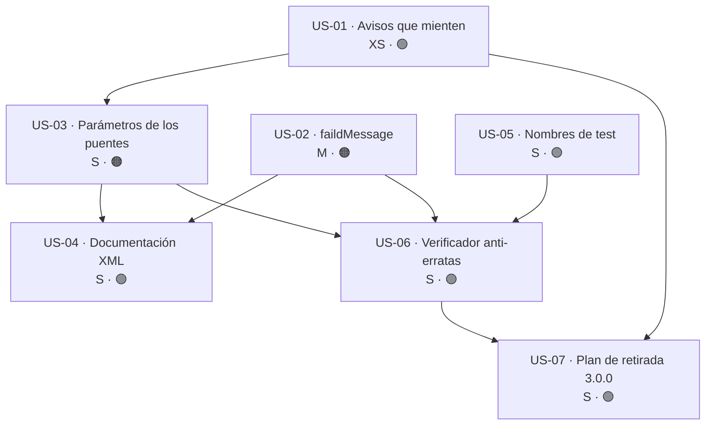

# Épica · Erratas en identificadores públicos

> **Versión destino:** 2.1.0 (saneado) · 3.0.0 (retirada de puentes)
> **Origen:** [`Temas Pendientes/Mejoras-Prioridad-Baja.md`](../../Temas%20Pendientes/Mejoras-Prioridad-Baja.md) — puntos **71, 72, 73, 74, 75** y **76**
> **Plan del que se desgaja:** bloque «Erratas en identificadores públicos» (71-76)
> **Estado:** ⬜ No iniciada
> **Esfuerzo:** M (~1 jornada el saneado de 2.1.0; la retirada de puentes es trabajo de 3.0.0)
> **Riesgo:** 🟢 bajo en US-01, US-04, US-05, US-06 · 🟠 alto en US-02 y US-03 · 🔴 muy alto en US-07

---

## Índice

1. [Contexto y problema](#1-contexto-y-problema)
2. [Hallazgos colaterales](#2-hallazgos-colaterales)
3. [Alcance](#3-alcance)
4. [Historias de usuario](#4-historias-de-usuario)
5. [Orden de ejecución](#5-orden-de-ejecución)
6. [Decisiones abiertas](#6-decisiones-abiertas)
7. [Definición de terminado](#7-definición-de-terminado)
8. [Apéndice · código actual y propuesto](#8-apéndice--código-actual-y-propuesto)

---

## 1. Contexto y problema

El bloque 71-76 se redactó contra la **versión 1.x**. La auditoría contra el código real de la rama
`release/2.0.0-nomenclatura` cambia el diagnóstico por completo: **el renombrado 2.0.0 ya corrigió
los seis puntos**, pero lo hizo añadiendo **puentes `[Obsolete]`** que conservan la grafía errónea.
El resultado es que las erratas siguen presentes en el ensamblado público, solo que ahora marcadas.

| Punto | Errata original | Estado hoy | Evidencia |
|---|---|---|---|
| 71 | `TryMapIAsyncf` | ✅ **Resuelto sin rastro** | 0 ocurrencias de `TryMapIAsyncf` y de `IAsyncf` en todo el repositorio |
| 72 | `ChangeReturnResultAlwais*` | ⚠️ **Corregido con puente** | 15 declaraciones obsoletas en `MlResultChangeReturnResult.Obsolete.cs` |
| 73 | `FromStringLenght`, `FromIntLenght`, `MinLenght` | ⚠️ **Corregido con puente defectuoso** | 8 declaraciones obsoletas en 8 ficheros de `ValueObjects`; **3 mensajes apuntan a un método que no existe** |
| 74 | `Id.Bydouble` / `Id.Fromdouble` | ✅ **Resuelto sin rastro** | 0 ocurrencias; `ValueObjects/Id.cs` se eliminó en la limpieza de la 2.0.0 |
| 75 | `AddScopedtGenServicesFpWithoutReposGeneral` | ⚠️ **Corregido con puente** | 2 declaraciones obsoletas en `Application/RegisterServices.Obsolete.cs` |
| 76 | `TEnumrable`, `BaseAdress` | ✅ **Resuelto sin rastro** | 0 ocurrencias de `TEnumrable`, `Enumrable`, `BaseAdress` y `Adress` |

### 1.1 El problema real: 51 erratas vivas en la superficie pública

Hay **73 ficheros `*.Obsolete.cs`** en la solución. De ellos, **13 contienen puentes para erratas de
grafía**, con **51 declaraciones públicas** que mantienen la palabra mal escrita:

| Errata | Declaraciones obsoletas | Fichero de los puentes |
|---|---|---|
| `Alwais` | 15 | `Core/Types/MlResultChangeReturnResult.Obsolete.cs` |
| `Faild` | 15 | `Core/Types/MlResultBindExtensions.Obsolete.cs` |
| `Lenght` | 8 | 8 ficheros de `ValueObjects` (uno por tipo) |
| `Erros` | 6 | `Core/Types/MlResultCollections.Obsolete.cs` |
| `Diferent` | 5 | `Core/Types/MlResultErrorDetailsExtensions.Obsolete.cs` |
| `Scopedt` | 2 | `Application/RegisterServices.Obsolete.cs` |
| **Total** | **51** | **13 ficheros** |

Los 51 usan el mismo patrón, que es **correcto y no hay que cambiarlo**:

```csharp
// MoralesLarios.OOFP.Core/Types/MlResultChangeReturnResult.Obsolete.cs, L22
[global::System.Obsolete("Renamed to ChangeReturnResultAlwaysValid. Will be removed in 3.0.0.", false),
 global::System.ComponentModel.EditorBrowsable(global::System.ComponentModel.EditorBrowsableState.Never)]
public static MlResult<TResult> ChangeReturnResultAlwaisValid<T, TResult>(/* … */)
    => ChangeReturnResultAlwaysValid(/* … */);
```

`EditorBrowsableState.Never` los esconde de IntelliSense y `false` en el segundo argumento los deja
como advertencia (CS0618) y no como error. **Ninguno de los 51 tiene una sola llamada** dentro de la
solución: son puramente para consumidores externos.

### 1.2 Consecuencia

Que la errata esté marcada no la hace invisible:

- Aparece en el **XML de documentación** que se publica en el paquete NuGet.
- Aparece en cualquier **visor de API** (NuGet Package Explorer, ILSpy, docs generadas).
- Aparece al **compilar** el código del consumidor, en el texto del aviso CS0618.
- Y, lo más importante, **hay erratas que no tienen puente** y que por tanto no están corregidas en
  absoluto. Es el objeto real de esta épica.

---

## 2. Hallazgos colaterales

Cuatro cosas que **no** estaban en los puntos 71-76 y que la auditoría ha sacado a la luz.

### 2.1 🔴 Tres mensajes `[Obsolete]` apuntan a un método que no existe

Es el hallazgo más serio. En los tres tipos de longitud de cadena, el mensaje de obsolescencia
anuncia `FromStringLength`, pero **el método real se llama `FromLength`**:

| Fichero | Mensaje `[Obsolete]` dice… | El método que existe es… |
|---|---|---|
| `ValueObjects/StringLengthBetween.Obsolete.cs`, L19 | `Renamed to FromStringLength` | `StringLengthBetween.FromLength` (`StringLengthBetween.cs`, L58) |
| `ValueObjects/StringMaxLength.Obsolete.cs`, L18 | `Renamed to FromStringLength` | `StringMaxLength.FromLength` (`StringMaxLength.cs`, L53) |
| `ValueObjects/StringMinLength.Obsolete.cs`, L18 | `Renamed to FromStringLength` | `StringMinLength.FromLength` (`StringMinLength.cs`, L53) |

```csharp
// MoralesLarios.OOFP.ValueObjects/StringLengthBetween.Obsolete.cs, L19-20
[global::System.Obsolete("Renamed to FromStringLength. Will be removed in 3.0.0.", false), /* … */]
//                                   ↑↑↑↑↑↑↑↑↑↑↑↑↑↑↑↑ este método NO EXISTE
public static StringLengthBetween FromStringLenght(string value, int minLenght, int maxLenght)
    => CreateFromLength(value, minLenght, maxLenght);   // ← el cuerpo sí llama al nombre correcto
```

**Un consumidor que siga la instrucción del aviso no compila.** Es peor que no dar instrucción: el
aviso promete una ruta de migración falsa. Además hay un segundo desajuste en el mismo fichero:
el método `FromStringLenght` reenvía a `CreateFromLength` (la factoría que **lanza**), mientras que
el aviso apunta a `FromLength` (la que **devuelve `MlResult<T>`**). Son contratos distintos.

Las tres variantes de `Int` (`IntBetween`, `IntLessThan`, `IntMoreThan`) **sí están bien**: su
mensaje dice `FromIntLength` y ese método existe. Y los dos `MinLenght` (`MemberName`, `ServiceKey`)
también: apuntan a `MinLength`, que existe en `MemberName.cs` L16 y `ServiceKey.cs` L15.

### 2.2 🟠 `faildMessage`: una errata viva, pública y sin puente

Fuera de los `*.Obsolete.cs` hay una errata que el renombrado 2.0.0 **no tocó**: el parámetro
`faildMessage` en la familia de extensiones de registro.

| Fichero (`MoralesLarios.OOFP.Logging/`) | Líneas |
|---|---|
| `MlResultLogExtensions.cs` | 678, 710, 857, 889 |
| `MlResultLogExtensions.Critical.cs` | 430, 458, 575, 603 |
| `MlResultLogExtensions.Debug.cs` | 429, 457, 574, 602 |
| `MlResultLogExtensions.Error.cs` | 428, 456, 573, 601 |
| `MlResultLogExtensions.Information.cs` | 426, 454, 571, 599 |
| `MlResultLogExtensions.Trace.cs` | 428, 456, 573, 601 |
| `MlResultLogExtensions.Warning.cs` | 429, 457, 574, 602 |

Son **28 métodos públicos** (4 por fichero × 7 ficheros) y **84 apariciones** del identificador
(28 declaraciones de parámetro + 28 usos en el cuerpo + 28 menciones en `<param>`).

Que sea «solo» un nombre de parámetro no lo hace inocuo: **es parte del contrato público** porque
C# permite argumentos nombrados.

```csharp
// Hoy, el consumidor escribe esto y compila:
result.LogError(logger, faildMessage: "no se pudo guardar");

// Si renombramos el parámetro, ese código DEJA DE COMPILAR.
```

Por eso US-02 es 🟠 y no 🟢: un renombrado de parámetro **rompe la compilación** de quien use
argumentos nombrados, y lo hace **sin que ningún `[Obsolete]` pueda avisar** (no existe forma de
marcar un parámetro como obsoleto en C#).

### 2.3 🟢 La documentación XML propaga las erratas

Los `///` de los puentes repiten la grafía incorrecta, y el generador `MlDoc` la copió literalmente
al construir los `<param>`:

```csharp
// MoralesLarios.OOFP.ValueObjects/StringLengthBetween.Obsolete.cs, L9-17
/// <summary>
/// Ejecuta <c>FromStringLenght</c>.          // ← errata en el resumen
/// </summary>
/// <param name="minLenght">Valor de <c>minLenght</c>.</param>   // ← y en los parámetros
/// <param name="maxLenght">Valor de <c>maxLenght</c>.</param>
```

Recuento de menciones de erratas **dentro de comentarios XML**: `Alwais` 15, `Lenght` 24, `Faild`
15, `Erros` 6, `Diferent` 5, `Scopedt` 2. Total: **67**. Estas sí se pueden corregir **sin romper
nada**, porque el texto de un `<summary>` no es parte del contrato.

### 2.4 🟢 Los tests perpetúan la errata en sus nombres

| Fichero (`MoralesLarios.OOFP.Core.Tests.Unit/Types/`) | Errata | Líneas |
|---|---|---|
| `MlResultMapExtensionsTests.cs` | `diferent` | 316, 330, 358, 570, 584, 625, 639, 653, 667, 681, 695, 710, 724, 853, 867, 881, 893, 907 |
| `MlResultBindExtensionsTests.cs` | `diferent` · `faild` · `Erros` | 354, 368 · 421, 433 · 433 |
| `MlResultErrorDetailsExtensionsTests.cs` | `diferent` | 43 |

**24 nombres de método de prueba** con errata. No son API de biblioteca, así que renombrarlos no
rompe nada; pero son lo primero que ve quien abre el proyecto de tests, y aparecen en los informes
de ejecución.

> ⚠️ **Falso positivo a respetar:** hay **2** coincidencias de `diferent` que **no** son erratas:
> `MlResultBindExtensions.cs` L3239 y `MlResultMapExtensions.cs` L2708, donde `diferent` es una
> subcadena de la palabra **española correcta** «diferente» dentro de un comentario `///` en
> castellano. De las 33 coincidencias textuales de `Diferent`/`diferent`, **31 son erratas reales**.

---

## 3. Alcance

### 3.1 Dentro

- Corregir los 3 mensajes `[Obsolete]` que apuntan a un método inexistente (§2.1).
- Renombrar el parámetro público `faildMessage` → `failedMessage` en los 28 métodos de `Logging`
  (§2.2), con su entrada obligatoria en la guía de migración.
- Sanear los nombres de **parámetro** con errata dentro de los 8 puentes de `ValueObjects`
  (`minLenght`, `maxLenght`, `lenght`).
- Limpiar las 67 menciones de erratas en documentación XML (§2.3).
- Renombrar los 24 métodos de prueba con errata (§2.4).
- Ampliar el verificador `check-old-names.ps1` para que **también escanee `.cs`** y detecte erratas
  nuevas (hoy solo mira `.md`, y por eso estas se colaron).
- Dejar por escrito el **plan de retirada** de los 51 puentes para la 3.0.0.

### 3.2 Fuera

- **Retirar** los 51 puentes `[Obsolete]`. Eso es, por definición, trabajo de una versión mayor
  (3.0.0) y aquí solo se documenta.
- Renombrar `MlResultBucles.cs` / `MlResultBuclesTests.cs`: son **trabajo en curso del autor** y no
  se tocan en ninguna épica.
- Las erratas de los documentos **históricos** (`Temas Pendientes/*`, `CONSEJOS_NOMENCLATURA.md`,
  `Cambios Realizados/*`): citan la grafía antigua **a propósito** y deben conservarla.
- Las 148 coincidencias que reporta `check-old-names.ps1` sobre `.md`: ya se verificó que **todas**
  son menciones históricas legítimas (61 en `oofp-upgrade-2.renames.md`, 40 en el prompt, 27 en las
  épicas 2.1, resto en bloques «Resuelto en 2.0.0» y en la columna «A evitar»). **No tocar.**
- Los identificadores en **español** (`ContieneCombinacion`): se tratan en la épica de
  [Mensajes y localización](Epica-Mensajes-Y-Localizacion.md), punto 79.

---

## 4. Historias de usuario

### US-01 · Corregir los avisos `[Obsolete]` que mienten

> **Como** consumidor de la 1.x que está migrando a la 2.0.0,
> **quiero** que el aviso de obsolescencia me diga el nombre del método que **realmente** existe,
> **para** poder migrar siguiendo el aviso sin que mi código deje de compilar.

**Esfuerzo:** XS (~30 min) · **Riesgo:** 🟢 bajo · **Depende de:** nada

**Criterios de aceptación**

- [ ] Los mensajes de `StringLengthBetween.Obsolete.cs` L19, `StringMaxLength.Obsolete.cs` L18 y
      `StringMinLength.Obsolete.cs` L18 dicen `FromLength` y no `FromStringLength`.
- [ ] Se verifica, uno a uno, que **cada** uno de los 51 mensajes `[Obsolete]` nombra un miembro que
      existe de verdad, con la aridad genérica correcta.
- [ ] El mensaje distingue la factoría que **lanza** (`CreateFromLength`) de la que devuelve
      `MlResult<T>` (`FromLength`), y apunta a la que corresponde al cuerpo del puente.
- [ ] `oofp-upgrade-2.renames.md` refleja el nombre destino corregido en esas 3 filas.

**API propuesta**

```csharp
// MoralesLarios.OOFP.ValueObjects/StringLengthBetween.Obsolete.cs
[global::System.Obsolete("Renamed to CreateFromLength. Will be removed in 3.0.0.", false), /* … */]
public static StringLengthBetween FromStringLenght(string value, int minLength, int maxLength)
    => CreateFromLength(value, minLength, maxLength);
```

**Notas técnicas**

Un aviso `[Obsolete]` es **texto libre**: el compilador no comprueba que el nombre citado exista.
Por eso el error ha podido vivir hasta ahora sin que ningún build lo detecte. La única defensa es
un verificador externo (US-06).

**Tests mínimos**

| Test | Qué comprueba |
|---|---|
| `ObsoleteMessages_CitanMiembrosExistentes` | Reflexión: para cada miembro con `[Obsolete]`, extrae el nombre citado tras `Renamed to ` y comprueba que el tipo declara un miembro con ese nombre |
| `FromStringLenght_DelegaEnCreateFromLength` | El puente devuelve lo mismo que la factoría nueva |

**Riesgo principal**

Ninguno técnico. El riesgo es **no hacerlo**: cada día que pasa, algún consumidor sigue el aviso
falso y pierde tiempo.

---

### US-02 · Renombrar el parámetro `faildMessage`

> **Como** usuario de las extensiones de registro,
> **quiero** que el parámetro se llame `failedMessage`,
> **para** que el nombre que escribo en un argumento nombrado esté bien escrito en inglés.

**Esfuerzo:** M (~3 h) · **Riesgo:** 🟠 alto · **Depende de:** nada

**Criterios de aceptación**

- [ ] Los 28 métodos públicos de los 7 ficheros `MlResultLogExtensions*.cs` declaran
      `failedMessage`.
- [ ] Las 28 menciones en `<param name="…">` se actualizan en el mismo movimiento (si no, aparece
      **CS1572**, «parámetro documentado inexistente», y el build deja de estar en CS1591 = 0).
- [ ] 0 ocurrencias de `faildMessage` en `**/*.cs`.
- [ ] La ruptura queda documentada en `oofp-upgrade-2.prompt.md` §3.3 **y** en el anexo
      `.renames.md`, marcada en la columna de puentes como **«❌ rompe la compilación»**.
- [ ] La Fase 5 del prompt de migración incorpora un barrido de `faildMessage:` → `failedMessage:`.

**API propuesta**

```csharp
// ───── 2.0.0 ─────
public static MlResult<T> LogError<T>(this MlResult<T> source,
                                           ILogger      logger,
                                           string       faildMessage = null!)

// ───── 2.1.0 ─────
public static MlResult<T> LogError<T>(this MlResult<T> source,
                                           ILogger      logger,
                                           string       failedMessage = null!)
```

**Notas técnicas**

- **No existe puente posible.** C# no permite marcar un parámetro como obsoleto ni declarar dos
  métodos que difieran solo en el nombre de un parámetro. La única alternativa a romper es **no
  renombrar** (ver decisión D-2).
- La convención del proyecto es **alinear los parámetros en columnas**. Al pasar de `faildMessage`
  (13 caracteres) a `failedMessage` (14), **hay que re-alinear** el bloque completo de la firma.
- Edición con el patrón determinista del repositorio: regex con grupo `(?<sp>\s+)` para preservar
  la alineación, guarda de recuento (`if ($count -ne 84) { throw }`) y escritura con BOM UTF-8.

**Tests mínimos**

| Test | Qué comprueba |
|---|---|
| `LogError_ConArgumentoNombrado_Compila` | Una llamada con `failedMessage:` compila |
| `LogExtensions_NoDeclaranParametrosConErrata` | Reflexión sobre los 28 métodos: ningún `ParameterInfo.Name` contiene `faild` |

**Riesgo principal**

Rompe silenciosamente a quien use argumentos nombrados. Es **detectable por el compilador** en el
lado del consumidor (CS1739, «no existe un parámetro con ese nombre»), lo cual es lo mejor que se
puede pedir de una ruptura: falla al compilar, no en producción.

---

### US-03 · Sanear los parámetros de los puentes de `ValueObjects`

> **Como** mantenedor,
> **quiero** que los 8 puentes de longitud no propaguen `lenght` en sus nombres de parámetro,
> **para** que la errata desaparezca de la superficie pública aunque el nombre del método la
> conserve por compatibilidad.

**Esfuerzo:** S (~1 h) · **Riesgo:** 🟠 alto · **Depende de:** US-01

**Criterios de aceptación**

- [ ] Los parámetros `minLenght`, `maxLenght` y `lenght` de los 8 ficheros `*.Obsolete.cs` de
      `ValueObjects` pasan a `minLength`, `maxLength` y `length`.
- [ ] El **nombre del método** (`FromStringLenght`, `FromIntLenght`, `MinLenght`) **se conserva**:
      es el puente, y cambiarlo haría inútil el puente.
- [ ] Los `<param name="…">` correspondientes se actualizan (24 menciones XML).
- [ ] Las 2 variables locales `minLenght` de `IntMoreThanTests.cs` (L14, 16, 25, 27) se renombran.
- [ ] Tras el cambio, `Lenght` solo aparece en **8 nombres de método/propiedad** (los puentes) y en
      **0** nombres de parámetro.

**API propuesta**

```csharp
// ───── 2.0.0 ─────
public static StringLengthBetween FromStringLenght(string value, int minLenght, int maxLenght)

// ───── 2.1.0 ─────   (el nombre del método NO cambia: es el puente)
public static StringLengthBetween FromStringLenght(string value, int minLength, int maxLength)
```

**Notas técnicas**

Misma limitación que US-02: es una ruptura para argumentos nombrados. Pero aquí el impacto es
**mucho menor**, porque quien llama a un método ya marcado `[Obsolete]` con `EditorBrowsableState.Never`
está en proceso de migración y recibe ya un CS0618 en esa misma línea.

**Tests mínimos**

| Test | Qué comprueba |
|---|---|
| `Puentes_NoDeclaranParametrosConErrata` | Reflexión sobre los 8 puentes: ningún `ParameterInfo.Name` contiene `lenght` |
| `FromStringLenght_SigueFuncionando` | El puente devuelve el mismo objeto que `CreateFromLength` |

**Riesgo principal**

Bajo en la práctica: 0 llamadas internas y el consumidor afectado ya está viendo un aviso.

---

### US-04 · Limpiar la errata de la documentación XML

> **Como** lector de IntelliSense,
> **quiero** que el resumen de un miembro esté escrito correctamente,
> **para** que la documentación no parezca generada sin revisar.

**Esfuerzo:** S (~1 h) · **Riesgo:** 🟢 bajo · **Depende de:** US-02, US-03

**Criterios de aceptación**

- [ ] Las 67 menciones de erratas en bloques `///` se reescriben con la grafía correcta.
- [ ] En el `<summary>` de un puente, el texto explica que es un **alias obsoleto** y nombra el
      miembro nuevo; no se limita a `Ejecuta <c>FromStringLenght</c>.`
- [ ] Se conserva el `<remarks>` estándar de los puentes.
- [ ] Build `Release --no-incremental`: **CS1591 = 0** y **CS1572 = 0**.
- [ ] Se cuentan los BOM UTF-8 antes y después, y se restauran los que falten.

**API propuesta**

```csharp
// ───── 2.0.0 ─────
/// <summary>
/// Ejecuta <c>FromStringLenght</c>.
/// </summary>
/// <param name="minLenght">Valor de <c>minLenght</c>.</param>

// ───── 2.1.0 ─────
/// <summary>
/// Alias obsoleto de <see cref="StringLengthBetween.CreateFromLength(string, int, int)"/>,
/// conservado por compatibilidad con la versión 1.x. Se elimina en la 3.0.0.
/// </summary>
/// <param name="minLength">Longitud mínima admitida, inclusive.</param>
```

**Notas técnicas**

- 🔴 **Trampa documentada del repositorio:** una edición masiva de `.cs` deja ficheros **sin BOM
  UTF-8**. En el objetivo 9 pasó con 207 de 232 ficheros. Hay que contar los BOM y restaurarlos
  comparando con `git show HEAD:<ruta>`.
- Un `<param>` que nombra un parámetro inexistente produce **CS1572**, así que esta historia tiene
  que ir **después** de US-02 y US-03 o el build se rompe en medio.

**Tests mínimos**

| Test | Qué comprueba |
|---|---|
| — | No hay test unitario: el criterio es `CS1591 = 0` + `CS1572 = 0` en build completo |
| `check-md-encoding.ps1` | 0 mojibake tras la edición masiva |

**Riesgo principal**

Perder los BOM o introducir mojibake en los acentos de los resúmenes en castellano.

---

### US-05 · Renombrar los métodos de prueba con errata

> **Como** desarrollador que lee el informe de ejecución de los 1.060 tests,
> **quiero** que los nombres de prueba estén bien escritos,
> **para** poder buscar un caso por su nombre sin adivinar la grafía.

**Esfuerzo:** S (~1 h) · **Riesgo:** 🟢 bajo · **Depende de:** nada

**Criterios de aceptación**

- [ ] Los 24 métodos de prueba con `diferent`, `faild` o `Erros` se renombran a `different`,
      `failed` y `Errors`.
- [ ] **Se respetan los 2 falsos positivos** de §2.4: los `diferent` de
      `MlResultBindExtensions.cs` L3239 y `MlResultMapExtensions.cs` L2708 **no se tocan** (son la
      palabra española «diferente»).
- [ ] Los tests que ejercitan un puente obsoleto **siguen nombrando el puente**: un test de
      `ChangeReturnResultAlwaisValid` debe llamarse así, porque eso es lo que prueba.
- [ ] **1.060 tests en verde**, el mismo número que antes: esta historia no añade ni quita casos.

**Notas técnicas**

- 🔴 **`MlResultBucles.cs` y `MlResultBuclesTests.cs` quedan intactos**: trabajo en curso del autor.
- Aquí sí se puede usar `MlRename` (renombrado semántico con Roslyn), porque son métodos privados
  al ensamblado de pruebas y no hay riesgo de colisión con homónimos públicos.

**Tests mínimos**

| Test | Qué comprueba |
|---|---|
| — | El propio conjunto: 1.060 en verde, mismo recuento |

**Riesgo principal**

Que un filtro de CI o un `--filter "FullyQualifiedName~…"` guardado en un script deje de casar.
Hay que revisar `scripts/test.ps1`.

---

### US-06 · Verificador de erratas que escanee también el código

> **Como** mantenedor,
> **quiero** un verificador que detecte erratas de grafía en `.cs` y no solo en `.md`,
> **para** que no vuelva a pasar que una errata sobreviva a un renombrado completo.

**Esfuerzo:** S (~2 h) · **Riesgo:** 🟢 bajo · **Depende de:** US-02, US-03, US-05

**Criterios de aceptación**

- [ ] `scripts/check-old-names.ps1` admite un modificador para escanear `**/*.cs` además de `.md`.
- [ ] Mantiene un **diccionario de erratas** con, al menos: `Alwais`, `Lenght`, `Faild`, `Diferent`,
      `Erros`, `Scopedt`, `Adress`, `Enumrable`, `IAsyncf`, `soported`, `Bydouble`, `Fromdouble`.
- [ ] Soporta una **lista blanca** (los 51 puentes + los 2 falsos positivos de «diferente» + los
      documentos históricos) para que la salida limpia sea **0 hallazgos** y cualquier aparición
      nueva destaque.
- [ ] Clasifica cada hallazgo en: nombre de **tipo/miembro**, nombre de **parámetro**, **literal de
      cadena**, **comentario XML** o **nombre de test**. Los dos primeros son los graves.
- [ ] Cuenta las ocurrencias con
      `[regex]::Matches([System.IO.File]::ReadAllText($p), [regex]::Escape($t)).Count`.
- [ ] Documentado en `CONTRIBUTING.md` como paso previo a cualquier renombrado.

**Notas técnicas**

- 🔴 **`Select-String -SimpleMatch -AllMatches` NO rellena `$_.Matches.Count` en PowerShell 5.1**:
  todos los contadores salen 0. Hay que usar `[regex]::Matches(...)`, como ya hacen los demás
  verificadores del repositorio.
- El `.ps1` debe ir en **ASCII puro** (sin acentos en el código): PowerShell 5.1 lee un `.ps1`
  UTF-8 sin BOM como Windows-1252 y corrompe los acentos. Si hacen falta textos acentuados, van en
  un fichero de datos aparte leído con `ReadAllText($p, [Text.Encoding]::UTF8)`.
- Guarda obligatoria: comparar el recuento de líneas antes y después y abortar si cambia.

**Tests mínimos**

| Test | Qué comprueba |
|---|---|
| Ejecución en limpio | 0 hallazgos fuera de la lista blanca |
| Inyección de prueba | Un `.cs` temporal con `faildMessage` produce exactamente 1 hallazgo clasificado como «parámetro» |

**Riesgo principal**

Una lista blanca demasiado amplia convierte el verificador en decorativo. Debe enumerar **ficheros
y líneas concretas**, no patrones genéricos.

---

### US-07 · Plan de retirada de los 51 puentes en la 3.0.0

> **Como** propietario de la biblioteca,
> **quiero** un inventario cerrado de los puentes `[Obsolete]` con su fecha de retirada,
> **para** que la 3.0.0 pueda limpiarlos de una vez sin volver a auditar nada.

**Esfuerzo:** S (~2 h) · **Riesgo:** 🟢 bajo ahora · 🔴 muy alto al ejecutarlo en 3.0.0
**Depende de:** US-01, US-06

**Criterios de aceptación**

- [ ] Documento `Next_Versions/3.0.0/Retirada-Puentes-Obsolete.md` con los **73** ficheros
      `*.Obsolete.cs` y sus declaraciones, marcando cuáles son por **errata** (51) y cuáles por
      **renombrado semántico** (el resto).
- [ ] Cada entrada lleva: nombre viejo, nombre nuevo **verificado**, fichero, línea y si el aviso
      es advertencia (`false`) o error (`true`).
- [ ] Se decide y se anota si en la 2.1.0 los avisos pasan de `false` a `true` (ver D-4).
- [ ] El documento se genera desde `Cambios Realizados/_registro.csv` con un script, no a mano.

**Notas técnicas**

Ya existe el inventario de renombrados (`Cambios Realizados/Renombrados-v2.0.0.md`, 888 cambios en
19 lotes) generado por `scripts/generar-cambios-realizados.ps1`. Lo natural es **añadir una columna
de retirada** a ese CSV y generar el nuevo documento con el mismo script, no crear un inventario
paralelo que se desincronice.

**Tests mínimos**

| Test | Qué comprueba |
|---|---|
| Recuento cruzado | Las declaraciones `[Obsolete]` contadas por reflexión coinciden con las filas del documento |

**Riesgo principal**

Ejecutar la retirada sin una versión mayor. Los 51 puentes son el único camino de migración desde
la 1.x; retirarlos en una menor sería una ruptura inadmisible.

---

## 5. Orden de ejecución



| Orden | Historia | Esfuerzo | Por qué va aquí |
|---|---|---|---|
| 1 | **US-01** Avisos que mienten | XS | 🎯 **Hito**: es un error de hecho, no una mejora. Media hora y deja de engañar a los consumidores |
| 2 | **US-05** Nombres de test | S | Independiente y sin riesgo; se puede hacer en paralelo |
| 3 | **US-02** `faildMessage` | M | La única ruptura real de la épica; cuanto antes entre, más margen de aviso |
| 4 | **US-03** Parámetros de los puentes | S | Cierra `Lenght` en nombres de parámetro |
| 5 | **US-04** Documentación XML | S | **Obligatoriamente después** de US-02 y US-03, o aparece CS1572 |
| 6 | **US-06** Verificador | S | Necesita el código ya limpio para que su salida en limpio sea 0 |
| 7 | **US-07** Plan de retirada | S | Consolida lo aprendido; su ejecución es de la 3.0.0 |

**Total:** ~1 jornada (US-01 a US-06) + ~2 h de documentación (US-07).

**Entrega incremental sugerida:** US-01 y US-05 pueden entrar en un parche `2.0.1`, porque no rompen
nada. US-02 y US-03 exigen esperar a la `2.1.0` por ser rupturas.

---

## 6. Decisiones abiertas

| Id | Decisión | Opciones | Recomendación |
|---|---|---|---|
| **D-1** | Los 3 avisos erróneos de §2.1, ¿apuntan a `CreateFromLength` (lo que hace el cuerpo) o a `FromLength` (el contrato funcional)? | a) `CreateFromLength`, fiel al cuerpo · b) `FromLength`, empujando al estilo `MlResult<T>` | **a)** El aviso debe describir un sustituto **equivalente**; `FromLength` tiene otro tipo de retorno y la migración no sería mecánica. Si se quiere empujar hacia `FromLength`, mencionarlo en el `<summary>`, no en el aviso |
| **D-2** | ¿Se renombra `faildMessage`? | a) Sí en 2.1.0, aceptando la ruptura · b) Sí, pero aplazado a 3.0.0 con el resto · c) No, se queda | **a)** Es un nombre de parámetro: la ruptura es **detectable por el compilador** (CS1739), afecta solo a quien use argumentos nombrados y 28 métodos es poco volumen. Aplazarlo a la 3.0.0 significa 28 erratas más en el paquete durante todo un ciclo |
| **D-3** | Los parámetros de los 8 puentes (US-03), ¿se sanean o se dejan congelados? | a) Sanear · b) Dejarlos: un puente es una foto del pasado | **a)** El consumidor de un puente ya recibe CS0618 en esa línea; el coste marginal es nulo y la superficie pública queda limpia |
| **D-4** | ¿Los 51 avisos pasan de advertencia (`false`) a error (`true`) en la 2.1.0? | a) Mantener `false` hasta la 3.0.0 · b) Pasar a `true` en 2.1.0 como último aviso | **a)** `EditorBrowsableState.Never` ya los oculta. Pasar a `true` en una **menor** rompería compilaciones y contradiría el versionado semántico |
| **D-5** | ¿Se renombran los tests que ejercitan puentes obsoletos? | a) No: el nombre del test debe nombrar lo que prueba · b) Sí, por uniformidad | **a)** Un test llamado `ChangeReturnResultAlwaisValid_Delega_EnVersionNueva` es **autodocumentado**; «corregirlo» lo volvería engañoso |
| **D-6** | ¿La 2.1.0 incluye el documento de la 3.0.0 (US-07)? | a) Sí, en `Next_Versions/3.0.0/` · b) Esperar a abrir la 3.0.0 | **a)** El conocimiento está fresco **ahora**; reauditar 73 ficheros dentro de un año cuesta mucho más |

---

## 7. Definición de terminado

- [ ] Build `dotnet build MoralesLarios.OOFP.sln -c Release --no-incremental` con **0 errores**,
      **CS1591 = 0** y **CS1572 = 0**.
- [ ] **1.060 tests en verde** (el mismo recuento: esta épica no añade casos funcionales).
- [ ] `check-old-names.ps1` ampliado a `.cs` devuelve **0 hallazgos** fuera de la lista blanca.
- [ ] `check-md-anchors4.ps1`: 0 anclas rotas. `check-md-links2.ps1`: solo los 9 falsos positivos
      conocidos de `_Seccion-para-README.md`.
- [ ] `check-md-encoding.ps1`: **0 mojibake**.
- [ ] Recuento de **BOM UTF-8** idéntico antes y después de las ediciones masivas.
- [ ] `oofp-upgrade-2.prompt.md` §3.3 incluye la ruptura de `faildMessage`, y el anexo
      `.renames.md` recoge las 3 correcciones de nombre destino.
- [ ] `Mejoras-Prioridad-Baja.md`: puntos 71 a 76 marcados `- [x]` con su veredicto.
- [ ] 0 ocurrencias en `**/*.cs` de: `faildMessage`, `minLenght`, `maxLenght`, `lenght`,
      `TryMapIAsyncf`, `TEnumrable`, `BaseAdress`, `Bydouble`, `Fromdouble`, `soported`.
- [ ] Las 51 erratas restantes están **exclusivamente** en nombres de miembro de puentes
      `[Obsolete]`, inventariadas en el documento de la 3.0.0.

---

## 8. Apéndice · código actual y propuesto

### 8.1 El aviso que miente (US-01)

```csharp
// ───── 2.0.0 ─────
// MoralesLarios.OOFP.ValueObjects/StringLengthBetween.Obsolete.cs, L19-20
[global::System.Obsolete("Renamed to FromStringLength. Will be removed in 3.0.0.", false),
 global::System.ComponentModel.EditorBrowsable(global::System.ComponentModel.EditorBrowsableState.Never)]
public static StringLengthBetween FromStringLenght(string value, int minLenght, int maxLenght)
    => CreateFromLength(value, minLenght, maxLenght);

// El consumidor lee el aviso, escribe esto… y NO COMPILA:
//     var vo = StringLengthBetween.FromStringLength("abc", 1, 10);
//                                  ^^^^^^^^^^^^^^^^ CS0117: no existe


// ───── 2.1.0 ─────
[global::System.Obsolete("Renamed to CreateFromLength. Will be removed in 3.0.0.", false),
 global::System.ComponentModel.EditorBrowsable(global::System.ComponentModel.EditorBrowsableState.Never)]
public static StringLengthBetween FromStringLenght(string value, int minLength, int maxLength)
    => CreateFromLength(value, minLength, maxLength);

// Ahora el aviso es ejecutable:
//     var vo = StringLengthBetween.CreateFromLength("abc", 1, 10);   // ✅ compila
```

### 8.2 `faildMessage` → `failedMessage` (US-02)

```csharp
// ───── 2.0.0 ─────
// MoralesLarios.OOFP.Logging/MlResultLogExtensions.Error.cs, L428
/// <param name="faildMessage">Mensaje de <c>faildMessage</c>.</param>
public static MlResult<T> LogError<T>(this MlResult<T> source,
                                           ILogger      logger,
                                           string       faildMessage = null!)
    => source.LogIfFail(logger, LogLevel.Error, faildMessage);


// ───── 2.1.0 ─────
/// <param name="failedMessage">
/// Mensaje que se registra cuando <paramref name="source"/> es un resultado fallido.
/// Si es <c>null</c>, se usa el mensaje de error del propio resultado.
/// </param>
public static MlResult<T> LogError<T>(this MlResult<T> source,
                                           ILogger      logger,
                                           string       failedMessage = null!)
    => source.LogIfFail(logger, LogLevel.Error, failedMessage);
```

> ⚠️ **Ruptura.** Quien escriba `result.LogError(logger, faildMessage: "x")` recibirá **CS1739**.
> Debe figurar en `oofp-upgrade-2.prompt.md` §3.3 con un barrido en la Fase 5:
> `faildMessage:` → `failedMessage:`.

Nótese la **re-alineación** de la columna de nombres: `faildMessage` ocupa 13 caracteres y
`failedMessage` 14, así que el bloque entero de la firma se desplaza. La convención de parámetros
alineados en columnas es del proyecto y hay que preservarla.

### 8.3 Script determinista para el renombrado (US-02)

```powershell
# Patrón obligatorio del repositorio para editar ficheros grandes de forma segura.
# OJO: este .ps1 debe ir en ASCII puro (sin acentos en el codigo fuente).
$files = Get-ChildItem 'MoralesLarios.OOFP.Logging' -Filter 'MlResultLogExtensions*.cs'
$total = 0

foreach ($f in $files) {
    $text   = [System.IO.File]::ReadAllText($f.FullName)
    $before = ([regex]::Matches($text, [regex]::Escape('faildMessage'))).Count
    $lines  = ($text -split "`n").Count

    # El grupo (?<sp>\s+) preserva la alineacion en columnas.
    $text = [regex]::Replace($text, 'faildMessage', 'failedMessage')

    $after = ([regex]::Matches($text, [regex]::Escape('faildMessage'))).Count
    if ($after -ne 0)                        { throw "Quedan $after en $($f.Name)" }
    if ((($text -split "`n").Count) -ne $lines) { throw "Cambio el recuento de lineas" }

    # BOM UTF-8: el repositorio lo usa y hay que preservarlo.
    [System.IO.File]::WriteAllText($f.FullName, $text, (New-Object System.Text.UTF8Encoding($true)))
    $total += $before
}

if ($total -ne 84) { throw "Esperadas 84 ocurrencias, encontradas $total" }
Write-Output "OK: $total ocurrencias sustituidas"
```

> La guarda `$total -ne 84` no es decorativa: si la auditoría previa contó 84 y el script encuentra
> otra cifra, significa que el código ha cambiado y la edición debe abortarse para revisarla.

### 8.4 Parámetros de los puentes (US-03)

```csharp
// ───── 2.0.0 ─────
// 8 ficheros de ValueObjects, el mismo patron en todos
public static StringMaxLength FromStringLenght(string value, int lenght)
    => CreateFromLength(value, lenght);

public static int MinLenght => MinLength;        // ← este ya esta BIEN: apunta a MinLength, que existe


// ───── 2.1.0 ─────
public static StringMaxLength FromStringLenght(string value, int length)
    => CreateFromLength(value, length);
//                                          ↑ el NOMBRE del metodo se conserva (es el puente);
//                                            solo cambia el nombre del PARAMETRO
```

### 8.5 Documentación XML de un puente (US-04)

```csharp
// ───── 2.0.0 ─────
/// <summary>
/// Ejecuta <c>FromStringLenght</c>.
/// </summary>
/// <remarks>
/// Miembro obsoleto conservado por compatibilidad. Use la alternativa indicada en el atributo
/// <c>Obsolete</c>.
/// </remarks>
/// <param name="value">Valor sobre el que se opera.</param>
/// <param name="minLenght">Valor de <c>minLenght</c>.</param>
/// <param name="maxLenght">Valor de <c>maxLenght</c>.</param>


// ───── 2.1.0 ─────
/// <summary>
/// Alias obsoleto de <see cref="StringLengthBetween.CreateFromLength(string, int, int)"/>.
/// Conservado por compatibilidad con la versión 1.x; se elimina en la 3.0.0.
/// </summary>
/// <remarks>
/// El nombre contenía la errata «Lenght». Migre a
/// <see cref="StringLengthBetween.CreateFromLength(string, int, int)"/>, cuya firma es idéntica.
/// </remarks>
/// <param name="value">Cadena cuya longitud se valida.</param>
/// <param name="minLength">Longitud mínima admitida, inclusive.</param>
/// <param name="maxLength">Longitud máxima admitida, inclusive.</param>
```

El `<summary>` genérico (`Ejecuta <c>X</c>.`) cumple el requisito formal de CS1591 pero **no informa**.
En un miembro obsoleto es justo donde más valor tiene explicar la ruta de migración, porque es el
único texto que ve quien está migrando.

### 8.6 Nombres de prueba (US-05)

```csharp
// ───── 2.0.0 ─────
// MoralesLarios.OOFP.Core.Tests.Unit/Types/MlResultMapExtensionsTests.cs, L316
[Fact]
public void TryMap_Should_Return_Fail_When_Source_Is_diferent_Type() { /* … */ }

// MoralesLarios.OOFP.Core.Tests.Unit/Types/MlResultBindExtensionsTests.cs, L433
[Fact]
public void BindSaveValueInDetailsIfFaild_Should_Fusion_Erros() { /* … */ }


// ───── 2.1.0 ─────
[Fact]
public void TryMap_Should_Return_Fail_When_Source_Is_Different_Type() { /* … */ }

[Fact]
public void BindSaveValueInDetailsIfFailed_Should_Merge_Errors() { /* … */ }
```

**Falso positivo que NO se toca:**

```csharp
// MoralesLarios.OOFP.Core/Types/MlResultMapExtensions.cs, L2708
/// Devuelve un resultado de un tipo diferente al de origen.
//                                ↑↑↑↑↑↑↑↑↑ palabra ESPAÑOLA correcta: "diferent" es subcadena de
//                                          "diferente". NO es una errata. 2 casos en todo el repo.
```

### 8.7 Resumen de rupturas de esta épica

| Historia | Ruptura | ¿La detecta el compilador del consumidor? | ¿Hay puente posible? |
|---|---|---|---|
| US-01 | Ninguna. Solo cambia el **texto** de un aviso | — | — |
| US-02 | `faildMessage` → `failedMessage` en 28 métodos | ✅ **CS1739**, solo si se usan argumentos nombrados | ❌ C# no admite alias de parámetro |
| US-03 | `lenght` → `length` en 8 puentes | ✅ **CS1739**, y ya convivía con CS0618 | ❌ |
| US-04 | Ninguna. Solo documentación | — | — |
| US-05 | Ninguna. Solo tests internos | — | — |
| US-06 | Ninguna. Herramienta de verificación | — | — |
| US-07 | Ninguna en 2.1.0. **Muy alta en 3.0.0** al retirar los 51 puentes | ✅ CS0117 / CS1061 | Los puentes **son** el puente |

---

## Ver también

- [`README.md`](README.md) — índice de las épicas de la 2.1.0.
- [`Epica-Mensajes-Y-Localizacion.md`](Epica-Mensajes-Y-Localizacion.md) — puntos 77-80; trata los
  textos **de mensaje** (incluido `ContieneCombinacion`), no los identificadores.
- [`Epica-Coherencia-Y-Documentacion.md`](Epica-Coherencia-Y-Documentacion.md) — puntos 81-89;
  incluye el renombrado de `EndpointPattern` y el parámetro genérico `K` → `TKey`.
- [`Epica-Limpieza-Codigo-Muerto.md`](Epica-Limpieza-Codigo-Muerto.md) — puntos 64-70 y 85.
- [`Temas Pendientes/Mejoras-Prioridad-Baja.md`](../../Temas%20Pendientes/Mejoras-Prioridad-Baja.md)
  — inventario de origen, puntos 64-89.
- [`CONTRIBUTING.md`](../../CONTRIBUTING.md) — guía de estilo viva, con la columna «A evitar».
- [`Cambios Realizados/Renombrados-v2.0.0.md`](../../Cambios%20Realizados/Renombrados-v2.0.0.md)
  — los 888 renombrados de la 2.0.0, con su columna de puentes.
