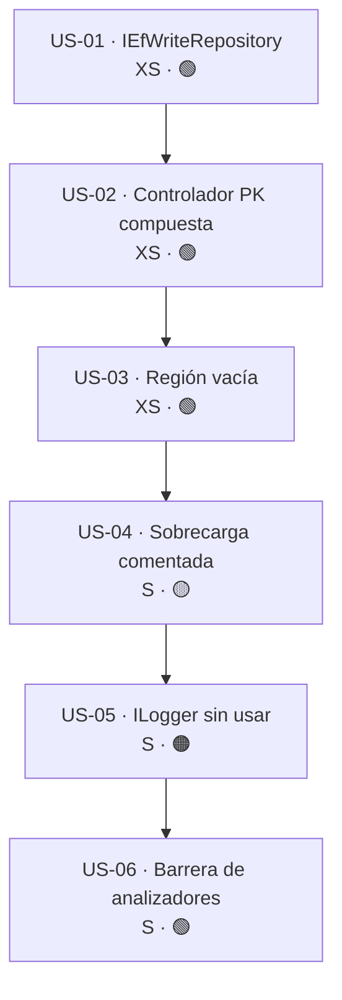

# Épica · Limpieza de código muerto en `Http`, `AspNetCore.Controllers` y `EntityFrameworkCore`

> **Versión destino:** 2.1.0
> **Origen:** [`Temas Pendientes/Mejoras-Prioridad-Baja.md`](../../Temas%20Pendientes/Mejoras-Prioridad-Baja.md) — puntos **64, 68, 69, 70** y **85**
> **Plan del que se desgaja:** bloque «Código muerto y archivos vacíos» (64-70) + punto 85 de «Coherencia y documentación»
> **Estado:** ⬜ No iniciada
> **Esfuerzo:** S (~½ jornada el tramo mecánico; ~1 jornada con la decisión del `ILogger`)
> **Riesgo:** 🟢 bajo en US-01…US-04 · 🟠 alto en US-05 (cambia firmas de constructor público)

---

## Índice

1. [Contexto y problema](#1-contexto-y-problema)
2. [Hallazgos colaterales](#2-hallazgos-colaterales)
3. [Alcance](#3-alcance)
4. [Historias de usuario](#4-historias-de-usuario)
5. [Orden de ejecución](#5-orden-de-ejecución)
6. [Decisiones abiertas](#6-decisiones-abiertas)
7. [Definición de terminado](#7-definición-de-terminado)
8. [Apéndice · código actual y propuesto](#8-apéndice--código-actual-y-propuesto)

---

## 1. Contexto y problema

La auditoría del bloque de prioridad 🟢 baja contra el código real de la rama
`release/2.0.0-nomenclatura` confirma que **quedan cinco focos de código muerto** repartidos por
tres proyectos públicos. Tres de los siete puntos originales del bloque (65, 66 y 67) **ya se
resolvieron** durante el renombrado 2.0.0 y no generan historia.

| Punto | Fichero | Líneas | Naturaleza |
|---|---|---|---|
| 64 | `MoralesLarios.OOFP.EntityFrameworkCore/Repositories/IEfWriteRepository.cs` | 13-34 (de 35) | 22 declaraciones comentadas dentro de una interfaz pública |
| 68 | `MoralesLarios.OOFP.AspNetCore.Controllers/Controllers/MlCompositeKeyCrudControllerBase.cs` | 154-174 **y** 341-361 | ~21 líneas comentadas, **duplicadas** en las dos variantes genéricas |
| 69 | `MoralesLarios.OOFP.Http/HttpApiInvoker.cs` | 545-552 (de 557) | `#region private methods` sin contenido |
| 70 | `MoralesLarios.OOFP.Http/RestClientFp.cs` · `CompositeKeyRestClientFp.cs` | 14, 140 · 7, 190 | `ILogger<>` inyectado y **nunca** utilizado en 4 clases |
| 85 | `MoralesLarios.OOFP.Http/IHttpApiInvoker.cs` | 12 (de 109) | Declaración de método comentada en una interfaz pública |

### Punto 64 — una interfaz pública cuyo cuerpo es íntegramente comentario

`IEfWriteRepository<T>` **sí tiene utilidad**: agrupa por herencia los tres contratos de escritura.
El problema es que su cuerpo contiene el contrato antiguo completo, comentado.

```csharp
// MoralesLarios.OOFP.EntityFrameworkCore/Repositories/IEfWriteRepository.cs, L13-34
public interface IEfWriteRepository<T> : IEfCreateRepository<T>, IEfUpdateRepository<T>, IEfDeleteRepository<T>
    where T : class
{
    //MlResult<T> TryAdd(T item);                                             // ← 22 líneas de contrato antiguo
    //Task<MlResult<T>> TryAddAsync(T item, CancellationToken token = default);
    //MlResult<IEnumerable<T>> TryAddRange(IEnumerable<T> items);
    // … 19 declaraciones más, todas comentadas …
    //Task<MlResult<IEnumerable<T>>> TryUpdateRangeAsync(IEnumerable<T> items, CancellationToken token = default);
}
```

### Punto 68 — código muerto duplicado en el controlador de clave compuesta

El documento original hablaba de «~20 líneas». La realidad es **el doble**: el mismo bloque aparece
en la variante `TDto` (L154-174) y en la variante dúplex `TRequest`/`TResponse` (L341-361). Además,
el código comentado **contradice** la implementación viva: hoy el parseo de claves lo resuelve
`Extensions.BuildKeyParseErrorMessage` y el `_keySelector`, no un `Activator.CreateInstance<TEntity>()`.

```csharp
// MoralesLarios.OOFP.AspNetCore.Controllers/Controllers/MlCompositeKeyCrudControllerBase.cs, L154-174
//private object[] InternalGetPkValues(string ids) => ParseKeyValues(ids.Split(','), _keySelector);
//private string InternalGetPkValuesErrorMessage(Exception ex, string ids) => $"{ids} not be extract …";

//protected object[] ParseKeyValues(string[] values, Func<TEntity, object[]> pkFields)
//{
//    var sample = Activator.CreateInstance<TEntity>();   // requiere new() o reflexión   ← ya descartado
//    …
//}
```

### Punto 69 — región privada vacía

```csharp
// MoralesLarios.OOFP.Http/HttpApiInvoker.cs, L545-552
    #region private methods      // ← ni un solo miembro


    #endregion
```

### Punto 70 — `ILogger<>` inyectado y nunca usado

Cuatro clases declaran el registrador en su constructor primario y **no lo consumen ni una vez**.
El contraste es revelador: `HttpApiInvoker` **sí** usa su logger (L30, L60, L66), de modo que no se
trata de un patrón deliberado sino de un residuo.

```csharp
// MoralesLarios.OOFP.Http/RestClientFp.cs, L14-16
public partial class RestClientFp<TDto>(ILogger<RestClientFp<TDto>> _logger,   // ← 0 usos
                               IHttpApiInvoker  _apiInvoker,
                               ServiceKey                        _clientName) : IRestClientFp<TDto>

// MoralesLarios.OOFP.Http/CompositeKeyRestClientFp.cs, L7-8
public class CompositeKeyRestClientFp<TDto>(ILogger<CompositeKeyRestClientFp<TDto>> _logger,   // ← 0 usos
                                      IRestClientFp<TDto>                _genClientFp) : ICompositeKeyRestClientFp<TDto>
```

El fichero parcial `RestClientFp.Obsolete.cs` tiene **0** apariciones de `_logger`, por lo que no hay
ningún consumo oculto en otra porción de la clase.

### Punto 85 — declaración comentada en una interfaz pública

Es la **primera línea del cuerpo** de la interfaz más visible del proyecto `Http`. Quien abra el
contrato por primera vez verá un método fantasma antes que cualquier método real.

```csharp
// MoralesLarios.OOFP.Http/IHttpApiInvoker.cs, L10-12
public interface IHttpApiInvoker
{
    //Task<MlResult<TResponse?>> PostAndReadAsync<TRequest, TResponse>(ApiCallOptions<TRequest> parameters);
```

Nótese que el nombre del documento original (`PostGetAsync`) ya no existe: el renombrado 2.0.0
convirtió esa familia en `PostAndReadAsync` / `PostAndReadPagedAsync`, y el comentario se renombró
con ella **sin que nadie se planteara si debía seguir existiendo**.

### Consecuencias

- **Ruido en la superficie pública.** Los puntos 64 y 85 ensucian *interfaces*, que es exactamente
  donde un consumidor busca el contrato. Un comentario con una firma plausible se lee como «esto
  existirá pronto» o, peor, como «esto existe y está roto».
- **Documentación contradictoria.** El bloque del punto 68 describe una estrategia de parseo
  (`Activator.CreateInstance<TEntity>()`) que el equipo **ya descartó**. Mantenerlo invita a
  reimplementar un camino cerrado.
- **Dependencias falsas en el contenedor.** El punto 70 obliga a registrar `ILogger<>` para resolver
  cuatro tipos que no registran nada. Cualquier test que construya `RestClientFp<T>` a mano debe
  fabricar un logger inútil, y toda lectura del constructor sugiere que la clase traza, cuando no lo hace.
- **Métrica de calidad falseada.** El código comentado no lo cubre ningún test ni lo analiza ningún
  analizador: es superficie invisible que sobrevive indefinidamente.

---

## 2. Hallazgos colaterales

> ⚠️ **Esto no estaba en los puntos 64-70 ni en el 85 originales**, pero aparece al auditarlos y
> conviene decidirlo dentro de esta épica porque afecta al mismo código.

**(a) El bloque del punto 68 está duplicado.** El documento fuente menciona un único sitio. Hay dos,
byte a byte idénticos (L154-174 y L341-361). Cualquier script de limpieza que busque «la» aparición
dejará la mitad del problema vivo.

**(b) `RestClientFp<TDto>` es `partial`, `CompositeKeyRestClientFp<TDto>` no.** Al tocar
constructores primarios hay que revisar las dos porciones de la primera (`RestClientFp.cs` y
`RestClientFp.Obsolete.cs`); la segunda vive en un único fichero. La asimetría no es un error, pero
condiciona el procedimiento de US-05.

**(c) Los puntos 65, 66 y 67 ya están resueltos.** Conviene marcarlos en el documento fuente para
que nadie los vuelva a auditar:

| Punto original | Estado | Evidencia |
|---|---|---|
| 65 · `EFCore/Helpers/Constants.cs` vacía | ✅ Eliminada | `Cambios Realizados/_registro.csv` L41. Hoy existe `MoralesLarios.OOFP.Core/Helpers/Constants.cs` **con miembros** (52 líneas) |
| 66 · `Services/GenService.cs` vacío | ✅ Eliminado | `Cambios Realizados/_registro.csv` L40 |
| 67 · `RangeEnumValueObject.cs` comentado | ✅ Reescrito | Hoy `MoralesLarios.OOFP.ValueObjects/EnumRangeValueObject.cs` L11, 98 líneas **activas** |

**(d) Los 28 `GlobalUsings.cs` no son código muerto.** La auditoría del punto 66 los detectó como
«ficheros que solo contienen `using`». Es su cometido: no deben tocarse.

---

## 3. Alcance

### Dentro

- Eliminar las 22 declaraciones comentadas del cuerpo de `IEfWriteRepository<T>` (punto 64).
- Eliminar **los dos** bloques comentados de `MlCompositeKeyCrudControllerBase` (punto 68).
- Eliminar la `#region private methods` vacía de `HttpApiInvoker` (punto 69).
- Resolver la declaración comentada de `IHttpApiInvoker` L12: borrarla o convertirla en API real (punto 85).
- Decidir y aplicar el destino del `ILogger<>` no utilizado en las 4 clases cliente (punto 70).
- Instalar una barrera automática (`.editorconfig` + analizador) que impida la reaparición del patrón.

### Fuera

- Las erratas de identificadores públicos (`Alwais`, `Lenght`, `Scopedt`) → épica
  **Erratas públicas y retirada de obsoletos**.
- Los mensajes de error y de log (puntos 77-80, 83) → épica **Mensajes, idioma y logging**.
- La coherencia de contratos y la documentación XML (puntos 81, 82, 84, 87, 89) → épica
  **Coherencia de contratos y documentación**.
- Cualquier cambio de comportamiento. **Esta épica no debe alterar ni un resultado de test**, con la
  única excepción de los tests que construyan a mano las clases de US-05.

---

## 4. Historias de usuario

> **Leyenda de esfuerzo:** XS (<2 h) · S (½ jornada) · M (1 jornada) · L (2 jornadas) · XL (3+ jornadas)
> **Leyenda de riesgo:** 🟢 bajo · 🟡 medio · 🟠 alto · 🔴 muy alto (rompe compatibilidad)

### US-01 · Limpiar el cuerpo comentado de `IEfWriteRepository<T>`

> **Como** consumidor de `MoralesLarios.OOFP.EntityFrameworkCore`
> **quiero** que la interfaz de escritura muestre únicamente el contrato que realmente ofrece
> **para** no confundir un contrato histórico comentado con métodos pendientes de implementar.

**Esfuerzo:** XS · **Riesgo:** 🟢 · **Dependencias:** ninguna

**Criterios de aceptación**

- [ ] `IEfWriteRepository.cs` no contiene ninguna línea que empiece por `//MlResult` ni `//Task<MlResult`.
- [ ] La declaración de la interfaz y sus tres interfaces base se conservan **sin un solo cambio**.
- [ ] La documentación XML (`<summary>`, `<typeparam>`) se conserva íntegra.
- [ ] El `using MoralesLarios.OOFP.Types.Errors;` de L5 se elimina **solo si** deja de usarse
      (lo usaba exclusivamente una firma comentada: `MlErrorDetails notFoundErrorDetails`).
- [ ] El fichero pasa de 35 a ~16 líneas.
- [ ] `dotnet build -c Release --no-incremental` → **0 errores, 0 avisos nuevos, `CS1591 = 0`**.

**API propuesta**

```csharp
public interface IEfWriteRepository<T> : IEfCreateRepository<T>,
                                         IEfUpdateRepository<T>,
                                         IEfDeleteRepository<T>
    where T : class
{
    // Interfaz de agregación: el contrato efectivo lo aportan las tres interfaces base.
}
```

**Notas técnicas**

Antes de borrar, comprobar que **cada** firma comentada tiene equivalente vivo en alguna de las tres
interfaces base. Si alguna no lo tiene, no se borra sin más: se registra en el documento fuente como
funcionalidad ausente y se decide (ver **D-1**).

**Tests mínimos**

| Escenario | Resultado esperado |
|---|---|
| Un repositorio existente que implementa `IEfWriteRepository<Persona>` | Compila sin cambios |
| `typeof(IEfWriteRepository<>).GetMethods().Length` | Idéntico antes y después |
| Los tests de `EntityFrameworkCore.Tests.Integration` | Todos en verde, sin modificar |

**⚠️ Riesgo principal**

Que una de las 22 firmas comentadas **no** exista en las interfaces base y el borrado sepulte la
única pista de una carencia conocida. Mitigación: la tabla de verificación de **§8.1**.

---

### US-02 · Eliminar los dos bloques de código muerto del controlador de clave compuesta

> **Como** mantenedor de `MoralesLarios.OOFP.AspNetCore.Controllers`
> **quiero** que el controlador base no conserve una estrategia de parseo de claves ya descartada
> **para** que nadie reintente un camino que el equipo cerró.

**Esfuerzo:** XS · **Riesgo:** 🟢 · **Dependencias:** ninguna

**Criterios de aceptación**

- [ ] Se eliminan **ambos** bloques: L154-174 (variante `TDto`) y L341-361 (variante dúplex).
- [ ] `grep` de `ParseKeyValues`, `InternalGetPkValues` y `InternalGetPkValuesErrorMessage` en todo
      el repositorio (excluyendo `obj/`, `bin/`, `.vs/`) → **0 resultados**.
- [ ] El `using System.Globalization;` del fichero se elimina **si** solo lo requería el
      `CultureInfo.InvariantCulture` comentado.
- [ ] El fichero pasa de 368 a ~326 líneas.
- [ ] Ningún método vivo pierde una sola línea.

**Notas técnicas**

La lógica viva equivalente es `Extensions.BuildKeyParseErrorMessage` (`Helpers/Extensions.cs` L129)
más el `_keySelector` del controlador. Antes de borrar conviene dejar constancia en el mensaje de
commit de que el camino `Activator.CreateInstance<TEntity>()` queda **explícitamente descartado**,
con su motivo: exige `new()` o reflexión y no puede inferir el tipo de una PK `string`
(el propio comentario lo admite).

**Tests mínimos**

| Escenario | Resultado esperado |
|---|---|
| `GET` con clave compuesta `1,2` | Mismo `200 OK` y mismo cuerpo que antes |
| `GET` con clave compuesta inválida | Mismo `ProblemDetails` que antes |
| `DELETE` por clave compuesta `DateTime` ISO 8601 | Mismo `204 No Content` que antes |

**⚠️ Riesgo principal**

Borrar sólo una de las dos apariciones. Mitigación: el criterio de aceptación exige el `grep` a cero,
no «el bloque eliminado».

---

### US-03 · Eliminar la región privada vacía de `HttpApiInvoker`

> **Como** desarrollador que navega `HttpApiInvoker`
> **quiero** que no haya regiones vacías al final del fichero
> **para** no buscar miembros privados donde no hay ninguno.

**Esfuerzo:** XS · **Riesgo:** 🟢 · **Dependencias:** ninguna

**Criterios de aceptación**

- [ ] Las líneas 545-552 desaparecen; el fichero pasa de 557 a ~549 líneas.
- [ ] El `#endregion` de L543 (cierre de la región anterior) **se conserva**.
- [ ] El recuento de `#region` y `#endregion` del fichero queda **equilibrado**.
- [ ] Se revisa el resto del proyecto `Http` en busca de otras regiones vacías y se eliminan todas
      en el mismo commit.

**Notas técnicas**

Es la historia más mecánica de la épica, pero la más fácil de romper: un `#endregion` de más o de
menos deja el fichero sin compilar. Verificar con un recuento, no a ojo:

```powershell
$p = 'MoralesLarios.OOFP.Http\HttpApiInvoker.cs'
$t = [System.IO.File]::ReadAllText($p)
[regex]::Matches($t, [regex]::Escape('#region')).Count    # debe igualar…
[regex]::Matches($t, [regex]::Escape('#endregion')).Count # …a este
```

**Tests mínimos**

| Escenario | Resultado esperado |
|---|---|
| Compilación del proyecto `Http` | 0 errores |
| Los 33 tests de `Http.Tests.Integration` | 33/33 en verde |

**⚠️ Riesgo principal**

Desequilibrar las directivas de región. Mitigación: el recuento del bloque anterior como paso
obligatorio del criterio de aceptación.

---

### US-04 · Decidir el futuro de la sobrecarga comentada de `IHttpApiInvoker`

> **Como** consumidor del contrato `IHttpApiInvoker`
> **quiero** que la primera línea de la interfaz sea un método real
> **para** saber qué puedo invocar sin descifrar comentarios.

**Esfuerzo:** S · **Riesgo:** 🟡 · **Dependencias:** ninguna (pero ver **D-2**)

La línea comentada propone una **sobrecarga basada en objeto de opciones** de `PostAndReadAsync`,
simétrica a la que **ya existe** para la variante paginada:

```csharp
// Hoy, L12  (comentado)
//Task<MlResult<TResponse?>> PostAndReadAsync<TRequest, TResponse>(ApiCallOptions<TRequest> parameters);

// Hoy, L37  (real)
Task<MlResult<PagedResult<TItem>>> PostAndReadPagedAsync<TRequest, TItem>(PagedApiCallOptions<TRequest> parameters, CancellationToken ct = default);
```

Es decir, el comentario **no es basura**: documenta una asimetría real del contrato. Hay dos salidas
legítimas y una sola prohibida (dejarlo como está).

**Criterios de aceptación**

- [ ] `IHttpApiInvoker.cs` no contiene ninguna declaración comentada.
- [ ] Se ha tomado la decisión **D-2** y queda registrada en el commit.
- [ ] *Si se implementa:* la nueva sobrecarga tiene documentación XML completa, implementación en
      `HttpApiInvoker`, y al menos los tres tests de la tabla.
- [ ] *Si se elimina:* el motivo queda escrito en el mensaje de commit, y la asimetría
      «paginada acepta `Options`, no paginada no» se anota en el documento fuente como decisión consciente.
- [ ] En ninguno de los dos casos cambia la firma de los métodos existentes.

**API propuesta** (opción «implementar»)

```csharp
/// <summary>
/// Envía la petición mediante el verbo HTTP POST y deserializa la respuesta. Versión asíncrona.
/// </summary>
/// <typeparam name="TRequest">Tipo del cuerpo enviado.</typeparam>
/// <typeparam name="TResponse">Tipo del valor devuelto.</typeparam>
/// <param name="options">Opciones de la llamada: url, cliente, cabeceras y token de cancelación.</param>
/// <returns>Resultado válido con el valor deserializado, o resultado fallido con los detalles del error.</returns>
Task<MlResult<TResponse>> PostAndReadAsync<TRequest, TResponse>(ApiCallOptions<TRequest> options);
```

**Notas técnicas**

Si se implementa, **no** debe duplicar lógica: la nueva sobrecarga delega en la existente de
5 parámetros. Atención al `TResponse?` del comentario: el contrato vivo devuelve
`MlResult<TResult>` sin anotación de nulabilidad, y `MlResult<T>` ya modela la ausencia de valor.
Introducir `TResponse?` reabriría la discusión «nulo vs resultado fallido» que `MlResult` existe
para cerrar.

**Tests mínimos** (opción «implementar»)

| Escenario | Resultado esperado |
|---|---|
| `PostAndReadAsync(options)` con respuesta `200` y cuerpo válido | `MlResult` válido con el objeto deserializado |
| `PostAndReadAsync(options)` con respuesta `500` | `MlResult` fallido con el estado y el cuerpo del error |
| La sobrecarga de 5 parámetros y la de `options` con los mismos datos | Resultado **idéntico** |

**⚠️ Riesgo principal**

Implementar la sobrecarga «porque estaba escrita» y ampliar la superficie pública sin necesidad
real. La decisión por defecto recomendada es **eliminar** (ver **D-2**).

---

### US-05 · Resolver el `ILogger<>` no utilizado de los cuatro clientes REST

> **Como** integrador de la librería
> **quiero** que los constructores de los clientes REST pidan solo lo que usan
> **para** no registrar dependencias inútiles ni creer que esas clases trazan algo.

**Esfuerzo:** S · **Riesgo:** 🟠 (cambia la firma de 4 constructores públicos) · **Dependencias:** ninguna (ver **D-3**)

Clases afectadas:

| Clase | Fichero | Línea | ¿`partial`? |
|---|---|---|---|
| `RestClientFp<TDto>` | `MoralesLarios.OOFP.Http/RestClientFp.cs` | 14 | sí (`RestClientFp.Obsolete.cs`, 0 usos de `_logger`) |
| `RestClientFp<TRequest, TResponse>` | `MoralesLarios.OOFP.Http/RestClientFp.cs` | 140 | sí |
| `CompositeKeyRestClientFp<TDto>` | `MoralesLarios.OOFP.Http/CompositeKeyRestClientFp.cs` | 7 | no |
| `CompositeKeyRestClientFp<TRequest, TResponse>` | `MoralesLarios.OOFP.Http/CompositeKeyRestClientFp.cs` | 190 | no |

**Criterios de aceptación**

- [ ] Se ha tomado la decisión **D-3**: *(a)* eliminar el parámetro, *(b)* usarlo de verdad, o
      *(c)* conservarlo documentando por qué.
- [ ] *Opción (a):* los 4 constructores dejan de pedir `ILogger<>`; la documentación XML
      `<param name="_logger">` se elimina; el `using Microsoft.Extensions.Logging;` se retira si
      queda sin uso; el registro en `RegisterServices` sigue funcionando sin cambios para el consumidor.
- [ ] *Opción (b):* cada método público traza al menos entrada y salida, reutilizando el helper
      `MyMethodFinalLogAsync` ya empleado por `HttpApiInvoker`.
- [ ] *Opción (c):* se añade un comentario XML `<remarks>` explicando que se reserva para
      trazas futuras, **y** se suprime el aviso del analizador de forma explícita y localizada.
- [ ] La ruptura queda documentada en
      [`Copilot/.github/prompts/oofp-upgrade-2.prompt.md`](../../Copilot/.github/prompts/oofp-upgrade-2.prompt.md) §3.3.
- [ ] `HttpApiInvoker` **no se toca**: su logger sí se usa (L30, L60, L66).

**API propuesta** (opción (a), la recomendada)

```csharp
// ───── 2.0.0 ─────
public partial class RestClientFp<TDto>(ILogger<RestClientFp<TDto>> _logger,
                                        IHttpApiInvoker             _apiInvoker,
                                        ServiceKey                  _clientName) : IRestClientFp<TDto>

// ───── 2.1.0 ─────
public partial class RestClientFp<TDto>(IHttpApiInvoker _apiInvoker,
                                        ServiceKey      _clientName) : IRestClientFp<TDto>
```

**Notas técnicas**

Al tratarse de **constructores primarios**, el cambio es puramente de firma: no hay campos ni
asignaciones que retirar. La ruptura es **detectable por el compilador** para quien instancie a mano,
pero **invisible** para quien resuelva por inyección de dependencias — que es el caso de uso normal.
Eso convierte la opción (a) en una ruptura de riesgo contenido.

Alternativa de transición si se quiere cero ruptura: mantener la sobrecarga antigua marcada
`[Obsolete]` delegando en la nueva. Tiene un coste: un constructor primario no admite sobrecargas,
así que habría que convertir el primario en constructor explícito. **No recomendado** para un
parámetro que no se usa.

**Tests mínimos**

| Escenario | Resultado esperado |
|---|---|
| Resolución por DI de `IRestClientFp<TDto>` | Se obtiene la instancia, sin registrar `ILogger<>` |
| Resolución por DI de `ICompositeKeyRestClientFp<TDto>` | Se obtiene la instancia |
| Los tests de `Http.Tests.Unit` que construyan el cliente a mano | Actualizados y en verde |
| Las 33 pruebas de `Http.Tests.Integration` | 33/33 en verde |

**⚠️ Riesgo principal**

Romper silenciosamente a un consumidor que instancie `new RestClientFp<Foo>(logger, invoker, key)`.
Mitigación: documentar en §3.3 del prompt de actualización y anunciarlo en las notas de versión; el
compilador avisará en su siguiente compilación.

---

### US-06 · Impedir que el código muerto reaparezca

> **Como** responsable de la calidad del repositorio
> **quiero** que el propio proceso de compilación detecte código comentado y miembros sin usar
> **para** no tener que volver a auditarlo a mano dentro de un año.

**Esfuerzo:** S · **Riesgo:** 🟢 · **Dependencias:** US-01…US-05 (primero se limpia, luego se cierra la puerta)

**Criterios de aceptación**

- [ ] El `.editorconfig` de la solución eleva a **aviso** (no error, para no bloquear) al menos:
      `IDE0051` (miembro privado sin usar), `IDE0052` (valor privado asignado y no leído),
      `IDE0005` (`using` innecesario) y `CS1591` si no estuviera ya.
- [ ] Un parámetro de constructor primario sin usar queda señalado; si ningún analizador integrado
      lo cubre, se evalúa añadir uno externo (ver el documento
      [`Profesionalizacion-Ingenieria-y-Calidad.md`](../../Temas%20Pendientes/Profesionalizacion-Ingenieria-y-Calidad.md)).
- [ ] La solución compila en `Release --no-incremental` con **0 errores**, y el recuento de avisos
      queda registrado como línea base en el commit.
- [ ] Ninguna regla nueva se activa como **error** en esta épica: el endurecimiento a error es
      materia del documento de profesionalización.

**Notas técnicas**

El documento fuente lo dice explícitamente en su consejo de uso: buena parte del bloque de prioridad
baja «se resuelve de una vez configurando un analizador o el `.editorconfig`». Esta historia es el
cierre natural de la épica, y debe ejecutarse **después** de limpiar, para que la línea base de
avisos sea limpia y comparable.

**Tests mínimos**

| Escenario | Resultado esperado |
|---|---|
| Se añade a propósito un campo privado sin usar | El build emite el aviso `IDE0051` |
| Se añade a propósito un `using` innecesario | El build emite el aviso `IDE0005` |
| Compilación completa tras US-01…US-05 | 0 errores y el recuento de avisos documentado |

**⚠️ Riesgo principal**

Activar un paquete de reglas tan amplio que el build quede sepultado en avisos y nadie los lea.
Mitigación: habilitar **solo** las cuatro reglas listadas y medir antes de ampliar.

---

## 5. Orden de ejecución



| Orden | Historia | Esfuerzo | Hito |
|---|---|---|---|
| 1 | US-01 · Limpiar `IEfWriteRepository<T>` | XS | |
| 2 | US-02 · Eliminar los dos bloques del controlador | XS | |
| 3 | US-03 · Eliminar la región vacía | XS | 🎯 **Las tres limpiezas puramente mecánicas, sin ruptura alguna, entregables en un único commit** |
| 4 | US-04 · Resolver la sobrecarga comentada | S | |
| 5 | US-05 · Resolver el `ILogger<>` no utilizado | S | 🎯 **Superficie pública sin residuos** |
| 6 | US-06 · Barrera automática | S | 🎯 **El problema no puede reaparecer** |

**Total: ~1 jornada.**

> 💡 **Entrega incremental sugerida:** los pasos 1-3 no rompen nada y no requieren ninguna decisión
> del propietario; pueden entregarse de inmediato como commit único de limpieza, incluso antes de
> arrancar el resto de las épicas de prioridad baja. Los pasos 4 y 5 esperan a **D-2** y **D-3**.

---

## 6. Decisiones abiertas

| Id | Decisión | Opciones | Recomendación |
|---|---|---|---|
| **D-1** | Si alguna de las 22 firmas comentadas de `IEfWriteRepository<T>` no existe en las interfaces base | (a) borrar y anotar la carencia en el documento fuente · (b) implementarla en esta épica | **(a)** — esta épica es de limpieza, no de funcionalidad |
| **D-2** | Sobrecarga `PostAndReadAsync(ApiCallOptions<TRequest>)` del punto 85 | (a) eliminar el comentario y documentar la asimetría · (b) implementarla por simetría con `PostAndReadPagedAsync` | **(a)** — ampliar superficie pública exige demanda real; la asimetría se documenta |
| **D-3** | `ILogger<>` no utilizado en los 4 clientes REST | (a) eliminar el parámetro (ruptura detectable) · (b) trazar de verdad · (c) conservar y documentar | **(a)** — 2.1.0 es la ocasión; (b) es trabajo de la épica de logging |
| **D-4** | Si se elige **D-3 (a)**, ¿se ofrece constructor `[Obsolete]` de transición? | (a) no, ruptura limpia · (b) sí, convirtiendo el constructor primario en explícito | **(a)** — el coste de (b) no se justifica para un parámetro inerte |
| **D-5** | Alcance de US-06 | (a) solo las 4 reglas listadas como aviso · (b) paquete completo de analizadores | **(a)** — (b) pertenece al documento de profesionalización |

---

## 7. Definición de terminado

- [ ] Las cinco limpiezas aplicadas: puntos **64, 68** (ambas apariciones), **69, 70** y **85**.
- [ ] `grep` en todo el repositorio (excluyendo `obj/`, `bin/`, `.vs/`) de `ParseKeyValues`,
      `InternalGetPkValues`, `InternalGetPkValuesErrorMessage` → **0 resultados**.
- [ ] Ninguna interfaz pública del repositorio contiene declaraciones comentadas.
- [ ] Ninguna región `#region` queda vacía en el proyecto `Http`.
- [ ] Las decisiones **D-1** a **D-5** resueltas y registradas.
- [ ] La solución compila en `Release --no-incremental` con **0 errores** y **`CS1591 = 0`**.
- [ ] Los **1.027 tests** existentes en verde, más los **33** de `Http.Tests.Integration`.
- [ ] Si se aplica US-05 opción (a): ruptura documentada en `oofp-upgrade-2.prompt.md` §3.3.
- [ ] Puntos **65, 66 y 67** marcados como ✅ resueltos en
      [`Mejoras-Prioridad-Baja.md`](../../Temas%20Pendientes/Mejoras-Prioridad-Baja.md).
- [ ] `.editorconfig` con las cuatro reglas de US-06 y la línea base de avisos registrada.

---

## 8. Apéndice · código actual y propuesto

> Este apéndice contiene **el código real de hoy** (con fichero y línea) y **el código propuesto**
> para cada historia. Todo el código "después" es *ilustrativo*: fija la intención y el contrato, no
> la implementación definitiva.

### Índice del apéndice

- [8.1 · `IEfWriteRepository<T>` (US-01)](#81--iefwriterepositoryt-us-01)
- [8.2 · `MlCompositeKeyCrudControllerBase` (US-02)](#82--mlcompositekeycrudcontrollerbase-us-02)
- [8.3 · `HttpApiInvoker` · región vacía (US-03)](#83--httpapiinvoker--región-vacía-us-03)
- [8.4 · `IHttpApiInvoker` · sobrecarga comentada (US-04)](#84--ihttpapiinvoker--sobrecarga-comentada-us-04)
- [8.5 · Clientes REST · `ILogger<>` (US-05)](#85--clientes-rest--ilogger-us-05)
- [8.6 · Resumen de rupturas](#86--resumen-de-rupturas)

---

### 8.1 · `IEfWriteRepository<T>` (US-01)

**Hoy — `MoralesLarios.OOFP.EntityFrameworkCore/Repositories/IEfWriteRepository.cs`, L1-35**

```csharp
// Copyright (c) 2023 Juan Francisco Morales Larios
// moraleslarios@gmail.com
// Licensed under the Apache License, Version 2.0

using MoralesLarios.OOFP.Types.Errors;        // ← solo lo requiere una firma COMENTADA

namespace MoralesLarios.OOFP.EntityFrameworkCore.Repositories;

/// <summary>
/// Contrato de <c>IEfWriteRepository</c>.
/// </summary>
/// <typeparam name="T">Tipo del valor transportado por el resultado.</typeparam>
public interface IEfWriteRepository<T> : IEfCreateRepository<T>, IEfUpdateRepository<T>, IEfDeleteRepository<T>
    where T : class
{
    //MlResult<T> TryAdd(T item);
    //Task<MlResult<T>> TryAddAsync(T item, CancellationToken token = default);
    //MlResult<IEnumerable<T>> TryAddRange(IEnumerable<T> items);
    //Task<MlResult<IEnumerable<T>>> TryAddRangeAsync(IEnumerable<T> items, CancellationToken token = default);
    //MlResult<T> TryRemove(T item);
    //MlResult<T> TryRemove(params object[] pk);
    //Task<MlResult<T>> TryRemoveAsync(T item, CancellationToken token = default);
    //Task<MlResult<T>> TryRemoveAsync(CancellationToken token = default, params object[] pk);
    //MlResult<IEnumerable<T>> TryRemoveRange(IEnumerable<T> items);
    //Task<MlResult<IEnumerable<T>>> TryRemoveRangeAsync(IEnumerable<T> items, CancellationToken token = default);
    //MlResult<T> TryUpdate(T item);
    //MlResult<T> TryUpdate(T item, params object[] pk);
    //MlResult<T> TryUpdate(T item, MlErrorDetails notFoundErrorDetails, params object[] pk);
    //Task<MlResult<T>> TryUpdateAsync(T item, CancellationToken token = default);
    //Task<MlResult<T>> TryUpdateAsync(T item, CancellationToken token = default, params object[] pk);
    //Task<MlResult<T>> TryUpdateAsync(T item, MlErrorDetails notFoundErrorDetails, CancellationToken token = default, params object[] pk);
    //MlResult<IEnumerable<T>> TryUpdateRange(IEnumerable<T> items);
    //Task<MlResult<IEnumerable<T>>> TryUpdateRangeAsync(IEnumerable<T> items, CancellationToken token = default);
}
```

**Después**

```csharp
// Copyright (c) 2023 Juan Francisco Morales Larios
// moraleslarios@gmail.com
// Licensed under the Apache License, Version 2.0

namespace MoralesLarios.OOFP.EntityFrameworkCore.Repositories;

/// <summary>
/// Contrato de escritura completo: agrupa creación, modificación y eliminación.
/// </summary>
/// <remarks>
/// Interfaz de agregación. No declara miembros propios: el contrato efectivo lo aportan
/// <see cref="IEfCreateRepository{T}"/>, <see cref="IEfUpdateRepository{T}"/> y
/// <see cref="IEfDeleteRepository{T}"/>.
/// </remarks>
/// <typeparam name="T">Tipo de la entidad persistida.</typeparam>
public interface IEfWriteRepository<T> : IEfCreateRepository<T>,
                                        IEfUpdateRepository<T>,
                                        IEfDeleteRepository<T>
    where T : class
{
}
```

**Verificación obligatoria antes de borrar** — cada firma comentada debe tener equivalente vivo:

| Firma comentada | Interfaz base donde debe existir | ¿Verificado? |
|---|---|---|
| `TryAdd(T)` / `TryAddAsync(T, ct)` | `IEfCreateRepository<T>` | ⬜ |
| `TryAddRange(…)` / `TryAddRangeAsync(…)` | `IEfCreateRepository<T>` | ⬜ |
| `TryRemove(T)` / `TryRemove(params object[])` | `IEfDeleteRepository<T>` | ⬜ |
| `TryRemoveAsync(…)` (2 sobrecargas) | `IEfDeleteRepository<T>` | ⬜ |
| `TryRemoveRange(…)` / `TryRemoveRangeAsync(…)` | `IEfDeleteRepository<T>` | ⬜ |
| `TryUpdate(…)` (3 sobrecargas) | `IEfUpdateRepository<T>` | ⬜ |
| `TryUpdateAsync(…)` (3 sobrecargas) | `IEfUpdateRepository<T>` | ⬜ |
| `TryUpdateRange(…)` / `TryUpdateRangeAsync(…)` | `IEfUpdateRepository<T>` | ⬜ |

Si alguna casilla no se puede marcar → aplica **D-1**.

---

### 8.2 · `MlCompositeKeyCrudControllerBase` (US-02)

**Hoy — `MoralesLarios.OOFP.AspNetCore.Controllers/Controllers/MlCompositeKeyCrudControllerBase.cs`, L154-174**
(y **otra vez, idéntico**, en L341-361)

```csharp
    //private object[] InternalGetPkValues(string ids) => ParseKeyValues(ids.Split(','), _keySelector);
    //private string InternalGetPkValuesErrorMessage(Exception ex, string ids) => $"{ids} not be extract values of pkFields. Ids string array not converted to pkFields. ex: {ex.Message}";

    //protected object[] ParseKeyValues(string[] values, Func<TEntity, object[]> pkFields)
    //{
    //    var sample = Activator.CreateInstance<TEntity>();   // requiere new() o reflexión
    //    var sampleP = pkFields(sample);                       // todos serán default/null
    //    if (values.Length != sampleP.Length) throw new ArgumentException($"The number of provided values ({values.Length}) does not match the number of primary key fields ({sampleP.Length}).", nameof(values));

    //    // ⚠️ Esto sólo funciona si los miembros devueltos son value types con default no-null.
    //    // Si la PK es int / long / Guid → ok. Si es string → sampleP[i] será null y NO sabrás el tipo.
    //    var result = new object[values.Length];
    //    for (int i = 0; i < values.Length; i++)
    //    {
    //        var t = sampleP[i]?.GetType() ?? typeof(string);
    //        result[i] = Convert.ChangeType(values[i], t, CultureInfo.InvariantCulture);
    //    }
    //    return result;
    //}
```

**Después**

Ambos bloques se eliminan por completo. El cierre de clase queda inmediatamente después del último
método vivo:

```csharp
    /// <summary>
    /// Elimina el elemento indicado. Versión asíncrona.
    /// </summary>
    /// <param name="dto">Objeto de transferencia de datos.</param>
    /// <param name="ct">Token para cancelar la operación.</param>
    /// <returns>Tarea que produce el valor de tipo <c>IActionResult</c> obtenido por la operación.</returns>
    public virtual async Task<IActionResult> DeleteAsync([FromBody] TDto dto, CancellationToken ct = default!)
    {
        var result = await _genServiceFp.DeleteAsync(dto, ct: ct)
                                        .ToDeletedProblemDetailsResultAsync();
        return result;
    }
}
```

**Lógica viva equivalente — no se toca**

```csharp
// MoralesLarios.OOFP.AspNetCore.Controllers/Helpers/Extensions.cs, L129
public static string BuildKeyParseErrorMessage(this Exception ex, string ids)
    => $"{ids} not be extract values of pkFields. Ids string array not converted to pkFields. ex: {ex.Message}";
```

> 📌 El texto de ese mensaje **también es defectuoso** (`"not be extract"`), pero su corrección
> pertenece a la épica de **mensajes** (punto 78), no a esta.

**Verificación posterior**

| Búsqueda (excluyendo `obj/`, `bin/`, `.vs/`) | Esperado |
|---|---|
| `ParseKeyValues` | 0 |
| `InternalGetPkValues` | 0 |
| `InternalGetPkValuesErrorMessage` | 0 |
| `Activator.CreateInstance<TEntity>` | 0 |
| `#region` vs `#endregion` en el fichero | equilibrado |

---

### 8.3 · `HttpApiInvoker` · región vacía (US-03)

**Hoy — `MoralesLarios.OOFP.Http/HttpApiInvoker.cs`, L538-557**

```csharp
        return result;
    }


    #endregion


    #region private methods         // ← L545: abre y no contiene nada


    #endregion                      // ← L552

}
```

**Después**

```csharp
        return result;
    }


    #endregion

}
```

---

### 8.4 · `IHttpApiInvoker` · sobrecarga comentada (US-04)

**Hoy — `MoralesLarios.OOFP.Http/IHttpApiInvoker.cs`, L10-12**

```csharp
public interface IHttpApiInvoker
{
    //Task<MlResult<TResponse?>> PostAndReadAsync<TRequest, TResponse>(ApiCallOptions<TRequest> parameters);
```

**Contraste con lo que sí existe — L24-28 y L37**

```csharp
    Task<MlResult<TResult>> PostAndReadAsync<T, TResult>(ServiceKey                 clientName,
                                                     T                          itemBody,
                                                     string                     url     = null!,
                                                     Dictionary<string, string> headers = null!,
                                                     CancellationToken          ct      = default);

    Task<MlResult<PagedResult<TItem>>> PostAndReadPagedAsync<TRequest, TItem>(PagedApiCallOptions<TRequest> parameters, CancellationToken ct = default);
```

**Después — opción (a), recomendada: eliminar**

```csharp
public interface IHttpApiInvoker
{
    /// <summary>
    /// Envia la petición mediante el verbo HTTP POST de <c>AndRead</c>. Versión asíncrona.
    /// </summary>
```

La asimetría se anota como decisión consciente: *la variante paginada acepta un objeto de opciones
porque necesita transportar `PageNumber`/`PageSize`; la no paginada no lo necesita.*

**Después — opción (b): implementar**

```csharp
// ───── 2.1.0 ─────  en IHttpApiInvoker
/// <summary>
/// Envía la petición mediante el verbo HTTP POST y deserializa la respuesta. Versión asíncrona.
/// </summary>
/// <typeparam name="TRequest">Tipo del cuerpo enviado.</typeparam>
/// <typeparam name="TResponse">Tipo del valor devuelto.</typeparam>
/// <param name="options">Opciones de la llamada: url, cliente, cabeceras y token de cancelación.</param>
/// <returns>Resultado válido con el valor deserializado, o resultado fallido con los detalles del error.</returns>
Task<MlResult<TResponse>> PostAndReadAsync<TRequest, TResponse>(ApiCallOptions<TRequest> options);

// ───── 2.1.0 ─────  en HttpApiInvoker: delega, NO duplica
public Task<MlResult<TResponse>> PostAndReadAsync<TRequest, TResponse>(ApiCallOptions<TRequest> options)
    => PostAndReadAsync<TRequest, TResponse>(options.ClientName,
                                             options.Body,
                                             options.Url,
                                             options.Headers,
                                             options.CancellationToken);
```

| Criterio | Opción (a) eliminar | Opción (b) implementar |
|---|---|---|
| Superficie pública | sin cambios | +1 método por tipo genérico |
| Coste | XS | S + tests |
| Riesgo de regresión | nulo | bajo (delega) |
| Resuelve la asimetría del contrato | no (la documenta) | sí |

---

### 8.5 · Clientes REST · `ILogger<>` (US-05)

**Hoy — `MoralesLarios.OOFP.Http/RestClientFp.cs`, L7-16**

```csharp
/// <summary>
/// Representa <c>RestClientFp</c>.
/// </summary>
/// <typeparam name="TDto">Tipo del objeto de transferencia de datos.</typeparam>
/// <param name="_logger">Registrador utilizado para trazar las llamadas.</param>   // ← documenta algo que no ocurre
/// <param name="_apiInvoker">Invocador HTTP que ejecuta las peticiones.</param>
/// <param name="_clientName">Clave del servicio que identifica el cliente HTTP a utilizar.</param>
public partial class RestClientFp<TDto>(ILogger<RestClientFp<TDto>> _logger,       // ← 0 usos
                               IHttpApiInvoker  _apiInvoker,
                               ServiceKey                        _clientName) : IRestClientFp<TDto>
```

**Hoy — `MoralesLarios.OOFP.Http/CompositeKeyRestClientFp.cs`, L3-8**

```csharp
/// <summary>
/// Representa <c>CompositeKeyRestClientFp</c>.
/// </summary>
/// <typeparam name="TDto">Tipo del objeto de transferencia de datos.</typeparam>
public class CompositeKeyRestClientFp<TDto>(ILogger<CompositeKeyRestClientFp<TDto>> _logger,   // ← 0 usos
                                      IRestClientFp<TDto>                _genClientFp) : ICompositeKeyRestClientFp<TDto>
```

**Después — opción (a), recomendada**

```csharp
// ───── 2.1.0 ─────
/// <summary>
/// Cliente REST funcional para un único tipo de DTO.
/// </summary>
/// <typeparam name="TDto">Tipo del objeto de transferencia de datos.</typeparam>
/// <param name="_apiInvoker">Invocador HTTP que ejecuta las peticiones.</param>
/// <param name="_clientName">Clave del servicio que identifica el cliente HTTP a utilizar.</param>
public partial class RestClientFp<TDto>(IHttpApiInvoker _apiInvoker,
                                        ServiceKey      _clientName) : IRestClientFp<TDto>

/// <summary>
/// Cliente REST funcional para entidades con clave compuesta.
/// </summary>
/// <typeparam name="TDto">Tipo del objeto de transferencia de datos.</typeparam>
/// <param name="_genClientFp">Cliente REST genérico en el que delega las operaciones.</param>
public class CompositeKeyRestClientFp<TDto>(IRestClientFp<TDto> _genClientFp)
    : ICompositeKeyRestClientFp<TDto>
```

**Contraste — `HttpApiInvoker` sí usa su logger y NO se toca**

```csharp
// MoralesLarios.OOFP.Http/HttpApiInvoker.cs, L66
                                            .MyMethodFinalLogAsync(_logger, $"GetPagedAsync<{typeof(T).Name}>");
```

**Las cuatro clases y su estado objetivo**

| Clase | Línea | `_logger` hoy | Tras US-05 (a) |
|---|---|---|---|
| `RestClientFp<TDto>` | 14 | pedido, 0 usos | eliminado |
| `RestClientFp<TRequest, TResponse>` | 140 | pedido, 0 usos | eliminado |
| `CompositeKeyRestClientFp<TDto>` | 7 | pedido, 0 usos | eliminado |
| `CompositeKeyRestClientFp<TRequest, TResponse>` | 190 | pedido, 0 usos | eliminado |
| `HttpApiInvoker` | 30, 60, 66 | **usado** | **sin cambios** |

**Tests a revisar**

| Proyecto | Qué comprobar |
|---|---|
| `MoralesLarios.OOFP.Http.Tests.Unit` | Toda construcción manual de los 4 tipos pierde el argumento del logger |
| `MoralesLarios.OOFP.Http.Tests.Integration` | Resolución por DI: 33/33 en verde sin cambios |
| `MoralesLarios.OOFP.Application.Tests.Unit` | Que ningún `ServiceProvider` de prueba dependa de registrar `ILogger<>` solo por estos tipos |

---

### 8.6 · Resumen de rupturas

| Elemento | 2.0.0 | 2.1.0 | ¿Lo detecta el compilador? |
|---|---|---|---|
| `IEfWriteRepository<T>` · cuerpo comentado | 22 líneas de comentario | sin miembros propios | — (no había API) |
| `MlCompositeKeyCrudControllerBase` · bloques comentados | 2 × 21 líneas | eliminados | — (no había API) |
| `HttpApiInvoker` · `#region private methods` | vacía | eliminada | — |
| `IHttpApiInvoker` · `//PostAndReadAsync(ApiCallOptions<>)` | comentado | eliminado *(D-2 a)* o real *(D-2 b)* | — / aditivo |
| `RestClientFp<TDto>(ILogger, IHttpApiInvoker, ServiceKey)` | 3 parámetros | **2 parámetros** | ✅ **sí**, en instanciación manual |
| `RestClientFp<TRequest,TResponse>(ILogger, …)` | con logger | **sin logger** | ✅ **sí**, en instanciación manual |
| `CompositeKeyRestClientFp<TDto>(ILogger, IRestClientFp)` | 2 parámetros | **1 parámetro** | ✅ **sí**, en instanciación manual |
| `CompositeKeyRestClientFp<TRequest,TResponse>(ILogger, …)` | con logger | **sin logger** | ✅ **sí**, en instanciación manual |
| Resolución por inyección de dependencias | funciona | funciona | sin impacto |

> ⚠️ **Obligatorio:** las cuatro rupturas de constructor deben quedar documentadas en
> [`Copilot/.github/prompts/oofp-upgrade-2.prompt.md`](../../Copilot/.github/prompts/oofp-upgrade-2.prompt.md)
> §3.3 antes de cerrar la épica. No son renombrados, así que **no** procede anotarlas en `.renames.md`.

---

## Ver también

- [`Next_Versions/2.1/README.md`](README.md) — índice de todas las épicas de la versión 2.1.0
- [`Temas Pendientes/Mejoras-Prioridad-Baja.md`](../../Temas%20Pendientes/Mejoras-Prioridad-Baja.md) — documento de origen (puntos 64-89)
- [`Temas Pendientes/Profesionalizacion-Ingenieria-y-Calidad.md`](../../Temas%20Pendientes/Profesionalizacion-Ingenieria-y-Calidad.md) — analizadores y `.editorconfig` (US-06)
- [`Copilot/.github/prompts/oofp-upgrade-2.prompt.md`](../../Copilot/.github/prompts/oofp-upgrade-2.prompt.md) — §3.3, registro de rupturas de compatibilidad
