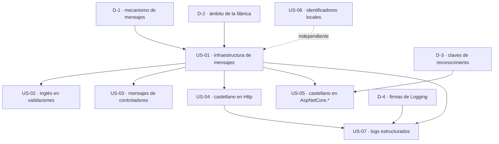

# Épica · Mensajes al usuario, idioma e instrumentación de logs

> **Versión destino:** 2.1.0
> **Origen:** [`Temas Pendientes/Mejoras-Prioridad-Baja.md`](../../Temas%20Pendientes/Mejoras-Prioridad-Baja.md) — puntos **77, 78, 79** y **80**
> **Plan del que se desgaja:** bloque «Mensajes al usuario» (77-80)
> **Estado:** ⬜ No iniciada
> **Esfuerzo:** L (~5-6 jornadas con las siete historias; ~3 jornadas sin US-07)
> **Riesgo:** 🟢 bajo en US-02, US-05 y US-06 · 🟡 medio en US-03 y US-04 · 🟠 alto en US-01 y US-07

---

## Índice

1. [Contexto y problema](#1-contexto-y-problema)
2. [Hallazgos colaterales](#2-hallazgos-colaterales)
3. [Alcance](#3-alcance)
4. [Historias de usuario](#4-historias-de-usuario)
5. [Orden de ejecución](#5-orden-de-ejecución)
6. [Decisiones abiertas](#6-decisiones-abiertas)
7. [Definición de terminado](#7-definición-de-terminado)
8. [Apéndice · código actual y propuesto](#8-apéndice--código-actual-y-propuesto)

---

## 1. Contexto y problema

El bloque «Mensajes al usuario» se redactó antes del renombrado 2.0.0 y describe erratas concretas
(`"source no be null"`, `"isn't null"`, `"soported"`, `ContieneCombinacion`) que **ya no existen**.
La auditoría contra el código real de `release/2.0.0-nomenclatura` demuestra que el problema **no ha
desaparecido: se ha desplazado**. Lo que queda no son erratas aisladas, sino tres carencias
estructurales:

1. **No hay infraestructura de mensajes.** `IStringLocalizer`: **0 usos**. Ficheros `.resx`:
   **0 en toda la solución**. Cada literal vive incrustado en el método que lo emite. Sólo
   `MoralesLarios.OOFP.Core` tiene un embrión de solución —la fábrica interna `EnsureFpMessages`
   con 46 mensajes centralizados—, y **no está expuesta ni reutilizada** por los demás proyectos.
2. **Hay castellano incrustado en tres bibliotecas públicas.** **33 apariciones / 28 literales
   distintos**: `Http` (22), `AspNetCore.Results` (8) y `AspNetCore.Controllers` (3). Una
   biblioteca no puede imponer el idioma de las respuestas ni de los logs de la aplicación que la
   consume.
3. **Los logs no son estructurados.** **30 llamadas de log / 48 literales**, el **100 %**
   interpolados (`$"..."`). Plantillas con parámetros nombrados: **0**. `EventId`: **0**. Una
   plantilla interpolada se resuelve *antes* de llegar al `ILogger`, así que el proveedor recibe un
   `string` opaco: no hay campos consultables en Seq, Application Insights o Elastic, y cada
   invocación genera una plantilla distinta.

| Punto | Proyecto(s) | Estado real tras la auditoría | Naturaleza |
|---|---|---|---|
| 77 | `Validation`, `Validation.DataAnnotations`, `Validation.FluentValidation` | 🟡 **parcial** — las erratas citadas: **0**; queda 1 mensaje con inglés deficiente | Mensaje aislado + falta de recursos |
| 78 | `AspNetCore.Controllers` | 🟡 **parcial** — `isn't null` / `diferent type` / `soported`: **0**; quedan 2 mensajes malos y 1 puente obsoleto | Inglés incorrecto en respuesta HTTP |
| 79 | `Http`, `AspNetCore.Results`, `AspNetCore.Controllers` | 🔴 **vivo** — 33 apariciones de castellano en bibliotecas | Idioma impuesto por la biblioteca |
| 80 | `Application`, `Logging` | 🔴 **vivo** — 30 llamadas, 0 plantillas nombradas, 0 `EventId` | Logs no consultables |

### Punto 77 — las erratas citadas ya no existen; el agujero es la falta de recursos

Búsqueda exhaustiva de `"source no be null"`, `"source no be empty"`, `" no be "`,
`no be (null|empty)` y sus interpolaciones equivalentes: **0 apariciones**. Los cuatro proyectos de
validación existen y sus mensajes son correctos. Sobrevive **un único** literal con inglés
deficiente:

```csharp
// MoralesLarios.OOFP.Validation.FluentValidation/Helpers/Extensions.cs, L38
return MlResult<T>.Fail($"Problems with automatic create instance of {typeof(TValidator).Name}");
//                       ← «Problems with automatic create instance of» no es inglés gramatical;
//                         además no dice QUÉ hacer (registrar el validador en el contenedor)
```

### Punto 78 — el inglés deficiente viaja hoy en respuestas HTTP

`"isn't null"`, `"is diferent type"`, `"diferent type"`, `"soported"`, `"not soported"` y
`"suported"`: **0 apariciones**. Pero el mensaje más visible del proyecto —el que se devuelve
cuando una clave compuesta no se puede interpretar— sigue siendo ininteligible, y se emite desde
**6 puntos** del controlador base:

```csharp
// MoralesLarios.OOFP.AspNetCore.Controllers/Helpers/Extensions.cs, L129
public static string BuildKeyParseErrorMessage(this Exception ex, string ids)
    => $"{ids} not be extract values of pkFields. Ids string array not converted to pkFields. ex: {ex.Message}";
//     ← «not be extract values», «Ids string array not converted»: no es inglés.
//       Filtra el nombre interno «pkFields» al consumidor y no indica el formato esperado.
```

Llamado desde `MoralesLarios.OOFP.AspNetCore.Controllers/Controllers/MlCompositeKeyCrudControllerBase.cs`
líneas **47, 91, 129, 210, 254** y **292**.

```csharp
// MoralesLarios.OOFP.AspNetCore.Controllers/Helpers/Extensions.cs, L74 y L99
default: throw new FormatException(string.Format("The type {0} is not supported", fullNameTipe));
//                                               ← no incluye el VALOR que falló ni los tipos admitidos
```

Y el identificador antiguo **sigue vivo como puente obsoleto**, en contra de lo que daba por hecho
el inventario:

```csharp
// MoralesLarios.OOFP.AspNetCore.Controllers/Helpers/Extensions.Obsolete.cs, L33
[global::System.Obsolete("Renamed to BuildKeyParseErrorMessage. Will be removed in 3.0.0.", false), ...]
public static string GetPkValuesErrorMessage(this Exception ex, string ids) => ex.BuildKeyParseErrorMessage(ids);
```

> ✅ **Buena noticia:** el mensaje de desajuste de cardinalidad **ya está en inglés correcto y ya
> indica el formato esperado**, que era justo la propuesta del punto 78. No hay que reescribirlo,
> sólo centralizarlo:
>
> ```csharp
> // Extensions.cs, L145
> if (values.Length != sampleP.Length)
>     throw new ArgumentException($"The number of provided values ({values.Length}) does not match the number of primary key fields ({sampleP.Length}).", nameof(values));
> ```

### Punto 79 — 33 apariciones de castellano en tres bibliotecas públicas

El reparto por proyecto y por naturaleza:

| Proyecto | Apariciones | De ellas, mensajes emitidos | De ellas, claves de reconocimiento | Visibilidad |
|---|---:|---:|---:|---|
| `MoralesLarios.OOFP.Http` | 22 | 22 | 0 | 14 públicas · 8 protegidas/privadas |
| `MoralesLarios.OOFP.AspNetCore.Results` | 8 | 2 | 6 | 2 públicas · 6 en campo privado |
| `MoralesLarios.OOFP.AspNetCore.Controllers` | 3 | 3 | 0 | 3 públicas (documentación OpenAPI) |
| **Total** | **33** | **27** | **6** | — |

El caso más grave es `HttpApiInvoker`: **todos** sus mensajes de log y **todas** sus excepciones de
guarda están en castellano.

```csharp
// MoralesLarios.OOFP.Http/HttpApiInvoker.cs
// L30 y L408
$"Consultando datos a la url {url}"
// L114 y L456
$"Consultando datos paginados a la url {...}. PageNumber {parameters.PageNumber}, PageSize {parameters.PageSize}"
// L115 y L471
$"Añadiendo información a las cabeceras de la petición: PageNumber {...}, PageSize {...}"
// L250, L359 y L388
$"Haciendo Delete a la url {...}"   ·   $"Haciendo post a la url {...}"   ·   $"Haciendo {action} a la url {...}"
// L87, L137, L164, L191, L219 → 5 veces el mismo literal
$"{nameof(itemBody)} no puede ser nulo"
// L271 · L328 y L525
$"{nameof(clientName)} no puede ser nulo"   ·   $"{nameof(parameters.RequestBody)} no puede ser nulo"
```

```csharp
// MoralesLarios.OOFP.Http/Helpers/MlResponseWebExtensions.cs, L42 · L65 · L83
"[Contenido del error omitido por configuración]"
"[No se pudo leer el contenido del error]"
$"{source[..maxLength]}… [truncado: {source.Length - maxLength} caracteres omitidos]"

// L69 — el cuerpo del error que recibe el consumidor, íntegro en castellano
@$"Se ha producido un error en la llamada al servicio.
                    Código de error: {(int)response.StatusCode}
                    Razón: {response.ReasonPhrase}
                    Detalle error: {errorContent}"
```

En `AspNetCore.Results` el castellano aparece en dos formas muy distintas y hay que tratarlas
separadas:

```csharp
// MoralesLarios.OOFP.AspNetCore.Results/Helpers/MlResultActionResultExtensionsLegacy.cs
// L14-15 — NO son mensajes: son CLAVES de reconocimiento por texto
private static readonly IEnumerable<string> NotFoundDetailKeys =
    [NOT_FOUND_KEY, "Not Found", "Not_Found", "not found",
     "NoEncontrado", "No Encontrado", "No_Encontrado", "no encontrado",      // ← 4
     "No se han encontrado", "no se han encontrado"];                         // ← 2

// L91 y L251 — SÍ son mensajes
"El nombre del método GET no puede ser nulo, vacío o espacio en blanco"
$"{nameof(controllerBase)} no puede ser nulo"
```

Y en `AspNetCore.Controllers`, el castellano se publica **en el contrato OpenAPI**, que es lo que
ve cualquier consumidor del Swagger:

```csharp
// MoralesLarios.OOFP.AspNetCore.Controllers/Attributes/CompositeKeyParameterAttribute.cs, L25-27
Description = "Valores de la clave primaria separados por comas. " +
              "Para DateTime usa formato ISO 8601: yyyy-MM-ddTHH:mm:ss.fff " +
              "(Ejemplo: '1,2' para PKs compuestas o '2026-05-16T07:34:29.239' para DateTime)";
```

#### `ContieneCombinacion`: renombrado a medias

El inventario pedía renombrar `ContieneCombinacion` → `ContainsCombination`. Búsqueda de
`ContieneCombinacion`: **0**. El método **ya se llama `ContainsAnyKey`**… pero conserva los tres
identificadores en castellano:

```csharp
// MoralesLarios.OOFP.AspNetCore.Results/Helpers/MlResultActionResultExtensionsLegacy.cs, L300-310
static bool ContainsAnyKey(string cadena, string[] combinaciones)   // ← 2 parámetros en castellano
{
    foreach (string combinacion in combinaciones)                    // ← variable en castellano
    { ... }
}
```

Y no es el único resto: quedan locales y parámetros en castellano en código activo.

| Identificador | Fichero | Declaración | Referencias activas |
|---|---|---:|---:|
| `resultado` | `AspNetCore.Controllers/Helpers/Extensions.cs` | 27 | 32 |
| `tipoDelNulable` | `AspNetCore.Controllers/Helpers/Extensions.cs` | 52 | 16 |
| `vinoBd` | `Application/Services/CrudServiceFp.cs` | 83 y 380 | 4 |
| `cadena` · `combinaciones` · `combinacion` | `AspNetCore.Results/Helpers/MlResultActionResultExtensionsLegacy.cs` | 300 · 300 · 302 | 2 · 2 · 2 |

### Punto 80 — logs sin plantillas ni `EventId`

El inventario atribuía el problema a «`WebServices`» (hoy `Application`) y hablaba de «textos por
defecto que no dicen qué entidad». La auditoría matiza el diagnóstico: **los mensajes sí tienen
contexto** —casi todos incluyen `typeof(TDto).Name`—, pero lo incluyen **interpolado**, de modo que
el `ILogger` nunca llega a verlo como campo.

| Métrica | Valor |
|---|---:|
| Llamadas directas a `LogError`…`LogCritical` en `Application` / `Logging` | **0** / **0** |
| Llamadas `logger.Log(logLevel, message)` en `Logging/MlResultLogExtensions.cs` (L33, 49, 192, 211, 233) | **5** |
| Llamadas vía extensiones · `Application` | **28** llamadas / **44** literales |
| Llamadas vía extensiones · `Logging` | **2** llamadas / **4** literales |
| **Total** | **30 llamadas / 48 literales** |
| Literales interpolados (`$"..."`) | **48 (100 %)** |
| Plantillas con parámetros nombrados (`"... {Entity} ..."` + args) | **0** |
| Concatenaciones (`+`) | **0** |
| Usos de `EventId` | **0** |
| Logs con texto vacío de contexto (`"Error"`, `"Fallo"`, `"Exception"` a secas) | **0** |

```csharp
// MoralesLarios.OOFP.Application/Services/CrudServiceFp.cs, L36-37
validBuildMessage: x      => successMessageFactory is null ? $"Found {x.Count()} of table {typeof(TDto).Name}" : successMessageFactory(x),
//                                                            ← 1 plantilla DISTINTA por cada TDto
failBuildMessage : errors => failMessageBuilder   is null ? $"An error occurred while querying the {typeof(TDto).Name} table. Error: {errors.ToString()}" : failMessageBuilder(errors));
//                                                            ← el detalle del error entra como texto plano
```

```csharp
// MoralesLarios.OOFP.Application/Services/CrudServiceFp.cs, L120 · L177 y L207
$"An error occurred while creating a new record in the table corresponding to dto {typeof(TDto).Name}. Error: {errors.ToString()}"
$"An error occurred while updating a record in the table corresponding to dto {typeof(TDto).Name}. Error: {errors.ToString()}"

// MoralesLarios.OOFP.Logging/Extensions.cs, L24 y L38 · L25 y L39
$"{methodActionDesc} done correctly."
$"Error when {methodActionDesc} Error: {errors.ToErrorsDetailsDescription()}"
```

**Consecuencia operativa:** con 28 DTOs distintos, el proveedor de telemetría ve **28 plantillas
diferentes** donde debería ver **una** con un campo `{Entity}`. No se puede agrupar, no se puede
filtrar por entidad y no se puede alertar sobre «todos los fallos de `CreateAsync`».

---

## 2. Hallazgos colaterales

| # | Hallazgo | Fichero · línea | Decisión |
|---|---|---|---|
| H-1 | `DEFAULT_ERROR_MESSAGE` tiene una **comilla simple sin cerrar**: `"… view 'Ex(s) details exceptions."` | `Core/Helpers/Constants.cs` L14 | Se corrige en **US-02** |
| H-2 | `DEFAULT_ERROR_MESSAGE` es una **propiedad pública, no una `const`** | `Core/Helpers/Constants.cs` L14 | Fuera de alcance (ver D-5) |
| H-3 | `EnsureFpMessages` centraliza **46 mensajes + 1 plantilla `Rule`** pero es **`internal`**: el patrón correcto existe y nadie más puede usarlo | `Core/Helpers/EnsureFpMessages.cs` | Es el **modelo** de US-01 |
| H-4 | El inventario cita el proyecto `Validation.Dataannotations`; el real es **`Validation.DataAnnotations`** | — | Documental; se corrige en el inventario |
| H-5 | Coexisten `Validation.FluentValidation` y `Validation.FluentValidations` (singular y plural) | raíz de la solución | **Fuera de alcance** → épica de coherencia (puntos 81-89) |
| H-6 | `MlResultActionResultExtensionsLegacy` está **marcada `[Obsolete]` por completo**: 8 de las 33 apariciones de castellano mueren solas en 3.0.0 | `AspNetCore.Results/Helpers/` | Condiciona el alcance de **US-05** (ver D-3) |
| H-7 | El reconocimiento de «no encontrado» **por comparación de texto** (10 claves, 6 en castellano) es la causa raíz del castellano en `AspNetCore.Results` | ídem, L14-15 | Lo resuelve la **épica de contrato REST** (códigos de error tipados) |
| H-8 | **16 usos de `InvariantCulture`** en producción: son conversiones y formateo, **no** localización. Correctos | `AspNetCore.Controllers/Helpers/Extensions.cs` L88 · `Http/CompositeKeyRestClientFp.cs` L163 · `Http/Helpers/MlHttpRequestExtensions.cs` L192 | Sin cambios |
| H-9 | **3 literales de log con un genérico sin cerrar**: `$"{nameof(PostAsync)}<{typeof(T).Name}"` | `Http/HttpApiInvoker.cs` L256, L365, L394 | Lo cubre la **épica de coherencia** (punto 83); se arregla de paso en **US-04** |
| H-10 | Hay castellano **fuera** de las bibliotecas (`Logging.Sample/Program.cs` L140, `Core.Tests.Unit/.../EnsureFpCoreTests.cs` L72, `scripts/tools/MlDoc/Options.cs` L30) | — | **Fuera de alcance**: muestras, tests y herramientas internas |

---

## 3. Alcance

### Dentro

- Infraestructura única de mensajes para las bibliotecas públicas, con el idioma **inglés neutro**
  por defecto y punto de extensión para el consumidor (US-01).
- Corrección del inglés deficiente que hoy llega al consumidor: 1 mensaje en
  `Validation.FluentValidation`, 2 en `AspNetCore.Controllers`, más H-1 (US-02, US-03).
- Erradicación de las **33 apariciones de castellano** en `Http`, `AspNetCore.Results` y
  `AspNetCore.Controllers` (US-04, US-05).
- Renombrado de los **6 identificadores locales en castellano** en código activo (US-06).
- Conversión de las **30 llamadas de log** a plantillas con parámetros nombrados y `EventId`
  estables (US-07).

### Fuera

- **Traducir** a otros idiomas. Se entrega el mecanismo y el inglés; cualquier otro idioma lo
  aporta el consumidor.
- Eliminar `MlResultActionResultExtensionsLegacy`: se retira en **3.0.0** con el resto de puentes.
- Sustituir el reconocimiento de «no encontrado» por texto por códigos tipados → **épica de
  contrato REST**.
- Castellano en proyectos de muestra, de test y en `scripts/tools` (H-10).
- Los 3 genéricos sin cerrar como *punto* del inventario (83) → **épica de coherencia**; aquí sólo
  se corrigen como efecto colateral de reescribir esos tres logs.
- Convertir `DEFAULT_ERROR_MESSAGE` en `const` (H-2) y la duplicidad
  `FluentValidation`/`FluentValidations` (H-5).

---

## 4. Historias de usuario

> **Esfuerzo:** XS (<2 h) · S (½ jornada) · M (1 jornada) · L (2 jornadas) · XL (3+ jornadas)
> **Riesgo:** 🟢 bajo · 🟡 medio · 🟠 alto · 🔴 muy alto (rompe compatibilidad)

### US-01 · Infraestructura única de mensajes

> **Como** consumidor de la biblioteca
> **quiero** que todos los mensajes que emite estén centralizados y en inglés neutro
> **para** poder sustituirlos por los míos sin parchear la biblioteca ni depender de su idioma.

**Esfuerzo:** M · **Riesgo:** 🟠 · **Depende de:** D-1, D-2

- [ ] Se define el mecanismo elegido en **D-1** y se documenta en el `README` del proyecto afectado.
- [ ] El patrón sigue el modelo ya probado de `EnsureFpMessages`: una clase de fábrica con un
      método por mensaje, **no** constantes sueltas con `string.Format`.
- [ ] Existe una clase de mensajes por proyecto público que emita texto al consumidor:
      `Http`, `AspNetCore.Controllers`, `AspNetCore.Results`, `Application`,
      `Validation.FluentValidation`.
- [ ] Ningún mensaje nuevo se escribe en línea: todos pasan por la fábrica.
- [ ] La fábrica de `Core` (`EnsureFpMessages`) **no** cambia de visibilidad en esta historia; si
      D-2 decide exponerla, se hace en una historia aparte de la épica de coherencia.
- [ ] Un test por proyecto comprueba que la clase de mensajes no contiene caracteres fuera de
      ASCII (detector de castellano por acentos).

**API propuesta**

```csharp
// MoralesLarios.OOFP.Http/Helpers/HttpMessages.cs
internal static class HttpMessages
{
    internal static string ArgumentCannotBeNull(string paramName)
        => $"'{paramName}' cannot be null.";

    internal static string ErrorContentOmittedByConfiguration()
        => "[Error content omitted by configuration.]";

    internal static string ErrorContentCouldNotBeRead()
        => "[Error content could not be read.]";

    internal static string ErrorContentTruncated(int omittedCharacters)
        => $"[Truncated: {omittedCharacters} characters omitted.]";

    internal static string ServiceCallFailed(int statusCode, string? reasonPhrase, string? errorContent)
        => $"The service call failed. Status code: {statusCode}. Reason: {reasonPhrase}. Details: {errorContent}";
}
```

**Notas técnicas**

- `internal` + `InternalsVisibleTo` hacia el proyecto de test de cada biblioteca: no se amplía la
  superficie pública.
- Si D-1 elige `.resx`, la clase de fábrica se mantiene como **fachada**: el cuerpo pasa a leer del
  recurso. Así US-02…US-07 no cambian aunque D-1 se decida más tarde.

**Tests mínimos**

| Caso | Resultado esperado |
|---|---|
| Cada método de cada clase de mensajes | Devuelve texto no vacío |
| Barrido ASCII sobre las clases de mensajes | 0 caracteres acentuados |
| Interpolación con `paramName` nulo | No lanza; produce un marcador legible |

**Riesgo principal:** elegir `.resx` y descubrir tarde que complica el empaquetado NuGet de 5
proyectos. Mitigación: la fachada de US-01 permite cambiar de mecanismo sin tocar los llamantes.

---

### US-02 · Inglés correcto en validaciones y en `Constants`

> **Como** desarrollador que integra un validador
> **quiero** que el mensaje de fallo esté en inglés correcto y me diga qué hacer
> **para** resolver el problema sin leer el código fuente de la biblioteca.

**Esfuerzo:** XS · **Riesgo:** 🟢 · **Depende de:** US-01

- [ ] `Validation.FluentValidation/Helpers/Extensions.cs` L38 emite un mensaje gramatical que
      **nombra la causa** (el validador no se pudo instanciar) y **la acción** (registrarlo).
- [ ] Se corrige **H-1**: la comilla sin cerrar de `Core/Helpers/Constants.cs` L14.
- [ ] Se confirma por búsqueda que `"no be null"`, `"no be empty"` y `" no be "` siguen en **0**
      apariciones, y se anota el resultado en el inventario.
- [ ] Los 4 proyectos de validación compilan sin cambios en su superficie pública.

**API propuesta**

```csharp
// ───── 2.0.0 ─────
$"Problems with automatic create instance of {typeof(TValidator).Name}"

// ───── 2.1.0 ─────
ValidationMessages.ValidatorCouldNotBeCreated(typeof(TValidator));
// → "The validator 'CustomerValidator' could not be created automatically.
//    Register it in the service container or provide an instance explicitly."
```

**Tests mínimos**

| Caso | Resultado esperado |
|---|---|
| Validador sin constructor público | El mensaje contiene el nombre del tipo y la palabra `Register` |
| `Constants.DEFAULT_ERROR_MESSAGE` | Comillas simples balanceadas |
| Los 16 tests de `Validation.FluentValidation.Tests.Unit` | En verde |

**Riesgo principal:** que algún test compare el mensaje literal. Mitigación: buscar el literal
antiguo en los proyectos de test antes de cambiarlo.

---

### US-03 · Mensajes útiles en los controladores (punto 78)

> **Como** consumidor de un endpoint de clave compuesta
> **quiero** que el error de interpretación de la clave me diga el formato esperado
> **para** corregir mi petición sin preguntar al equipo que publicó la API.

**Esfuerzo:** S · **Riesgo:** 🟡 · **Depende de:** US-01

- [ ] `BuildKeyParseErrorMessage` emite inglés gramatical, **no** filtra el identificador interno
      `pkFields` y **sí** indica el separador y la cardinalidad esperados.
- [ ] Los **6 llamantes** de `MlCompositeKeyCrudControllerBase` (L47, 91, 129, 210, 254, 292) siguen
      compilando sin cambios de firma.
- [ ] Los dos `FormatException` de `Extensions.cs` L74 y L99 incluyen **el valor que falló** y la
      lista de tipos admitidos.
- [ ] El puente obsoleto `GetPkValuesErrorMessage` (`Extensions.Obsolete.cs` L33) **se conserva** y
      sigue delegando: no se toca hasta 3.0.0.
- [ ] El mensaje de cardinalidad de `ParseKeyValues` (L145) **no se reescribe**; sólo se mueve a la
      fábrica de mensajes.

**API propuesta**

```csharp
// ───── 2.0.0 ─────
public static string BuildKeyParseErrorMessage(this Exception ex, string ids)
    => $"{ids} not be extract values of pkFields. Ids string array not converted to pkFields. ex: {ex.Message}";

// ───── 2.1.0 ─────
public static string BuildKeyParseErrorMessage(this Exception ex, string ids)
    => ControllerMessages.KeyValuesCouldNotBeParsed(ids, ex);
// → "The composite key '2026-05-16' could not be parsed into the primary key values.
//    Expected values separated by ','. Cause: String was not recognized as a valid DateTime."
```

**Notas técnicas**

- La firma pública de `BuildKeyParseErrorMessage` **no cambia**: sólo cambia el texto. No es
  ruptura de API, pero **sí** es un cambio observable en el cuerpo de la respuesta HTTP → se
  documenta en §3.3 del prompt de actualización.

**Tests mínimos**

| Caso | Resultado esperado |
|---|---|
| Clave con 3 valores para una PK de 2 campos | El mensaje cita `3` y `2` |
| Clave con un `DateTime` mal formado | El mensaje cita el separador `,` y el valor recibido |
| El mensaje de error | No contiene la cadena `pkFields` |
| Tipo no admitido en `ConvertToType` | El `FormatException` cita el valor y los tipos admitidos |

**Riesgo principal:** el cuerpo de la respuesta HTTP cambia y un consumidor podría estar
comparándolo. Es exactamente el motivo por el que la épica de contrato REST introduce códigos de
error tipados; aquí se avisa en §3.3.

---

### US-04 · Erradicar el castellano de `MoralesLarios.OOFP.Http` (punto 79a)

> **Como** consumidor anglófono de la biblioteca HTTP
> **quiero** que sus logs y sus excepciones estén en inglés
> **para** poder leer la telemetría de mi aplicación sin traducirla.

**Esfuerzo:** M · **Riesgo:** 🟡 · **Depende de:** US-01

- [ ] Las **22 apariciones** de castellano en `Http` quedan en **0**.
- [ ] `HttpApiInvoker.cs`: los 8 grupos de literales (L30, 87, 114, 115, 137, 164, 191, 219, 250,
      271, 328, 359, 388, 408, 456, 471, 525) pasan por la fábrica de mensajes.
- [ ] Los 5 literales idénticos de `$"{nameof(itemBody)} no puede ser nulo"` (L87, 137, 164, 191,
      219) se unifican en **una sola** llamada a `HttpMessages.ArgumentCannotBeNull`.
- [ ] `MlResponseWebExtensions.cs`: los 4 literales (L42, 65, 69, 83) quedan en inglés, incluido el
      bloque multilínea verbatim de L69.
- [ ] `RegisterServices.cs` L132: `"clientName no puede ser null"` → mensaje en inglés.
- [ ] De paso, los 3 genéricos sin cerrar de **H-9** (L256, L365, L394) quedan con `>` de cierre.
- [ ] Los 33 tests de `Http.Tests.Integration` y los 7 de `Http.Tests.Unit` siguen en verde.

**API propuesta**

```csharp
// ───── 2.0.0 ─────
await _logger.LogMlResultInformationAsync($"Consultando datos a la url {url}")
...
EnsureFp.NotNull(itemBody, $"{nameof(itemBody)} no puede ser nulo");

// ───── 2.1.0 ─────
await _logger.LogMlResultInformationAsync(HttpMessages.QueryingData(url))
...
EnsureFp.NotNull(itemBody, HttpMessages.ArgumentCannotBeNull(nameof(itemBody)));
```

**Notas técnicas**

- `HttpApiInvoker` **sí usa** su `ILogger` (L30, 60, 66): a diferencia de los 4 clientes REST de la
  épica de código muerto, aquí el logger se queda.
- El literal verbatim de L69 (`@$"..."`) incluye saltos de línea y sangría; al moverlo a la fábrica
  conviene pasar a una cadena cruda (`"""`) para no arrastrar la indentación del método.

**Tests mínimos**

| Caso | Resultado esperado |
|---|---|
| Barrido de acentos sobre `MoralesLarios.OOFP.Http/**/*.cs` | 0 apariciones en literales |
| `itemBody` nulo en los 5 métodos afectados | Los 5 mensajes son idénticos y están en inglés |
| Respuesta 500 con cuerpo | La descripción del error está en inglés y cita el `StatusCode` |
| Cuerpo de error mayor que `maxLength` | El mensaje de truncado está en inglés y cita los caracteres omitidos |

**Riesgo principal:** 22 ediciones en un fichero de 557 líneas que ya tuvo problemas con las
herramientas de edición. Mitigación: PowerShell determinista con guarda de recuento de líneas y
verificación con `git diff -U1`, nunca edición asistida masiva.

---

### US-05 · Erradicar el castellano de `AspNetCore.Results` y `AspNetCore.Controllers` (punto 79b)

> **Como** consumidor del Swagger generado
> **quiero** que la descripción de los parámetros de clave compuesta esté en inglés
> **para** que mi documentación de API sea coherente en un solo idioma.

**Esfuerzo:** S · **Riesgo:** 🟢 · **Depende de:** US-01, D-3

- [ ] `CompositeKeyParameterAttribute.cs` L25-27: la `Description` de OpenAPI queda en inglés,
      conservando el ejemplo ISO 8601 y el formato de PK compuesta.
- [ ] `MlResultActionResultExtensionsLegacy.cs` L91 y L251: los 2 mensajes emitidos pasan a inglés.
- [ ] Las **6 claves de reconocimiento en castellano** de L14-15 se tratan según **D-3**: se
      conservan (compatibilidad) o se retiran (limpieza). La decisión se anota en el fichero con un
      comentario que remita a la épica de contrato REST.
- [ ] Las 8 apariciones de `AspNetCore.Results` y las 3 de `AspNetCore.Controllers` quedan
      resueltas o explícitamente justificadas.
- [ ] Los 54 tests de `AspNetCore.Results.Tests.Unit` siguen en verde.

**API propuesta**

```csharp
// ───── 2.1.0 ─────
Description = "Primary key values separated by commas. "
            + "For DateTime use ISO 8601: yyyy-MM-ddTHH:mm:ss.fff "
            + "(e.g. '1,2' for composite keys, or '2026-05-16T07:34:29.239' for DateTime).";
```

**Notas técnicas**

- `MlResultActionResultExtensionsLegacy` está entera marcada `[Obsolete]` (**H-6**). Tocar sus
  mensajes es una inversión con fecha de caducidad en 3.0.0: por eso **D-3** plantea limitarse a
  los 2 mensajes emitidos y dejar intactas las 10 claves de reconocimiento.

**Tests mínimos**

| Caso | Resultado esperado |
|---|---|
| Swagger generado para un controlador de clave compuesta | La descripción del parámetro está en inglés |
| Nombre de método GET vacío | El mensaje está en inglés |
| `controllerBase` nulo | El mensaje está en inglés |
| Detalle de error con la clave `"no encontrado"` | Según D-3: sigue mapeando a 404, o deja de hacerlo documentadamente |

**Riesgo principal:** si D-3 retira las claves en castellano, un consumidor que generase el texto
«no encontrado» dejaría de recibir un 404 y recibiría un 500. Mitigación: retirar sólo con nota
expresa en §3.3 y en las notas de versión.

---

### US-06 · Identificadores locales en inglés (punto 79c)

> **Como** mantenedor del código
> **quiero** que no queden identificadores en castellano entre cientos en inglés
> **para** que leer un método no exija cambiar de idioma a mitad de línea.

**Esfuerzo:** XS · **Riesgo:** 🟢 · **Depende de:** —

- [ ] `resultado` → `result` (declaración L27 + 32 referencias) en
      `AspNetCore.Controllers/Helpers/Extensions.cs`.
- [ ] `tipoDelNulable` → `nullableTypeName` (declaración L52 + 16 referencias) en el mismo fichero.
- [ ] `vinoBd` → `dbEntity` (L83 y L380) en `Application/Services/CrudServiceFp.cs`.
- [ ] `cadena` → `text`, `combinaciones` → `keys`, `combinacion` → `key` en `ContainsAnyKey`
      (`AspNetCore.Results/Helpers/MlResultActionResultExtensionsLegacy.cs` L300-302).
- [ ] **Ninguno** de los 6 identificadores es público: 0 rupturas de API, 0 entradas en
      `.renames.md`.
- [ ] El recuento de líneas de cada fichero es idéntico antes y después.

**Notas técnicas**

- `vinoBd` es el parámetro de una lambda (`.MapAsync(vinoBd => ...)`): su nombre no es parte de
  ninguna firma.
- `cadena`, `combinaciones` y `combinacion` pertenecen a un método `static` **sin modificador de
  acceso** → `private` implícito dentro de una clase estática.
- Renombrar con el proveedor de refactorización del lenguaje, no con búsqueda y reemplazo:
  `resultado` tiene 32 referencias y `result` ya existe como identificador en el mismo fichero.

**Tests mínimos**

| Caso | Resultado esperado |
|---|---|
| Compilación `Release --no-incremental` | 0 errores, `CS1591 = 0` |
| Barrido de los 6 identificadores antiguos | 0 apariciones en `**/*.cs` |
| Los 1.060 tests | En verde |

**Riesgo principal:** una colisión de nombres al renombrar `resultado` → `result`. Mitigación:
usar el renombrado semántico, que detecta la colisión antes de aplicarla.

---

### US-07 · Logs estructurados con plantillas nombradas y `EventId` (punto 80)

> **Como** responsable de la explotación en producción
> **quiero** que los logs de la biblioteca sean plantillas con campos consultables
> **para** poder filtrar por entidad y por operación y alertar sobre un fallo concreto.

**Esfuerzo:** L · **Riesgo:** 🟠 · **Depende de:** US-01, D-4

- [ ] Las **30 llamadas de log** emiten plantillas con **parámetros nombrados**; interpolación en
      el mensaje de log: **0**.
- [ ] Existe un catálogo de `EventId` estables, uno por operación lógica, en una clase única.
- [ ] `CrudServiceFp` usa **una** plantilla por operación con el campo `{Entity}`, en lugar de una
      plantilla por `TDto`.
- [ ] El detalle del error entra como **campo estructurado**, no concatenado en el texto.
- [ ] La API pública de los *builders* de mensaje (`successMessageFactory`, `failMessageBuilder`)
      se resuelve según **D-4**: se conserva, se complementa o se sustituye.
- [ ] Los 5 `logger.Log(logLevel, message)` de `Logging/MlResultLogExtensions.cs` (L33, 49, 192,
      211, 233) aceptan y propagan plantilla + argumentos + `EventId`.
- [ ] Un test comprueba, con un `ILogger` falso, que el *estado* del registro contiene los campos
      esperados y **no** sólo el texto final.
- [ ] Los 1.060 tests siguen en verde.

**API propuesta**

```csharp
// ───── 2.0.0 ─────
validBuildMessage: x      => $"Found {x.Count()} of table {typeof(TDto).Name}",
failBuildMessage : errors => $"An error occurred while querying the {typeof(TDto).Name} table. Error: {errors.ToString()}");

// ───── 2.1.0 ─────
internal static class ApplicationEvents
{
    internal static readonly EventId GetPagedSucceeded = new(2101, nameof(GetPagedSucceeded));
    internal static readonly EventId GetPagedFailed    = new(2102, nameof(GetPagedFailed));
    internal static readonly EventId CreateFailed      = new(2111, nameof(CreateFailed));
    internal static readonly EventId UpdateFailed      = new(2121, nameof(UpdateFailed));
    internal static readonly EventId DeleteFailed      = new(2131, nameof(DeleteFailed));
}

// Una sola plantilla, válida para los 28 DTOs
_logger.LogInformation(ApplicationEvents.GetPagedSucceeded,
                       "Found {Count} records of entity {Entity}.",
                       items.Count(), typeof(TDto).Name);

_logger.LogError(ApplicationEvents.GetPagedFailed,
                 "Querying entity {Entity} failed. {ErrorDetails}",
                 typeof(TDto).Name, errors);
```

**Notas técnicas**

- Las 30 llamadas no invocan `ILogger` directamente: pasan por las extensiones de
  `MoralesLarios.OOFP.Logging`, cuyas firmas reciben hoy un `string` ya formado. **Propagar
  plantilla + `object?[]` + `EventId` por toda la cadena es el verdadero coste de esta historia**,
  y es lo que la hace 🟠 y no 🟡.
- Alternativa de bajo riesgo si D-4 lo exige: añadir **sobrecargas** que acepten
  `(EventId, string template, params object?[] args)` y marcar las que reciben `string` como
  «mensaje ya formado», sin eliminarlas. Aditivo, 0 rupturas.
- `LoggerMessage.Define` con generación de código daría el mejor rendimiento, pero no es compatible
  con plantillas elegidas en tiempo de ejecución por el consumidor (`successMessageFactory`): esa
  tensión es precisamente **D-4**.

**Tests mínimos**

| Caso | Resultado esperado |
|---|---|
| `ILogger` falso + `GetPagedAsync` correcto | El estado del registro contiene `Count` y `Entity` como campos |
| `ILogger` falso + `GetPagedAsync` fallido | `EventId` = `GetPagedFailed` y campo `ErrorDetails` presente |
| Dos `TDto` distintos | **La misma** plantilla, distinto valor de `{Entity}` |
| `successMessageFactory` suministrado por el consumidor | Sigue respetándose |
| `EventId` de cada operación | Estable entre ejecuciones |

**Riesgo principal:** propagar plantilla y argumentos obliga a tocar las firmas de las extensiones
de `Logging`, que son públicas y numerosas. Mitigación: la vía aditiva de sobrecargas descrita
arriba, decidida en D-4 **antes** de empezar.

---

## 5. Orden de ejecución



| # | Historia | Esfuerzo | Riesgo | Hito |
|---|---|---|---|---|
| 0 | Cerrar **D-1**, **D-2** y **D-4** | XS | 🟠 | 🎯 **Hito 0** · estrategia aprobada |
| 1 | **US-06** · identificadores locales en inglés | XS | 🟢 | — |
| 2 | **US-01** · infraestructura de mensajes | M | 🟠 | 🎯 **Hito 1** · fábrica en los 5 proyectos |
| 3 | **US-02** · inglés en validaciones + H-1 | XS | 🟢 | — |
| 4 | **US-03** · mensajes de los controladores | S | 🟡 | 🎯 **Hito 2** · punto 78 cerrado |
| 5 | **US-04** · castellano en `Http` (22) | M | 🟡 | — |
| 6 | **US-05** · castellano en `AspNetCore.*` (11) | S | 🟢 | 🎯 **Hito 3** · punto 79 cerrado · 0 acentos en bibliotecas |
| 7 | **US-07** · logs estructurados + `EventId` | L | 🟠 | 🎯 **Hito 4** · punto 80 cerrado |

**Total:** ~**5,75 jornadas** (0,25 + 0,25 + 1 + 0,25 + 0,5 + 1 + 0,5 + 2). Sin **US-07** la épica
baja a ~**3,75 jornadas** y el riesgo máximo a 🟡.

> **US-06 primero, a propósito.** Es XS, 🟢, no depende de ninguna decisión y toca ficheros que
> luego modifican US-03, US-04 y US-05. Hacerlo antes evita resolver conflictos dos veces.

---

## 6. Decisiones abiertas

| Id | Decisión | Opciones | Recomendación |
|---|---|---|---|
| **D-1** | Mecanismo de mensajes | (a) clase de fábrica `internal` por proyecto, como `EnsureFpMessages`; (b) ficheros `.resx` + `IStringLocalizer`; (c) delegado configurable `Func<string, string>` que el consumidor inyecta | **(a)** ahora, con la clase como **fachada** para poder migrar a (b) sin tocar llamantes. Hoy hay 0 `.resx` y 0 `IStringLocalizer`: introducir ambos en 5 proyectos es un coste que esta épica no necesita asumir |
| **D-2** | ¿Se expone `EnsureFpMessages` de `Core` para reutilizarla? | (a) no: una fábrica por proyecto, aunque haya 3-4 mensajes repetidos; (b) sí: pasa a `public` y los 5 proyectos la consumen | **(a)**. Hacer pública una fábrica de mensajes la convierte en API con compromiso de compatibilidad; 3 literales duplicados son más baratos |
| **D-3** | Las 6 claves de reconocimiento en castellano de `NotFoundDetailKeys` | (a) conservarlas: la clase es `[Obsolete]` y muere en 3.0.0; (b) retirarlas ya; (c) conservarlas y marcarlas con un comentario que remita a la épica de contrato REST | **(c)**. Coste cero, no rompe a nadie y deja constancia de que la solución real son los códigos tipados |
| **D-4** | Cómo introducir plantilla + `EventId` en las extensiones de `Logging` | (a) cambiar las firmas actuales (ruptura); (b) **añadir sobrecargas** y dejar las de `string` como «mensaje ya formado»; (c) aplazar US-07 a 2.2.0 | **(b)**. Aditivo, 0 rupturas y permite migrar los llamantes de uno en uno |
| **D-5** | ¿Se entra a corregir `DEFAULT_ERROR_MESSAGE` más allá de la comilla? | (a) sólo la comilla (H-1); (b) además convertirla en `const` (H-2); (c) además revisar su redacción | **(a)** en esta épica; **(b)** pertenece a la épica de coherencia |
| **D-6** | ¿Se traduce la biblioteca a algún otro idioma en 2.1.0? | (a) no: sólo inglés neutro y el mecanismo; (b) sí: inglés + castellano | **(a)**. El punto 79 pide explícitamente que la biblioteca **no** imponga idioma; añadir un segundo idioma propio contradice el objetivo |

---

## 7. Definición de terminado

- [ ] Las 7 historias cerradas, o las no abordadas movidas a 2.2.0 con justificación escrita.
- [ ] Las 6 decisiones **D-1** … **D-6** resueltas y anotadas en este documento.
- [ ] **0 apariciones de castellano** en literales de `MoralesLarios.OOFP.Http`,
      `MoralesLarios.OOFP.AspNetCore.Results` y `MoralesLarios.OOFP.AspNetCore.Controllers`
      (hoy: 22 + 8 + 3 = **33**), salvo las explícitamente justificadas por **D-3**.
- [ ] **0 identificadores en castellano** en código activo de biblioteca (hoy: **6**).
- [ ] **0 literales de log interpolados** en `Application` y `Logging` (hoy: **48**), si se aborda
      US-07.
- [ ] Todo mensaje emitido al consumidor procede de una clase de mensajes; **0** literales nuevos
      escritos en línea.
- [ ] La solución **compila en `Release --no-incremental` con 0 errores y `CS1591 = 0`**.
- [ ] Los **1.060 tests** siguen **en verde**.
- [ ] Los cambios observables en el cuerpo de las respuestas HTTP (US-03, US-05) quedan
      documentados en §3.3 de
      [`Copilot/.github/prompts/oofp-upgrade-2.prompt.md`](../../Copilot/.github/prompts/oofp-upgrade-2.prompt.md).
- [ ] Los puntos **77, 78, 79** y **80** quedan marcados en
      [`Temas Pendientes/Mejoras-Prioridad-Baja.md`](../../Temas%20Pendientes/Mejoras-Prioridad-Baja.md)
      con su veredicto y el enlace a esta épica.
- [ ] `scripts/check-md-links2.ps1`, `scripts/check-md-anchors4.ps1` y
      `scripts/check-md-encoding.ps1` pasan sin regresiones.

---

## 8. Apéndice · código actual y propuesto

### 8.1 · El patrón que ya funciona en `Core` y hay que generalizar

La solución al punto 77 **ya existe** dentro del proyecto, aplicada a los helpers `EnsureFp*`: una
fábrica que concentra 46 mensajes y una plantilla común. Es el modelo de US-01.

```csharp
// Hoy — MoralesLarios.OOFP.Core/Helpers/EnsureFpMessages.cs, L18-30 (internal)
$"'{SafeName(paramName)}' cannot be null."
$"'{SafeName(paramName)}' cannot be null or empty."
$"'{SafeName(paramName)}' cannot be null, empty or whitespace."
$"'{SafeName(paramName)}' is not valid."
$"An error occurred while validating '{SafeName(paramName)}'. Error: {ex.Message}. More info in Ex Details."
```

| Proyecto | ¿Tiene fábrica de mensajes hoy? | Literales que habría que mover |
|---|---|---:|
| `MoralesLarios.OOFP.Core` | ✅ `EnsureFpMessages` (46 + 1 plantilla) | 0 |
| `MoralesLarios.OOFP.Http` | ❌ | 22 castellano + 3 genéricos sin cerrar |
| `MoralesLarios.OOFP.AspNetCore.Controllers` | ❌ | 3 castellano + 3 inglés deficiente |
| `MoralesLarios.OOFP.AspNetCore.Results` | ❌ | 2 castellano (+ 6 claves, según D-3) |
| `MoralesLarios.OOFP.Application` | ❌ | 5 plantillas de log |
| `MoralesLarios.OOFP.Validation.FluentValidation` | ❌ | 1 inglés deficiente |

### 8.2 · US-03 · el mensaje que hoy viaja en 6 respuestas HTTP

**Hoy — `MoralesLarios.OOFP.AspNetCore.Controllers/Helpers/Extensions.cs`, L129**

```csharp
// ───── 2.0.0 ─────
/// <summary>
/// Construye la instancia solicitada de <c>KeyParseErrorMessage</c>.
/// </summary>
public static string BuildKeyParseErrorMessage(this Exception ex, string ids)
    => $"{ids} not be extract values of pkFields. Ids string array not converted to pkFields. ex: {ex.Message}";
//     ↑ no es inglés          ↑ identificador interno filtrado   ↑ sin formato esperado
```

**Después**

```csharp
// ───── 2.1.0 ─────
/// <summary>
/// Construye el mensaje de error que se devuelve cuando una clave compuesta no se puede interpretar.
/// </summary>
/// <param name="ex">Excepción capturada durante la conversión.</param>
/// <param name="ids">Texto recibido con los valores de la clave.</param>
/// <returns>Mensaje en inglés que indica el formato esperado y la causa del fallo.</returns>
public static string BuildKeyParseErrorMessage(this Exception ex, string ids)
    => ControllerMessages.KeyValuesCouldNotBeParsed(ids, ex);

// MoralesLarios.OOFP.AspNetCore.Controllers/Helpers/ControllerMessages.cs
internal static class ControllerMessages
{
    internal static string KeyValuesCouldNotBeParsed(string ids, Exception ex)
        => $"The composite key '{ids}' could not be parsed into primary key values. "
         + $"Expected values separated by ','. Cause: {ex.Message}";

    internal static string KeyValueCountMismatch(int provided, int expected)
        => $"The number of provided values ({provided}) does not match the number of primary key fields ({expected}).";

    internal static string TypeNotSupported(string typeName, string value)
        => $"The type '{typeName}' is not supported for key conversion (received value: '{value}'). "
         + "Supported types: numeric types, Boolean, String, DateTime, Guid and their nullable variants.";
}
```

**Los 6 llamantes, que no cambian**

| Fichero | Líneas |
|---|---|
| `AspNetCore.Controllers/Controllers/MlCompositeKeyCrudControllerBase.cs` | 47, 91, 129, 210, 254, 292 |

**El puente obsoleto, que se conserva intacto**

```csharp
// MoralesLarios.OOFP.AspNetCore.Controllers/Helpers/Extensions.Obsolete.cs, L33 — SIN CAMBIOS
[global::System.Obsolete("Renamed to BuildKeyParseErrorMessage. Will be removed in 3.0.0.", false), ...]
public static string GetPkValuesErrorMessage(this Exception ex, string ids) => ex.BuildKeyParseErrorMessage(ids);
```

### 8.3 · US-04 · las 22 apariciones de castellano en `Http`, una a una

| Literal (hoy) | Fichero | Líneas | Nº | Visibilidad |
|---|---|---|---:|---|
| `$"Consultando datos a la url {url}"` | `HttpApiInvoker.cs` | 30, 408 | 2 | pública / protegida |
| `$"Consultando datos paginados a la url …. PageNumber …, PageSize …"` | `HttpApiInvoker.cs` | 114, 456 | 2 | pública / protegida |
| `$"Añadiendo información a las cabeceras … PageNumber …, PageSize …"` | `HttpApiInvoker.cs` | 115, 471 | 2 | pública / protegida |
| `$"Haciendo Delete a la url …"` · `$"Haciendo post a la url …"` · `$"Haciendo {action} a la url …"` | `HttpApiInvoker.cs` | 250, 359, 388 | 3 | pública / protegida ×2 |
| `$"{nameof(itemBody)} no puede ser nulo"` | `HttpApiInvoker.cs` | 87, 137, 164, 191, 219 | 5 | pública |
| `$"{nameof(clientName)} no puede ser nulo"` | `HttpApiInvoker.cs` | 271 | 1 | pública |
| `$"{nameof(parameters.RequestBody)} no puede ser nulo"` | `HttpApiInvoker.cs` | 328, 525 | 2 | protegida |
| `"clientName no puede ser null"` | `RegisterServices.cs` | 132 | 1 | privada |
| `"[Contenido del error omitido por configuración]"` | `Helpers/MlResponseWebExtensions.cs` | 42 | 1 | pública |
| `"[No se pudo leer el contenido del error]"` | `Helpers/MlResponseWebExtensions.cs` | 65 | 1 | pública |
| Bloque verbatim «Se ha producido un error en la llamada al servicio…» | `Helpers/MlResponseWebExtensions.cs` | 69 | 1 | pública |
| `$"… [truncado: {…} caracteres omitidos]"` | `Helpers/MlResponseWebExtensions.cs` | 83 | 1 | privada |
| | | **Total** | **22** | |

**Hoy — `MoralesLarios.OOFP.Http/Helpers/MlResponseWebExtensions.cs`, L69**

```csharp
// ───── 2.0.0 ─────
var description = @$"Se ha producido un error en la llamada al servicio.
                    Código de error: {(int)response.StatusCode}
                    Razón: {response.ReasonPhrase}
                    Detalle error: {errorContent}";
```

**Después**

```csharp
// ───── 2.1.0 ─────
var description = HttpMessages.ServiceCallFailed((int)response.StatusCode,
                                                  response.ReasonPhrase,
                                                  errorContent);

// HttpMessages.cs — cadena cruda: sin la sangría del método llamante
internal static string ServiceCallFailed(int statusCode, string? reasonPhrase, string? errorContent)
    => $"""
        The service call failed.
        Status code: {statusCode}
        Reason: {reasonPhrase}
        Error details: {errorContent}
        """;
```

**De paso — H-9, los 3 genéricos sin cerrar**

```csharp
// ───── 2.0.0 ─────  HttpApiInvoker.cs L256 · L365 · L394
$"{nameof(DeleteByIdAsync)}<{typeof(T).Name}"      // ← falta '>'
$"{nameof(PostAsync)}<{typeof(T).Name}"            // ← falta '>'
$"{nameof(ActionEmptyAsync)}<{typeof(T).Name}"     // ← falta '>'

// ───── 2.1.0 ─────
$"{nameof(DeleteByIdAsync)}<{typeof(T).Name}>"
$"{nameof(PostAsync)}<{typeof(T).Name}>"
$"{nameof(ActionEmptyAsync)}<{typeof(T).Name}>"
```

### 8.4 · US-05 · el castellano de `AspNetCore.*`

**Hoy — `AspNetCore.Controllers/Attributes/CompositeKeyParameterAttribute.cs`, L25-27**

```csharp
// ───── 2.0.0 ─────  esto se publica en el Swagger
Description = "Valores de la clave primaria separados por comas. " +
              "Para DateTime usa formato ISO 8601: yyyy-MM-ddTHH:mm:ss.fff " +
              "(Ejemplo: '1,2' para PKs compuestas o '2026-05-16T07:34:29.239' para DateTime)";
```

**Después**

```csharp
// ───── 2.1.0 ─────
Description = "Primary key values separated by commas. "
            + "For DateTime use ISO 8601: yyyy-MM-ddTHH:mm:ss.fff "
            + "(e.g. '1,2' for composite keys, or '2026-05-16T07:34:29.239' for DateTime).";
```

**Hoy — `AspNetCore.Results/Helpers/MlResultActionResultExtensionsLegacy.cs`**

```csharp
// ───── 2.0.0 ─────
// L14-15 — claves de reconocimiento POR TEXTO (no son mensajes)
private static readonly IEnumerable<string> NotFoundDetailKeys =
    [NOT_FOUND_KEY, "Not Found", "Not_Found", "not found",
     "NoEncontrado", "No Encontrado", "No_Encontrado", "no encontrado",
     "No se han encontrado", "no se han encontrado"];

// L91
"El nombre del método GET no puede ser nulo, vacío o espacio en blanco"
// L251
$"{nameof(controllerBase)} no puede ser nulo"
```

**Después — opción D-3 (c), recomendada**

```csharp
// ───── 2.1.0 ─────
// Las claves en castellano SE CONSERVAN por compatibilidad: esta clase es [Obsolete] y
// desaparece en 3.0.0. La solución definitiva es el código de error tipado que introduce
// la épica de contrato REST; mientras exista el reconocimiento por texto, retirarlas
// convertiría un 404 en un 500 para quien ya emite esos textos.
private static readonly IEnumerable<string> NotFoundDetailKeys = [ ... sin cambios ... ];

// L91
ResultsMessages.GetMethodNameCannotBeNullOrWhiteSpace()
// → "The GET method name cannot be null, empty or whitespace."
// L251
ResultsMessages.ArgumentCannotBeNull(nameof(controllerBase))
// → "'controllerBase' cannot be null."
```

### 8.5 · US-06 · los 6 identificadores en castellano

**Hoy → Después**

```csharp
// ───── 2.0.0 ─────  AspNetCore.Controllers/Helpers/Extensions.cs, L27 y L52
object? resultado = null;                                   // ← 32 referencias
var     tipoDelNulable = Nullable.GetUnderlyingType(...)!.FullName!;   // ← 16 referencias
if (tipoDelNulable.Contains("System.Decimal")) resultado = ...;

// ───── 2.1.0 ─────
object? result = null;
var     nullableTypeName = Nullable.GetUnderlyingType(...)!.FullName!;
if (nullableTypeName.Contains("System.Decimal")) result = ...;
```

```csharp
// ───── 2.0.0 ─────  Application/Services/CrudServiceFp.cs, L83 y L380
.MapAsync(vinoBd => vinoBd?.Adapt<TDto>())
.MapAsync(vinoBd => vinoBd?.Adapt<TResponse>())

// ───── 2.1.0 ─────
.MapAsync(dbEntity => dbEntity?.Adapt<TDto>())
.MapAsync(dbEntity => dbEntity?.Adapt<TResponse>())
```

```csharp
// ───── 2.0.0 ─────  AspNetCore.Results/Helpers/MlResultActionResultExtensionsLegacy.cs, L300-310
static bool ContainsAnyKey(string cadena, string[] combinaciones)
{
    foreach (string combinacion in combinaciones)
    {
        if (cadena.IndexOf(combinacion, StringComparison.OrdinalIgnoreCase) >= 0) return true;
    }
    return false;
}

// ───── 2.1.0 ─────
static bool ContainsAnyKey(string text, string[] keys)
{
    foreach (string key in keys)
    {
        if (text.IndexOf(key, StringComparison.OrdinalIgnoreCase) >= 0) return true;
    }
    return false;
}
```

| Identificador | Nuevo nombre | Fichero | Declaración | Referencias | ¿Público? |
|---|---|---|---:|---:|---|
| `resultado` | `result` | `AspNetCore.Controllers/Helpers/Extensions.cs` | 27 | 32 | No, local |
| `tipoDelNulable` | `nullableTypeName` | ídem | 52 | 16 | No, local |
| `vinoBd` | `dbEntity` | `Application/Services/CrudServiceFp.cs` | 83, 380 | 4 | No, lambda |
| `cadena` | `text` | `AspNetCore.Results/Helpers/MlResultActionResultExtensionsLegacy.cs` | 300 | 2 | No, parámetro privado |
| `combinaciones` | `keys` | ídem | 300 | 2 | No, parámetro privado |
| `combinacion` | `key` | ídem | 302 | 2 | No, local |

### 8.6 · US-07 · de 48 literales interpolados a plantillas con campos

**Hoy — `Application/Services/CrudServiceFp.cs`, L33-37**

```csharp
// ───── 2.0.0 ─────
var result = _logger.LogMlResultInformationAsync(initialMessage ?? $"Querying all records of the table corresponding to dto {typeof(TDto).Name}")
                    .BindAsync( _     => _repo.TryAllAsync(ct))
                    .MapAsync (bdData => bdData.Adapt<IEnumerable<TDto>>())
                    .LogCompletedResultAsync(logger           : _logger,
                                             validBuildMessage: x      => successMessageFactory is null ? $"Found {x.Count()} of table {typeof(TDto).Name}" : successMessageFactory(x),
                                             failBuildMessage : errors => failMessageBuilder   is null ? $"An error occurred while querying the {typeof(TDto).Name} table. Error: {errors.ToString()}" : failMessageBuilder(errors));
//                                                                        ↑ el proveedor de telemetría ve 28 plantillas distintas, una por TDto
```

**Después — con las sobrecargas aditivas de D-4 (b)**

```csharp
// ───── 2.1.0 ─────
var result = _logger.LogMlResultInformationAsync(ApplicationEvents.GetPagedStarted,
                                                 "Querying all records of entity {Entity}.",
                                                 typeof(TDto).Name)
                    .BindAsync( _     => _repo.TryAllAsync(ct))
                    .MapAsync (bdData => bdData.Adapt<IEnumerable<TDto>>())
                    .LogCompletedResultAsync(logger      : _logger,
                                             validEvent  : ApplicationEvents.GetPagedSucceeded,
                                             validTemplate: "Found {Count} records of entity {Entity}.",
                                             validArgs   : x      => [x.Count(), typeof(TDto).Name],
                                             failEvent   : ApplicationEvents.GetPagedFailed,
                                             failTemplate: "Querying entity {Entity} failed. {ErrorDetails}",
                                             failArgs    : errors => [typeof(TDto).Name, errors]);
//                                                                    ↑ UNA plantilla, campos consultables
```

**Reparto del trabajo de US-07**

| Fichero | Llamadas | Literales | Plantillas resultantes |
|---|---:|---:|---:|
| `Application/Services/CrudServiceFp.cs` (L36, 37, 120, 177, 207 y resto) | 28 | 44 | ~10 |
| `Logging/Extensions.cs` (L24, 25, 38, 39) | 2 | 4 | 2 |
| `Logging/MlResultLogExtensions.cs` (L33, 49, 192, 211, 233) | 5 `logger.Log(...)` | — | propagan plantilla |
| **Total** | **30** | **48** | **~12** |

**Catálogo de `EventId` propuesto**

| Operación | Éxito | Fallo |
|---|---:|---:|
| `GetPagedAsync` | 2101 | 2102 |
| `FindByIdAsync` | 2103 | 2104 |
| `CreateAsync` | 2111 | 2112 |
| `UpdateAsync` | 2121 | 2122 |
| `DeleteAsync` | 2131 | 2132 |

### 8.7 · Resumen de rupturas

| Elemento | 2.0.0 | 2.1.0 | ¿Lo detecta el compilador? |
|---|---|---|---|
| Texto de `BuildKeyParseErrorMessage` | inglés incorrecto | inglés correcto con formato esperado | ❌ **no** — cambia el cuerpo de 6 respuestas HTTP |
| Texto de los 2 `FormatException` de `Extensions.cs` | sin valor ni tipos admitidos | con valor y tipos admitidos | ❌ **no** |
| `CompositeKeyParameterAttribute.Description` | castellano | inglés | ❌ **no** — cambia el Swagger publicado |
| Mensajes de log de `Http` (22) | castellano | inglés | ❌ **no** — cambia la telemetría |
| Mensajes de excepción de guarda de `Http` | castellano | inglés | ❌ **no** |
| `ReadErrorDescriptionAsync` · descripción del error | castellano, verbatim | inglés, cadena cruda | ❌ **no** — cambia el texto que recibe el consumidor |
| `NotFoundDetailKeys` · 6 claves en castellano | presentes | presentes *(D-3 c)* o retiradas *(D-3 b)* | ❌ **no** — con (b), un 404 pasaría a 500 |
| Firmas públicas de `BuildKeyParseErrorMessage`, `ParseKeyValues`, `ContainsAnyKey` | — | **sin cambios** | — |
| Identificadores locales en castellano (6) | — | renombrados, todos no públicos | — |
| Extensiones de `Logging` | sólo `string` | **+ sobrecargas** con plantilla y `EventId` *(D-4 b)* | ✅ aditivo, 0 rupturas |
| Plantillas de log de `Application` | 1 por `TDto` | 1 por operación | ❌ **no** — rompe consultas y alertas existentes |

> ⚠️ **Obligatorio:** ninguna de estas rupturas es un renombrado público, así que **no** procede
> anotarlas en `oofp-upgrade-2.renames.md`. Pero **todas** son cambios observables que el
> compilador **no** detecta, y por eso deben quedar documentadas en
> [`Copilot/.github/prompts/oofp-upgrade-2.prompt.md`](../../Copilot/.github/prompts/oofp-upgrade-2.prompt.md)
> §3.3 antes de cerrar la épica, con mención expresa a los tres riesgos silenciosos: el cuerpo de
> las respuestas HTTP, el contrato OpenAPI publicado y las consultas de telemetría existentes.

---

## Ver también

- [`Next_Versions/2.1/README.md`](README.md) — índice de todas las épicas de la versión 2.1.0
- [`Temas Pendientes/Mejoras-Prioridad-Baja.md`](../../Temas%20Pendientes/Mejoras-Prioridad-Baja.md) — documento de origen (puntos 64-89)
- [`Epica-Contrato-Rest.md`](Epica-Contrato-Rest.md) — códigos de error tipados que eliminan el reconocimiento por texto (H-7)
- [`Epica-Limpieza-Codigo-Muerto.md`](Epica-Limpieza-Codigo-Muerto.md) — los `ILogger` no usados de los clientes REST
- [`Epica-Erratas-Identificadores-Publicos.md`](Epica-Erratas-Identificadores-Publicos.md) — erratas en nombres públicos (puntos 71-76)
- [`Copilot/.github/prompts/oofp-upgrade-2.prompt.md`](../../Copilot/.github/prompts/oofp-upgrade-2.prompt.md) — §3.3, registro de rupturas de compatibilidad
