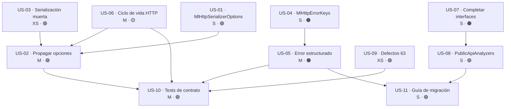

# Épica · Serialización y errores HTTP en `MoralesLarios.OOFP.Http`

> **Versión destino:** `2.1.0`
> **Origen:** puntos **45**, **46** y **47** de [`Temas Pendientes/Mejoras-Prioridad-Media.md`](../../Temas%20Pendientes/Mejoras-Prioridad-Media.md)
> (*"No se pueden configurar las `JsonSerializerOptions`"*, *"El código de estado HTTP se pierde como texto"*,
> *"Métodos públicos que no están en las interfaces"*), más los colaterales **42**, **44** y **63**.
> **Plan del que se desgaja:** [`Temas Pendientes/Plan-Ejecucion-Prioridad-Media.md`](../../Temas%20Pendientes/Plan-Ejecucion-Prioridad-Media.md) · fase 2 (tareas 2.1, 2.2, 2.3) y fase 1 (tareas 1.3, 1.4, 1.5).
> **Estado:** ⬜ No iniciada
> **Esfuerzo estimado:** **L** (~1-2 jornadas) · **Riesgo:** 🟢 Bajo en lo aditivo · 🟠 Alto en la forma del error

---

## Índice

1. [Contexto y problema](#1-contexto-y-problema)
2. [Hallazgo colateral · el `Dispose()` comentado y la serialización muerta](#2-hallazgo-colateral--el-dispose-comentado-y-la-serialización-muerta)
3. [Alcance](#3-alcance)
4. [Historias de usuario](#4-historias-de-usuario)
5. [Orden de ejecución y dependencias](#5-orden-de-ejecución-y-dependencias)
6. [Decisiones de diseño abiertas](#6-decisiones-de-diseño-abiertas)
7. [Definición de terminado (DoD)](#7-definición-de-terminado-dod)
8. [Apéndice · Ejemplos de código y explicación detallada](#8-apéndice--ejemplos-de-código-y-explicación-detallada)

---

## 1. Contexto y problema

`MoralesLarios.OOFP.Http` es la cara cliente del protocolo: **todo lo que la biblioteca envía y recibe por HTTP
pasa por `HttpApiInvoker`**. Hoy ese tránsito tiene tres fugas estructurales:

1. **No se puede decidir cómo se serializa.** Hay **2 puntos de serialización explícita** y **9 puntos de
   deserialización** que usan los valores por defecto de `System.Text.Json`, sin ningún punto de extensión.
2. **El estado HTTP se convierte en prosa.** `ReadErrorDescriptionAsync` devuelve un `string` con el `404`
   interpolado dentro; a partir de ahí, el `404` **ya no es un dato**.
3. **La clase pública ofrece más que su interfaz.** Quien programa contra `IRestClientFp<TDto>` —lo correcto,
   y lo que exige la inyección de dependencias— no puede llamar a todo lo que `RestClientFp<TDto>` expone.

| Fichero | Líneas relevantes |
|---|---|
| `MoralesLarios.OOFP.Http/Requests/ApiCallOptions.cs` | L11 (`ApiCallOptions`), L20 (`ApiCallOptions<TRequest>`) |
| `MoralesLarios.OOFP.Http/Requests/PagedApiCallOptions.cs` | L16 |
| `MoralesLarios.OOFP.Http/HttpApiInvoker.cs` | L132-146, L159-173 (serialización), L296-315, L326-341 |
| `MoralesLarios.OOFP.Http/Helpers/MlResponseWebExtensions.cs` | L33-75 (`ReadErrorDescriptionAsync`) |
| `MoralesLarios.OOFP.Http/IRestClientFp.cs` | L44 (`GetApiInvoker`), falta `GetClientName` |
| `MoralesLarios.OOFP.Http/RestClientFp.cs` | L28 (`GetClientName`, público y fuera de la interfaz) |
| `MoralesLarios.OOFP.Http/Helpers/MlHttpRequestExtensions.cs` | L134, L160 (`nameof`), L163 (`foreach` sin guarda), L180 (`ToAsync`) |

El contrato de opciones de llamada es, literalmente, éste:

```csharp
public record ApiCallOptions(string                      Url,
                             ServiceKey                  ClientName,
                             Dictionary<string, string>? Headers           = null!,
                             CancellationToken           CancellationToken = default)
// ← no hay JsonSerializerOptions en ninguna parte del record
```

Es decir: **el consumidor puede elegir la URL, el cliente, las cabeceras y la cancelación, pero no puede
elegir cómo se escribe ni cómo se lee el JSON que viaja por esa URL.**

### Consecuencias

1. **Un servidor `camelCase` rompe el cliente y no hay arreglo posible desde fuera.**
   `System.Text.Json` por defecto es sensible a mayúsculas en la escritura y usa el nombre exacto de la
   propiedad. Si el servidor publica `{"nombreCliente": "..."}` y el DTO declara `NombreCliente`, la
   deserialización deja la propiedad en `null` **sin error**.

   ```csharp
   .TryMapAsync( _ => JsonSerializer.Serialize(itemBody))   // ← sin opciones: PascalCase al servidor
   …
   .TryMapAsync(response => response.Content.ReadFromJsonAsync<TResponse>(cancellationToken: ct))
                                                            // ← sin opciones: null silencioso al volver
   ```

   La única salida hoy es poner `[JsonPropertyName]` en **todos** los DTO del consumidor, o derivar
   `HttpApiInvoker` y reescribir los 11 métodos.

2. **Los `enum` y las fechas viajan en el formato que la biblioteca decida, no el que el servidor espera.**
   Sin `JsonStringEnumConverter` los `enum` se envían como número. Un servidor que espere `"Pendiente"`
   recibirá `0` y devolverá `400`, que a su vez llegará al consumidor como texto (ver consecuencia 3).

3. **Reintentar un 503 o tratar un 409 exige analizar una cadena en castellano.**
   El error que recibe el consumidor es esto:

   ```text
   Se ha producido un error en la llamada al servicio.
                   Código de error: 409
                   Razón: Conflict
                   Detalle error: {...}
   ```

   Para saber si merece la pena reintentar hay que buscar la subcadena `"Código de error: 5"`. Es decir:
   **la política de reintentos del consumidor depende del idioma y del espaciado de un texto interno de la
   biblioteca.** Cualquier retoque de redacción —incluida la traducción al inglés que ya exige el punto 63—
   rompe silenciosamente a quien lo esté parseando.

4. **Hay miembros públicos útiles que la interfaz no declara, y nada impide que vuelvan a divergir.**
   `RestClientFp<TDto>.GetClientName()` (L28) es público; `IRestClientFp<TDto>` no lo declara.
   `IHttpApiInvoker` no declara `GetAsync<T>` ni `GetPagedAsync<T>`.
   Búsqueda de `PublicApiAnalyzers` en la solución: **0 resultados**. No hay ningún mecanismo que detecte la
   próxima divergencia; se descubrirá cuando un consumidor la sufra.

---

## 2. Hallazgo colateral · el `Dispose()` comentado y la serialización muerta

> ⚠️ **Esto no estaba en los puntos 45-47 originales, está en los puntos 42 y 44, y condiciona el diseño
> de las opciones de serialización.** Hay que resolverlo *en el mismo cambio*, porque toca exactamente las
> mismas líneas.

`MoralesLarios.OOFP.Http/HttpApiInvoker.cs`, L296-315:

```csharp
var result = await MlResult.EmptyAsync()
    .TryMapAsync         ( _     => _httpClientFactory.CreateClient(clientName))
    .ExecSelfIfValidAsync(client => InternalLogUrl(_logger, client.BaseAddress?.ToString()!, url))
    .TryMapAsync         (client => client.SendAsync(requestMessage, ct))
    .BindAsync           (async response => response.IsSuccessStatusCode
                                             ? response.ToMlResultValid()
                                             : (await response.ReadErrorDescriptionAsync()).ToMlResultFail<HttpResponseMessage>())
    //.ExecSelfIfValidAsync(actionValid: response => response.Dispose())      // ← COMENTADO
    .TryMapAsync(response => response.Content.ReadFromJsonAsync<TResponse>(cancellationToken: ct))
```

**El `Dispose()` está comentado porque, colocado ahí, rompía el flujo: liberaba la respuesta antes de leer su
contenido en la línea siguiente.** La solución no es descomentarlo, es mover el ciclo de vida: un `using` en
el punto de creación, no un `Dispose()` en medio de una tubería.

Y en `SendAndReadAsync` (L326-341) hay una serialización que **se calcula y se tira**:

```csharp
.TryMapAsync(_ => JsonSerializer.Serialize(parameters.RequestBody))        // ← resultado DESCARTADO
.TryMapAsync( _ => client.PostAsJsonAsync(parameters.Url, parameters.RequestBody, parameters.CancellationToken))
                                                                           // ← serializa OTRA VEZ
```

Efectos:

| # | Efecto | Detalle |
|---|---|---|
| 1 | Doble coste de serialización | Cada `POST` con cuerpo serializa el DTO **dos veces**; la primera copia se descarta |
| 2 | Línea engañosa | Parece configurar la serialización y no configura nada |
| 3 | `HttpResponseMessage` retenido | **7 respuestas** sin liberar: el *stream* y sus *buffers* esperan al recolector |
| 4 | `HttpRequestMessage` retenido | **9 peticiones** creadas sin `using` (L31, 89, 139, 166, 193, 221, 247, 486, 527) |
| 5 | Sockets ocupados más tiempo del necesario | Bajo carga, consumo de memoria creciente y agotamiento del *pool* del `HttpClientFactory` |

El punto 44 y el punto 45 **compiten por la misma línea**: o se borra la serialización muerta, o se usa su
resultado para construir el `StringContent` con las opciones inyectadas. La segunda opción resuelve los dos
puntos de una vez.

Por tanto **US-03 (serialización muerta) y US-06 (ciclo de vida) son prerrequisitos técnicos de US-02**.

---

## 3. Alcance

### Dentro del alcance

- Un tipo de opciones de serialización propio de la biblioteca, con valores por defecto sensatos y **una sola
  instancia reutilizada** (nunca un `new JsonSerializerOptions()` por llamada).
- Propagación de esas opciones a los **2 puntos de serialización** y a los **9 de deserialización**.
- Claves constantes en `MlError.Details` para el estado HTTP, la razón y la URL de la llamada fallida.
- `ReadErrorDescriptionAsync` pasa a devolver un error estructurado, conservando el texto para humanos.
- Liberación correcta de `HttpRequestMessage` y `HttpResponseMessage` en todas las rutas, incluidas las de error.
- Decisión miembro a miembro sobre qué sube a `IRestClientFp<TDto>` / `IHttpApiInvoker` y qué baja a `internal`.
- `Microsoft.CodeAnalysis.PublicApiAnalyzers` con `PublicAPI.Shipped.txt` / `PublicAPI.Unshipped.txt`.
- Los tres defectos menores de `MlHttpRequestExtensions` (`nameof`, guarda de nulos, `*Async` simulados).
- Guía de migración para el consumidor que hoy parsea el texto del error.

### Fuera del alcance

- Reintentos, *circuit breaker* o `Polly`: esta épica **habilita** la decisión (expone el estado), no la implementa.
- Cambiar `System.Text.Json` por otro serializador.
- El contrato REST del servidor (rutas, verbos, `[ProducesResponseType]`): eso es la
  [épica del contrato REST](Epica-Contrato-Rest.md).
- Añadir `MemberName`/`Target` a `MlError`: eso es la [épica de validación](Epica-Validacion.md), pero
  **hay que coordinarse con ella** (ver D-3).

---

## 4. Historias de usuario

> **Leyenda de esfuerzo:** XS (<2 h) · S (½ jornada) · M (1 jornada) · L (2 jornadas) · XL (3+ jornadas)
> **Leyenda de riesgo:** 🟢 bajo · 🟡 medio · 🟠 alto · 🔴 muy alto (rompe compatibilidad)

### US-01 · Poder declarar cómo se serializa el JSON

> **Como** consumidor de `MoralesLarios.OOFP.Http` contra una API que publica `camelCase` y `enum` como texto,
> **quiero** declarar una sola vez las `JsonSerializerOptions` que debe usar el cliente,
> **para** no tener que decorar todos mis DTO con `[JsonPropertyName]` ni derivar `HttpApiInvoker`.

- **Esfuerzo:** S · **Riesgo:** 🟢 (aditivo, con valor por defecto igual al comportamiento actual)
- **Prerrequisito de:** US-02
- **Proyecto afectado:** `MoralesLarios.OOFP.Http`
- **Justificación:** punto 45. Hoy `ApiCallOptions` y `PagedApiCallOptions` no exponen nada.

**Criterios de aceptación**

- [ ] Existe un tipo `MlHttpSerializerOptions` (o equivalente, ver D-1) que encapsula unas
      `JsonSerializerOptions`.
- [ ] Se registra en el contenedor junto al cliente, con una **única instancia** por configuración.
- [ ] El valor por defecto reproduce **exactamente** el comportamiento de hoy (ninguna llamada existente
      cambia de resultado).
- [ ] Existe un ayudante de registro que configura `camelCase` + `JsonStringEnumConverter` en una línea.
- [ ] Nadie construye `new JsonSerializerOptions()` dentro de una ruta de llamada.

**API propuesta**

```csharp
public sealed class MlHttpSerializerOptions
{
    public static MlHttpSerializerOptions Default { get; } = new(new JsonSerializerOptions());

    public static MlHttpSerializerOptions Web { get; } = new(new JsonSerializerOptions(JsonSerializerDefaults.Web)
    {
        Converters = { new JsonStringEnumConverter() }
    });

    public JsonSerializerOptions Value { get; }
    private MlHttpSerializerOptions(JsonSerializerOptions value) => Value = value;
    public static MlHttpSerializerOptions From(JsonSerializerOptions options) => new(options);
}
```

**⚠️ Riesgo principal**
Que alguien exponga el `JsonSerializerOptions` mutable y lo modifique después del primer uso:
`System.Text.Json` lo congela al serializar por primera vez y lanza `InvalidOperationException`.
El tipo envoltorio existe para impedirlo.

---

### US-02 · Que esas opciones se usen en los 11 puntos de (de)serialización

> **Como** consumidor,
> **quiero** que las opciones que he declarado se apliquen tanto al cuerpo que envío como al que recibo,
> **para** que la configuración sea de verdad una configuración y no una declaración decorativa.

- **Esfuerzo:** M · **Riesgo:** 🟢 (con el valor por defecto, comportamiento idéntico)
- **Depende de:** US-01, US-03, US-06
- **Proyecto afectado:** `MoralesLarios.OOFP.Http`
- **Justificación:** punto 45. `HttpApiInvoker` L138 y L311 usan los valores por defecto.

**Criterios de aceptación**

- [ ] Los **2** `JsonSerializer.Serialize` reciben las opciones.
- [ ] Los **9** `ReadFromJsonAsync` reciben las opciones.
- [ ] `PostAsJsonAsync` / `PutAsJsonAsync` reciben las opciones.
- [ ] Un test comprueba que, con `MlHttpSerializerOptions.Web`, un DTO `NombreCliente` se envía como
      `nombreCliente` y se lee desde `nombreCliente`.
- [ ] Un test comprueba que un `enum` viaja como texto cuando se registra el convertidor.

**Notas técnicas**
`ApiCallOptions` es un `record` con operador implícito desde tupla. Añadir una propiedad al final con valor
por defecto **no rompe** a quien use el constructor posicional, pero **sí rompe** el operador implícito si se
añade a la tupla. Ver D-2.

---

### US-03 · Dejar de serializar dos veces el mismo cuerpo

> **Como** mantenedor,
> **quiero** que no haya una serialización calculada y descartada en cada `POST`,
> **para** no pagar dos veces el mismo trabajo ni dejar una línea que miente sobre lo que hace.

- **Esfuerzo:** XS · **Riesgo:** 🟢 (bajo)
- **Prerrequisito de:** US-02
- **Proyecto afectado:** `MoralesLarios.OOFP.Http`
- **Justificación:** punto 44. `SendAndReadAsync` L329 serializa y descarta; L333 vuelve a serializar.

**Criterios de aceptación**

- [ ] `SendAndReadAsync` serializa **una sola vez**.
- [ ] El `StringContent` se construye con el resultado de esa única serialización y con las opciones de US-01.
- [ ] La validación de `RequestBody` no nulo (`EnsureFp.NotNullAsync`) se conserva.
- [ ] Ningún test existente cambia de resultado.

---

### US-04 · Saber qué código HTTP ha fallado, como dato

> **Como** consumidor que implementa reintentos,
> **quiero** leer el código de estado desde `MlError.Details` con una clave constante,
> **para** distinguir un 404 de un 409 y de un 503 sin analizar texto en castellano.

- **Esfuerzo:** S · **Riesgo:** 🟠 (cambia la forma del error, no su existencia)
- **Depende de:** —
- **Prerrequisito de:** US-05
- **Proyecto afectado:** `MoralesLarios.OOFP.Http`
- **Justificación:** punto 46. Hoy `MlResponseWebExtensions.cs` L70 interpola `{(int)response.StatusCode}`
  dentro de la cadena.

**Criterios de aceptación**

- [ ] Existe una clase de constantes públicas (`MlHttpErrorKeys`) con, al menos, `StatusCode`, `ReasonPhrase`,
      `RequestUri` y `HttpMethod`.
- [ ] Las claves son `const string` y están documentadas.
- [ ] Están en el proyecto compartido, no duplicadas en cliente y servidor (ver D-4).

**API propuesta**

```csharp
public static class MlHttpErrorKeys
{
    public const string StatusCode   = nameof(StatusCode);
    public const string ReasonPhrase = nameof(ReasonPhrase);
    public const string RequestUri   = nameof(RequestUri);
    public const string HttpMethod   = nameof(HttpMethod);
}
```

---

### US-05 · Que el error que devuelve la biblioteca lleve ese dato

> **Como** consumidor,
> **quiero** que el `MlResult` fallido de una llamada HTTP traiga el estado en `Details` **y** el texto legible
> en `Message`,
> **para** poder decidir por programa y diagnosticar por lectura, sin elegir entre las dos cosas.

- **Esfuerzo:** M · **Riesgo:** 🟠 (quien parsea el texto hoy seguirá funcionando; quien compare la cadena
  completa, no)
- **Depende de:** US-04
- **Prerrequisito de:** US-10, US-11
- **Proyecto afectado:** `MoralesLarios.OOFP.Http`
- **Justificación:** punto 46. `ReadErrorDescriptionAsync` devuelve `string` (L75).

**Criterios de aceptación**

- [ ] Existe `ReadErrorDetailsAsync` que devuelve `MlErrorDetails` con las 4 claves rellenas.
- [ ] `ReadErrorDescriptionAsync` (la que devuelve `string`) se conserva marcada `[Obsolete]` con mensaje
      *"Use `ReadErrorDetailsAsync`. Will be removed in 3.0.0."* y `EditorBrowsable(Never)`.
- [ ] El texto humano sigue siendo el mismo, pero **sin la indentación de 16 espacios** que hoy produce el
      literal verbatim.
- [ ] Las flags `IncludeResponseBodyInErrors` y `DefaultMaxErrorBodyLength` siguen respetándose.
- [ ] El truncado (`Truncate`) sigue aplicándose al cuerpo del error.
- [ ] Todas las rutas de `HttpApiInvoker` que hoy llaman a `ReadErrorDescriptionAsync` pasan a la nueva.

**Tests mínimos**

| Escenario | Resultado esperado |
|---|---|
| Respuesta 404 | `Details[StatusCode] == 404` y `Message` contiene `Not Found` |
| Respuesta 409 con cuerpo JSON | `Details[StatusCode] == 409` y el cuerpo aparece indentado en `Message` |
| Respuesta 503 sin cuerpo | `Details[StatusCode] == 503`, `Message` sin excepción |
| `IncludeResponseBodyInErrors = false` | `Message` contiene el aviso de omisión, `Details` igual de completo |
| Cuerpo de 1 MB con `DefaultMaxErrorBodyLength = 500` | `Message` truncado y con el recuento de omitidos |

**⚠️ Riesgo principal**
Leer el cuerpo de la respuesta (`ReadAsStringAsync`) y después intentar `ReadFromJsonAsync` sobre la misma
respuesta falla: el *stream* ya está consumido. Hoy no ocurre porque sólo se lee en la rama de error, pero al
mover el ciclo de vida (US-06) hay que garantizar que **sigue siendo así**.

---

### US-06 · No retener peticiones ni respuestas HTTP

> **Como** operador de un servicio con carga sostenida,
> **quiero** que cada `HttpRequestMessage` y cada `HttpResponseMessage` se libere al terminar su uso,
> **para** que el consumo de memoria y de sockets no crezca con el tiempo.

- **Esfuerzo:** M · **Riesgo:** 🟡 (riesgo real de *stream* ya consumido si el `Dispose` se adelanta)
- **Prerrequisito de:** US-02
- **Proyecto afectado:** `MoralesLarios.OOFP.Http`
- **Justificación:** punto 42. **9 peticiones** sin `using`, **7 respuestas** sin liberar, `Dispose()`
  comentado en L310.

**Criterios de aceptación**

- [ ] Las 9 creaciones de `HttpRequestMessage` usan `using` (o se liberan en un `finally`).
- [ ] Toda respuesta se libera **después** de haber leído su contenido, nunca antes.
- [ ] La línea comentada de L310 desaparece (no se descomenta: se sustituye por el `using` correcto).
- [ ] Un test de integración hace 1.000 llamadas seguidas y comprueba que no crece el número de
      `HttpResponseMessage` vivos (ver D-6 sobre cómo medirlo).
- [ ] Los 33 tests de `MoralesLarios.OOFP.Http.Tests.Integration` siguen en verde.

**⚠️ Riesgo principal**
`ReadFromJsonAsync` sobre una respuesta ya liberada lanza `ObjectDisposedException`. El orden correcto es:
leer → materializar el objeto → liberar. Un `using` en el ámbito del método lo garantiza; un `Dispose()` en
medio de una tubería `Bind`/`Map`, no. **Eso es exactamente lo que estaba comentado y por lo que estaba
comentado.**

---

### US-07 · Que la interfaz ofrezca lo mismo que la clase

> **Como** consumidor que inyecta `IRestClientFp<TDto>`,
> **quiero** poder llamar a todo lo que la implementación expone como público,
> **para** no tener que hacer un *cast* a la clase concreta y poder sustituirla en pruebas.

- **Esfuerzo:** S · **Riesgo:** 🟠 (ampliar una interfaz pública rompe a quien la implemente por su cuenta)
- **Prerrequisito de:** US-08
- **Proyecto afectado:** `MoralesLarios.OOFP.Http`
- **Justificación:** punto 47. `GetClientName()` es público en `RestClientFp.cs` L28 y no está en
  `IRestClientFp.cs`. `GetAsync<T>` / `GetPagedAsync<T>` no están en `IHttpApiInvoker`.

**Criterios de aceptación**

- [ ] `IRestClientFp<TDto>` declara `GetClientName()`.
- [ ] `IHttpApiInvoker` declara `GetAsync<T>` y `GetPagedAsync<T>`.
- [ ] Los 2 miembros `[Obsolete]` (`GetHttpClientFactoryKey`) **no** suben a la interfaz.
- [ ] Decisión documentada, miembro a miembro, en una tabla del README (sube / baja a `internal` / se queda).
- [ ] Si se opta por métodos de interfaz con implementación por defecto (ver D-5), queda justificado.

**Notas técnicas**
`ICompositeKeyRestClientFp` hereda de `IRestClientFp`: cualquier miembro nuevo aparece también allí.
`RestClientFp.Obsolete.cs` L16-17 y L42-43 reenvían a `GetClientName()`, luego ya hay una implementación
válida en los dos sitios.

---

### US-08 · Que el contrato público no pueda volver a divergir

> **Como** mantenedor,
> **quiero** que cualquier cambio en la superficie pública falle la compilación si no se declara
> explícitamente,
> **para** que la divergencia clase/interfaz no vuelva a descubrirse en producción.

- **Esfuerzo:** S · **Riesgo:** 🟢 (herramienta, no comportamiento)
- **Depende de:** US-07
- **Proyecto afectado:** `MoralesLarios.OOFP.Http` (y candidato a toda la solución)
- **Justificación:** punto 47. Búsqueda de `PublicApiAnalyzers`: **0 resultados**.

**Criterios de aceptación**

- [ ] `Microsoft.CodeAnalysis.PublicApiAnalyzers` referenciado en `MoralesLarios.OOFP.Http`.
- [ ] `PublicAPI.Shipped.txt` con la superficie de la `2.0.0` y `PublicAPI.Unshipped.txt` con las adiciones
      de esta épica.
- [ ] `RS0016` (miembro público no declarado) configurado como **error**, no como aviso.
- [ ] Documentado en el README cómo aceptar un cambio intencionado (`dotnet format analyzers` o el *code fix*).
- [ ] Decidido si se extiende al resto de proyectos en esta épica o en otra (ver D-5).

---

### US-09 · Limpiar los defectos acumulados de `MlHttpRequestExtensions`

> **Como** consumidor que recibe un mensaje de error,
> **quiero** que el mensaje nombre el parámetro que de verdad ha fallado,
> **para** no perder tiempo buscando en el sitio equivocado.

- **Esfuerzo:** XS · **Riesgo:** 🟢 (bajo)
- **Proyecto afectado:** `MoralesLarios.OOFP.Http`
- **Justificación:** punto 63, parte pendiente.

**Criterios de aceptación**

- [ ] Los `nameof` de L134 y L160 apuntan al parámetro correcto.
- [ ] `TrySetHeaders` valida la colección antes del `foreach` de L163.
- [ ] Los `*Async` simulados por `ToAsync()` (L180) quedan documentados como *simetría de composición*
      (decisión del punto 58, ver [épica de validación](Epica-Validacion.md)) **o** se retira el sufijo.
- [ ] Los mensajes están en inglés correcto (ya lo están, verificar que no se rompe).

---

### US-10 · Tests de contrato de serialización y de error

> **Como** mantenedor,
> **quiero** una batería que fije el formato del JSON enviado y la forma del error devuelto,
> **para** que un cambio de redacción o de política de nombres no se escape a producción.

- **Esfuerzo:** M · **Riesgo:** 🟢 (bajo)
- **Depende de:** US-02, US-05, US-06
- **Proyectos afectados:** `MoralesLarios.OOFP.Http.Tests.Unit`, `MoralesLarios.OOFP.Http.Tests.Integration`
- **Justificación:** sin esto, los criterios de US-02 y US-05 no son verificables.

**Criterios de aceptación**

- [ ] Test que captura el cuerpo enviado con un `HttpMessageHandler` falso y compara el JSON exacto.
- [ ] Test que devuelve 404/409/503 y comprueba `Details[StatusCode]`.
- [ ] Test de no regresión del texto humano (el `Message` sigue siendo legible y contiene la razón).
- [ ] Test de ciclo de vida: `ObjectDisposedException` no aparece en ninguna ruta.
- [ ] Los 33 tests de integración existentes siguen en verde.

---

### US-11 · Guía de migración para quien parsea el texto del error

> **Como** consumidor de la `2.0.0` que detecta los 503 buscando `"Código de error: 5"` en el mensaje,
> **quiero** saber exactamente qué hacer en la `2.1.0`,
> **para** migrar sin descubrir el cambio en caliente.

- **Esfuerzo:** S · **Riesgo:** 🟢 (documental)
- **Depende de:** US-05
- **Justificación:** el cambio de US-05 es una ruptura **que el compilador no detecta**.

**Criterios de aceptación**

- [ ] Sección en el README con tabla antes/después y código de los dos lados.
- [ ] Aviso explícito de que el parsing de texto deja de estar soportado.
- [ ] Documentada la fecha de retirada de `ReadErrorDescriptionAsync` (`3.0.0`).
- [ ] Documentación XML generada con **MlDoc** (nunca a mano) y `CS1591 = 0`.

---

## 5. Orden de ejecución y dependencias



### Secuencia recomendada

| Orden | Historia | Esfuerzo | Hito |
|---:|---|---|---|
| 1 | US-09 · Defectos de `MlHttpRequestExtensions` | XS | Calentamiento sin riesgo |
| 2 | US-03 · Eliminar la serialización muerta | XS | |
| 3 | US-06 · Ciclo de vida de peticiones y respuestas | M | 🎯 La fuga de memoria deja de existir |
| 4 | US-01 · `MlHttpSerializerOptions` | S | |
| 5 | US-02 · Propagar las opciones | M | 🎯 El punto 45 queda cerrado |
| 6 | US-04 · Claves constantes | S | |
| 7 | US-05 · Error estructurado | M | 🎯 El punto 46 queda cerrado |
| 8 | US-07 · Completar interfaces | S | |
| 9 | US-08 · `PublicApiAnalyzers` | S | 🎯 El punto 47 queda cerrado |
| 10 | US-10 · Tests de contrato | M | |
| 11 | US-11 · Guía de migración | S | Entregable publicable |

**Total: ~1-2 jornadas** (las historias XS/S son de minutos reales; el coste está en US-02, US-05, US-06 y US-10).

> 💡 **Entrega incremental sugerida**
> - **`2.0.x`:** US-09 → US-01 → US-02. Todo aditivo, sin ruptura: el punto 45 cerrado y la fuga de memoria
>   tapada. Es el 70 % del valor con el 0 % de riesgo de contrato.
> - **`2.1.0`:** US-04 → US-11. El cambio de forma del error y la ampliación de interfaces, con guía.

---

## 6. Decisiones de diseño abiertas

| Id | Decisión | Opciones | Recomendación |
|---|---|---|---|
| D-1 | ¿Dónde viven las `JsonSerializerOptions`? | (a) propiedad nueva en `ApiCallOptions` · (b) en las opciones del cliente registradas en DI · (c) ambas, con la de la llamada ganando | **(c)**, pero implementando primero (b): la configuración normal es por cliente, no por llamada; la de la llamada es la excepción |
| D-2 | ¿Se amplía el operador implícito desde tupla de `ApiCallOptions`? | (a) sí, añadir un 5.º elemento · (b) no, dejar la tupla con 4 y usar el constructor para el caso avanzado | **(b)**: ampliar la tupla rompe a todo el que use el operador implícito, y el compilador lo detecta como error de conversión, no como aviso |
| D-3 | ¿`MlError.Details` se diseña aquí o en la épica de validación? | (a) aquí, y validación se adapta · (b) en validación, y esta épica espera · (c) diseño conjunto en un solo cambio de `Core` | **(c)**: los puntos 46 y 59 cambian el mismo tipo. Un solo cambio de `MlError` con `Details` tipado, consumido por los dos |
| D-4 | ¿Dónde van las constantes `MlHttpErrorKeys`? | (a) `MoralesLarios.OOFP.Http` · (b) `MoralesLarios.OOFP.Shared` · (c) `MoralesLarios.OOFP.Core` | **(b)**: es el mismo criterio que ya se aplicó a `MlPaginationHeaders` al cerrar el punto 55 |
| D-5 | ¿`PublicApiAnalyzers` solo en `Http` o en toda la solución? | (a) solo `Http` ahora · (b) toda la solución en esta épica · (c) toda la solución en una épica aparte | **(a) + (c)**: aquí se valida el mecanismo en un proyecto; la extensión a 30 proyectos es un trabajo propio |
| D-6 | ¿Cómo se verifica que no hay fuga de `HttpResponseMessage`? | (a) `HttpMessageHandler` falso que cuenta `Dispose` · (b) `GC.GetTotalMemory` (frágil) · (c) no verificar | **(a)**: determinista, rápido y no depende del recolector |
| D-7 | ¿`ReadErrorDescriptionAsync` se marca `[Obsolete]` o se elimina? | (a) `[Obsolete]` hasta `3.0.0` · (b) eliminar ahora · (c) mantener las dos sin aviso | **(a)**: es pública, está documentada y hay consumidores; el aviso da un ciclo de margen |

---

## 7. Definición de terminado (DoD)

- [ ] La solución compila en `Release --no-incremental` con **0 errores y `CS1591 = 0`**.
- [ ] Los **1.027 tests** existentes siguen en verde, incluidos los **33** de `Http.Tests.Integration`.
- [ ] `grep` de `new JsonSerializerOptions(` dentro de rutas de llamada: **0 resultados**.
- [ ] `grep` de `JsonSerializer.Serialize(` sin opciones en `HttpApiInvoker`: **0 resultados**.
- [ ] `grep` de `//.*Dispose()` en `MoralesLarios.OOFP.Http`: **0 resultados**.
- [ ] `RS0016` activo como error y los dos ficheros `PublicAPI.*.txt` versionados.
- [ ] Las 7 decisiones (D-1 … D-7) cerradas y anotadas en este documento.
- [ ] Guía de migración publicada en el README con la tabla antes/después.
- [ ] Documentación XML generada con **MlDoc** para todos los miembros públicos nuevos.
- [ ] Los puntos **42**, **44**, **45**, **46**, **47** y la parte pendiente de **63** marcados como resueltos
      en `Mejoras-Prioridad-Media.md`, con fichero y línea de la solución.

---

## 8. Apéndice · Ejemplos de código y explicación detallada

> Este apéndice contiene **el código real de hoy** (con fichero y línea) y **el código propuesto**
> para cada historia. Todo el código "después" es *ilustrativo*: fija la intención y el contrato, no
> la implementación definitiva.

### Índice del apéndice

- [8.1 · El caso que hoy no se puede resolver: un servidor `camelCase`](#81--el-caso-que-hoy-no-se-puede-resolver-un-servidor-camelcase)
- [8.2 · US-01 · Las opciones de serialización, una sola vez](#82--us-01--las-opciones-de-serialización-una-sola-vez)
- [8.3 · US-02 · Los 11 puntos que hay que tocar](#83--us-02--los-11-puntos-que-hay-que-tocar)
- [8.4 · US-03 · La serialización que se calcula y se tira](#84--us-03--la-serialización-que-se-calcula-y-se-tira)
- [8.5 · US-04 y US-05 · Del texto al dato](#85--us-04-y-us-05--del-texto-al-dato)
- [8.6 · US-06 · El `Dispose()` que estaba comentado por una razón](#86--us-06--el-dispose-que-estaba-comentado-por-una-razón)
- [8.7 · US-07 · La divergencia clase/interfaz, miembro a miembro](#87--us-07--la-divergencia-claseinterfaz-miembro-a-miembro)
- [8.8 · US-08 · Congelar la superficie pública](#88--us-08--congelar-la-superficie-pública)
- [8.9 · US-09 · Los tres defectos de `MlHttpRequestExtensions`](#89--us-09--los-tres-defectos-de-mlhttprequestextensions)
- [8.10 · US-11 · Antes y después para el consumidor](#810--us-11--antes-y-después-para-el-consumidor)
- [8.11 · US-10 · Tests propuestos](#811--us-10--tests-propuestos)

---

### 8.1 · El caso que hoy no se puede resolver: un servidor `camelCase`

Supongamos un consumidor que llama a una API ajena (no generada con esta biblioteca):

```csharp
public record FacturaDto(int Id, string NombreCliente, EstadoFactura Estado, DateTime FechaEmision);

// Registro del cliente
services.AddRestClient<IRestClientFp<FacturaDto>, RestClientFp<FacturaDto>, FacturaDto>("facturas");

// Llamada
var result = await cliente.GetByIdAsync("42");
```

La API publica:

```json
{ "id": 42, "nombreCliente": "ACME", "estado": "Pendiente", "fechaEmision": "2026-01-15" }
```

Lo que ocurre hoy, paso a paso:

```text
1. GetByIdAsync("42")
     → _apiInvoker.GetAsync<FacturaDto>(_clientName, "id-str/42", headers, ct)   RestClientFp.cs L51
2. HttpApiInvoker lee la respuesta
     → response.Content.ReadFromJsonAsync<FacturaDto>(cancellationToken: ct)     HttpApiInvoker.cs L311
       (sin JsonSerializerOptions)
3. System.Text.Json busca "NombreCliente" y encuentra "nombreCliente"
     → no coincide (comparación sensible a mayúsculas por defecto en la escritura;
        en lectura sí es tolerante desde .NET, pero NO con enum ni con política de nombres)
4. "estado": "Pendiente" contra un enum sin JsonStringEnumConverter
     → JsonException: The JSON value could not be converted to EstadoFactura
```

| | Estado real de la respuesta | Lo que ve el consumidor |
|---|---|---|
| `id` | `42` | `42` ✔ |
| `nombreCliente` | `"ACME"` | depende de la versión/política ⚠ |
| `estado` | `"Pendiente"` | **`JsonException`** ✘ |
| `fechaEmision` | `"2026-01-15"` | `DateTime` ✔ |

**El consumidor no tiene ningún punto de extensión.** Sus únicas salidas son decorar todos sus DTO o derivar
`HttpApiInvoker` y reescribir sus 11 métodos. Las dos son, en la práctica, "no usar la biblioteca".

---

### 8.2 · US-01 · Las opciones de serialización, una sola vez

**Hoy — `MoralesLarios.OOFP.Http/Requests/ApiCallOptions.cs`, L11-30:**

```csharp
public record ApiCallOptions(string                      Url,
                             ServiceKey                  ClientName,
                             Dictionary<string, string>? Headers           = null!,
                             CancellationToken           CancellationToken = default)
{
    public static implicit operator ApiCallOptions((NotEmptyString url, ServiceKey clientName,
                                                   Dictionary<string, string>? headers,
                                                   CancellationToken cancellationToken) value)
        => new (value.url, value.clientName, value.headers, value.cancellationToken);
}

public record ApiCallOptions<TRequest>(                     string                      Url,
                                                            ServiceKey                  ClientName,
                                       [property: Required] TRequest                    RequestBody,
                                                            Dictionary<string, string>? Headers           = null!,
                                                            CancellationToken           CancellationToken = default)
{ /* operador implícito análogo */ }
```

No hay nada que configurar. El `record` es el único lugar donde el consumidor puede hablar con el invocador,
y no habla de serialización.

**Después — tipo nuevo, inmutable y con instancia compartida:**

```csharp
/// <summary>Opciones de serialización JSON que usará el cliente HTTP de la biblioteca.</summary>
public sealed class MlHttpSerializerOptions
{
    /// <summary>Comportamiento idéntico al de la versión 2.0.0 (valores por defecto de System.Text.Json).</summary>
    public static MlHttpSerializerOptions Default { get; } = From(new JsonSerializerOptions());

    /// <summary>camelCase, tolerante a mayúsculas y enum como texto. Lo habitual contra una API web.</summary>
    public static MlHttpSerializerOptions Web { get; } = From(new JsonSerializerOptions(JsonSerializerDefaults.Web)
    {
        Converters = { new JsonStringEnumConverter() }
    });

    /// <summary>Las opciones efectivas. Se congelan en la primera serialización.</summary>
    public JsonSerializerOptions Value { get; }

    private MlHttpSerializerOptions(JsonSerializerOptions value) => Value = value;

    /// <summary>Crea unas opciones a partir de una configuración propia del consumidor.</summary>
    public static MlHttpSerializerOptions From(JsonSerializerOptions options)
        => new(new JsonSerializerOptions(options));      // ← copia: el consumidor no puede mutarlas después
}
```

**Lectura clave de este bloque.** El `new JsonSerializerOptions(options)` del `From` no es un detalle de
estilo: es lo que impide que el consumidor guarde una referencia, la modifique tras la primera llamada y
reciba un `InvalidOperationException` de `System.Text.Json` *dentro* de la biblioteca.

**Registro, con el ayudante que pide el criterio de aceptación:**

```csharp
// Caso normal: una línea
services.AddRestClient<IRestClientFp<FacturaDto>, RestClientFp<FacturaDto>, FacturaDto>(
            "facturas",
            serializer: MlHttpSerializerOptions.Web);

// Caso avanzado
services.AddRestClient<IRestClientFp<FacturaDto>, RestClientFp<FacturaDto>, FacturaDto>(
            "facturas",
            serializer: MlHttpSerializerOptions.From(new JsonSerializerOptions
            {
                PropertyNamingPolicy = JsonNamingPolicy.SnakeCaseLower,
                Converters           = { new MiConvertidorDeFechas() }
            }));
```

| Criterio | Cómo se cumple |
|---|---|
| Una sola instancia | `Default` y `Web` son estáticas; el registro guarda una por cliente |
| Sin cambio de comportamiento | `Default` usa `new JsonSerializerOptions()`, exactamente lo de hoy |
| Inmutable | El constructor es privado y `From` copia |
| Configurable en una línea | `MlHttpSerializerOptions.Web` |

---

### 8.3 · US-02 · Los 11 puntos que hay que tocar

**Hoy — `HttpApiInvoker.cs` L132-146 (`PostAsync<T>`):**

```csharp
public virtual async Task<MlResult<T>> PostAsync<T>(ServiceKey clientName, T itemBody,
                                                    string url = null!,
                                                    Dictionary<string, string> headers = null!,
                                                    CancellationToken ct = default)
    => await EnsureFp.NotNullAsync(itemBody, $"{nameof(itemBody)} no puede ser nulo")
                     .TryMapAsync( _ => JsonSerializer.Serialize(itemBody))          // ← sin opciones
                     .BindAsync  (jsonBody => new HttpRequestMessage(HttpMethod.Post, url)
                                              {
                                                  Content = new StringContent(jsonBody, Encoding.UTF8, "application/json")
                                              }.TrySetHeadersAsync(headers ?? []))
                     .BindAsync  (requestMessage => ActionPostAsync<T>(clientName, requestMessage, url, ct));
```

**Después:**

```csharp
public virtual async Task<MlResult<T>> PostAsync<T>(ServiceKey clientName, T itemBody,
                                                    string url = null!,
                                                    Dictionary<string, string> headers = null!,
                                                    CancellationToken ct = default)
    => await EnsureFp.NotNullAsync(itemBody, $"{nameof(itemBody)} must not be null")
                     .TryMapAsync( _ => JsonSerializer.Serialize(itemBody, _serializer.Value))   // ← opciones
                     .BindAsync  (jsonBody =>
                     {
                         using var request = new HttpRequestMessage(HttpMethod.Post, url)        // ← US-06
                         {
                             Content = new StringContent(jsonBody, Encoding.UTF8, "application/json")
                         };
                         return request.TrySetHeadersAsync(headers ?? [])
                                       .BindAsync(req => ActionPostAsync<T>(clientName, req, url, ct));
                     });
```

> ⚠️ **Ojo con el `using` y el `Bind`.** `HttpRequestMessage` **no se puede reenviar**: una vez enviado,
> `HttpClient` lo marca como usado. El `using` tiene que envolver **todo** el uso, incluido el `SendAsync`
> que ocurre dentro de `ActionPostAsync`. Si la tubería devuelve una `Task` que se completa después de salir
> del ámbito del `using`, se libera antes de enviarlo → `ObjectDisposedException`. Hay que **esperar dentro
> del ámbito**, como en el ejemplo (`await` implícito por el `async`/`return`), no devolver la tarea sin esperar.

**Inventario exacto de los puntos a tocar:**

| Punto | Fichero · línea | Qué hace hoy |
|---|---|---|
| 1 | `HttpApiInvoker.cs` L138 | `JsonSerializer.Serialize(itemBody)` |
| 2 | `HttpApiInvoker.cs` L165 (aprox.) | `JsonSerializer.Serialize(itemBody)` en `PostAsync<T,TResponse>` |
| 3 | `HttpApiInvoker.cs` L329 | `JsonSerializer.Serialize(parameters.RequestBody)` **descartado** (US-03) |
| 4 | `HttpApiInvoker.cs` L333 | `client.PostAsJsonAsync(url, body, ct)` sin opciones |
| 5-11 | `HttpApiInvoker.cs` L311, L337 y las 5 restantes | `ReadFromJsonAsync<TResponse>(cancellationToken: ct)` sin opciones |

**Test que lo fija:**

```csharp
[Fact]
public async Task PostAsync_WithWebSerializerOptions_SendsCamelCaseBody()
{
    string? cuerpoEnviado = null;
    var handler = new FakeHandler(async req => { cuerpoEnviado = await req.Content!.ReadAsStringAsync(); });

    var invoker = BuildInvoker(handler, MlHttpSerializerOptions.Web);

    await invoker.PostAsync("facturas", new FacturaDto(42, "ACME", EstadoFactura.Pendiente, new(2026, 1, 15)));

    cuerpoEnviado.Should().Contain("\"nombreCliente\":\"ACME\"")
                 .And.Contain("\"estado\":\"Pendiente\"");     // ← enum como texto
}
```

---

### 8.4 · US-03 · La serialización que se calcula y se tira

**Hoy — `HttpApiInvoker.cs` L326-341:**

```csharp
protected virtual async Task<MlResult<TResponse?>> SendAndReadAsync<TRequest, TResponse>(
        ApiCallOptions<TRequest> parameters, HttpClient client, MemberName methodName)
{
    var result = await EnsureFp.NotNullAsync(parameters.RequestBody, $"{nameof(parameters.RequestBody)} no puede ser nulo")
        .TryMapAsync(_ => JsonSerializer.Serialize(parameters.RequestBody))        // ← resultado DESCARTADO
        .TryMapAsync( _ => client.PostAsJsonAsync(parameters.Url, parameters.RequestBody, parameters.CancellationToken))
        .BindAsync  (async response => response.IsSuccessStatusCode
                                        ? response.ToMlResultValid()
                                        : (await response.ReadErrorDescriptionAsync()).ToMlResultFail<HttpResponseMessage>())
        .TryMapAsync(response => response.Content.ReadFromJsonAsync<TResponse>(cancellationToken: parameters.CancellationToken))
        .MyMethodFinalLogAsync(_logger, $"{methodName}<{typeof(TRequest).Name}, {typeof(TResponse).Name}>");
    return result;
}
```

Fíjate en el `_` del segundo `TryMapAsync`: **descarta el `jsonBody` que acaba de calcularse** y vuelve a
serializar dentro de `PostAsJsonAsync`. El primer `Serialize` no es inútil por casualidad —sirve para que una
excepción de serialización se convierta en `MlResult` fallido antes de abrir el socket—, pero se paga dos veces.

**Después — una serialización, un contenido, y la validación conservada:**

```csharp
protected virtual async Task<MlResult<TResponse?>> SendAndReadAsync<TRequest, TResponse>(
        ApiCallOptions<TRequest> parameters, HttpClient client, MemberName methodName)
{
    var result = await EnsureFp.NotNullAsync(parameters.RequestBody, $"{nameof(parameters.RequestBody)} must not be null")
        .TryMapAsync( _ => JsonSerializer.Serialize(parameters.RequestBody, _serializer.Value))   // ← UNA vez
        .TryMapAsync(json =>
        {
            using var content = new StringContent(json, Encoding.UTF8, "application/json");       // ← se reutiliza
            return client.PostAsync(parameters.Url, content, parameters.CancellationToken);
        })
        .BindAsync  (async response => response.IsSuccessStatusCode
                                        ? response.ToMlResultValid()
                                        : (await response.ReadErrorDetailsAsync()).ToMlResultFail<HttpResponseMessage>())
        .TryMapAsync(response => ReadAndDisposeAsync<TResponse>(response, parameters.CancellationToken))
        .MyMethodFinalLogAsync(_logger, $"{methodName}<{typeof(TRequest).Name}, {typeof(TResponse).Name}>");
    return result;
}
```

| Criterio | Cómo se cumple |
|---|---|
| Serializa una sola vez | El `json` del primer `TryMapAsync` alimenta el `StringContent` |
| Conserva la conversión de excepción a `MlResult` | Sigue siendo `TryMapAsync`, no `MapAsync` |
| Conserva la validación de nulo | `EnsureFp.NotNullAsync` intacto |
| Usa las opciones de US-01 | `_serializer.Value` |
| Libera la respuesta | `ReadAndDisposeAsync` (ver 8.6) |

---

### 8.5 · US-04 y US-05 · Del texto al dato

**Hoy — `MoralesLarios.OOFP.Http/Helpers/MlResponseWebExtensions.cs`, L33-75:**

```csharp
public static async Task<string> ReadErrorDescriptionAsync(this HttpResponseMessage response,
                                                           int maxBodyLength = DefaultMaxErrorBodyLength)
{
    if (response.IsSuccessStatusCode) return string.Empty;
    string errorContent;
    if (! IncludeResponseBodyInErrors)
    {
        errorContent = "[Contenido del error omitido por configuración]";
    }
    else
    {
        try
        {
            errorContent = await response.Content.ReadAsStringAsync();
            if (!string.IsNullOrWhiteSpace(errorContent) && errorContent.TrimStart().StartsWith('{'))
            {
                using var jsonDoc = System.Text.Json.JsonDocument.Parse(errorContent);
                errorContent = System.Text.Json.JsonSerializer.Serialize(
                    jsonDoc.RootElement,
                    new System.Text.Json.JsonSerializerOptions { WriteIndented = true });   // ← opciones ad hoc inline
            }
            errorContent = Truncate(errorContent, maxBodyLength);
        }
        catch { errorContent = "[No se pudo leer el contenido del error]"; }
    }

    var result = @$"Se ha producido un error en la llamada al servicio.
                Código de error: {(int)response.StatusCode}
                Razón: {response.ReasonPhrase}
                Detalle error: {errorContent}";
    return result;      // ← devuelve STRING: se pierde StatusCode como dato
}
```

Tres problemas en el mismo método:

1. **Devuelve `string`.** El `409` entra en la cadena y sale del dominio del programa.
2. **`new JsonSerializerOptions { WriteIndented = true }` por cada error.** Es una asignación nueva en cada
   respuesta fallida, justo cuando el servicio ya va mal. Debe ser `static readonly`.
3. **El literal verbatim arrastra la indentación del código.** Las líneas 2, 3 y 4 del mensaje llevan
   16 espacios al principio porque el `@$"` conserva el sangrado del fichero.

**Después — las claves (US-04):**

```csharp
/// <summary>Claves constantes de los datos que la biblioteca añade a <see cref="MlError.Details"/>
/// cuando una llamada HTTP falla.</summary>
public static class MlHttpErrorKeys
{
    /// <summary>Código de estado HTTP, como <see cref="int"/>.</summary>
    public const string StatusCode   = nameof(StatusCode);
    /// <summary>Frase de razón devuelta por el servidor, si la hay.</summary>
    public const string ReasonPhrase = nameof(ReasonPhrase);
    /// <summary>URI absoluta de la petición que ha fallado.</summary>
    public const string RequestUri   = nameof(RequestUri);
    /// <summary>Verbo HTTP de la petición que ha fallado.</summary>
    public const string HttpMethod   = nameof(HttpMethod);
}
```

**Después — el error estructurado (US-05):**

```csharp
private static readonly JsonSerializerOptions IndentedOptions = new() { WriteIndented = true };   // ← una vez

/// <summary>Construye el error de una respuesta HTTP no satisfactoria, con el estado como dato
/// en <c>Details</c> y el texto legible en el mensaje.</summary>
public static async Task<MlErrorDetails> ReadErrorDetailsAsync(this HttpResponseMessage response,
                                                               int maxBodyLength = DefaultMaxErrorBodyLength)
{
    var body = await ReadBodyForErrorAsync(response, maxBodyLength);

    var message = string.Join(Environment.NewLine,
        "The service call failed.",
        $"Status code: {(int)response.StatusCode}",
        $"Reason: {response.ReasonPhrase}",
        $"Details: {body}");                        // ← sin la indentación del literal verbatim

    var details = new Dictionary<string, object>
    {
        [MlHttpErrorKeys.StatusCode]   = (int)response.StatusCode,
        [MlHttpErrorKeys.ReasonPhrase] = response.ReasonPhrase ?? string.Empty,
        [MlHttpErrorKeys.RequestUri]   = response.RequestMessage?.RequestUri?.ToString() ?? string.Empty,
        [MlHttpErrorKeys.HttpMethod]   = response.RequestMessage?.Method.Method       ?? string.Empty,
    };

    return MlErrorDetails.FromErrorMessage(message, details);
}

/// <inheritdoc cref="ReadErrorDetailsAsync"/>
[Obsolete("Use ReadErrorDetailsAsync. Will be removed in 3.0.0.", false)]
[EditorBrowsable(EditorBrowsableState.Never)]
public static async Task<string> ReadErrorDescriptionAsync(this HttpResponseMessage response,
                                                           int maxBodyLength = DefaultMaxErrorBodyLength)
    => response.IsSuccessStatusCode
          ? string.Empty
          : (await response.ReadErrorDetailsAsync(maxBodyLength)).Message;
```

**Lectura clave de este bloque.** La sobrecarga antigua **no se borra ni se reimplementa**: delega en la nueva
y devuelve su `Message`. Así el consumidor que hoy parsea texto sigue compilando y funcionando igual, con un
aviso de compilación que le dice qué hacer. Es el único camino que no obliga a una `3.0.0`.

**Uso, desde el consumidor:**

```csharp
var result = await cliente.GetByIdAsync("42");

var accion = result.Match(
    valid: factura => Accion.Mostrar(factura),
    fail : errors  => errors.Details.TryGetValue(MlHttpErrorKeys.StatusCode, out var code) && code is int status
                          ? status switch
                            {
                                404           => Accion.NoEncontrado(),
                                409           => Accion.Recargar(),
                                >= 500         => Accion.Reintentar(),      // ← decisión por DATO
                                _              => Accion.Error(errors.Message)
                            }
                          : Accion.Error(errors.Message));
```

**⚠️ El riesgo, en código.** Esto es lo que hoy escribe el consumidor y lo que deja de estar soportado:

```csharp
// 2.0.0 — frágil: depende del idioma, del espaciado y de la redacción
if (errors.Message.Contains("Código de error: 5")) await ReintentarAsync();
```

---

### 8.6 · US-06 · El `Dispose()` que estaba comentado por una razón

**Hoy — `HttpApiInvoker.cs` L296-315:**

```csharp
protected virtual async Task<MlResult<TResponse?>> InternalHttpActionAsync<TRequest, TResponse>(
        ServiceKey clientName, HttpRequestMessage requestMessage, string url = null!, CancellationToken ct = default!)
{
    var result = await MlResult.EmptyAsync()
        .TryMapAsync         ( _     => _httpClientFactory.CreateClient(clientName))
        .ExecSelfIfValidAsync(client => InternalLogUrl(_logger, client.BaseAddress?.ToString()!, url))
        .TryMapAsync         (client => client.SendAsync(requestMessage, ct))
        .BindAsync           (async response => response.IsSuccessStatusCode
                                                 ? response.ToMlResultValid()
                                                 : (await response.ReadErrorDescriptionAsync()).ToMlResultFail<HttpResponseMessage>())
        //.ExecSelfIfValidAsync(actionValid: response => response.Dispose())      // ← COMENTADO
        .TryMapAsync(response => response.Content.ReadFromJsonAsync<TResponse>(cancellationToken: ct))
        .MyMethodFinalLogAsync(_logger, $"{nameof(InternalHttpActionAsync)}<{typeof(TRequest).Name}, {typeof(TResponse).Name}>");
    return result;
}
```

Traza de lo que pasaría al descomentar esa línea:

```text
1. SendAsync → HttpResponseMessage con un Content que envuelve un Stream de red
2. BindAsync comprueba IsSuccessStatusCode → válido, propaga la respuesta
3. ExecSelfIfValidAsync → response.Dispose()
     → libera el HttpContent y, con él, el Stream subyacente
4. TryMapAsync → response.Content.ReadFromJsonAsync<TResponse>(...)
     → ObjectDisposedException: Cannot access a disposed object.
```

El `Dispose()` no estaba de más: **estaba en el sitio equivocado**. Y porque estaba en el sitio equivocado se
comentó, y porque se comentó la respuesta no se libera nunca.

> **Regla general:** *quien crea un `IDisposable` lo destruye, y lo destruye cuando ya nadie necesita su
> contenido — no en medio de una tubería.*

**Después — leer y liberar en una sola operación atómica:**

```csharp
/// <summary>Lee el cuerpo de la respuesta y la libera, en ese orden.</summary>
private async Task<TResponse?> ReadAndDisposeAsync<TResponse>(HttpResponseMessage response, CancellationToken ct)
{
    using (response)                                                       // ← se libera al salir
    {
        return await response.Content.ReadFromJsonAsync<TResponse>(_serializer.Value, ct);
    }
}

protected virtual async Task<MlResult<TResponse?>> InternalHttpActionAsync<TRequest, TResponse>(
        ServiceKey clientName, HttpRequestMessage requestMessage, string url = null!, CancellationToken ct = default!)
{
    var result = await MlResult.EmptyAsync()
        .TryMapAsync         ( _     => _httpClientFactory.CreateClient(clientName))
        .ExecSelfIfValidAsync(client => InternalLogUrl(_logger, client.BaseAddress?.ToString()!, url))
        .TryMapAsync         (client => client.SendAsync(requestMessage, ct))
        .BindAsync           (async response =>
                              {
                                  if (response.IsSuccessStatusCode) return response.ToMlResultValid();

                                  using (response)                          // ← en la rama de error TAMBIÉN
                                      return (await response.ReadErrorDetailsAsync())
                                                 .ToMlResultFail<HttpResponseMessage>();
                              })
        .TryMapAsync(response => ReadAndDisposeAsync<TResponse>(response, ct))   // ← lee y libera
        .MyMethodFinalLogAsync(_logger, $"{nameof(InternalHttpActionAsync)}<{typeof(TRequest).Name}, {typeof(TResponse).Name}>");
    return result;
}
```

**Detalles que los criterios de aceptación exigen y que el código anterior resuelve:**

| Criterio | Cómo se cumple |
|---|---|
| La respuesta se libera siempre | `using` en la rama válida (dentro de `ReadAndDisposeAsync`) y en la de error |
| Nunca antes de leer | El `return await` está **dentro** del `using`, no después |
| La línea comentada desaparece | Sustituida, no descomentada |
| La petición se libera | `using var request = …` en los 9 puntos de creación (ver 8.3) |

**Verificación determinista (D-6):**

```csharp
internal sealed class CountingHandler : HttpMessageHandler
{
    public int Created  { get; private set; }
    public int Disposed { get; private set; }

    protected override Task<HttpResponseMessage> SendAsync(HttpRequestMessage request, CancellationToken ct)
    {
        Created++;
        var response = new TrackedResponse(() => Disposed++)
        {
            StatusCode    = HttpStatusCode.OK,
            Content       = new StringContent("""{"id":1}""", Encoding.UTF8, "application/json"),
            RequestMessage = request
        };
        return Task.FromResult<HttpResponseMessage>(response);
    }
}

[Fact]
public async Task AfterManyCalls_EveryResponseIsDisposed()
{
    var handler = new CountingHandler();
    var invoker = BuildInvoker(handler, MlHttpSerializerOptions.Web);

    for (var i = 0; i < 1_000; i++)
        await invoker.GetAsync<FacturaDto>("facturas", $"id-str/{i}");

    handler.Disposed.Should().Be(handler.Created);      // ← hoy sería 0 == 1000 → falso
}
```

---

### 8.7 · US-07 · La divergencia clase/interfaz, miembro a miembro

**Hoy — `MoralesLarios.OOFP.Http/RestClientFp.cs`, L18-28:**

```csharp
public partial class RestClientFp<TDto>(ILogger<RestClientFp<TDto>> _logger,
                               IHttpApiInvoker  _apiInvoker,
                               ServiceKey                        _clientName) : IRestClientFp<TDto>
{
    public IHttpApiInvoker GetApiInvoker() => _apiInvoker;                 // L23 ← SÍ está en la interfaz
    public ServiceKey      GetClientName() => _clientName;                 // L28 ← NO está en la interfaz
```

**Hoy — `MoralesLarios.OOFP.Http/IRestClientFp.cs`, L1-60** declara: `DeleteAsync`, `DeleteByIdAsync`,
`GetAllAsync`, `GetByIdAsync`, `GetApiInvoker()` (L44), `PostAsync`, `PutAsync`. **No declara `GetClientName()`.**

Y en `RestClientFp.Obsolete.cs`, L16-17 y L42-43:

```csharp
[Obsolete("Renamed to GetClientName. Will be removed in 3.0.0.", false), EditorBrowsable(Never)]
public ServiceKey GetHttpClientFactoryKey() => GetClientName();
```

**Decisión miembro a miembro:**

| Miembro | Dónde está hoy | Decisión | Motivo |
|---|---|---|---|
| `RestClientFp<TDto>.GetClientName()` | público, fuera de la interfaz | **subir a `IRestClientFp<TDto>`** | Es información del contrato: el consumidor necesita saber contra qué cliente va |
| `RestClientFp<TDto>.GetHttpClientFactoryKey()` | público, `[Obsolete]` | **no subir** | Un miembro obsoleto no se promueve; se retira en `3.0.0` |
| `IHttpApiInvoker.GetAsync<T>` | solo en `HttpApiInvoker` | **subir** | `RestClientFp` lo usa en L38 y L51 a través del campo; quien sustituya el invocador en pruebas lo necesita |
| `IHttpApiInvoker.GetPagedAsync<T>` | solo en `HttpApiInvoker` | **subir** | Mismo motivo |
| Los `protected virtual` de `HttpApiInvoker` | `protected` | **se quedan** | Son puntos de extensión por herencia, no contrato de consumo |

**Después:**

```csharp
public interface IRestClientFp<TDto> where TDto : class
{
    // …miembros existentes…

    /// <summary>Devuelve el nombre del cliente registrado en el <see cref="IHttpClientFactory"/>.</summary>
    ServiceKey GetClientName();
}
```

> ⚠️ **Por qué esto es 🟠 y no 🟢.** Ampliar una interfaz pública rompe a quien la implemente desde fuera
> (un doble de pruebas escrito a mano, por ejemplo). Las alternativas son un miembro con implementación por
> defecto (`ServiceKey GetClientName() => throw new NotSupportedException();`), que compila pero miente, o
> aceptar la ruptura en una versión menor con nota en la guía de migración. **Recomendación: aceptar la
> ruptura**, está documentada y el compilador la detecta. Ver D-5.

---

### 8.8 · US-08 · Congelar la superficie pública

**Hoy:** `grep` de `PublicApiAnalyzers` en la solución → **0 resultados**. Nada impide que la próxima
divergencia pase desapercibida.

**Después — `MoralesLarios.OOFP.Http.csproj`:**

```xml
<ItemGroup>
  <PackageReference Include="Microsoft.CodeAnalysis.PublicApiAnalyzers" Version="3.11.0-beta1.*"
                    PrivateAssets="all" />
  <AdditionalFiles Include="PublicAPI.Shipped.txt" />
  <AdditionalFiles Include="PublicAPI.Unshipped.txt" />
</ItemGroup>

<PropertyGroup>
  <!-- RS0016: miembro público sin declarar. Error, no aviso. -->
  <WarningsAsErrors>$(WarningsAsErrors);RS0016;RS0017;RS0025</WarningsAsErrors>
</PropertyGroup>
```

**`PublicAPI.Unshipped.txt`** con las adiciones de esta épica:

```text
MoralesLarios.OOFP.Http.MlHttpSerializerOptions
MoralesLarios.OOFP.Http.MlHttpSerializerOptions.Value.get -> System.Text.Json.JsonSerializerOptions!
static MoralesLarios.OOFP.Http.MlHttpSerializerOptions.Default.get -> MoralesLarios.OOFP.Http.MlHttpSerializerOptions!
static MoralesLarios.OOFP.Http.MlHttpSerializerOptions.Web.get -> MoralesLarios.OOFP.Http.MlHttpSerializerOptions!
static MoralesLarios.OOFP.Http.MlHttpSerializerOptions.From(System.Text.Json.JsonSerializerOptions! options) -> MoralesLarios.OOFP.Http.MlHttpSerializerOptions!
MoralesLarios.OOFP.Shared.Web.MlHttpErrorKeys
MoralesLarios.OOFP.Http.IRestClientFp<TDto>.GetClientName() -> MoralesLarios.OOFP.Shared.ServiceKey
```

| Criterio | Cómo se cumple |
|---|---|
| Cualquier miembro público nuevo rompe la build | `RS0016` como error |
| Un miembro público eliminado rompe la build | `RS0017` |
| Se ve en la revisión qué superficie cambia | El diff de `PublicAPI.Unshipped.txt` **es** el cambio de contrato |
| Se publica sin fricción | Al sacar la versión, el contenido de `Unshipped` se mueve a `Shipped` |

---

### 8.9 · US-09 · Los tres defectos de `MlHttpRequestExtensions`

**Hoy — `MoralesLarios.OOFP.Http/Helpers/MlHttpRequestExtensions.cs`:**

| Línea | Defecto | Consecuencia |
|---|---|---|
| L134 | `nameof` apunta al parámetro equivocado | El mensaje de error nombra un parámetro que el consumidor no ha pasado |
| L160 | Idem | Idem |
| L163 | `foreach` sobre la colección de cabeceras sin comprobar nulo | `NullReferenceException` en lugar de `MlResult` fallido |
| L180 | `*Async` implementado con `ToAsync()` | El sufijo promete que no bloquea el hilo y no es cierto |

**Después — la guarda, en el estilo de la biblioteca:**

```csharp
public static MlResult<HttpRequestMessage> TrySetHeaders(this HttpRequestMessage source,
                                                         Dictionary<string, string> headers)
    => EnsureFp.NotNull(source , $"{nameof(source)} must not be null")        // ← nameof correcto
               .Bind( _ => EnsureFp.NotNull(headers, $"{nameof(headers)} must not be null"))
               .TryMap( _ =>
               {
                   foreach (var (key, value) in headers)                      // ← ya validado
                       source.Headers.TryAddWithoutValidation(key, value);
                   return source;
               });
```

Para L180, la decisión del punto 58 (asincronía simulada) se toma en la
[épica de validación](Epica-Validacion.md) y se aplica igual aquí: o `await` real, o documentación explícita
de que existe por simetría de composición. **No puede quedar sin decidir en los dos sitios con criterios
distintos.**

---

### 8.10 · US-11 · Antes y después para el consumidor

#### Configurar la serialización

```csharp
// ───── 2.0.0 ─────  imposible: hay que decorar todos los DTO
public record FacturaDto(
    [property: JsonPropertyName("id")]            int    Id,
    [property: JsonPropertyName("nombreCliente")] string NombreCliente,
    …);

// ───── 2.1.0 ─────
services.AddRestClient<IRestClientFp<FacturaDto>, RestClientFp<FacturaDto>, FacturaDto>(
            "facturas", serializer: MlHttpSerializerOptions.Web);
```

#### Decidir si se reintenta

```csharp
// ───── 2.0.0 ─────
if (errors.Message.Contains("Código de error: 503")) await ReintentarAsync();

// ───── 2.1.0 ─────
if (errors.Details.TryGetValue(MlHttpErrorKeys.StatusCode, out var c) && c is int and >= 500)
    await ReintentarAsync();
```

#### Leer la descripción del error

```csharp
// ───── 2.0.0 ─────
string texto = await response.ReadErrorDescriptionAsync();

// ───── 2.1.0 ─────  sigue compilando, con aviso
MlErrorDetails error = await response.ReadErrorDetailsAsync();
string         texto = error.Message;
```

#### Programar contra la interfaz

```csharp
// ───── 2.0.0 ─────  hacía falta un cast
var nombre = ((RestClientFp<FacturaDto>)cliente).GetClientName();

// ───── 2.1.0 ─────
var nombre = cliente.GetClientName();
```

#### Implementar `IRestClientFp<TDto>` a mano

```csharp
// ───── 2.0.0 ─────  compilaba
internal sealed class ClienteFalso : IRestClientFp<FacturaDto> { /* 7 miembros */ }

// ───── 2.1.0 ─────  ERROR de compilación: falta GetClientName()
//   → añadir el miembro, o heredar de RestClientFp<FacturaDto> y sobrescribir lo necesario
```

#### Resumen de rupturas

| Elemento | 2.0.0 | 2.1.0 | ¿Lo detecta el compilador? |
|---|---|---|---|
| `JsonSerializerOptions` | no configurable | configurable | — (aditivo) |
| Texto del error | castellano, con indentación | inglés, sin indentación | **No** ⚠️ |
| `Message` del error | único portador del estado | sigue existiendo | No (compatible) |
| `Details` del error | sin el estado | con 4 claves | — (aditivo) |
| `ReadErrorDescriptionAsync` | pública y recomendada | `[Obsolete]` | Sí (aviso) |
| `IRestClientFp<TDto>` | 7 miembros | 8 miembros | Sí (error en implementaciones propias) |
| `IHttpApiInvoker` | sin `GetAsync`/`GetPagedAsync` | con ellos | Sí (error en implementaciones propias) |
| Respuestas HTTP | no liberadas | liberadas | — (interno) |

---

### 8.11 · US-10 · Tests propuestos

> Recordatorio: `MlResult<T>.Value` y `.ErrorsDetails` son `internal protected`. En los tests hay que usar
> `SecureValidValue()` y `SecureFailErrorsDetails()`.

```csharp
public class HttpSerializationContractTests(HttpFixture fixture)
{
    [Fact]
    public async Task PostAsync_WithWebOptions_SerializesCamelCaseAndStringEnum()
    {
        string? body = null;
        var invoker  = fixture.BuildInvoker(MlHttpSerializerOptions.Web,
                                            onRequest: async r => body = await r.Content!.ReadAsStringAsync());

        await invoker.PostAsync("facturas", new FacturaDto(42, "ACME", EstadoFactura.Pendiente, new(2026, 1, 15)));

        body.Should().Contain("\"nombreCliente\":\"ACME\"")
            .And.Contain("\"estado\":\"Pendiente\"");
    }

    [Fact]
    public async Task GetAsync_WithDefaultOptions_BehavesLikeVersion200()
    {
        var invoker = fixture.BuildInvoker(MlHttpSerializerOptions.Default,
                                           respondWith: """{"Id":42,"NombreCliente":"ACME","Estado":0,"FechaEmision":"2026-01-15"}""");

        var result = await invoker.GetAsync<FacturaDto>("facturas", "id-str/42");

        result.IsValid.Should().BeTrue();
        result.SecureValidValue().NombreCliente.Should().Be("ACME");
    }

    [Theory]
    [InlineData(404)]
    [InlineData(409)]
    [InlineData(503)]
    public async Task WhenServerFails_StatusCodeIsAvailableAsData(int status)
    {
        var invoker = fixture.BuildInvoker(MlHttpSerializerOptions.Web, respondWithStatus: status);

        var result = await invoker.GetAsync<FacturaDto>("facturas", "id-str/42");

        result.IsFail.Should().BeTrue();
        result.SecureFailErrorsDetails()
              .Details[MlHttpErrorKeys.StatusCode].Should().Be(status);     // ← clave CONSTANTE
    }

    [Fact]
    public async Task WhenServerFails_MessageIsStillHumanReadable()
    {
        var invoker = fixture.BuildInvoker(MlHttpSerializerOptions.Web, respondWithStatus: 409,
                                            reasonPhrase: "Conflict");

        var result = await invoker.GetAsync<FacturaDto>("facturas", "id-str/42");

        var message = result.SecureFailErrorsDetails().Message;
        message.Should().Contain("409").And.Contain("Conflict");
        message.Should().NotContain("                ");      // ← sin la indentación del literal verbatim
    }

    [Fact]
    public async Task WhenBodyIsExcluded_DetailsAreStillComplete()
    {
        MlResponseWebExtensions.IncludeResponseBodyInErrors = false;
        try
        {
            var invoker = fixture.BuildInvoker(MlHttpSerializerOptions.Web, respondWithStatus: 500,
                                                respondWith: """{"secreto":"no debe salir"}""");

            var result = await invoker.GetAsync<FacturaDto>("facturas", "id-str/42");
            var errors = result.SecureFailErrorsDetails();

            errors.Message.Should().NotContain("no debe salir");
            errors.Details[MlHttpErrorKeys.StatusCode].Should().Be(500);
        }
        finally { MlResponseWebExtensions.IncludeResponseBodyInErrors = true; }
    }

    [Fact]
    public async Task ReadAfterSuccess_DoesNotThrowObjectDisposed()
    {
        var invoker = fixture.BuildInvoker(MlHttpSerializerOptions.Web);

        var act = async () => await invoker.GetAsync<FacturaDto>("facturas", "id-str/42");

        await act.Should().NotThrowAsync<ObjectDisposedException>();
    }

    [Fact]
    public async Task AfterThousandCalls_EveryResponseIsDisposed()
    {
        var handler = new CountingHandler();
        var invoker = fixture.BuildInvoker(handler, MlHttpSerializerOptions.Web);

        for (var i = 0; i < 1_000; i++)
            await invoker.GetAsync<FacturaDto>("facturas", $"id-str/{i}");

        handler.Disposed.Should().Be(handler.Created);
    }

    [Fact]
    public void RestClientFp_ExposesNothingOutsideItsInterface()
    {
        var enClase     = typeof(RestClientFp<FacturaDto>).GetMethods(BindingFlags.Public | BindingFlags.Instance | BindingFlags.DeclaredOnly)
                                                          .Where(m => !m.IsSpecialName)
                                                          .Where(m => m.GetCustomAttribute<ObsoleteAttribute>() is null)
                                                          .Select(m => m.Name);
        var enInterfaz  = typeof(IRestClientFp<FacturaDto>).GetMethods().Select(m => m.Name);

        enClase.Should().BeSubsetOf(enInterfaz);     // ← el test que hoy fallaría por GetClientName()
    }
}
```

**Tabla de cobertura exigida por el DoD:**

| Test | Historia que valida |
|---|---|
| `PostAsync_WithWebOptions_SerializesCamelCaseAndStringEnum` | US-01, US-02 |
| `GetAsync_WithDefaultOptions_BehavesLikeVersion200` | US-01 (sin regresión) |
| `WhenServerFails_StatusCodeIsAvailableAsData` | US-04, US-05 |
| `WhenServerFails_MessageIsStillHumanReadable` | US-05 (texto para humanos) |
| `WhenBodyIsExcluded_DetailsAreStillComplete` | US-05 (flags respetadas) |
| `ReadAfterSuccess_DoesNotThrowObjectDisposed` | US-06 (orden leer→liberar) |
| `AfterThousandCalls_EveryResponseIsDisposed` | US-06 (sin retención) |
| `RestClientFp_ExposesNothingOutsideItsInterface` | US-07, US-08 |

---

## Ver también

- [`Temas Pendientes/Mejoras-Prioridad-Media.md`](../../Temas%20Pendientes/Mejoras-Prioridad-Media.md) · puntos 42, 44, 45, 46, 47 y 63, origen de esta épica
- [`Temas Pendientes/Plan-Ejecucion-Prioridad-Media.md`](../../Temas%20Pendientes/Plan-Ejecucion-Prioridad-Media.md) · plan de la `2.0.0`, del que se desgaja
- [`Epica-Contrato-Rest.md`](Epica-Contrato-Rest.md) · el otro lado del protocolo (puntos 43, 48-52, 60, 61)
- [`Epica-Validacion.md`](Epica-Validacion.md) · diseño conjunto de `MlError.Details` (punto 59) y decisión sobre `*Async` (punto 58)
- [`Epica-Unidad-de-Trabajo-y-Transacciones.md`](Epica-Unidad-de-Trabajo-y-Transacciones.md) · punto 40
