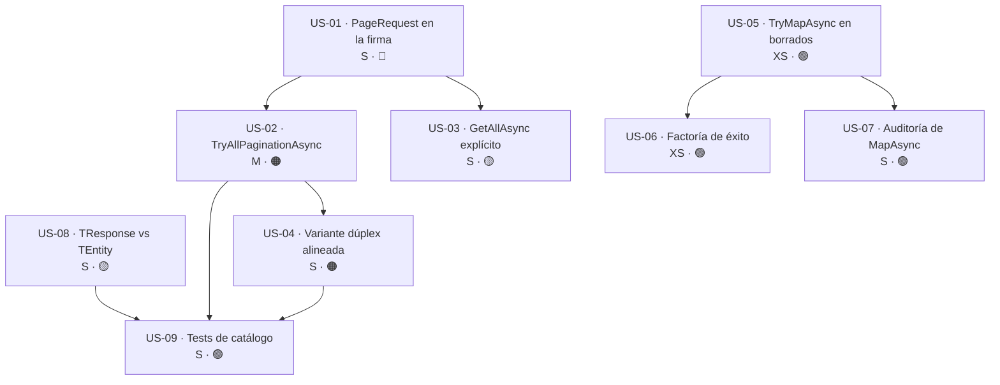

# Épica · Servicio y paginación en `MoralesLarios.OOFP.Application`

> **Versión destino:** `2.1.0`
> **Origen:** puntos **41**, **53** y **54** de [`Temas Pendientes/Mejoras-Prioridad-Media.md`](../../Temas%20Pendientes/Mejoras-Prioridad-Media.md)
> (*"`GetPagedAsync` no pagina"*, *"`MapAsync` donde debería haber `TryMapAsync`"*, *"mensajes con el tipo equivocado"*).
> **Plan del que se desgaja:** [`Temas Pendientes/Plan-Ejecucion-Prioridad-Media.md`](../../Temas%20Pendientes/Plan-Ejecucion-Prioridad-Media.md) · fase 4, tareas 4.1, 4.2 y 4.3.
> **Estado:** ⬜ No iniciada
> **Esfuerzo estimado:** **M** (~1-2 jornadas) · **Riesgo:** 🔴 Alto (cambia la firma de un método público muy usado)

> ⚠️ La tarea **4.4** de la fase 4 (punto **40**, `IMlUnitOfWork`) **no entra en esta épica**: se ha
> desgajado a [`Epica-Unidad-de-Trabajo-y-Transacciones.md`](Epica-Unidad-de-Trabajo-y-Transacciones.md).
> Reproducimos el aviso del plan porque explica por qué:
>
> > ⚠️ **4.4 es el punto más caro del documento.** Es un rediseño del modelo de persistencia, no un arreglo.

---

## Índice

1. [Contexto y problema](#1-contexto-y-problema)
2. [Hallazgo colateral: la infraestructura de paginación ya existe y nadie la llama](#2-hallazgo-colateral-la-infraestructura-de-paginación-ya-existe-y-nadie-la-llama)
3. [Alcance](#3-alcance)
4. [Historias de usuario](#4-historias-de-usuario)
5. [Orden de ejecución y dependencias](#5-orden-de-ejecución-y-dependencias)
6. [Decisiones de diseño abiertas](#6-decisiones-de-diseño-abiertas)
7. [Definición de terminado (DoD)](#7-definición-de-terminado-dod)
8. [Apéndice · Ejemplos de código y explicación detallada](#8-apéndice--ejemplos-de-código-y-explicación-detallada)

---

## 1. Contexto y problema

`CrudServiceFp<TDto, TEntity, TKey>` es la clase de servicio genérica sobre la que se apoya toda la
capa de aplicación. Tiene **2 problemas de contrato** y **1 problema de diagnóstico**:

1. **Un método llamado `GetPagedAsync` que no pagina.** No recibe página ni tamaño de página, y en su
   cuerpo llama a `_repo.TryAllAsync(ct)`: trae **la tabla completa** y la proyecta a `IEnumerable<TDto>`.
   El nombre promete paginación; la implementación hace un `SELECT *`.
2. **`MapAsync` en proyecciones que pueden lanzar.** `dto.Adapt<TEntity>()` es una llamada a Mapster
   que **puede lanzar** (configuración ausente, conversión imposible, constructor que falla). Al estar
   dentro de `MapAsync` y no de `TryMapAsync`, la excepción **escapa del railway** y rompe el contrato
   `MlResult<T>` del método.
3. **Mensajes que nombran el tipo equivocado.** En las sobrecargas dúplex (`TRequest`/`TResponse`) hay
   mensajes construidos con `typeof(TEntity).Name`, de modo que el cliente de la API recibe el nombre
   de la **entidad de base de datos**, no el de su DTO.

| Fichero | Líneas |
|---|---|
| `MoralesLarios.OOFP.Application/Services/CrudServiceFp.cs` | **27-39** (`GetPagedAsync` simple), **322-334** (`GetPagedAsync` dúplex), **271** y **568** (`MapAsync` + `Adapt`), **264** y **561** (firmas sin factoría de éxito), **438** y **521** (`typeof(TEntity).Name`), **539**, **547**, **548**, **584** (`typeof(TResponse).Name`) |
| `MoralesLarios.OOFP.Application/Services/ICrudServiceFp.cs` | **25-28** (declaración simple), **179** (declaración dúplex) |
| `MoralesLarios.OOFP.EntityFrameworkCore/Repositories/IEfPaginator.cs` | **24**, **34**, **44**, **55** (los 4 métodos de paginación que nadie llama) |
| `MoralesLarios.OOFP.EntityFrameworkCore/Repositories/EfPagedReadRepository.cs` | **11-13**, **135-158** (`TryQueryPage`) |

El cuerpo real de hoy:

```csharp
// MoralesLarios.OOFP.Application/Services/CrudServiceFp.cs, L27-39
    public virtual Task<MlResult<IEnumerable<TDto>>> GetPagedAsync(CancellationToken               ct                  = default!,
                                                              string                          initialMessage      = null!,
                                                              Func<IEnumerable<TDto>, string> successMessageFactory = null!,
                                                              Func<MlErrorDetails  , string> failMessageBuilder  = null!)
    {
        var result = _logger.LogMlResultInformationAsync(initialMessage ?? $"Querying all records of the table corresponding to dto {typeof(TDto).Name}")
                            .BindAsync( _     => _repo.TryAllAsync(ct))     // ← trae TODA la tabla
                            .MapAsync (bdData => bdData.Adapt<IEnumerable<TDto>>())
                            .LogCompletedResultAsync(logger           : _logger,
                                                   validBuildMessage: x      => successMessageFactory is null  ? $"Found {x.Count()} of table {typeof(TDto).Name}" : successMessageFactory(x),
                                                   failBuildMessage : errors => failMessageBuilder  is null  ? $"An error occurred while querying the {typeof(TDto).Name} table. Error: {errors.ToString()}" : failMessageBuilder(errors));
        return result;
    }
```

Fíjate en el propio mensaje por defecto: **`"Querying all records of the table…"`**. El código es
honesto; el nombre del método, no.

**Un método público llamado `GetPagedAsync` que hace `SELECT *` es una bomba de relojería: funciona
perfectamente en desarrollo con 20 filas y tumba el proceso en producción con 2 millones.**

### Consecuencias

1. **Riesgo de `OutOfMemoryException` y de saturación del pool de conexiones** en cualquier tabla
   grande. No hay tope: `PageRequest.MaxPageSize = 1000` existe, pero este camino no lo atraviesa.
2. **El consumidor no puede paginar aunque quiera.** La firma no admite página ni tamaño, así que la
   única salida es saltarse el servicio y hablar con el repositorio directamente — exactamente lo que
   la capa de aplicación pretende evitar.
3. **Excepciones que escapan del railway.** Un `Adapt` mal configurado no produce un `MlResult` fallido
   con su `MlErrorDetails`: produce una excepción que atraviesa el servicio, el controlador y acaba en
   un `500` sin diagnóstico.
4. **Diagnóstico engañoso.** Mensajes con el nombre de la entidad filtran el modelo de persistencia al
   cliente y, a la vez, dificultan correlacionar un log con la petición que lo originó.

---

## 2. Hallazgo colateral: la infraestructura de paginación ya existe y nadie la llama

> ⚠️ **Esto cambia por completo el coste del punto 41: no hay que construir la paginación, hay que
> enchufarla.**

En `MoralesLarios.OOFP.EntityFrameworkCore` ya están implementados y probados:

```csharp
// MoralesLarios.OOFP.EntityFrameworkCore/Repositories/IEfPaginator.cs, L24-55
    MlResult<PagedResult<T>>       TryAllPagination         (PageRequest paginationInfo, SortDirection orderBy = SortDirection.Ascending, Expression<Func<T, object>> orderByField = null!);
    Task<MlResult<PagedResult<T>>> TryAllPaginationAsync    (PageRequest paginationInfo, SortDirection orderBy = SortDirection.Ascending, Expression<Func<T, object>> orderByField = null!, CancellationToken ct = default!);
    MlResult<PagedResult<T>>       TryGetDataPagination     (PageRequest paginationInfo, SortDirection orderBy = SortDirection.Ascending, Expression<Func<T, object>> orderByField = null!, Expression<Func<T, bool>> filter = null!);
    Task<MlResult<PagedResult<T>>> TryGetDataPaginationAsync(PageRequest paginationInfo, SortDirection orderBy = SortDirection.Ascending, Expression<Func<T, object>> orderByField = null!, Expression<Func<T, bool>> filter = null!, CancellationToken ct = default!);
```

Y la jerarquía de interfaces ya los expone:

| Interfaz | Composición | Métodos |
|---|---|---|
| `IEfPagedReadRepository<T>` | `IEfReadRepository<T>` + `IEfPaginator<T>` | 16 + 4 |
| `IEfPagedRepository<T>` | `IEfRepository<T>` + `IEfPaginator<T>` | 20 + 4 |

Efectos:

| # | Efecto | Detalle |
|---|---|---|
| 1 | **El punto 41 es una conexión, no un desarrollo** | `PageRequest`, `PagedResult<T>`, `SortDirection`, `TryQueryPage` y los 4 métodos de `IEfPaginator<T>` ya existen y están cubiertos por tests |
| 2 | **Hay código muerto de facto** | 4 métodos públicos de paginación con **0 llamadas** desde `Application`. El valor construido no se está cobrando |
| 3 | **El tope ya está decidido** | `PageRequest.MaxPageSize = 1000`; no hay que inventar política de límites, hay que atravesarla |
| 4 | **El tipo de retorno correcto ya está escrito** | `PagedResult<T>` lleva `items`, `pageNumber`, `pageSize` y `count`: es exactamente lo que necesitan las cabeceras `MlPaginationHeaders` (punto 55, ya resuelto) |
| 5 | **El repositorio del servicio puede no exponerlos** | `CrudServiceFp` se tipa contra `_repo`; hay que verificar si su tipo declarado incluye `IEfPaginator<TEntity>` o si hay que elevarlo (ver **D-3**) |

Es decir: el trabajo de esta épica es **de contrato**, no de algoritmo.

---

## 3. Alcance

### Dentro del alcance

- `GetPagedAsync` (simple y dúplex) pasa a recibir `PageRequest` y a devolver paginación real.
- Un método explícito y honesto para el caso "quiero todos los registros".
- Sustituir `MapAsync` por `TryMapAsync` en las proyecciones DTO→entidad de los borrados.
- Añadir factoría de mensaje de éxito a los 2 borrados por DTO que no la tienen.
- Auditar los 16 `MapAsync` del proyecto y clasificarlos (seguro / debe ser `TryMapAsync`).
- Criterio único de nomenclatura en mensajes: `TResponse` hacia el cliente, `TEntity` solo en logs.
- Tests de servicio para paginación, para el fallo de proyección y para los mensajes.

### Fuera del alcance

- **Punto 40 · `IMlUnitOfWork` y transacciones** → [`Epica-Unidad-de-Trabajo-y-Transacciones.md`](Epica-Unidad-de-Trabajo-y-Transacciones.md).
- **Puntos 38 y 39** (`LastOrDefault()` en `ThrowingEfReadRepository`, `TryFind`+`Update` en `EfUpdateRepository`): viven en `EntityFrameworkCore`, no en `Application`.
- Las cabeceras HTTP de paginación (`MlPaginationHeaders`): **ya resueltas** en el punto 55.
- El contrato REST de los controladores → [`Epica-Contrato-Rest.md`](Epica-Contrato-Rest.md).
- Reescribir `EfPagedReadRepository.TryQueryPage`: se consume tal cual está.

---

## 4. Historias de usuario

> **Leyenda de esfuerzo:** XS (<2 h) · S (½ jornada) · M (1 jornada) · L (2 jornadas) · XL (3+ jornadas)
> **Leyenda de riesgo:** 🟢 bajo · 🟡 medio · 🟠 alto · 🔴 muy alto (rompe compatibilidad)

### US-01 · `GetPagedAsync` recibe `PageRequest`

> *"**Como** consumidor de `ICrudServiceFp`, **quiero** que `GetPagedAsync` me exija la página y el tamaño de página, **para** que sea imposible pedir una tabla entera sin darme cuenta."*

- **Esfuerzo:** S · **Riesgo:** 🔴 (cambia la firma de un método público; rompe en compilación)
- **Depende de:** nada
- **Prerrequisito de:** US-02, US-04
- **Proyecto afectado:** `MoralesLarios.OOFP.Application`
- **Justificación:** punto 41; plan fase 4, tarea 4.1.

**Criterios de aceptación**

- [ ] `GetPagedAsync` declara `PageRequest pageRequest` como **primer parámetro obligatorio** (sin valor por defecto).
- [ ] La declaración de `ICrudServiceFp.cs` (L25-28) refleja la nueva firma.
- [ ] Se admite opcionalmente el criterio de ordenación (`SortDirection` + `Expression<Func<TEntity, object>>`), con los mismos valores por defecto que `IEfPaginator<T>`.
- [ ] Cualquier llamada antigua `GetPagedAsync(ct)` **deja de compilar** (no se añade sobrecarga de compatibilidad sin cuerpo; ver **D-1**).
- [ ] El XML doc del método describe el tope `MaxPageSize = 1000` y qué pasa al superarlo.

**API propuesta**

```csharp
Task<MlResult<PagedResult<TDto>>> GetPagedAsync(PageRequest                         pageRequest,
                                                SortDirection                       orderBy               = SortDirection.Ascending,
                                                Expression<Func<TEntity, object>>   orderByField          = null!,
                                                CancellationToken                   ct                    = default!,
                                                string                              initialMessage        = null!,
                                                Func<PagedResult<TDto>, string>     successMessageFactory = null!,
                                                Func<MlErrorDetails, string>        failMessageBuilder    = null!);
```

**⚠️ Riesgo principal**

Es una **ruptura en compilación**, que es la buena: todo consumidor se enterará al construir, no en
producción. Hay que anunciarla en las notas de versión con la tabla de equivalencias de US-03.

---

### US-02 · `GetPagedAsync` llama a `TryAllPaginationAsync` y devuelve `PagedResult<TDto>`

> *"**Como** operador del sistema, **quiero** que una consulta paginada traduzca a `SKIP`/`TAKE` en la base de datos, **para** que el consumo de memoria no dependa del tamaño de la tabla."*

- **Esfuerzo:** M · **Riesgo:** 🟠 (cambia el tipo de retorno)
- **Depende de:** US-01
- **Prerrequisito de:** US-04, US-09
- **Proyecto afectado:** `MoralesLarios.OOFP.Application`
- **Justificación:** punto 41; plan fase 4, tarea 4.1.

**Criterios de aceptación**

- [ ] El cuerpo llama a `_repo.TryAllPaginationAsync(pageRequest, orderBy, orderByField, ct)` y **no** a `TryAllAsync`.
- [ ] El retorno es `MlResult<PagedResult<TDto>>`: se preservan `PageNumber`, `PageSize` y `Count` del `PagedResult<TEntity>` devuelto por el repositorio.
- [ ] Solo se proyecta a DTO la **página**, no la colección completa.
- [ ] El mensaje de éxito por defecto deja de decir *"Querying all records…"* y pasa a indicar página, tamaño y total.
- [ ] El `CancellationToken` se propaga hasta el repositorio.

**API propuesta**

```csharp
var result = _logger.LogMlResultInformationAsync(initialMessage ?? $"Querying page {pageRequest.PageNumber} (size {pageRequest.PageSize}) of dto {typeof(TDto).Name}")
                    .BindAsync( _    => _repo.TryAllPaginationAsync(pageRequest, orderBy, orderByField, ct))
                    .MapAsync ( page => page.MapItems(items => items.Adapt<IEnumerable<TDto>>()))
                    .LogCompletedResultAsync(...);
```

**Notas técnicas**

- `PagedResult<T>` es inmutable; si no tiene un `MapItems`/`WithItems`, hay que construir el nuevo con `new PagedResult<TDto>(items, page.PageNumber, page.PageSize, page.Count)`. Decidir en **D-4**.
- `_repo` debe exponer `IEfPaginator<TEntity>`; si su tipo declarado no lo incluye, elevarlo (ver **D-3**).

**Tests mínimos**

| Escenario | Resultado esperado |
|---|---|
| Tabla de 25 filas, página 2 de tamaño 10 | `Items.Count() == 10`, `PageNumber == 2`, `Count == 25` |
| Página 4 de tamaño 10 sobre 25 filas | `Items` vacío, `Count == 25`, resultado **válido** (no fallido) |
| `PageSize` por encima de `MaxPageSize` | el comportamiento de `PageRequest` se respeta (recorte o fallo), documentado |
| Repositorio devuelve fallo | el `MlResult` fallido se propaga sin proyectar |

---

### US-03 · Método explícito para "traer todos los registros"

> *"**Como** desarrollador que de verdad necesita la tabla completa (un export, una caché de arranque), **quiero** un método que se llame como lo que hace, **para** que la revisión de código vea el riesgo."*

- **Esfuerzo:** S · **Riesgo:** 🟡 (añade superficie pública)
- **Depende de:** US-01
- **Prerrequisito de:** nada
- **Proyecto afectado:** `MoralesLarios.OOFP.Application`
- **Justificación:** punto 41, apartado *"si se conserva el «traer todo», que sea otro método explícito"*; plan fase 4, tarea 4.1.

**Criterios de aceptación**

- [ ] Existe `GetAllAsync` con el cuerpo que hoy tiene `GetPagedAsync` (llamada a `TryAllAsync` + proyección completa).
- [ ] Su XML doc empieza con una advertencia explícita de que **no está acotado** y de cuándo usar `GetPagedAsync`.
- [ ] Está declarado en `ICrudServiceFp` (simple y dúplex).
- [ ] El `README` de `Application` incluye la tabla de equivalencias `2.0.0` → `2.1.0`.

**Tabla de equivalencias exigida**

| Llamada en `2.0.0` | Equivalente en `2.1.0` | Comentario |
|---|---|---|
| `GetPagedAsync(ct)` | `GetAllAsync(ct)` | mismo comportamiento, nombre honesto |
| *(no existía)* | `GetPagedAsync(new PageRequest(1, 50), ct: ct)` | paginación real |

---

### US-04 · La variante dúplex (`TRequest`/`TResponse`) queda alineada

> *"**Como** consumidor de la sobrecarga dúplex, **quiero** exactamente el mismo contrato de paginación que en la simple, **para** no tener que recordar dos semánticas distintas."*

- **Esfuerzo:** S · **Riesgo:** 🟠 (segunda ruptura de firma)
- **Depende de:** US-01, US-02
- **Prerrequisito de:** US-09
- **Proyecto afectado:** `MoralesLarios.OOFP.Application`
- **Justificación:** punto 41; `CrudServiceFp.cs` L322-334 e `ICrudServiceFp.cs` L179.

**Criterios de aceptación**

- [ ] `GetPagedAsync` dúplex recibe `PageRequest` y devuelve `MlResult<PagedResult<TResponse>>`.
- [ ] Existe `GetAllAsync` dúplex, análogo al de US-03.
- [ ] Los mensajes por defecto usan **`TResponse`**, nunca `TEntity` (ver US-08).
- [ ] No queda ninguna diferencia de comportamiento entre simple y dúplex más allá del tipo proyectado.

---

### US-05 · `TryMapAsync` en las proyecciones DTO→entidad de los borrados

> *"**Como** consumidor del servicio, **quiero** que un fallo de mapeo me llegue como `MlResult` fallido, **para** poder tratarlo sin `try/catch` y sin romper el railway."*

- **Esfuerzo:** XS · **Riesgo:** 🟢 (solo convierte excepciones en fallos)
- **Depende de:** nada
- **Prerrequisito de:** US-07
- **Proyecto afectado:** `MoralesLarios.OOFP.Application`
- **Justificación:** punto 53; plan fase 4, tarea 4.2. `CrudServiceFp.cs` **L271** y **L568**.

**Criterios de aceptación**

- [ ] `L271` y `L568` usan `.TryMapAsync(_ => dto.Adapt<TEntity>(), "<mensaje>")` en lugar de `.MapAsync(...)`.
- [ ] El mensaje de error identifica el par de tipos involucrado (`TDto` → `TEntity`).
- [ ] Hay un test que registra un mapeo que lanza y comprueba que el resultado es **fallido**, no una excepción.
- [ ] El estilo coincide con el que ya usa `CreateAsync` (L107-122), que ya hace `TryMapAsync` en esa misma proyección.

**Notas técnicas**

`CreateAsync` ya es el ejemplo correcto dentro del propio fichero: usa `.TryMapAsync(_ => dto.Adapt<TEntity>())`
para entrar y `.MapAsync(bdData => bdData.Adapt<TDto>())` para salir. Esta historia solo extiende ese
criterio a los borrados.

---

### US-06 · Factoría de mensaje de éxito en los borrados por DTO

> *"**Como** integrador, **quiero** poder personalizar el mensaje de éxito de un borrado igual que en el resto de operaciones, **para** que mis logs sean homogéneos."*

- **Esfuerzo:** XS · **Riesgo:** 🟢 (parámetro opcional)
- **Depende de:** US-05
- **Prerrequisito de:** nada
- **Proyecto afectado:** `MoralesLarios.OOFP.Application`
- **Justificación:** punto 53, apartado *"+ factoría de mensaje de éxito"*; firmas `CrudServiceFp.cs` **L264** y **L561**.

**Criterios de aceptación**

- [ ] Las firmas de L264 y L561 incluyen `Func<…, string> successMessageFactory = null!` en la misma posición que el resto de métodos.
- [ ] Si llega `null`, se mantiene **literalmente** el mensaje por defecto actual (no es una ruptura de comportamiento).
- [ ] Las declaraciones de `ICrudServiceFp` se actualizan.
- [ ] Un test comprueba que la factoría se invoca y que su texto llega al logger.

---

### US-07 · Auditoría de los `MapAsync` restantes

> *"**Como** mantenedor, **quiero** saber qué `MapAsync` del proyecto son seguros y cuáles no, **para** no tener que volver a auditarlo en cada versión."*

- **Esfuerzo:** S · **Riesgo:** 🟢
- **Depende de:** US-05
- **Prerrequisito de:** nada
- **Proyecto afectado:** `MoralesLarios.OOFP.Application`
- **Justificación:** punto 53, apartado *"revisar los otros 14 `MapAsync`"*; plan fase 4, tarea 4.2.

**Criterios de aceptación**

- [ ] Se parte del recuento confirmado: **22 llamadas a `Adapt`**, **16 dentro de `MapAsync`**, **6 en `TryMapAsync`**.
- [ ] Cada uno de los 16 queda clasificado en una tabla: *convertido a `TryMapAsync`* / *seguro, se documenta por qué*.
- [ ] Se convierten como mínimo los que proyectan **entrada del consumidor** (`GetPagedAsync` L34, `FindByIdProblemsDetailsAsync` L83, `UpdateAsync` L174 y los de las variantes dúplex) según el criterio acordado en **D-5**.
- [ ] La tabla queda en el documento de la épica (§8.5) y referenciada desde el `README` del proyecto.

---

### US-08 · Criterio único: `TResponse` hacia el cliente, `TEntity` solo en logs

> *"**Como** consumidor de la API, **quiero** que los mensajes de error nombren mi DTO y no la tabla, **para** no depender del modelo interno de persistencia."*

- **Esfuerzo:** S · **Riesgo:** 🟡 (cambia el texto de mensajes; puede romper tests que comparan cadenas)
- **Depende de:** nada
- **Prerrequisito de:** US-09
- **Proyecto afectado:** `MoralesLarios.OOFP.Application`
- **Justificación:** punto 54; plan fase 4, tarea 4.3.

**Criterios de aceptación**

- [ ] Se documenta el criterio en una sola frase al principio de `CrudServiceFp.cs`: **`TResponse`/`TDto` en todo mensaje que pueda llegar al consumidor; `TEntity` solo en trazas internas.**
- [ ] `L438` y `L521` dejan de usar `typeof(TEntity).Name` y usan el tipo que el método realmente recibe (`TRequest`/`TResponse`).
- [ ] Los usos ya correctos de `typeof(TResponse).Name` (**L539, L547, L548, L584**) se dejan tal cual y se citan como referencia del criterio.
- [ ] Cualquier test que compare el texto se actualiza en el mismo commit.

**Notas técnicas**

```csharp
// L432-438 — el método recibe TRequest, pero el error nombra TEntity
        => UpdateAsync(dtoRequest, typeof(TEntity).Name.BuildEntityNotFoundError(pk), ct, initialMessage, successMessageFactory, failMessageBuilder, pk);

// L517-521 — el método solo recibe claves; el error nombra TEntity
        => DeleteProblemDetailsAsync(typeof(TEntity).Name.BuildEntityNotFoundError(pk), ct, initialMessage, failMessageBuilder, pk);
```

El caso de L521 merece debate: el método **no tiene** un DTO de entrada, solo claves. Resolver en **D-6**.

---

### US-09 · Tests de catálogo del servicio

> *"**Como** equipo, **quiero** una prueba que falle sola si alguien reintroduce un `SELECT *` o un mensaje con el tipo equivocado, **para** no depender de la revisión manual."*

- **Esfuerzo:** S · **Riesgo:** 🟢
- **Depende de:** US-02, US-04, US-08
- **Prerrequisito de:** nada
- **Proyecto afectado:** `MoralesLarios.OOFP.Application.Tests.Unit`
- **Justificación:** criterio de calidad del plan (entregable de la fase 4).

**Criterios de aceptación**

- [ ] Test por reflexión: **ningún** método público de `ICrudServiceFp` cuyo nombre contenga `Paged` carece de un parámetro `PageRequest`.
- [ ] Test por reflexión: todos los métodos `*Paged*` devuelven `Task<MlResult<PagedResult<…>>>`.
- [ ] Test de mensajes: con un repositorio simulado que devuelve "no encontrado", el texto contiene el nombre del DTO y **no** el de la entidad.
- [ ] Test de railway: un `Adapt` que lanza produce `MlResult` fallido en los 2 borrados y en los métodos convertidos en US-07.

**Tests mínimos**

| Escenario | Resultado esperado |
|---|---|
| Reflexión sobre `ICrudServiceFp` buscando `Paged` sin `PageRequest` | 0 coincidencias |
| `GetAllAsync` existe en las 2 variantes | verdadero |
| Mensaje de "no encontrado" en la sobrecarga dúplex | contiene `typeof(TResponse).Name` |
| Mapeo que lanza en el borrado por DTO | `MlResult` fallido con `MlErrorDetails` no vacío |

---

## 5. Orden de ejecución y dependencias



### Secuencia recomendada

| Orden | Historia | Esfuerzo | Hito |
|---:|---|---|---|
| 1 | US-05 · `TryMapAsync` en los borrados | XS | arreglo sin ruptura, se puede soltar ya |
| 2 | US-06 · factoría de mensaje de éxito | XS | API homogénea |
| 3 | US-08 · criterio `TResponse`/`TEntity` | S | mensajes correctos |
| 4 | US-01 · `PageRequest` en la firma | S | **arranca la ruptura** |
| 5 | US-02 · `TryAllPaginationAsync` | M | 🎯 **paginación real funcionando** |
| 6 | US-03 · `GetAllAsync` explícito | S | ruta de migración disponible |
| 7 | US-04 · variante dúplex | S | contrato completo |
| 8 | US-07 · auditoría de los `MapAsync` | S | deuda cerrada y documentada |
| 9 | US-09 · tests de catálogo | S | red de seguridad |

**Total: ~1-2 jornadas.**

> 💡 **Entrega incremental sugerida**
> US-05, US-06 y US-08 **no rompen compilación** y pueden publicarse por separado como arreglo menor.
> La ruptura real (US-01 → US-04) debe salir **en un solo golpe** junto con la tabla de equivalencias
> de US-03 y, preferiblemente, en la misma versión que la [épica del contrato REST](Epica-Contrato-Rest.md),
> para concentrar todas las rupturas de la `2.1.0` en un único salto.

---

## 6. Decisiones de diseño abiertas

| Id | Decisión | Opciones | Recomendación |
|---|---|---|---|
| **D-1** | ¿`GetPagedAsync` **exige** `PageRequest` o se añade una sobrecarga nueva y se deja la antigua? | (a) exigirlo: ruptura en compilación · (b) sobrecarga nueva + `[Obsolete]` en la antigua un ciclo · (c) sobrecarga nueva y dejar la antigua indefinidamente | **(a)**, con la tabla de equivalencias de US-03. Es la pregunta 2 del plan: una firma que miente es peor que una ruptura anunciada |
| **D-2** | ¿Cómo se llama el método "traer todo"? | (a) `GetAllAsync` · (b) `GetUnboundedAsync` · (c) `GetCompleteTableAsync` | **(a)** por coherencia con `TryAllAsync` del repositorio; la advertencia va en el XML doc |
| **D-3** | ¿`_repo` expone ya `IEfPaginator<TEntity>`? | (a) sí, no hay nada que hacer · (b) elevar el tipo declarado a `IEfPagedRepository<TEntity>` · (c) inyectar un segundo `IEfPaginator<TEntity>` opcional | Verificar antes de empezar; si no lo expone, **(b)** (es la interfaz que ya compone los 20 + 4 métodos) |
| **D-4** | ¿Cómo se proyecta `PagedResult<TEntity>` → `PagedResult<TDto>`? | (a) añadir `MapItems` a `PagedResult<T>` · (b) construirlo a mano en el servicio · (c) registrar la conversión en Mapster | **(a)**: es reutilizable y evita repetir los 4 argumentos en cada método |
| **D-5** | ¿Qué `MapAsync` de los 16 se convierten en `TryMapAsync`? | (a) todos · (b) solo los que proyectan entrada del consumidor · (c) solo los 2 del punto 53 | **(b)**: `Adapt` de entidad→DTO con configuración estable es seguro; el de DTO→entidad depende de datos externos |
| **D-6** | En los métodos que **solo reciben claves** (L521), ¿qué tipo se nombra en el error? | (a) `TResponse`/`TDto` · (b) `TEntity` porque es lo que no se ha encontrado · (c) un nombre lógico configurable | **(a)** para el mensaje que sale, **(b)** para la traza; el criterio de US-08 ya lo cubre |

---

## 7. Definición de terminado (DoD)

- [ ] `GetPagedAsync` (simple y dúplex) recibe `PageRequest` y llama a `TryAllPaginationAsync`.
- [ ] Existe `GetAllAsync` en las 2 variantes, documentado como no acotado.
- [ ] `L271` y `L568` usan `TryMapAsync`; las firmas `L264`/`L561` admiten factoría de éxito.
- [ ] Los 16 `MapAsync` están clasificados en la tabla de §8.5 y los acordados en **D-5** están convertidos.
- [ ] `L438` y `L521` ya no usan `typeof(TEntity).Name` en mensajes de salida.
- [ ] La solución compila en `Release --no-incremental` con **0 errores y `CS1591 = 0`**.
- [ ] Los **1.027 tests** existentes siguen en verde (ajustando los que comparan cadenas de mensaje).
- [ ] Los tests de catálogo de US-09 están en `Application.Tests.Unit` y pasan.
- [ ] El `README` de `Application` publica la tabla de equivalencias `2.0.0` → `2.1.0`.
- [ ] Las 6 decisiones (**D-1 … D-6**) están cerradas y anotadas en este documento.

---

## 8. Apéndice · Ejemplos de código y explicación detallada

> Este apéndice contiene **el código real de hoy** (con fichero y línea) y **el código propuesto**
> para cada historia. Todo el código "después" es *ilustrativo*: fija la intención y el contrato, no
> la implementación definitiva.

### Índice del apéndice

- 8.1 · El método que no paginaba (US-01, US-02)
- 8.2 · `GetAllAsync`: el camino honesto para "traer todo" (US-03)
- 8.3 · La variante dúplex (US-04)
- 8.4 · `MapAsync` frente a `TryMapAsync`: por qué importa (US-05, US-06)
- 8.5 · Catálogo de los 22 `Adapt` (US-07)
- 8.6 · `TResponse` frente a `TEntity` en los mensajes (US-08)
- 8.7 · Tests de catálogo por reflexión (US-09)
- 8.8 · Resumen de rupturas

---

### 8.1 · El método que no paginaba (US-01, US-02)

**Hoy — `Application/Services/CrudServiceFp.cs`, L27-39**

```csharp
    public virtual Task<MlResult<IEnumerable<TDto>>> GetPagedAsync(CancellationToken               ct                  = default!,
                                                              string                          initialMessage      = null!,
                                                              Func<IEnumerable<TDto>, string> successMessageFactory = null!,
                                                              Func<MlErrorDetails  , string> failMessageBuilder  = null!)
    {
        var result = _logger.LogMlResultInformationAsync(initialMessage ?? $"Querying all records of the table corresponding to dto {typeof(TDto).Name}")
                            .BindAsync( _     => _repo.TryAllAsync(ct))
                            .MapAsync (bdData => bdData.Adapt<IEnumerable<TDto>>())
                            .LogCompletedResultAsync(logger           : _logger,
                                                   validBuildMessage: x      => successMessageFactory is null  ? $"Found {x.Count()} of table {typeof(TDto).Name}" : successMessageFactory(x),
                                                   failBuildMessage : errors => failMessageBuilder  is null  ? $"An error occurred while querying the {typeof(TDto).Name} table. Error: {errors.ToString()}" : failMessageBuilder(errors));
        return result;
    }
```

**Y su declaración — `ICrudServiceFp.cs`, L25-28**

```csharp
    Task<MlResult<IEnumerable<TDto>>> GetPagedAsync(CancellationToken               ct                    = default!,
                                                    string                          initialMessage        = null!,
                                                    Func<IEnumerable<TDto>, string> successMessageFactory = null!,
                                                    Func<MlErrorDetails, string>    failMessageBuilder    = null!);
```

Lo que de verdad ocurre al invocarlo sobre una tabla de 2 millones de filas:

```
1. _repo.TryAllAsync(ct)                   → SELECT * FROM T            (2.000.000 filas)
2. materialización en memoria              → ~2.000.000 instancias de TEntity
3. bdData.Adapt<IEnumerable<TDto>>()       → ~2.000.000 instancias de TDto  ← pico de memoria x2
4. x.Count()                               → recorre la secuencia OTRA vez
5. el consumidor recibe IEnumerable<TDto>  → sin PageNumber, sin PageSize, sin Count
```

El paso **4** es un agravante independiente: `x.Count()` sobre un `IEnumerable<T>` no materializado
provoca una segunda enumeración. Con `PagedResult<T>` desaparece, porque el total ya viene calculado
por la propia consulta de conteo.

**Después**

```csharp
    public virtual Task<MlResult<PagedResult<TDto>>> GetPagedAsync(PageRequest                       pageRequest,
                                                                   SortDirection                     orderBy               = SortDirection.Ascending,
                                                                   Expression<Func<TEntity, object>> orderByField          = null!,
                                                                   CancellationToken                 ct                    = default!,
                                                                   string                            initialMessage        = null!,
                                                                   Func<PagedResult<TDto>, string>   successMessageFactory = null!,
                                                                   Func<MlErrorDetails, string>      failMessageBuilder    = null!)
    {
        var result = _logger.LogMlResultInformationAsync(initialMessage ?? $"Querying page {pageRequest.PageNumber} (size {pageRequest.PageSize}) of dto {typeof(TDto).Name}")
                            .BindAsync( _    => _repo.TryAllPaginationAsync(pageRequest, orderBy, orderByField, ct))
                            .MapAsync ( page => page.MapItems(items => items.Adapt<IEnumerable<TDto>>()))
                            .LogCompletedResultAsync(logger           : _logger,
                                                   validBuildMessage: x      => successMessageFactory is null  ? $"Returned {x.Items.Count()} of {x.Count} records of {typeof(TDto).Name} (page {x.PageNumber}/{x.PageSize})" : successMessageFactory(x),
                                                   failBuildMessage : errors => failMessageBuilder  is null  ? $"An error occurred while querying page {pageRequest.PageNumber} of {typeof(TDto).Name}. Error: {errors.ToString()}" : failMessageBuilder(errors));
        return result;
    }
```

La traza equivalente:

```
1. _repo.TryAllPaginationAsync(new PageRequest(2, 50), ...)
                                           → SELECT COUNT(*) FROM T                 (1 fila)
                                           → SELECT * FROM T ORDER BY ... OFFSET 50 ROWS FETCH NEXT 50  (50 filas)
2. page.Items.Adapt<IEnumerable<TDto>>()   → 50 instancias de TDto
3. x.Items.Count()                         → 50, sin segunda consulta
4. el consumidor recibe PagedResult<TDto>  → Items + PageNumber + PageSize + Count
```

> **Regla general:** si un método público lleva `Paged` en el nombre, **debe** tener un parámetro de
> paginación en la firma. US-09 lo convierte en una prueba automática.

**El `MapItems` de D-4:**

```csharp
// Propuesta en PagedResult<T> (MoralesLarios.OOFP.Shared o EntityFrameworkCore, según dónde viva)
    public PagedResult<TOut> MapItems<TOut>(Func<IEnumerable<T>, IEnumerable<TOut>> projection)
        => new PagedResult<TOut>(projection(Items), PageNumber, PageSize, Count);
```

Sin él, cada método tendría que repetir los 4 argumentos del constructor, con el riesgo evidente de
cruzar `PageNumber` con `PageSize`.

**Tabla de verificación**

| Comprobación | Antes | Después |
|---|---|---|
| Filas leídas de la BD | todas | `PageSize` (+1 consulta de conteo) |
| Instancias de `TDto` creadas | todas | `PageSize` |
| Enumeraciones de la secuencia | 2 (`Adapt` + `Count()`) | 1 |
| El consumidor conoce el total | ❌ | ✅ `PagedResult.Count` |
| El consumidor puede pedir la página 3 | ❌ | ✅ |
| Respeta `MaxPageSize = 1000` | ❌ | ✅ (vía `PageRequest`) |

---

### 8.2 · `GetAllAsync`: el camino honesto para "traer todo" (US-03)

El cuerpo actual **no se tira**: se renombra. Hay casos legítimos (exportaciones, cachés de arranque,
tablas de catálogo de 12 filas) y lo que queremos es que **se vean**.

**Después**

```csharp
    /// <summary>
    /// ⚠️ <b>Consulta NO acotada</b>: lee la tabla completa en memoria. Úsese únicamente con tablas
    /// de tamaño conocido y pequeño (catálogos, maestros cerrados). Para cualquier otro caso use
    /// <see cref="GetPagedAsync"/>, que respeta <c>PageRequest.MaxPageSize</c>.
    /// </summary>
    public virtual Task<MlResult<IEnumerable<TDto>>> GetAllAsync(CancellationToken               ct                    = default!,
                                                                 string                          initialMessage        = null!,
                                                                 Func<IEnumerable<TDto>, string> successMessageFactory = null!,
                                                                 Func<MlErrorDetails, string>    failMessageBuilder    = null!)
    {
        // cuerpo idéntico al GetPagedAsync de 2.0.0
    }
```

La migración para el consumidor es mecánica:

```diff
- var result = await service.GetPagedAsync(ct);
+ var result = await service.GetAllAsync(ct);                              // quiero todo, lo asumo
+ var result = await service.GetPagedAsync(new PageRequest(1, 50), ct: ct); // quiero paginar
```

El compilador obliga a elegir. Eso es precisamente el valor de la ruptura: **nadie** se queda con un
`SELECT *` por inercia.

---

### 8.3 · La variante dúplex (US-04)

**Hoy — `CrudServiceFp.cs`, L322-334**

El cuerpo es **idéntico** al simple, cambiando `TDto` por `TResponse`:

```csharp
    public virtual Task<MlResult<IEnumerable<TResponse>>> GetPagedAsync(CancellationToken                    ct                    = default!,
                                                              string                               initialMessage        = null!,
                                                              Func<IEnumerable<TResponse>, string> successMessageFactory = null!,
                                                              Func<MlErrorDetails, string>         failMessageBuilder    = null!)
    {
        var result = _logger.LogMlResultInformationAsync(initialMessage ?? $"Querying all records of the table corresponding to dto {typeof(TResponse).Name}")
                            .BindAsync( _     => _repo.TryAllAsync(ct))
                            .MapAsync (bdData => bdData.Adapt<IEnumerable<TResponse>>())
                            .LogCompletedResultAsync(...);
        return result;
    }
```

Y su declaración está en `ICrudServiceFp.cs` **L179**.

**Después:** la misma transformación de §8.1, con `PagedResult<TResponse>`. Lo importante aquí es la
**simetría**: cualquier divergencia entre las dos variantes es deuda futura garantizada, porque quien
migre de la simple a la dúplex (o al revés) asumirá que se comportan igual.

**Tabla de paridad exigida**

| Capacidad | Simple (`TDto`) | Dúplex (`TResponse`) |
|---|---|---|
| `GetPagedAsync` con `PageRequest` | ✅ | ✅ |
| Retorno `PagedResult<…>` | ✅ | ✅ |
| `GetAllAsync` | ✅ | ✅ |
| Ordenación opcional | ✅ | ✅ |
| Mensajes con el tipo de salida | `TDto` | `TResponse` |

---

### 8.4 · `MapAsync` frente a `TryMapAsync`: por qué importa (US-05, US-06)

**Hoy — `CrudServiceFp.cs`, L264-271 (borrado por DTO, variante simple)**

```csharp
    public virtual Task<MlResult<TDto>> DeleteAsync(TDto                         dto,
                                                    CancellationToken            ct                 = default!,
                                                    string                       initialMessage     = null!,
                                                    Func<MlErrorDetails, string> failMessageBuilder = null!)
    {
        var result = _logger.LogMlResultInformationAsync(initialMessage ?? $"...")
                            .MapAsync( _ => dto.Adapt<TEntity>())        // ← L271
                            .BindAsync( entity => _repo.TryRemoveAsync(entity, ct))
                            .MapAsync ( bdData => bdData.Adapt<TDto>())
                            .LogCompletedResultAsync(...);
        return result;
    }
```

La misma estructura se repite en **L561-568** para la variante dúplex.

El problema es concreto. Si Mapster no tiene configuración para `TDto → TEntity`, o si una propiedad
no es convertible, `Adapt` lanza. Y dentro de `MapAsync`, esa excepción **no se captura**:

```
MlResult<T> prometido  ──┐
                         ├─ MapAsync(Adapt)  ── throw ──►  la excepción atraviesa el servicio
                         │                                  atraviesa el controlador
                         └─ nunca se evalúa                 → 500 sin MlErrorDetails
```

Mientras que con `TryMapAsync`:

```
MlResult<T> prometido  ──┐
                         ├─ TryMapAsync(Adapt, "msg") ── throw ──►  capturada
                         │                                          → MlResult.Fail con MlErrorDetails
                         └─ el railway continúa                     → el consumidor decide qué hacer
```

**Y el precedente ya está en el mismo fichero — `CreateAsync`, L107-122:**

```csharp
                            .TryMapAsync(_      => dto.Adapt<TEntity>())      // ← entrada: TryMapAsync ✔
                            .BindAsync  (entity => _repo.TryAddAsync(entity, ct))
                            .MapAsync   (bdData => bdData.Adapt<TDto>())      // ← salida: MapAsync
```

> **Regla general:** la proyección **DTO → entidad** procede de datos externos y va con `TryMapAsync`;
> la proyección **entidad → DTO** procede de datos ya validados por la BD y puede ir con `MapAsync`.
> Ese es el criterio que **D-5** eleva a norma y que US-07 aplica a los 16 casos.

**Después (US-05 + US-06 juntas)**

```csharp
    public virtual Task<MlResult<TDto>> DeleteAsync(TDto                         dto,
                                                    CancellationToken            ct                    = default!,
                                                    string                       initialMessage        = null!,
                                                    Func<TDto, string>           successMessageFactory = null!,   // ← US-06
                                                    Func<MlErrorDetails, string> failMessageBuilder    = null!)
    {
        var result = _logger.LogMlResultInformationAsync(initialMessage ?? $"...")
                            .TryMapAsync( _ => dto.Adapt<TEntity>(),                                              // ← US-05
                                          $"Problems mapping {typeof(TDto).Name} to {typeof(TEntity).Name}")
                            .BindAsync  ( entity => _repo.TryRemoveAsync(entity, ct))
                            .MapAsync   ( bdData => bdData.Adapt<TDto>())
                            .LogCompletedResultAsync(logger           : _logger,
                                                   validBuildMessage: x      => successMessageFactory is null ? $"..." : successMessageFactory(x),
                                                   failBuildMessage : errors => failMessageBuilder is null    ? $"..." : failMessageBuilder(errors));
        return result;
    }
```

Nótese que `successMessageFactory` se coloca **en la misma posición** que en el resto de métodos del
fichero (entre `initialMessage` y `failMessageBuilder`). Es un detalle de coherencia que importa: un
parámetro opcional colocado en otro orden convierte las llamadas posicionales en una trampa.

**Tests mínimos**

| Escenario | Resultado esperado |
|---|---|
| `Adapt<TEntity>()` lanza (sin configuración) | `MlResult` **fallido** con `MlErrorDetails` no vacío; **ninguna excepción** sale del método |
| `successMessageFactory` informada | el logger recibe su texto |
| `successMessageFactory` a `null` | el logger recibe **exactamente** el mensaje por defecto de `2.0.0` |
| Borrado correcto | `MlResult` válido con el DTO devuelto por el repositorio |

---

### 8.5 · Catálogo de los 22 `Adapt` (US-07)

Estado medido hoy en `MoralesLarios.OOFP.Application`:

| Métrica | Valor |
|---|---|
| Llamadas a `Adapt` | **22** |
| Dentro de `MapAsync` | **16** |
| Dentro de `TryMapAsync` | **6** |

La tabla que US-07 exige rellenar (muestra con los casos ya identificados):

| # | Ubicación | Dirección | Hoy | Veredicto |
|---:|---|---|---|---|
| 1 | `GetPagedAsync` L34 | entidad → `TDto` | `MapAsync` | ⚠️ revisar: es colección, un fallo de configuración afecta a N elementos |
| 2 | `FindByIdProblemsDetailsAsync` L83 | entidad → `TDto` | `MapAsync` | 🟢 seguro (salida de BD) |
| 3 | `CreateAsync` L107-122 (entrada) | `TDto` → entidad | `TryMapAsync` | ✅ ya correcto — **patrón de referencia** |
| 4 | `CreateAsync` L107-122 (salida) | entidad → `TDto` | `MapAsync` | 🟢 seguro |
| 5 | `UpdateAsync` L174 | `TDto` → entidad | `MapAsync` | 🔴 **convertir** (entrada del consumidor) |
| 6 | `DeleteAsync` L271 | `TDto` → entidad | `MapAsync` | 🔴 **convertir** (US-05) |
| 7 | `GetPagedAsync` dúplex L329 | entidad → `TResponse` | `MapAsync` | ⚠️ revisar (igual que #1) |
| 8 | `DeleteAsync` dúplex L568 | `TRequest` → entidad | `MapAsync` | 🔴 **convertir** (US-05) |
| … | *(resto hasta 22)* | | | *pendiente de clasificar* |

Criterio de clasificación acordado (**D-5**, opción b):

```
¿La proyección parte de datos que ha proporcionado el consumidor?
        │
        ├── SÍ  → TryMapAsync  (DTO/Request → Entity)
        │
        └── NO  → MapAsync es aceptable  (Entity → DTO/Response)
                  …salvo que sea una COLECCIÓN grande, donde un fallo
                  de configuración es igual de probable pero más costoso
                  de diagnosticar → se recomienda TryMapAsync también.
```

**Tabla de cobertura exigida por el DoD:**

| Test | Historia que valida |
|---|---|
| `Adapt` que lanza en el borrado simple → resultado fallido | US-05 |
| `Adapt` que lanza en el borrado dúplex → resultado fallido | US-05 |
| `Adapt` que lanza en `UpdateAsync` → resultado fallido | US-07 |
| Los 22 `Adapt` están en la tabla de clasificación | US-07 |

---

### 8.6 · `TResponse` frente a `TEntity` en los mensajes (US-08)

**Hoy — `CrudServiceFp.cs`, L432-438**

```csharp
        => UpdateAsync(dtoRequest, typeof(TEntity).Name.BuildEntityNotFoundError(pk), ct, initialMessage, successMessageFactory, failMessageBuilder, pk);
```

**Hoy — `CrudServiceFp.cs`, L517-521**

```csharp
        => DeleteProblemDetailsAsync(typeof(TEntity).Name.BuildEntityNotFoundError(pk), ct, initialMessage, failMessageBuilder, pk);
```

**Hoy — los casos que YA son correctos (L539, L547, L548, L584)**

```csharp
        ... typeof(TResponse).Name ...
```

El resultado para el consumidor es incoherente: sobre el **mismo** servicio, un `PUT` que no encuentra
el registro devuelve el nombre de la **tabla**, y un `GET` que no lo encuentra devuelve el nombre del
**DTO**.

```
// ───── 2.0.0 ─────
PUT    /customers/42   → "Customer entity not found. Key: 42"        ← TEntity  (nombre interno)
DELETE /customers/42   → "Customer entity not found. Key: 42"        ← TEntity
GET    /customers/42   → "CustomerResponse not found. Key: 42"       ← TResponse

// ───── 2.1.0 ─────
PUT    /customers/42   → "CustomerResponse not found. Key: 42"       ← TResponse, homogéneo
DELETE /customers/42   → "CustomerResponse not found. Key: 42"       ← TResponse
GET    /customers/42   → "CustomerResponse not found. Key: 42"       ← TResponse
```

**Después**

```csharp
    // L438
        => UpdateAsync(dtoRequest, typeof(TResponse).Name.BuildEntityNotFoundError(pk), ct, initialMessage, successMessageFactory, failMessageBuilder, pk);

    // L521
        => DeleteProblemDetailsAsync(typeof(TResponse).Name.BuildEntityNotFoundError(pk), ct, initialMessage, failMessageBuilder, pk);
```

Y el criterio documentado una sola vez, arriba del fichero:

```csharp
// ─────────────────────────────────────────────────────────────────────────────
//  CRITERIO DE NOMENCLATURA EN MENSAJES  (punto 54)
//  · Todo mensaje que pueda llegar al consumidor usa TDto / TRequest / TResponse.
//  · typeof(TEntity).Name se reserva EXCLUSIVAMENTE para trazas internas del logger.
//  Motivo: TEntity es un detalle del modelo de persistencia y no debe filtrarse.
// ─────────────────────────────────────────────────────────────────────────────
```

**Tabla de verificación**

| Punto | Antes | Después |
|---|---|---|
| L438 | `typeof(TEntity).Name` | `typeof(TResponse).Name` |
| L521 | `typeof(TEntity).Name` | `typeof(TResponse).Name` |
| L539, L547, L548, L584 | `typeof(TResponse).Name` | sin cambios ✅ |
| Coherencia entre verbos HTTP | ❌ | ✅ |
| Filtración del nombre de la entidad | sí | no |

> ⚠️ Esto **cambia el texto** de mensajes. Cualquier test que compare cadenas hay que actualizarlo en
> el mismo commit, y debe anunciarse en las notas de versión aunque el compilador no lo detecte.

---

### 8.7 · Tests de catálogo por reflexión (US-09)

La idea es que la regla *"si se llama `Paged`, pagina"* **no dependa de la revisión humana**:

```csharp
    [Fact]
    public void Paged_methods_must_declare_a_PageRequest_parameter()
    {
        var offenders = typeof(ICrudServiceFp<,,>).GetMethods()
                            .Where(m => m.Name.Contains("Paged", StringComparison.Ordinal))
                            .Where(m => m.GetParameters().All(p => p.ParameterType != typeof(PageRequest)))
                            .Select(m => m.Name)
                            .ToArray();

        offenders.Should().BeEmpty("un método con 'Paged' en el nombre debe recibir PageRequest (punto 41)");
    }

    [Fact]
    public void Paged_methods_must_return_a_PagedResult()
    {
        var offenders = typeof(ICrudServiceFp<,,>).GetMethods()
                            .Where(m => m.Name.Contains("Paged", StringComparison.Ordinal))
                            .Where(m => !IsTaskOfMlResultOfPagedResult(m.ReturnType))
                            .Select(m => m.Name)
                            .ToArray();

        offenders.Should().BeEmpty("un método paginado debe devolver Task<MlResult<PagedResult<T>>>");
    }
```

Y el test de railway, que es el que de verdad protege US-05:

```csharp
    [Fact]
    public async Task DeleteAsync_with_a_failing_projection_returns_a_failed_MlResult()
    {
        // Mapster configurado para lanzar al proyectar TDto → TEntity
        var sut = BuildServiceWithBrokenMapping();

        Func<Task> act = async () => await sut.DeleteAsync(new CustomerDto { Id = 1 });

        await act.Should().NotThrowAsync("el fallo de mapeo debe viajar como MlResult, no como excepción");

        var result = await sut.DeleteAsync(new CustomerDto { Id = 1 });
        result.SecureFailErrorsDetails().Should().NotBeNull();
    }
```

> Recuerda que `MlResult<T>.Value` y `.ErrorsDetails` son `internal protected`: en tests hay que usar
> `SecureValidValue()` y `SecureFailErrorsDetails()`.

---

### 8.8 · Resumen de rupturas

#### Resumen de rupturas

| Elemento | 2.0.0 | 2.1.0 | ¿Lo detecta el compilador? |
|---|---|---|---|
| `GetPagedAsync(ct, …)` | existe, trae todo | **no existe** | ✅ sí (error de compilación) |
| `GetPagedAsync(PageRequest, …)` | no existe | pagina de verdad | ✅ sí |
| Retorno de `GetPagedAsync` | `MlResult<IEnumerable<TDto>>` | `MlResult<PagedResult<TDto>>` | ✅ sí |
| `GetAllAsync` | no existe | trae todo, documentado | ✅ sí (es aditivo) |
| Firma de los borrados por DTO | sin `successMessageFactory` | con `successMessageFactory` opcional | ⚠️ solo si se llamaba por posición |
| Texto de "no encontrado" en `PUT`/`DELETE` | nombre de `TEntity` | nombre de `TResponse` | ❌ **no** (ruptura silenciosa) |
| Fallo de `Adapt` en los borrados | excepción | `MlResult` fallido | ❌ **no** (mejora silenciosa: quien tenía `try/catch` deja de entrar en él) |

Las dos últimas filas son las peligrosas: **no hay error de compilación**. Deben ir destacadas en las
notas de versión con el mismo énfasis que la ruptura de firma.

---

## Ver también

- [`Temas Pendientes/Mejoras-Prioridad-Media.md`](../../Temas%20Pendientes/Mejoras-Prioridad-Media.md) · puntos 41, 53 y 54, origen de esta épica
- [`Temas Pendientes/Plan-Ejecucion-Prioridad-Media.md`](../../Temas%20Pendientes/Plan-Ejecucion-Prioridad-Media.md) · fase 4, tareas 4.1, 4.2 y 4.3
- [`Epica-Unidad-de-Trabajo-y-Transacciones.md`](Epica-Unidad-de-Trabajo-y-Transacciones.md) · tarea 4.4 (punto 40), desgajada de la fase 4
- [`Epica-Contrato-Rest.md`](Epica-Contrato-Rest.md) · la otra ruptura de la `2.1.0`; conviene publicarlas juntas
- [`Temas Pendientes/Mejoras-Prioridad-Critica-y-Alta.md`](../../Temas%20Pendientes/Mejoras-Prioridad-Critica-y-Alta.md) · puntos 1-37
