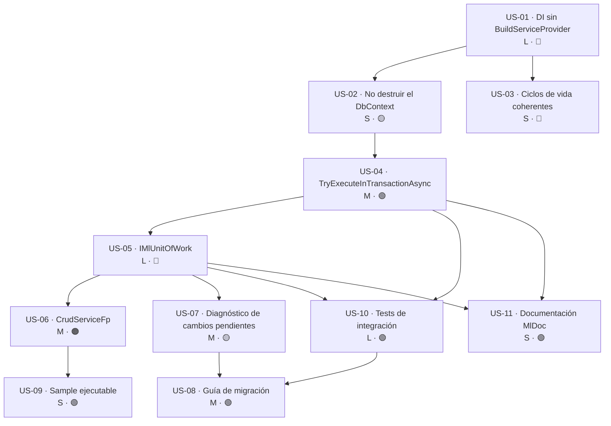

# Épica · Unidad de trabajo y transacciones en `MoralesLarios.OOFP.EntityFrameworkCore`

> **Versión destino:** `2.1.0`
> **Origen:** punto **40** de [`Temas Pendientes/Mejoras-Prioridad-Media.md`](../../Temas%20Pendientes/Mejoras-Prioridad-Media.md)
> (*"No hay unidad de trabajo: un `SaveChanges` por operación"*), sacado de la versión `2.0.0` por su coste y su riesgo.
> **Plan del que se desgaja:** [`Temas Pendientes/Plan-Ejecucion-Prioridad-Media.md`](../../Temas%20Pendientes/Plan-Ejecucion-Prioridad-Media.md) · fase 4, tarea 4.4.
> **Estado:** ⬜ No iniciada
> **Esfuerzo estimado:** **XL** (~5-7 jornadas) · **Riesgo:** 🔴 Alto (ruptura de comportamiento silenciosa)

---

## Índice

- [1. Contexto y problema](#1-contexto-y-problema)
- [2. Hallazgo colateral: la resolución de dependencias](#2-hallazgo-colateral-la-resolución-de-dependencias)
- [3. Alcance de la épica](#3-alcance-de-la-épica)
- [4. Historias de usuario](#4-historias-de-usuario)
- [5. Orden de ejecución y dependencias](#5-orden-de-ejecución-y-dependencias)
- [6. Decisiones de diseño abiertas](#6-decisiones-de-diseño-abiertas)
- [7. Definición de terminado (DoD) de la épica](#7-definición-de-terminado-dod-de-la-épica)
- [8. Apéndice · Ejemplos de código y explicación detallada](#8-apéndice--ejemplos-de-código-y-explicación-detallada)

---

## 1. Contexto y problema

Hoy **cada método de escritura de los repositorios confirma por su cuenta**. Son **12 llamadas** a
`SaveChanges`/`SaveChangesAsync`, 4 en cada uno de estos tres ficheros:

| Fichero | Líneas |
|---|---|
| `MoralesLarios.OOFP.EntityFrameworkCore/Repositories.Imperative/ThrowingEfCreateRepository.cs` | 29, 38, 47, 56 |
| `MoralesLarios.OOFP.EntityFrameworkCore/Repositories.Imperative/ThrowingEfUpdateRepository.cs` | 29, 38, 47, 56 |
| `MoralesLarios.OOFP.EntityFrameworkCore/Repositories.Imperative/ThrowingEfDeleteRepository.cs` | 29, 38, 47, 56 |

El patrón es siempre idéntico (`ThrowingEfCreateRepository.cs`, L26-32):

```csharp
public T Add(T item)
{
    internalDbContext.Set<T>().Add(item);
    internalDbContext.SaveChanges();   // ← confirma AQUÍ, siempre
    return item;
}
```

Es decir: **`Add` no significa "marca para insertar", significa "inserta y confirma ya"**. Lo mismo
`Update`, `Remove`, `AddRange`, `UpdateRange` y `RemoveRange`.

### Consecuencias

1. **Pérdida de atomicidad.** Cualquier caso de uso que escriba más de una entidad queda a medias si
   falla el segundo paso:

   ```csharp
   await _pedidos.TryAddAsync(pedido);       // ← COMMIT 1: ya está en la BD
   await _lineas.TryAddRangeAsync(lineas);   // ← si esto falla, el pedido queda huérfano
   ```

   Y lo más peligroso: `MlResult` devuelve un fallo limpio, así que el consumidor **cree** que la
   operación completa se ha descartado.

2. **Contradicción con el diseño funcional.** La composición `Bind`/`BindAsync` invita a encadenar
   escrituras, pero el *railway* no puede garantizar atomicidad si cada eslabón commitea por su cuenta.

3. **Coste de rendimiento.** N escrituras = N viajes a la base de datos. Se desperdicia el
   *change tracker* de EF Core, diseñado precisamente para acumular cambios y confirmarlos de golpe.

4. **No existe el concepto de transacción en la librería.** Búsqueda de
   `BeginTransaction|Database\.|IDbContextTransaction` en todo el proyecto `EntityFrameworkCore`:
   **0 resultados**.

---

## 2. Hallazgo colateral: la resolución de dependencias

> ⚠️ **Esto no estaba en el punto 40 original y es un bloqueante de la épica.**

En `MoralesLarios.OOFP.EntityFrameworkCore/RegisterServices.cs` (L12-17):

```csharp
private static IServiceCollection? _services;

internal static IServiceProvider ServiceProvider
{
    get => _services?.BuildServiceProvider() ?? throw new ArgumentNullException("The field Provider is null");
}
```

**`BuildServiceProvider()` se ejecuta en CADA acceso al getter.** Y los repositorios lo invocan desde
inicializadores de campo (`Repositories/EfCrudRepository.cs`, L16-17):

```csharp
internal readonly IEfReadRepository<T>  _repoReaderFp = RegisterServices.GetRepository<IEfReadRepository<T>>();
internal readonly IEfWriteRepository<T> _repoWriterFp = RegisterServices.GetRepository<IEfWriteRepository<T>>();
```

Efectos:

| # | Efecto | Detalle |
|---|---|---|
| 1 | **Cada repositorio interno vive en un contenedor distinto** | Obtiene su **propio `DbContext`**. Aunque se registre con `AddScoped` (L84-101), el scope se pierde porque el provider es nuevo. Dos repositorios **nunca** comparten contexto |
| 2 | **Una transacción compartida es imposible hoy** | Aunque se retiraran los 12 `SaveChanges`, no hay un `DbContext` común sobre el que abrirla |
| 3 | **`Dispose()` cruzado** | `ThrowingEfRepository : IDisposable` hace `internalDbContext?.Dispose()` (L33-36): un repositorio puede destruir el contexto que otro está usando |
| 4 | **`AddOofpRepositoriesSingleton` es inseguro** | `DbContext` no es *thread-safe* (`RegisterServices.cs`, L115-140) |
| 5 | **Fuga de memoria** | Cada `BuildServiceProvider()` crea un contenedor que se registra para *disposal* y no se libera nunca |

**Por tanto la historia US-01 es prerrequisito técnico de todo lo demás.**

---

## 3. Alcance de la épica

### Dentro del alcance

- Corregir la resolución de dependencias y el ciclo de vida del `DbContext`.
- Introducir `IMlUnitOfWork` con confirmación explícita.
- Introducir `TryExecuteInTransactionAsync(...)` como agrupador transaccional.
- Retirar los 12 `SaveChanges` de los repositorios imperativos.
- Adaptar `CrudServiceFp` (`MoralesLarios.OOFP.Application`).
- Batería de tests de transaccionalidad.
- Documentación XML (con **MlDoc**) y guía de migración.

### Fuera del alcance

- Reintentos / *execution strategy* de EF Core (resiliencia): candidato a épica propia.
- Transacciones distribuidas o `TransactionScope`.
- Eventos de dominio / *outbox pattern*.
- Cualquier punto del 38 al 63 distinto del 40.

---

## 4. Historias de usuario

> **Leyenda de esfuerzo:** XS (<2 h) · S (½ jornada) · M (1 jornada) · L (2 jornadas) · XL (3+ jornadas)
> **Leyenda de riesgo:** 🟢 bajo · 🟡 medio · 🟠 alto · 🔴 muy alto (rompe compatibilidad)

---

### US-01 · Resolver las dependencias sin reconstruir el contenedor

> **Como** desarrollador que consume `MoralesLarios.OOFP.EntityFrameworkCore`,
> **quiero** que todos los repositorios de una misma petición compartan el mismo `DbContext`,
> **para** que las operaciones de escritura puedan participar en una única transacción y no se filtre memoria.

- **Esfuerzo:** L · **Riesgo:** 🔴 (cambia constructores públicos)
- **Prerrequisito de:** US-02, US-03, US-04, US-05

**Criterios de aceptación**

- [ ] `RegisterServices.ServiceProvider` **ya no llama a `BuildServiceProvider()`** en el getter.
- [ ] Las dependencias internas (`_repoReaderFp`, `_repoWriterFp`, `_internalRepoAdder`, …) se **inyectan por constructor**, no por `RegisterServices.GetRepository<T>()`.
- [ ] `RegisterServices.GetRepository<TRepo>()` queda marcado `[Obsolete]` o se elimina (ver decisión D-1).
- [ ] Un test demuestra que, dentro de un mismo `IServiceScope`, `IEfCreateRepository<T>` e `IEfUpdateRepository<T>` devuelven **la misma instancia de `DbContext`** (comparación por referencia vía `IGetContextable.GetContext()`).
- [ ] Un test demuestra que resolver repositorios 1.000 veces **no incrementa** el número de contenedores creados.
- [ ] La solución compila con **0 errores** y los 1.027 tests existentes siguen en verde.

**Notas técnicas**

- Afecta a los ~16 tipos de `Repositories/` y `Repositories.Imperative/`.
- Los consumidores que **heredan** de `EfCrudRepository<T, TContext>` y similares dejarán de compilar → ruptura declarada.

---

### US-02 · El repositorio no destruye el `DbContext` que no le pertenece

> **Como** desarrollador,
> **quiero** que el ciclo de vida del `DbContext` lo gestione el contenedor de DI y no los repositorios,
> **para** no sufrir `ObjectDisposedException` cuando dos repositorios colaboran.

- **Esfuerzo:** S · **Riesgo:** 🟡
- **Depende de:** US-01

**Criterios de aceptación**

- [ ] `ThrowingEfRepository.Dispose()` (L33-36) **deja de llamar** a `internalDbContext.Dispose()`.
- [ ] Se documenta que el `DbContext` lo libera el scope de DI (`AddDbContext` ya lo hace).
- [ ] Un test usa dos repositorios en secuencia sobre el mismo scope y **no** lanza `ObjectDisposedException`.
- [ ] Se revisa si `ThrowingEfRepository` debe seguir implementando `IDisposable` o puede dejar de hacerlo.

---

### US-03 · Registrar los repositorios con un ciclo de vida coherente

> **Como** desarrollador,
> **quiero** que la librería no me ofrezca registros de ciclo de vida incompatibles con `DbContext`,
> **para** no caer en errores de concurrencia difíciles de diagnosticar.

- **Esfuerzo:** S · **Riesgo:** 🔴 (puede eliminar API pública)
- **Depende de:** US-01

**Criterios de aceptación**

- [ ] `AddOofpRepositoriesSingleton<T, TContext>` (L115-140) queda **`[Obsolete(error: true)]`** o se elimina (ver decisión D-2).
- [ ] `AddOofpRepositoriesTransient<T, TContext>` (L36-61) se documenta como **no apta para unidad de trabajo**, o se retira.
- [ ] `AddOofpRepositories<T, TContext>` (scoped, L76-101) queda como **vía recomendada y única soportada** por `IMlUnitOfWork`.
- [ ] El XML doc de los tres métodos explica la implicación transaccional de cada ciclo de vida.
- [ ] La ruptura queda registrada en la guía de migración.

---

### US-04 · Agrupar varias escrituras en una transacción (vía aditiva)

> **Como** desarrollador que implementa un caso de uso con varias entidades,
> **quiero** un método que ejecute un bloque de operaciones dentro de una transacción,
> **para** que, si cualquiera falla, no quede nada confirmado en la base de datos.

- **Esfuerzo:** M · **Riesgo:** 🟢 (no rompe nada: es aditivo)
- **Depende de:** US-01, US-02

**API propuesta** (nombre definitivo sujeto a D-3)

```csharp
Task<MlResult<TResult>> TryExecuteInTransactionAsync<TResult>(
        Func<CancellationToken, Task<MlResult<TResult>>> operations,
        CancellationToken                                token = default);
```

**Criterios de aceptación**

- [ ] Abre la transacción con `DbContext.Database.BeginTransactionAsync(token)`.
- [ ] Si el delegado devuelve un `MlResult` **válido** → `CommitAsync()` y se devuelve el valor.
- [ ] Si el delegado devuelve un `MlResult` **fallido** → `RollbackAsync()` y se **propagan los errores originales sin alterarlos**.
- [ ] Si el delegado **lanza una excepción** → `RollbackAsync()` y la excepción se convierte en `MlResult` fallido (coherente con el resto de `Try*`).
- [ ] Si el propio `CommitAsync()` falla → `MlResult` fallido con el detalle del error de confirmación.
- [ ] El `CancellationToken` se propaga a todas las operaciones internas.
- [ ] Existe variante sincrónica `TryExecuteInTransaction<TResult>(...)`, o se documenta por qué no.
- [ ] Documentado con **MlDoc**.

**Tests mínimos**

| Escenario | Resultado esperado |
|---|---|
| Dos inserciones correctas | Ambas en la BD, 1 commit |
| Primera correcta, segunda devuelve fallo | **Nada** en la BD, errores de la segunda intactos |
| Primera correcta, segunda lanza excepción | **Nada** en la BD, `MlResult` fallido con la excepción |
| Cancelación a mitad | **Nada** en la BD |
| Transacción anidada | Comportamiento definido y documentado (ver D-4) |

---

### US-05 · Separar el marcado de la confirmación con `IMlUnitOfWork`

> **Como** desarrollador,
> **quiero** que `Add`/`Update`/`Remove` solo marquen la intención y que la confirmación sea un paso explícito,
> **para** controlar yo el punto exacto en que se escribe en la base de datos.

- **Esfuerzo:** L · **Riesgo:** 🔴 **(ruptura de comportamiento silenciosa)**
- **Depende de:** US-01, US-02, US-04

**API propuesta**

```csharp
public interface IMlUnitOfWork
{
    MlResult<int>       TryCommit();
    Task<MlResult<int>> TryCommitAsync(CancellationToken token = default);
    bool                HasPendingChanges { get; }
    MlResult<Unit>      DiscardChanges();
}
```

**Criterios de aceptación**

- [ ] Se eliminan las **12** llamadas a `SaveChanges`/`SaveChangesAsync` de `ThrowingEf{Create,Update,Delete}Repository.cs`.
- [ ] `IMlUnitOfWork` se registra con el **mismo ciclo de vida que el `DbContext`** (scoped).
- [ ] `TryCommitAsync()` devuelve el **número de filas afectadas** en caso de éxito.
- [ ] `DbUpdateConcurrencyException` y `DbUpdateException` se traducen a `MlResult` fallido con detalle útil (no un `ToString()` de la excepción).
- [ ] `HasPendingChanges` consulta el `ChangeTracker` sin provocar efectos secundarios.
- [ ] Documentado con **MlDoc**.

**⚠️ Riesgo principal**

El consumidor que hoy escribe:

```csharp
await _repo.TryAddAsync(pedido);   // hoy: guardado. Después de US-05: NO guardado
```

**compila exactamente igual** y deja de persistir. Es una ruptura de *comportamiento*, no de firma:
el compilador no la detecta. Mitigaciones obligatorias en US-07 y US-08.

---

### US-06 · El servicio CRUD funciona con la nueva unidad de trabajo

> **Como** desarrollador que usa `CrudServiceFp`,
> **quiero** que el servicio siga persistiendo correctamente tras el cambio,
> **para** no tener que reescribir mi capa de aplicación.

- **Esfuerzo:** M · **Riesgo:** 🟠
- **Depende de:** US-05
- **Proyecto afectado:** `MoralesLarios.OOFP.Application`

**Criterios de aceptación**

- [ ] `CrudServiceFp` (variantes de 2 y 3 genéricos) confirma explícitamente al final de cada método de escritura.
- [ ] Los métodos que escriben más de una vez usan `TryExecuteInTransactionAsync`.
- [ ] Los tests de `MoralesLarios.OOFP.Application.Tests.Unit` siguen en verde.
- [ ] Se verifica que los controladores de `MoralesLarios.OOFP.AspNetCore.Controllers` no requieren cambios.

---

### US-07 · Detectar en tiempo de ejecución los cambios sin confirmar

> **Como** desarrollador que migra desde `2.0.0`,
> **quiero** ser avisado si mi petición termina con cambios pendientes sin confirmar,
> **para** detectar en desarrollo lo que el compilador no puede detectar.

- **Esfuerzo:** M · **Riesgo:** 🟡
- **Depende de:** US-05
- **Justificación:** única red de seguridad frente a la ruptura silenciosa de US-05.

**Criterios de aceptación**

- [ ] Existe un mecanismo opcional (middleware, *interceptor* de EF Core o `Dispose` del scope) que detecta `HasPendingChanges == true` al terminar el scope.
- [ ] Emite un **log de nivel `Warning`** (o `Critical`, configurable) indicando que hay cambios sin confirmar.
- [ ] Es **desactivable por configuración** y está **desactivado por defecto en producción**.
- [ ] No afecta al rendimiento cuando está desactivado.
- [ ] Documentado en la guía de migración como *"cómo encontrar los `Commit` que me faltan"*.

---

### US-08 · Guía de migración `2.0.0` → `2.1.0`

> **Como** desarrollador que actualiza el paquete,
> **quiero** una guía que me diga exactamente qué cambia y qué debo tocar,
> **para** migrar sin romper mi aplicación en producción.

- **Esfuerzo:** M · **Riesgo:** 🟢
- **Depende de:** US-01 … US-07

**Criterios de aceptación**

- [ ] La ruptura queda documentada en el prompt de actualización (`oofp-upgrade-2.prompt.md` o su equivalente de `2.1`), tal como exige la convención del proyecto para **todo** cambio incompatible.
- [ ] Incluye tabla **antes / después** con código real para los tres escenarios: alta simple, alta múltiple y actualización + borrado.
- [ ] Documenta la retirada o marcado `[Obsolete]` de `AddOofpRepositoriesSingleton`, `AddOofpRepositoriesTransient` y `RegisterServices.GetRepository<T>()`.
- [ ] Explica el cambio de constructores de los repositorios (impacto en herencia).
- [ ] Enlaza con el diagnóstico de US-07.
- [ ] Se actualiza el `README.md` del proyecto `EntityFrameworkCore`.

---

### US-09 · Ejemplo ejecutable de transacción

> **Como** desarrollador que evalúa la librería,
> **quiero** ver un ejemplo funcionando de escritura maestro-detalle transaccional,
> **para** entender el patrón sin leer los tests.

- **Esfuerzo:** S · **Riesgo:** 🟢
- **Depende de:** US-05, US-06
- **Proyecto afectado:** `MoralesLarios.OOFP.EntityFrameworkCore.Sample`

**Criterios de aceptación**

- [ ] El *sample* muestra un caso maestro-detalle con `TryExecuteInTransactionAsync`.
- [ ] Muestra también el caso de fallo y el *rollback* resultante.
- [ ] Se ejecuta sin configuración adicional (base de datos en memoria o SQLite).

---

### US-10 · Cobertura de tests de integración de la unidad de trabajo

> **Como** mantenedor de la librería,
> **quiero** una batería de tests de integración sobre transaccionalidad,
> **para** que ninguna regresión futura vuelva a romper la atomicidad.

- **Esfuerzo:** L · **Riesgo:** 🟢
- **Depende de:** US-04, US-05
- **Proyectos afectados:** `MoralesLarios.OOFP.EntityFrameworkCore.Tests.Integration`, `MoralesLarios.OOFP.EFCore.Integration.Tests`

**Criterios de aceptación**

- [ ] Tests de commit, rollback por fallo, rollback por excepción, cancelación y commit fallido.
- [ ] Test de concurrencia optimista (`DbUpdateConcurrencyException` → `MlResult` fallido).
- [ ] Test que verifica **un solo** `SaveChanges` para N operaciones agrupadas.
- [ ] Test de contexto compartido entre repositorios en el mismo scope.
- [ ] Todos los tests nuevos en verde y los **1.027 existentes sin regresiones**.

---

### US-11 · Documentación XML completa de la nueva API

> **Como** consumidor de la librería,
> **quiero** IntelliSense completo en los tipos nuevos,
> **para** usarlos sin salir del editor.

- **Esfuerzo:** S · **Riesgo:** 🟢
- **Depende de:** US-04, US-05

**Criterios de aceptación**

- [ ] Todos los miembros públicos nuevos documentados **con MlDoc** (nunca a mano, por la convención del proyecto).
- [ ] `CS1591 = 0` en compilación `Release --no-incremental`.
- [ ] Los `<remarks>` de `IMlUnitOfWork` advierten del cambio de semántica respecto a `2.0.0`.

---

## 5. Orden de ejecución y dependencias



### Secuencia recomendada

| Orden | Historia | Esfuerzo | Hito |
|---:|---|---|---|
| 1 | **US-01** | L | Contexto compartido real |
| 2 | **US-02** | S | Sin `Dispose` cruzado |
| 3 | **US-03** | S | API de registro saneada |
| 4 | **US-04** | M | 🎯 **Primer entregable útil y no disruptivo** |
| 5 | **US-05** | L | Unidad de trabajo real |
| 6 | **US-06** | M | Capa de aplicación alineada |
| 7 | **US-07** | M | Red de seguridad |
| 8 | **US-10** | L | Garantía de no regresión |
| 9 | **US-11** | S | IntelliSense |
| 10 | **US-09** | S | Ejemplo |
| 11 | **US-08** | M | Cierre y publicación |

**Total: ~5-7 jornadas.**

> 💡 **Entrega incremental sugerida**
> - **`2.1.0-preview` / `2.0.x`:** US-01 → US-04. No rompe comportamiento, y ya ofrece atomicidad
>   mediante `TryExecuteInTransactionAsync`. Es el 80 % del valor con el 20 % del riesgo.
> - **`2.1.0`:** US-05 → US-11. La ruptura semántica, con guía y diagnóstico.

---

## 6. Decisiones de diseño abiertas

| Id | Decisión | Opciones | Recomendación |
|---|---|---|---|
| **D-1** | ¿Qué hacer con `RegisterServices.GetRepository<T>()`? | (a) Eliminar · (b) `[Obsolete]` con error · (c) Mantener leyendo de un provider ya construido | **(b)**: visibiliza la ruptura sin romper la compilación de golpe |
| **D-2** | ¿Se retira `AddOofpRepositoriesSingleton`? | (a) Eliminar · (b) `[Obsolete(error: true)]` · (c) Mantener documentando el riesgo | **(b)**: con `DbContext` el singleton es incorrecto por definición |
| **D-3** | Nombre del agrupador transaccional | `TryExecuteInTransactionAsync` · `TryTransactionAsync` · `TryUnitOfWorkAsync` | **`TryExecuteInTransactionAsync`**: explícito y coherente con el prefijo `Try*` |
| **D-4** | Transacciones anidadas | (a) Lanzar error · (b) Reutilizar la transacción externa (*ambient*) · (c) `CreateSavepoint` | **(b)**: lo habitual y lo menos sorprendente |
| **D-5** | ¿`IMlUnitOfWork` genérico por contexto? | `IMlUnitOfWork` · `IMlUnitOfWork<TContext>` | **`IMlUnitOfWork<TContext>`** si se admiten varios `DbContext`; decidir antes de US-05 |
| **D-6** | ¿Se mantienen los `SaveChanges` sincrónicos? | (a) Solo async · (b) Ambos | **(b)**: hay consumidores sincrónicos en los repositorios actuales |
| **D-7** | ¿`DiscardChanges()` entra en el alcance? | (a) Sí · (b) Posponer | **(a)**: es trivial sobre el `ChangeTracker` y completa el contrato |

---

## 7. Definición de terminado (DoD) de la épica

- [ ] Las **12** llamadas a `SaveChanges`/`SaveChangesAsync` retiradas de los repositorios imperativos.
- [ ] `IMlUnitOfWork` y `TryExecuteInTransactionAsync` implementados, registrados y documentados.
- [ ] `RegisterServices.ServiceProvider` sin `BuildServiceProvider()` en el getter.
- [ ] Todos los repositorios de un mismo scope comparten `DbContext` (verificado por test).
- [ ] Solución compila en `Release --no-incremental` con **0 errores y `CS1591 = 0`**.
- [ ] Los **1.027 tests** existentes en verde + los tests nuevos de US-10.
- [ ] Guía de migración publicada y `README.md` del proyecto actualizado.
- [ ] *Sample* ejecutable con el caso maestro-detalle.
- [ ] Las 7 decisiones (D-1 … D-7) cerradas y registradas en este documento.

---

## 8. Apéndice · Ejemplos de código y explicación detallada

> Este apéndice contiene **el código real de hoy** (con fichero y línea) y **el código propuesto**
> para cada historia. Todo el código "después" es *ilustrativo*: fija la intención y el contrato, no
> la implementación definitiva.

### Índice del apéndice

- [8.1 · Por qué duele: el caso maestro-detalle](#81--por-qué-duele-el-caso-maestro-detalle)
- [8.2 · US-01 · Inyección por constructor](#82--us-01--inyección-por-constructor)
- [8.3 · US-02 · El `Dispose` que no debería existir](#83--us-02--el-dispose-que-no-debería-existir)
- [8.4 · US-03 · Ciclos de vida](#84--us-03--ciclos-de-vida)
- [8.5 · US-04 · `TryExecuteInTransactionAsync`](#85--us-04--tryexecuteintransactionasync)
- [8.6 · US-05 · `IMlUnitOfWork`](#86--us-05--imlunitofwork)
- [8.7 · US-06 · `CrudServiceFp`](#87--us-06--crudservicefp)
- [8.8 · US-07 · Diagnóstico de cambios pendientes](#88--us-07--diagnóstico-de-cambios-pendientes)
- [8.9 · US-08 · Tabla antes / después de la migración](#89--us-08--tabla-antes--después-de-la-migración)
- [8.10 · US-09 · Ejemplo del *sample*](#810--us-09--ejemplo-del-sample)
- [8.11 · US-10 · Tests de integración](#811--us-10--tests-de-integración)

---

### 8.1 · Por qué duele: el caso maestro-detalle

**Hoy** (`EntityFrameworkCore/Repositories.Imperative/ThrowingEfCreateRepository.cs`, L26-57):

```csharp
public T Add(T item)
{
    internalDbContext.Set<T>().Add(item);
    internalDbContext.SaveChanges();                 // L29
    return item;
}

public async Task<T> AddAsync(T item, CancellationToken token = default)
{
    await internalDbContext.Set<T>().AddAsync(item, token);
    await internalDbContext.SaveChangesAsync(token);  // L38
    return item;
}

public IEnumerable<T> AddRange(IEnumerable<T> items)
{
    internalDbContext.Set<T>().AddRange(items);
    internalDbContext.SaveChanges();                  // L47
    return items;
}

public async Task<IEnumerable<T>> AddRangeAsync(IEnumerable<T> items, CancellationToken token = default)
{
    await internalDbContext.Set<T>().AddRangeAsync(items, token);
    await internalDbContext.SaveChangesAsync(token);  // L56
    return items;
}
```

`ThrowingEfUpdateRepository.cs` y `ThrowingEfDeleteRepository.cs` repiten el patrón en las **mismas
líneas 29, 38, 47 y 56**. Total: **12 confirmaciones autónomas**.

**El síntoma visible para el consumidor:**

```csharp
// Caso de uso: crear un pedido con sus líneas
public Task<MlResult<PedidoDto>> CrearPedidoAsync(PedidoDto dto, CancellationToken ct)
    => EnsureFp.NotNullAsync(dto, "El pedido no puede ser nulo")
               .BindAsync( _      => _pedidos.TryAddAsync(dto.Adapt<Pedido>(), ct))   // COMMIT 1 ✔
               .BindAsync(pedido  => _lineas.TryAddRangeAsync(                        // COMMIT 2 ✘
                                        dto.Lineas.Select(l => l.ToEntity(pedido.Id)), ct))
               .MapAsync (_       => dto);
```

Si el segundo paso falla (violación de FK, `DbUpdateException`, timeout, cancelación…):

| | Estado real de la base de datos | Lo que ve el consumidor |
|---|---|---|
| Hoy | **El pedido está insertado**, sin líneas | `MlResult` fallido → *"nada se ha guardado"* |
| Objetivo | Nada insertado | `MlResult` fallido → coherente |

Esa discrepancia es el núcleo del punto 40: **el `MlResult` fallido miente sobre el estado del
sistema**. Y el *railway* es precisamente lo que invita a encadenar escrituras, porque leerlo sugiere
una única operación compuesta.

**La verificación de que no existe transaccionalidad alguna**: búsqueda de
`BeginTransaction|Database\.BeginTransaction|IDbContextTransaction` en todo
`MoralesLarios.OOFP.EntityFrameworkCore` → **0 resultados**.

---

### 8.2 · US-01 · Inyección por constructor

**Hoy** — `EntityFrameworkCore/RegisterServices.cs` (L9-26):

```csharp
public static partial class RegisterServices                    // L9
{
    private static IServiceCollection? _services;               // L12

    internal static IServiceProvider ServiceProvider            // L14-17
    {
        get => _services?.BuildServiceProvider()                // ⛔ construye un contenedor NUEVO
               ?? throw new ArgumentNullException("The field Provider is null");
    }

    public static TRepo GetRepository<TRepo>()                  // L24-26
        => ServiceProvider.GetService<TRepo>()
           ?? throw new ArgumentException($"{typeof(TRepo).Name} is not registered...");
}
```

Y los consumidores internos lo invocan **desde inicializadores de campo**, es decir, *antes* de que el
constructor pueda recibir nada:

```csharp
// Repositories/EfCreateRepository.cs, L13-17
public class EfCreateRepository<T, TContext>(TContext dbContext)
        : EfRepository(dbContext), IEfCreateRepository<T>
{
    internal readonly IThrowingEfCreateRepository<T>? _internalRepoAdder
        = RegisterServices.GetRepository<IThrowingEfCreateRepository<T>>();   // ⛔ L17
    ...
}

// Repositories/EfCrudRepository.cs, L12-17
internal readonly IEfReadRepository<T>  _repoReaderFp = RegisterServices.GetRepository<IEfReadRepository<T>>();
internal readonly IEfWriteRepository<T> _repoWriterFp = RegisterServices.GetRepository<IEfWriteRepository<T>>();

// Repositories.Imperative/ThrowingEfPagedRepository.cs, L31
_repoReaderPagination = RegisterServices.ServiceProvider.GetService<IThrowingEfPagedReadRepository<T>>();
```

**Lo que ocurre en tiempo de ejecución, paso a paso:**

```
1. El scope de la petición HTTP resuelve EfCrudRepository<Pedido, MiContexto>
2. El contenedor inyecta `dbContext` → DbContext #1 (correcto, del scope)
3. ANTES del cuerpo del constructor se evalúa el inicializador del campo:
     RegisterServices.GetRepository<IEfReadRepository<Pedido>>()
       → getter ServiceProvider → BuildServiceProvider()   → CONTENEDOR #2
       → ese contenedor resuelve su propio DbContext        → DbContext #2
4. Se evalúa el segundo inicializador:
       → BuildServiceProvider()                            → CONTENEDOR #3
       → otro DbContext                                    → DbContext #3
```

Resultado: **tres `DbContext` distintos dentro de un repositorio que el consumidor cree único**. Por
eso el punto 2 de la tabla de la sección 2 dice que "una transacción compartida es imposible hoy":
no hay nada sobre lo que abrirla.

**Después** — resolución estándar de .NET, sin estado estático:

```csharp
public class EfCreateRepository<T, TContext> : EfRepository, IEfCreateRepository<T>
    where T        : class
    where TContext : DbContext
{
    private readonly IThrowingEfCreateRepository<T> _internalRepoAdder;

    public EfCreateRepository(TContext                        dbContext,
                              IThrowingEfCreateRepository<T>  internalRepoAdder)   // ✅ inyectado
        : base(dbContext)
        => _internalRepoAdder = internalRepoAdder
                                ?? throw new ArgumentNullException(nameof(internalRepoAdder));

    public virtual MlResult<T> TryAdd(T item)
        => EnsureFp.NotNull(item, "The entity item to add cannot be null")
                   .TryMap(x => _internalRepoAdder.Add(x));
}
```

Y el estado estático desaparece:

```csharp
public static partial class RegisterServices
{
    // ❌ se elimina:  private static IServiceCollection? _services;
    // ❌ se elimina:  internal static IServiceProvider ServiceProvider { get => _services?.BuildServiceProvider() ... }

    [Obsolete("Resuelva los repositorios desde el IServiceProvider de su scope. " +
              "Este método creaba un contenedor nuevo en cada llamada. Se eliminará en 3.0.0.", error: false)]
    public static TRepo GetRepository<TRepo>()
        => throw new NotSupportedException(
               "RegisterServices.GetRepository<T>() ya no está soportado. " +
               "Inyecte el repositorio por constructor o resuélvalo con IServiceProvider.GetRequiredService<T>().");
}
```

**Test de aceptación propuesto** (criterio *"la misma instancia de `DbContext`"*):

```csharp
[Fact]
public void Repositories_InTheSameScope_ShareTheSameDbContext()
{
    var services = new ServiceCollection();
    services.AddDbContext<TestContext>(o => o.UseSqlite("DataSource=:memory:"));
    services.AddOofpRepositories<Pedido, TestContext>();

    using var provider = services.BuildServiceProvider();
    using var scope    = provider.CreateScope();

    var reader = scope.ServiceProvider.GetRequiredService<IEfReadRepository<Pedido>>();
    var writer = scope.ServiceProvider.GetRequiredService<IEfWriteRepository<Pedido>>();

    // IGetContextable expone el DbContext interno
    var ctxReader = ((IGetContextable)reader).GetContext();
    var ctxWriter = ((IGetContextable)writer).GetContext();

    ctxReader.Should().BeSameAs(ctxWriter);     // hoy FALLA
}
```

Y el de la fuga de contenedores:

```csharp
[Fact]
public void ResolvingRepositories_ManyTimes_DoesNotLeakProviders()
{
    using var provider = BuildProvider();
    var contexts = new HashSet<DbContext>(ReferenceEqualityComparer.Instance);

    using var scope = provider.CreateScope();
    for (var i = 0; i < 1_000; i++)
        contexts.Add(((IGetContextable)scope.ServiceProvider
                        .GetRequiredService<IEfReadRepository<Pedido>>()).GetContext());

    contexts.Should().HaveCount(1);             // hoy devolvería ~1.000
}
```

---

### 8.3 · US-02 · El `Dispose` que no debería existir

**Hoy** — `EntityFrameworkCore/Repositories.Imperative/ThrowingEfRepository.cs`, L19-38:

```csharp
internal class ThrowingEfRepository : IDisposable, IGetContextable          // L19
{
    protected internal DbContext internalDbContext { get; set; }            // L21

    public ThrowingEfRepository(DbContext dbContext)                        // L24-27
        => internalDbContext = dbContext;

    public virtual void Dispose()                                           // L33-36
        => internalDbContext?.Dispose();          // ⛔ destruye algo que no le pertenece

    public DbContext GetContext() => internalDbContext;                     // L38
}
```

**El escenario que revienta** en cuanto US-01 hace que el contexto se comparta:

```csharp
using (var scope = provider.CreateScope())
{
    var creador     = scope.ServiceProvider.GetRequiredService<IEfCreateRepository<Pedido>>();
    var actualizador = scope.ServiceProvider.GetRequiredService<IEfUpdateRepository<Pedido>>();

    creador.TryAdd(pedido);
    // si algo dispara el Dispose() del creador (p. ej. un using anidado del consumidor)
    actualizador.TryUpdate(otroPedido);   // 💥 ObjectDisposedException: el DbContext ya está muerto
}
```

**Después** — el ciclo de vida lo gobierna el contenedor, que es quien creó el `DbContext`
(`AddDbContext` ya registra su *disposal* en el scope):

```csharp
internal class ThrowingEfRepository : IGetContextable      // ya no es IDisposable
{
    protected internal DbContext internalDbContext { get; }

    public ThrowingEfRepository(DbContext dbContext)
        => internalDbContext = dbContext ?? throw new ArgumentNullException(nameof(dbContext));

    public DbContext GetContext() => internalDbContext;
}
```

> **Regla general:** *quien no construye un `IDisposable`, no lo destruye.* El repositorio **recibe**
> el `DbContext`; por tanto no es su dueño.

Si por compatibilidad hay que conservar `IDisposable` (ver nota de la US-02), el cuerpo debe quedar
vacío y documentado:

```csharp
/// <remarks>
/// No libera el <see cref="DbContext"/>: su ciclo de vida pertenece al contenedor de dependencias
/// que lo creó mediante <c>AddDbContext</c>. Se mantiene por compatibilidad binaria con 2.0.0.
/// </remarks>
public virtual void Dispose() { /* intencionadamente vacío */ }
```

---

### 8.4 · US-03 · Ciclos de vida

**Hoy** — `EntityFrameworkCore/RegisterServices.cs` ofrece **tres** registros simétricos:

| Método | Línea | Ciclo de vida | Registros | Apto para unidad de trabajo |
|---|---:|---|---:|---|
| `AddOofpRepositoriesTransient<T, TContext>` | 36 | `AddTransient` (L44-61) | 16 | ❌ cada resolución, otro repositorio |
| `AddOofpRepositories<T, TContext>` | 76 | `AddScoped` (L84-101) | 16 | ✅ **la única correcta** |
| `AddOofpRepositoriesSingleton<T, TContext>` | 115 | `AddSingleton` (L123-140) | 16 | ❌ `DbContext` no es *thread-safe* |

El problema del *singleton* no es teórico: `DbContext` mantiene el `ChangeTracker` y una conexión. Un
singleton compartido entre peticiones concurrentes produce, de forma intermitente:

```
System.InvalidOperationException: A second operation was started on this context instance
before a previous operation completed.
```

**Después** — se conserva solo el *scoped* como vía soportada:

```csharp
/// <summary>
/// Registra los repositorios OOFP con ciclo de vida <c>Scoped</c>, alineado con el del
/// <see cref="DbContext"/>. Es el único registro compatible con <see cref="IMlUnitOfWork"/>.
/// </summary>
public static IServiceCollection AddOofpRepositories<T, TContext>(this IServiceCollection services)
    where T        : class
    where TContext : DbContext
{ /* 16 AddScoped + AddScoped<IMlUnitOfWork, MlUnitOfWork<TContext>>() */ }

/// <summary>
/// Registra los repositorios con ciclo de vida <c>Transient</c>.
/// </summary>
/// <remarks>
/// ⚠️ <b>No es compatible con <see cref="IMlUnitOfWork"/>:</b> cada resolución devuelve una
/// instancia distinta, por lo que no existe un punto de confirmación común. Úselo solo para
/// escenarios de lectura.
/// </remarks>
public static IServiceCollection AddOofpRepositoriesTransient<T, TContext>(this IServiceCollection services) { ... }

/// <summary>
/// Registraba los repositorios con ciclo de vida <c>Singleton</c>.
/// </summary>
[Obsolete("DbContext no es thread-safe: un registro Singleton es incorrecto por definición. " +
          "Use AddOofpRepositories<T, TContext> (Scoped). Se eliminará en 3.0.0.", error: true)]
public static IServiceCollection AddOofpRepositoriesSingleton<T, TContext>(this IServiceCollection services) { ... }
```

> `error: true` hace que el consumidor **no compile**, que es exactamente lo que se busca: el error es
> de diseño, no una preferencia de estilo. Es la decisión **D-2**.

---

### 8.5 · US-04 · `TryExecuteInTransactionAsync`

Esta es la historia **aditiva**: no cambia el comportamiento de nada existente, así que puede
publicarse incluso en una `2.0.x`. Aun con los 12 `SaveChanges` en su sitio, envolver las operaciones
en una transacción de base de datos ya restaura la atomicidad: los *commits* intermedios de EF Core
quedan dentro de la transacción y el `Rollback` los deshace todos.

**Contrato:**
```csharp
public interface IMlTransactionRunner
{
    /// <summary>
    /// Ejecuta <paramref name="operations"/> dentro de una transacción de base de datos.
    /// Confirma si el resultado es válido y revierte en caso de fallo o excepción.
    /// </summary>
    Task<MlResult<TResult>> TryExecuteInTransactionAsync<TResult>(
            Func<CancellationToken, Task<MlResult<TResult>>> operations,
            CancellationToken                                token = default);

    /// <summary>Variante sincrónica. Ver decisión D-6.</summary>
    MlResult<TResult> TryExecuteInTransaction<TResult>(Func<MlResult<TResult>> operations);
}
```

**Implementación de referencia** (encaja la transacción en el *railway* sin alterar los errores
originales, que es el criterio de aceptación más delicado):

```csharp
internal class MlTransactionRunner<TContext>(TContext                            _context,
                                             ILogger<MlTransactionRunner<TContext>> _logger)
        : IMlTransactionRunner
    where TContext : DbContext
{
    public async Task<MlResult<TResult>> TryExecuteInTransactionAsync<TResult>(
            Func<CancellationToken, Task<MlResult<TResult>>> operations,
            CancellationToken                                token = default)
    {
        // D-4: transacción anidada → se reutiliza la externa (comportamiento "ambient")
        if (_context.Database.CurrentTransaction is not null)
            return await operations(token);

        IDbContextTransaction? transaction = null;

        try
        {
            transaction = await _context.Database.BeginTransactionAsync(token);

            var result = await operations(token);

            if (result.IsFail)
            {
                await transaction.RollbackAsync(token);
                return result;                 // ⬅️ errores ORIGINALES, sin envolver ni enriquecer
            }

            // Un Commit que falla NO es un éxito: se convierte en MlResult fallido
            await transaction.CommitAsync(token);

            return result;
        }
        catch (Exception ex)
        {
            if (transaction is not null)
                await SafeRollbackAsync(transaction, token);

            return ex.ToMlResultFail<TResult>();   // coherente con el resto de la familia Try*
        }
        finally
        {
            if (transaction is not null) await transaction.DisposeAsync();
        }
    }

    private async Task SafeRollbackAsync(IDbContextTransaction transaction, CancellationToken token)
    {
        try   { await transaction.RollbackAsync(token); }
        catch (Exception ex) { _logger.LogWarning(ex, "Fallo al revertir la transacción."); }
    }
}
```

**Detalles que los criterios de aceptación exigen y que el código anterior resuelve:**

| Criterio | Cómo se cumple |
|---|---|
| Fallo del delegado → *rollback* + errores intactos | `return result;` sin tocar `result` |
| Excepción del delegado → `MlResult` fallido | `catch` + `ex.ToMlResultFail<TResult>()` |
| Fallo del `CommitAsync` → `MlResult` fallido | El `CommitAsync` está **dentro** del `try` |
| Cancelación | El `token` se pasa a `BeginTransactionAsync`, `CommitAsync` y al delegado |
| Transacción anidada (D-4) | `CurrentTransaction is not null` → se reutiliza |
| *Rollback* que a su vez falla | `SafeRollbackAsync` registra y no oculta el error original |

**Uso: el mismo caso maestro-detalle, ahora atómico:**

```csharp
public Task<MlResult<PedidoDto>> CrearPedidoAsync(PedidoDto dto, CancellationToken ct)
    => _transactions.TryExecuteInTransactionAsync(async token =>
            await EnsureFp.NotNullAsync(dto, "El pedido no puede ser nulo")
                          .BindAsync( _     => _pedidos.TryAddAsync(dto.Adapt<Pedido>(), token))
                          .BindAsync(pedido => _lineas.TryAddRangeAsync(
                                                  dto.Lineas.Select(l => l.ToEntity(pedido.Id)), token))
                          .BindAsync( _     => _uow.TryCommitAsync(token))                         // ✅ ÚNICO commit
                          .MapAsync ( _     => dto),
            ct);
```

Si `TryAddRangeAsync` falla, el pedido **no queda** en la base de datos y el `MlResult` fallido
describe el estado real.

---

### 8.6 · US-05 · `IMlUnitOfWork`

**Hoy, los 12 puntos a retirar.** El cambio quirúrgico en cada método es una sola línea:

```diff
 public T Add(T item)
 {
     internalDbContext.Set<T>().Add(item);
-    internalDbContext.SaveChanges();          // ThrowingEfCreateRepository.cs, L29
     return item;
 }

 public async Task<T> AddAsync(T item, CancellationToken token = default)
 {
     await internalDbContext.Set<T>().AddAsync(item, token);
-    await internalDbContext.SaveChangesAsync(token);   // L38
     return item;
 }
```

…y lo equivalente en L47 y L56 de los tres ficheros (`Create`, `Update`, `Delete`).

**Contrato propuesto** (`IMlUnitOfWork<TContext>` si se cierra D-5 a favor del genérico):

```csharp
public interface IMlUnitOfWork
{
    /// <summary>Confirma los cambios pendientes. Devuelve el número de filas afectadas.</summary>
    MlResult<int> TryCommit();

    /// <summary>Confirma los cambios pendientes. Devuelve el número de filas afectadas.</summary>
    Task<MlResult<int>> TryCommitAsync(CancellationToken token = default);

    /// <summary>Indica si el <c>ChangeTracker</c> tiene cambios sin confirmar.</summary>
    bool HasPendingChanges { get; }

    /// <summary>Descarta los cambios pendientes y deja el <c>ChangeTracker</c> limpio.</summary>
    MlResult<Unit> DiscardChanges();
}
```

**Implementación de referencia**, con la traducción de excepciones de EF Core a `MlResult` que piden
los criterios de aceptación (no un `ToString()` de la excepción, sino **detalle útil**):

```csharp
internal class MlUnitOfWork<TContext>(TContext _context, ILogger<MlUnitOfWork<TContext>> _logger)
        : IMlUnitOfWork
    where TContext : DbContext
{
    public bool HasPendingChanges => _context.ChangeTracker.HasChanges();

    public MlResult<int> TryCommit()
        => EnsureFp.Try(() => _context.SaveChanges(), BuildCommitError);

    public async Task<MlResult<int>> TryCommitAsync(CancellationToken token = default)
    {
        try
        {
            var rows = await _context.SaveChangesAsync(token);
            _logger.LogDebug("Unidad de trabajo confirmada: {Rows} filas afectadas.", rows);
            return rows.ToMlResultValid();
        }
        catch (DbUpdateConcurrencyException ex)
        {
            return MlErrorDetails.FromErrorMessageDetails(
                        "Conflicto de concurrencia al confirmar la unidad de trabajo. " +
                        "Otro proceso modificó los datos después de su lectura.",
                        new Dictionary<string, object>
                        {
                            ["ErrorKind"]       = "Concurrency",
                            ["EntityCount"]     = ex.Entries.Count,
                            ["EntityTypes"]     = ex.Entries.Select(e => e.Metadata.Name).Distinct().ToArray(),
                            ["ConflictedKeys"]  = ex.Entries.Select(DescribeKey).ToArray()
                        })
                   .ToMlResultFail<int>();
        }
        catch (DbUpdateException ex)
        {
            return MlErrorDetails.FromErrorMessageDetails(
                        "Error al confirmar la unidad de trabajo en la base de datos.",
                        new Dictionary<string, object>
                        {
                            ["ErrorKind"]    = "DbUpdate",
                            ["EntityTypes"]  = ex.Entries.Select(e => e.Metadata.Name).Distinct().ToArray(),
                            ["ProviderError"] = ex.InnerException?.Message ?? string.Empty
                        })
                   .ToMlResultFail<int>();
        }
        catch (OperationCanceledException)
        {
            throw;        // la cancelación NO es un error de dominio: se propaga
        }
    }

    public MlResult<Unit> DiscardChanges()
        => EnsureFp.Try(() =>
           {
               _context.ChangeTracker.Clear();
               return Unit.Value;
           }, ex => $"No se pudieron descartar los cambios pendientes. {ex.Message}");

    private static string DescribeKey(EntityEntry entry)
        => $"{entry.Metadata.Name}({string.Join(", ", entry.Properties
                                                           .Where(p => p.Metadata.IsPrimaryKey())
                                                           .Select(p => p.CurrentValue))})";
}
```

**Lectura clave de este bloque:** `ErrorKind` como **clave constante** en el diccionario de
`Details` permite al consumidor ramificar programáticamente (`Concurrency` → reintentar y refrescar;
`DbUpdate` → error 409/500) en lugar de hacer *parsing* del mensaje. Es el mismo criterio que la
épica de [serialización y errores HTTP](Epica-Serializacion-y-Errores-Http.md) aplica al estado HTTP.

**Uso resultante:**

```csharp
public Task<MlResult<PedidoDto>> CrearPedidoAsync(PedidoDto dto, CancellationToken ct)
    => _transactions.TryExecuteInTransactionAsync(async token =>
            await EnsureFp.NotNullAsync(dto, "El pedido no puede ser nulo")
                          .BindAsync( _     => _pedidos.TryAddAsync(dto.Adapt<Pedido>(), token))   // solo MARCA
                          .BindAsync(pedido => _lineas.TryAddRangeAsync(                           // solo MARCA
                                                  dto.Lineas.Select(l => l.ToEntity(pedido.Id)), token))
                          .BindAsync( _     => _uow.TryCommitAsync(token))                         // ✅ ÚNICO commit
                          .MapAsync ( _     => dto),
            ct);
```

**Un solo viaje a la base de datos** para N escrituras, en lugar de N. Esa es la consecuencia 3 de la
sección 1, resuelta.

**⚠️ El riesgo, en código.** Este fragmento **compila igual antes y después** y cambia de
comportamiento sin que el compilador avise:

```csharp
// 2.0.0 → inserta y confirma.   2.1.0 → marca y NO confirma: no se guarda nada.
await _repo.TryAddAsync(pedido, ct);
```

De ahí que US-07 (diagnóstico en ejecución) y US-08 (guía) **no sean opcionales**.

---

### 8.7 · US-06 · `CrudServiceFp`

El servicio de `MoralesLarios.OOFP.Application` debe pasar a confirmar explícitamente. Hoy no lo hace
porque no le hace falta (el repositorio commitea):

```csharp
// Hoy — MoralesLarios.OOFP.Application/Services/CrudServiceFp.cs (patrón de AddAsync)
public virtual Task<MlResult<TDto>> AddAsync(TDto dto, CancellationToken ct = default!, ...)
    => _logger.LogMlResultInformationAsync(initialMessage ?? $"...")
              .BindAsync( _     => EnsureFp.NotNull(dto, $"{nameof(dto)} can't be null"))
              .MapAsync ( _     => dto.Adapt<TEntity>())
              .BindAsync(bdData => _repo.TryAddAsync(bdData, ct))     // ← aquí se commiteaba
              .MapAsync (bdData => bdData.Adapt<TDto>())
              .LogCompletedResultAsync(...);
```

**Después** — una sola escritura: basta con el `TryCommitAsync`:

```csharp
public class CrudServiceFp<TEntity, TDto>(IEfRepository<TEntity>                _repo,
                                          IMlUnitOfWork                         _uow,
                                          ILogger<CrudServiceFp<TEntity, TDto>> _logger)
        : ICrudServiceFp<TEntity, TDto>
    where TEntity : class
    where TDto    : class
{
    public virtual Task<MlResult<TDto>> AddAsync(TDto dto, CancellationToken ct = default!, ...)
        => _logger.LogMlResultInformationAsync(initialMessage ?? $"...")
                  .BindAsync( _     => EnsureFp.NotNull(dto, $"{nameof(dto)} can't be null"))
                  .TryMapAsync( _    => dto.Adapt<TEntity>())          // cf. punto 53
                  .BindAsync(bdData => _repo.TryAddAsync(bdData, ct))
                  .ExecSelfIfValidAsync(async _ => await _uow.TryCommitAsync(ct))   // ✅
                  .MapAsync (bdData => bdData.Adapt<TDto>())
                  .LogCompletedResultAsync(...);
}
```

> ⚠️ `ExecSelfIfValidAsync` **descarta** el resultado del commit. Si se quiere que un fallo de
> confirmación propague (y debe propagar), hay que usar `BindAsync` conservando el valor:
>
> ```csharp
> .BindAsync(bdData => _repo.TryAddAsync(bdData, ct))
> .BindAsync(bdData => _uow.TryCommitAsync(ct).MapAsync(_ => bdData))   // ✅ propaga el fallo
> ```
>
> Este detalle hay que fijarlo en la implementación: es exactamente el tipo de error que los tests de
> US-10 deben cazar.

**Y los métodos que escriben más de una vez** (criterio 2 de US-06) usan el agrupador:

```csharp
public virtual Task<MlResult<IEnumerable<TDto>>> ReplaceAllAsync(IEnumerable<TDto>  dtos,
                                                                 CancellationToken  ct = default!)
    => _transactions.TryExecuteInTransactionAsync(async token =>
            await _repo.TryAllAsync(token)
                       .BindAsync(actuales => _repo.TryRemoveRangeAsync(actuales, token))
                       .BindAsync( _       => _repo.TryAddRangeAsync(dtos.Adapt<IEnumerable<TEntity>>(), token))
                       .BindAsync( nuevos  => _uow.TryCommitAsync(token).MapAsync(_ => nuevos))
                       .MapAsync ( nuevos  => nuevos.Adapt<IEnumerable<TDto>>()),
            ct);
```

**Nota sobre los controladores:** `MoralesLarios.OOFP.AspNetCore.Controllers` llama al servicio y
nunca al repositorio, así que no debería requerir cambios. El criterio de aceptación pide
**verificarlo**, no asumirlo.

---

### 8.8 · US-07 · Diagnóstico de cambios pendientes

Tres implementaciones posibles. La recomendada es el *middleware*, porque no depende de EF Core
interno y es trivialmente desactivable.

**Opción A · Middleware de ASP.NET Core** (ámbito: petición HTTP):

```csharp
internal class MlPendingChangesMiddleware(RequestDelegate                      _next,
                                          IOptions<MlUnitOfWorkDiagnostics>    _options,
                                          ILogger<MlPendingChangesMiddleware>  _logger)
{
    public async Task InvokeAsync(HttpContext context)
    {
        await _next(context);

        var opts = _options.Value;
        if (! opts.WarnOnUncommittedChanges) return;     // ✅ coste cero cuando está desactivado

        var uow = context.RequestServices.GetService<IMlUnitOfWork>();
        if (uow is null || ! uow.HasPendingChanges) return;

        _logger.Log(opts.Level,                           // Warning por defecto, configurable
                    "La petición {Method} {Path} finalizó con cambios SIN CONFIRMAR en la unidad de " +
                    "trabajo. ¿Falta una llamada a IMlUnitOfWork.TryCommitAsync()? " +
                    "Desde la versión 2.1.0 los repositorios ya no confirman automáticamente.",
                    context.Request.Method, context.Request.Path);
    }
}

public class MlUnitOfWorkDiagnostics
{
    /// <summary>Desactivado por defecto: debe habilitarse explícitamente en desarrollo.</summary>
    public bool     WarnOnUncommittedChanges { get; set; } = false;
    public LogLevel Level                    { get; set; } = LogLevel.Warning;
}
```

Registro:

```csharp
// Program.cs del consumidor
builder.Services.AddOofpUnitOfWorkDiagnostics(o =>
{
    o.WarnOnUncommittedChanges = builder.Environment.IsDevelopment();   // 👈 solo en desarrollo
    o.Level                    = LogLevel.Warning;
});

if (app.Environment.IsDevelopment()) app.UseOofpUnitOfWorkDiagnostics();
```

**Opción B · `IDisposable` del propio `MlUnitOfWork`** (ámbito: scope, sirve también fuera de web):

```csharp
public void Dispose()
{
    if (_diagnostics.WarnOnUncommittedChanges && HasPendingChanges)
        _logger.Log(_diagnostics.Level,
                    "El scope se destruyó con {Count} entradas sin confirmar: {Entities}",
                    _context.ChangeTracker.Entries().Count(e => e.State != EntityState.Unchanged),
                    _context.ChangeTracker.Entries()
                            .Where(e => e.State != EntityState.Unchanged)
                            .Select(e => $"{e.Metadata.Name}:{e.State}")
                            .Distinct());
}
```

**Opción C · `SaveChangesInterceptor`**: útil para lo contrario (detectar confirmaciones fuera de la
unidad de trabajo), no para los cambios pendientes. Se descarta como mecanismo principal.

---

### 8.9 · US-08 · Tabla antes / después de la migración

#### Escenario 1 · Alta simple

```csharp
// ───── 2.0.0 ─────
var resultado = await _repo.TryAddAsync(pedido, ct);
// la fila ya está en la base de datos

// ───── 2.1.0 ─────
var resultado = await _repo.TryAddAsync(pedido, ct)
                           .BindAsync(p => _uow.TryCommitAsync(ct).MapAsync(_ => p));
```

#### Escenario 2 · Alta múltiple (el caso que el punto 40 viene a arreglar)

```csharp
// ───── 2.0.0 ───── ❌ NO atómico: si falla el 2.º, el 1.º queda confirmado
await _pedidos.TryAddAsync(pedido, ct);
await _lineas.TryAddRangeAsync(lineas, ct);

// ───── 2.1.0 ───── ✅ atómico
await _transactions.TryExecuteInTransactionAsync(async token =>
    await _pedidos.TryAddAsync(pedido, token)
                  .BindAsync(p => _lineas.TryAddRangeAsync(lineas, token))
                  .BindAsync(_ => _uow.TryCommitAsync(token)),
    ct);
```

#### Escenario 3 · Actualización + borrado

```csharp
// ───── 2.0.0 ───── 2 commits independientes
await _repo.TryUpdateAsync(cabecera, ct);
await _repo.TryRemoveRangeAsync(lineasObsoletas, ct);

// ───── 2.1.0 ───── 1 commit dentro de 1 transacción
await _transactions.TryExecuteInTransactionAsync(async token =>
    await _repo.TryUpdateAsync(cabecera, token)
               .BindAsync(_ => _repo.TryRemoveRangeAsync(lineasObsoletas, token))
               .BindAsync(_ => _uow.TryCommitAsync(token)),
    ct);
```

#### Escenario 4 · Registro de servicios

```csharp
// ───── 2.0.0 ─────
builder.Services.AddOofpRepositoriesSingleton<Pedido, MiContexto>();   // 2.1.0: NO COMPILA

// ───── 2.1.0 ─────
builder.Services.AddDbContext<MiContexto>(o => o.UseSqlServer(cs));
builder.Services.AddOofpRepositories<Pedido, MiContexto>();            // Scoped + IMlUnitOfWork
```

#### Escenario 5 · Herencia de repositorios

```csharp
// ───── 2.0.0 ─────
public class PedidoRepository(MiContexto ctx) : EfCrudRepository<Pedido, MiContexto>(ctx) { }

// ───── 2.1.0 ───── el constructor base cambia: hay que propagar las dependencias
public class PedidoRepository(MiContexto                ctx,
                              IEfReadRepository<Pedido>  lector,
                              IEfWriteRepository<Pedido> escritor)
        : EfCrudRepository<Pedido, MiContexto>(ctx, lector, escritor) { }
```

#### Resumen de rupturas

| Elemento | `2.0.0` | `2.1.0` | ¿Lo detecta el compilador? |
|---|---|---|---|
| `TryAdd/Update/Remove*` | Confirma | Solo marca | ❌ **NO** → US-07 + US-08 |
| Constructores de los repositorios | 1 parámetro | + dependencias | ✅ sí |
| `AddOofpRepositoriesSingleton` | Disponible | `[Obsolete(error: true)]` | ✅ sí |
| `RegisterServices.GetRepository<T>()` | Funciona | `[Obsolete]` / `NotSupportedException` | ⚠️ solo advertencia |
| `ThrowingEfRepository.Dispose()` | Libera el contexto | No lo libera | ❌ no (mejora, no ruptura) |

---

### 8.10 · US-09 · Ejemplo del *sample*

En `MoralesLarios.OOFP.EntityFrameworkCore.Sample`, con SQLite en memoria para que se ejecute sin
configuración:

```csharp
var services = new ServiceCollection();
services.AddLogging(b => b.AddConsole());
services.AddDbContext<TiendaContext>(o => o.UseSqlite("DataSource=demo;Mode=Memory;Cache=Shared"));
services.AddOofpRepositories<Pedido,      TiendaContext>();
services.AddOofpRepositories<LineaPedido, TiendaContext>();

using var provider = services.BuildServiceProvider();
using var scope    = provider.CreateScope();
var sp = scope.ServiceProvider;

sp.GetRequiredService<TiendaContext>().Database.EnsureCreated();

var pedidos      = sp.GetRequiredService<IEfRepository<Pedido>>();
var lineas       = sp.GetRequiredService<IEfRepository<LineaPedido>>();
var uow          = sp.GetRequiredService<IMlUnitOfWork>();
var transactions = sp.GetRequiredService<IMlTransactionRunner>();

// ───── CASO 1 · todo correcto: se confirma ─────
var ok = await transactions.TryExecuteInTransactionAsync(async token =>
    await pedidos.TryAddAsync(new Pedido { Cliente = "ACME" }, token)
                 .BindAsync(p => lineas.TryAddRangeAsync(
                                    [ new LineaPedido { PedidoId = p.Id, Articulo = "A", Cantidad = 2 },
                                      new LineaPedido { PedidoId = p.Id, Articulo = "B", Cantidad = 1 } ],
                                    token))
                 .BindAsync(_ => uow.TryCommitAsync(token)),
    CancellationToken.None);

Console.WriteLine($"Caso 1 → {(ok.IsValid ? "CONFIRMADO" : "REVERTIDO")}");
Console.WriteLine($"Pedidos en BD: {(await pedidos.TryAllAsync()).SecureValidValue().Count()}");   // 1

// ───── CASO 2 · el detalle falla: se revierte TODO ─────
var ko = await transactions.TryExecuteInTransactionAsync(async token =>
    await pedidos.TryAddAsync(new Pedido { Cliente = "FALLIDO" }, token)
                 .BindAsync(_ => MlResult<Pedido>.Fail("Simulación de fallo en el detalle"))
                 .BindAsync(_ => uow.TryCommitAsync(token)),
    CancellationToken.None);

Console.WriteLine($"Caso 2 → {(ko.IsValid ? "CONFIRMADO" : "REVERTIDO")}");
Console.WriteLine($"Pedidos en BD: {(await pedidos.TryAllAsync()).SecureValidValue().Count()}");   // sigue 1 ✅
```

La traza del caso 2 es lo que hay que ver en el *sample*: **el contador no sube**. Con el código de
`2.0.0`, subiría a 2 y quedaría un pedido huérfano.

---

### 8.11 · US-10 · Tests de integración

Los tests van en `MoralesLarios.OOFP.EntityFrameworkCore.Tests.Integration`. Recordatorio de
convención del proyecto: `MlResult<T>.Value` es `internal protected`, así que en tests hay que usar
**`SecureValidValue()`**.

```csharp
public class UnitOfWorkTransactionTests(TestDbFixture fixture) : IClassFixture<TestDbFixture>
{
    [Fact]
    public async Task TryExecuteInTransactionAsync_WhenAllOperationsSucceed_CommitsEverything()
    {
        using var scope = fixture.CreateScope();
        var (pedidos, lineas, uow, tx) = scope.Resolve();

        var result = await tx.TryExecuteInTransactionAsync(async token =>
            await pedidos.TryAddAsync(new Pedido { Cliente = "OK" }, token)
                         .BindAsync(p => lineas.TryAddRangeAsync(LineasDe(p), token))
                         .BindAsync(_ => uow.TryCommitAsync(token)),
            TestContext.Current.CancellationToken);

        result.IsValid.Should().BeTrue();

        using var verificacion = fixture.CreateScope();     // scope NUEVO: lee de la BD, no del tracker
        (await verificacion.Pedidos().TryAllAsync()).SecureValidValue().Should().HaveCount(1);
        (await verificacion.Lineas().TryAllAsync()).SecureValidValue().Should().HaveCount(2);
    }

    [Fact]
    public async Task TryExecuteInTransactionAsync_WhenSecondOperationFails_RollsBackAndKeepsOriginalErrors()
    {
        using var scope = fixture.CreateScope();
        var (pedidos, _, uow, tx) = scope.Resolve();
        const string mensajeEsperado = "Error de negocio en el detalle";

        var result = await tx.TryExecuteInTransactionAsync(async token =>
            await pedidos.TryAddAsync(new Pedido { Cliente = "KO" }, token)
                         .BindAsync(_ => MlResult<Pedido>.Fail(mensajeEsperado))
                         .BindAsync(_ => uow.TryCommitAsync(token)),
            TestContext.Current.CancellationToken);

        result.IsFail.Should().BeTrue();
        result.SecureFailErrorsDetails().ToString().Should().Contain(mensajeEsperado);   // errores INTACTOS

        using var verificacion = fixture.CreateScope();
        (await verificacion.Pedidos().TryAllAsync()).SecureValidValue().Should().BeEmpty();
    }

    [Fact]
    public async Task TryExecuteInTransactionAsync_WhenDelegateThrows_RollsBackAndReturnsFail()
    {
        using var scope = fixture.CreateScope();
        var (pedidos, _, _, tx) = scope.Resolve();

        var result = await tx.TryExecuteInTransactionAsync<Pedido>(
            async token =>
            {
                await pedidos.TryAddAsync(new Pedido { Cliente = "BOOM" }, token);
                throw new InvalidOperationException("Explosión intencionada");
            },
            TestContext.Current.CancellationToken);

        result.IsFail.Should().BeTrue();

        using var verificacion = fixture.CreateScope();
        (await verificacion.Pedidos().TryAllAsync()).SecureValidValue().Should().BeEmpty();
    }

    [Fact]
    public async Task UnitOfWork_ForNOperations_IssuesASingleSaveChanges()
    {
        using var scope = fixture.CreateScope();
        var (pedidos, _, uow, _) = scope.Resolve();
        var contador = scope.SaveChangesCounter();        // interceptor de EF Core que cuenta commits

        await pedidos.TryAddRangeAsync(Enumerable.Range(0, 10).Select(i => new Pedido { Cliente = $"C{i}" }),
                                       TestContext.Current.CancellationToken);
        await uow.TryCommitAsync(TestContext.Current.CancellationToken);

        contador.Count.Should().Be(1);                    // hoy sería 1 por cada AddRange… y 10 con Add
    }

    [Fact]
    public async Task UnitOfWork_OnConcurrencyConflict_ReturnsFailWithConcurrencyErrorKind()
    {
        // dos scopes leen la misma fila, ambos modifican, el segundo commit debe fallar
        var result = await ProvocarConflictoDeConcurrenciaAsync();

        result.IsFail.Should().BeTrue();
        result.SecureFailErrorsDetails()
              .Details["ErrorKind"].Should().Be("Concurrency");    // clave CONSTANTE, no parsing de texto
    }

    [Fact]
    public void Repositories_InTheSameScope_ShareTheSameDbContext()
    {
        using var scope = fixture.CreateScope();

        var ctxLectura   = ((IGetContextable)scope.ServiceProvider.GetRequiredService<IEfReadRepository<Pedido>>()).GetContext();
        var ctxEscritura = ((IGetContextable)scope.ServiceProvider.GetRequiredService<IEfWriteRepository<Pedido>>()).GetContext();

        ctxLectura.Should().BeSameAs(ctxEscritura);
    }
}
```

**Tabla de cobertura exigida por el DoD:**

| Test | Historia que valida |
|---|---|
| `WhenAllOperationsSucceed_CommitsEverything` | US-04, US-05 |
| `WhenSecondOperationFails_RollsBackAndKeepsOriginalErrors` | US-04 (errores intactos) |
| `WhenDelegateThrows_RollsBackAndReturnsFail` | US-04 (excepción → `MlResult`) |
| `WhenCancelled_RollsBack` | US-04 (cancelación) |
| `WhenCommitFails_ReturnsFail` | US-04 (commit fallido) |
| `ForNOperations_IssuesASingleSaveChanges` | US-05 (un solo commit) |
| `OnConcurrencyConflict_ReturnsFailWithConcurrencyErrorKind` | US-05 (traducción de excepciones) |
| `Repositories_InTheSameScope_ShareTheSameDbContext` | US-01 |
| `TwoRepositoriesInSequence_DoNotThrowObjectDisposed` | US-02 |
| `NestedTransaction_ReusesTheOuterOne` | US-04 (D-4) |

---

## Ver también

- [`Temas Pendientes/Mejoras-Prioridad-Media.md`](../../Temas%20Pendientes/Mejoras-Prioridad-Media.md) · punto 40, origen de esta épica
- [`Temas Pendientes/Plan-Ejecucion-Prioridad-Media.md`](../../Temas%20Pendientes/Plan-Ejecucion-Prioridad-Media.md) · plan de la `2.0.0`, del que se desgaja
- [`Temas Pendientes/Mejoras-Prioridad-Critica-y-Alta.md`](../../Temas%20Pendientes/Mejoras-Prioridad-Critica-y-Alta.md) · puntos 1-37
