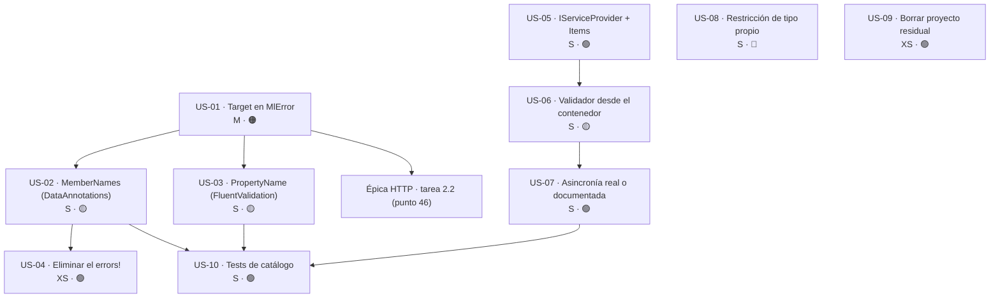

# Épica · Validación en `MoralesLarios.OOFP.Validation*`

> **Versión destino:** `2.1.0`
> **Origen:** puntos **56**, **57**, **58** y **59** de [`Temas Pendientes/Mejoras-Prioridad-Media.md`](../../Temas%20Pendientes/Mejoras-Prioridad-Media.md)
> (*"`where T : class` en lugar de restricción de tipo propio"*, *"sin acceso al contenedor de servicios"*,
> *"métodos `Async` que no son asíncronos"*, *"se descarta `MemberNames`"*).
> **Plan del que se desgaja:** [`Temas Pendientes/Plan-Ejecucion-Prioridad-Media.md`](../../Temas%20Pendientes/Plan-Ejecucion-Prioridad-Media.md) · fase 5, tareas 5.1, 5.2, 5.3 y 5.4.
> **Estado:** ⬜ No iniciada
> **Esfuerzo estimado:** **M** (~1-2 jornadas) · **Riesgo:** 🟠 Alto (la tarea 5.1 toca `Core`; la 5.3 rompe compatibilidad)

> 💡 Del plan, literalmente:
>
> > 💡 **5.1 debe ir antes que 2.2**, o diseñarse con él: ambos cambian MlError.
>
> Es decir: **US-01 de esta épica es prerrequisito de la épica de
> [serialización y errores HTTP](Epica-Serializacion-y-Errores-Http.md)**. Si se hacen por separado,
> `MlError` se modifica dos veces y la segunda invalida el diseño de la primera.

---

## Índice

1. [Contexto y problema](#1-contexto-y-problema)
2. [Hallazgo colateral: hay dos proyectos de FluentValidation y uno está muerto](#2-hallazgo-colateral-hay-dos-proyectos-de-fluentvalidation-y-uno-está-muerto)
3. [Alcance](#3-alcance)
4. [Historias de usuario](#4-historias-de-usuario)
5. [Orden de ejecución y dependencias](#5-orden-de-ejecución-y-dependencias)
6. [Decisiones de diseño abiertas](#6-decisiones-de-diseño-abiertas)
7. [Definición de terminado (DoD)](#7-definición-de-terminado-dod)
8. [Apéndice · Ejemplos de código y explicación detallada](#8-apéndice--ejemplos-de-código-y-explicación-detallada)

---

## 1. Contexto y problema

La familia de validación de la librería (`Validation`, `Validation.DataAnnotations`,
`Validation.FluentValidation`) tiene **4 problemas** que comparten una raíz común: el adaptador que
traduce el resultado del validador a `MlResult<T>` **pierde información** y **no participa del
ecosistema de la aplicación**.

1. **Se descarta el nombre del miembro.** Tanto DataAnnotations (`ValidationResult.MemberNames`) como
   FluentValidation (`ValidationFailure.PropertyName`) dicen **qué propiedad** ha fallado. El adaptador
   hace `Select(x => x.ErrorMessage)` y tira ese dato. `MlError` solo tiene `Message`, así que no
   habría dónde guardarlo aunque se quisiera.
2. **El validador no puede resolver dependencias.** `new ValidationContext(source, null, null)` pasa
   `null` como `IServiceProvider` y `null` como diccionario de `Items`; `new TValidator()` construye el
   validador de FluentValidation con el constructor sin parámetros. Resultado: **ningún atributo de
   validación ni ningún validador puede consultar la base de datos, una caché o un servicio**.
3. **Métodos `Async` que no son asíncronos.** `ValidateAsync` devuelve `Validate(source).ToAsync()`:
   una envoltura sobre un cálculo totalmente sincrónico. Quien vea la firma asumirá que no bloquea.
4. **La restricción genérica no restringe nada útil.** `IMlSelfValidatable<T>` declara `where T : class`,
   cuando lo que quiere expresar es *"`T` es el tipo que implementa esta interfaz"*.

| Fichero | Líneas |
|---|---|
| `MoralesLarios.OOFP.Core/Types/Errors/MlError.cs` | **17** (solo declara `Message`) |
| `MoralesLarios.OOFP.Validation.DataAnnotations/Helpers/Extensions.cs` | **22** (`new ValidationContext(source, null, null)`), **39** (descarta `MemberNames`), **40** (`errors!`) |
| `MoralesLarios.OOFP.Validation.DataAnnotations/DataAnnotationsValidator.cs` | **28** y **57** (`ValidateSource(source).ToAsync()`); **38** y **67** (sobrecargas con entrada `Task`, estas sí hacen `await`) |
| `MoralesLarios.OOFP.Validation.FluentValidation/FluentValidationValidator.cs` | **21-25** (`where T : class`, `new()`), **34-37** (`ValidateAsync` falso) |
| `MoralesLarios.OOFP.Validation.FluentValidation/Helpers/Extensions.cs` | **21-24** (`new TValidator()`), **33-43** (`Activator.CreateInstance<TValidator>()`, **L40** ignora `PropertyName`) |
| `MoralesLarios.OOFP.Validation/IMlSelfValidatable.cs` | **14** (`where T : class`) |
| `MoralesLarios.OOFP.Validation/MlSelfValidatable.Obsolete.cs` | **11** (`where T : class`) |

El adaptador completo de DataAnnotations, tal como está hoy:

```csharp
// MoralesLarios.OOFP.Validation.DataAnnotations/Helpers/Extensions.cs, L20-43
    public static IEnumerable<ValidationResult> ValidateDataAnnotations(this object source)
    {
        ValidationContext valContext = new ValidationContext(source, null, null);     // L22 ← sin IServiceProvider, sin Items
        var result     = new List<ValidationResult>();
        Validator.TryValidateObject(source, valContext, result, true);
        return result;
    } 

    public static MlResult<T> ValidateWithDataAnnotations<T>(this T source)
    {
        var result = source!.ValidateDataAnnotations().ToMlResultValid()
                                .Map ( valResults => valResults.Select(x => x.ErrorMessage))   // L39 ← descarta MemberNames
                                .Bind( errors     => errors.Any() ? errors!.ToMlResultFail<T>() : source.ToMlResultValid<T>());
        return result;
    }
```

**Un validador que sabe exactamente qué propiedad ha fallado y devuelve solo una cadena de texto está
obligando a cada consumidor a reconstruir con expresiones regulares lo que la librería ya tenía en la
mano.**

### Consecuencias

1. **Imposible construir un `ProblemDetails` conforme a RFC 9457.** El campo `errors` de una respuesta
   de validación HTTP es un diccionario `propiedad → mensajes`. Sin `MemberName` no hay diccionario: hay
   una lista plana de frases.
2. **Imposible marcar el campo erróneo en un formulario.** Cualquier cliente (Blazor, React, una app
   móvil) necesita el nombre del campo para resaltarlo. Hoy tiene que parsear el mensaje.
3. **Las reglas de negocio que necesitan datos quedan fuera.** "Este NIF no está ya registrado" o
   "este código existe en el catálogo" no se pueden expresar como atributo porque el atributo no puede
   resolver un repositorio.
4. **Firmas que mienten sobre su coste.** Un `await ValidateAsync(...)` que es sincrónico induce al
   consumidor a creer que puede validar 10.000 objetos en paralelo sin bloquear hilos.
5. **El contrato de autovalidación no se puede verificar en compilación.** Con `where T : class`, nada
   impide `class Pedido : IMlSelfValidatable<Factura>`.

---

## 2. Hallazgo colateral: hay dos proyectos de FluentValidation y uno está muerto

> ⚠️ **Esto no estaba en los puntos 56-59 originales y hay que resolverlo antes de tocar nada, o se
> harán los cambios en la carpeta equivocada.**

Coexisten dos carpetas con nombres casi idénticos:

| Carpeta | `.csproj` | En el `.sln` | Contenido |
|---|---|---|---|
| `MoralesLarios.OOFP.Validation.FluentValidation` *(singular)* | ✅ | ✅ línea **24** (tests en la **26**) | código real: `FluentValidationValidator.cs`, `Helpers/Extensions.cs` |
| `MoralesLarios.OOFP.Validation.FluentValidations` *(plural)* | ❌ **0** | ❌ **0 referencias** | **solo** una carpeta `obj/` |

Lo mismo ocurre con la carpeta de DataAnnotations: la real es **`MoralesLarios.OOFP.Validation.DataAnnotations`**
(con `A` mayúscula), no `Dataannotations`.

Efectos:

| # | Efecto | Detalle |
|---|---|---|
| 1 | **Riesgo de editar un proyecto fantasma** | un `grep` por `FluentValidation` devuelve rutas de las dos carpetas; la plural no compila nada |
| 2 | **Residuos de build versionados** | hay `obj/` en una carpeta sin proyecto; debería estar ignorada o borrada |
| 3 | **Ambigüedad en los `using`** | el nombre del *namespace* y el de la carpeta deben coincidir; conviene verificarlo antes de añadir tipos nuevos |
| 4 | **Limpieza barata y de valor inmediato** | borrar la carpeta plural es XS y elimina una fuente permanente de confusión |

---

## 3. Alcance

### Dentro del alcance

- Añadir `MemberName`/`Target` a `MlError` (en `Core`) y propagarlo desde los dos adaptadores.
- Eliminar el `errors!` validando la colección antes de usarla.
- Permitir inyectar `IServiceProvider` (y `Items`) en la validación de DataAnnotations.
- Permitir resolver el validador de FluentValidation desde el contenedor.
- Restringir `IMlSelfValidatable<T>` al tipo propio.
- Resolver la asincronía falsa: hacerla real o documentarla y verificarla con un analizador.
- Borrar la carpeta residual `Validation.FluentValidations`.

### Fuera del alcance

- **El formato final de `MlError.Details` para HTTP** → [`Epica-Serializacion-y-Errores-Http.md`](Epica-Serializacion-y-Errores-Http.md), tarea 2.2 (punto 46). Esta épica aporta el **dato**; aquella decide cómo **se serializa**.
- Reescribir el motor de validación: se siguen usando `System.ComponentModel.DataAnnotations` y `FluentValidation`.
- Los `ProblemDetails` de los controladores → [`Epica-Contrato-Rest.md`](Epica-Contrato-Rest.md).
- La unidad de trabajo → [`Epica-Unidad-de-Trabajo-y-Transacciones.md`](Epica-Unidad-de-Trabajo-y-Transacciones.md).

---

## 4. Historias de usuario

> **Leyenda de esfuerzo:** XS (<2 h) · S (½ jornada) · M (1 jornada) · L (2 jornadas) · XL (3+ jornadas)
> **Leyenda de riesgo:** 🟢 bajo · 🟡 medio · 🟠 alto · 🔴 muy alto (rompe compatibilidad)

### US-01 · `MlError` guarda el miembro al que apunta el error

> *"**Como** consumidor de la librería, **quiero** que un error de validación me diga **qué propiedad** ha fallado, **para** poder construir un `ProblemDetails` o resaltar el campo en un formulario."*

- **Esfuerzo:** M · **Riesgo:** 🟠 (toca `Core`, del que depende todo lo demás)
- **Depende de:** nada
- **Prerrequisito de:** US-02, US-03, y **de la tarea 2.2 de la épica de serialización**
- **Proyectos afectados:** `MoralesLarios.OOFP.Core` (+ consumidores)
- **Justificación:** punto 59; plan fase 5, tarea 5.1. `MlError.cs` **L17**.

**Criterios de aceptación**

- [ ] `MlError` expone un miembro opcional que identifica el objetivo del error (nombre definitivo en **D-1**).
- [ ] Vale `null`/vacío para los errores que no apuntan a ningún miembro: **ningún uso actual se rompe**.
- [ ] Las conversiones implícitas desde `string` siguen funcionando igual (el `Target` queda vacío).
- [ ] `ToString()` sigue devolviendo **exactamente** lo de hoy cuando no hay `Target` (no es una ruptura silenciosa de texto).
- [ ] Existen fábricas/constructores que permiten crear el error con mensaje **y** objetivo.
- [ ] El diseño está consensuado con la tarea **2.2** (punto 46) para hacer **un solo cambio** en `MlError`.

**API propuesta**

```csharp
// MoralesLarios.OOFP.Core/Types/Errors/MlError.cs
public record MlError
{
    public string  Message { get; init; } = string.Empty;

    /// <summary>
    /// Miembro, propiedad o recurso al que apunta el error. Vacío cuando el error no es
    /// atribuible a un miembro concreto.
    /// </summary>
    public string? Target  { get; init; }

    public static MlError For(string target, string message) => new() { Target = target, Message = message };
}
```

**⚠️ Riesgo principal**

`MlError` es el tipo más transversal de la librería. Cualquier cambio en su `ToString()`, en su
serialización o en su igualdad estructural repercute en los **1.027 tests**. La mitigación es que el
miembro nuevo sea **opcional** y que el comportamiento sin él sea **idéntico** al actual.

---

### US-02 · DataAnnotations propaga `MemberNames`

> *"**Como** consumidor de `ValidateWithDataAnnotations`, **quiero** recibir un error por miembro, **para** no tener que deducirlo del texto del mensaje."*

- **Esfuerzo:** S · **Riesgo:** 🟡 (cambia la forma de los errores devueltos)
- **Depende de:** US-01
- **Prerrequisito de:** US-08
- **Proyecto afectado:** `MoralesLarios.OOFP.Validation.DataAnnotations`
- **Justificación:** punto 59; `Helpers/Extensions.cs` **L39**.

**Criterios de aceptación**

- [ ] `L39` deja de hacer `Select(x => x.ErrorMessage)` y construye `MlError` con `Target` a partir de `ValidationResult.MemberNames`.
- [ ] Un `ValidationResult` con **varios** `MemberNames` produce un error por miembro (criterio en **D-2**).
- [ ] Un `ValidationResult` **sin** `MemberNames` produce un error con `Target` vacío.
- [ ] El texto del mensaje no se altera.
- [ ] Hay test con un objeto de 3 propiedades inválidas que comprueba los 3 `Target`.

**Tests mínimos**

| Escenario | Resultado esperado |
|---|---|
| 1 propiedad inválida | 1 error con `Target == "Nombre"` |
| 3 propiedades inválidas | 3 errores, cada uno con su `Target` |
| Validación a nivel de clase (`IValidatableObject` sin miembros) | 1 error con `Target` vacío |
| `ValidationResult` con 2 `MemberNames` | según **D-2** (2 errores o 1 con los 2 nombres) |
| Objeto válido | `MlResult` válido, sin errores |

---

### US-03 · FluentValidation propaga `PropertyName`

> *"**Como** consumidor de `ValidateWithFluentValidation`, **quiero** el mismo contrato de errores que con DataAnnotations, **para** poder cambiar de motor de validación sin cambiar mi código de presentación."*

- **Esfuerzo:** S · **Riesgo:** 🟡
- **Depende de:** US-01
- **Prerrequisito de:** US-08
- **Proyecto afectado:** `MoralesLarios.OOFP.Validation.FluentValidation`
- **Justificación:** punto 59; `Helpers/Extensions.cs` **L40**.

**Criterios de aceptación**

- [ ] `L40` deja de hacer `valResults.Errors.Select(x => x.ErrorMessage)` y usa `ValidationFailure.PropertyName` como `Target`.
- [ ] Los `RuleFor(x => x.Hijo.Propiedad)` producen el `Target` anidado tal como lo da FluentValidation (`"Hijo.Propiedad"`).
- [ ] La forma del resultado es **indistinguible** de la de DataAnnotations para un mismo conjunto de errores.
- [ ] Hay un test comparativo que valida el mismo objeto con los dos motores y comprueba que los `Target` coinciden.

---

### US-04 · Eliminar el `errors!` validando la colección

> *"**Como** mantenedor, **quiero** que no haya operadores de supresión de nulidad en el camino caliente del adaptador, **para** que un fallo de contrato se manifieste como error tratado y no como `NullReferenceException`."*

- **Esfuerzo:** XS · **Riesgo:** 🟢
- **Depende de:** US-02
- **Prerrequisito de:** nada
- **Proyecto afectado:** `MoralesLarios.OOFP.Validation.DataAnnotations`
- **Justificación:** punto 59, apartado *"eliminar el `errors!` validando la colección"*; `Helpers/Extensions.cs` **L40**.

**Criterios de aceptación**

- [ ] No queda ningún `!` (null-forgiving) en `ValidateWithDataAnnotations`.
- [ ] La colección se comprueba explícitamente (`is null or { Count: 0 }` o equivalente) antes de usarse.
- [ ] Un `ValidationResult` con `ErrorMessage` a `null` no produce `NullReferenceException`: produce un mensaje por defecto.
- [ ] Hay test con `ErrorMessage == null`.

---

### US-05 · `IServiceProvider` e `Items` en la validación de DataAnnotations

> *"**Como** autor de un atributo de validación, **quiero** poder resolver un servicio desde el contenedor, **para** escribir reglas que consulten datos (unicidad, existencia en catálogo)."*

- **Esfuerzo:** S · **Riesgo:** 🟢 (parámetros opcionales, aditivo)
- **Depende de:** nada
- **Prerrequisito de:** US-07
- **Proyecto afectado:** `MoralesLarios.OOFP.Validation.DataAnnotations`
- **Justificación:** punto 57; plan fase 5, tarea 5.2. `Helpers/Extensions.cs` **L22**.

**Criterios de aceptación**

- [ ] Existe sobrecarga que acepta `IServiceProvider? serviceProvider` y `IDictionary<object, object?>? items`.
- [ ] La sobrecarga sin parámetros **sigue existiendo** y se comporta igual que hoy (pasa `null`, `null`).
- [ ] El `ValidationContext` se construye con los valores recibidos.
- [ ] Hay test con un `ValidationAttribute` que obtiene un servicio vía `validationContext.GetService<T>()` y lo usa en la regla.
- [ ] El XML doc explica el ciclo de vida: el `IServiceProvider` que se pasa debe ser el **ámbito** de la petición, no el raíz.

**API propuesta**

```csharp
    public static IEnumerable<ValidationResult> ValidateDataAnnotations(this object                      source,
                                                                       IServiceProvider?                serviceProvider = null,
                                                                       IDictionary<object, object?>?     items           = null)
    {
        var valContext = new ValidationContext(source, serviceProvider, items);
        var result     = new List<ValidationResult>();
        Validator.TryValidateObject(source, valContext, result, validateAllProperties: true);
        return result;
    }
```

---

### US-06 · Resolver el validador de FluentValidation desde el contenedor

> *"**Como** autor de un `AbstractValidator`, **quiero** poder recibir dependencias por constructor, **para** escribir reglas asíncronas contra la base de datos."*

- **Esfuerzo:** S · **Riesgo:** 🟡 (afecta a la restricción `new()`)
- **Depende de:** US-05
- **Prerrequisito de:** US-07
- **Proyecto afectado:** `MoralesLarios.OOFP.Validation.FluentValidation`
- **Justificación:** punto 57; `Helpers/Extensions.cs` **L21-24** y **L33-43**.

**Criterios de aceptación**

- [ ] Existe un camino que obtiene el `IValidator<T>` de un `IServiceProvider` en lugar de hacer `new TValidator()`.
- [ ] El camino actual (`new()` / `Activator.CreateInstance`) **se conserva** para quien no use contenedor.
- [ ] Si el contenedor no tiene registrado el validador, el resultado es un `MlResult` **fallido** con mensaje claro, no una excepción.
- [ ] La restricción `where TValidator : AbstractValidator<T>, new()` se relaja en la sobrecarga que usa el contenedor (ver **D-4**).
- [ ] Hay test con un validador que recibe un servicio simulado por constructor.

**Notas técnicas**

Hoy hay **dos** construcciones distintas en el mismo proyecto, lo que ya es un olor:

```csharp
// Helpers/Extensions.cs, L21-24
        => new TValidator().Validate(source);

// Helpers/Extensions.cs, L33-43
        var result = MlResult.Empty()
                                .TryMap( _          => Activator.CreateInstance<TValidator>(), $"Problems with automatic create instance of {typeof(TValidator).Name}")
                                .TryMap( validator  => validator.Validate(source))
                                ...
```

La segunda es la correcta en espíritu (envuelve el fallo de construcción en el railway); la primera
lanza. Conviene unificar antes de añadir la vía del contenedor.

---

### US-07 · Resolver la asincronía falsa

> *"**Como** consumidor, **quiero** que un método `Async` o sea realmente asíncrono o me diga por escrito que no lo es, **para** no tomar decisiones de concurrencia sobre una premisa falsa."*

- **Esfuerzo:** S · **Riesgo:** 🟢 (si se documenta) / 🟠 (si se hace asíncrono de verdad)
- **Depende de:** US-05, US-06
- **Prerrequisito de:** nada
- **Proyectos afectados:** `Validation.DataAnnotations`, `Validation.FluentValidation`
- **Justificación:** punto 58; plan fase 5, tarea 5.4. Decisión **D-5** (pregunta 5 del plan).

**Criterios de aceptación**

- [ ] Se toma y se registra la decisión **D-5**: asincronía real o simetría documentada.
- [ ] Si es **simetría documentada**: el XML doc de cada método `Async` afectado dice explícitamente *"existe por simetría de composición; la validación es sincrónica y no cede el hilo"*.
- [ ] Si es **asincronía real**: FluentValidation usa `ValidateAsync` del propio validador y DataAnnotations documenta por qué no puede.
- [ ] Se añade el analizador/test que impide introducir nuevos `Async` que solo hagan `ToAsync()` sin justificación.
- [ ] Las sobrecargas que **sí** son asíncronas de verdad (entrada `Task`, `DataAnnotationsValidator.cs` **L38** y **L67**) quedan documentadas como tales, para que el contraste sea evidente.

**Notas técnicas**

```csharp
// Validation.DataAnnotations/DataAnnotationsValidator.cs — L28 y L57
        => ValidateSource(source).ToAsync();            // ← sincrónico envuelto en Task

// Validation.FluentValidation/FluentValidationValidator.cs — L34-37
    public static Task<MlResult<T>> ValidateAsync<T, TValidator>(T source)
        where T : class where TValidator : AbstractValidator<T>, new()
        => Validate<T, TValidator>(source).ToAsync();   // ← idem
```

FluentValidation **sí** tiene `IValidator<T>.ValidateAsync`, así que ahí la asincronía real es posible
y además necesaria (las reglas `MustAsync` no se ejecutan en el camino sincrónico). DataAnnotations no
tiene equivalente asíncrono: `Validator.TryValidateObject` es sincrónico por diseño.

> **Regla general:** la asimetría es aceptable si está **escrita**. Lo inaceptable es que el consumidor
> tenga que leer el cuerpo del método para saber si su `await` bloquea.

---

### US-08 · Restricción de tipo propio en `IMlSelfValidatable<T>`

> *"**Como** desarrollador que implementa autovalidación, **quiero** que el compilador me impida declarar `class Pedido : IMlSelfValidatable<Factura>`, **para** que el contrato signifique lo que su nombre dice."*

- **Esfuerzo:** S · **Riesgo:** 🔴 (rompe compatibilidad en compilación)
- **Depende de:** nada
- **Prerrequisito de:** nada
- **Proyecto afectado:** `MoralesLarios.OOFP.Validation`
- **Justificación:** punto 56; plan fase 5, tarea 5.3. `IMlSelfValidatable.cs` **L14**, `MlSelfValidatable.Obsolete.cs` **L11**.

**Criterios de aceptación**

- [ ] `IMlSelfValidatable<T>` declara `where T : IMlSelfValidatable<T>` (patrón CRTP).
- [ ] Se evalúa y se decide en **D-6** si se añaden miembros `static abstract` (requiere `net8.0`+ en todos los objetivos).
- [ ] Un tipo que implemente la interfaz con un argumento que **no sea él mismo** deja de compilar.
- [ ] Se actualiza `MlSelfValidatable.Obsolete.cs` **L11** con la misma restricción.
- [ ] Las notas de versión incluyen el ejemplo de migración (es un cambio de una línea en el consumidor).

**API propuesta**

```csharp
// ───── 2.0.0 ─────
public interface IMlSelfValidatable<T> where T : class
{
    MlResult<T> SelfValidate();
}

// ───── 2.1.0 ─────
public interface IMlSelfValidatable<T> where T : IMlSelfValidatable<T>
{
    MlResult<T> SelfValidate();
}
```

**⚠️ Riesgo principal**

`static abstract` solo está disponible desde C# 11 / .NET 7. Varios proyectos de la solución son
multi-objetivo `net8.0`+`net9.0`, con lo cual **no hay bloqueo**, pero conviene confirmarlo antes de
comprometerse con **D-6**.

---

### US-09 · Borrar el proyecto residual `Validation.FluentValidations`

> *"**Como** mantenedor, **quiero** que no exista una carpeta con nombre casi idéntico al del proyecto real, **para** no editar por error un directorio que no compila."*

- **Esfuerzo:** XS · **Riesgo:** 🟢
- **Depende de:** nada
- **Prerrequisito de:** nada
- **Proyecto afectado:** raíz de la solución
- **Justificación:** hallazgo colateral §2.

**Criterios de aceptación**

- [ ] Se confirma que `MoralesLarios.OOFP.Validation.FluentValidations` (plural) no tiene `.csproj` ni referencias en el `.sln`.
- [ ] Se borra la carpeta (y su `obj/`).
- [ ] Lo mismo con `MoralesLarios.OOFP.Validation.FluentValidations.Tests.Unit` si está en la misma situación.
- [ ] La solución sigue compilando y los **1.027 tests** siguen en verde.
- [ ] `.gitignore` cubre los `obj/`/`bin/` para que no vuelva a pasar.

---

### US-10 · Tests de catálogo de la validación

> *"**Como** equipo, **quiero** una prueba que falle si alguien vuelve a descartar el nombre del miembro, **para** que el arreglo no se deshaga en la siguiente refactorización."*

- **Esfuerzo:** S · **Riesgo:** 🟢
- **Depende de:** US-02, US-03, US-07
- **Prerrequisito de:** nada
- **Proyectos afectados:** `Validation.DataAnnotations.Tests.Unit`, `Validation.FluentValidation.Tests.Unit`
- **Justificación:** criterio de calidad del plan (entregable de la fase 5).

**Criterios de aceptación**

- [ ] Test de paridad: el mismo objeto inválido validado con los dos motores produce el **mismo conjunto de `Target`**.
- [ ] Test por reflexión: ningún método público `*Async` de los validadores tiene un cuerpo que sea solo `ToAsync()` sin el XML doc de simetría (o el analizador de US-07 lo cubre).
- [ ] Test de regresión: los errores sin miembro atribuible siguen produciendo `Target` vacío y mensaje intacto.
- [ ] Test de contenedor: un atributo que resuelve un servicio funciona con `IServiceProvider` y falla de forma controlada sin él.

**Tests mínimos**

| Escenario | Resultado esperado |
|---|---|
| Objeto con 2 campos inválidos, DataAnnotations | 2 errores con `Target` correcto |
| El mismo objeto, FluentValidation | 2 errores con los **mismos** `Target` |
| Atributo que necesita servicio, **sin** `IServiceProvider` | fallo controlado con mensaje claro |
| Atributo que necesita servicio, **con** `IServiceProvider` | validación correcta |
| `IMlSelfValidatable<T>` con `T` ajeno | **no compila** (test de compilación negativa o verificación por reflexión de los implementadores) |

---

## 5. Orden de ejecución y dependencias



### Secuencia recomendada

| Orden | Historia | Esfuerzo | Hito |
|---:|---|---|---|
| 1 | US-09 · borrar el proyecto residual | XS | terreno limpio antes de editar |
| 2 | US-01 · `Target` en `MlError` | M | 🎯 **desbloquea esta épica y la tarea 2.2 de HTTP** |
| 3 | US-02 · `MemberNames` en DataAnnotations | S | primer motor completo |
| 4 | US-04 · eliminar el `errors!` | XS | adaptador robusto |
| 5 | US-03 · `PropertyName` en FluentValidation | S | paridad entre motores |
| 6 | US-05 · `IServiceProvider` + `Items` | S | reglas con datos (DataAnnotations) |
| 7 | US-06 · validador desde el contenedor | S | reglas con datos (FluentValidation) |
| 8 | US-07 · asincronía | S | firmas honestas |
| 9 | US-08 · restricción de tipo propio | S | **única ruptura de compilación** |
| 10 | US-10 · tests de catálogo | S | red de seguridad |

**Total: ~1-2 jornadas.**

> 💡 **Entrega incremental sugerida**
> US-01 es la **puerta de entrada de toda la `2.1.0`** en lo que respecta a errores: debe cerrarse
> **antes** de la tarea 2.2 de la [épica de serialización](Epica-Serializacion-y-Errores-Http.md), o se
> acabará modificando `MlError` dos veces. US-02 a US-07 son aditivas y pueden publicarse por separado.
> US-08 es la única ruptura y conviene agruparla con las rupturas de la
> [épica del contrato REST](Epica-Contrato-Rest.md) y de la
> [épica de servicio y paginación](Epica-Servicio-y-Paginacion.md) en un único salto de versión.

---

## 6. Decisiones de diseño abiertas

| Id | Decisión | Opciones | Recomendación |
|---|---|---|---|
| **D-1** | ¿Cómo se llama el miembro nuevo de `MlError`? | (a) `Target` (vocabulario RFC 9457 / OData) · (b) `MemberName` (vocabulario DataAnnotations) · (c) `PropertyName` (vocabulario FluentValidation) · (d) los dos: `Target` genérico y alias | **(a) `Target`**: es el único neutral respecto a los dos motores y el que encaja con la serialización HTTP de la tarea 2.2 |
| **D-2** | Un `ValidationResult` con **varios** `MemberNames`, ¿cuántos `MlError` produce? | (a) uno por miembro, repitiendo el mensaje · (b) uno con los miembros concatenados · (c) uno con el primer miembro | **(a)**: es lo que espera el diccionario `errors` de `ProblemDetails`; duplicar el texto es irrelevante |
| **D-3** | ¿`MlError` sigue siendo convertible implícitamente desde `string`? | (a) sí, con `Target` vacío · (b) no, para forzar a pensar el objetivo | **(a)** obligatoriamente: hay cientos de usos y romperlos no aporta nada |
| **D-4** | ¿Se relaja `where TValidator : AbstractValidator<T>, new()`? | (a) solo en la sobrecarga del contenedor · (b) en todas, resolviendo siempre por contenedor · (c) no se relaja y el contenedor se usa solo para las dependencias del `ValidationContext` | **(a)**: aditivo, no rompe a nadie y abre la puerta a validadores con dependencias |
| **D-5** | Punto 58: ¿asincronía real o simetría documentada? | (a) real en FluentValidation (`ValidateAsync`), documentada en DataAnnotations · (b) documentada en ambos · (c) real en ambos (imposible en DataAnnotations) | **(a)**: FluentValidation tiene `MustAsync`, y hoy esas reglas **no se están ejecutando** por el camino sincrónico. Es la pregunta 5 del plan |
| **D-6** | ¿`IMlSelfValidatable<T>` incorpora miembros `static abstract`? | (a) sí, `static abstract MlResult<T> Validate(T)` · (b) no, solo CRTP en la restricción · (c) sí, pero en una interfaz nueva aparte | **(b)** para la `2.1.0`: el CRTP ya arregla el problema del punto 56 con una sola línea; `static abstract` es un rediseño que merece su propia discusión |
| **D-7** | ¿Qué pasa con los errores que no tienen miembro atribuible? | (a) `Target` a `null` · (b) `Target` a `string.Empty` · (c) `Target` con un valor convencional (`"$"`, `"."`) | **(a) `null`**, y que la serialización decida; así se distingue "sin objetivo" de "objetivo vacío" |

---

## 7. Definición de terminado (DoD)

- [ ] `MlError` expone el miembro acordado en **D-1**, opcional y sin alterar el comportamiento actual.
- [ ] Los dos adaptadores (DataAnnotations y FluentValidation) propagan el nombre del miembro.
- [ ] No queda ningún `!` (null-forgiving) en el camino de `ValidateWithDataAnnotations`.
- [ ] Existe sobrecarga con `IServiceProvider` e `Items` en DataAnnotations y vía de contenedor en FluentValidation.
- [ ] Los métodos `Async` o son asíncronos de verdad o lo documentan explícitamente, y hay analizador/test que lo vigila.
- [ ] `IMlSelfValidatable<T>` usa la restricción de tipo propio, también en el fichero `.Obsolete.cs`.
- [ ] La carpeta `MoralesLarios.OOFP.Validation.FluentValidations` (plural) ya no existe.
- [ ] La solución compila en `Release --no-incremental` con **0 errores y `CS1591 = 0`**.
- [ ] Los **1.027 tests** existentes siguen en verde.
- [ ] Los tests de catálogo de US-10 están en los proyectos de test de validación y pasan.
- [ ] El diseño de `MlError` está acordado con la tarea **2.2** de la épica de serialización (un solo cambio).
- [ ] Las 7 decisiones (**D-1 … D-7**) están cerradas y anotadas en este documento.

---

## 8. Apéndice · Ejemplos de código y explicación detallada

> Este apéndice contiene **el código real de hoy** (con fichero y línea) y **el código propuesto**
> para cada historia. Todo el código "después" es *ilustrativo*: fija la intención y el contrato, no
> la implementación definitiva.

### Índice del apéndice

- 8.1 · `MlError` hoy: un solo campo (US-01)
- 8.2 · El adaptador de DataAnnotations y el dato que tira (US-02, US-04)
- 8.3 · El adaptador de FluentValidation (US-03)
- 8.4 · El `ValidationContext` sin contenedor (US-05)
- 8.5 · Dos formas de construir el mismo validador (US-06)
- 8.6 · La asincronía que no existe (US-07)
- 8.7 · `where T : class` frente a CRTP (US-08)
- 8.8 · El proyecto fantasma (US-09)
- 8.9 · Resumen de rupturas

---

### 8.1 · `MlError` hoy: un solo campo (US-01)

**Hoy — `MoralesLarios.OOFP.Core/Types/Errors/MlError.cs`, L17**

El tipo declara **únicamente** `Message`. No hay ningún sitio donde guardar el nombre del miembro, el
código de error, el objetivo ni nada más. Todo lo que no sea texto se pierde.

Eso tiene un efecto en cascada que conviene ver completo:

```
ValidationResult { ErrorMessage = "Debe tener entre 3 y 50 caracteres",
                   MemberNames  = ["Nombre"] }
        │
        ▼  Extensions.cs L39:  Select(x => x.ErrorMessage)
"Debe tener entre 3 y 50 caracteres"                       ← MemberNames: PERDIDO
        │
        ▼  ToMlResultFail<T>()
MlError { Message = "Debe tener entre 3 y 50 caracteres" } ← no hay dónde ponerlo
        │
        ▼  el controlador quiere construir ProblemDetails.errors
{ "errors": { "???": ["Debe tener entre 3 y 50 caracteres"] } }   ← imposible
```

**Después**

```csharp
public record MlError
{
    public string  Message { get; init; } = string.Empty;

    /// <summary>
    /// Miembro, propiedad o recurso al que apunta el error. <c>null</c> cuando el error no es
    /// atribuible a un miembro concreto (validaciones a nivel de clase, errores de infraestructura).
    /// </summary>
    public string? Target  { get; init; }

    public static MlError For(string target, string message) => new() { Target = target, Message = message };

    public static implicit operator MlError(string message) => new() { Message = message };   // ← D-3: se conserva

    public override string ToString() => Message;                                             // ← sin cambios
}
```

Y la cascada queda así:

```
ValidationResult { ErrorMessage = "...", MemberNames = ["Nombre"] }
        │
        ▼  MlError.For("Nombre", "...")
MlError { Target = "Nombre", Message = "..." }
        │
        ▼  el controlador agrupa por Target
{ "errors": { "Nombre": ["Debe tener entre 3 y 50 caracteres"] } }   ← RFC 9457 ✔
```

**Tabla de verificación**

| Comprobación | Antes | Después |
|---|---|---|
| `new MlError { Message = "x" }` compila | ✅ | ✅ |
| `MlError e = "x";` (conversión implícita) | ✅ | ✅ (`Target == null`) |
| `e.ToString()` sin `Target` | `"x"` | `"x"` (idéntico) |
| Se puede agrupar por propiedad | ❌ | ✅ |
| Los 1.027 tests siguen compilando | — | ✅ (el miembro es opcional) |

> **Regla general:** añadir información a un tipo transversal solo es seguro si el camino que **no** la
> usa queda **byte a byte** idéntico. De ahí que `ToString()` sea un criterio de aceptación explícito.

---

### 8.2 · El adaptador de DataAnnotations y el dato que tira (US-02, US-04)

**Hoy — `Validation.DataAnnotations/Helpers/Extensions.cs`, L36-43**

```csharp
    public static MlResult<T> ValidateWithDataAnnotations<T>(this T source)
    {
        var result = source!.ValidateDataAnnotations().ToMlResultValid()
                                .Map ( valResults => valResults.Select(x => x.ErrorMessage))   // L39 ← descarta MemberNames
                                .Bind( errors     => errors.Any() ? errors!.ToMlResultFail<T>() : source.ToMlResultValid<T>());
        return result;
    }
```

Hay **dos** defectos en dos líneas consecutivas:

1. **L39** — `Select(x => x.ErrorMessage)` descarta `x.MemberNames`.
2. **L40** — `errors!` suprime la nulidad. `ValidationResult.ErrorMessage` es `string?`: si un atributo
   personalizado devuelve `new ValidationResult(null)`, la secuencia contiene `null` y el `!` lo pasa
   por alto hasta que algo lo desreferencia.

**Después**

```csharp
    public static MlResult<T> ValidateWithDataAnnotations<T>(this T                           source,
                                                             IServiceProvider?                serviceProvider = null,
                                                             IDictionary<object, object?>?     items           = null)
    {
        var result = source!.ValidateDataAnnotations(serviceProvider, items).ToMlResultValid()
                                .Map ( valResults => valResults.SelectMany(ToMlErrors).ToArray())   // ← US-02 + D-2
                                .Bind( errors     => errors.Length > 0                              // ← US-04: sin '!'
                                                        ? errors.ToMlResultFail<T>()
                                                        : source.ToMlResultValid<T>());
        return result;
    }

    private static IEnumerable<MlError> ToMlErrors(ValidationResult valResult)
    {
        var message = string.IsNullOrWhiteSpace(valResult.ErrorMessage)
                        ? "Validation failed."                       // ← US-04: ErrorMessage puede ser null
                        : valResult.ErrorMessage;

        var members = valResult.MemberNames?.Where(m => !string.IsNullOrWhiteSpace(m)).ToArray() ?? [];

        if (members.Length == 0)
            yield return new MlError { Message = message };           // ← D-7: Target null
        else
            foreach (var member in members)                           // ← D-2 opción (a)
                yield return MlError.For(member, message);
    }
```

Trazado de un caso con 2 miembros, para ver qué hace **D-2** opción (a):

```
1. ValidationResult { ErrorMessage = "FechaFin debe ser posterior a FechaInicio",
                      MemberNames  = ["FechaInicio", "FechaFin"] }
2. ToMlErrors → 2 elementos:
     MlError { Target = "FechaInicio", Message = "FechaFin debe ser posterior a FechaInicio" }
     MlError { Target = "FechaFin",    Message = "FechaFin debe ser posterior a FechaInicio" }
3. ProblemDetails.errors:
     { "FechaInicio": ["FechaFin debe ser..."], "FechaFin": ["FechaFin debe ser..."] }
4. el formulario resalta LOS DOS campos  ✔
```

Con la opción (c) (*solo el primer miembro*) el segundo campo se quedaría sin resaltar; con la (b)
(*concatenados*) la clave del diccionario sería `"FechaInicio, FechaFin"`, que ningún cliente sabe
interpretar. De ahí la recomendación.

**Tests mínimos**

| Escenario | Resultado esperado |
|---|---|
| `[Required]` en `Nombre` | 1 `MlError` con `Target == "Nombre"` |
| `IValidatableObject` que devuelve 2 `MemberNames` | 2 `MlError`, mismo `Message` |
| `new ValidationResult(null)` | 1 `MlError` con mensaje por defecto, **sin excepción** |
| `MemberNames` vacío | 1 `MlError` con `Target == null` |
| Objeto válido | `MlResult` válido |
| Mensaje de un objeto con 1 error | **idéntico** al de `2.0.0` |

---

### 8.3 · El adaptador de FluentValidation (US-03)

**Hoy — `Validation.FluentValidation/Helpers/Extensions.cs`, L33-43**

```csharp
        var result = MlResult.Empty()
                                .TryMap( _          => Activator.CreateInstance<TValidator>(), $"Problems with automatic create instance of {typeof(TValidator).Name}")
                                .TryMap( validator  => validator.Validate(source))
                                .Map   ( valResults => valResults.Errors.Select(x => x.ErrorMessage))   // L40 ← ignora PropertyName
                                .Bind  ( errors     => errors.Any() ? errors.ToMlResultFail<T>() : source.ToMlResultValid<T>());
```

`ValidationFailure` es incluso **más rico** que `ValidationResult`: trae `PropertyName`, `ErrorCode`,
`AttemptedValue` y `Severity`. Hoy se usa 1 de los 5 campos.

**Después**

```csharp
        var result = MlResult.Empty()
                                .TryMap( _          => CreateValidator<T, TValidator>(serviceProvider),            // ← US-06
                                         $"Problems creating an instance of {typeof(TValidator).Name}")
                                .TryMap( validator  => validator.Validate(source))
                                .Map   ( valResults => valResults.Errors
                                                                 .Select(x => MlError.For(x.PropertyName, x.ErrorMessage))   // ← US-03
                                                                 .ToArray())
                                .Bind  ( errors     => errors.Length > 0
                                                        ? errors.ToMlResultFail<T>()
                                                        : source.ToMlResultValid<T>());
```

**Paridad entre los dos motores — el test que US-10 exige**

```csharp
    [Fact]
    public void Both_engines_report_the_same_targets()
    {
        var invalid = new Customer { Name = "", Age = -1 };

        var byDataAnnotations = invalid.ValidateWithDataAnnotations();
        var byFluent          = invalid.ValidateWithFluentValidation<Customer, CustomerValidator>();

        var targetsA = byDataAnnotations.SecureFailErrorsDetails().Errors.Select(e => e.Target).OrderBy(x => x);
        var targetsF = byFluent        .SecureFailErrorsDetails().Errors.Select(e => e.Target).OrderBy(x => x);

        targetsF.Should().BeEquivalentTo(targetsA, "cambiar de motor de validación no debe cambiar el contrato de errores");
    }
```

Esta prueba es la que convierte "los dos adaptadores están arreglados" en "los dos adaptadores están
arreglados **igual**", que es lo que de verdad le importa al consumidor.

**Tabla de verificación**

| Dato que ofrece el motor | Se usa en 2.0.0 | Se usa en 2.1.0 |
|---|---|---|
| `ErrorMessage` | ✅ | ✅ |
| `PropertyName` | ❌ | ✅ → `Target` |
| `ErrorCode` | ❌ | ❌ (candidato a `2.2.0`) |
| `AttemptedValue` | ❌ | ❌ (no se expone: podría filtrar datos sensibles) |
| `Severity` | ❌ | ❌ (candidato a `2.2.0`) |

---

### 8.4 · El `ValidationContext` sin contenedor (US-05)

**Hoy — `Validation.DataAnnotations/Helpers/Extensions.cs`, L20-26**

```csharp
    public static IEnumerable<ValidationResult> ValidateDataAnnotations(this object source)
    {
        ValidationContext valContext = new ValidationContext(source, null, null);     // L22
        var result     = new List<ValidationResult>();
        Validator.TryValidateObject(source, valContext, result, true);
        return result;
    } 
```

Los dos `null` son, por orden, `IServiceProvider? serviceProvider` e
`IDictionary<object, object?>? items`. Con ellos a `null`:

```csharp
// Lo que un atributo de validación NO puede hacer hoy
public sealed class UniqueNifAttribute : ValidationAttribute
{
    protected override ValidationResult? IsValid(object? value, ValidationContext validationContext)
    {
        var repo = validationContext.GetService<ICustomerRepository>();   // ← SIEMPRE null
        return repo!.Exists((string)value!)                              // ← NullReferenceException
                 ? new ValidationResult("NIF ya registrado", [validationContext.MemberName!])
                 : ValidationResult.Success;
    }
}
```

**Después**

```csharp
    public static IEnumerable<ValidationResult> ValidateDataAnnotations(this object                      source,
                                                                       IServiceProvider?                serviceProvider = null,
                                                                       IDictionary<object, object?>?     items           = null)
    {
        var valContext = new ValidationContext(source, serviceProvider, items);
        var result     = new List<ValidationResult>();
        Validator.TryValidateObject(source, valContext, result, validateAllProperties: true);
        return result;
    }
```

Y entonces el atributo anterior funciona sin cambios... **si** el llamante pasa el ámbito correcto:

```csharp
// En un controlador o servicio con DI
var validation = dto.ValidateWithDataAnnotations(HttpContext.RequestServices);
```

> ⚠️ **Nota de ciclo de vida, obligatoria en el XML doc:** hay que pasar el `IServiceProvider` **del
> ámbito de la petición** (`HttpContext.RequestServices`), no el raíz. Con el raíz, cualquier servicio
> `Scoped` (como un `DbContext`) lanzará `InvalidOperationException`, o peor: se capturará y vivirá
> para siempre.

**Tabla de verificación**

| Comprobación | Antes | Después |
|---|---|---|
| `dto.ValidateWithDataAnnotations()` compila | ✅ | ✅ (sobrecarga conservada) |
| `validationContext.GetService<T>()` | siempre `null` | funciona si se pasa el proveedor |
| `validationContext.Items` | siempre `null` | diccionario del llamante |
| Reglas de unicidad como atributo | ❌ | ✅ |
| Es ruptura | — | **no**, es aditivo |

---

### 8.5 · Dos formas de construir el mismo validador (US-06)

**Hoy — `Validation.FluentValidation/Helpers/Extensions.cs`, L21-24**

```csharp
        => new TValidator().Validate(source);
```

**Hoy — el mismo fichero, L33-43**

```csharp
                                .TryMap( _          => Activator.CreateInstance<TValidator>(), $"Problems with automatic create instance of {typeof(TValidator).Name}")
```

**Hoy — `Validation.FluentValidation/FluentValidationValidator.cs`, L21-25**

```csharp
    public static MlResult<T> Validate<T, TValidator>(T source)
        where T          : class
        where TValidator : AbstractValidator<T>, new()      // ← punto 56: la restricción new() cierra la DI
        => EnsureFp.NotNull(source, $"{nameof(source)} must not be null")
                   .Bind(_ => source.ValidateWithFluentValidation<T, TValidator>());
```

Son **tres** construcciones del validador con **dos** comportamientos distintos ante el fallo:

| Vía | Qué hace si el constructor lanza |
|---|---|
| `new TValidator()` (L21-24) | la excepción **escapa** |
| `Activator.CreateInstance<TValidator>()` dentro de `TryMap` (L33-43) | se convierte en `MlResult` fallido ✔ |

Y la restricción `, new()` es lo que **impide** que el validador tenga dependencias: un
`AbstractValidator<Customer>` que necesite `ICustomerRepository` en el constructor **no satisface
`new()`** y, por tanto, no se puede usar con esta API.

**Después**

```csharp
    private static IValidator<T> CreateValidator<T, TValidator>(IServiceProvider? serviceProvider)
        where TValidator : class, IValidator<T>
    {
        if (serviceProvider is not null)
        {
            // 1) el validador registrado explícitamente
            var fromContainer = serviceProvider.GetService(typeof(TValidator)) as IValidator<T>
                             ?? serviceProvider.GetService(typeof(IValidator<T>)) as IValidator<T>;

            if (fromContainer is not null) return fromContainer;

            // 2) construcción asistida: resuelve las dependencias del constructor
            return (IValidator<T>)ActivatorUtilities.CreateInstance(serviceProvider, typeof(TValidator));
        }

        // 3) sin contenedor: comportamiento de 2.0.0
        return Activator.CreateInstance<TValidator>();
    }
```

La clave es el punto **2**: `ActivatorUtilities.CreateInstance` permite que el validador **no** esté
registrado y que, aun así, reciba sus dependencias. Eso cubre el caso más común (nadie quiere registrar
a mano 40 validadores) sin exigir `FluentValidation.DependencyInjectionExtensions`.

Y la restricción se relaja **solo** en la sobrecarga nueva (**D-4** opción a):

```csharp
// ───── 2.0.0 ─────
    public static MlResult<T> Validate<T, TValidator>(T source)
        where T : class where TValidator : AbstractValidator<T>, new()

// ───── 2.1.0 ─────  (la de arriba SE CONSERVA; se añade esta)
    public static MlResult<T> Validate<T, TValidator>(T source, IServiceProvider serviceProvider)
        where T : class where TValidator : class, IValidator<T>          // ← sin new()
```

**Tests mínimos**

| Escenario | Resultado esperado |
|---|---|
| Validador sin dependencias, sin contenedor | funciona igual que en `2.0.0` |
| Validador con dependencia, con contenedor | se construye y valida |
| Validador con dependencia, **sin** contenedor | `MlResult` **fallido** con mensaje claro, sin excepción |
| Validador registrado como `IValidator<T>` | se usa el del contenedor, no uno nuevo |
| Constructor que lanza | `MlResult` fallido (unificado en las 3 vías) |

---

### 8.6 · La asincronía que no existe (US-07)

**Hoy — `Validation.DataAnnotations/DataAnnotationsValidator.cs`, L28 y L57**

```csharp
        => ValidateSource(source).ToAsync();
```

**Hoy — `Validation.FluentValidation/FluentValidationValidator.cs`, L34-37**

```csharp
    public static Task<MlResult<T>> ValidateAsync<T, TValidator>(T source)
        where T : class where TValidator : AbstractValidator<T>, new()
        => Validate<T, TValidator>(source).ToAsync();
```

**Hoy — las que SÍ son asíncronas, `DataAnnotationsValidator.cs` L38 y L67**

Las sobrecargas cuya **entrada** es un `Task<T>` sí hacen `await` de verdad. Por eso el fichero
contiene, a la vez, asincronía real y asincronía decorativa:

| Línea | Firma (resumida) | ¿Asíncrono de verdad? |
|---|---|---|
| L28 | `ValidateAsync(T source)` | ❌ `ToAsync()` sobre un cálculo sincrónico |
| L38 | `ValidateAsync(Task<T> source)` | ✅ hace `await` de la entrada |
| L57 | `ValidateAsync(T source, …)` | ❌ |
| L67 | `ValidateAsync(Task<T> source, …)` | ✅ |

Esto no es un bug: es **composición**. `ToAsync()` existe para poder encadenar `BindAsync`/`MapAsync`
sin romper la cadena. El problema es que **no está escrito en ningún sitio**.

El agravante específico de FluentValidation es que su camino sincrónico **se salta reglas**:

```csharp
// Un validador perfectamente legítimo
public sealed class CustomerValidator : AbstractValidator<Customer>
{
    public CustomerValidator(ICustomerRepository repo)
    {
        RuleFor(x => x.Nif).MustAsync(async (nif, ct) => !await repo.ExistsAsync(nif, ct))
                           .WithMessage("NIF ya registrado");
    }
}
```

```
// 2.0.0, llamando a ValidateAsync:
ValidateAsync → Validate → validator.Validate(source)   ← método SINCRÓNICO de FluentValidation
                                                           → AsyncValidatorInvokedSynchronouslyException
                                                           (o la regla se omite, según versión)
```

**Después (D-5 opción a)**

```csharp
// FluentValidation: asincronía REAL
    /// <summary>
    /// Valida <paramref name="source"/> de forma asíncrona. Ejecuta también las reglas
    /// <c>MustAsync</c>/<c>CustomAsync</c>, que el camino sincrónico no puede evaluar.
    /// </summary>
    public static Task<MlResult<T>> ValidateAsync<T, TValidator>(T source, IServiceProvider? serviceProvider = null, CancellationToken ct = default)
        where T : class where TValidator : class, IValidator<T>
        => EnsureFp.NotNull(source, $"{nameof(source)} must not be null")
                   .BindAsync(_ => source.ValidateWithFluentValidationAsync<T, TValidator>(serviceProvider, ct));

// DataAnnotations: simetría DOCUMENTADA
    /// <summary>
    /// <b>Esta sobrecarga existe por simetría de composición: la validación es sincrónica y no cede
    /// el hilo.</b> <c>System.ComponentModel.DataAnnotations</c> no ofrece un camino asíncrono
    /// (<see cref="Validator.TryValidateObject(object, ValidationContext, ICollection{ValidationResult}, bool)"/>
    /// es sincrónico por diseño). Se expone para poder encadenarla con <c>BindAsync</c>/<c>MapAsync</c>
    /// sin romper la cadena.
    /// </summary>
    public static Task<MlResult<T>> ValidateAsync<T>(T source) => Validate(source).ToAsync();
```

Y el guardián que exige el criterio de aceptación:

```csharp
    [Fact]
    public void Fake_async_methods_must_document_why_they_are_async()
    {
        var offenders = typeof(DataAnnotationsValidator).GetMethods()
                            .Where(m => m.Name.EndsWith("Async", StringComparison.Ordinal))
                            .Where(m => !HasSymmetryRemarkInXmlDoc(m))     // lee el .xml de documentación
                            .Select(m => m.Name)
                            .ToArray();

        offenders.Should().BeEmpty("todo método Async sincrónico debe declarar que existe por simetría (punto 58)");
    }
```

> **Regla general:** una firma `Async` es una **promesa de no bloquear**. Si no se puede cumplir, hay
> que anular la promesa explícitamente en la documentación, no dejar que el consumidor lo descubra con
> un perfilador.

---

### 8.7 · `where T : class` frente a CRTP (US-08)

**Hoy — `Validation/IMlSelfValidatable.cs`, L14-23**

```csharp
public interface IMlSelfValidatable<T> where T : class
```

**Hoy — `Validation/MlSelfValidatable.Obsolete.cs`, L11**

La misma restricción, repetida.

Lo que la restricción actual **permite**:

```csharp
// Compila perfectamente en 2.0.0, y no tiene ningún sentido
public class Pedido : IMlSelfValidatable<Factura>
{
    public MlResult<Factura> SelfValidate() => throw new NotImplementedException();
    //            ^^^^^^^ se valida solo... devolviendo OTRO tipo
}
```

```csharp
// ───── 2.0.0 ─────
public interface IMlSelfValidatable<T> where T : class
{
    MlResult<T> SelfValidate();
}

// ───── 2.1.0 ─────
public interface IMlSelfValidatable<T> where T : IMlSelfValidatable<T>
{
    MlResult<T> SelfValidate();
}
```

Y a partir de ahí:

```csharp
public class Pedido  : IMlSelfValidatable<Pedido>  { ... }   // ✅ compila
public class Pedido2 : IMlSelfValidatable<Factura> { ... }   // ❌ CS0311: Factura no implementa IMlSelfValidatable<Factura>
```

La migración para el consumidor correcto es **nula**: quien ya escribía `IMlSelfValidatable<Pedido>` en
`Pedido` no cambia una sola línea. Solo rompe a quien lo estaba usando mal — que es exactamente el
objetivo.

**Sobre `static abstract` (D-6):** el patrón completo sería

```csharp
public interface IMlSelfValidatable<T> where T : IMlSelfValidatable<T>
{
    MlResult<T>        SelfValidate();
    static abstract MlResult<T> Validate(T source);     // ← requiere C# 11 / net7.0+
}
```

Es viable (la solución es `net8.0`/`net9.0`), pero **obliga** a todos los implementadores a añadir un
miembro estático. Eso ya no es "arreglar una restricción": es un rediseño del contrato. De ahí la
recomendación de dejarlo fuera de la `2.1.0`.

#### Resumen de rupturas de esta historia

| Elemento | 2.0.0 | 2.1.0 | ¿Lo detecta el compilador? |
|---|---|---|---|
| `class X : IMlSelfValidatable<X>` | ✅ | ✅ | — (sin cambios) |
| `class X : IMlSelfValidatable<Y>` | ✅ compila | ❌ CS0311 | ✅ **sí** |
| `IMlSelfValidatable<T>` con `T` estructura | ❌ (`where T : class`) | ✅ si implementa la interfaz | ✅ sí (es una ampliación) |

---

### 8.8 · El proyecto fantasma (US-09)

Situación medida:

```
MoralesLarios.OOFP.Validation.FluentValidation/          ← REAL
    FluentValidationValidator.cs
    Helpers/Extensions.cs
    MoralesLarios.OOFP.Validation.FluentValidation.csproj   ✔  (.sln línea 24)

MoralesLarios.OOFP.Validation.FluentValidations/         ← FANTASMA (plural)
    obj/                                                    ← solo residuos de build
    (0 ficheros .cs, 0 .csproj, 0 referencias en el .sln)
```

El riesgo es operativo y muy concreto: un `grep_search` por `FluentValidation` devuelve rutas de las
**dos** carpetas; si se edita la plural, el cambio compila (porque no compila nada) y los tests pasan
(porque no hay tests), pero el comportamiento no cambia. Es una tarde perdida garantizada.

Lo mismo aplica al nombre de la carpeta de DataAnnotations: la real es
`MoralesLarios.OOFP.Validation.DataAnnotations`, con **`A` mayúscula**.

**Tabla de verificación antes de borrar**

| Comprobación | Esperado |
|---|---|
| `*.csproj` dentro de la carpeta plural | 0 |
| Apariciones de `FluentValidations` en el `.sln` | 0 |
| Apariciones de `FluentValidations` en cualquier `.csproj` | 0 |
| Ficheros `.cs` dentro | 0 |
| Tras borrar: `dotnet build` | 0 errores |
| Tras borrar: los 1.027 tests | en verde |

---

### 8.9 · Resumen de rupturas

#### Resumen de rupturas

| Elemento | 2.0.0 | 2.1.0 | ¿Lo detecta el compilador? |
|---|---|---|---|
| `MlError` | solo `Message` | `Message` + `Target` opcional | ❌ no (aditivo; `ToString()` idéntico) |
| Errores de DataAnnotations | lista plana de cadenas | `MlError` con `Target` | ⚠️ solo si se consumía la forma concreta |
| Un `ValidationResult` con 2 miembros | 1 error | **2 errores** | ❌ **no** (cambia el recuento: ruptura silenciosa) |
| Errores de FluentValidation | lista plana de cadenas | `MlError` con `Target` | ⚠️ igual que arriba |
| `ValidateDataAnnotations(source)` | existe | existe (+ sobrecarga) | — |
| `Validate<T, TValidator>(source)` | `where TValidator : …, new()` | igual (+ sobrecarga sin `new()`) | — |
| `ValidateAsync` de FluentValidation | sincrónico disfrazado | asíncrono real (**D-5**) | ❌ no, pero **ahora sí ejecuta `MustAsync`** |
| `IMlSelfValidatable<T>` | `where T : class` | `where T : IMlSelfValidatable<T>` | ✅ **sí** |
| Carpeta `Validation.FluentValidations` | existe (vacía) | borrada | — |

Las filas marcadas con ❌ son las que hay que destacar en las notas de versión: **el recuento de
errores puede aumentar** cuando una validación afecta a varios miembros, y **reglas `MustAsync` que
antes se omitían empezarán a ejecutarse**. Lo segundo es una corrección, pero puede hacer fallar
validaciones que antes pasaban.

---

## Ver también

- [`Temas Pendientes/Mejoras-Prioridad-Media.md`](../../Temas%20Pendientes/Mejoras-Prioridad-Media.md) · puntos 56, 57, 58 y 59, origen de esta épica
- [`Temas Pendientes/Plan-Ejecucion-Prioridad-Media.md`](../../Temas%20Pendientes/Plan-Ejecucion-Prioridad-Media.md) · fase 5, tareas 5.1 a 5.4
- [`Epica-Serializacion-y-Errores-Http.md`](Epica-Serializacion-y-Errores-Http.md) · **tarea 2.2 (punto 46): depende de US-01**; hay que diseñar `MlError` una sola vez
- [`Epica-Contrato-Rest.md`](Epica-Contrato-Rest.md) · consumidor final del `Target` para construir `ProblemDetails`
- [`Epica-Servicio-y-Paginacion.md`](Epica-Servicio-y-Paginacion.md) · la otra ruptura de la `2.1.0`
- [`Epica-Unidad-de-Trabajo-y-Transacciones.md`](Epica-Unidad-de-Trabajo-y-Transacciones.md) · punto 40, desgajado de la fase 4
- [`Temas Pendientes/Mejoras-Prioridad-Critica-y-Alta.md`](../../Temas%20Pendientes/Mejoras-Prioridad-Critica-y-Alta.md) · puntos 1-37
