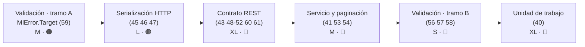

# Versión 2.1.0 · Épicas de ejecución

> **Estado global:** ⬜ Ninguna épica iniciada
> **Origen:** [`Temas Pendientes/Mejoras-Prioridad-Media.md`](../../Temas%20Pendientes/Mejoras-Prioridad-Media.md)
> **Plan maestro del que se desgajan:** [`Temas Pendientes/Plan-Ejecucion-Prioridad-Media.md`](../../Temas%20Pendientes/Plan-Ejecucion-Prioridad-Media.md)

Esta carpeta contiene las **5 épicas** en las que se ha descompuesto la auditoría de los puntos
**38 a 63** de prioridad media. Cada documento es autosuficiente: parte del **código real de hoy**
(con fichero y número de línea), propone el contrato de destino, desglosa historias de usuario con
criterios de aceptación verificables y cierra con un apéndice de ejemplos antes/después.

---

## Índice

1. [Las cinco épicas](#1-las-cinco-épicas)
2. [Orden de ejecución recomendado](#2-orden-de-ejecución-recomendado)
3. [Decisiones pendientes del propietario](#3-decisiones-pendientes-del-propietario)
4. [Rupturas de compatibilidad previstas](#4-rupturas-de-compatibilidad-previstas)
5. [Estructura común de los documentos](#5-estructura-común-de-los-documentos)

---

## 1. Las cinco épicas

| # | Épica | Proyecto principal | Puntos cubiertos | Esfuerzo | Riesgo |
|---|---|---|---|---|---|
| 1 | [Serialización y errores HTTP](Epica-Serializacion-y-Errores-Http.md) | `OOFP.Http` | 45, 46, 47 (+42, 44, 63) | **L** (~1-2 j) | 🟢 / 🟠 |
| 2 | [Contrato REST](Epica-Contrato-Rest.md) | `OOFP.AspNetCore.Controllers` | 43, 48, 49, 50, 51, 52, 60, 61 | **XL** (~3-4 j) | 🔴 |
| 3 | [Servicio y paginación](Epica-Servicio-y-Paginacion.md) | `OOFP.Application` | 41, 53, 54 | **M** (~1 j) | 🔴 |
| 4 | [Validación](Epica-Validacion.md) | `OOFP.Validation*` | 56, 57, 58, 59 | **L** (~1-2 j) | 🟠 |
| 5 | [Unidad de trabajo y transacciones](Epica-Unidad-de-Trabajo-y-Transacciones.md) | `OOFP.EntityFrameworkCore` | 40 | **XL** (~1 semana) | 🔴 |

> **Leyenda de esfuerzo:** XS (<2 h) · S (½ jornada) · M (1 jornada) · L (2 jornadas) · XL (3+ jornadas)
> **Leyenda de riesgo:** 🟢 bajo · 🟡 medio · 🟠 alto · 🔴 muy alto (rompe compatibilidad)

**Total estimado:** ~8-11 jornadas sin la épica 5; ~13-16 jornadas con ella.

---

## 2. Orden de ejecución recomendado

El orden no es arbitrario: la épica de **Validación** introduce `MlError.Target`, y tanto la
serialización HTTP (`ProblemDetails`) como el contrato REST dependen de ese miembro para poder
devolver errores por campo. Por eso se parte en dos tramos.

| Orden | Épica | Por qué va aquí |
|---|---|---|
| 1 | Validación (US-01 · `Target`) | 🎯 Hito habilitante: sin `Target` no hay errores por campo en HTTP |
| 2 | Serialización y errores HTTP | Consume `Target`; fija la forma del error en el borde |
| 3 | Contrato REST | Depende de la forma del error ya estabilizada |
| 4 | Servicio y paginación | Los controladores ya tienen contrato estable al que adaptarse |
| 5 | Validación (resto) | Limpieza que no bloquea a nadie |
| 6 | Unidad de trabajo | Épica independiente y la más larga; se puede paralelizar |

> 💡 **Entrega incremental sugerida:** publicar tras el paso 2 una `2.1.0-preview`, y dejar el paso 3
> (que rompe rutas y firmas públicas) para una `2.1.0` o incluso `3.0.0` según la decisión D-6 del plan.

---

## 3. Decisiones pendientes del propietario

Ninguna épica puede cerrarse sin estas respuestas. Cada documento las detalla en su sección 6
(`D-1`…`D-7`); aquí están las **transversales**, tomadas del plan maestro.

| # | Decisión | Afecta a |
|---|---|---|
| 1 | Punto **40**: ¿entra en `2.0.0` o se aplaza a `2.1.0`? | Unidad de trabajo |
| 2 | Punto **41**: ¿`PageRequest` obligatorio o sobrecarga adicional? | Servicio y paginación |
| 3 | Punto **61**: ¿implementar el `IOperationFilter` o eliminar el atributo? | Contrato REST |
| 4 | Punto **50**: ¿eliminar las sobrecargas o marcarlas `[Obsolete]`? | Contrato REST |
| 5 | Punto **58**: ¿asincronía real o simetría documentada? | Validación |
| 6 | Fase 3 completa: ¿`2.0.0` o `3.0.0`? | Contrato REST |

---

## 4. Rupturas de compatibilidad previstas

> ⚠️ **Obligatorio:** toda ruptura que llegue a implementarse debe quedar documentada en
> `Copilot/.github/prompts/oofp-upgrade-2.prompt.md` (§3.3) y, si es un renombrado, en el anexo
> `.renames.md`.

| Épica | Ruptura principal | ¿La detecta el compilador? |
|---|---|---|
| Validación | `MlError` gana `Target`; la forma de los errores de validación cambia | ⚠️ solo si se consumía la forma concreta |
| Serialización HTTP | El error deja de ser texto plano y pasa a llevar código de estado | ⚠️ parcial |
| Contrato REST | Rutas `id-str/{id}` unificadas; sobrecargas retiradas | ✅ en firmas · ❌ en rutas |
| Servicio y paginación | `GetAllAsync` deja de devolver la colección completa | ✅ |
| Unidad de trabajo | `AddOofpRepositoriesSingleton` pasa a `[Obsolete(error: true)]` | ✅ |

---

## 5. Estructura común de los documentos

Las cinco épicas comparten exactamente el mismo esqueleto, de modo que se puedan leer en cualquier
orden sin reaprender el formato:

| Sección | Contenido |
|---|---|
| Cabecera | Versión destino, origen, plan, estado, esfuerzo y riesgo |
| **1** Contexto y problema | Tabla `Fichero │ Líneas` + código real anotado con `// ← …` + consecuencias |
| **2** Hallazgo colateral | Lo que apareció durante la auditoría y **no** estaba en el punto original |
| **3** Alcance | Qué entra y qué queda explícitamente fuera |
| **4** Historias de usuario | `US-0n` con *Como/quiero/para*, esfuerzo, riesgo, criterios `- [ ]`, API propuesta, notas, tests mínimos y riesgo principal |
| **5** Orden de ejecución | Grafo `mermaid`, tabla de orden con hitos 🎯 y total de jornadas |
| **6** Decisiones abiertas | Tabla `Id │ Decisión │ Opciones │ Recomendación` |
| **7** Definición de terminado | Incluye *compila en `Release --no-incremental` con 0 errores y `CS1591 = 0`* y *los 1.027 tests en verde* |
| **8** Apéndice | Código **Hoy** (fichero + línea) → **Después**, separadores `// ───── 2.0.0 ─────` / `// ───── 2.1.0 ─────` y resumen de rupturas |

> Todo el código de la sección 8 marcado como *"Después"* es **ilustrativo**: fija la intención y el
> contrato, no la implementación definitiva.

---

## Ver también

- [`Temas Pendientes/Plan-Ejecucion-Prioridad-Media.md`](../../Temas%20Pendientes/Plan-Ejecucion-Prioridad-Media.md) · auditoría y plan por fases
- [`Temas Pendientes/Mejoras-Prioridad-Media.md`](../../Temas%20Pendientes/Mejoras-Prioridad-Media.md) · catálogo original de puntos 38-63
- [`Temas Pendientes/Mejoras-Prioridad-Critica-y-Alta.md`](../../Temas%20Pendientes/Mejoras-Prioridad-Critica-y-Alta.md) · puntos 1-37
