# Versión 2.1.0 · Épicas de ejecución

> **Estado global:** ⬜ Ninguna épica iniciada
> **Origen:** [`Temas Pendientes/Mejoras-Prioridad-Media.md`](../../Temas%20Pendientes/Mejoras-Prioridad-Media.md) (puntos 38-63) · [`Temas Pendientes/Mejoras-Prioridad-Baja.md`](../../Temas%20Pendientes/Mejoras-Prioridad-Baja.md) (puntos 64-89)
> **Plan maestro del que se desgajan:** [`Temas Pendientes/Plan-Ejecucion-Prioridad-Media.md`](../../Temas%20Pendientes/Plan-Ejecucion-Prioridad-Media.md)

Esta carpeta contiene las **9 épicas** en las que se ha descompuesto la auditoría de los puntos
**38 a 89**: cinco de prioridad media (38-63) y cuatro de prioridad baja (64-89). Cada documento es
autosuficiente: parte del **código real de hoy** (con fichero y número de línea), propone el
contrato de destino, desglosa historias de usuario con criterios de aceptación verificables y cierra
con un apéndice de ejemplos antes/después.

Los puntos **1-37** (prioridad crítica y alta) y el **objetivo 9** (documentación XML) están
cerrados y no generan épica.

---

## Índice

1. [Las nueve épicas](#1-las-nueve-épicas)
2. [Orden de ejecución recomendado](#2-orden-de-ejecución-recomendado)
3. [Decisiones pendientes del propietario](#3-decisiones-pendientes-del-propietario)
4. [Rupturas de compatibilidad previstas](#4-rupturas-de-compatibilidad-previstas)
5. [Estructura común de los documentos](#5-estructura-común-de-los-documentos)
6. [Cobertura de los puntos del inventario](#6-cobertura-de-los-puntos-del-inventario)

---

## 1. Las nueve épicas

### 1.1 · Prioridad media · puntos 38-63

| # | Épica | Proyecto principal | Puntos cubiertos | Esfuerzo | Riesgo |
|---|---|---|---|---|---|
| 1 | [Serialización y errores HTTP](Epica-Serializacion-y-Errores-Http.md) | `OOFP.Http` | 45, 46, 47 (+42, 44, 63) | **L** (~1-2 j) | 🟢 / 🟠 |
| 2 | [Contrato REST](Epica-Contrato-Rest.md) | `OOFP.AspNetCore.Controllers` | 43, 48, 49, 50, 51, 52, 60, 61 | **XL** (~3-4 j) | 🔴 |
| 3 | [Servicio y paginación](Epica-Servicio-y-Paginacion.md) | `OOFP.Application` | 41, 53, 54 | **M** (~1 j) | 🔴 |
| 4 | [Validación](Epica-Validacion.md) | `OOFP.Validation*` | 56, 57, 58, 59 | **L** (~1-2 j) | 🟠 |
| 5 | [Unidad de trabajo y transacciones](Epica-Unidad-de-Trabajo-y-Transacciones.md) | `OOFP.EntityFrameworkCore` | 40 | **XL** (~1 semana) | 🔴 |

### 1.2 · Prioridad baja · puntos 64-89

| # | Épica | Proyecto principal | Puntos cubiertos | Esfuerzo | Riesgo |
|---|---|---|---|---|---|
| 6 | [Limpieza de código muerto](Epica-Limpieza-Codigo-Muerto.md) | `OOFP.Http` · `AspNetCore.Controllers` · `EntityFrameworkCore` | 64, 68, 69, 70, 85 | **S** (~½-1 j) | 🟢 / 🟠 |
| 7 | [Erratas en identificadores públicos](Epica-Erratas-Identificadores-Publicos.md) | `OOFP.Core` · `ValueObjects` · `Application` | 71, 72, 73, 74, 75, 76 | **M** (~1-2 j) | 🟠 |
| 8 | [Mensajes, idioma e instrumentación de logs](Epica-Mensajes-Y-Localizacion.md) | `OOFP.Validation*` · `AspNetCore.Controllers` · `Application` | 77, 78, 79, 80 | **L** (~2 j) | 🟡 / 🟠 |
| 9 | [Coherencia de contratos y documentación](Epica-Coherencia-Y-Documentacion.md) | `OOFP.Shared` · `Http` · `AspNetCore.Controllers` | 81-89 | **M** (~5-6 j con los `README`) | 🟢 / 🟠 |

> **Leyenda de esfuerzo:** XS (<2 h) · S (½ jornada) · M (1 jornada) · L (2 jornadas) · XL (3+ jornadas)
> **Leyenda de riesgo:** 🟢 bajo · 🟡 medio · 🟠 alto · 🔴 muy alto (rompe compatibilidad)

**Total estimado:**

| Bloque | Jornadas |
|---|---|
| Prioridad media sin la épica 5 | ~8-11 |
| Prioridad media con la épica 5 | ~13-16 |
| Prioridad baja (épicas 6-9) | ~10-12 |
| **Versión 2.1.0 completa** | **~23-28** |

---

## 2. Orden de ejecución recomendado

El orden no es arbitrario: la épica de **Validación** introduce `MlError.Target`, y tanto la
serialización HTTP (`ProblemDetails`) como el contrato REST dependen de ese miembro para poder
devolver errores por campo. Por eso se parte en dos tramos. Las épicas de prioridad baja van
**después**, porque varias de ellas documentan o renombran superficie que las de prioridad media
todavía pueden mover.

```mermaid
graph LR
    V1["Validación · tramo A<br/>MlError.Target (59)<br/>M · 🟠"] --> H["Serialización HTTP<br/>(45 46 47)<br/>L · 🟠"]
    H  --> R["Contrato REST<br/>(43 48-52 60 61)<br/>XL · 🔴"]
    R  --> A["Servicio y paginación<br/>(41 53 54)<br/>M · 🔴"]
    A  --> V2["Validación · tramo B<br/>(56 57 58)<br/>S · 🔴"]
    V2 --> UOW["Unidad de trabajo<br/>(40)<br/>XL · 🔴"]
    UOW --> DM["Código muerto<br/>(64-70 85)<br/>S · 🟢"]
    DM --> ER["Erratas públicas<br/>(71-76)<br/>M · 🟠"]
    ER --> MS["Mensajes y logs<br/>(77-80)<br/>L · 🟡"]
    MS --> CO["Coherencia y doc<br/>(81-89)<br/>M · 🟢"]
```

| Orden | Épica | Por qué va aquí |
|---|---|---|
| 1 | Validación (US-01 · `Target`) | 🎯 Hito habilitante: sin `Target` no hay errores por campo en HTTP |
| 2 | Serialización y errores HTTP | Consume `Target`; fija la forma del error en el borde |
| 3 | Contrato REST | Depende de la forma del error ya estabilizada |
| 4 | Servicio y paginación | Los controladores ya tienen contrato estable al que adaptarse |
| 5 | Validación (resto) | Limpieza que no bloquea a nadie |
| 6 | Unidad de trabajo | Épica independiente y la más larga; se puede paralelizar |
| 7 | Limpieza de código muerto | Borrar antes de renombrar: no tiene sentido renombrar lo que se va a eliminar |
| 8 | Erratas en identificadores públicos | Renombrados con puente `[Obsolete]`; requiere superficie estable |
| 9 | Mensajes y logs | Reescribe textos; mejor cuando las firmas ya no se mueven |
| 10 | Coherencia y documentación | 🎯 Hito final: documenta el estado definitivo, no uno intermedio |

> 💡 **Entrega incremental sugerida:** publicar tras el paso 2 una `2.1.0-preview`, y dejar el paso 3
> (que rompe rutas y firmas públicas) para una `2.1.0` o incluso `3.0.0` según la decisión D-6 del plan.
>
> 💡 **Atajo de bajo riesgo:** las épicas 6 y 9 contienen unas ~3 jornadas de trabajo 🟢 (borrado de
> código muerto, `[Range]` imposibles, `[ProducesResponseType]`, `README` que faltan) que se pueden
> adelantar en cualquier momento sin tocar ninguna firma pública.

---

## 3. Decisiones pendientes del propietario

Ninguna épica puede cerrarse sin estas respuestas. Cada documento las detalla en su sección 6
(`D-1`…`D-7`); aquí están las **transversales**.

### 3.1 · Prioridad media

| # | Decisión | Afecta a |
|---|---|---|
| 1 | Punto **40**: ¿entra en `2.0.0` o se aplaza a `2.1.0`? | Unidad de trabajo |
| 2 | Punto **41**: ¿`PageRequest` obligatorio o sobrecarga adicional? | Servicio y paginación |
| 3 | Punto **61**: ¿implementar el `IOperationFilter` o eliminar el atributo? | Contrato REST |
| 4 | Punto **50**: ¿eliminar las sobrecargas o marcarlas `[Obsolete]`? | Contrato REST |
| 5 | Punto **58**: ¿asincronía real o simetría documentada? | Validación |
| 6 | Fase 3 completa: ¿`2.0.0` o `3.0.0`? | Contrato REST |

### 3.2 · Prioridad baja

| # | Decisión | Afecta a |
|---|---|---|
| 7 | ¿Se eliminan los constructores con `ILogger` o se mantienen con puente? | Código muerto |
| 8 | ¿Los renombrados de erratas llevan puente `[Obsolete]` o se rompen en seco? | Erratas públicas |
| 9 | ¿Los mensajes al usuario quedan en inglés, en español o localizados con `IStringLocalizer`? | Mensajes y logs |
| 10 | ¿`Headers` pasa a `IReadOnlyDictionary` (ruptura) o solo se le quita el `null!`? | Coherencia y doc |
| 11 | ¿Los 11 proyectos de test llevan `README.md` propio o uno agregado en `docs/`? | Coherencia y doc |

---

## 4. Rupturas de compatibilidad previstas

> ⚠️ **Obligatorio:** toda ruptura que llegue a implementarse debe quedar documentada en
> [`Copilot/.github/prompts/oofp-upgrade-2.prompt.md`](../../Copilot/.github/prompts/oofp-upgrade-2.prompt.md)
> (§3.3) y, si es un renombrado, en el anexo
> [`oofp-upgrade-2.renames.md`](../../Copilot/.github/prompts/oofp-upgrade-2.renames.md).

| Épica | Ruptura principal | ¿La detecta el compilador? |
|---|---|---|
| Validación | `MlError` gana `Target`; la forma de los errores de validación cambia | ⚠️ solo si se consumía la forma concreta |
| Serialización HTTP | El error deja de ser texto plano y pasa a llevar código de estado | ⚠️ parcial |
| Contrato REST | Rutas `id-str/{id}` unificadas; sobrecargas retiradas | ✅ en firmas · ❌ en rutas |
| Servicio y paginación | `GetAllAsync` deja de devolver la colección completa | ✅ |
| Unidad de trabajo | `AddOofpRepositoriesSingleton` pasa a `[Obsolete(error: true)]` | ✅ |
| Código muerto | Cambian firmas de constructor público (parámetro `ILogger`) | ✅ |
| Erratas públicas | `TryMapIAsyncf`, `…Alwais…`, `…Lenght…`, `Bydouble`, `TEnumrableResponse` renombrados | ⚠️ advertencia con puente `[Obsolete]` |
| Mensajes y logs | Cambia el **texto** de los mensajes de error y validación | ❌ no — rompe aserciones de tests y consumidores que comparan texto |
| Coherencia y doc | `[Range]` empieza a validar de verdad · `Headers` cambia de tipo · Swagger pasa de `200` a `204` | ❌ en `[Range]` y Swagger · ✅ en `Headers` |

> Las rupturas marcadas con ❌ son las **más peligrosas**: no hay error ni advertencia que avise al
> consumidor, así que necesitan entrada destacada en la guía de migración.

---

## 5. Estructura común de los documentos

Las nueve épicas comparten exactamente el mismo esqueleto, de modo que se puedan leer en cualquier
orden sin reaprender el formato:

| Sección | Contenido |
|---|---|
| Cabecera | Versión destino, origen, plan, estado, esfuerzo y riesgo |
| **1** Contexto y problema | Tabla `Punto │ Fichero │ Líneas │ Naturaleza` + código real anotado con `// ← …` + consecuencias |
| **2** Hallazgos colaterales | Lo que apareció durante la auditoría y **no** estaba en el punto original |
| **3** Alcance | Qué entra y qué queda explícitamente fuera |
| **4** Historias de usuario | `US-0n` con *Como/quiero/para*, esfuerzo, riesgo, criterios `- [ ]`, API propuesta, notas, tests mínimos y riesgo principal |
| **5** Orden de ejecución | Grafo `mermaid`, tabla de orden con hitos 🎯 y total de jornadas |
| **6** Decisiones abiertas | Tabla `Id │ Decisión │ Opciones │ Recomendación` |
| **7** Definición de terminado | Incluye *compila en `Release --no-incremental` con 0 errores y `CS1591 = 0`* y *los 1.060 tests en verde* |
| **8** Apéndice | Código **Hoy** (fichero + línea) → **Después**, separadores `// ───── 2.0.0 ─────` / `// ───── 2.1.0 ─────` y resumen de rupturas |

> Todo el código de la sección 8 marcado como *"Después"* es **ilustrativo**: fija la intención y el
> contrato, no la implementación definitiva.

---

## 6. Cobertura de los puntos del inventario

Los **52 puntos** de prioridad media y baja (38-89) están cubiertos. La tabla resuelve también los
puntos que la auditoría encontró **ya resueltos** en la 2.0.0 y los que se han **reubicado** porque
el tipo que citaban se renombró.

| Puntos | Épica | Observación |
|---|---|---|
| 38, 39 | — | ✅ Resueltos en la 2.0.0 |
| 40 | [Unidad de trabajo](Epica-Unidad-de-Trabajo-y-Transacciones.md) | |
| 41, 53, 54 | [Servicio y paginación](Epica-Servicio-y-Paginacion.md) | |
| 42, 44, 45, 46, 47, 63 | [Serialización y errores HTTP](Epica-Serializacion-y-Errores-Http.md) | 42, 44 y 63 entran como colaterales |
| 43, 48, 49, 50, 51, 52, 60, 61 | [Contrato REST](Epica-Contrato-Rest.md) | |
| 55, 62 | — | ✅ Resueltos en la 2.0.0 |
| 56, 57, 58, 59 | [Validación](Epica-Validacion.md) | |
| 64, 68, 69, 70 | [Código muerto](Epica-Limpieza-Codigo-Muerto.md) | |
| 65, 66, 67 | [Código muerto](Epica-Limpieza-Codigo-Muerto.md) | ✅ Resueltos en la 2.0.0; citados para dejar constancia |
| 71, 72, 73, 74, 75, 76 | [Erratas públicas](Epica-Erratas-Identificadores-Publicos.md) | |
| 77, 78, 79, 80 | [Mensajes y logs](Epica-Mensajes-Y-Localizacion.md) | |
| 81, 82, 83, 84, 86, 87, 89 | [Coherencia y documentación](Epica-Coherencia-Y-Documentacion.md) | 82, 84, 86 y 89 **reubicados**: los tipos citados se renombraron en 2.0.0 |
| 85 | [Código muerto](Epica-Limpieza-Codigo-Muerto.md) · [Coherencia y doc](Epica-Coherencia-Y-Documentacion.md) | ✅ Resuelto en la 2.0.0; citado en las dos épicas |
| 88 | [Coherencia y documentación](Epica-Coherencia-Y-Documentacion.md) | ✅ Resuelto: 0 `global using` duplicados en 27 ficheros |

---

## Ver también

- [`Temas Pendientes/Plan-Ejecucion-Prioridad-Media.md`](../../Temas%20Pendientes/Plan-Ejecucion-Prioridad-Media.md) · auditoría y plan por fases
- [`Temas Pendientes/Mejoras-Prioridad-Media.md`](../../Temas%20Pendientes/Mejoras-Prioridad-Media.md) · catálogo original de puntos 38-63
- [`Temas Pendientes/Mejoras-Prioridad-Baja.md`](../../Temas%20Pendientes/Mejoras-Prioridad-Baja.md) · catálogo original de puntos 64-89
- [`Temas Pendientes/Mejoras-Prioridad-Critica-y-Alta.md`](../../Temas%20Pendientes/Mejoras-Prioridad-Critica-y-Alta.md) · puntos 1-37
- [`Temas Pendientes/Profesionalizacion-Ingenieria-y-Calidad.md`](../../Temas%20Pendientes/Profesionalizacion-Ingenieria-y-Calidad.md) · analizadores, `.editorconfig` y calidad transversal
- [`Copilot/.github/prompts/oofp-upgrade-2.prompt.md`](../../Copilot/.github/prompts/oofp-upgrade-2.prompt.md) · §3.3, registro de rupturas de compatibilidad
