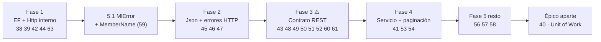

# Plan de ejecución · 🟡 Mejoras de prioridad media (puntos 38-63)

> 📌 **Qué es este documento**
> Resultado de la **auditoría del código real** (rama `release/2.0.0-nomenclatura`, commit `9ffd376`) frente a
> [`Mejoras-Prioridad-Media.md`](Mejoras-Prioridad-Media.md), más el **plan de ejecución** de lo que queda.
>
> ⚠️ El documento original se redactó **antes del renombrado 2.0.0**, por lo que sus nombres de
> proyecto, clase y miembro ya no existen. La tabla de traducción está en el apéndice A.

---

## Índice

- [1. Resumen de la auditoría](#1-resumen-de-la-auditoría)
- [2. Veredicto punto por punto](#2-veredicto-punto-por-punto)
- [3. Plan de ejecución](#3-plan-de-ejecución)
- [Apéndice A · Traducción de nomenclatura](#apéndice-a--traducción-de-nomenclatura)

---

## 1. Resumen de la auditoría

| Estado | Puntos | Nº |
|---|---|---:|
| ✅ **Resuelto** | 55, 62 | **2** |
| 🟨 **Parcial** (resuelto a medias, normalmente de forma colateral por el renombrado) | 41, 47, 51, 60, 63 | **5** |
| ⬜ **Pendiente** | 38, 39, 40, 42, 43, 44, 45, 46, 48, 49, 50, 52, 53, 54, 56, 57, 58, 59, 61 | **19** |

**Conclusión:** el renombrado 2.0.0 cerró de rebote 2 puntos y mejoró 5, pero **ninguno de los problemas
de fondo** (rendimiento de EF Core, liberación de recursos HTTP, contrato OpenAPI) se ha tocado.

---

## 2. Veredicto punto por punto

### Rendimiento y acceso a datos (38-44)

| # | Estado | Dónde está hoy | Evidencia |
|---|---|---|---|
| 38 | ⬜ | `EntityFrameworkCore/Repositories.Imperative/ThrowingEfReadRepository.cs` | L44 `.Where(filter).AsEnumerable().LastOrDefault()`; L47 `(await …ToListAsync(token)).LastOrDefault()` |
| 39 | ⬜ | `EntityFrameworkCore/Repositories/EfUpdateRepository.cs` | L63 `TryFind(pk)` (rastrea) + L65 `Update(item)` (otra instancia) |
| 40 | ⬜ | `EntityFrameworkCore/Repositories.Imperative/ThrowingEf{Create,Delete,Update}Repository.cs` | **12 llamadas** a `SaveChanges`/`SaveChangesAsync`; no existe `IMlUnitOfWork` |
| 41 | 🟨 | `Application/Services/CrudServiceFp.cs` | Renombrado a `GetPagedAsync` pero L33 y L328 hacen `TryAllAsync(ct)`: **el nombre promete paginación y no pagina**. `PageRequest` con `MaxPageSize = 1000` ya existe en `Shared/Pagination` y `EfPagedReadRepository.TryAllPagination` también → solo falta conectarlos |
| 42 | ⬜ | `Http/HttpApiInvoker.cs` | 9 `new HttpRequestMessage` sin `using` (L31, 89, 139, 166, 193, 221, 247, 486, 527); 7 respuestas sin liberar; `response.Dispose()` **comentado** en L310 |
| 43 | ⬜ | `AspNetCore.Controllers/Helpers/Extensions.cs` | L143 `var sample = Activator.CreateInstance<TEntity>();` |
| 44 | ⬜ | `Http/HttpApiInvoker.cs` | L329 serializa y **descarta** el resultado; L333 vuelve a serializar con `PostAsJsonAsync` |

### Diseño de API y contratos (45-52)

| # | Estado | Dónde está hoy | Evidencia |
|---|---|---|---|
| 45 | ⬜ | `Http/Requests/ApiCallOptions.cs` (L11), `PagedApiCallOptions.cs` (L16) | Ninguno expone `JsonSerializerOptions`; `HttpApiInvoker` L138 y L311 usan los valores por defecto |
| 46 | ⬜ | `Http/Helpers/MlResponseWebExtensions.cs` | L70 `Código de error: {(int)response.StatusCode}` → estado embebido en texto, no en `Details` |
| 47 | 🟨 | `Http/IRestClientFp.cs` | `GetApiInvoker()` **ya está** en la interfaz (L44, L116). Faltan `GetClientName()` y los 2 `[Obsolete]`; `GetAsync<T>`/`GetPagedAsync<T>` no están en `IHttpApiInvoker`. No hay `PublicApiAnalyzers` |
| 48 | ⬜ | `Http/RestClientFp.cs`, `AspNetCore.Controllers/…CrudControllerBase.cs` | L51 `$"id-str/{idStr}"` (GET) vs L89 `idStr` crudo (PUT); `dto:` (L81) vs `dtoRequest:` (L224) |
| 49 | ⬜ | Las 4 bases de controlador | `[HttpGet("id-str/{id}")]` vs `[HttpPut("{id}")]` / `[HttpDelete("{id}")]` |
| 50 | ⬜* | Sobrecargas de `Put`/`Delete` de las 4 bases | *Matiz:* reciben el **DTO completo** en `[FromBody]` (L96, 129, 239, 272), no un parámetro de clave suelto. El riesgo del `DELETE` con cuerpo se mantiene |
| 51 | 🟨 | Las 4 bases | **Ya son `abstract`** (resuelto de rebote). Siguen con `[ApiController]` en la base y ninguna declara `[Route]` (correcto: lo pone la derivada). Falta el test de que no aparecen en el catálogo de endpoints |
| 52 | ⬜ | Todo `AspNetCore.Controllers` | **0 `[ProducesResponseType]` y 0 `[Produces]`** |

### Comportamiento y coherencia funcional (53-63)

| # | Estado | Dónde está hoy | Evidencia |
|---|---|---|---|
| 53 | ⬜ | `Application/Services/CrudServiceFp.cs` | L271 y L568 `.MapAsync(_ => dto.Adapt<TEntity>())`. Admiten `initialMessage`/`failMessageBuilder` pero **no** factoría de mensaje de éxito. Recuento: **16 `MapAsync` vs 6 `TryMapAsync`** |
| 54 | ⬜ | `Application/Services/CrudServiceFp.cs` | L438 y L521 usan `typeof(TEntity).Name`; L539, L547, L548, L584 describen lo mismo con `typeof(TResponse).Name` |
| 55 | ✅ | `Shared/Web/MlPaginationHeaders.cs` | L11 `PageNumber = "X-Page-Number"`, L15 `PageSize = "X-Page-Size"`; consumidas por `Http` (L72) y `AspNetCore.Results` (L68). Los literales restantes están solo en tests |
| 56 | ⬜ | `Validation/IMlSelfValidatable.cs` L14, `MlSelfValidatable.Obsolete.cs` L11 | Renombrado a `IMlSelfValidatable<T>` / `MlSelfValidatable<T>`, ambos `where T : class`: **sigue sin restricción de tipo propio** |
| 57 | ⬜ | `Validation.DataAnnotations/Helpers/Extensions.cs` | L22 `new ValidationContext(source, null, null)`; la clase es `DataAnnotationsValidator` |
| 58 | ⬜ | `Validation.DataAnnotations/DataAnnotationsValidator.cs` | L28 y L57 `ValidateSource(source).ToAsync()`. *Matiz:* las sobrecargas con entrada `Task` sí hacen `await` (L38, L67) |
| 59 | ⬜ | `Validation.DataAnnotations/Helpers/Extensions.cs` | L39 `valResults.Select(x => x.ErrorMessage)` descarta `MemberNames`; L40 mantiene `errors!`. `MlError` (`Core/Types/Errors/MlError.cs` L17) solo tiene `Message` |
| 60 | 🟨 | `AspNetCore.Controllers/Helpers/Extensions.cs` | L119 sigue con `ids.Split(',')` sin decodificar, **pero L145 ya valida el número de componentes** (`if (values.Length != sampleP.Length) throw`) |
| 61 | ⬜ | `AspNetCore.Controllers/Attributes/CompositeKeyParameterAttribute.cs` L12 | Renombrado, se aplica en 12 sitios (6 en `MlCompositeKeyCrudControllerBase`, 6 en `MlCachedCompositeKeyCrudControllerBase`) y **nada lo lee**: sin `IOperationFilter`/`ISchemaFilter`/`IDocumentFilter` |
| 62 | ✅ | `Http/RegisterServices.cs` | L67 `AddCompositeKeyRestClient<TService,TImplementation,TDto>` existe y L83 registra también `IRestClientFp<TDto>`. Los 4 helpers cubren simple y dúplex |
| 63 | 🟨 | `Http/Helpers/MlHttpRequestExtensions.cs` | L134 y L160: `nameof` apunta al parámetro equivocado ⬜. `TrySetHeaders` valida `request` pero **no la colección** antes del `foreach` (L163) ⬜. `Async` simulados vía `ToAsync()` (L180) ⬜. **Mensajes en inglés: ya correctos** ✅ |

---

## 3. Plan de ejecución

### Criterio de ordenación

1. **Primero lo que rompe en producción** (corrupción/excepciones) aunque esté clasificado como medio.
2. **Después los agrupados por proyecto**, para no abrir y cerrar el mismo fichero cinco veces.
3. **Los *breaking changes* al final de cada lote**, y todos ellos dentro de la misma versión mayor (2.0.0) para no pagar dos roturas.

### Fase 1 · Correcciones sin ruptura de contrato — `EntityFrameworkCore` + `Http`

> Todo esto es interno: el contrato público no cambia. Se puede entrar sin discusión de diseño.

| Orden | Puntos | Tarea | Esfuerzo | Riesgo |
|---:|---|---|---|---|
| 1.1 | **39** | `TryUpdate(item, pk)`: `Find` + `Entry(found).CurrentValues.SetValues(item)` en vez de `Update(item)`. Una sola estrategia en los 2 repositorios | S | 🟢 bajo |
| 1.2 | **38** | `TryGetLast*`: exigir `IOrderedQueryable` u `orderBy` explícito y resolver con `OrderByDescending(...).FirstOrDefaultAsync()` | S | 🟡 cambia la firma |
| 1.3 | **42** | `using` en las 9 peticiones y 7 respuestas de `HttpApiInvoker`; **descomentar/arreglar** el `Dispose()` de L310 cuidando no leer el contenido después | M | 🟡 riesgo de *stream* ya consumido |
| 1.4 | **44** | Eliminar la serialización muerta de L329 o usarla para construir el `StringContent` (se solapa con 45) | XS | 🟢 bajo |
| 1.5 | **63** | `nameof` correctos en L134/L160 + guarda de nulos de la colección antes del `foreach` de L163 | XS | 🟢 bajo |

**Entregable:** build + los 1.027 tests en verde. Punto 63 queda cerrado salvo el sufijo `Async` (ver 3.5).

### Fase 2 · Serialización y errores HTTP — `Http`

| Orden | Puntos | Tarea | Esfuerzo | Riesgo |
|---:|---|---|---|---|
| 2.1 | **45** | `JsonSerializerOptions` en `ApiCallOptions`/`PagedApiCallOptions` (+ opciones del cliente), **una sola instancia reutilizada**, y propagarlas a los 2 puntos de serialización y al `ReadFromJsonAsync` | M | 🟢 aditivo |
| 2.2 | **46** | Mover `HttpStatusCode` y URL a los `Details` de `MlError` con claves constantes; dejar el texto solo para humanos | M | 🟠 cambia la forma del error |
| 2.3 | **47** | Decidir uno por uno: `GetClientName()` → subir a `IRestClientFp`; los 2 `[Obsolete]` → dejarlos fuera; `GetAsync<T>`/`GetPagedAsync<T>` → subir a `IHttpApiInvoker`. Después **congelar con `PublicApiAnalyzers`** (`PublicAPI.Shipped.txt`) | M | 🟠 amplía interfaces |

> 💡 **2.2 depende de 59**: si se añade `Target`/`MemberName` a `MlError` (punto 59), conviene diseñar *a la vez* la forma definitiva de `MlError.Details` y hacer un solo cambio.

### Fase 3 · Contrato REST — `AspNetCore.Controllers` (⚠️ *breaking change*)

> Los 5 puntos tocan las **mismas 4 clases base**. Hay que hacerlos **en un solo golpe** y publicarlos juntos.

| Orden | Puntos | Tarea | Esfuerzo | Riesgo |
|---:|---|---|---|---|
| 3.1 | **49 + 48** | Un único patrón de ruta para los 4 verbos: eliminar el segmento `id-str/` del `GET` (o aplicarlo a todos) y unificar los nombres de parámetro (`dto:` / `dtoRequest:`) entre simple y dúplex | M | 🔴 rompe URLs |
| 3.2 | **50** | Retirar (o marcar `[Obsolete]`) las sobrecargas de `PUT`/`DELETE` con cuerpo; clave siempre en la ruta | S | 🔴 rompe clientes |
| 3.3 | **52** | `[Produces("application/json")]` + `[ProducesResponseType]` para 200/201/204/400/404/500 en los 4 bases. Cambiar el retorno de `Task<IActionResult>` a `Task<ActionResult<TDto>>` donde aplique | M | 🟡 mejora OpenAPI |
| 3.4 | **61** | Implementar el `IOperationFilter` que lea `CompositeKeyParameterAttribute` **o eliminar el atributo**. Decisión de producto: si no se va a implementar, borrarlo (12 usos) | M | 🟡 |
| 3.5 | **43 + 60** | Sustituir `Activator.CreateInstance<TEntity>()` por los tipos del modelo EF (`IEntityType.FindPrimaryKey()`) **cacheados**; separador de clave compuesta documentado + `Uri.UnescapeDataString` | L | 🟡 |
| 3.6 | **51** | Quitar `[ApiController]` de las bases (que lo ponga la derivada) + test que verifique que las bases no aparecen en el catálogo de endpoints | S | 🟢 |

**Entregable:** tabla de equivalencias simple ↔ dúplex en el README + prueba paramétrica que recorra ambas familias verificando la URL generada (lo pedía el punto 48).

### Fase 4 · Servicio y paginación — `Application` + `EntityFrameworkCore`

| Orden | Puntos | Tarea | Esfuerzo | Riesgo |
|---:|---|---|---|---|
| 4.1 | **41** | **Conectar lo que ya existe**: `GetPagedAsync` debe recibir `PageRequest` y llamar a `EfPagedReadRepository.TryAllPagination`, no a `TryAllAsync`. Si se quiere conservar el "traer todo", que sea otro método explícito y documentado como avanzado | M | 🔴 cambia la firma |
| 4.2 | **53** | `MapAsync` → `TryMapAsync` en los 2 borrados por DTO (L271, L568) + factoría de mensaje de éxito. Revisar si alguno de los otros 14 `MapAsync` debería ser `TryMapAsync` | S | 🟢 |
| 4.3 | **54** | Criterio único: **`TResponse` hacia el cliente, `TEntity` solo en logs**. Normalizar L438, L521 y los 7 usos de `TResponse` | S | 🟡 cambia textos (ojo a tests que comparen mensajes) |
| 4.4 | **40** | `IMlUnitOfWork.CommitAsync()` o `TryExecuteInTransactionAsync(...)`; separar el marcado del guardado en los 12 puntos de `SaveChanges` | **XL** | 🔴 rediseño |

> ⚠️ **4.4 es el punto más caro del documento.** Es un rediseño del modelo de persistencia, no un arreglo.
> Recomendación: **sacarlo de este lote** y tratarlo como un épico propio (candidato a 2.1.0), porque
> condiciona la firma de todos los repositorios y servicios.

### Fase 5 · Validación — `Validation` + `Validation.DataAnnotations`

| Orden | Puntos | Tarea | Esfuerzo | Riesgo |
|---:|---|---|---|---|
| 5.1 | **59** | Añadir `MemberName`/`Target` a `MlError` y dejar de descartar `MemberNames` (L39); eliminar el `errors!` validando la colección | M | 🟠 toca `Core` |
| 5.2 | **57** | `IServiceProvider` opcional + diccionario de `Items` en el `ValidationContext` (L22) | S | 🟢 aditivo |
| 5.3 | **56** | Restricción de tipo propio `where T : IMlSelfValidatable<T>` (+ `static abstract` para las factorías, ya disponible en net8.0) | S | 🔴 rompe derivadas existentes |
| 5.4 | **58** | Decidir: hacerlos realmente asíncronos o **documentar que existen solo por simetría de composición**. Es lo más probable: entonces basta XML doc + un analizador que impida nuevos `*Async` sin `await` | S | 🟢 |

> 💡 **5.1 debe ir antes que 2.2**, o diseñarse con él: ambos cambian `MlError`.

### Orden global recomendado

### Estimación agregada

| Fase | Puntos que cierra | Esfuerzo | Breaking change |
|---|---|---|---|
| 1 | 38, 39, 42, 44, 63 | ~1-2 días | No (salvo firma de `TryGetLast`) |
| 2 | 45, 46, 47 | ~1-2 días | Sí, menor |
| 3 | 43, 48, 49, 50, 51, 52, 60, 61 | ~3-4 días | **Sí, mayor** |
| 4 (sin 40) | 41, 53, 54 | ~1 día | Sí, menor |
| 5 | 56, 57, 58, 59 | ~1-2 días | Sí, menor |
| Épico 40 | 40 | **~1 semana+** | **Sí, mayor** |

**Total sin el punto 40: ~8-11 días.** El punto 40 duplica el coste por sí solo.

### Decisiones que requieren tu confirmación

1. **Punto 40 (unidad de trabajo):** ¿se aborda en 2.0.0 o se posterga a 2.1.0 como épico?
2. **Punto 41:** ¿`GetPagedAsync` pasa a exigir `PageRequest` (rompe) o se añade una sobrecarga nueva?
3. **Punto 61:** ¿se implementa el `IOperationFilter` de OpenAPI o **se elimina** `CompositeKeyParameterAttribute`?
4. **Punto 50:** ¿se eliminan las sobrecargas con cuerpo o se marcan `[Obsolete]` durante un ciclo?
5. **Punto 58:** ¿asincronía real o se documenta como simetría de composición?
6. **Fase 3:** al ser *breaking*, ¿entra completa en 2.0.0 antes de publicar, o se publica 2.0.0 y se deja para 3.0.0?

---

## Apéndice A · Traducción de nomenclatura

### Proyectos

| En `Mejoras-Prioridad-Media.md` | Proyecto real hoy |
|---|---|
| `MoralesLarios.OOFP.EFCore` | `MoralesLarios.OOFP.EntityFrameworkCore` |
| `MoralesLarios.OOFP.WebServices` | `MoralesLarios.OOFP.Application` |
| `MoralesLarios.OOFP.HttpClients` | `MoralesLarios.OOFP.Http` |
| `MoralesLarios.OOFP.WebControllers` | `MoralesLarios.OOFP.AspNetCore.Controllers` |
| `MoralesLarios.OOFP.WebControllers.Cache` | `MoralesLarios.OOFP.AspNetCore.Controllers.OutputCaching` |
| `MoralesLarios.OOFP.WebApi` | `MoralesLarios.OOFP.AspNetCore.Results` |
| `MoralesLarios.OOFP.Validation.Dataannotations` | `MoralesLarios.OOFP.Validation.DataAnnotations` |
| `MoralesLarios.OOFP.Validation.FluentValidations` | `MoralesLarios.OOFP.Validation.FluentValidation` |
| `MoralesLarios.OOFP.ValueObjects.IO` | `MoralesLarios.OOFP.ValueObjects.FileSystem` |
| `MoralesLarios.OOFP.Internals` | fusionado en `MoralesLarios.OOFP.Shared` |

> 🧹 Las 9 carpetas con el nombre antiguo **siguen en disco pero solo contienen `bin/` y `obj/`**
> (0 ficheros `.cs`) y **no están en el `.sln`**. Son residuos locales de compilación: candidatas a borrado.

### Tipos y miembros

| Antiguo | Actual |
|---|---|
| `EFRepoReaderFp` | `EfReadRepository` → delega en `ThrowingEfReadRepository` |
| `EFRepoUpdaterFp` | `EfUpdateRepository` → delega en `ThrowingEfUpdateRepository` |
| `GenServiceFp` | `CrudServiceFp` (variantes de 2 y 3 genéricos) |
| `GenClientFp` / `IGenClientFp` | `RestClientFp` / `IRestClientFp` |
| `GenComplexClientFp` / `IGenComplexClientFp` | `CompositeKeyRestClientFp` / `ICompositeKeyRestClientFp` |
| `MlValidableFp<T>` | `IMlSelfValidatable<T>` / `MlSelfValidatable<T>` |
| `DataannotationsValidator` | `DataAnnotationsValidator` |
| `PkParameterAttribute` | `CompositeKeyParameterAttribute` |
| `MlRequestWebExtensions` | `HttpRequestPaginationExtensions` (en `AspNetCore.Results`) |
| `MlErrorsDetails` | `MlErrorDetails` |
| `TryLast` / `TryLastAsync` | `TryGetLast` / `TryGetLastAsync` |
| `AllAsync` (servicio) | `GetPagedAsync` (⚠️ pese a no paginar) |
| `GetPkValues<TEntity>` | `ParseKeyValues<TEntity>` |
| `InternalPostGetAsync` | `SendAndReadAsync` (en `HttpApiInvoker`) |
| `GetHttpClientFactoryKey()` | `GetClientName()` (el antiguo queda `[Obsolete]`) |

> ℹ️ `MlHttpRequestExtensions` **no se renombró**: sigue en `MoralesLarios.OOFP.Http/Helpers/`.
> No confundirlo con `HttpRequestPaginationExtensions` de `AspNetCore.Results`, que es otra clase
> (lee cabeceras en el lado servidor).

---

## Ver también

- [`Next_Versions/2.1/README.md`](../Next_Versions/2.1/README.md) — **las 5 épicas** en las que se ha desglosado este plan, con historias de usuario y apéndices de código.
- [`Mejoras-Prioridad-Media.md`](Mejoras-Prioridad-Media.md) — enunciado original de los puntos 38-63.
- [`Mejoras-Prioridad-Critica-y-Alta.md`](Mejoras-Prioridad-Critica-y-Alta.md) — puntos 1-37.
- [`Mejoras-Prioridad-Baja.md`](Mejoras-Prioridad-Baja.md) — prioridad 🟢 baja.
- [`Plan-Renombrados-2.0.0.md`](Plan-Renombrados-2.0.0.md) — el renombrado que dejó obsoleta la nomenclatura del documento original.
- [`README.md`](README.md) — índice de la carpeta.
