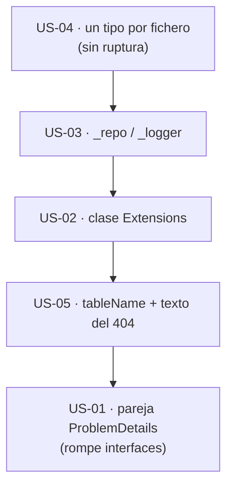

# 01 · Nomenclatura y estándares — `MoralesLarios.OOFP.Application`

> **Proyecto** · `src/MoralesLarios.OOFP.Application`
> **Versión actual** · 2.0.0 · `net8.0`
> **Versión destino** · 2.2.0 (puentes `[Obsolete]`) · retirada en 3.0.0
> **Origen** · análisis profundo de la capa de aplicación, posterior al commit `04b8ee3`
> **Estado** · ⬜ pendiente · documento de análisis, sin cambios aplicados
> **Esfuerzo total** · M (1 jornada) · el renombrado de la pareja `…ProblemDetailsAsync` es el 70 %
> **Riesgo** · 🔴 muy alto el punto 01 (rompe a quien **implemente** `ICrudServiceFp`) · 🟢 el resto

---

## Índice

1. [Contexto y problema](#1-contexto-y-problema)
2. [Alcance](#2-alcance)
3. [Historias de usuario](#3-historias-de-usuario)
4. [Orden de ejecución](#4-orden-de-ejecución)
5. [Decisiones abiertas](#5-decisiones-abiertas)
6. [Definición de terminado](#6-definición-de-terminado)
7. [Apéndice · código actual y propuesto](#7-apéndice--código-actual-y-propuesto)
8. [Ver también](#ver-también)

---

## 1. Contexto y problema

La capa de aplicación expone **59 miembros públicos** en 7 tipos. La nomenclatura de los 20 métodos del
servicio es coherente en su estructura (`GetPagedAsync`, `FindByIdAsync`, `CreateAsync`, `UpdateAsync`,
`DeleteAsync`), pero la pareja de variantes «con mi propio error de no encontrado» usa **dos grafías
distintas**, el único método de extensión público cuelga de una clase sin dominio y se extiende `string`,
y los parámetros del constructor primario llevan guion bajo.

| Punto | Fichero | Líneas | Naturaleza |
|------:|---------|--------|------------|
| **01** | `Services/CrudServiceFp.cs` · `Services/ICrudServiceFp.cs` | `CrudServiceFp.cs:72,236,369,533` · `ICrudServiceFp.cs:40,156,217,238` | ruptura de compilación (incluye a quien implemente la interfaz) |
| **02** | `Helpers/Extensions.cs` · `Helpers/Extensions.Obsolete.cs` | `Extensions.cs:4-6,16` | ruptura de compilación (sólo invocación estática o `using static`) |
| **03** | `Services/CrudServiceFp.cs` | 14-15 · 306-307 | ruptura teórica (sólo argumentos con nombre) |
| **04** | `Services/CrudServiceFp.cs` | 83 · 380 | ninguna (variable local) · **ya planificado** |
| **05** | `Services/CrudServiceFp.cs` · `Services/ICrudServiceFp.cs` | `CrudServiceFp.cs:14,306` · `ICrudServiceFp.cs:13,166` | ninguna (reubicación de ficheros) |
| **06** | `Helpers/Extensions.cs` · `Services/CrudServiceFp.cs` | `Extensions.cs:16` · 57, 141, 224, 354, 438, 521 | ninguna (nombre de parámetro) · mensaje: comportamiento |

> **Todas las cifras de este documento son medidas, no estimadas**, y cada hallazgo se referencia con `fichero:línea`.

---

### Punto 01 — `…ProblemsDetailsAsync` frente a `…ProblemDetailsAsync`

Tres operaciones tienen una variante «con mi propio `MlErrorDetails` de no encontrado». Su nombre sigue
**tres criterios distintos**:

| Operación | Variante con error propio | Grafía |
|-----------|---------------------------|--------|
| Buscar | `FindById`**`ProblemsDetails`**`Async` | *Problems* (plural) |
| Borrar | `Delete`**`ProblemDetails`**`Async` | *Problem* (singular) |
| Actualizar | `UpdateAsync(dto, MlErrorDetails notFoundErrorDetails, …)` | ninguna: sobrecarga sin sufijo |

```csharp
// MoralesLarios.OOFP.Application/Services/CrudServiceFp.cs, L72 y L236
public virtual Task<MlResult<TDto?>> FindByIdProblemsDetailsAsync(MlErrorDetails notFoundErrorDetails, …)
//                                               ^^^^^^^^^^^^^^^^  ← plural
public virtual Task<MlResult<TDto>>  DeleteProblemDetailsAsync   (MlErrorDetails notFoundErrorDetails, …)
//                                           ^^^^^^^^^^^^^^^^^^  ← singular
```

Dos problemas distintos:

1. **Incoherencia de grafía.** Medido: 6 ocurrencias de `FindByIdProblemsDetailsAsync` y 6 de
   `DeleteProblemDetailsAsync` entre las dos clases y las dos interfaces.
2. **El nombre promete algo que no hace.** Ninguna de las dos *genera* un `ProblemDetails`: sólo
   **aceptan** el `MlErrorDetails` que se les pasa para usarlo si la entidad no existe. El propio
   `README.md` del proyecto lo advierte («el nombre es engañoso»).

Además la clave del diccionario de errores se llama `ProblemsDetails` (con *s*,
`Shared/Web/WebErrorDetailsKeys.cs:11`), así que la errata de plural **ha contaminado** el nombre de un
método. Cambiar la clave es **una decisión del proyecto `Shared`** y queda fuera de este documento.

| Aspecto | Valor |
|---------|-------|
| **Ocurrencias** | 4 métodos × 2 (clase + interfaz) · 12 líneas de declaración o uso |
| **Ruptura** | **de compilación**, y además a **cualquiera que implemente `ICrudServiceFp`** (un miembro de interfaz renombrado deja la clase sin implementar) |
| **Puente posible** | ⚠️ parcial · en la clase, el método antiguo `[Obsolete]` reenvía al nuevo; en la **interfaz** sólo sirve un *default interface method* (C# 8, `net8.0` lo admite) que reenvíe al nuevo |
| **Consumidores internos** | ⚠️ **8 llamadas por nombre** en producción: `AspNetCore.Controllers/Controllers/MlCrudControllerBase.cs:47,115,190,258` y `MlCompositeKeyCrudControllerBase.cs:50,130,213,293`, todas con el argumento con nombre `notFoundErrorDetails:` |

---

### Punto 02 — Clase pública `Extensions` y método de extensión sobre `string`

```csharp
// MoralesLarios.OOFP.Application/Helpers/Extensions.cs, L4-6 y L16-18
/// <summary>
/// Métodos de extension de <c></c>.
/// </summary>                                  // ← summary vacío (`<c></c>`), también en Extensions.Obsolete.cs:4
public static partial class Extensions          // ← nombre sin dominio: mismo caso que la US-11 del núcleo
{
    public static MlErrorDetails BuildEntityNotFoundError(this string tableName, params object[] pk)
    //                                                    ^^^^^^^^^^^ ← extensión PÚBLICA sobre `string`
        => MlProblemDetails.NotFoundError(
            detail: $"No data found for the {tableName} table by Id ({pk.FormatCompositeKey()})");
}
```

Tres observaciones:

1. **Nombre de clase sin dominio.** Es el mismo problema que la US-11 resolvió en el núcleo y que
   `Logging` arrastra en su punto 05. Medido: 2 summaries vacíos (`Extensions.cs:4`, `Extensions.Obsolete.cs:4`).
2. **Contamina `string`.** Un método de extensión **público** sobre `string` aparece en IntelliSense de
   **toda** cadena en cualquier proyecto que importe `MoralesLarios.OOFP.Application.Helpers`. Es
   precisamente el patrón que las *Framework Design Guidelines* desaconsejan para tipos del framework.
3. **Una sola superficie, dos formas.** Ya existe `MlProblemDetails.NotFoundError(...)`; el método
   sólo lo envuelve con un mensaje fijo en inglés. Lo natural es una fábrica
   `MlProblemDetails.EntityNotFoundError(string entityName, params object[] pk)`.

| Aspecto | Valor |
|---------|-------|
| **Ocurrencias** | 1 clase (2 ficheros parciales) · 1 método vivo · 1 método `[Obsolete]` |
| **Ruptura** | **de compilación** sólo si se invoca de forma estática o se usa `using static`; como extensión el renombrado de la clase es transparente. Mover el método a `MlProblemDetails` **sí** rompe la llamada `typeof(X).Name.BuildEntityNotFoundError(pk)` |
| **Puente posible** | ✅ sí · patrón ya presente en `Helpers/Extensions.Obsolete.cs` |

---

### Punto 03 — Parámetros del constructor primario con guion bajo

```csharp
// MoralesLarios.OOFP.Application/Services/CrudServiceFp.cs, L14-15 y L306-307
public class CrudServiceFp<TEntity, TDto>(IEfRepository<TEntity>                   _repo,
//                                                                                  ^^^^^^ ← parámetro público con prefijo `_`
                                         ILogger<CrudServiceFp<TEntity, TDto>> _logger) : ICrudServiceFp<TEntity, TDto>
```

Un parámetro de constructor es **público** (forma parte del contrato, p. ej. para argumentos con
nombre). La convención de .NET es `camelCase` sin prefijo; el guion bajo se reserva para campos privados.
En un constructor primario el parámetro **captura** como campo, pero sigue siendo un parámetro.

| Aspecto | Valor |
|---------|-------|
| **Ocurrencias** | 4 (2 por clase) |
| **Ruptura** | **teórica**: sólo rompe `new CrudServiceFp<,>(_repo: x, _logger: y)`. La construcción habitual es por DI |
| **Puente posible** | ❌ no necesario; se acepta la ruptura teórica en una menor |

---

### Punto 04 — `vinoBd`: argot de dominio en una biblioteca genérica

```csharp
// MoralesLarios.OOFP.Application/Services/CrudServiceFp.cs, L83 y L380
.MapAsync (vinoBd => vinoBd?.Adapt<TDto>())
//         ^^^^^^ ← «vino» (ejemplo de dominio del autor) + «Bd» (mezcla español/inglés)
```

Medido: **2** apariciones de `vinoBd` (sensible a mayúsculas). Es una lambda local, sin ruptura.

> ✅ **Ya planificado.** Está recogido en
> [`Epica-Mensajes-Y-Localizacion.md`](../../Next_Versions/2.0.0/Pendientes/Epica-Mensajes-Y-Localizacion.md)
> (líneas 201, 570, 964 y 999) con el nombre propuesto `dbEntity`. **No se repite aquí**; se deja anotado
> para que la épica de nomenclatura lo agrupe con el resto de residuos de dominio.

---

### Punto 05 — Dos tipos públicos por fichero

| Fichero | Tipos | Líneas |
|---------|-------|--------|
| `Services/ICrudServiceFp.cs` | `ICrudServiceFp<TEntity,TDto>` · `ICrudServiceFp<TEntity,TRequest,TResponse>` | 13 · 166 |
| `Services/CrudServiceFp.cs` | `CrudServiceFp<TEntity,TDto>` · `CrudServiceFp<TEntity,TRequest,TResponse>` | 14 · 306 |

```csharp
// MoralesLarios.OOFP.Application/Services/CrudServiceFp.cs, L292-L296
/*********************************************************************************
 *                                      DUPLEX
 * ********************************************************************************/
//   ↑ un banner de comentario sustituye a lo que debería ser un fichero aparte
```

La convención es **un tipo público por fichero**, con el nombre del tipo. Aquí un banner de comentario
hace de separador. Mover cada tipo a su fichero es una reubicación **sin ruptura** (no cambia el
espacio de nombres) y facilita el siguiente punto del [documento 05](05-Superficie-de-API-y-Arquitectura.md)
(extraer una base común).

| Aspecto | Valor |
|---------|-------|
| **Ocurrencias** | 2 ficheros × 2 tipos |
| **Ruptura** | **ninguna** |

---

### Punto 06 — `tableName` recibe nombres de **tipo**, no de tabla

```csharp
// MoralesLarios.OOFP.Application/Services/CrudServiceFp.cs, L57 (simple) · L354 (dúplex) · L438 y L521
notFoundErrorDetails: typeof(TDto).Name.BuildEntityNotFoundError(pk)       // ← «VinoDto»
notFoundErrorDetails: typeof(TResponse).Name.BuildEntityNotFoundError(pk)  // ← «VinoResponse»
notFoundErrorDetails: typeof(TEntity).Name.BuildEntityNotFoundError(pk)    // ← «Vino»
```

El parámetro del método se llama `tableName` (`Extensions.cs:16`) y el mensaje dice
`"No data found for the {tableName} table by Id (…)"`. **Ninguno** de los tres valores es el nombre de una
tabla: son nombres de tipo CLR. Comprobado en ejecución:

```text
Detail = No data found for the ItemDto table by Id (777)      ← «ItemDto» presentado como «table»
```

Medido: **6 llamadas** a `BuildEntityNotFoundError` en `CrudServiceFp.cs` (57, 141, 224 en el modo simple;
354, 438, 521 en el dúplex) con **tres criterios** distintos (`TDto`: 57/141/224; `TResponse`: 354;
`TEntity`: 438/521), y **39** apariciones de `typeof(TDto|TEntity|TResponse).Name` en total en ese fichero.

> ✅ **La inconsistencia de criterio ya está planificada** en
> [`Epica-Servicio-y-Paginacion.md`](../../Next_Versions/2.0.0/Pendientes/Epica-Servicio-y-Paginacion.md)
> (§1 punto 3: «`TResponse` hacia el cliente, `TEntity` sólo en logs»). Aquí sólo se añade el matiz de
> **nombre**: el parámetro y el texto hablan de *tabla* cuando reciben un *tipo*.

| Aspecto | Valor |
|---------|-------|
| **Nombre propuesto del parámetro** | `entityName` (o `typeName`) |
| **Ruptura** | del parámetro: **ninguna práctica** (extensión llamada de forma posicional) · del **texto** del 404: ⚠️ **de comportamiento (silenciosa)**, rompe a quien compare la cadena `"… table by Id"` |

---

## 2. Alcance

**Dentro:**

- Renombrado de `FindByIdProblemsDetailsAsync` y `DeleteProblemDetailsAsync` (y decisión sobre `UpdateAsync` con error propio).
- Renombrado de la clase `Extensions` y decisión sobre dónde vive `BuildEntityNotFoundError`.
- Renombrado de `_repo`/`_logger`.
- Separación de las dos interfaces y las dos clases en ficheros propios.
- Renombrado del parámetro `tableName` y revisión del texto del 404.
- Puentes `[Obsolete]` siguiendo el patrón de `Helpers/Extensions.Obsolete.cs`.

**Fuera:**

- La clave `ProblemsDetails` de `Shared` (otro proyecto).
- `vinoBd` (ya en la épica de mensajes).
- El criterio `TDto`/`TResponse`/`TEntity` de los mensajes (ya en la épica de servicio y paginación).
- Los parámetros opcionales y `params object[] pk` (ver [05](05-Superficie-de-API-y-Arquitectura.md)).

---

## 3. Historias de usuario

> Inventario de intención para el futuro agente de épicas. Sin desarrollar.

### US-01 · Unificar el nombre de la variante con error propio

- [ ] `FindByIdProblemsDetailsAsync` y `DeleteProblemDetailsAsync` adoptan el nombre acordado en [D-01](#5-decisiones-abiertas).
- [ ] Puentes `[Obsolete]` con `EditorBrowsable(Never)` en las dos clases; *default interface methods* en las dos interfaces.
- [ ] Registro en el prompt de migración y en el anexo de renombrados.

### US-02 · Dar dominio a `Extensions` y sacar el método de `string`

- [ ] La clase o el método adoptan el destino acordado en [D-02](#5-decisiones-abiertas); el `<summary>` deja de estar vacío.
- [ ] El método antiguo queda como puente.

### US-03 · Renombrar `_repo` y `_logger`

- [ ] Los 4 parámetros pasan a `repository` y `logger`.

### US-04 · Un tipo por fichero

- [ ] 4 ficheros nuevos; el banner `DUPLEX` desaparece.

### US-05 · Corregir `tableName` y el texto del 404

- [ ] Parámetro renombrado; decisión de texto según [D-03](#5-decisiones-abiertas); si cambia el texto, registrar la **ruptura silenciosa** con su patrón de búsqueda.

---

## 4. Orden de ejecución



**Justificación.** La US-04 no rompe nada y deja listo el terreno. La US-01 va **la última**: es la única
que afecta a implementadores de la interfaz y conviene hacerla con la red de seguridad del
[documento 08](08-Calidad-Pruebas-y-Documentacion.md) ya en pie.

> ⚠️ **Prerrequisito.** Esta épica **no debe empezar** antes de que existan pruebas activas sobre el
> servicio (documento 08, punto 01). Sin ellas no hay forma de demostrar que un renombrado de interfaz no
> ha cambiado ninguna llamada.

---

## 5. Decisiones abiertas

| ID | Decisión | Opciones | Estado |
|----|----------|----------|--------|
| **D-01** | Nombre de la variante con error propio | (a) sobrecarga `FindByIdAsync(MlErrorDetails notFound, …)` y `DeleteAsync(MlErrorDetails notFound, …)` (como ya hace `UpdateAsync`) · (b) `FindByIdOrErrorAsync` / `DeleteOrErrorAsync` · (c) `…WithNotFoundAsync` | ⬜ abierta |
| **D-02** | Destino de `BuildEntityNotFoundError` | (a) renombrar la clase (`MlEntityErrorExtensions`) · (b) mover a `MlProblemDetails.EntityNotFoundError(entityName, pk)` y dejar puente · (c) hacerlo `internal` (rompe a quien lo use) | ⬜ abierta |
| **D-03** | Texto del 404 | (a) mantener en inglés y sólo cambiar el nombre del parámetro · (b) `"{entityName} with key ({pk}) was not found."` (más honesto: no habla de tablas) · (c) localizable vía la épica de mensajes | ⬜ abierta |

> **Sobre D-01 (a).** Una sobrecarga resolvería el nombre **y** alinearía las tres operaciones. Cuidado:
> `FindByIdAsync(CancellationToken ct = default, …, params object[] pk)` y
> `FindByIdAsync(MlErrorDetails notFound, CancellationToken ct = default, …)` pueden ser ambiguas con
> `null`; hay que comprobarlo con una prueba de compilación antes de decidir.

---

## 6. Definición de terminado

- [ ] `dotnet build MoralesLarios.OOFP.sln -c Release --no-incremental` con **0 errores** y **`CS1591` = 0**.
- [ ] Tests de la solución en verde respecto a la línea base medida antes de empezar, más los nuevos del documento 08.
- [ ] `CS0618` = 0 dentro de la solución (los puentes no se usan internamente).
- [ ] **0 ocurrencias** vivas de los nombres antiguos, verificado con búsqueda sensible a mayúsculas.
- [ ] Toda ruptura registrada en
      [`../../Copilot/.github/prompts/oofp-upgrade-2.prompt.md`](../../Copilot/.github/prompts/oofp-upgrade-2.prompt.md)
      (§3.3, subsección de detalle, barrido de la Fase 5, informe de la Fase 6, apéndice de versiones) y, para los renombrados,
      [`../../Copilot/.github/prompts/oofp-upgrade-2.renames.md`](../../Copilot/.github/prompts/oofp-upgrade-2.renames.md).
- [ ] La ruptura **silenciosa** del texto del 404 incluye cómo detectarla (patrón de búsqueda del literal antiguo).
- [ ] Las decisiones `D-01` … `D-03` están resueltas y anotadas.

---

## 7. Apéndice · código actual y propuesto

### 7.1 El puente de la interfaz (punto 01)

```csharp
// MoralesLarios.OOFP.Application/Services/ICrudServiceFp.cs

// ───── 2.0.0 (actual) ─────
Task<MlResult<TDto?>> FindByIdProblemsDetailsAsync(MlErrorDetails notFoundErrorDetails, CancellationToken ct = default, …, params object[] pk);

// ───── 2.2.0 (propuesta, opción D-01 a) ─────
Task<MlResult<TDto?>> FindByIdAsync(MlErrorDetails notFoundErrorDetails, CancellationToken ct = default, …, params object[] pk);

[Obsolete("Renamed to FindByIdAsync. Will be removed in 3.0.0.", false)]
[EditorBrowsable(EditorBrowsableState.Never)]
Task<MlResult<TDto?>> FindByIdProblemsDetailsAsync(MlErrorDetails notFoundErrorDetails, CancellationToken ct = default, …, params object[] pk)
    => FindByIdAsync(notFoundErrorDetails, ct, …, pk);     // ← default interface method: los implementadores antiguos siguen compilando
```

### 7.2 La extensión sobre `string` (punto 02)

```csharp
// ───── 2.0.0 (actual) ─────
public static MlErrorDetails BuildEntityNotFoundError(this string tableName, params object[] pk)
    => MlProblemDetails.NotFoundError(detail: $"No data found for the {tableName} table by Id ({pk.FormatCompositeKey()})");

// ───── 2.2.0 (propuesta, opción D-02 b) ─────
public static MlErrorDetails EntityNotFoundError(string entityName, params object[] pk)   // en MlProblemDetails
    => NotFoundError(detail: $"{entityName} with key ({pk.FormatCompositeKey()}) was not found.");
```

---

## Ver también

- [`README.md`](README.md) — índice de la carpeta.
- [`../Logging/01-Nomenclatura-y-Estandares.md`](../Logging/01-Nomenclatura-y-Estandares.md) — mismo patrón de clase `Extensions` sin dominio.
- [`../../Next_Versions/2.0.0/Pendientes/Epica-Servicio-y-Paginacion.md`](../../Next_Versions/2.0.0/Pendientes/Epica-Servicio-y-Paginacion.md) — criterio `TDto`/`TResponse`/`TEntity`.
- [`../../Next_Versions/2.0.0/Pendientes/Epica-Mensajes-Y-Localizacion.md`](../../Next_Versions/2.0.0/Pendientes/Epica-Mensajes-Y-Localizacion.md) — `vinoBd`.
- [`../../../MoralesLarios.OOFP.Application/README.md`](../../../MoralesLarios.OOFP.Application/README.md) — documentación funcional.
