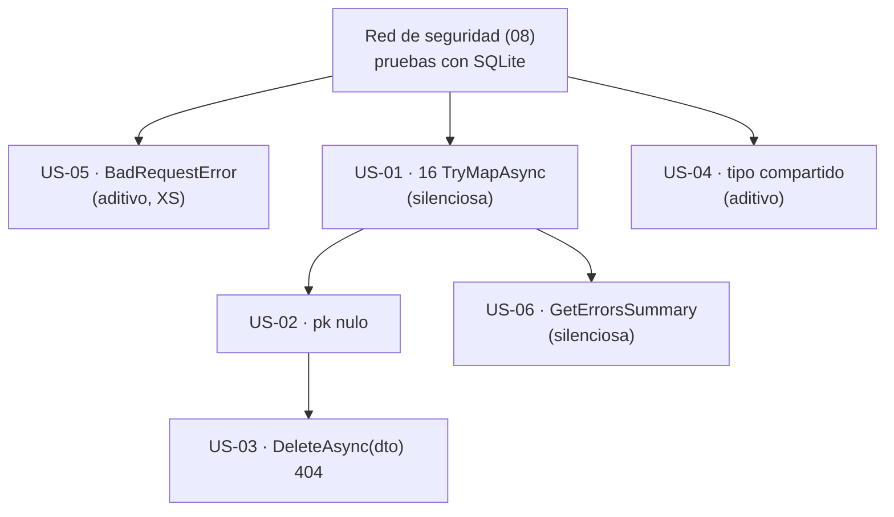

# 03 · Modelo de error — `MoralesLarios.OOFP.Application`

> **Proyecto** · `src/MoralesLarios.OOFP.Application`
> **Versión actual** · 2.0.0 · `net8.0`
> **Versión destino** · 2.1.0 (puntos 05) · 2.2.0 (puntos 01, 02, 03, 04, 06)
> **Origen** · análisis profundo de la capa de aplicación, posterior al commit `04b8ee3`, con comprobación empírica
> **Estado** · ⬜ pendiente · documento de análisis, sin cambios aplicados
> **Esfuerzo total** · L (2 jornadas) · el punto 01 es S, el 03 es M
> **Riesgo** · 🟠 alto · 4 de los 6 puntos son **rupturas silenciosas** (compilan igual, se ejecutan distinto)

---

## Índice

1. [Contexto y problema](#1-contexto-y-problema)
2. [Alcance](#2-alcance)
3. [Historias de usuario](#3-historias-de-usuario)
4. [Orden de ejecución](#4-orden-de-ejecución)
5. [Decisiones abiertas](#5-decisiones-abiertas)
6. [Definición de terminado](#6-definición-de-terminado)
7. [Apéndice · código actual y propuesto](#7-apéndice--código-actual-y-propuesto)
8. [Ver también](#ver-también)

---

## 1. Contexto y problema

La promesa de toda la biblioteca es que **una operación que puede fallar devuelve un `MlResult<T>` y no
lanza**. La capa de aplicación es donde esa promesa se cumple o se rompe de cara al controlador, porque
es el último eslabón antes del borde HTTP. Esta revisión la pone a prueba con un arnés real (SQLite en
memoria) y encuentra que **se rompe en cuatro sitios**.

| Punto | Fichero | Líneas | Naturaleza |
|------:|---------|--------|------------|
| **01** | `Services/CrudServiceFp.cs` | 34, 83, 117, 174, 204, 248, 271, 273, 329, 380, 414, 471, 501, 545, 568, 570 | de comportamiento (silenciosa) · **medido** |
| **02** | `Services/CrudServiceFp.cs` | 57, 79, 141, 224, 354, 376, 438, 521 | de comportamiento · medido en `FindById`, por lectura en el resto |
| **03** | `Services/CrudServiceFp.cs` | 264-280 · 561-577 | de comportamiento · **medido** |
| **04** | `MlProblemDetails.cs` · `AspNetCore.Results/Helpers/MlErrorDetailsExtensions.cs` | `MlProblemDetails.cs:167-190` · `MlErrorDetails…:47,56-61` | aditiva |
| **05** | `MlProblemDetails.cs` | 54, 84 | aditiva · **medido** (`CS0121`) |
| **06** | `Services/CrudServiceFp.cs` | 14 ocurrencias de `errors.ToString()` | de comportamiento (texto del log) |

> **Todas las cifras de este documento son medidas, no estimadas**, y cada hallazgo se referencia con `fichero:línea`.

> ✅ **Ya planificado parcialmente.** Los puntos 01 (sólo 271 y 568) y 02 (sólo los mensajes) aparecen en
> [`Epica-Servicio-y-Paginacion.md`](../../Next_Versions/2.0.0/Pendientes/Epica-Servicio-y-Paginacion.md).
> Esa épica **pide auditar los 16 `MapAsync`**; este documento **entrega esa auditoría** y la evidencia
> empírica. No se duplican las historias de la épica: se referencian.

---

### Punto 01 — 16 `MapAsync` sin protección: la excepción escapa del raíl

`MapAsync(Func<T, TResult>)` **no captura excepciones**; su hermano `TryMapAsync` sí
(`Core/Types/MlResultMapExtensions.cs:118-120` frente a su documentación «Captura cualquier excepción»).
En `CrudServiceFp.cs` hay **16** `.MapAsync(` y **todas** ejecutan `Adapt<…>()` de Mapster, que puede lanzar
(configuración ausente, tipo abstracto, constructor que falla):

| Dirección del mapeo | Nº | Líneas |
|---------------------|---:|--------|
| entidad → DTO (`bdData.Adapt<TDto\|TResponse>()`) | **14** | 34, 83, 117, 174, 204, 248, 273, 329, 380, 414, 471, 501, 545, 570 |
| DTO → entidad (`dto.Adapt<TEntity>()`) | **2** | **271, 568** (los dos `DeleteAsync(dto, …)`) |

Las 2 de DTO → entidad **ya estaban detectadas** (épica de servicio, punto 53 del inventario). **Las 14
de entidad → DTO no**: el `README` del proyecto afirma incluso que «el mapeo va dentro de `TryMapAsync`,
así que un error de Mapster se convierte en `Fail`», lo cual es cierto sólo para las 6 llamadas
DTO → entidad de `Create`/`Update`.

```csharp
// MoralesLarios.OOFP.Application/Services/CrudServiceFp.cs, L107-L123
var result = _logger.LogMlResultInformationAsync(…)
                    .BindAsync  ( _     => EnsureFp.NotNull(dto, $"{nameof(dto)} can't be null"))
                    .TryMapAsync( _     => dto.Adapt<TEntity>())               // ← protegido
                    .BindAsync  (bdData => _repo.TryAddAsync(bdData, token: ct))   // ← la fila YA está en la base de datos
                    .MapAsync   (bdData => bdData.Adapt<TDto>())               // ← SIN protección (L117)
                    .LogCompletedResultAsync(…);                                // ← no se alcanza si lo anterior lanza
```

**Comprobación empírica** (arnés desechable, SQLite en memoria, `Microsoft.EntityFrameworkCore.Sqlite 8.0.3`):

| Prueba | Resultado medido |
|--------|------------------|
| `CreateAsync` con un DTO **abstracto** (Mapster no puede instanciarlo) | `THREW CompileException: Error while compiling` |
| …y comprobación posterior en la base de datos | `row persisted despite exception: True` |
| `DeleteAsync(dto)` con un mapeo configurado para lanzar | `THREW InvalidOperationException: mapping exploded` |
| `CreateAsync(dto)` con **el mismo** mapeo que lanza (camino `TryMapAsync`) | `returned IsSuccess=False` (se convierte en `Fail`) |

Dos consecuencias que van más allá del contrato roto:

1. **Efecto lateral confirmado.** En `CreateAsync`/`UpdateAsync` el `MapAsync` entidad → DTO se ejecuta
   **después** de persistir. Una excepción ahí devuelve un 500 al cliente **con la fila ya creada**; un
   reintento duplica el registro. Es peor que un fallo de validación porque es inconsistente.
2. **Se pierde la traza de salida.** `LogCompletedResultAsync` es el último eslabón y no se alcanza.
   La operación queda sin log de resultado **por construcción**.

| Aspecto | Valor |
|---------|-------|
| **Ocurrencias** | 16 (14 + 2) |
| **Corrección** | `MapAsync` → `TryMapAsync` en las 16 |
| **Ruptura** | ⚠️ **de comportamiento (silenciosa)**: donde hoy hay una excepción pasa a haber un `Fail` con 500. Un `catch` en el consumidor deja de ejecutarse |
| **Registro obligatorio** | sí · patrón de detección: `MapAsync\s*\(` sobre `Adapt<` en `CrudServiceFp.cs` |

---

### Punto 02 — `pk` nulo: `ArgumentNullException` fuera del raíl

Las variantes cortas calculan el error de «no encontrado» **antes** de entrar en la cadena, y ese cálculo
usa `pk`:

```csharp
// MoralesLarios.OOFP.Application/Services/CrudServiceFp.cs, L50-L58 y L79
public virtual Task<MlResult<TDto?>> FindByIdAsync(CancellationToken ct = default!, …, params object[] pk)
    => FindByIdProblemsDetailsAsync(ct: ct, …,
                     notFoundErrorDetails: typeof(TDto).Name.BuildEntityNotFoundError(pk),   // ← L57: se evalúa ANTES de llamar
                     …);

// L79
var result = _logger.LogMlResultInformationAsync(initialMessage ?? $"Querying data from the {typeof(TDto).Name} table by Id ({pk.FormatCompositeKey()})")
//                                                                                                                   ^^^^^^^^^^^^^^^^^^^^^ ← también eager
```

`FormatCompositeKey` hace `source.Count()` (`EntityFrameworkCore/Helpers/Extensions.cs:22`), que lanza
`ArgumentNullException` con `null`.

**Comprobación empírica:**

| Prueba | Resultado medido |
|--------|------------------|
| `FindByIdAsync(…, pk: (object[])null)` | `THREW ArgumentNullException` |
| `FindByIdAsync(…, pk: new object[0])` | `IsSuccess=False` (cae en `Fail`, no lanza) |
| `FindByIdAsync(…, 12345)` (no existe) | `IsSuccess=False` con `Status = 404` ✅ |

El mismo patrón se repite por lectura en `UpdateAsync` (L141) y `DeleteAsync` (L224) del modo simple y en
sus equivalentes dúplex (L354/L376, L438, L521). Y deja **sin efecto** la validación que el servicio sí
tiene (`EnsureFp.That(pk, pk is not null && pk.Any(), …)`, L165, L243, L462, L540): en las variantes
cortas **nunca llega a evaluarse** con `pk` nulo, porque la excepción se produce antes.

| Aspecto | Valor |
|---------|-------|
| **Probabilidad real** | baja: `params object[]` sin argumentos produce un array **vacío**, no `null`; hace falta pasar `null` de forma explícita |
| **Corrección** | construir el error de «no encontrado» **dentro** de la cadena (perezoso) o validar `pk` primero |
| **Ruptura** | de comportamiento: `ArgumentNullException` → `Fail` |

---

### Punto 03 — `DeleteAsync(dto, …)` no comprueba existencia: no hay 404

```csharp
// MoralesLarios.OOFP.Application/Services/CrudServiceFp.cs, L264-L280
.BindAsync  ( _     => EnsureFp.NotNull(dto, $"{nameof(dto)} can't be null"))
.MapAsync   ( _     => dto.Adapt<TEntity>())                // ← L271 · además sin protección (punto 01)
.BindAsync  (bdData => _repo.TryRemoveAsync(bdData, ct))    // ← borra una entidad «inventada» desde el DTO; no busca antes
```

Las variantes por clave (`DeleteAsync(…, pk)`) hacen `TryFindAsync` primero y devuelven un 404 limpio.
La variante por DTO **salta ese paso**. **Comprobación empírica** con una fila inexistente:

| Llamada | Resultado medido |
|---------|------------------|
| `DeleteAsync(dto con Id = 777)` | `IsSuccess=False`, error: `Ex: Microsoft.EntityFrameworkCore.DbUpdateConcurrencyException: The database operation was expected to affect 1 row(s), but actually affected 0 row(s)…` **con la traza completa** |
| `DeleteAsync(default, null, null, 777)` (por clave) | `IsSuccess=False`, `ProblemsDetails: { Status = 404, … Detail = No data found for the ItemDto table by Id (777) }` ✅ |

Es la **misma operación lógica con dos resultados distintos**: un 404 en un caso y un fallo de
concurrencia (500 genérico) en el otro. El `README` del proyecto ya señala que `DeleteAsync(dto)` «no
comprueba existencia» (❌ en su tabla) pero lo trata como una propiedad, no como una divergencia de contrato.

| Aspecto | Valor |
|---------|-------|
| **Corrección** | hacer `TryFindAsync` por la clave del DTO antes de borrar. Requiere **extraer la PK del DTO**, lo que no existe hoy → ver [D-01](#5-decisiones-abiertas) |
| **Ruptura** | de comportamiento: un 500 de concurrencia pasa a 404 |

---

### Punto 04 — Un contrato por reflexión sobre un objeto anónimo

`MlProblemDetails` fabrica un tipo **anónimo** y lo mete en `MlErrorDetails.Metadata["ProblemsDetails"]`.
`AspNetCore.Results` lo **lee por reflexión**, buscando seis propiedades **por nombre**:

```csharp
// MoralesLarios.OOFP.Application/MlProblemDetails.cs, L167-L190 (NotFoundError)
{ ProblemsDetails, new
    {
          Status     = 404,        // ← los dos son OBLIGATORIOS
          Title      = title  ?? "Not found",
          Detail     = detail ?? "The requested resource was not found.",
          Type       = type   ?? DefaultProblemType,
          Errors     = errors ?? new Dictionary<string, object>(),
          StatusCode = 404         // ← porque el consumidor los exige a la vez
    }
}

// MoralesLarios.OOFP.AspNetCore.Results/Helpers/MlErrorDetailsExtensions.cs, L47 y L56-L61
var requiredProperties = new[] { "Status", "Title", "Detail", "Type", "Errors", "StatusCode" };
return requiredProperties.All(propName => type.GetProperty(propName) != null);
var status = (int?)type.GetProperty("Status")?.GetValue(obj) ?? 500;
```

- **`Status` y `StatusCode` duplicados.** El `README` lo califica de «redundante pero inofensivo»; en
  realidad es **obligatorio** por el consumidor (L47): quitar uno hace que `ToProblemDetails` devuelva `Fail`.
- **Contrato implícito.** Productor y consumidor **no comparten ningún tipo**. Si alguien renombra una
  propiedad en `Application`, el compilador no avisa y `AspNetCore.Results` cae a su valor por defecto
  (`500`) sin error visible.
- **Ya existe el tipo tipado, pero en el sitio equivocado.** `AspNetCore.Results/Data/ProblemDetailsData.cs`
  es un `record` con exactamente esos seis campos. `Application` **no** referencia `AspNetCore.Results`
  (su `.csproj` sólo referencia `EntityFrameworkCore`, `Logging` y `Shared`), pero **ambos sí referencian `Shared`**.
- **Coste en rendimiento.** Una reflexión de 6 `GetProperty` por cada error HTTP. Sin medir; ver [06](06-Rendimiento.md#punto-03--no-hay-línea-base-de-rendimiento).

| Aspecto | Valor |
|---------|-------|
| **Corrección** | mover el `record` a `Shared`, que `MlProblemDetails` lo construya y que el consumidor haga `is ProblemDetailsData` con *fallback* a reflexión para compatibilidad |
| **Ruptura** | **ninguna** si se conservan los nombres de las seis propiedades y la clave `ProblemsDetails` (`Shared/Web/WebErrorDetailsKeys.cs:11`) |

---

### Punto 05 — `BadRequestError(...)` es ambigua (`CS0121`)

`BadRequestError` tiene **dos sobrecargas con todos los parámetros opcionales** que sólo difieren en el
cuarto (`Dictionary<string, object>` frente a `IEnumerable<ValidationResult>`):

```csharp
// MoralesLarios.OOFP.Application/MlProblemDetails.cs, L54 y L84
public static MlErrorDetails BadRequestError(string title = null!, string detail = null!, string type = null!, Dictionary<string, object> errors = null!)
public static MlErrorDetails BadRequestError(string title = null!, string detail = null!, string type = null!, IEnumerable<ValidationResult> validationResults = null!)
```

**Comprobación empírica** (proyecto desechable que referencia `Application`):

| Llamada | Resultado |
|---------|-----------|
| `MlProblemDetails.BadRequestError("t")` | ❌ `CS0121: La llamada es ambigua` |
| `MlProblemDetails.BadRequestError()` | ❌ `CS0121` |
| `MlProblemDetails.BadRequestError(detail: "d")` | ❌ `CS0121` |
| `MlProblemDetails.BadRequestError(errors: null!)` | ✅ compila (el nombre desambigua) |

Es la forma **más natural** de llamar a una fábrica de 400 y es justo la que no compila, mientras que las
otras 12 fábricas de una sola sobrecarga (excluida `CreateProblemDetails`, que exige `statusCode`) sí aceptan `NotFoundError(detail: "x")`. El `README` usa `NotFoundError(detail:…)` en
todos sus ejemplos, así que el problema no se ha visto. Medido: **0** llamadas cualificadas
`MlProblemDetails.BadRequestError(` en el resto de la solución (no se ha buscado el uso con `using static`), por eso nadie ha tropezado todavía.

| Aspecto | Valor |
|---------|-------|
| **Corrección** | quitar los valores por defecto de `validationResults` (hacerlo obligatorio) |
| **Ruptura** | **ninguna**: cualquier llamada que compila hoy sigue compilando; las que hoy fallan pasan a resolver a la sobrecarga de `Dictionary` |

---

### Punto 06 — `errors.ToString()` vuelca la traza completa de la excepción al log

```csharp
// MoralesLarios.OOFP.Application/Services/CrudServiceFp.cs (14 ocurrencias, p. ej. L38)
failBuildMessage: errors => failMessageBuilder is null
                                ? $"An error occurred while querying the {typeof(TDto).Name} table. Error: {errors.ToString()}"
                                : failMessageBuilder(errors)
```

El `README` dudaba de si `ToString()` estaba sobrescrito: **lo está** (`Core/Types/Errors/MlErrorDetails.cs:245`)
y recorre errores **y metadatos**. El efecto, medido en el borrado de una fila inexistente, es que el mensaje
de log incluye `Ex: Microsoft.EntityFrameworkCore.DbUpdateConcurrencyException: …` **más toda la pila**,
con rutas locales del equipo de compilación (`C:\Git\FOOP\src\…\ThrowingEfDeleteRepository.cs:line 38`).

- **Ruido.** Cada fallo con excepción escribe decenas de líneas en el log.
- **Fuga potencial.** Las rutas de fichero de la máquina de compilación viajan en el texto. En un log
  accesible a terceros es información de infraestructura. **Pendiente de comprobar** si la capa HTTP
  (`AspNetCore.Results`) serializa ese mismo `ToString()` hacia el cliente; aquí sólo se ha medido el log.
- **Alternativa ya disponible.** `GetErrorsSummary()` existe en el núcleo y es la que usa `Logging` en sus
  propios mensajes por defecto (`Logging/MlResultLogExtensions.cs:1089`).

| Aspecto | Valor |
|---------|-------|
| **Ocurrencias** | 14 (una por operación y modo) |
| **Corrección** | `errors.ToString()` → `errors.GetErrorsSummary()` |
| **Ruptura** | ⚠️ **de comportamiento (silenciosa)**: cambia el texto del log; rompe alertas o pruebas que busquen la cadena `Error: MlError:` |

---

## 2. Alcance

**Dentro:**

- Sustitución de los 16 `MapAsync` por `TryMapAsync` y la prueba que lo demuestre.
- Construcción perezosa del error de «no encontrado» y validación temprana de `pk`.
- Comprobación de existencia en `DeleteAsync(dto)`.
- Tipo compartido para el problema HTTP y su uso en `MlProblemDetails`.
- Eliminación de la ambigüedad de `BadRequestError`.
- Cambio de `errors.ToString()` por un resumen de errores.

**Fuera:**

- El criterio `TDto`/`TResponse`/`TEntity` en los mensajes (épica de servicio y paginación).
- La paginación de `GetPagedAsync` (documento [06](06-Rendimiento.md)).
- La conversión de `MlErrorDetails` a respuesta HTTP en `AspNetCore.Results` (otro proyecto), salvo la compatibilidad de los puntos 04 y 06.

---

## 3. Historias de usuario

> Inventario de intención para el futuro agente de épicas. Sin desarrollar.

- **US-01** · Que ninguna operación del servicio lance por un fallo de mapeo (16 `TryMapAsync` + 1 prueba por modo).
- **US-02** · Que `pk` nulo produzca un `Fail` y no una excepción.
- **US-03** · Que `DeleteAsync(dto)` devuelva 404 si la fila no existe.
- **US-04** · Que el problema HTTP sea un tipo compartido y no un objeto anónimo leído por reflexión.
- **US-05** · Que `MlProblemDetails.BadRequestError("t")` compile.
- **US-06** · Que el log de fallo contenga un resumen y no la pila completa.

---

## 4. Orden de ejecución



**Justificación.** La red de seguridad va primero porque cada corrección de comportamiento necesita su
prueba. La US-05 es aditiva y puede salir sola. La US-01 precede a la US-03 porque el mismo `MapAsync` está
en la ruta del borrado por DTO.

---

## 5. Decisiones abiertas

| ID | Decisión | Opciones | Estado |
|----|----------|----------|--------|
| **D-01** | Cómo obtener la PK de un DTO en `DeleteAsync(dto)` | (a) exigir que el consumidor pase `pk` (deja de existir `DeleteAsync(dto)` sin clave) · (b) leer la PK del modelo de EF (`IEntityType.FindPrimaryKey`) a partir de la entidad mapeada · (c) mantener el comportamiento y **documentarlo** como «sin comprobación de existencia» | ⬜ abierta |
| **D-02** | Dónde vive el tipo del problema HTTP | (a) `Shared` (lo referencian ambos proyectos) · (b) `Core` · (c) dejarlo en `AspNetCore.Results` y que `Application` lo referencie (acopla capas) | ⬜ abierta |
| **D-03** | Qué hacer con `Status`/`StatusCode` duplicados | (a) mantener ambos en el `record` por compatibilidad · (b) deprecar `StatusCode` en una menor y retirarlo en la 3.0.0 | ⬜ abierta |
| **D-04** | Texto del log de fallo por defecto | (a) `GetErrorsSummary()` · (b) mantener `ToString()` y ofrecer un parámetro de opciones · (c) delegar en la épica de mensajes | ⬜ abierta |

> **Sobre D-01 (b).** El repositorio ya sabe buscar por clave (`TryFindAsync(…, keyValues)`); lo que falta
> es **extraer** `keyValues` de la entidad mapeada. EF lo permite, pero ata la capa de aplicación a
> `Microsoft.EntityFrameworkCore` (hoy sólo lo ve a través de `IEfRepository`). Conviene decidirlo junto con
> el [punto 01 del documento 05](05-Superficie-de-API-y-Arquitectura.md#punto-01--acoplamiento-a-iefrepository-y-al-proyecto-entityframeworkcore).

---

## 6. Definición de terminado

- [ ] `dotnet build MoralesLarios.OOFP.sln -c Release --no-incremental` con **0 errores** y **`CS1591` = 0**.
- [ ] Tests de la solución en verde respecto a la línea base medida antes de empezar.
- [ ] **0 ocurrencias** de `.MapAsync(` con `Adapt<` en `CrudServiceFp.cs`, verificado con búsqueda sensible a mayúsculas.
- [ ] Existe una prueba que **lanza** desde el mapeo en cada una de las 10 operaciones y comprueba `IsFailure` y que **no** persiste lo que no debe.
- [ ] Existe una prueba de `BadRequestError("t")` compilando.
- [ ] Toda ruptura **silenciosa** (puntos 01, 02, 03, 06) registrada en
      [`../../Copilot/.github/prompts/oofp-upgrade-2.prompt.md`](../../Copilot/.github/prompts/oofp-upgrade-2.prompt.md)
      (§3.3, detalle, barrido de la Fase 5, informe de la Fase 6, apéndice de versiones) con su **patrón de detección**.
- [ ] Las decisiones `D-01` … `D-04` están resueltas y anotadas.

---

## 7. Apéndice · código actual y propuesto

### 7.1 `CreateAsync` con el `MapAsync` protegido (punto 01)

```csharp
// MoralesLarios.OOFP.Application/Services/CrudServiceFp.cs, L107-L123

// ───── 2.0.0 (actual) ─────
                    .BindAsync  (bdData => _repo.TryAddAsync(bdData, token: ct))
                    .MapAsync   (bdData => bdData.Adapt<TDto>())          // ← lanza fuera del raíl

// ───── 2.2.0 (propuesta) ─────
                    .BindAsync  (bdData => _repo.TryAddAsync(bdData, token: ct))
                    .TryMapAsync(bdData => bdData.Adapt<TDto>())          // ← se convierte en Fail
```

> ⚠️ Con `TryMapAsync` la fila **sigue** persistida cuando falla el mapeo de salida. El `Fail` es al
> menos **honesto** (el cliente se entera del problema), pero el dato queda creado. Resolver eso de raíz
> exige transacción (épica de unidad de trabajo) o validar el mapeo antes de persistir.

### 7.2 `BadRequestError` sin ambigüedad (punto 05)

```csharp
// MoralesLarios.OOFP.Application/MlProblemDetails.cs, L84-L88

// ───── 2.0.0 (actual) ─────
public static MlErrorDetails BadRequestError(string title = null!, string detail = null!, string type = null!,
                                             IEnumerable<ValidationResult> validationResults = null!)

// ───── 2.1.0 (propuesta) ─────
public static MlErrorDetails BadRequestError(string title, string detail, string type,
                                             IEnumerable<ValidationResult> validationResults)
//                                           ↑ sin valores por defecto: ya no compite con la sobrecarga de Dictionary
```

### 7.3 El tipo compartido del problema HTTP (punto 04)

```csharp
// ───── 2.0.0 (actual) · objeto anónimo leído por reflexión ─────
{ ProblemsDetails, new { Status = 404, Title = …, Detail = …, Type = …, Errors = …, StatusCode = 404 } }

// ───── 2.2.0 (propuesta) · en Shared ─────
public record ProblemDetailsData(int Status, string Title, string Detail, string Type,
                                 Dictionary<string, object> Errors, int StatusCode);
// y MlProblemDetails.Create(...) construye `new ProblemDetailsData(...)`; los nombres de las 6 propiedades se conservan.
```

---

## Ver también

- [`README.md`](README.md) — índice de la carpeta.
- [`../../Next_Versions/2.0.0/Pendientes/Epica-Servicio-y-Paginacion.md`](../../Next_Versions/2.0.0/Pendientes/Epica-Servicio-y-Paginacion.md) — épica que ya cubre los `MapAsync` de 271 y 568.
- [`08-Calidad-Pruebas-y-Documentacion.md`](08-Calidad-Pruebas-y-Documentacion.md) — la red de seguridad que estos cambios necesitan.
- [`../Logging/README.md`](../Logging/README.md) — `GetErrorsSummary()` y los mensajes por defecto.
- [`../../../MoralesLarios.OOFP.AspNetCore.Results/Helpers/MlErrorDetailsExtensions.cs`](../../../MoralesLarios.OOFP.AspNetCore.Results/Helpers/MlErrorDetailsExtensions.cs) — el consumidor por reflexión.
