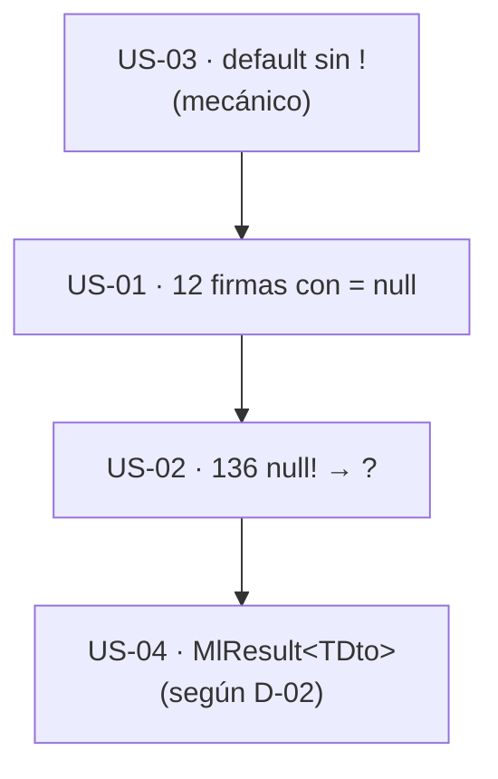

# 04 · Nulabilidad, genéricos y contratos — `MoralesLarios.OOFP.Application`

> **Proyecto** · `src/MoralesLarios.OOFP.Application`
> **Versión actual** · 2.0.0 · `net8.0` · `<Nullable>enable</Nullable>`
> **Versión destino** · 2.1.0 (todo es aditivo a nivel de código fuente; puede producir avisos `CS8610`/`CS8619` en código ajeno)
> **Origen** · análisis profundo de la capa de aplicación, posterior al commit `04b8ee3`; el `dotnet build` propio da **32 avisos `CS8625`**
> **Estado** · ⬜ pendiente · documento de análisis, sin cambios aplicados
> **Esfuerzo total** · S (½ jornada)
> **Riesgo** · 🟢 bajo · ninguna firma cambia de tipo en tiempo de ejecución; sólo cambian anotaciones

---

## Índice

1. [Contexto y problema](#1-contexto-y-problema)
2. [Alcance](#2-alcance)
3. [Historias de usuario](#3-historias-de-usuario)
4. [Orden de ejecución](#4-orden-de-ejecución)
5. [Decisiones abiertas](#5-decisiones-abiertas)
6. [Definición de terminado](#6-definición-de-terminado)
7. [Apéndice · código actual y propuesto](#7-apéndice--código-actual-y-propuesto)
8. [Ver también](#ver-también)

---

## 1. Contexto y problema

El proyecto declara `<Nullable>enable</Nullable>` pero **la nulabilidad declarada no refleja la realidad**:
los parámetros que aceptan `null` se declaran como no anulables y se silencian con `null!`, y la mitad de
las interfaces no lo hace ni siquiera así, lo que produce **el 100 % de los avisos propios** del proyecto.

| Punto | Fichero | Líneas | Naturaleza |
|------:|---------|--------|------------|
| **01** | `Services/ICrudServiceFp.cs` | 146, 156, 179, 189, 198, 207, 217, 227, 238, 249, 259, 271 | aditiva · **32 avisos `CS8625`** |
| **02** | `MlProblemDetails.cs` · `Services/CrudServiceFp.cs` · `Services/ICrudServiceFp.cs` | 60 + 54 + 22 líneas | aditiva (con avisos posibles en *overrides* ajenos) |
| **03** | `Services/CrudServiceFp.cs` · `Services/ICrudServiceFp.cs` | 27 declaraciones | aditiva |
| **04** | `Services/CrudServiceFp.cs` · `Services/ICrudServiceFp.cs` | `CrudServiceFp.cs:50,72,347,369` · `:84-88,381-385` | aditiva (sólo avisos) |

> **Todas las cifras de este documento son medidas, no estimadas**, y cada hallazgo se referencia con `fichero:línea`.

> ℹ️ Este documento aplica el mismo criterio que el [hallazgo 12 del análisis de `Core`](../Core/README.md#3-resumen-ejecutivo-los-12-hallazgos-de-mayor-impacto)
> (417 `= null!` en el núcleo). No se ha usado la *skill* `migrate-nullable-references` del marketplace
> porque el proyecto **ya tiene** `Nullable` activado y el problema es de **anotación**, no de migración;
> los recuentos salen de `Select-String` y de `dotnet build`.

---

### Punto 01 — 12 firmas de una línea con `= null` (32 `CS8625`)

La **segunda mitad** de `ICrudServiceFp.cs` está escrita con una línea por método y con `= null` en lugar
de `= null!`:

```csharp
// MoralesLarios.OOFP.Application/Services/ICrudServiceFp.cs, L146 (modo simple)
Task<MlResult<TDto>> UpdateAsync(TDto dto, MlErrorDetails notFoundErrorDetails, CancellationToken ct = default, string initialMessage = null, Func<TDto, string> successMessageFactory = null, Func<MlErrorDetails, string> failMessageBuilder = null, params object[] pk);
//                                                                                                                  ^^^^ ← CS8625                                 ^^^^ ← CS8625                                                 ^^^^ ← CS8625
```

Cada firma con 3 valores por defecto nulos produce 3 avisos; las de 2 producen 2. Medido por línea:

| Línea | Avisos | Línea | Avisos | Línea | Avisos |
|------:|-------:|------:|-------:|------:|-------:|
| 146 | 3 | 207 | 2 | 249 | 3 |
| 156 | 2 | 217 | 2 | 259 | 3 |
| 179 | 3 | 227 | 3 | 271 | 3 |
| 189 | 3 | 238 | 3 | | |
| 198 | 2 | | | **Total** | **32** |

**El 100 % de los avisos propios del proyecto** (32 de 32) salen de estas 12 líneas; el resto de los 83
avisos del `dotnet build` vienen de proyectos referenciados (`ValueObjects` 44, `Core` 4, `Shared` 2,
`EntityFrameworkCore` 1).

| Aspecto | Valor |
|---------|-------|
| **Ocurrencias** | 12 firmas · 32 avisos |
| **Corrección** | ver [punto 02](#punto-02--136-null-como-valor-por-omisión): anotar con `?` en lugar de `null!` |
| **Ruptura** | **ninguna** |

---

### Punto 02 — 136 `null!` como valor por omisión

```csharp
// MoralesLarios.OOFP.Application/MlProblemDetails.cs, L167-L170
public static MlErrorDetails NotFoundError(string                     title      = null!,
                                           string                     detail     = null!,
//                                         ^^^^^^ ← declarado «no nulo», pero null es el valor esperado
                                           string                     type       = null!,
                                           Dictionary<string, object> errors     = null!)
```

| Fichero | Líneas con `null!` |
|---------|-------------------:|
| `MlProblemDetails.cs` | **60** (15 fábricas × 4 parámetros) |
| `Services/CrudServiceFp.cs` | **54** |
| `Services/ICrudServiceFp.cs` | **22** |
| **Total** | **136** |

El compilador deja de avisar, pero **el consumidor ve `string title` en IntelliSense** y el análisis de
flujo da por hecho que nunca es nulo, cuando el cuerpo hace `title ?? "Not found"`. La contradicción es
visible dentro del mismo método: se compara con `??` un valor declarado no nulo.

La anotación honesta es `string? title = null`:

| Declaración | Lectura |
|-------------|---------|
| `string title = null!` | «no es nulo» (falso) |
| `string? title = null` | «opcional» (verdadero) |

| Aspecto | Valor |
|---------|-------|
| **Ocurrencias** | 136 líneas |
| **Ruptura** | **ninguna** a nivel de uso. ⚠️ Quien **sobrescriba** un método `virtual` de `CrudServiceFp` declarando `string initialMessage` (sin `?`) verá un aviso `CS8610` (no un error) |
| **Relación con otras épicas** | mismo patrón que los 417 `= null!` de `Core` y los 132 de `Logging` (ver sus documentos) |

---

### Punto 03 — `default!` sobre `CancellationToken`

```csharp
// MoralesLarios.OOFP.Application/Services/CrudServiceFp.cs, L24 (y 26 declaraciones más)
public virtual Task<MlResult<IEnumerable<TDto>>> GetPagedAsync(CancellationToken ct = default!, …)
//                                                                                          ^ ← `default!` sobre un struct: no hace nada
```

`CancellationToken` es un `struct`: `default` no es nulo y `!` **no suprime ningún aviso**. Es ruido que
convive, en el mismo proyecto, con la grafía correcta:

| Grafía | Declaraciones |
|--------|--------------:|
| `ct = default!` | **27** (`Services/*.cs`) |
| `ct = default` | **13** (el resto: las 12 firmas de una línea de `ICrudServiceFp.cs` más `FindByIdProblemsDetailsAsync`) |
| **Total de `CancellationToken`** | **40** (20 en la clase + 20 en las interfaces) |

> 13 = 40 − 27, deducido de las dos medidas anteriores (`CancellationToken` = 40 líneas; `default!` = 27 líneas).

| Aspecto | Valor |
|---------|-------|
| **Corrección** | `default!` → `default` en las 27 |
| **Ruptura** | **ninguna** |

---

### Punto 04 — `MlResult<TDto?>`: una anulabilidad que el repositorio ya descarta

```csharp
// MoralesLarios.OOFP.Application/Services/CrudServiceFp.cs, L72-L91
public virtual Task<MlResult<TDto?>> FindByIdProblemsDetailsAsync(…)
{
    var result = _logger.LogMlResultInformationAsync(…)
                        .BindAsync( _     => _repo.TryFindAsync(notFoundErrorDetails: …, token: ct, keyValues: pk))
                        .MapAsync (vinoBd => vinoBd?.Adapt<TDto>())          // ← `?.` defensivo
                        .LogCompletedResultAsync(…
                                               validBuildMessage: x => x is not null
                                                                          ? (…)
                                                                          : $"No data found in the {typeof(TDto).Name} table for the pk …",   // ← rama inalcanzable
```

El repositorio **nunca devuelve `Valid(null)`**: `EfReadRepository.TryFindAsync` termina en
`.TryBindAsync(x => x.FailIfNullAsync(notFoundErrorDetails))` (`EntityFrameworkCore/Repositories/EfReadRepository.cs:66`),
de modo que «no encontrado» es siempre un `Fail`. Comprobado en ejecución: `FindByIdAsync(…, 12345)` devuelve
`IsSuccess=False` con `Status = 404`.

Consecuencias:

1. **Anulabilidad que miente por exceso.** `Task<MlResult<TDto?>>` obliga al consumidor a hacer `?.` sobre
   un valor que, cuando el resultado es válido, **no es nulo**. El propio `README` lo reconoce
   («un `Valid` nunca trae `null`; la anulabilidad es defensiva»).
2. **Rama muerta.** La parte `: "No data found in the … table for the pk …"` del mensaje de éxito
   (`CrudServiceFp.cs:84-88` y `381-385`) no se puede alcanzar con el contrato actual del repositorio.
3. **Superficie.** El `?` está en **8 declaraciones**: `FindByIdAsync` y `FindByIdProblemsDetailsAsync`,
   en los 2 modos, en la clase y en la interfaz (`CrudServiceFp.cs:50,72,347,369` y `ICrudServiceFp.cs:40,57,227,238`).

| Aspecto | Valor |
|---------|-------|
| **Corrección** | `MlResult<TDto?>` → `MlResult<TDto>`, quitar el `?.` y la rama muerta |
| **Ruptura** | **sólo avisos** (`CS8619` al convertir entre `Task<MlResult<TDto?>>` y `Task<MlResult<TDto>>` en código ajeno). Si el repositorio cambiase algún día a devolver `Valid(null)`, habría que revisarlo: ver [D-02](#5-decisiones-abiertas) |

---

## 2. Alcance

**Dentro:**

- Anotar los 12 `= null` de `ICrudServiceFp.cs` (32 `CS8625`).
- Sustituir `= null!` por `?` + `= null` en los 136 sitios, o decidir una excepción justificada.
- `default!` → `default` en los 27 `CancellationToken`.
- Retirar el `?` de `MlResult<TDto?>` y la rama inalcanzable, si [D-02](#5-decisiones-abiertas) lo confirma.

**Fuera:**

- La alternativa de **eliminar** los parámetros opcionales con sobrecargas reales (documento [05](05-Superficie-de-API-y-Arquitectura.md#punto-05--explosión-de-parámetros-y-posición-del-cancellationtoken)).
- Los avisos de proyectos referenciados (`ValueObjects` 44, `Core` 4, `Shared` 2, `EntityFrameworkCore` 1).
- La nulabilidad de `Core` y `Logging`.

---

## 3. Historias de usuario

> Inventario de intención para el futuro agente de épicas. Sin desarrollar.

- **US-01** · Que el proyecto compile con **0 avisos propios** (hoy 32).
- **US-02** · Que la nulabilidad de los parámetros opcionales diga la verdad (`string? x = null`).
- **US-03** · Que `CancellationToken` use `default` y no `default!`.
- **US-04** · Que `FindById*` devuelva `MlResult<TDto>` si el contrato del repositorio lo permite.

---

## 4. Orden de ejecución



**Justificación.** La US-03 es mecánica y valida el procedimiento. La US-01 deja el proyecto con 0 avisos
propios y sirve de línea base para que la US-02 (la más voluminosa) no introduzca avisos nuevos.

---

## 5. Decisiones abiertas

| ID | Decisión | Opciones | Estado |
|----|----------|----------|--------|
| **D-01** | Cómo declarar un parámetro opcional que admite `null` | (a) `string? x = null` · (b) mantener `string x = null!` y justificarlo · (c) sustituir por sobrecargas reales (3.0.0, ver documento 05) | ⬜ abierta |
| **D-02** | Contrato de `FindById*` | (a) `MlResult<TDto>` (el repositorio ya no devuelve `Valid(null)`) · (b) mantener `TDto?` por si un repositorio **ajeno** implementa `IEfRepository<T>` con otro criterio | ⬜ abierta |

> **Sobre D-02.** `IEfRepository<T>` es una interfaz pública: nada impide que alguien implemente su propio
> repositorio y devuelva `Valid(null)`. La opción (b) protege ese caso a costa de seguir obligando al `?.`.
> La decisión depende de si se quiere que `IEfRepository` sea un punto de extensión soportado
> (ver [documento 05, punto 01](05-Superficie-de-API-y-Arquitectura.md#punto-01--acoplamiento-a-iefrepository-y-al-proyecto-entityframeworkcore)).

---

## 6. Definición de terminado

- [ ] `dotnet build MoralesLarios.OOFP.sln -c Release --no-incremental` con **0 errores** y **`CS1591` = 0**.
- [ ] **0 avisos propios** de `MoralesLarios.OOFP.Application` (hoy 32 `CS8625`).
- [ ] Tests de la solución en verde respecto a la línea base medida antes de empezar.
- [ ] El número total de avisos de la solución **no sube** (hoy 83 líneas únicas al compilar `Application` con sus dependencias).
- [ ] **0 ocurrencias** de `default!` y, salvo excepción documentada en [D-01](#5-decisiones-abiertas), de `= null!` en parámetros públicos.
- [ ] Si se cambia `MlResult<TDto?>`, la rama inalcanzable de `CrudServiceFp.cs:84-88` y `381-385` está retirada y hay una prueba de «no encontrado → `Fail` con 404».

---

## 7. Apéndice · código actual y propuesto

### 7.1 Firma de una línea (punto 01)

```csharp
// MoralesLarios.OOFP.Application/Services/ICrudServiceFp.cs, L156

// ───── 2.0.0 (actual) ─────
Task<MlResult<TDto>> DeleteProblemDetailsAsync(MlErrorDetails notFoundErrorDetails, CancellationToken ct = default, string initialMessage = null, Func<MlErrorDetails, string> failMessageBuilder = null, params object[] pk);

// ───── 2.1.0 (propuesta) ─────
Task<MlResult<TDto>> DeleteProblemDetailsAsync(MlErrorDetails            notFoundErrorDetails,
                                               CancellationToken         ct                 = default,
                                               string?                   initialMessage     = null,
                                               Func<MlErrorDetails, string>? failMessageBuilder = null,
                                               params object[]           pk);
```

### 7.2 Fábrica de problemas (punto 02)

```csharp
// MoralesLarios.OOFP.Application/MlProblemDetails.cs, L167-L170

// ───── 2.0.0 (actual) ─────
public static MlErrorDetails NotFoundError(string title = null!, string detail = null!, string type = null!, Dictionary<string, object> errors = null!)

// ───── 2.1.0 (propuesta) ─────
public static MlErrorDetails NotFoundError(string? title = null, string? detail = null, string? type = null, Dictionary<string, object>? errors = null)
```

---

## Ver también

- [`README.md`](README.md) — índice de la carpeta.
- [`../Core/README.md`](../Core/README.md) — mismo patrón de `= null!` en el núcleo.
- [`../Logging/README.md`](../Logging/README.md) — mismo patrón en `Logging` (132 `null!`).
- [`05-Superficie-de-API-y-Arquitectura.md`](05-Superficie-de-API-y-Arquitectura.md) — la alternativa de sobrecargas reales.
