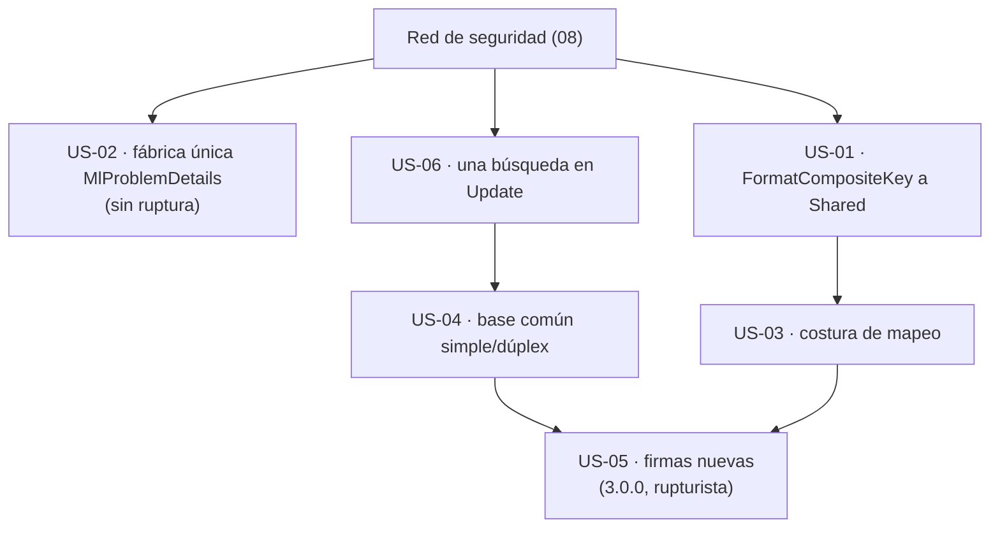

# 05 · Superficie de API y arquitectura — `MoralesLarios.OOFP.Application`

> **Proyecto** · `src/MoralesLarios.OOFP.Application`
> **Versión actual** · 2.0.0 · `net8.0`
> **Versión destino** · 2.2.0 (puntos 02, 03, 04, 06) · 3.0.0 (puntos 01 con cambio de constructor y 05)
> **Origen** · análisis profundo de la capa de aplicación, posterior al commit `04b8ee3`
> **Estado** · ⬜ pendiente · documento de análisis, sin cambios aplicados
> **Esfuerzo total** · XL (3+ jornadas) · el punto 05 es XL por sí solo; el resto suma L
> **Riesgo** · 🟡 medio los puntos 02, 03, 04, 06 · 🔴 muy alto el punto 05

---

## Índice

1. [Contexto y problema](#1-contexto-y-problema)
2. [Alcance](#2-alcance)
3. [Historias de usuario](#3-historias-de-usuario)
4. [Orden de ejecución](#4-orden-de-ejecución)
5. [Decisiones abiertas](#5-decisiones-abiertas)
6. [Definición de terminado](#6-definición-de-terminado)
7. [Apéndice · código actual y propuesto](#7-apéndice--código-actual-y-propuesto)
8. [Ver también](#ver-también)

---

## 1. Contexto y problema

La capa es **pequeña** (7 ficheros, 1.426 líneas), pero su tamaño está **inflado por duplicación**: 553
líneas son dos copias casi idénticas del servicio (272 y 281) y 460 son 14 bloques clonados de
`MlProblemDetails`. Además su acoplamiento hacia abajo (repositorio, mapeador) es más fuerte de lo que
necesita, y la forma de sus firmas obliga al consumidor a nombrar argumentos.

| Punto | Fichero | Líneas | Naturaleza |
|------:|---------|--------|------------|
| **01** | `MoralesLarios.OOFP.Application.csproj` · `Services/CrudServiceFp.cs` | `.csproj:17` · 18 llamadas a `_repo` · 9 a `FormatCompositeKey` | aditiva (interfaz nueva) / rupturista (si cambia el constructor) |
| **02** | `MlProblemDetails.cs` | 23-460 | aditiva (refactor interno) |
| **03** | `Services/CrudServiceFp.cs` | 22 `.Adapt<` | aditiva (mapeo inyectable opcional) |
| **04** | `Services/CrudServiceFp.cs` · `Services/ICrudServiceFp.cs` | `CrudServiceFp.cs:14-285` y `306-586` · `ICrudServiceFp.cs:13-157` y `166-272` | de comportamiento (si se unifican los mensajes) |
| **05** | `Services/CrudServiceFp.cs` · `Services/ICrudServiceFp.cs` | las 20 firmas | rupturista |
| **06** | `Services/CrudServiceFp.cs` | 165, 243, 462, 540 · `UpdateAsync` L166-L173 y L463-L470 | de comportamiento (mensaje) · aditiva (consulta duplicada) |

> **Todas las cifras de este documento son medidas, no estimadas**, y cada hallazgo se referencia con `fichero:línea`.

> ℹ️ No se ha usado la *skill* `csharp-refactoring` del marketplace: las propuestas de este documento son
> **de planificación** (qué extraer y qué contrato cambia), no refactors ejecutados. Cuando se aborden, esa
> *skill* es la apropiada para distinguir los refactores que conservan comportamiento (puntos 02, 03, 04
> parcial) de los que cambian contrato (01 con constructor y 05).

---

### Punto 01 — Acoplamiento a `IEfRepository` y al proyecto `EntityFrameworkCore`

`CrudServiceFp` recibe un `IEfRepository<TEntity>` y **usa 5 de sus métodos**:

| Método del repositorio | Llamadas desde `CrudServiceFp.cs` |
|------------------------|----------------------------------:|
| `TryFindAsync` | 6 |
| `TryUpdateAsync` | 4 |
| `TryRemoveAsync` | 4 |
| `TryAllAsync` | 2 |
| `TryAddAsync` | 2 |
| **Total** | **18** |

```csharp
// MoralesLarios.OOFP.Application/MoralesLarios.OOFP.Application.csproj, L17
<ProjectReference Include="..\MoralesLarios.OOFP.EntityFrameworkCore\MoralesLarios.OOFP.EntityFrameworkCore.csproj" />
//                         ^^^^^^^^^^^^^^^^^^^^^^^^^^^^^^^^^^^^^^^^^^^^^^^ ← proyecto entero, para 5 métodos y un helper de texto
```

`IEfRepository<T>` hereda de `IEfReadRepository<T>` y `IEfWriteRepository<T>`
(`EntityFrameworkCore/Repositories/IEfRepository.cs:9`) y, según la épica de paginación, expone del orden de
20 métodos (cifra de la épica, no re-medida aquí). El servicio no necesita casi ninguno de ellos.

Lo único que `Application` toma del proyecto de EF, además de la interfaz, es un **helper de cadenas**:

```csharp
// MoralesLarios.OOFP.EntityFrameworkCore/Helpers/Extensions.cs, L20-L26
public static string FormatCompositeKey(this object[] source)   // ← vive en EF; Application lo llama 9 veces
```

Medido: 8 llamadas en `CrudServiceFp.cs` (L79, 87, 89, 91, 376, 384, 386, 388) y 1 en `Helpers/Extensions.cs:18`.

Y comprobado: **`Application` no usa ningún tipo de `Microsoft.EntityFrameworkCore`** (la única coincidencia
textual con `DbContext` es un comentario XML de `RegisterServices.cs`). El `README` ya avisa de que «no
puedes usar esta capa con otro tipo de persistencia sin implementar tú `IEfRepository<T>`».

> ⚠️ **Contexto que conviene no perder.** Los repositorios internos de EF resuelven sus dependencias con un
> *service locator* estático (`EntityFrameworkCore/RegisterServices.cs:21-24`, `_services?.BuildServiceProvider()`
> en cada resolución). No se ha analizado en profundidad porque es del proyecto de EF, pero es relevante
> para `Application`: el comportamiento observado de `UpdateAsync(pk)` ([punto 06](#punto-06--comprobaciones-redundantes))
> **podría** depender de él. Hipótesis **no verificada**; la épica de simplificación de repositorios es el sitio donde confirmarla.

| Aspecto | Valor |
|---------|-------|
| **Corrección ligera** | mover `FormatCompositeKey` a `Shared` (con puente en EF) para que `Application` no necesite EF **sólo** por una cadena |
| **Corrección completa** | interfaz mínima de 5 métodos (`ICrudRepository<T>`) que `IEfRepository<T>` ya cumple; el servicio se tipa contra ella |
| **Ruptura** | la corrección ligera es **aditiva**; la completa cambia el tipo del constructor ⇒ **de compilación** para quien construya el servicio a mano. Por DI no se nota |

---

### Punto 02 — `MlProblemDetails`: 14 bloques clonados en 460 líneas

El 32 % del proyecto es una sola clase estática con **15 métodos públicos**, de los cuales **14 repiten el
mismo bloque de 13 líneas** cambiando tres literales (estado, título, detalle):

```csharp
// MoralesLarios.OOFP.Application/MlProblemDetails.cs, L167-L190 (NotFoundError) — idéntico en 13 fábricas más
var result = (title ?? "Not found",
              new Dictionary<string, object>
              {
                  { ProblemsDetails, new
                      {
                            Status     = 404,                                    // ← cambia
                            Title      = title  ?? "Not found",                  // ← cambia
                            Detail     = detail ?? "The requested resource was not found.",   // ← cambia
                            Type       = type   ?? DefaultProblemType,
                            Errors     = errors ?? new Dictionary<string, object>(),
                            StatusCode = 404                                     // ← cambia (otra vez)
                      }
                  }
              });
return result;
```

Medido: **14** líneas `Status     =`, **14** usos de `DefaultProblemType` y **15** `new Dictionary<string, object>()`
(los 14 bloques más el *fallback* de la sobrecarga de validación). Cada fábrica es una copia pegada: un
cambio de contrato (p. ej. el [punto 04 del documento 03](03-Modelo-de-Error.md#punto-04--un-contrato-por-reflexión-sobre-un-objeto-anónimo))
hay que hacerlo **14 veces** sin que el compilador ayude.

| Aspecto | Valor |
|---------|-------|
| **Corrección** | una fábrica privada `Create(int status, string defaultTitle, string defaultDetail, string? title, string? detail, string? type, Dictionary<string, object>? errors)` y 14 métodos de una línea |
| **Ruptura** | **ninguna** si el objeto resultante conserva sus seis propiedades (el consumidor los lee por reflexión) |

---

### Punto 03 — Mapster estático: 22 `Adapt<` y ningún mapeador inyectable

```csharp
// MoralesLarios.OOFP.Application/Services/CrudServiceFp.cs, L34 y L117 (ejemplo)
.MapAsync (bdData => bdData.Adapt<IEnumerable<TDto>>())   // ← método de extensión estático de Mapster
.TryMapAsync( _   => dto.Adapt<TEntity>())
```

Medido: **22** `.Adapt<` en `CrudServiceFp.cs` y **0** apariciones de `IMapper`, `TypeAdapterConfig` o similar
en el proyecto. El mapeo depende de la **configuración global estática** de Mapster. Efectos:

1. **No hay punto de sustitución.** Una prueba no puede inyectar un mapeador falso; para provocar un fallo de
   mapeo hay que tocar `TypeAdapterConfig<,>.NewConfig()` **global**, y limpiarlo después (`Clear()`), porque la
   configuración fuga entre pruebas. Es exactamente lo que hizo el arnés de comprobación.
2. **Compilación en tiempo de ejecución.** El fallo medido en [el punto 01 del documento 03](03-Modelo-de-Error.md#punto-01--16-mapasync-sin-protección-la-excepción-escapa-del-raíl)
   fue una `CompileException`: Mapster genera y compila árboles de expresión al primer uso. Eso es relevante
   para trimming/AOT (ver [07](07-Empaquetado-y-Compatibilidad.md#punto-04--aot-y-trimming-la-compatibilidad-no-está-declarada-ni-verificada)).
3. **Acoplamiento de paquete.** `Mapster 7.4.0` es dependencia **obligatoria** de la capa y de sus consumidores.

El proyecto vecino `AspNetCore.Controllers` tiene **0** `.Adapt<`, o sea que Mapster queda **confinado** a esta
capa: es un buen punto para ponerle una costura.

| Aspecto | Valor |
|---------|-------|
| **Corrección** | constructor con un parámetro opcional (`IMlMapper? mapper = null`, por defecto Mapster) o aceptar `TypeAdapterConfig` por constructor |
| **Ruptura** | **ninguna** si el parámetro es opcional y el valor por defecto reproduce el comportamiento actual |

---

### Punto 04 — Dos servicios que son uno

```text
CrudServiceFp<TEntity, TDto>                    L14-285   · 272 líneas · 10 métodos
CrudServiceFp<TEntity, TRequest, TResponse>     L306-586  · 281 líneas · 10 métodos
ICrudServiceFp<TEntity, TDto>                   L13-157   · 145 líneas
ICrudServiceFp<TEntity, TRequest, TResponse>    L166-272  · 107 líneas
```

El modo simple es el dúplex con `TRequest = TResponse = TDto`. Cada método está escrito **dos veces** con la
misma cadena funcional. La duplicación **ya ha producido divergencia accidental**:

| Aspecto | Modo simple | Modo dúplex |
|---------|-------------|-------------|
| Tipo del 404 de `FindById` | `typeof(TDto)` (L57) | `typeof(TResponse)` (L354) |
| Tipo del 404 de `Update`/`Delete` | `typeof(TDto)` (L141, L224) | **`typeof(TEntity)`** (L438, L521) |
| Texto de los mensajes | `…corresponding to dto {typeof(TDto).Name}` | `…corresponding to {DtosDescType}` (propiedad privada L584) |

Es el hallazgo 3 de [`Epica-Servicio-y-Paginacion.md`](../../Next_Versions/2.0.0/Pendientes/Epica-Servicio-y-Paginacion.md)
visto desde su causa: **dos copias que evolucionan por separado**.

| Aspecto | Valor |
|---------|-------|
| **Corrección** | una base interna `CrudServiceCore<TEntity,TRequest,TResponse>` con toda la lógica; el modo simple hereda de ella con `TDto` en las dos posiciones; las interfaces se quedan como están |
| **Ruptura** | **ninguna** de firma. ⚠️ **De comportamiento** si se unifican los mensajes (texto del 404 y del log); si se conservan literalmente, aditiva. Quien herede de `CrudServiceFp<,>` y sobrescriba métodos `virtual` debe seguir compilando: se comprueba con la red de seguridad |

---

### Punto 05 — Explosión de parámetros y posición del `CancellationToken`

Las 20 firmas siguen el patrón `(entrada, [error propio], ct, initialMessage, successMessageFactory, failMessageBuilder, params pk)`:

```csharp
// MoralesLarios.OOFP.Application/Services/CrudServiceFp.cs, L155-L163 (UpdateAsync, modo simple)
public virtual Task<MlResult<TDto>> UpdateAsync(TDto                          dto,
                                                MlErrorDetails               notFoundErrorDetails,
                                                CancellationToken             ct                  = default!,      // ← 3.er parámetro, opcional
                                                string                        initialMessage      = null!,
                                                Func<TDto, string>            successMessageFactory = null!,
                                                Func<MlErrorDetails, string> failMessageBuilder  = null!,
                                                params object[]               pk)                                   // ← tras 4 opcionales
```

Hasta **7 parámetros** por método. Consecuencias medidas:

1. **El `CancellationToken` no va al final.** Las *Framework Design Guidelines* lo colocan como último
   parámetro. Aquí es el 1.º, 2.º o 3.º y es opcional, de modo que **todos** los llamadores internos lo pasan
   por nombre: los controladores escriben `GetPagedAsync(ct: ct)` y `CreateAsync(dto, ct: ct)`
   (`MlCrudControllerBase.cs:27,64`; 8 llamadas por nombre a las variantes con error propio, ver
   [documento 01](01-Nomenclatura-y-Estandares.md#punto-01--problemsdetailsasync-frente-a-problemdetailsasync)).
2. **Para pasar una clave hay que escribir 4 *placeholders*.** `FindByIdAsync(12345)` **no compila**: `12345`
   no es un `CancellationToken`. El arnés de comprobación tuvo que escribir
   `FindByIdAsync(default, null, null, null, 12345)`. Es el problema de `params object[] pk` tras opcionales
   que ya recoge
   [`Epica-Coherencia-Y-Documentacion.md`](../../Next_Versions/2.0.0/Pendientes/Epica-Coherencia-Y-Documentacion.md)
   (§ punto 5): medido, **14** declaraciones en la clase y **12** en las interfaces.
3. **Tres parámetros de mensaje por operación.** `initialMessage`, `successMessageFactory`, `failMessageBuilder`
   viajan siempre juntos y casi nunca se usan: 20 métodos × 3 parámetros = 60 parámetros opcionales, todos
   `null!` (ver [04](04-Nulabilidad-Genericos-y-Contratos.md)).
4. **`DeleteAsync` no tiene `successMessageFactory`** (L264 y L561): una asimetría que ya anota el `README` y
   que la épica de servicio recoge (*«firmas sin factoría de éxito»*).

| Aspecto | Valor |
|---------|-------|
| **Corrección** | `object id` o `object[] key` obligatorio y **primero**; un `record CrudMessages(string? Initial, Func<T,string>? Success, Func<MlErrorDetails,string>? Fail)` opcional; `CancellationToken ct = default` **último** |
| **Ruptura** | **de compilación**, para los 8 controladores base y todo consumidor directo. Sólo cabe en una versión mayor |
| **Puente posible** | ✅ parcial · las firmas antiguas pueden quedar como sobrecargas `[Obsolete]` que reenvían a las nuevas, a costa de **duplicar** la superficie hasta la 3.0.0 |

---

### Punto 06 — Comprobaciones redundantes

**(a) Validación de `pk` duplicada.** El servicio comprueba `pk` en 4 sitios y el repositorio **vuelve a
comprobarlo**:

```csharp
// MoralesLarios.OOFP.Application/Services/CrudServiceFp.cs, L165, L243, L462, L540
.BindAsync( _ => EnsureFp.That(pk, pk is not null && pk.Any(), $"{nameof(pk)} can't be null or empty"))

// MoralesLarios.OOFP.EntityFrameworkCore/Repositories/EfReadRepository.cs, L63-L64
var result = await EnsureFp.NotNullAsync(keyValues, "The object array pk cannot be null")
                            .TryMapAsync (x => EnsureFp.NotEmptyAsync(keyValues, "The object array pk cannot be empty"))
```

Y además **no protege en las variantes cortas**: con `pk` nulo la excepción se produce antes
([punto 02 del documento 03](03-Modelo-de-Error.md#punto-02--pk-nulo-argumentnullexception-fuera-del-raíl)).
El servicio evalúa `pk.Any()` **fuera** del raíl (`EnsureFp.That(pk, condición, …)` recibe ya el booleano), un
detalle que el `README` ya señala.

**(b) `UpdateAsync(…, pk)` busca dos veces y descarta la primera.**

```csharp
// MoralesLarios.OOFP.Application/Services/CrudServiceFp.cs, L166-L173 (modo simple)
.BindAsync  ( _     => _repo.TryFindAsync(notFoundErrorDetails: …, token: ct, keyValues: pk))   // ← 1.ª búsqueda; el resultado se descarta (`_ =>` en el paso siguiente)
.TryMapAsync( _     => dto.Adapt<TEntity>())
.BindAsync  (bdData => _repo.TryUpdateAsync(item: bdData, notFoundErrorDetails: …, token: ct, keyValues: pk))   // ← 2.ª: internamente vuelve a hacer TryFind

// MoralesLarios.OOFP.EntityFrameworkCore/Repositories/EfUpdateRepository.cs, L111-L120
.BindAsync  ( _ => notFoundErrorDetails is null ? _repoReaderFp!.TryFindAsync(token, keyValues) : _repoReaderFp!.TryFindAsync(notFoundErrorDetails, token, keyValues))
```

El `README` presenta esto como «el defecto más importante de esta capa» porque la segunda llamada recibe una
instancia **distinta** con la misma clave y EF podría lanzar un conflicto de seguimiento. **No se ha podido
reproducir**: `UpdateAsync(dto, …, pk: 1)` sobre SQLite en memoria devolvió `IsSuccess=True`. Lo que **sí** es
cierto por lectura de código es que hay **dos búsquedas por clave** para una sola actualización. No se ha medido
el número de sentencias SQL que eso supone (el contexto puede resolver la segunda desde el seguimiento).

| Aspecto | Valor |
|---------|-------|
| **Corrección (a)** | retirar las 4 comprobaciones del servicio y dejar la del repositorio; **cambia el texto** del error de `pk` vacío |
| **Corrección (b)** | quitar la 1.ª búsqueda: `TryUpdateAsync(item, notFound, ct, pk)` ya comprueba existencia con el `notFoundErrorDetails` recibido |
| **Ruptura** | (a) **de comportamiento** (mensaje) · (b) **aditiva** (una consulta menos), sujeta a la prueba de la red de seguridad por si el seguimiento de EF cambia el resultado |

---

## 2. Alcance

**Dentro:**

- Mover `FormatCompositeKey` a `Shared` y estudiar la interfaz mínima del repositorio.
- Fábrica privada única en `MlProblemDetails`.
- Costura de mapeo opcional.
- Base común para el modo simple y el dúplex.
- Rediseño de las firmas (objeto de mensajes, clave primero, `ct` último) en 3.0.0.
- Eliminación de las comprobaciones redundantes de `pk` y de la primera búsqueda de `UpdateAsync`.

**Fuera:**

- Los repositorios de EF y su *service locator* estático (épica de simplificación de repositorios).
- La paginación (documento [06](06-Rendimiento.md)).
- La conversión del error HTTP en el cliente (`AspNetCore.Results`).

---

## 3. Historias de usuario

> Inventario de intención para el futuro agente de épicas. Sin desarrollar.

- **US-01** · Que `Application` no necesite el proyecto de EF para formatear una clave.
- **US-02** · Que añadir una fábrica HTTP nueva sea una línea, no 13.
- **US-03** · Que el mapeo sea sustituible en pruebas sin tocar configuración global.
- **US-04** · Que el servicio simple y el dúplex compartan una sola implementación.
- **US-05** · Que pasar una clave primaria no exija 4 *placeholders*.
- **US-06** · Que `UpdateAsync(pk)` haga una sola búsqueda y una sola validación.

---

## 4. Orden de ejecución



**Justificación.** La base común (US-04) debe ir **antes** de rediseñar las firmas (US-05): cambiar 20
firmas en **una** base cuesta la mitad que cambiarlas en dos copias.

> ⚠️ **Prerrequisito.** Ninguna de estas historias debe empezar sin la red de seguridad del
> [documento 08](08-Calidad-Pruebas-y-Documentacion.md): el proyecto tiene **0 pruebas activas**.

---

## 5. Decisiones abiertas

| ID | Decisión | Opciones | Estado |
|----|----------|----------|--------|
| **D-01** | Dependencia del repositorio | (a) mantener `IEfRepository<T>` y sólo mover `FormatCompositeKey` · (b) interfaz mínima `ICrudRepository<T>` de 5 métodos · (c) que `Application` defina su propio contrato y EF lo implemente (inversión de dependencia completa) | ⬜ abierta |
| **D-02** | Mapeo | (a) mantener Mapster estático y documentarlo · (b) `IMlMapper` opcional · (c) `MapsterMapper.IMapper` de Mapster | ⬜ abierta |
| **D-03** | ¿Se unifica el texto de los mensajes al extraer la base común? | (a) sí, con `TResponse` hacia el cliente y `TEntity` sólo en logs (criterio de la épica) · (b) no: la base conserva literalmente ambos textos | ⬜ abierta |
| **D-04** | Forma de la firma nueva en 3.0.0 | (a) `object id` + `CrudMessages?` + `ct` · (b) `params object[] key` obligatorio primero · (c) *builder* por operación | ⬜ abierta |

> **Sobre D-01.** La opción (c) es la más limpia en teoría y la más cara: obligaría a que
> `EntityFrameworkCore` referencie `Application` (hoy es al revés). La (b) es el término medio. La (a) es la
> que **menos riesgo** introduce y ya elimina la dependencia más gratuita (el helper de cadenas).

---

## 6. Definición de terminado

- [ ] `dotnet build MoralesLarios.OOFP.sln -c Release --no-incremental` con **0 errores** y **`CS1591` = 0**.
- [ ] Tests de la solución en verde respecto a la línea base medida antes de empezar, más los nuevos del documento 08.
- [ ] `MlProblemDetails.cs` sin bloques clonados: **0** apariciones repetidas del bloque anónimo fuera de la fábrica única.
- [ ] Sólo queda **una** implementación de la lógica CRUD (la base); las dos clases públicas son delgadas.
- [ ] Toda ruptura registrada en
      [`../../Copilot/.github/prompts/oofp-upgrade-2.prompt.md`](../../Copilot/.github/prompts/oofp-upgrade-2.prompt.md)
      (§3.3, detalle, barrido de la Fase 5, informe de la Fase 6, apéndice de versiones) y, para los renombrados,
      [`../../Copilot/.github/prompts/oofp-upgrade-2.renames.md`](../../Copilot/.github/prompts/oofp-upgrade-2.renames.md).
- [ ] Los puentes `[Obsolete]` de las firmas antiguas no se usan internamente (`CS0618` = 0).
- [ ] Las decisiones `D-01` … `D-04` están resueltas y anotadas.

---

## 7. Apéndice · código actual y propuesto

### 7.1 La fábrica única (punto 02)

```csharp
// MoralesLarios.OOFP.Application/MlProblemDetails.cs

// ───── 2.0.0 (actual) · 14 copias de este bloque ─────
public static MlErrorDetails NotFoundError(string title = null!, string detail = null!, string type = null!, Dictionary<string, object> errors = null!)
{
    var result = (title ?? "Not found", new Dictionary<string, object> { { ProblemsDetails, new { Status = 404, Title = title ?? "Not found", … StatusCode = 404 } } });
    return result;
}

// ───── 2.2.0 (propuesta) ─────
public static MlErrorDetails NotFoundError(string? title = null, string? detail = null, string? type = null, Dictionary<string, object>? errors = null)
    => Create(404, "Not found", "The requested resource was not found.", title, detail, type, errors);

private static MlErrorDetails Create(int status, string defaultTitle, string defaultDetail,
                                     string? title, string? detail, string? type, Dictionary<string, object>? errors)
    => (title ?? defaultTitle,
        new Dictionary<string, object>
        {
            { ProblemsDetails, new { Status = status, Title = title ?? defaultTitle, Detail = detail ?? defaultDetail,
                                     Type = type ?? DefaultProblemType, Errors = errors ?? new Dictionary<string, object>(), StatusCode = status } }
        });
```

### 7.2 La base común (punto 04)

```csharp
// ───── 2.2.0 (propuesta) ─────
public class CrudServiceFp<TEntity, TRequest, TResponse>(IEfRepository<TEntity> repo, ILogger<…> logger) : ICrudServiceFp<TEntity, TRequest, TResponse> { /* única implementación */ }

public class CrudServiceFp<TEntity, TDto>(IEfRepository<TEntity> repo, ILogger<CrudServiceFp<TEntity, TDto>> logger)
    : CrudServiceFp<TEntity, TDto, TDto>(repo, logger), ICrudServiceFp<TEntity, TDto>
    where TEntity : class where TDto : class { }
//   ↑ los 10 miembros del modo simple se heredan; los `virtual` siguen siendo puntos de extensión
```

> ⚠️ Esta propuesta sólo es válida si las firmas coinciden con `TRequest = TResponse = TDto`. Hay que
> comprobarlo con una prueba de compilación antes de decidir: `ICrudServiceFp<TEntity,TDto>` y la interfaz
> dúplex **no** tienen exactamente los mismos miembros declarados en el mismo orden, aunque sí el mismo conjunto de 10.

---

## Ver también

- [`README.md`](README.md) — índice de la carpeta.
- [`03-Modelo-de-Error.md`](03-Modelo-de-Error.md) — los `MapAsync` y el contrato del problema HTTP.
- [`../../Next_Versions/2.0.0/Pendientes/Epica-Coherencia-Y-Documentacion.md`](../../Next_Versions/2.0.0/Pendientes/Epica-Coherencia-Y-Documentacion.md) — `params object[] pk` tras opcionales.
- [`../../Next_Versions/2.0.0/Pendientes/Epica-Servicio-y-Paginacion.md`](../../Next_Versions/2.0.0/Pendientes/Epica-Servicio-y-Paginacion.md) — criterio de tipo en los mensajes.
- [`../../Next_Versions/2.0.0/Pendientes/Epica-Simplificacion-Repositorios-EFCore.md`](../../Next_Versions/2.0.0/Pendientes/Epica-Simplificacion-Repositorios-EFCore.md) — los repositorios.
