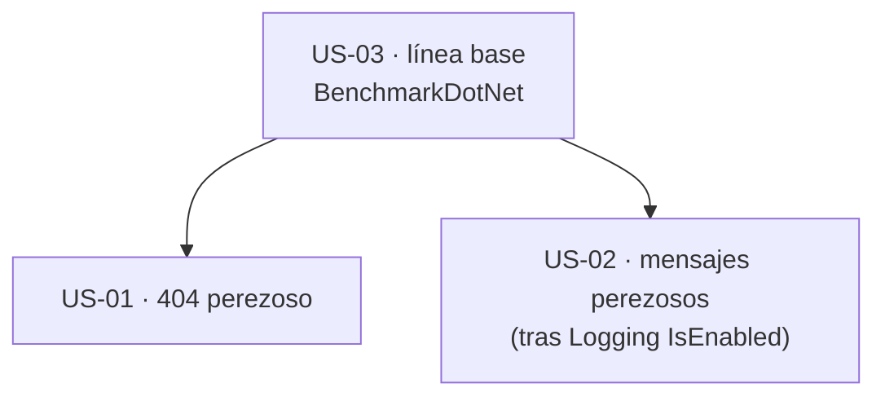

# 06 · Rendimiento — `MoralesLarios.OOFP.Application`

> **Proyecto** · `src/MoralesLarios.OOFP.Application`
> **Versión actual** · 2.0.0 · `net8.0`
> **Versión destino** · 2.2.0 (puntos 02 y 03) · 3.0.0 (punto 01, por cambio de firma)
> **Origen** · análisis profundo de la capa de aplicación, posterior al commit `04b8ee3`
> **Estado** · ⬜ pendiente · el punto 01 ya está planificado en una épica
> **Esfuerzo total** · M (1 jornada) sin contar la paginación (M adicional, ya estimada en su épica)
> **Riesgo** · 🟢 bajo los puntos 02 y 03 · 🔴 muy alto el punto 01 (cambia firma y tipo de retorno)

---

## Índice

1. [Contexto y problema](#1-contexto-y-problema)
2. [Alcance](#2-alcance)
3. [Historias de usuario](#3-historias-de-usuario)
4. [Orden de ejecución](#4-orden-de-ejecución)
5. [Decisiones abiertas](#5-decisiones-abiertas)
6. [Definición de terminado](#6-definición-de-terminado)
7. [Apéndice · código actual y propuesto](#7-apéndice--código-actual-y-propuesto)
8. [Ver también](#ver-también)

---

## 1. Contexto y problema

La capa de aplicación es **fina** en términos de rendimiento: **0** palabras `async` en `CrudServiceFp.cs`
(no genera máquinas de estado propias), **40** `CancellationToken` propagados hasta el repositorio y
**0** `ConfigureAwait` (irrelevante aquí: no hace `await`). El coste está en lo que **construye por
llamada** y en una consulta que no pagina.

| Punto | Fichero | Líneas | Naturaleza |
|------:|---------|--------|------------|
| **01** | `Services/CrudServiceFp.cs` | 27-39 · 322-334 (`TryAllAsync` en 33 y 328) | rupturista · **ya planificado** |
| **02** | `Services/CrudServiceFp.cs` | 57, 141, 224, 354, 438, 521 · 14 mensajes iniciales | aditiva |
| **03** | solución | sin proyecto de benchmarks | aditiva |

> **Todas las cifras de este documento son medidas, no estimadas**, y cada hallazgo se referencia con `fichero:línea`.
> Las **asignaciones y tiempos** no se han medido (no hay línea base, ver punto 03): donde se habla de coste,
> es coste **por lectura de código**.

> ℹ️ No se ha delegado en el subagente `optimizing-dotnet-performance` ni en la *skill*
> `analyzing-dotnet-performance`: el fichero de servicio (586 líneas) se ha leído íntegro y los patrones
> relevantes (asincronía, LINQ, colecciones) son pocos. Cuando exista la línea base del punto 03, ese
> subagente es el apropiado para revisar los combinadores del núcleo.

---

### Punto 01 — `GetPagedAsync` no pagina

```csharp
// MoralesLarios.OOFP.Application/Services/CrudServiceFp.cs, L27-L39
public virtual Task<MlResult<IEnumerable<TDto>>> GetPagedAsync(CancellationToken ct = default!, …)
{
    var result = _logger.LogMlResultInformationAsync(initialMessage ?? $"Querying all records of the table corresponding to dto {typeof(TDto).Name}")
                        .BindAsync( _     => _repo.TryAllAsync(ct))                        // ← L33: trae TODA la tabla
                        .MapAsync (bdData => bdData.Adapt<IEnumerable<TDto>>())           // ← y la mapea ENTERA en memoria
```

> ✅ **Ya planificado.** La épica
> [`Epica-Servicio-y-Paginacion.md`](../../Next_Versions/2.0.0/Pendientes/Epica-Servicio-y-Paginacion.md)
> (US-01 y US-02) lo cubre con detalle: firma con `PageRequest`, retorno `PagedResult<TDto>`, tope
> `MaxPageSize = 1000`. **No se repite aquí.** Se añaden sólo los datos medidos que la épica no recoge:

| Dato medido | Valor |
|-------------|-------|
| Menciones de `PagedResult` o `PageRequest` en `Application` | **0** (aunque el `GlobalUsings.cs:12` importa `Shared.Pagination`) |
| Llamadas a `GetPagedAsync` en `AspNetCore.Controllers` | **4** (`MlCrudControllerBase.cs:27,170` y `MlCompositeKeyCrudControllerBase.cs:24,187`) |
| Métodos del repositorio que `Application` usa | 5, **ninguno** de paginación |
| Aviso en el propio `README` del proyecto | sí: «`GetPagedAsync` trae toda la tabla … problema de rendimiento serio» |

| Aspecto | Valor |
|---------|-------|
| **Corrección** | la de la épica |
| **Ruptura** | **de compilación** (firma y tipo de retorno), para los 4 puntos de llamada y todo consumidor directo |

---

### Punto 02 — Se construye el error de «no encontrado» **en cada llamada**, incluso si todo va bien

Las variantes cortas calculan el `MlErrorDetails` de 404 **antes** de llamar a la larga:

```csharp
// MoralesLarios.OOFP.Application/Services/CrudServiceFp.cs, L50-L58
public virtual Task<MlResult<TDto?>> FindByIdAsync(…, params object[] pk)
    => FindByIdProblemsDetailsAsync(ct: ct, …,
                     notFoundErrorDetails: typeof(TDto).Name.BuildEntityNotFoundError(pk),   // ← L57
                     …);                                                                     //   se ejecuta SIEMPRE, exista o no la fila
```

`BuildEntityNotFoundError` (`Helpers/Extensions.cs:16`) llama a `MlProblemDetails.NotFoundError`, que crea
**un diccionario, un objeto anónimo, una tupla, un segundo diccionario vacío y una cadena formateada**
(`MlProblemDetails.cs:167-190`). Todo eso se construye **para descartarlo** en el camino feliz (el
registro existe). Medido: **6** sitios (L57, 141, 224 en el modo simple; 354, 438, 521 en el dúplex).

Y hay más trabajo anticipado en los mensajes iniciales:

| Elemento | Medido |
|----------|-------:|
| `initialMessage ?? $"…"` (interpolación que se evalúa en cada llamada) | **14** |
| De ellas, con `pk.FormatCompositeKey()` (formatea la clave) | **2** (L79 y L376) |
| `typeof(…).Name` en total en el fichero | **39** |

Aguas arriba, **`Logging` construye el mensaje antes de saber si el nivel está habilitado** (no hay
`IsEnabled` en sus 347 métodos; ver
[`../Logging/README.md`](../Logging/README.md#23-lo-que-falta-el-dato-más-revelador)). Así que el trabajo de
`Application` **se paga aunque el nivel `Information` esté apagado**: la causa raíz está en `Logging`, pero
la parte de `Application` (14 interpolaciones + 6 errores de 404) se puede reducir sin esperar a ese cambio.

| Aspecto | Valor |
|---------|-------|
| **Corrección** | construir el 404 **dentro del `Fail`** (perezoso) y no antes de la cadena: la variante larga recibe `MlErrorDetails?` y lo crea sólo si hace falta |
| **Ruptura** | **ninguna** de firma; **ninguna** de comportamiento si el texto del 404 se conserva |
| **Dependencia** | el repositorio ya acepta `notFoundErrorDetails` nulo (`EfUpdateRepository.cs:115-117`) pero con **otro texto** por defecto: no sirve sin construir el error propio |

---

### Punto 03 — No hay línea base de rendimiento

Medido: **0** referencias a `BenchmarkDotNet` en los `.csproj` de la solución. Sin una medición, cualquier
afirmación de coste es una hipótesis. Por lectura de código, el coste por operación se reparte así:

| Eslabón de la cadena de cada operación | Apariciones en `CrudServiceFp.cs` |
|----------------------------------------|----------------------------------:|
| `LogMlResultInformationAsync` (arranque) | 14 |
| `.BindAsync(` | 30 |
| `.MapAsync(` | 16 |
| `.TryMapAsync(` | 6 |
| `.LogCompletedResultAsync(` | 14 |
| **Total de eslabones** | **80** (repartidos en 14 cadenas) |

Cada eslabón es una **lambda** y una **continuación** sobre `Task<MlResult<T>>`, y cada `MlResult<T>` es un
`record` (de referencia) en el núcleo. El coste **no** está en `Application` (que no tiene `await`), sino en
cómo `Core` implementa `BindAsync`/`MapAsync`. Por eso la regla que ya fija el análisis del núcleo
se aplica tal cual:

> ⚠️ **Regla de oro** (de [`../Core/06-Rendimiento.md`](../Core/06-Rendimiento.md#3-hallazgos-pendientes-de-análisis)) ·
> ningún cambio estructural de rendimiento debe abordarse sin la línea base de BenchmarkDotNet.

| Aspecto | Valor |
|---------|-------|
| **Corrección** | un proyecto de *benchmarks* con 3 escenarios por modo: `FindById` existente, `FindById` inexistente, `Create`; sobre un repositorio simulado para aislar la capa |
| **Ruptura** | **ninguna** |

---

## 2. Alcance

**Dentro:**

- Construcción perezosa del error de 404 en las 6 variantes cortas.
- Reducción de las interpolaciones anticipadas en los 14 mensajes iniciales.
- Proyecto de benchmarks para la capa.

**Fuera:**

- La paginación (épica de servicio y paginación).
- `IsEnabled`, `EventId` y `LoggerMessage` (proyecto `Logging`).
- `record` frente a `readonly struct` y el coste de los combinadores (proyecto `Core`).

---

## 3. Historias de usuario

> Inventario de intención para el futuro agente de épicas. Sin desarrollar.

- **US-01** · Que el camino feliz de `FindById`/`Update`/`Delete` no construya un error de 404.
- **US-02** · Que el mensaje inicial no formatee la clave si el nivel de log está apagado (cuando `Logging` lo permita).
- **US-03** · Que exista una línea base medida antes de cualquier otro cambio de rendimiento.

---

## 4. Orden de ejecución



**Justificación.** La línea base va primera: sin ella no se puede demostrar que el 404 perezoso gana algo.

---

## 5. Decisiones abiertas

| ID | Decisión | Opciones | Estado |
|----|----------|----------|--------|
| **D-01** | Cómo hacer perezoso el 404 | (a) la variante larga recibe `MlErrorDetails?` y construye el error por defecto si es nulo · (b) la variante larga recibe `Func<MlErrorDetails>` (nueva sobrecarga) · (c) mantener el diseño y asumir el coste | ⬜ abierta |
| **D-02** | ¿Se espera a `Logging` para los mensajes iniciales? | (a) sí: el arreglo de raíz es `IsEnabled` · (b) no: pasar a una plantilla constante y que el nombre del tipo vaya como argumento | ⬜ abierta |

---

## 6. Definición de terminado

- [ ] `dotnet build MoralesLarios.OOFP.sln -c Release --no-incremental` con **0 errores** y **`CS1591` = 0**.
- [ ] Tests de la solución en verde respecto a la línea base medida antes de empezar.
- [ ] Existe un informe de BenchmarkDotNet **antes** y **después** con asignaciones por operación en el camino feliz.
- [ ] En el camino feliz de `FindByIdAsync` **no** se crea ningún `MlErrorDetails` (comprobado con una prueba que cuente invocaciones de la fábrica).
- [ ] Si el texto del 404 cambia, la ruptura **silenciosa** está registrada con su patrón de búsqueda en
      [`../../Copilot/.github/prompts/oofp-upgrade-2.prompt.md`](../../Copilot/.github/prompts/oofp-upgrade-2.prompt.md).
- [ ] Las decisiones `D-01` y `D-02` están resueltas y anotadas.

---

## 7. Apéndice · código actual y propuesto

### 7.1 El 404 perezoso (punto 02)

```csharp
// MoralesLarios.OOFP.Application/Services/CrudServiceFp.cs, L50-L58

// ───── 2.0.0 (actual) ─────
public virtual Task<MlResult<TDto?>> FindByIdAsync(…, params object[] pk)
    => FindByIdProblemsDetailsAsync(…, notFoundErrorDetails: typeof(TDto).Name.BuildEntityNotFoundError(pk), …);   // ← se construye siempre

// ───── 2.2.0 (propuesta, opción D-01 b) ─────
public virtual Task<MlResult<TDto?>> FindByIdAsync(…, params object[] pk)
    => FindByIdCoreAsync(…, notFoundFactory: () => typeof(TDto).Name.BuildEntityNotFoundError(pk), …);             // ← sólo si no se encuentra
```

---

## Ver también

- [`README.md`](README.md) — índice de la carpeta.
- [`../../Next_Versions/2.0.0/Pendientes/Epica-Servicio-y-Paginacion.md`](../../Next_Versions/2.0.0/Pendientes/Epica-Servicio-y-Paginacion.md) — la paginación.
- [`../Core/06-Rendimiento.md`](../Core/06-Rendimiento.md) — la regla de oro y el coste de los combinadores.
- [`../Logging/README.md`](../Logging/README.md) — la ausencia de `IsEnabled`.
- [`03-Modelo-de-Error.md`](03-Modelo-de-Error.md) — la misma evaluación anticipada de `pk`, vista como riesgo de excepción.
