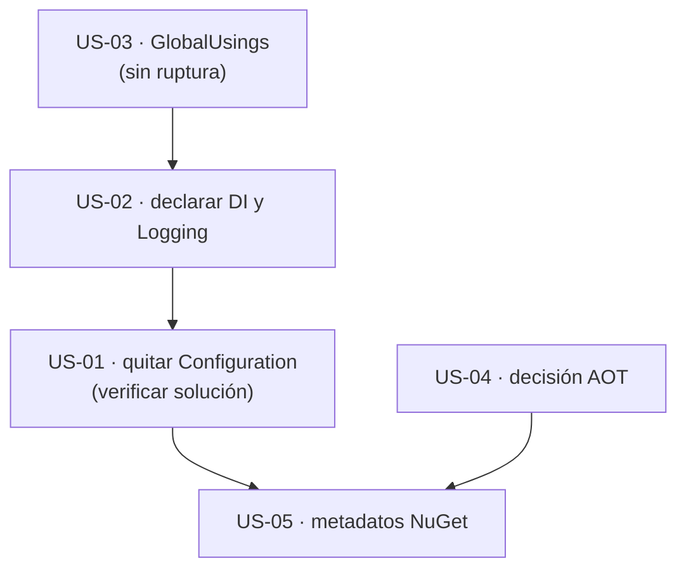

# 07 · Empaquetado y compatibilidad — `MoralesLarios.OOFP.Application`

> **Proyecto** · `src/MoralesLarios.OOFP.Application`
> **Versión actual** · 2.0.0 · `net8.0`
> **Versión destino** · 2.1.0 (puntos 02, 03, 05) · 2.1.0 con verificación de la solución (punto 01)
> **Origen** · análisis profundo de la capa de aplicación, posterior al commit `04b8ee3`; comprobaciones en copias desechables en `%TEMP%`
> **Estado** · ⬜ pendiente · documento de análisis, sin cambios aplicados
> **Esfuerzo total** · S (½ jornada)
> **Riesgo** · 🟡 medio el punto 01 (puede romper la compilación de un consumidor que use `IConfiguration` por transitividad) · 🟢 el resto

---

## Índice

1. [Contexto y problema](#1-contexto-y-problema)
2. [Alcance](#2-alcance)
3. [Historias de usuario](#3-historias-de-usuario)
4. [Orden de ejecución](#4-orden-de-ejecución)
5. [Decisiones abiertas](#5-decisiones-abiertas)
6. [Definición de terminado](#6-definición-de-terminado)
7. [Apéndice · código actual y propuesto](#7-apéndice--código-actual-y-propuesto)
8. [Ver también](#ver-también)

---

## 1. Contexto y problema

El `.csproj` tiene **22 líneas** y declara dos paquetes. De ellos, uno **no se usa** y, a la vez, las
dependencias que **sí** se usan directamente no están declaradas.

| Punto | Fichero | Líneas | Naturaleza |
|------:|---------|--------|------------|
| **01** | `MoralesLarios.OOFP.Application.csproj` · `GlobalUsings.cs` | `.csproj:13` · `GlobalUsings.cs:13` | de comportamiento (transitiva) |
| **02** | `MoralesLarios.OOFP.Application.csproj` | `.csproj:11-14` · `RegisterServices.cs:25` · `CrudServiceFp.cs:15` | aditiva |
| **03** | `GlobalUsings.cs` | 1-23 (12 líneas sobran) | aditiva |
| **04** | `MoralesLarios.OOFP.Application.csproj` | `.csproj:3-9` | aditiva |
| **05** | `MoralesLarios.OOFP.Application.csproj` | `.csproj:3-9` | aditiva |

> **Todas las cifras de este documento son medidas, no estimadas**, y cada hallazgo se referencia con `fichero:línea`.

> ℹ️ No se ha usado la *skill* `msbuild-antipatterns` ni el subagente `msbuild-code-review`: el `.csproj`
> tiene 22 líneas y se ha leído entero. Cuando se añadan los metadatos NuGet y un `Directory.Build.props`
> (punto 05), ese subagente es el apropiado para revisar el resultado.

---

### Punto 01 — Paquete sin uso y con la versión mayor equivocada

```xml
<!-- MoralesLarios.OOFP.Application/MoralesLarios.OOFP.Application.csproj, L11-L14 -->
<ItemGroup>
  <PackageReference Include="mapster" Version="7.4.0" />
  <PackageReference Include="Microsoft.Extensions.Configuration.Abstractions" Version="9.0.6" />
  <!--                                                                         ^^^^^ ← 9.x en un proyecto net8.0 -->
</ItemGroup>
```

```csharp
// MoralesLarios.OOFP.Application/GlobalUsings.cs, L13
global using Microsoft.Extensions.Configuration;      // ← el único consumidor posible del paquete
```

Dos problemas encadenados:

1. **No se usa.** Medido: **0** apariciones de `IConfiguration` en el código de producción de `Application`, y
   la compilación **sigue pasando con 0 errores** al quitar el `global using` (comprobado en copia desechable,
   punto 03). El `README` del proyecto ya lo reconoce («declarada pero no se usa»), y la planificación existente
   lo lista en
   [`Profesionalizacion-Ingenieria-y-Calidad.md`](../../Temas%20Pendientes/Profesionalizacion-Ingenieria-y-Calidad.md) (línea 131).
2. **Desajuste de versión mayor.** El proyecto apunta a `net8.0` y el resto de paquetes `Microsoft.Extensions.*`
   que resuelve son de la serie 8 (`DependencyInjection 8.0.0`, `Logging 8.0.0`, `…Abstractions 8.0.1`, según
   `obj/project.assets.json`); este paquete es el **único de la serie 9** (`9.0.6`). Lo arrastra cualquier
   consumidor, que acaba mezclando series.

Pero **quitarlo no es gratis**: lo que Application arrastra lo reciben sus consumidores por transitividad.
Medido: **4** proyectos que referencian `Application` (directa o indirectamente) mencionan `IConfiguration` o
`Microsoft.Extensions.Configuration`:

| Consumidor | Menciones |
|------------|----------:|
| `AspNetCore.Controllers.OutputCaching` | 1 |
| `AspNetCore.Results.Tests.Unit` | 3 |
| `Http.Tests.Integration` | 3 |
| `Application.Tests.Unit` | 3 |

No se ha determinado cuáles de ellos dependen **sólo** de la transitividad de este paquete (algunos declaran el
suyo, p. ej. `Application.Tests.Unit` referencia `Microsoft.Extensions.Configuration.Json`). La única forma de
saberlo es **compilar la solución entera sin el paquete**.

| Aspecto | Valor |
|---------|-------|
| **Corrección** | quitar el `PackageReference` **y** el `global using` (si se quita sólo el paquete, el `global using` deja de resolverse: `CS0246`) |
| **Ruptura** | ⚠️ **de comportamiento (transitiva)**: un consumidor que use `IConfiguration` sin declarar su paquete dejará de compilar. Se descubre con `dotnet build MoralesLarios.OOFP.sln` |

---

### Punto 02 — Dependencias de uso directo no declaradas

`Application` usa **directamente** `IServiceCollection` (`RegisterServices.cs:25`) y `ILogger<>`
(`CrudServiceFp.cs:15`), pero su `.csproj` **no declara** ni `Microsoft.Extensions.DependencyInjection.Abstractions`
ni `Microsoft.Extensions.Logging.Abstractions`. Llegan **por transitividad** desde los proyectos referenciados
(el origen exacto no se ha rastreado; el candidato natural es `EntityFrameworkCore`, que referencia
`Microsoft.EntityFrameworkCore 8.0.3`):

| Paquete | Versión resuelta | Declarado en `Application` |
|---------|------------------|:--------------------------:|
| `Microsoft.Extensions.DependencyInjection` | 8.0.0 | ❌ |
| `Microsoft.Extensions.DependencyInjection.Abstractions` | 8.0.1 | ❌ |
| `Microsoft.Extensions.Logging` | 8.0.0 | ❌ |
| `Microsoft.Extensions.Logging.Abstractions` | 8.0.1 | ❌ |
| `Microsoft.Extensions.Configuration.Abstractions` | 9.0.6 | ✅ (sin uso) |

La paradoja: **el único paquete `Microsoft.Extensions.*` declarado es el que no se usa**, y los dos que sí se
usan dependen de que el proyecto de EF los siga arrastrando.

| Aspecto | Valor |
|---------|-------|
| **Corrección** | declarar `DependencyInjection.Abstractions` y `Logging.Abstractions` (serie 8, la de `net8.0`) y quitar el del punto 01 |
| **Ruptura** | **ninguna**: se declara lo que ya se resuelve |

---

### Punto 03 — `GlobalUsings.cs`: 12 de 23 líneas sobran

`GlobalUsings.cs` tiene **23** líneas. Se ha comprobado **quitando cada una por separado** en una copia
desechable del proyecto y recompilando, y después quitando **las 12 que sobran a la vez**:

| # | `global using` | ¿Necesario? | Motivo |
|--:|----------------|:-----------:|--------|
| 1 | `System` | ❌ | ya lo trae `ImplicitUsings` |
| 2 | `System.Collections.Generic` | ❌ | ya lo trae `ImplicitUsings` |
| 3 | `System.Linq` | ❌ | ya lo trae `ImplicitUsings` |
| 4 | `System.Text` | ❌ | 0 usos (ni `StringBuilder` ni `Encoding`) |
| 5 | `System.Threading.Tasks` | ❌ | ya lo trae `ImplicitUsings` |
| 6 | `MoralesLarios.OOFP.Helpers` | ✅ | 24 errores si falta |
| 7 | `static MoralesLarios.OOFP.Helpers.Constants` | ❌ | 0 usos |
| 8 | `MoralesLarios.OOFP.Types` | ✅ | 80 errores |
| 9 | `MoralesLarios.OOFP.Types.Errors` | ✅ | 138 errores |
| 10 | `MoralesLarios.OOFP.ValueObjects` | ❌ | 0 usos |
| 11 | `MoralesLarios.OOFP.Helpers.Extensions` | ❌ | 0 usos |
| 12 | `MoralesLarios.OOFP.Shared.Pagination` | ❌ | 0 usos (y `GetPagedAsync` no pagina) |
| 13 | `Microsoft.Extensions.Configuration` | ❌ | 0 usos (punto 01) |
| 14 | `Microsoft.Extensions.DependencyInjection` | ✅ | 8 errores |
| 15 | `Microsoft.EntityFrameworkCore` | ❌ | 0 usos |
| 16 | `MoralesLarios.OOFP.EntityFrameworkCore.Repositories` | ✅ | 4 errores |
| 17 | `Microsoft.Extensions.Logging` | ✅ | 4 errores |
| 18 | `MoralesLarios.OOFP.Logging` | ✅ | 28 errores |
| 19 | `Mapster` | ✅ | 28 errores |
| 20 | `MoralesLarios.OOFP.EntityFrameworkCore.Helpers` | ✅ | 18 errores |
| 21 | `MoralesLarios.OOFP.Application.Services` | ✅ | 8 errores |
| 22 | `MoralesLarios.OOFP.EntityFrameworkCore` | ❌ | 0 usos |
| 23 | `static …Shared.Web.WebErrorDetailsKeys` | ✅ | 56 errores |

**Resultado:** quitando de golpe las líneas 1, 2, 3, 4, 5, 7, 10, 11, 12, 13, 15 y 22 el proyecto queda en
**11 líneas** y compila con **0 errores** (y con los mismos 32 avisos `CS8625`). Es el mismo patrón que el hallazgo G2
del análisis de `Logging` (`GlobalUsings` redundantes con `ImplicitUsings`).

| Aspecto | Valor |
|---------|-------|
| **Ocurrencias** | 12 líneas de 23 (52 %) |
| **Ruptura** | **ninguna**: los `global using` de una biblioteca no se exportan a sus consumidores |

---

### Punto 04 — AOT y trimming: la compatibilidad no está declarada ni verificada

El `.csproj` **no declara `IsAotCompatible`**. Se ha medido lo que diría el analizador **sin tocar el repositorio**,
con una propiedad de línea de comandos (`-p:IsAotCompatible=true`):

| Proyecto | Avisos `IL…` con la propiedad activa |
|----------|-------------------------------------:|
| `Application` | **0** |
| `Core` | 2 |
| `EntityFrameworkCore` | 27 |

`Application` sale limpio, pero **ese 0 no es una garantía**: el analizador sólo ve lo que está anotado.
Mapster **no marca** `Adapt<T>()` como incompatible con trimming, y en ejecución se comprobó que genera y
compila árboles de expresión (el fallo medido en [03](03-Modelo-de-Error.md#punto-01--16-mapasync-sin-protección-la-excepción-escapa-del-raíl)
fue una `CompileException`). Los 22 `.Adapt<` dependen de eso.

> ℹ️ No se ha usado la *skill* `dotnet-aot-compat`: ésta guía **resolver** avisos IL y el proyecto no tiene
> ninguno propio. Si se decide declarar `IsAotCompatible`, los 29 avisos de `Core` y `EntityFrameworkCore` son lo que bloquearía.

| Aspecto | Valor |
|---------|-------|
| **Corrección** | no declarar `IsAotCompatible` mientras dependa de Mapster en tiempo de ejecución; documentarlo en el `README` y en los metadatos del paquete |
| **Ruptura** | **ninguna** |

---

### Punto 05 — Metadatos NuGet ausentes y sin `Directory.Build.props`

```xml
<!-- MoralesLarios.OOFP.Application/MoralesLarios.OOFP.Application.csproj, L3-L9 -->
<PropertyGroup>
  <TargetFramework>net8.0</TargetFramework>
  <ImplicitUsings>enable</ImplicitUsings>
  <Nullable>enable</Nullable>
  <Version>2.0.0</Version>                                   <!-- ← L7 -->
  <GenerateDocumentationFile>true</GenerateDocumentationFile>
</PropertyGroup>
```

Medido: no hay `Directory.Build.props` ni `.editorconfig` ni en `src/` ni en la raíz. El proyecto no declara
`PackageId`, `Authors`, `Description`, `PackageLicenseExpression`, `RepositoryUrl`, `PackageReadmeFile` ni
SourceLink. Es el mismo estado que el hallazgo 10 del análisis de [`Core`](../Core/README.md#3-resumen-ejecutivo-los-12-hallazgos-de-mayor-impacto),
así que la solución correcta es **transversal** (un único `Directory.Build.props`), no por proyecto.

Lo que sí está bien y hay que **preservar**: `GenerateDocumentationFile` activo y **0** `CS1591`.

| Aspecto | Valor |
|---------|-------|
| **Corrección** | `Directory.Build.props` común con metadatos, SourceLink, build determinista y versión única |
| **Ruptura** | **ninguna** de API; la versión se centraliza (⛔ **no se sube sin preguntar antes al propietario**) |

---

## 2. Alcance

**Dentro:**

- Retirada del paquete `Configuration.Abstractions` y de su `global using`, **verificando la solución entera**.
- Declaración de `DependencyInjection.Abstractions` y `Logging.Abstractions` (serie 8).
- Limpieza de 12 de los 23 `global using`.
- Decisión documentada sobre AOT.
- Metadatos NuGet vía `Directory.Build.props` (transversal).

**Fuera:**

- Multi-targeting y SemVer del conjunto (análisis de `Core`).
- Los 27 avisos `IL…` de `EntityFrameworkCore` y los 2 de `Core`.
- Subir la versión del paquete.

---

## 3. Historias de usuario

> Inventario de intención para el futuro agente de épicas. Sin desarrollar.

- **US-01** · Que el paquete sin uso desaparezca sin romper a ningún consumidor.
- **US-02** · Que las dependencias directas estén declaradas con la serie de `net8.0`.
- **US-03** · Que `GlobalUsings.cs` contenga sólo lo que se usa.
- **US-04** · Que el estado AOT/trimming esté documentado.
- **US-05** · Que el paquete tenga metadatos NuGet y SourceLink.

---

## 4. Orden de ejecución



**Justificación.** La US-03 no rompe nada y deja el terreno limpio. La US-02 debe ir **antes** de la US-01: así
la retirada del paquete sin uso no deja a `Application` sin sus abstracciones.

---

## 5. Decisiones abiertas

| ID | Decisión | Opciones | Estado |
|----|----------|----------|--------|
| **D-01** | ¿Se quita `Configuration.Abstractions`? | (a) sí, y los consumidores que lo necesiten lo declaran · (b) sí, pero se deja declarado en los 4 consumidores afectados · (c) no, y se baja a la serie 8 por coherencia | ⬜ abierta |
| **D-02** | Versiones de `Microsoft.Extensions.*` | (a) serie 8 (coherente con `net8.0` y EF Core 8.0.3) · (b) serie 9 (obliga a subir EF Core) | ⬜ abierta |
| **D-03** | Dónde viven los metadatos | (a) `Directory.Build.props` en `src/` · (b) por proyecto | ⬜ abierta |

---

## 6. Definición de terminado

- [ ] `dotnet build MoralesLarios.OOFP.sln -c Release --no-incremental` con **0 errores** y **`CS1591` = 0**.
- [ ] Tests de la solución en verde respecto a la línea base medida antes de empezar.
- [ ] **0** ocurrencias de `Microsoft.Extensions.Configuration` en `Application` (paquete y `using`), **y la solución entera compila**.
- [ ] `GlobalUsings.cs` sin las 12 líneas innecesarias y **0 errores** de compilación.
- [ ] `obj/project.assets.json` sin `Microsoft.Extensions.Configuration.Abstractions/9.0.6` como dependencia directa de `Application`.
- [ ] Ninguna versión se sube sin preguntar antes al propietario.
- [ ] Las decisiones `D-01` … `D-03` están resueltas y anotadas.

---

## 7. Apéndice · código actual y propuesto

### 7.1 El `.csproj`

```xml
<!-- MoralesLarios.OOFP.Application/MoralesLarios.OOFP.Application.csproj, L11-L14 -->

<!-- ───── 2.0.0 (actual) ───── -->
<ItemGroup>
  <PackageReference Include="mapster" Version="7.4.0" />
  <PackageReference Include="Microsoft.Extensions.Configuration.Abstractions" Version="9.0.6" />
</ItemGroup>

<!-- ───── 2.1.0 (propuesta) ───── -->
<ItemGroup>
  <PackageReference Include="Mapster" Version="7.4.0" />
  <PackageReference Include="Microsoft.Extensions.DependencyInjection.Abstractions" Version="8.0.1" />
  <PackageReference Include="Microsoft.Extensions.Logging.Abstractions" Version="8.0.1" />
</ItemGroup>
```

### 7.2 `GlobalUsings.cs` tras la limpieza (11 líneas)

```csharp
// MoralesLarios.OOFP.Application/GlobalUsings.cs

// ───── 2.1.0 (propuesta) · las 11 líneas que se necesitan ─────
global using MoralesLarios.OOFP.Helpers;
global using MoralesLarios.OOFP.Types;
global using MoralesLarios.OOFP.Types.Errors;
global using Microsoft.Extensions.DependencyInjection;
global using MoralesLarios.OOFP.EntityFrameworkCore.Repositories;
global using Microsoft.Extensions.Logging;
global using MoralesLarios.OOFP.Logging;
global using Mapster;
global using MoralesLarios.OOFP.EntityFrameworkCore.Helpers;
global using MoralesLarios.OOFP.Application.Services;
global using static MoralesLarios.OOFP.Shared.Web.WebErrorDetailsKeys;
```

---

## Ver también

- [`README.md`](README.md) — índice de la carpeta.
- [`../Core/README.md`](../Core/README.md) — hallazgo 10 (metadatos NuGet) y roadmap de empaquetado.
- [`../Logging/README.md`](../Logging/README.md) — hallazgo G2 (`GlobalUsings` redundantes).
- [`../../Temas Pendientes/Profesionalizacion-Ingenieria-y-Calidad.md`](../../Temas%20Pendientes/Profesionalizacion-Ingenieria-y-Calidad.md) — ya lista `Configuration.Abstractions 9.0.6`.
