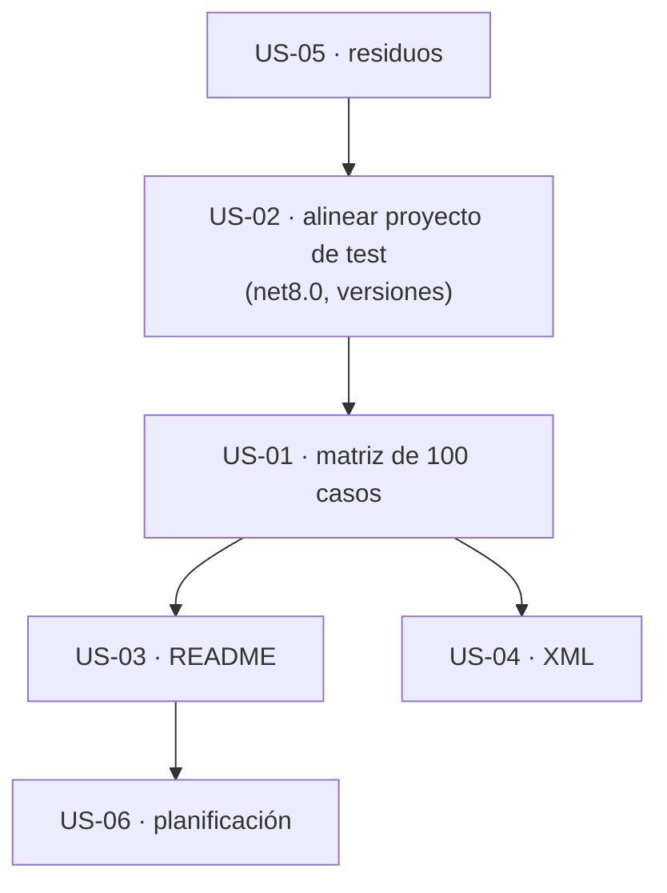

# 08 · Calidad, pruebas y documentación — `MoralesLarios.OOFP.Application`

> **Proyecto** · `src/MoralesLarios.OOFP.Application` y `src/MoralesLarios.OOFP.Application.Tests.Unit`
> **Versión actual** · 2.0.0 · `net8.0`
> **Versión destino** · 2.1.0
> **Origen** · análisis profundo de la capa de aplicación, posterior al commit `04b8ee3`, con comprobación empírica
> **Estado** · ⬜ pendiente · documento de análisis, sin cambios aplicados
> **Esfuerzo total** · XL (3+ jornadas) · el punto 01 es L, el 03 es M, el 02 es S
> **Riesgo** · 🟢 bajo · todo es aditivo; el valor está en que **habilita** los cambios de comportamiento de los documentos 03, 05 y 06

---

## Índice

1. [Contexto y problema](#1-contexto-y-problema)
2. [Alcance](#2-alcance)
3. [Historias de usuario](#3-historias-de-usuario)
4. [Orden de ejecución](#4-orden-de-ejecución)
5. [Decisiones abiertas](#5-decisiones-abiertas)
6. [Definición de terminado](#6-definición-de-terminado)
7. [Apéndice · código actual y propuesto](#7-apéndice--código-actual-y-propuesto)
8. [Ver también](#ver-también)

---

## 1. Contexto y problema

`Application` es el único proyecto de producción de la cadena repositorio → servicio → controlador **sin
una sola prueba activa**, y su documentación contiene datos que el código ya no respalda. Esa combinación
es la causa de que los defectos del [documento 03](03-Modelo-de-Error.md) sigan vivos: **no hay nada que
los detecte**.

| Punto | Fichero | Líneas | Naturaleza |
|------:|---------|--------|------------|
| **01** | `Application.Tests.Unit/*` | `UnitTest1.cs` (61 líneas) · `Startup.cs` (23) · `.csproj` | aditiva |
| **02** | `Application/README.md` | 93, 97, 108-124, 145, 191, 232, 235, 303-317, 336, 383, 432-455, 459-481, 483-499, 505-515, 544-552, 564-570, 801 | aditiva (documentación) |
| **03** | `Services/*.cs` · `MlProblemDetails.cs` · `Helpers/*.cs` | 40 + 40 + 67 + 14 + 3 + 2 ocurrencias | aditiva |
| **04** | `Services/CrudServiceFp.cs` · `Application.Tests.Unit/*` | `CrudServiceFp.cs:282-284,579-581` · `UnitTest1.cs` · `appsettings.test.json` | aditiva |
| **05** | `docs_next/Next_Versions/…` · `docs_next/Mejoras/Logging/README.md` | `Epica-Erratas…:38,53` · `Epica-Servicio…:33` · `Logging/README.md:§1.1` | aditiva |

> **Todas las cifras de este documento son medidas, no estimadas**, y cada hallazgo se referencia con `fichero:línea`.

> ℹ️ No se ha delegado en el subagente `test-quality-auditor`: el proyecto de pruebas **no tiene pruebas que
> auditar** (0 atributos `[Fact]`/`[Theory]`). Cuando existan, ese subagente (y las *skills* `assertion-quality`
> y `test-anti-patterns`) es el apropiado para revisar su calidad.

---

### Punto 01 — Cero pruebas activas

Medido sobre **todos** los proyectos de test de la solución (atributos `[Fact]`/`[Theory]` activos):

| Proyecto de test | Pruebas |
|------------------|--------:|
| `Core.Tests.Unit` | 805 |
| `Logging.Tests.Unit` | 230 |
| `ValueObjects.Tests.Unit` | 110 |
| `AspNetCore.Results.Tests.Unit` | 53 |
| `Http.Tests.Integration` | 33 |
| `ValueObjects.FileSystem.Tests.Unit` | 22 |
| `Configuration.Tests.Unit` | 18 |
| `Validation.FluentValidation.Tests.Unit` | 16 |
| `Validation.DataAnnotations.Tests.Unit` | 12 |
| `Http.Tests.Unit` | 7 |
| **`Application.Tests.Unit`** | **0** |
| `EntityFrameworkCore.Tests.Integration` | 0 (mismo criterio) |

```csharp
// MoralesLarios.OOFP.Application.Tests.Unit/UnitTest1.cs — 61 líneas
public class UnitTest1
{
    //[Fact]                          // ← todo lo demás está comentado
    //public void Test1() { … }
}
```

El proyecto **existe, está en la solución y compila**, pero su único fichero de pruebas tiene **5 líneas no
comentadas** (un `using`, un `namespace`, una clase vacía). `Startup.cs` registra el servicio con
`AddCrudServicesFpWithoutRepositories()` y la carpeta `FakeData/` tiene un `DbContext` y dos tipos
(`FakeDbContext.cs` 15 líneas, `MyTable.cs` 13, `MyTableDto.cs` 4) **que no usa ninguna prueba**.

Lo que esa ausencia deja sin red, por documento:

| Defecto | Medido en | Lo habría detectado una prueba de… |
|---------|-----------|------------------------------------|
| 16 `MapAsync` sin protección; el dato queda persistido | [03 · punto 01](03-Modelo-de-Error.md#punto-01--16-mapasync-sin-protección-la-excepción-escapa-del-raíl) | fallo de mapeo en `CreateAsync` |
| `DeleteAsync(dto)` sin 404 | [03 · punto 03](03-Modelo-de-Error.md#punto-03--deleteasyncdto--no-comprueba-existencia-no-hay-404) | borrar una fila inexistente |
| `BadRequestError("t")` no compila | [03 · punto 05](03-Modelo-de-Error.md#punto-05--badrequesterror-es-ambigua-cs0121) | cualquier llamada con sólo `title` |
| `pk` nulo lanza | [03 · punto 02](03-Modelo-de-Error.md#punto-02--pk-nulo-argumentnullexception-fuera-del-raíl) | `FindByIdAsync` con `null` |

Y el propio proyecto de test está **desalineado** con el resto de la solución:

| Elemento | `Application.Tests.Unit` | `Core.Tests.Unit` y `Logging.Tests.Unit` |
|----------|--------------------------|-------------------------------------------|
| `TargetFramework` | **net9.0** | net8.0 |
| `xunit` | 2.4.2 | 2.7.0 |
| `Microsoft.NET.Test.Sdk` | 17.3.2 | 17.9.0 |
| `moq` | 4.18.2 | 4.20.70 |
| `FluentAssertions` | 6.8.0 | 6.12.0 |
| `AutoFixture` | 4.17.0 | 4.18.1 (Core) |
| `Microsoft.Extensions.Configuration.Json` | 6.0.0 | 8.0.0 (Core) |

**Comprobación de que es viable.** Un arnés desechable con `Microsoft.EntityFrameworkCore.Sqlite 8.0.3` (ya
presente en la caché de NuGet de la solución porque lo usa `EntityFrameworkCore.Tests.Integration`) y SQLite en
memoria permitió ejecutar el servicio **de verdad** y obtener los datos de los documentos 03 y 05 en una sola
sesión. Es decir: la red de seguridad **no necesita SQL Server**.

| Aspecto | Valor |
|---------|-------|
| **Matriz propuesta** | 10 métodos × 5 escenarios (válido · no encontrado · fallo del repositorio · excepción de mapeo · `pk` nulo o vacío) × 2 modos = **100 casos** (aritmética de la propuesta, no una medida) |
| **Ruptura** | **ninguna** |

---

### Punto 02 — El `README` afirma cosas que ya no son ciertas

El `README.md` del proyecto (**924 líneas**) es la mejor fuente de conocimiento del servicio, pero **no se
debe usar como verdad** sin contrastarlo. Se han verificado 11 afirmaciones contra el código actual:

| # | `README` dice (línea) | Realidad (comprobada) |
|--:|-----------------------|-----------------------|
| 1 | «Versión del paquete: **1.0.10**» (l. 97) | `<Version>2.0.0</Version>` (`.csproj:7`) y el puente `[Obsolete]` de `Helpers/Extensions.Obsolete.cs:18` es de la 2.0.0 |
| 2 | `IEfRepository<TEntity>`, **`ParseKeyValues`** (l. 93) y su uso (l. 305-306) | **0** apariciones de `ParseKeyValues` en `EntityFrameworkCore`; el método es `FormatCompositeKey` |
| 3 | Estructura con `Services/GenService.cs` («fichero vacío», l. 115, 124, 568-570), `Helpers/Constants.cs` (l. 118) y `RegisterServices.cs → 6 extensiones` (l. 120) | `Services/` tiene **2** ficheros (`CrudServiceFp.cs`, `ICrudServiceFp.cs`); `Helpers/` tiene **2** (`Extensions.cs`, `Extensions.Obsolete.cs`); `RegisterServices` tiene **2** métodos (el propio `README` lo corrige en la l. 409) |
| 4 | «Ambos modos tienen **exactamente los mismos 11 métodos**» (l. 145, 232) y `AllAsync` (l. 191, 235, 801) | **10** miembros por modo (20 en total) y el método se llama `GetPagedAsync` |
| 5 | `BuildEntityNotFoundError` genera un diccionario con la clave `"NotFound"` y «**la capa HTTP no la reconocerá como 404**» (l. 303-317, 483-499) | Delega en `MlProblemDetails.NotFoundError(...)` (`Helpers/Extensions.cs:16-18`). **Medido:** `FindByIdAsync(…, 12345)` devuelve `ProblemsDetails: { Status = 404, … }` |
| 6 | `Type` por defecto = `https://www.puntonetalpunto.net/` (l. 336, 383) | `about:blank` (`Shared/Web/WebErrorDetailsKeys.cs:18`) |
| 7 | «Hay **dos definiciones** del mismo literal»: `Constants.ProblemsDetails` y una constante privada de `MlProblemDetails` (l. 505-515) | `MlProblemDetails` usa `ProblemsDetails` de `Shared` (`using static …WebErrorDetailsKeys`, `GlobalUsings.cs:23`); ya no hay duplicación |
| 8 | «**Es el defecto más importante de esta capa**»: `UpdateAsync` con `pk` puede fallar por conflicto de seguimiento de EF (l. 459-481) | **No reproducido**: `UpdateAsync(dto, …, pk: 1)` devolvió `IsSuccess=True` en SQLite en memoria. Lo que sí es cierto es que hay **dos búsquedas** ([05 · punto 06](05-Superficie-de-API-y-Arquitectura.md#punto-06--comprobaciones-redundantes)) |
| 9 | `AddWebServices(IServiceCollection, IConfiguration)` «quedó comentado en `RegisterServices`» (l. 564-566) | `RegisterServices.cs` **no** contiene ningún código comentado ni esa firma |
| 10 | `DeleteAsync(dto)` es «la **única** operación» con `MapAsync` sin protección (l. 455, 542) | Hay **16** `MapAsync` sin protección (2 DTO → entidad y **14** entidad → DTO); ver [03 · punto 01](03-Modelo-de-Error.md#punto-01--16-mapasync-sin-protección-la-excepción-escapa-del-raíl) |
| 11 | «Si el tipo no lo sobrescribe de forma útil, el log podría mostrar sólo el nombre del tipo» (l. 544-552) | `MlErrorDetails.ToString()` **está sobrescrito** (`Core/Types/Errors/MlErrorDetails.cs:245`); el problema real es el contrario: vuelca la pila entera ([03 · punto 06](03-Modelo-de-Error.md#punto-06--errorstostring-vuelca-la-traza-completa-de-la-excepción-al-log)) |

> Es una lección de método: **un `README` que enumera «particularidades reales» envejece más rápido que el
> código**. Las filas 5, 7, 8 y 10 cambian el diagnóstico (no sólo los datos).

| Aspecto | Valor |
|---------|-------|
| **Ocurrencias** | 11 afirmaciones desactualizadas o refutadas |
| **Ruptura** | **ninguna** (documentación) |

---

### Punto 03 — Documentación XML con texto de plantilla

El proyecto compila con `GenerateDocumentationFile` y **0** `CS1591`, pero buena parte del texto es de relleno:

| Texto de plantilla | Ocurrencias | Dónde |
|--------------------|------------:|-------|
| `<param>` «Mensaje descriptivo.» | **40** | `initialMessage` en las 40 firmas (20 de la clase + 20 de las interfaces) |
| `<param>` «Función a aplicar.» | **40** | `failMessageBuilder` |
| `<param>` «Valor de `<c>…</c>`.» | **67** | `notFoundErrorDetails`, `dtoRequest`, `title`, `detail`, `type`… |
| `<summary>` «Ejecuta `<c>…</c>`.» | **14** | las 14 fábricas de `MlProblemDetails` salvo `CreateProblemDetails` |
| `<summary>` «Representa `<c>…</c>`.» | **3** | `CrudServiceFp`, `MlProblemDetails` |
| `<summary>` vacío (`<c></c>`) | **2** | `Helpers/Extensions.cs:4` y `Extensions.Obsolete.cs:4` |

```csharp
// MoralesLarios.OOFP.Application/Services/CrudServiceFp.cs, L18-L23
/// <param name="initialMessage">Mensaje descriptivo.</param>                        // ← no dice cuándo se usa ni qué pasa con null
/// <param name="successMessageFactory">Función que crea la instancia solicitada.</param>
/// <param name="failMessageBuilder">Función a aplicar.</param>                       // ← no dice que recibe los errores y devuelve el texto del log
```

El mismo patrón está en `Logging` (hallazgo X1, 383 ocurrencias) y su épica de coherencia ya recoge el
objetivo. Aquí falta lo esencial de cada método: **qué ocurre con `pk` vacío**, **qué devuelve cuando no
existe la fila** (un `Fail` con 404, o con 500 en `DeleteAsync(dto)`), **que la traza de entrada se emite
siempre** y **que el servicio no valida más que `NotNull`**. Tampoco hay `<exception>` ni `<example>`.

| Aspecto | Valor |
|---------|-------|
| **Ocurrencias** | 166 plantillas (40 + 40 + 67 + 14 + 3 + 2) |
| **Ruptura** | **ninguna** |

---

### Punto 04 — Residuos: código comentado y configuración ajena

```csharp
// MoralesLarios.OOFP.Application/Services/CrudServiceFp.cs, L282-L284 (y L579-L581 idéntico)
//private MlErrorDetails BuildEntityNotFoundError(string tableName, params object[] keyValues)
//    => MlErrorDetails.FromErrorMessageDetails($"No data found for the {tableName} table by Id ({keyValues.FormatCompositeKey()})",
//                                               new Dictionary<string, object>() { ["NotFound"] = $"No data found …" });
//   ↑ la versión antigua del helper, sustituida por Helpers/Extensions.cs:16
```

| Residuo | Medido |
|---------|-------:|
| Bloques de código comentado en `CrudServiceFp.cs` | **2** (6 líneas) |
| `UnitTest1.cs` | 61 líneas, 5 vivas, el resto comentado (incluye una clase `PkComplexOptions` entera) |
| `Application.Tests.Unit/appsettings.test.json` | configuración de **otro dominio** (`ConnectionDB`, `Rutas`, `Proxy`) |

Este último merece atención: el fichero `appsettings.test.json` del proyecto de pruebas contiene una cadena de
conexión, una ruta de descompresión y una configuración de *proxy* **que no corresponden a este proyecto** y que
incluyen **dos nombres de host corporativos** (valores de usuario y contraseña enmascarados con `xxx`/`****`).
No hay credenciales reales a la vista, pero un repositorio de biblioteca pública **no debería** publicar
nombres de infraestructura de terceros ni arrastrar configuración que ninguna prueba lee (`Startup.cs:10-14` la
carga y no se usa).

| Aspecto | Valor |
|---------|-------|
| **Ocurrencias** | 2 bloques + 1 fichero de configuración ajena |
| **Ruptura** | **ninguna** |
| **Pendiente** | comprobar si esos nombres de host figuran en el historial de `git` antes de decidir la limpieza (el borrado no los retira del historial) |

---

### Punto 05 — La planificación existente arrastra datos obsoletos

Al contrastar los documentos de planificación con el árbol de trabajo (`HEAD` = `04b8ee3`) aparecen tres desajustes:

| Documento | Afirma | Realidad |
|-----------|--------|----------|
| [`Epica-Erratas-Identificadores-Publicos.md`](../../Next_Versions/2.0.0/Pendientes/Epica-Erratas-Identificadores-Publicos.md) (l. 38 y 53) | `AddScopedtGenServicesFpWithoutReposGeneral` **«corregido con puente»** en `Application/RegisterServices.Obsolete.cs` (2 declaraciones obsoletas) | El fichero **no existe** en el árbol de trabajo y `RegisterServices.cs` sólo tiene 2 métodos; 0 apariciones de `AddScopedt…` en `src/` |
| [`Epica-Servicio-y-Paginacion.md`](../../Next_Versions/2.0.0/Pendientes/Epica-Servicio-y-Paginacion.md) (l. 33) | «`CrudServiceFp<TDto, TEntity, TKey>`» | Las clases reales son `CrudServiceFp<TEntity, TDto>` y `CrudServiceFp<TEntity, TRequest, TResponse>`; **no existe** un parámetro `TKey` en el servicio |
| [`../Logging/README.md`](../Logging/README.md) (§1.1) | «`MoralesLarios.OOFP.Logging.Tests.Unit` **tampoco existe**» | Existe y tiene **230** pruebas activas |

El primero es el más importante: la épica de erratas da por cerrado con puente un cambio cuyo puente **ya no
está**. Es coherente con el historial (el `git log` del fichero incluye `9d84ec2`, *«unificar el ciclo de vida de la
inyección de dependencias en Transient»*) y con el `README` del proyecto (l. 409, «ahora son dos»), pero el documento de planificación no lo
refleja, de modo que un lector creería que un consumidor 1.x **tiene** puente cuando no lo tiene.

| Aspecto | Valor |
|---------|-------|
| **Ocurrencias** | 3 documentos |
| **Ruptura** | **ninguna** (documentación) · la retirada de los métodos `Add{Transient\|Scoped\|Singleton}…` es una **ruptura de compilación ya aplicada** y **ya consta** en el prompt de migración como punto 62 (tabla §3.3, l. 397; subsección `#### 62`, l. 1653) y en el anexo de renombrados (l. 489-494): el consumidor tiene la tabla antiguo → nuevo, pero **no** un puente `[Obsolete]` |

---

## 2. Alcance

**Dentro:**

- Pruebas del servicio, de `MlProblemDetails` y de `BuildEntityNotFoundError` con SQLite en memoria.
- Alineación del proyecto de pruebas con `net8.0` y las versiones del resto.
- Corrección del `README` del proyecto (11 puntos).
- Sustitución de las plantillas XML por texto útil, `<exception>` y `<example>`.
- Retirada del código comentado y de la configuración ajena.
- Corrección de los tres documentos de planificación.

**Fuera:**

- Arreglar los defectos que las pruebas revelen (documentos 03, 05 y 06).
- La calidad de las pruebas de otros proyectos.
- Un proyecto de pruebas de integración contra SQL Server.

---

## 3. Historias de usuario

> Inventario de intención para el futuro agente de épicas. Sin desarrollar.

- **US-01** · Que `Application.Tests.Unit` tenga la matriz de 100 casos y falle hoy en los 4 defectos conocidos (como **pruebas que documentan el defecto**, marcadas hasta que se corrijan).
- **US-02** · Que el proyecto de pruebas use `net8.0` y las mismas versiones que `Core.Tests.Unit`.
- **US-03** · Que el `README` del proyecto refleje el código actual.
- **US-04** · Que los 166 `<param>`/`<summary>` de plantilla se sustituyan por texto informativo.
- **US-05** · Que no queden residuos de código comentado ni configuración ajena en el proyecto de pruebas.
- **US-06** · Que los tres documentos de planificación se corrijan (la retirada de los registros 1.x ya consta en el prompt de migración como punto 62).

---

## 4. Orden de ejecución



**Justificación.** El proyecto de pruebas se limpia y se alinea **antes** de escribir en él. El `README` va
después de la matriz porque la matriz **demuestra** qué afirmaciones eran ciertas (filas 5, 8 y 10).

> ⚠️ **Esta es la épica que desbloquea todas las demás.** Ninguna historia de los documentos 01, 03, 05 y 06
> debe empezar sin la US-01.

---

## 5. Decisiones abiertas

| ID | Decisión | Opciones | Estado |
|----|----------|----------|--------|
| **D-01** | Cómo ejecutar el servicio en pruebas | (a) SQLite en memoria con repositorios reales (lo que hizo el arnés) · (b) repositorio simulado con `Moq` (más rápido, no prueba EF) · (c) ambos: simulado para la lógica, SQLite para 5-6 pruebas de integración | ⬜ abierta |
| **D-02** | ¿Cómo se tratan los defectos conocidos hasta corregirlos? | (a) prueba que **afirma el comportamiento actual** y se invierte al corregir · (b) prueba que afirma el **correcto**, marcada `Skip` con enlace al hallazgo · (c) sólo documentar | ⬜ abierta |
| **D-03** | Destino de `appsettings.test.json` | (a) borrar el fichero y la carga de `Startup.cs` · (b) sustituir por uno mínimo · (c) conservar | ⬜ abierta |
| **D-04** | Versión de `TargetFramework` del proyecto de test | (a) `net8.0` (como el resto) · (b) mantener `net9.0` | ⬜ abierta |

> **Sobre D-02.** La opción (b) es la que menos confunde en el informe de pruebas y la que mejor sobrevive:
> cuando se corrija el defecto, basta quitar el `Skip`. La (a) deja una prueba que **debe fallar** en el
> momento de la corrección, lo que sirve de recordatorio pero ensucia la ejecución mientras tanto.

---

## 6. Definición de terminado

- [ ] `dotnet build MoralesLarios.OOFP.sln -c Release --no-incremental` con **0 errores** y **`CS1591` = 0**.
- [ ] `Application.Tests.Unit` con **≥ 100** pruebas activas, todas en verde (las que documentan un defecto, marcadas según [D-02](#5-decisiones-abiertas)).
- [ ] Existe al menos **una prueba por cada** una de las 11 filas de [§Punto 02](#punto-02--el-readme-afirma-cosas-que-ya-no-son-ciertas) que contradice al `README`.
- [ ] El proyecto de pruebas usa `net8.0` y las mismas versiones de paquetes que `Core.Tests.Unit`.
- [ ] **0** ocurrencias de «Mensaje descriptivo.» y «Función a aplicar.» en `Application`.
- [ ] **0** bloques de código comentado en `CrudServiceFp.cs` y `UnitTest1.cs` sin clase comentada.
- [ ] El `README` del proyecto no contiene `1.0.10`, `ParseKeyValues`, `GenService`, `Constants.cs` ni `AllAsync`.
- [ ] `Epica-Erratas-Identificadores-Publicos.md` refleja que `RegisterServices.Obsolete.cs` ya no existe y remite al
      punto 62 de
      [`../../Copilot/.github/prompts/oofp-upgrade-2.prompt.md`](../../Copilot/.github/prompts/oofp-upgrade-2.prompt.md),
      donde la retirada de los registros `Add{Transient|Scoped|Singleton}…` ya está registrada en los seis sitios.
- [ ] Las decisiones `D-01` … `D-04` están resueltas y anotadas.

---

## 7. Apéndice · código actual y propuesto

### 7.1 Esqueleto de la matriz (punto 01)

```csharp
// MoralesLarios.OOFP.Application.Tests.Unit/Services/CrudServiceFpTests.cs

// ───── 2.0.0 (actual) ─────
public class UnitTest1 { /* todo comentado */ }

// ───── 2.1.0 (propuesta) ─────
public class CrudServiceFpTests : IDisposable
{
    private readonly SqliteConnection _conn = new("DataSource=:memory:");        // ← la misma técnica que el arnés de este análisis

    // Escenario «excepción de mapeo» (hallazgo 03·01): hoy lanza, debe devolver Fail.
    [Fact(Skip = "Defecto 03·01 · quitar el Skip al sustituir MapAsync por TryMapAsync")]
    public async Task CreateAsync_WhenEntityToDtoMappingThrows_ReturnsFail()
    {
        var result = await Service<Item, AbstractDto>().CreateAsync(new ConcreteDto { Id = 2, Name = "x" });
        result.IsFailure.Should().BeTrue();
    }

    [Fact]
    public async Task FindByIdAsync_WhenRowDoesNotExist_ReturnsFailWith404()
    {
        var result = await Service<Item, ItemDto>().FindByIdAsync(default, null, null, null, 12345);
        result.IsFailure.Should().BeTrue();   // y el detalle contiene `Status = 404` (medido en este análisis)
    }

    public void Dispose() { TypeAdapterConfig<ItemDto, Item>.Clear(); _conn.Dispose(); }   // ← Mapster es global estático: limpiar entre pruebas
}
```

### 7.2 Alineación del proyecto de pruebas (punto 01)

```xml
<!-- MoralesLarios.OOFP.Application.Tests.Unit/MoralesLarios.OOFP.Application.Tests.Unit.csproj -->

<!-- ───── 2.0.0 (actual) ───── -->
<TargetFramework>net9.0</TargetFramework>
<PackageReference Include="xunit" Version="2.4.2" />

<!-- ───── 2.1.0 (propuesta) ───── -->
<TargetFramework>net8.0</TargetFramework>
<PackageReference Include="xunit" Version="2.7.0" />
<PackageReference Include="Microsoft.EntityFrameworkCore.Sqlite" Version="8.0.3" />
```

---

## Ver también

- [`README.md`](README.md) — índice de la carpeta.
- [`03-Modelo-de-Error.md`](03-Modelo-de-Error.md) — los defectos que esta red de seguridad debe atrapar.
- [`../Logging/README.md`](../Logging/README.md) — su `Logging.Tests.Unit` (230 pruebas) es el modelo a seguir.
- [`../../Next_Versions/2.0.0/Pendientes/Epica-Coherencia-Y-Documentacion.md`](../../Next_Versions/2.0.0/Pendientes/Epica-Coherencia-Y-Documentacion.md) — coherencia de la documentación XML.
- [`../../../MoralesLarios.OOFP.Application/README.md`](../../../MoralesLarios.OOFP.Application/README.md) — el `README` que se corrige.
