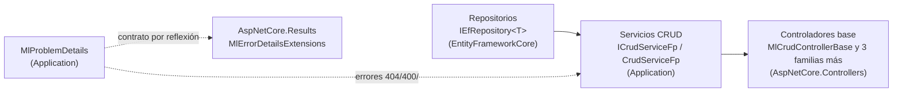
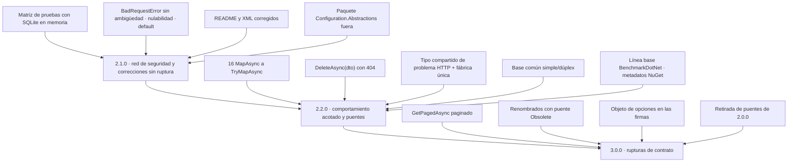

# Mejoras del proyecto `MoralesLarios.OOFP.Application`

> **Proyecto analizado** · `src/MoralesLarios.OOFP.Application` (y, como contexto de contrato, `src/MoralesLarios.OOFP.Application.Tests.Unit`)
> **Versión actual** · 2.0.0 · `net8.0`
> **Fecha del análisis** · 2026-11-03, tras el commit `04b8ee3` (rama `release/2.0.0-nomenclatura`)
> **Objetivo** · identificar las mejoras que hacen la capa de aplicación **más robusta como puente entre repositorios, servicios CRUD y controladores**, más estándar respecto a .NET y más fácil de mantener
> **Naturaleza** · documento de análisis y planificación. No contiene cambios de código aplicados.

---

## Índice

1. [Qué es este conjunto de documentos](#1-qué-es-este-conjunto-de-documentos)
2. [Fotografía cuantitativa](#2-fotografía-cuantitativa)
3. [Resumen ejecutivo: los 12 hallazgos de mayor impacto](#3-resumen-ejecutivo-los-12-hallazgos-de-mayor-impacto)
4. [Índice de documentos](#4-índice-de-documentos)
5. [Matriz de prioridad y esfuerzo](#5-matriz-de-prioridad-y-esfuerzo)
6. [Hoja de ruta propuesta por versiones](#6-hoja-de-ruta-propuesta-por-versiones)
7. [Relación con la planificación ya existente](#7-relación-con-la-planificación-ya-existente)
8. [Convenciones de estos documentos](#8-convenciones-de-estos-documentos)

---

## 1. Qué es este conjunto de documentos

`MoralesLarios.OOFP.Application` es el **eslabón central** de la cadena

- **Hacia abajo** consume `IEfRepository<TEntity>` (de los 20+ métodos del repositorio sólo usa 5 nombres, ver [05](05-Superficie-de-API-y-Arquitectura.md)).
- **Hacia arriba** lo consumen **8 clases base abstractas** de controlador (4 familias × modo simple/dúplex) repartidas en `AspNetCore.Controllers` y `AspNetCore.Controllers.OutputCaching`.
- **Hacia el borde HTTP**, `MlProblemDetails` fabrica errores cuya forma (un objeto anónimo) se lee **por reflexión** en `AspNetCore.Results`.

Este análisis se ha hecho **leyendo todo el código de producción del proyecto** (7 ficheros, 1.426 líneas),
**compilándolo** y **ejecutando un arnés desechable** (SQLite en memoria, ya borrado) para confirmar
empíricamente los comportamientos dudosos. **Todas las cifras de estos documentos son medidas, no
estimadas**, y cada hallazgo se referencia con `fichero:línea`.

Igual que en los análisis de `Core` y `Logging`, las mejoras se separan en tres categorías:

- Mejoras **aditivas** · no rompen nada, caben en una versión menor.
- Mejoras **de comportamiento** · compilan igual pero se ejecutan distinto ⇒ **ruptura silenciosa**, hay que documentarlas (ver [§8.3](#83-obligación-de-documentar-rupturas)).
- Mejoras **rupturistas** · el compilador avisa al consumidor ⇒ puentes `[Obsolete]` y versión mayor.

### 1.1 Quién consume este proyecto

Cuatro proyectos referencian `MoralesLarios.OOFP.Application.csproj`:

| Proyecto consumidor | Relación |
|---------------------|----------|
| `MoralesLarios.OOFP.AspNetCore.Controllers` | producción · 4 clases base abstractas (2 familias × modo simple/dúplex) con `ICrudServiceFp` en el constructor primario |
| `MoralesLarios.OOFP.AspNetCore.Results.Tests.Unit` | pruebas · 1 coincidencia de uso directo |
| `MoralesLarios.OOFP.Http.Tests.Integration` | pruebas de integración |
| `MoralesLarios.OOFP.Application.Tests.Unit` | **0 pruebas activas** (ver [08](08-Calidad-Pruebas-y-Documentacion.md)) |

Además, `AspNetCore.Controllers.OutputCaching` consume `ICrudServiceFp` por transitividad (4 clases base más).
⇒ Toda ruptura de firma se propaga a **8 clases base abstractas** y a todos los controladores de usuario que hereden de ellas.

### 1.2 Lo que **no** se ha encontrado

Para no inflar el análisis se dejan registradas las comprobaciones con resultado favorable:

| Comprobación | Resultado |
|--------------|-----------|
| El servicio no usa `async`/`await` propios | **0** `async` en `CrudServiceFp.cs` · no hay máquinas de estado en esta capa |
| Cancelación | ✅ **40** apariciones de `CancellationToken`; se propaga a los 5 métodos del repositorio que se usan |
| Paridad simple/dúplex | ✅ los dos modos tienen **10 miembros cada uno** (20 en total) |
| `BuildEntityNotFoundError` y el 404 | ✅ delega en `MlProblemDetails.NotFoundError` ⇒ produce `Status = 404` con la clave `ProblemsDetails` (comprobado en ejecución) |
| `ToString()` de `MlErrorDetails` | ✅ está sobrescrito (`Core/Types/Errors/MlErrorDetails.cs:245`) ⇒ `errors.ToString()` no devuelve el nombre del tipo |
| `UpdateAsync(…, pk)` y el conflicto de seguimiento de EF | ✅ **no reproducido** (ver [08](08-Calidad-Pruebas-y-Documentacion.md#punto-02--el-readme-afirma-cosas-que-ya-no-son-ciertas)) |
| Avisos de compilación propios | sólo `CS8625` (32) · **0** `CS1591` · **0** errores |

---

## 2. Fotografía cuantitativa

### 2.1 Tamaño y distribución

| Métrica | Valor |
|---------|------:|
| Ficheros `.cs` de producción (sin `bin`/`obj`) | **7** |
| Líneas totales | **1.426** |
| Líneas en blanco | **109** (7,6 %) |
| Comentarios no documentales (`//`) | **19** (de ellos 6 son código comentado) |
| Tipos públicos | **7** (3 clases estáticas, 2 interfaces, 2 clases) |
| Miembros públicos | **59** (15 fábricas + 2 registros + 2 extensiones + 20 de interfaz + 20 de clase) |
| `README.md` del proyecto | 924 líneas |

| Líneas | Fichero | Blancas | Comentadas |
|-------:|---------|--------:|-----------:|
| 586 | `Services/CrudServiceFp.cs` | 65 | 9 |
| 460 | `MlProblemDetails.cs` | 20 | 3 |
| 272 | `Services/ICrudServiceFp.cs` | 13 | 3 |
| 45 | `RegisterServices.cs` | 7 | 3 |
| 23 | `GlobalUsings.cs` | 0 | 0 |
| 20 | `Helpers/Extensions.cs` | 4 | 0 |
| 20 | `Helpers/Extensions.Obsolete.cs` | 0 | 1 |
| **1.426** | **7 ficheros** | **109** | **19** |

Dos ficheros concentran **el 73 %** del proyecto (`CrudServiceFp.cs` + `MlProblemDetails.cs` = 1.046 de 1.426 líneas).

### 2.2 Superficie pública

| Métrica | Valor | Comentario |
|---------|------:|------------|
| Métodos `public virtual` en `CrudServiceFp` | **20** | 10 por modo; todos `virtual` (decisión deliberada, punto fuerte) |
| Miembros de `ICrudServiceFp` | **20** | 10 por modo (el `README` dice 11) |
| Fábricas en `MlProblemDetails` | **15** | 14 bloques de construcción idénticos + 1 sobrecarga que delega |
| Métodos de registro | **2** | `AddCrudServicesFpWithoutRepositories`, `AddCrudServicesDuplexFpWithoutRepositories` |
| `params object[] pk` en la implementación | **14** | además 12 en las interfaces |
| Miembros `[Obsolete]` reales | **1** | `BuildNotFoundPkError` (`Helpers/Extensions.Obsolete.cs:18-19`) |
| Métodos distintos del repositorio usados | **5** | `TryAllAsync`, `TryFindAsync`, `TryAddAsync`, `TryUpdateAsync`, `TryRemoveAsync` (18 llamadas) |

Cadena funcional de cada operación (en `CrudServiceFp.cs`):

| Operador | Apariciones |
|----------|------------:|
| `LogMlResultInformationAsync` (arranque de la cadena) | 14 |
| `.BindAsync(` | 30 |
| `.TryMapAsync(` | 6 |
| **`.MapAsync(` (sin protección)** | **16** |
| `.LogCompletedResultAsync(` | 14 |
| `.Adapt<` (Mapster) | 22 |

### 2.3 Lo que **falta**

| Elemento estándar | Ocurrencias |
|-------------------|------------:|
| `ArgumentNullException` / `ThrowIfNull` | **0** |
| `ConfigureAwait` | **0** (irrelevante aquí: la capa no hace `await`) |
| `ILogger.IsEnabled` | **0** (es una carencia de `Logging`, ver su documento) |
| `IMapper` / `TypeAdapterConfig` (mapeo inyectable) | **0** |
| `PagedResult` / `PageRequest` (aunque `GetPagedAsync` se llama así) | **0** |
| `IConfiguration` (aunque el paquete y el `using` existen) | **0** |
| Pruebas activas (`[Fact]`/`[Theory]`) | **0** |
| `Directory.Build.props` / `.editorconfig` en la solución | **no existen** |

Y lo que hay en exceso:

| Elemento | Ocurrencias | Comentario |
|----------|------------:|------------|
| `null!` en valores por omisión | **136** | 60 en `MlProblemDetails.cs`, 54 en `CrudServiceFp.cs`, 22 en `ICrudServiceFp.cs` |
| `default!` sobre `CancellationToken` | **27** | además 12 `default` a secas: dos grafías para lo mismo |
| `<param>` de plantilla «Mensaje descriptivo.» / «Función a aplicar.» | **40 / 40** | mismo texto para semánticas distintas |
| `<param>` «Valor de `<c>…</c>`.» | **67** | sin información |
| `typeof(TDto\|TEntity\|TResponse).Name` en mensajes | **39** | tres criterios distintos |
| Cadenas por defecto `"An error occurred … Error: {errors.ToString()}"` | **14** | inglés fijo en el código |

### 2.4 Estado de compilación

| Métrica | Valor |
|---------|------:|
| `dotnet build … Application.csproj -c Release --no-incremental` | **0 errores** |
| Líneas de aviso únicas totales | **83** |
| Avisos **propios** de `Application` | **32** (todos `CS8625`, todos en `ICrudServiceFp.cs`) |
| Heredados | `ValueObjects` 44 · `Core` 4 · `Shared` 2 · `EntityFrameworkCore` 1 |
| `CS1591` (documentación XML ausente) | **0** |

---

## 3. Resumen ejecutivo: los 12 hallazgos de mayor impacto

| # | Hallazgo | Documento | Prioridad | Rompe |
|--:|----------|-----------|-----------|:-----:|
| 1 | **16 `MapAsync` sin protección** · una excepción de Mapster escapa del raíl. **Medido:** `CreateAsync` lanza `CompileException` **y la fila queda persistida**; `DeleteAsync(dto)` lanza `InvalidOperationException` | [03](03-Modelo-de-Error.md) | 🔴 crítica | sí (silenciosa) |
| 2 | **Cero pruebas activas** · 20 métodos públicos sin red de seguridad; es la causa de que el punto 1 siga vivo | [08](08-Calidad-Pruebas-y-Documentacion.md) | 🔴 crítica | no |
| 3 | **`GetPagedAsync` no pagina** · `SELECT *` de toda la tabla (`CrudServiceFp.cs:33,328`); la infraestructura de paginación ya existe | [06](06-Rendimiento.md) | 🔴 alta | sí (firma) |
| 4 | **`DeleteAsync(dto)` no comprueba existencia** · medido: devuelve `DbUpdateConcurrencyException` con traza completa, no un 404 | [03](03-Modelo-de-Error.md) | 🟠 alta | sí (silenciosa) |
| 5 | **`BadRequestError(...)` es ambigua** · medido: `CS0121` en `BadRequestError("t")`, `BadRequestError()` y `BadRequestError(detail: "d")` | [03](03-Modelo-de-Error.md) | 🟠 alta | no (aditivo) |
| 6 | **Contrato por reflexión con un objeto anónimo** · `Status`/`StatusCode` duplicados por exigencia de `AspNetCore.Results` | [03](03-Modelo-de-Error.md) | 🟠 alta | no (aditivo) |
| 7 | **`FindByIdProblemsDetailsAsync` vs `DeleteProblemDetailsAsync`** · dos grafías, y el nombre promete un `ProblemDetails` que no devuelve | [01](01-Nomenclatura-y-Estandares.md) | 🟠 alta | sí (compilación) |
| 8 | **README desactualizado** · 11 discrepancias verificadas (versión, estructura, 404, defecto de `UpdateAsync` no reproducible…) | [08](08-Calidad-Pruebas-y-Documentacion.md) | 🟠 alta | no |
| 9 | **136 `null!` y 32 `CS8625`** · la nulabilidad declarada miente; el 100 % de los avisos propios sale de 12 firmas en una línea | [04](04-Nulabilidad-Genericos-y-Contratos.md) | 🟡 media | no (aditivo) |
| 10 | **Dos clases de 272 y 281 líneas con la misma lógica** (modo simple y dúplex) · y ya han divergido (`TDto` / `TResponse` / `TEntity` en los mensajes) | [05](05-Superficie-de-API-y-Arquitectura.md) | 🟡 media | no / comportamiento |
| 11 | **Paquete `Microsoft.Extensions.Configuration.Abstractions 9.0.6` sin uso** en un proyecto `net8.0` | [07](07-Empaquetado-y-Compatibilidad.md) | 🟡 media | sí (transitiva) |
| 12 | **`MlProblemDetails`: 14 bloques clonados** en 460 líneas | [05](05-Superficie-de-API-y-Arquitectura.md) | 🟡 media | no |

---

## 4. Índice de documentos

| Documento | Contenido | Hallazgos |
|-----------|-----------|----------:|
| [`01-Nomenclatura-y-Estandares.md`](01-Nomenclatura-y-Estandares.md) | Pareja `ProblemsDetails`/`ProblemDetails`, clase `Extensions`, parámetros `_repo`/`_logger`, `vinoBd`, dos tipos por fichero, `tableName` que recibe nombres de tipo | 6 |
| `02-Interoperabilidad-BCL.md` | **No se crea** · el único hallazgo (posición de `CancellationToken`) se documenta en [05](05-Superficie-de-API-y-Arquitectura.md#punto-05--explosión-de-parámetros-y-posición-del-cancellationtoken) | 0 |
| [`03-Modelo-de-Error.md`](03-Modelo-de-Error.md) | `MapAsync` sin protección, `pk` nulo, `DeleteAsync(dto)`, contrato anónimo, `CS0121`, `errors.ToString()` | 6 |
| [`04-Nulabilidad-Genericos-y-Contratos.md`](04-Nulabilidad-Genericos-y-Contratos.md) | 32 `CS8625`, 136 `null!`, 27 `default!`, `MlResult<TDto?>` | 4 |
| [`05-Superficie-de-API-y-Arquitectura.md`](05-Superficie-de-API-y-Arquitectura.md) | Acoplamiento a `IEfRepository`, `MlProblemDetails` clonado, Mapster estático, duplicación simple/dúplex, explosión de parámetros, comprobaciones redundantes | 6 |
| [`06-Rendimiento.md`](06-Rendimiento.md) | `GetPagedAsync`, mensajes interpolados eager, ausencia de línea base | 3 |
| [`07-Empaquetado-y-Compatibilidad.md`](07-Empaquetado-y-Compatibilidad.md) | Paquete sin uso, dependencias directas no declaradas, `GlobalUsings` (12 de 23 sobran), AOT/trimming, metadatos NuGet | 5 |
| [`08-Calidad-Pruebas-y-Documentacion.md`](08-Calidad-Pruebas-y-Documentacion.md) | Cero pruebas, README obsoleto (11 afirmaciones), XML de plantilla (166), residuos y configuración ajena, planificación con datos obsoletos | 5 |

**Total: 35 hallazgos documentados.**

---

## 5. Matriz de prioridad y esfuerzo

> **Esfuerzo** · XS (<2 h) · S (½ jornada) · M (1 jornada) · L (2 jornadas) · XL (3+ jornadas)
> **Riesgo** · 🟢 bajo · 🟡 medio · 🟠 alto · 🔴 muy alto (rompe compatibilidad)

### 5.1 Ganancia alta / coste bajo — hacer primero

| Mejora | Doc | Esfuerzo | Riesgo |
|--------|-----|:--------:|:------:|
| Crear la red de seguridad: matriz de 20 métodos × {válido, fallo de repositorio, excepción de mapeo} con SQLite en memoria | 08 | L | 🟢 |
| Sustituir los 16 `MapAsync` por `TryMapAsync` (con su prueba) | 03 | S | 🟠 (silenciosa) |
| Quitar los valores por defecto de la sobrecarga `BadRequestError(…, IEnumerable<ValidationResult>)` | 03 | XS | 🟢 |
| Corregir los 12 `= null` de `ICrudServiceFp.cs` (32 `CS8625`) | 04 | XS | 🟢 |
| Sustituir `default!` por `default` en los 27 `CancellationToken` | 04 | XS | 🟢 |
| Retirar el paquete `Configuration.Abstractions` y su `using` (verificando la solución entera) | 07 | XS | 🟡 |
| Reescribir el `README` con los 11 datos corregidos | 08 | S | 🟢 |
| Sanear los `<param>` de plantilla (40 + 40 + 67) | 08 | M | 🟢 |

### 5.2 Ganancia alta / coste medio-alto — planificar

| Mejora | Doc | Esfuerzo | Riesgo |
|--------|-----|:--------:|:------:|
| Tipo compartido para el problema HTTP (en `Shared`) y fábrica privada única en `MlProblemDetails` | 03 · 05 | M | 🟢 |
| `DeleteAsync(dto)` con comprobación de existencia y 404 | 03 | M | 🟠 |
| Base compartida entre servicio simple y dúplex | 05 | L | 🟡 |
| Estrechar la dependencia del repositorio a lo que se usa | 05 | M | 🟡 |
| `MlResult<TDto?>` → `MlResult<TDto>` en `FindById*` (sólo avisos `CS8619`) | 04 | S | 🟡 |
| Mapeo inyectable (`IMlMapper` opcional) | 05 | M | 🟢 |
| Línea base con BenchmarkDotNet | 06 | S | 🟢 |
| Metadatos NuGet y SourceLink | 07 | S | 🟢 |

### 5.3 Rupturista — con puente `[Obsolete]` o sólo en 3.0.0

| Mejora | Doc | Esfuerzo | Riesgo |
|--------|-----|:--------:|:------:|
| `GetPagedAsync` con `PageRequest` y `PagedResult<TDto>` (ya planificada) | 06 | M | 🔴 |
| Renombrar `FindByIdProblemsDetailsAsync` / `DeleteProblemDetailsAsync` | 01 | M | 🔴 |
| Renombrar la clase `Extensions` y su método sobre `string` | 01 | XS | 🔴 |
| Objeto de opciones en lugar de 3 parámetros de mensaje + `ct` + `pk` | 05 | XL | 🔴 |

---

## 6. Hoja de ruta propuesta por versiones

| Versión | Carácter | Contenido | Jornadas estimadas |
|---------|----------|-----------|-------------------:|
| **2.1.0** | aditivo | Red de seguridad, avisos de nulabilidad, `CS0121`, paquete sin uso, README y XML | ~6 |
| **2.2.0** | comportamiento acotado | `TryMapAsync`, `DeleteAsync(dto)`, tipo compartido, base común, línea base, metadatos | ~8 |
| **3.0.0** | rupturista | Paginación real, renombrados, objeto de opciones, retirada de puentes | ~7 |

> Las jornadas son **estimación de esfuerzo de planificación** (suma de las leyendas XS-XL de cada documento), no una medición.

---

## 7. Relación con la planificación ya existente

Este análisis **no duplica** lo que ya existe; cuando un hallazgo ya estaba planificado se **referencia** y sólo se añade lo que falta.

| Documento existente | Qué cubre ya | Cómo se relaciona |
|---------------------|--------------|-------------------|
| [`../../Next_Versions/2.0.0/Pendientes/Epica-Servicio-y-Paginacion.md`](../../Next_Versions/2.0.0/Pendientes/Epica-Servicio-y-Paginacion.md) | `GetPagedAsync` sin paginar, `MapAsync` en 271 y 568, tipo equivocado en los mensajes, auditoría de los 16 `MapAsync` | [03](03-Modelo-de-Error.md) y [06](06-Rendimiento.md) **aportan la auditoría ya hecha** (14 + 2) y la evidencia empírica |
| [`../../Next_Versions/2.0.0/Pendientes/Epica-Mensajes-Y-Localizacion.md`](../../Next_Versions/2.0.0/Pendientes/Epica-Mensajes-Y-Localizacion.md) | `vinoBd` (L83 y L380) e instrumentación de logs | [01](01-Nomenclatura-y-Estandares.md) lo referencia sin repetirlo |
| [`../../Next_Versions/2.0.0/Pendientes/Epica-Coherencia-Y-Documentacion.md`](../../Next_Versions/2.0.0/Pendientes/Epica-Coherencia-Y-Documentacion.md) | `params object[] pk` tras opcionales (12 declaraciones) | [05](05-Superficie-de-API-y-Arquitectura.md) lo referencia y añade el efecto sobre `CancellationToken` |
| [`../../Next_Versions/2.0.0/Pendientes/Epica-Simplificacion-Repositorios-EFCore.md`](../../Next_Versions/2.0.0/Pendientes/Epica-Simplificacion-Repositorios-EFCore.md) | Simplificación de los repositorios | [05](05-Superficie-de-API-y-Arquitectura.md) añade **qué parte** de `IEfRepository` usa realmente `Application` |
| [`../../Next_Versions/2.0.0/Pendientes/Epica-Unidad-de-Trabajo-y-Transacciones.md`](../../Next_Versions/2.0.0/Pendientes/Epica-Unidad-de-Trabajo-y-Transacciones.md) | `IMlUnitOfWork` y adaptación de `CrudServiceFp` | Fuera de alcance aquí |
| [`../Logging/README.md`](../Logging/README.md) | Falta de `IsEnabled`, `EventId`, plantillas | [06](06-Rendimiento.md) lo referencia: la causa raíz está en `Logging`, no aquí |
| [`../Core/README.md`](../Core/README.md) | 417 `= null!` y metadatos NuGet del núcleo | [04](04-Nulabilidad-Genericos-y-Contratos.md) y [07](07-Empaquetado-y-Compatibilidad.md) aplican el mismo criterio |

---

## 8. Convenciones de estos documentos

### 8.1 Estructura de cada documento

1. Cabecera en cita con metadatos (proyecto, versión destino, origen, estado, esfuerzo, riesgo).
2. `## Índice`.
3. `## 1. Contexto y problema` con una tabla `Punto │ Fichero │ Líneas │ Naturaleza` y una subsección `### Punto NN — …` por hallazgo, con el **código real** anotado.
4. `## 2. Alcance` (dentro / fuera).
5. `## 3. Historias de usuario` (sólo inventario de intención).
6. `## 4. Orden de ejecución`.
7. `## 5. Decisiones abiertas`.
8. `## 6. Definición de terminado`.
9. `## 7. Apéndice · código actual y propuesto`.
10. `## Ver también`.

### 8.2 Marcado del código

- La primera línea es un comentario con `// fichero, Lnn-nn`.
- Las anotaciones del analista van con `// ← …`.
- En los apéndices, las versiones se separan con `// ───── 2.0.0 ─────` y `// ───── 2.2.0 ─────`.

### 8.3 Obligación de documentar rupturas

> ⚠️ **Obligatorio.** Toda ruptura de compatibilidad que se decida implementar a partir de estos documentos debe quedar registrada en
> [`../../Copilot/.github/prompts/oofp-upgrade-2.prompt.md`](../../Copilot/.github/prompts/oofp-upgrade-2.prompt.md) (§3.3)
> y, si es un renombrado, además en el anexo
> [`../../Copilot/.github/prompts/oofp-upgrade-2.renames.md`](../../Copilot/.github/prompts/oofp-upgrade-2.renames.md).

### 8.4 Cómo se han obtenido las cifras y las comprobaciones empíricas

| Origen | Herramienta |
|--------|-------------|
| Recuentos de líneas, apariciones y `null!` | `Select-String` / `Get-Content` sobre los `.cs` sin `bin`/`obj` |
| Avisos de compilación | `dotnet build -c Release --no-incremental` |
| `CS0121` de `BadRequestError` | proyecto desechable en `%TEMP%` que referenciaba `Application` (borrado tras la prueba) |
| Comportamiento de `MapAsync`, `UpdateAsync(pk)`, `DeleteAsync(dto)`, `FindById` | arnés desechable en `%TEMP%` con `Microsoft.EntityFrameworkCore.Sqlite 8.0.3` y SQLite en memoria (borrado tras la prueba) |

> Los dos proyectos desechables **no se han añadido al repositorio**. Reproducirlos es la primera tarea de la [épica de red de seguridad](08-Calidad-Pruebas-y-Documentacion.md).

### 8.5 Definición de terminado común

Cualquier historia de estos documentos sólo se considera terminada cuando:

- [ ] La solución compila con `dotnet build MoralesLarios.OOFP.sln -c Release --no-incremental` con **0 errores** y **`CS1591` = 0**.
- [ ] Los tests de la solución están en verde **respecto a la línea base medida antes de empezar** (registrar el número con `dotnet test`).
- [ ] El número de avisos no supera la línea base anterior; los 32 `CS8625` propios sólo pueden bajar.
- [ ] Si hay ruptura, está registrada según [§8.3](#83-obligación-de-documentar-rupturas).

---

## Ver también

- [`../../Next_Versions/2.0.0/Pendientes/README.md`](../../Next_Versions/2.0.0/Pendientes/README.md) — índice de las épicas pendientes.
- [`../../../MoralesLarios.OOFP.Application/README.md`](../../../MoralesLarios.OOFP.Application/README.md) — documentación funcional del proyecto (**con datos obsoletos**, ver [08](08-Calidad-Pruebas-y-Documentacion.md)).
- [`../Core/README.md`](../Core/README.md) y [`../Logging/README.md`](../Logging/README.md) — análisis hermanos.
- [Framework Design Guidelines](https://learn.microsoft.com/dotnet/standard/design-guidelines/) — referencia normativa.
