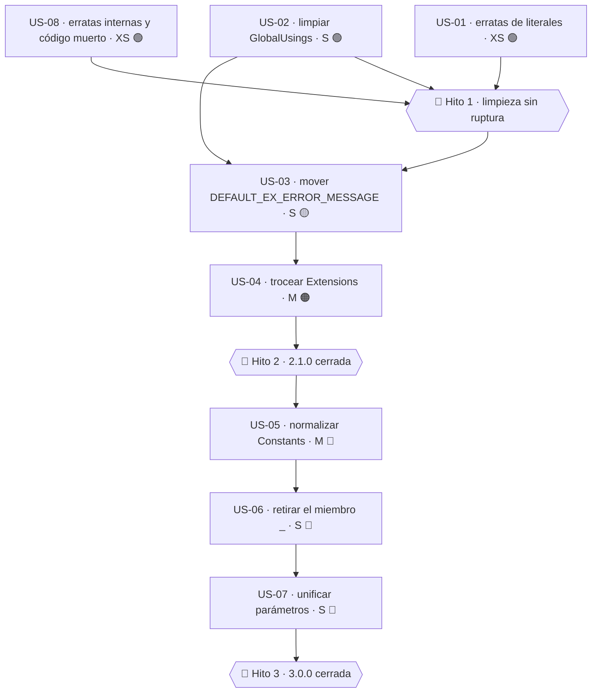

# 01 · Nomenclatura y estándares de .NET

> **Proyecto** · `MoralesLarios.OOFP.Core`
> **Versión destino** · 2.1.0 (parte aditiva) · 3.0.0 (parte rupturista)
> **Origen** · análisis profundo del núcleo, posterior al commit `0a6f8fc`
> **Estado** · propuesta, pendiente de aprobación
> **Esfuerzo total** · L (2 jornadas) la parte no rupturista · XL la rupturista
> **Riesgo** · 🟡 medio en la parte aditiva · 🔴 muy alto en la rupturista

---

## Índice

1. [Contexto y problema](#1-contexto-y-problema)
   - [Punto 01 — Identificadores en `SCREAMING_SNAKE_CASE` en la API pública](#punto-01--identificadores-en-screaming_snake_case-en-la-api-pública)
   - [Punto 02 — Un «constante» que en realidad es un método](#punto-02--un-constante-que-en-realidad-es-un-método)
   - [Punto 03 — Parámetros en `PascalCase`](#punto-03--parámetros-en-pascalcase)
   - [Punto 04 — El miembro público llamado `_`](#punto-04--el-miembro-público-llamado-_)
   - [Punto 05 — Clase pública llamada `Extensions`](#punto-05--clase-pública-llamada-extensions)
   - [Punto 06 — Literales de mensaje en inglés incrustados en el código](#punto-06--literales-de-mensaje-en-inglés-incrustados-en-el-código)
   - [Punto 07 — Erratas en el literal `DEFAULT_ERROR_MESSAGE`](#punto-07--erratas-en-el-literal-default_error_message)
   - [Punto 08 — Incoherencia `Details` / `Metadata` / `ErrorsDetails`](#punto-08--incoherencia-details--metadata--errorsdetails)
   - [Punto 09 — El sufijo `Async` sobre métodos que no son asíncronos](#punto-09--el-sufijo-async-sobre-métodos-que-no-son-asíncronos)
   - [Punto 10 — La semántica de `Try*` no coincide con la de la BCL](#punto-10--la-semántica-de-try-no-coincide-con-la-de-la-bcl)
   - [Punto 11 — Nombres de parámetro incoherentes entre sobrecargas hermanas](#punto-11--nombres-de-parámetro-incoherentes-entre-sobrecargas-hermanas)
   - [Punto 12 — Erratas no cubiertas por la épica 2.1](#punto-12--erratas-no-cubiertas-por-la-épica-21)
   - [Punto 13 — `global using static` que contamina todos los ficheros](#punto-13--global-using-static-que-contamina-todos-los-ficheros)
   - [Punto 14 — Nombres de tipo que repiten el prefijo del espacio de nombres](#punto-14--nombres-de-tipo-que-repiten-el-prefijo-del-espacio-de-nombres)
2. [Alcance](#2-alcance)
3. [Historias de usuario](#3-historias-de-usuario)
4. [Orden de ejecución](#4-orden-de-ejecución)
5. [Decisiones abiertas](#5-decisiones-abiertas)
6. [Definición de terminado](#6-definición-de-terminado)
7. [Apéndice · código actual y propuesto](#7-apéndice--código-actual-y-propuesto)
8. [Ver también](#ver-también)

---

## 1. Contexto y problema

Las *Framework Design Guidelines* de .NET son el contrato implícito que todo consumidor de una
librería espera. Cuando una API se desvía de ellas, el coste no es estético: el IntelliSense sugiere
mal, los analizadores de los proyectos consumidores emiten advertencias que el consumidor no puede
suprimir sin ensuciar su propio código, y la curva de aprendizaje se multiplica.

El núcleo tiene **14 desviaciones** identificadas, con grados muy distintos de gravedad.

| Punto | Fichero | Líneas | Naturaleza |
|------:|---------|--------|------------|
| 01 | `Helpers/Constants.cs` | 10-40 | CA1707 · nombres con guión bajo |
| 02 | `Helpers/Constants.cs` | 48 | método con nombre de constante |
| 03 | `Types/Errors/MlError.cs` · `Types/Errors/MlErrorDetails.cs` | 69 · 12 | CA1707/convención · parámetros `PascalCase` |
| 04 | `Types/MlResult.cs` | 12, 141 | miembro público llamado `_` |
| 05 | `Helpers/Extensions/Extensions.cs` | 11 | nombre de tipo sin información |
| 06 | `Types/MlResult.cs` · `Types/Errors/MlErrorDetails.cs` | 395 · ~300 | literales de UI en inglés |
| 07 | `Helpers/Constants.cs` | 10, 48 | comilla sin cerrar · falta un espacio |
| 08 | `Types/Errors/MlErrorDetails.cs` | 12, 20, 24 | tres nombres para el mismo concepto |
| 09 | `Types/MlResultBindExtensions.cs` · `Helpers/EnsureFp.cs` | 40, 93 · 150+ | `Async` sin asincronía real |
| 10 | toda la familia `Try*` | — | semántica divergente de `TryParse` |
| 11 | `Helpers/EnsureFp.cs` · `Helpers/EnsureFp.Core.cs` | 60 vs 30 | `message` vs `errorMessage` |
| 12 | varios | — | erratas no incluidas en la épica 2.1 |
| 13 | `GlobalUsings.cs` | 12 | `global using static` |
| 14 | `Types/MlResultBindExtensions.cs` y hermanos | 8 | `MlResult` + `Bind` + `Extensions` |

---

### Punto 01 — Identificadores en `SCREAMING_SNAKE_CASE` en la API pública

```csharp
// Helpers/Constants.cs, L7-46
public static partial class Constants
{
    public static string DEFAULT_ERROR_MESSAGE { get; }     // ← propiedad pública con guiones bajos → CA1707
        = "Without custom error message. For more info, view 'Ex(s) details exceptions.";

    public static string ExceptionMetadataKey { get; } = "Ex";      // ← ésta sí es PascalCase
    public static string ValueMetadataKey     { get; } = "Value";   // ← ésta sí es PascalCase

    public const string NOT_FOUND_KEY      = "NotFound";        // ← const con guiones bajos
    public const string PARAM_NAME_KEY     = "ParamName";       // ← const con guiones bajos
    public const string FAILED_INDEXES_KEY = "FailedIndexes";   // ← const con guiones bajos
    public const string EXPECTED_KEY       = "Expected";        // ← const con guiones bajos
}
```

Tres problemas simultáneos:

1. **CA1707** («los identificadores no deben contener guiones bajos») se dispara en los seis
   miembros con guión bajo. Como son `public` y el proyecto no tiene `NoWarn`, cualquier consumidor
   que active los analizadores de .NET los verá.
2. **Incoherencia interna**: en el mismo fichero conviven `ExceptionMetadataKey` (correcto) y
   `NOT_FOUND_KEY` (incorrecto), para conceptos idénticos (ambos son claves de metadatos).
3. **`static get-only property` vs `const`**: `DEFAULT_ERROR_MESSAGE`, `ExceptionMetadataKey` y
   `ValueMetadataKey` son propiedades; `NOT_FOUND_KEY` y compañía son `const`. Para literales de
   cadena invariables, `const` es lo correcto (se incrusta en el consumidor, cero indirección),
   pero mezclar ambos estilos en el mismo fichero no tiene justificación.

> **Nota sobre `const` público.** Un `public const` se incrusta en el ensamblado del consumidor en
> tiempo de compilación. Si el valor cambia en una versión futura, el consumidor seguirá usando el
> antiguo hasta que recompile. Para claves de metadatos esto es deseable (son parte del contrato),
> pero debe ser una decisión consciente → ver [D-01](#5-decisiones-abiertas).

---

### Punto 02 — Un «constante» que en realidad es un método

```csharp
// Helpers/Constants.cs, L48
public static string DEFAULT_EX_ERROR_MESSAGE(Exception ex)   // ← ¡es un MÉTODO!
    => $"An error occurred while executing the function. Error: {ex.Message}.More info in Ex Details.";
```

Está declarado en una clase llamada `Constants`, con nombre de constante, y es una **función con
parámetro**. El consumidor que lo vea en IntelliSense dentro de `Constants` esperará un valor.

Además, se usa desde dos sitios con el `global using static` del [punto 13](#punto-13--global-using-static-que-contamina-todos-los-ficheros),
lo que hace que aparezca como símbolo global en los 40 ficheros del núcleo:

```csharp
// Types/Errors/MlErrorDetailsActions.cs, L57
=> source.AppendExDetailsToMlDetails(
       errorMessageBuilder != null ? errorMessageBuilder(ex) : DEFAULT_EX_ERROR_MESSAGE(ex),  // ← símbolo global
       ex);
```

**Lugar correcto**: `EnsureFpMessages`, que ya existe (`Helpers/EnsureFpMessages.cs`, 187 líneas) y
cuyo cometido es exactamente éste: construir mensajes.

---

### Punto 03 — Parámetros en `PascalCase`

```csharp
// Types/Errors/MlError.cs, L69
public static MlError FromErrorMessage(string Message) => new MlError(Message);
//                                            ^^^^^^^ ← parámetro en PascalCase
```

```csharp
// Types/Errors/MlErrorDetails.cs, L12
public partial class MlErrorDetails(IEnumerable<MlError>       Errors  = null!,
//                                                            ^^^^^^ ← PascalCase
                                    Dictionary<string, object> Details = null!)
//                                                             ^^^^^^^ ← PascalCase
```

En el caso del constructor primario de `MlErrorDetails` el `PascalCase` es **tentador pero erróneo**:
funciona porque C# permite nombrar los parámetros del constructor primario como se quiera, y el
autor probablemente copió el estilo de los `record` (donde los parámetros del constructor primario
**sí** generan propiedades `PascalCase`). Pero `MlErrorDetails` es una `class`, no un `record`, así
que esos parámetros **no** generan propiedades: son variables capturadas que se usan en los
inicializadores de abajo.

El efecto práctico es que la ayuda de parámetros del IDE muestra `Errors:` y `Details:` cuando
el consumidor escribe argumentos con nombre, lo que contradice la convención de .NET
(`camelCase` para parámetros) y además induce a pensar que existe una propiedad `Details` cuando
en realidad se llama `Metadata` → ver [punto 08](#punto-08--incoherencia-details--metadata--errorsdetails).

---

### Punto 04 — El miembro público llamado `_`

```csharp
// Types/MlResult.cs, L12-16
public partial record MlResult
{
    public static MlResult  _       => new (default!);   // ← miembro público llamado "_"
    public static MlResult  Discard => _;
}

// Types/MlResult.cs, L141-145
public partial record MlResult<T>
{
    public static MlResult<T> _       => new (default(T)!);   // ← idem en el genérico
    public static MlResult<T> Discard => _;
}
```

En C# moderno `_` es el **descarte** del lenguaje (`_ = Foo();`, `switch { _ => … }`,
`out _`). Usarlo como nombre de un miembro público genera tres problemas:

1. **Colisión conceptual**: `MlResult._` se lee como «el descarte de MlResult», no como «un
   MlResult vacío». De hecho el autor ya se dio cuenta y añadió el alias `Discard`.
2. **CA1707 de nuevo**: el nombre consiste **íntegramente** en un guión bajo.
3. **Redundancia**: existen `_`, `Discard` y `Empty()`:

```csharp
// Types/MlResult.cs, L118-126
public static MlResult<object> Empty() => new object();                  // ← tercera forma
public static Task<MlResult<object>> EmptyAsync() => Empty().ToAsync();
```

Tres nombres para «resultado sin valor relevante», y además `Empty()` devuelve
`MlResult<object>` mientras que `_` devuelve `MlResult` o `MlResult<T>`. El consumidor no tiene
forma de saber cuál usar.

> **Propuesta**: conservar sólo `Discard` (nombre que ya existe y es autoexplicativo), marcar `_`
> como `[Obsolete]` en 2.1 y eliminarlo en 3.0. Decidir el destino de `Empty()` en [D-03](#5-decisiones-abiertas).

---

### Punto 05 — Clase pública llamada `Extensions`

```csharp
// Helpers/Extensions/Extensions.cs, L8-11
/// <summary>
/// Métodos de extension de <c></c>.
/// </summary>
//                       ^^^^^^^ ← etiqueta <c> VACÍA: la plantilla de documentación no se rellenó
public static class Extensions
//                  ^^^^^^^^^^ ← nombre sin información
```

Dos problemas en cuatro líneas:

1. El nombre `Extensions`, en el espacio de nombres `MoralesLarios.OOFP.Helpers.Extensions`, da
   como nombre completo `MoralesLarios.OOFP.Helpers.Extensions.Extensions` — un *stuttering* clásico.
   Dado que el espacio de nombres está en los `global using` del núcleo, cualquier consumidor que
   también declare una clase `Extensions` entrará en conflicto de resolución.
2. El `<summary>` tiene una etiqueta `<c></c>` vacía, residuo de la generación automática de
   documentación. Esto **no** dispara CS1591 (hay documentación) pero produce un párrafo sin
   sentido en el `.xml` y en el IntelliSense.

El contenido real de la clase son utilidades heterogéneas:

```csharp
// Helpers/Extensions/Extensions.cs — inventario del contenido
T?                         ToNullable<T>(this T source) where T : struct
Dictionary<string, object> AppendExDetails(this Dictionary<string, object> source, Exception ex)
T                          With<T>(this T source, params Action<T>[] changes) where T : class
Task<T>                    WithAsync<T>(...)                      // ×2
Task                       VoidToAsync<T>(this T source, Action<T> voidAction)
Func<T, Task<TResult>>     ToFuncTask<T, TResult>(this Func<T, TResult> func)   // + 4 sobrecargas
```

Son **cuatro responsabilidades** distintas (conversión a nullable, metadatos de excepción,
mutación con `With`, elevación a `Task`) que merecen cuatro clases con nombre propio.

> **Nota aparte**: `With<T>(this T, params Action<T>[])` **muta** el objeto recibido y lo devuelve.
> En una librería funcional, un método llamado `With` que muta en vez de copiar es
> contraintuitivo. Se analiza en [`05-Superficie-de-API-y-Arquitectura.md`](05-Superficie-de-API-y-Arquitectura.md).

---

### Punto 06 — Literales de mensaje en inglés incrustados en el código

```csharp
// Types/MlResult.cs, L395
public override string ToString()
    => this.Match(fail : errors => errors.ToString(),
                  valid: value  => value?.ToString() ?? "Not right value");
//                                                      ^^^^^^^^^^^^^^^^^ ← literal en inglés, además mal redactado
```

```csharp
// Types/Errors/MlErrorDetails.cs — ToString()
sb.AppendLine("MlError:");    // ← cabecera en inglés
// …
sb.AppendLine("Details:");    // ← cabecera en inglés
```

```csharp
// Helpers/Constants.cs, L10
= "Without custom error message. For more info, view 'Ex(s) details exceptions.";
```

```csharp
// Helpers/Constants.cs, L48
=> $"An error occurred while executing the function. Error: {ex.Message}.More info in Ex Details.";
```

El proyecto documenta en **castellano** (3.400 miembros con XML doc en español) pero emite
mensajes de error en **inglés**. Es una incoherencia de producto: el desarrollador lee la
documentación en un idioma y ve los errores en otro.

Además, `"Not right value"` no es inglés idiomático; lo esperable sería `"No value"` o
`"<null>"`. Y `ToString()` devolviendo un mensaje de error en lugar de una representación
estructurada rompe la expectativa de `ToString()` → se trata en
[`02-Interoperabilidad-BCL.md`](02-Interoperabilidad-BCL.md) (`IFormattable`).

> La localización completa es objeto de la épica
> [`Epica-Mensajes-Y-Localizacion.md`](../../Next_Versions/2.1/Epica-Mensajes-Y-Localizacion.md).
> Aquí sólo se aporta el **inventario del núcleo** y la decisión de idioma por defecto
> → [D-05](#5-decisiones-abiertas).

---

### Punto 07 — Erratas en el literal `DEFAULT_ERROR_MESSAGE`

```csharp
// Helpers/Constants.cs, L10
public static string DEFAULT_ERROR_MESSAGE { get; }
    = "Without custom error message. For more info, view 'Ex(s) details exceptions.";
//                                                       ^                        ^
//                                                       └── comilla simple ABIERTA que nunca se cierra
```

```csharp
// Helpers/Constants.cs, L48
=> $"An error occurred while executing the function. Error: {ex.Message}.More info in Ex Details.";
//                                                                      ^^^^^ ← falta el espacio tras el punto
```

Estos dos literales son los que **más veces** ve el usuario de la librería: `DEFAULT_ERROR_MESSAGE`
se usa como mensaje de reserva en `MlError` cuando el mensaje recibido está vacío:

```csharp
// Types/Errors/MlError.cs — constructor
Message = string.IsNullOrWhiteSpace(message) ? DEFAULT_ERROR_MESSAGE : message;
```

Es decir: **cada error sin mensaje explícito muestra un texto con una comilla sin cerrar**.
Corrección de coste XS y visibilidad máxima.

---

### Punto 08 — Incoherencia `Details` / `Metadata` / `ErrorsDetails`

El mismo concepto —el diccionario de datos adicionales de un error— tiene **tres nombres**:

```csharp
// Types/Errors/MlErrorDetails.cs, L12-24
public partial class MlErrorDetails(IEnumerable<MlError>       Errors  = null!,
                                    Dictionary<string, object> Details = null!)
//                                                             ^^^^^^^ (1) el parámetro se llama "Details"
{
    public IEnumerable<MlError>       Errors   { get; init; } = Errors  ?? new List<MlError>();
    public Dictionary<string, object> Metadata { get; init; } = Details ?? new();
//                                    ^^^^^^^^ (2) la propiedad se llama "Metadata"
```

```csharp
// Types/MlResultBindExtensions.cs, L57 (y ~1.800 sitios más)
failAsync : errorsDetails => Task.FromResult(MlResult<TResult>.Fail(errorsDetails)),
//          ^^^^^^^^^^^^^ (3) el parámetro se llama "errorsDetails"
```

Y en los factores estáticos aparecen todavía más variantes:

```csharp
// Types/Errors/MlErrorDetails.cs — nombres de los 14 factores
FromErrorsMessagesDetails(…)        // "ErrorsMessages" + "Details"
FromErrorMessageDetails(…)          // "ErrorMessage"   + "Details"
FromEnumerableErrors(…)             // "EnumerableErrors"
FromEnumerableErrorsDetails(…)      // "EnumerableErrors" + "Details"
FromEnumerableStrings(…)            // "EnumerableStrings"  ← duplica a FromErrorsMessagesDetails
FromError(…)
FromErrorDetails(…)                 // ×2 sobrecargas
FromErrorMessage(…)
FromErrorMessageWithException(…)
FromErrorMessageWithValue(…)        // ×2 (object y T genérico)
```

Diez nombres distintos, con `Enumerable` como prefijo de tipo en el nombre del método (algo que las
guías de .NET descartan explícitamente: el tipo ya está en la firma) y una duplicación funcional
(`FromEnumerableStrings` ≡ `FromErrorsMessagesDetails` con `details = null`).

El impacto real se ve en la **documentación del propio proyecto**:

```markdown
<!-- MoralesLarios.OOFP.Core/README.md -->
| El flujo tiene un valor correcto disponible en `Value` |
| … el motivo está en `ErrorsDetails` |
```

El README documenta `Value` y `ErrorsDetails`, miembros que **no existen**: los reales son
`SuccessValue` y `FailureDetails`, y además son `internal protected` (inaccesibles desde fuera).
Esta deriva documental se trata en
[`08-Calidad-Pruebas-y-Documentacion.md`](08-Calidad-Pruebas-y-Documentacion.md).

---

### Punto 09 — El sufijo `Async` sobre métodos que no son asíncronos

La convención de .NET (TAP, *Task-based Asynchronous Pattern*) reserva el sufijo `Async` para
operaciones que **pueden** no completarse de forma sincrónica. En el núcleo hay un patrón
sistemático que lo incumple:

```csharp
// Types/MlResultBindExtensions.cs, L40-42
public static Task<MlResult<TResult>> BindAsync<T, TResult>(this MlResult<T>                source,
                                                                 Func<T, MlResult<TResult>> func)
    => source.Bind(func).ToAsync();      // ← ejecuta TODO sincrónicamente y envuelve en Task
```

```csharp
// Types/MlResultBindExtensions.cs, L127-130
public static Task<MlResult<TResult>> TryBindAsync<T, TResult>(this MlResult<T>                source,
                                                                    Func<T, MlResult<TResult>> func,
                                                                    string                     exceptionAdditionalMessage = null!)
    => source.TryBind(func, exceptionAdditionalMessage).ToAsync();     // ← idem
```

```csharp
// Helpers/Extensions/Extensions.cs — el método que lo hace posible
public static Task VoidToAsync<T>(this T source, Action<T> voidAction)
{
    voidAction(source);
    return Task.CompletedTask;        // ← asincronía ficticia
}
```

Estos métodos **existen por una razón legítima**: permiten empezar una cadena con `Await` y seguir
encadenando sin cambiar de estilo. El problema es doble:

1. **Semántico**: el consumidor que ve `BindAsync` asume E/S o trabajo en segundo plano, y
   razona sobre cancelación, tiempos de espera y paralelismo que no existen.
2. **De rendimiento**: `ToAsync()` asigna un `Task<MlResult<TResult>>` por llamada. En una cadena
   de 10 pasos síncronos envueltos, son 10 asignaciones evitables → ver
   [`06-Rendimiento.md`](06-Rendimiento.md).

> **Propuesta**: mantener la funcionalidad (es útil), pero documentar explícitamente en el
> `<returns>` que **se completa sincrónicamente**, y en 2.2 devolver `ValueTask<MlResult<T>>` en
> estas sobrecargas, que es exactamente el caso de uso para el que `ValueTask` se diseñó.

---

### Punto 10 — La semántica de `Try*` no coincide con la de la BCL

En la BCL, `TryXxx` significa «intenta y devuelve `bool`, con el resultado en un `out`»:
`int.TryParse`, `Dictionary.TryGetValue`, `Queue.TryDequeue`.

En el núcleo, `Try*` significa «ejecuta capturando excepciones y conviértelas en un `MlResult`
fallido»:

```csharp
// Types/MlResultBindExtensions.cs, L113-117
public static MlResult<TResult> TryBind<T, TResult>(this MlResult<T>                source,
                                                         Func<T, MlResult<TResult>> func,
                                                         string                     exceptionAdditionalMessage = null!)
    => TryBind(source, func, _ => exceptionAdditionalMessage!);
```

Hay **1.000+ métodos** con prefijo `Try` en el núcleo bajo esta semántica. Cambiar el prefijo ahora
sería una ruptura masiva y probablemente no rentable. Pero el problema es real y tiene una
consecuencia práctica concreta: **el consumidor no sabe qué excepciones se tragan**.

```csharp
// Helpers/EnsureFp.Core.cs — el patrón de captura
catch (Exception ex)      // ← captura TODO
{
    return BuildExceptionFail(paramName, ex, errorMessageBuilder);
}
```

`catch (Exception)` captura también `OperationCanceledException` (convirtiendo una cancelación
limpia en un error de negocio), `OutOfMemoryException` y `StackOverflowException`-adyacentes.
Esto se analiza en profundidad en [`03-Modelo-de-Error.md`](03-Modelo-de-Error.md).

> **Propuesta de nomenclatura**: no renombrar los 1.000 métodos, pero:
> - documentar la semántica propia en la documentación XML de cada familia (`<remarks>` compartido);
> - introducir, en los sitios donde sí tiene sentido la semántica BCL, el prefijo `TryGet`
>   (`TryGetValue`, `TryGetErrors`), que es inequívoco → ver [`02-Interoperabilidad-BCL.md`](02-Interoperabilidad-BCL.md);
> - excluir `OperationCanceledException` del `catch`.

---

### Punto 11 — Nombres de parámetro incoherentes entre sobrecargas hermanas

```csharp
// Helpers/EnsureFp.cs — sobrecargas de NotEmpty
public static MlResult<IEnumerable<T>> NotEmpty<T>(IEnumerable<T> source, string         message)
//                                                                       ^^^^^^^^^^^^^^ "message"
public static MlResult<IEnumerable<T>> NotEmpty<T>(IEnumerable<T> source, MlErrorDetails errorsDetails)
//                                                                       ^^^^^^^^^^^^^^^^^^^^^^^^^^^^ "errorsDetails"
```

```csharp
// Helpers/EnsureFp.Strings.cs, L246-253 — las hermanas usan "errorMessage"
public static MlResult<string> StartsWith(string value, string prefix, string         errorMessage, …)
//                                                                     ^^^^^^^^^^^^^^^^^^^^^^^^^^ "errorMessage"
public static MlResult<string> StartsWith(string value, string prefix, MlErrorDetails errorsDetails, …)
```

El parámetro de mensaje se llama `message` en `EnsureFp.cs` y `errorMessage` en
`EnsureFp.Strings.cs`, `EnsureFp.Numbers.cs` y `EnsureFp.Collections.cs`. Como los argumentos con
nombre son **parte del contrato público** en C#, renombrarlos es una ruptura de origen; pero
dejarlos así impide usar argumentos con nombre de forma consistente.

Más incoherencias del mismo tipo detectadas:

| Concepto | Nombres encontrados | Fichero de referencia |
|----------|---------------------|-----------------------|
| mensaje de error | `message`, `errorMessage`, `exceptionAdditionalMessage` | `EnsureFp.cs`, `EnsureFp.Strings.cs`, `MlResultBindExtensions.cs` |
| detalles de error | `errorsDetails`, `errorDetails`, `details`, `Details` | `EnsureFp.cs`, `MlErrorDetailsActions.cs`, `MlErrorDetails.cs` |
| función a ejecutar | `func`, `funcAsync`, `errorMessageBuilder`, `voidAction`, `changes` | `MlResultBindExtensions.cs`, `EnsureFp.Core.cs`, `Extensions.cs` |
| origen | `source`, `sourceAsync`, `value`, `t` | `MlResultBindExtensions.cs`, `EnsureFp.cs`, `MlResult.cs` |

---

### Punto 12 — Erratas no cubiertas por la épica 2.1

La épica [`Epica-Erratas-Identificadores-Publicos.md`](../../Next_Versions/2.1/Epica-Erratas-Identificadores-Publicos.md)
ya cubre `Faild`, `Diferent`, `Erros`, `Alwais`, `Lenght` y `FusionFailErros`. El análisis del
núcleo ha encontrado **erratas adicionales**, todas en identificadores **internos** (lo que las hace
de coste XS y riesgo 🟢):

```csharp
// Types/Errors/MlErrorDetailsActions.cs, L96-97
var printipalDetailsWitoutEx = sourceDetails.Where(x => x.Value is not Exception)…;
//  ^^^^^^^^^^               ^^^^^^^           ← "printipal" (por "principal") y "Witout" (por "Without")
var otherDetailsWitoutEx     = otherDetails .Where(x => x.Value is not Exception)…;
//                ^^^^^^^                                ← "Witout"
```

```csharp
// Types/Errors/MlErrorDetailsActions.cs, L86
var principalDetailsWithEx = …   // ← aquí SÍ está bien escrito "principal": incoherencia dentro del mismo método
```

| Errata | Correcto | Ocurrencias | Visibilidad |
|--------|----------|------------:|-------------|
| `printipal` | `principal` | 2 | variable local 🟢 |
| `Witout` | `Without` | 4 | variable local 🟢 |

> **Importante**: estas erratas **no** son públicas, así que corregirlas **no rompe nada** y debe
> hacerse en 2.1 junto con la campaña de erratas públicas, no en 3.0.

---

### Punto 13 — `global using static` que contamina todos los ficheros

```csharp
// GlobalUsings.cs, L1-12
global using System;                      // ← redundante: ImplicitUsings=enable ya lo incluye
global using System.Collections.Generic;  // ← redundante
global using System.Linq;                 // ← redundante
global using System.Text;                 // ← NO está en ImplicitUsings → éste sí hace falta
global using System.Threading.Tasks;      // ← redundante

global using MoralesLarios.OOFP.Types.Errors;
global using MoralesLarios.OOFP.Helpers;
global using MoralesLarios.OOFP.Helpers.Extensions;
global using MoralesLarios.OOFP.Types;

global using static MoralesLarios.OOFP.Helpers.Constants;   // ← ESTO es el problema
```

El `global using static Constants` introduce en **los 40 ficheros** del núcleo los símbolos
`DEFAULT_ERROR_MESSAGE`, `DEFAULT_EX_ERROR_MESSAGE`, `ExceptionMetadataKey`, `ValueMetadataKey`,
`NOT_FOUND_KEY`, `PARAM_NAME_KEY`, `FAILED_INDEXES_KEY` y `EXPECTED_KEY` como si fueran palabras
del lenguaje. Consecuencias:

1. Al leer `DEFAULT_EX_ERROR_MESSAGE(ex)` en `MlErrorDetailsActions.cs` es **imposible saber de
   dónde viene** sin ir a la definición.
2. Cualquier variable local llamada igual lo oculta silenciosamente.
3. Si en el futuro se añade un miembro a `Constants` que colisione con un identificador existente,
   la rotura aparece en ficheros que no se han tocado.

Los `using` de `System*` son redundantes con `<ImplicitUsings>enable</ImplicitUsings>` salvo
`System.Text` (que no forma parte del conjunto implícito de `Microsoft.NET.Sdk`).

---

### Punto 14 — Nombres de tipo que repiten el prefijo del espacio de nombres

```csharp
// Types/MlResultBindExtensions.cs, L5-9
namespace MoralesLarios.OOFP.Types;
public static partial class MlResultBindExtensions   // → MoralesLarios.OOFP.Types.MlResultBindExtensions
```

El patrón `Ml` + `Result` + `<Familia>` + `Extensions` se repite en:

| Tipo | Nombre completo |
|------|-----------------|
| `MlResultBindExtensions` | `MoralesLarios.OOFP.Types.MlResultBindExtensions` |
| `MlResultMapExtensions` | `MoralesLarios.OOFP.Types.MlResultMapExtensions` |
| `MlResultMatchExtensions` | `MoralesLarios.OOFP.Types.MlResultMatchExtensions` |
| `MlResultExecSelfExtensions` | `MoralesLarios.OOFP.Types.MlResultExecSelfExtensions` |
| `MlResultSeveralExtensions` | `MoralesLarios.OOFP.Types.MlResultSeveralExtensions` |
| `MlResultErrorDetailsExtensions` | `MoralesLarios.OOFP.Types.MlResultErrorDetailsExtensions` |
| `MlResultExtensions` | `MoralesLarios.OOFP.Types.MlResultExtensions` |

Esto **no es un defecto grave** —la convención de .NET para clases de extensión es precisamente
`<Tipo>Extensions`— pero sí hay dos observaciones:

1. `MlResultExtensions` (sin familia) es un cajón de sastre: contiene `AddMlErrorDetailIfFail`,
   `AddValueDetailIfFail`, `CompleteWithDataValueIfValid`, `CompleteWithDetailsValueIfFail`… que son
   dos familias distintas (enriquecer el error / completar el valor).
2. El prefijo `Ml` en los tipos es redundante con el espacio de nombres `MoralesLarios.OOFP`, pero
   **eliminarlo sería una ruptura masiva sin beneficio funcional**. Se descarta explícitamente.

---

## 2. Alcance

### Dentro

- Los 14 puntos anteriores, limitados a `src/MoralesLarios.OOFP.Core`.
- Las correcciones **no rupturistas** (puntos 02, 05-doc, 06, 07, 12, 13) → versión 2.1.0.
- El diseño de los puentes `[Obsolete]` para las rupturistas (puntos 01, 03, 04, 05-nombre, 08, 11)
  → versión 3.0.0.

### Fuera

- La campaña de erratas públicas `Faild`/`Diferent`/`Erros`/`Alwais`/`Lenght`/`FusionFailErros`, que
  ya tiene su propia épica.
- La localización de mensajes a otros idiomas (épica propia). Aquí sólo se decide el idioma por
  defecto y se corrigen las erratas de los literales.
- Los renombrados en proyectos distintos de `Core` (aunque se listan los consumidores afectados).
- El prefijo `Ml` de los tipos: se descarta su eliminación.

---

## 3. Historias de usuario

### US-01 · Corregir las erratas de los literales de mensaje

> **Como** desarrollador que consume la librería
> **quiero** que los mensajes de error por defecto estén bien escritos
> **para** no mostrar texto roto a mis propios usuarios.

- **Esfuerzo**: XS · **Riesgo**: 🟢 · **Depende de**: nada

Criterios de aceptación:

- [ ] `DEFAULT_ERROR_MESSAGE` no contiene comillas sin cerrar.
- [ ] `DEFAULT_EX_ERROR_MESSAGE` tiene un espacio tras el punto de `{ex.Message}.`.
- [ ] Los tests que comparan literalmente con estos mensajes se han actualizado.
- [ ] Se ha buscado el literal antiguo en los `.md` del repositorio y actualizado donde aparezca.

**API propuesta** (sin cambio de firma, sólo del valor):

```csharp
public static string DEFAULT_ERROR_MESSAGE { get; }
    = "Without custom error message. For more info, view the 'Ex' details exceptions.";
```

**Tests mínimos**:

| Test | Comprueba |
|------|-----------|
| `MlError_SinMensaje_UsaMensajePorDefecto` | el literal exacto nuevo |
| `Constants_DefaultErrorMessage_ComillasBalanceadas` | `count('\'') % 2 == 0` |

**Riesgo principal**: algún test de otro proyecto compara la cadena completa. Buscar con
`grep` el fragmento `"Without custom error message"` en toda la solución antes de cambiar.

---

### US-02 · Limpiar `GlobalUsings.cs`

> **Como** mantenedor del núcleo
> **quiero** saber de dónde viene cada símbolo que leo
> **para** poder razonar sobre el código sin saltar a la definición.

- **Esfuerzo**: S · **Riesgo**: 🟢 · **Depende de**: nada

Criterios de aceptación:

- [ ] Se han eliminado los `global using System;`, `System.Collections.Generic`, `System.Linq` y
      `System.Threading.Tasks` (redundantes con `ImplicitUsings`).
- [ ] Se conserva `global using System.Text;`.
- [ ] Se ha eliminado `global using static MoralesLarios.OOFP.Helpers.Constants;`.
- [ ] Los ~30 usos de los símbolos de `Constants` se han cualificado con `Constants.`.
- [ ] La solución compila con 0 errores y el número de advertencias no sube.

**API propuesta**:

```csharp
// GlobalUsings.cs — después
global using System.Text;

global using MoralesLarios.OOFP.Helpers;
global using MoralesLarios.OOFP.Helpers.Extensions;
global using MoralesLarios.OOFP.Types;
global using MoralesLarios.OOFP.Types.Errors;
```

**Notas técnicas**: el cambio es puramente interno (los `global using` no se exportan al
consumidor), por lo que **no hay ruptura**. El trabajo es mecánico: compilar, ver los CS0103
(«el nombre no existe») y cualificar.

**Tests mínimos**: ninguno nuevo; basta con que los 1.060 existentes sigan en verde.

**Riesgo principal**: ninguno significativo. Es el cambio con mejor relación beneficio/riesgo
del documento.

---

### US-03 · Mover `DEFAULT_EX_ERROR_MESSAGE` a `EnsureFpMessages`

> **Como** consumidor
> **quiero** que `Constants` contenga sólo constantes
> **para** que el IntelliSense sea predecible.

- **Esfuerzo**: S · **Riesgo**: 🟡 (es API pública) · **Depende de**: US-02

Criterios de aceptación:

- [ ] `EnsureFpMessages` expone `public static string DefaultExceptionError(Exception ex)`.
- [ ] `Constants.DEFAULT_EX_ERROR_MESSAGE` permanece como puente `[Obsolete]` que delega.
- [ ] El puente lleva `[EditorBrowsable(Never)]` y el mensaje
      `"Renamed to EnsureFpMessages.DefaultExceptionError. Will be removed in 3.0.0."`.
- [ ] La ruptura futura está registrada en `oofp-upgrade-2.prompt.md` §3.3 y en el anexo de renombrados.

**API propuesta**:

```csharp
// Helpers/EnsureFpMessages.cs
public static string DefaultExceptionError(Exception ex)
    => $"An error occurred while executing the function. Error: {ex.Message}. More info in 'Ex' details.";
```

```csharp
// Helpers/Constants.Obsolete.cs
[Obsolete("Renamed to EnsureFpMessages.DefaultExceptionError. Will be removed in 3.0.0.", false)]
[EditorBrowsable(EditorBrowsableState.Never)]
public static string DEFAULT_EX_ERROR_MESSAGE(Exception ex) => EnsureFpMessages.DefaultExceptionError(ex);
```

**Tests mínimos**:

| Test | Comprueba |
|------|-----------|
| `EnsureFpMessages_DefaultExceptionError_FormatoCorrecto` | el texto resultante |
| `Constants_DefaultExErrorMessage_DelegaEnEnsureFpMessages` | ambos devuelven lo mismo |

**Riesgo principal**: el símbolo está en el `global using static` eliminado en US-02, así que los
usos internos se detectan en compilación.

---

### US-04 · Dar nombre propio a las utilidades de `Extensions`

> **Como** consumidor
> **quiero** encontrar las utilidades por su cometido
> **para** no tener que explorar una clase llamada `Extensions`.

- **Esfuerzo**: M · **Riesgo**: 🟠 (API pública) · **Depende de**: nada

Criterios de aceptación:

- [ ] Se han creado `NullableExtensions`, `ExceptionMetadataExtensions`, `MutationExtensions` y
      `TaskLiftExtensions` en `Helpers/Extensions/`.
- [ ] Cada método vive en la clase que le corresponde.
- [ ] `Extensions` permanece como `partial` con puentes `[Obsolete]` que delegan.
- [ ] El `<summary>` con `<c></c>` vacío se ha rellenado en todas las clases nuevas.
- [ ] Los 10 comentarios de código muerto (`ValidateObject`) se han eliminado.
- [ ] La ruptura está registrada en `oofp-upgrade-2.prompt.md` §3.3 y en el anexo de renombrados.

**Reparto propuesto**:

| Clase nueva | Métodos |
|-------------|---------|
| `NullableExtensions` | `ToNullable<T>` |
| `ExceptionMetadataExtensions` | `AppendExDetails` |
| `MutationExtensions` | `With<T>`, `WithAsync<T>` ×2 |
| `TaskLiftExtensions` | `VoidToAsync<T>`, `ToFuncTask` ×5 |

**Notas técnicas**: como son **métodos de extensión estáticos**, mover un método de una clase
estática a otra **no rompe la invocación en forma de extensión** (`x.ToNullable()` sigue
compilando) siempre que el espacio de nombres esté importado. Sólo rompe la invocación en
forma estática (`Extensions.ToNullable(x)`), que es minoritaria. Esto hace la US sorprendentemente
barata para su impacto.

**Tests mínimos**: los existentes deben seguir pasando sin cambios; añadir uno por clase nueva
que confirme la resolución por extensión.

**Riesgo principal**: si algún consumidor externo llama en forma estática. Los puentes
`[Obsolete]` lo cubren.

---

### US-05 · Normalizar `Constants` a convenciones de .NET

> **Como** consumidor con analizadores activados
> **quiero** que la API del núcleo no dispare CA1707
> **para** no tener que suprimir advertencias ajenas en mi proyecto.

- **Esfuerzo**: M · **Riesgo**: 🔴 (ruptura de origen) · **Depende de**: US-02, US-03

Criterios de aceptación:

- [ ] Los seis miembros con guión bajo tienen un gemelo en `PascalCase`.
- [ ] Todos los literales de clave son `public const string` (no propiedades).
- [ ] Los nombres antiguos permanecen como puentes `[Obsolete]` en `Constants.Obsolete.cs`.
- [ ] CA1707 no aparece en el núcleo tras activar los analizadores (ver
      [`08-Calidad-Pruebas-y-Documentacion.md`](08-Calidad-Pruebas-y-Documentacion.md)).
- [ ] La ruptura está registrada en `oofp-upgrade-2.prompt.md` §3.3 y en el anexo de renombrados.

**Mapa de renombrados**:

| 2.0.0 | 3.0.0 | Tipo |
|-------|-------|------|
| `DEFAULT_ERROR_MESSAGE` | `DefaultErrorMessage` | `const string` |
| `NOT_FOUND_KEY` | `NotFoundKey` | `const string` |
| `PARAM_NAME_KEY` | `ParameterNameKey` | `const string` |
| `FAILED_INDEXES_KEY` | `FailedIndexesKey` | `const string` |
| `EXPECTED_KEY` | `ExpectedKey` | `const string` |
| `DEFAULT_EX_ERROR_MESSAGE(ex)` | `EnsureFpMessages.DefaultExceptionError(ex)` | método (US-03) |
| `ExceptionMetadataKey` | *(sin cambio)* | pasa de propiedad a `const` |
| `ValueMetadataKey` | *(sin cambio)* | pasa de propiedad a `const` |

**Tests mínimos**:

| Test | Comprueba |
|------|-----------|
| `Constants_NombresNuevos_CoincidenConLosAntiguos` | valor idéntico para cada par |
| `Constants_ClavesDeMetadatos_SonConst` | vía reflexión, `FieldInfo.IsLiteral` |

**Riesgo principal**: `ExceptionMetadataKey` y `ValueMetadataKey` pasan de propiedad a `const`.
Esto es **compatible a nivel de origen** pero **rompe a nivel binario**: un consumidor ya compilado
contra la propiedad fallará con `MissingMethodException`. Debe ir en 3.0.0 y constar en la guía
de migración → ver [D-01](#5-decisiones-abiertas).

---

### US-06 · Retirar el miembro `_` en favor de `Discard`

> **Como** consumidor
> **quiero** que `_` no sea un nombre de miembro público
> **para** que el descarte del lenguaje no se confunda con un valor.

- **Esfuerzo**: S · **Riesgo**: 🔴 · **Depende de**: nada

Criterios de aceptación:

- [ ] `MlResult._` y `MlResult<T>._` están marcados `[Obsolete]` + `[EditorBrowsable(Never)]` en 2.1.
- [ ] Todos los usos internos del núcleo y de los 29 proyectos usan `Discard`.
- [ ] Se ha decidido y aplicado el destino de `Empty()`/`EmptyAsync()` → [D-03](#5-decisiones-abiertas).
- [ ] La ruptura está registrada en `oofp-upgrade-2.prompt.md` §3.3 y en el anexo de renombrados.

**API propuesta**:

```csharp
// Types/MlResult.cs — después
public partial record MlResult
{
    /// <summary>Resultado válido sin valor relevante. Equivalente funcional a <c>Unit</c>.</summary>
    public static MlResult Discard => new (default!);
}
```

```csharp
// Types/MlResult.Obsolete.cs
[Obsolete("Renamed to Discard. Will be removed in 3.0.0.", false)]
[EditorBrowsable(EditorBrowsableState.Never)]
public static MlResult _ => Discard;
```

**Tests mínimos**:

| Test | Comprueba |
|------|-----------|
| `MlResult_Discard_EsValido` | `IsSuccess == true` |
| `MlResult_Guion_DelegaEnDiscard` | equivalencia funcional |

**Riesgo principal**: `_` es corto y cómodo; es probable que se use en los tests internos. El
contador real de usos debe medirse antes de planificar.

---

### US-07 · Unificar los nombres de parámetro de las guardias

> **Como** consumidor que usa argumentos con nombre
> **quiero** que el parámetro de mensaje se llame igual en todas las guardias
> **para** poder copiar y pegar llamadas.

- **Esfuerzo**: S · **Riesgo**: 🔴 (ruptura de origen para argumentos con nombre) · **Depende de**: nada

Criterios de aceptación:

- [ ] El parámetro de mensaje se llama `errorMessage` en **todas** las guardias de `EnsureFp.*`.
- [ ] El parámetro de detalles se llama `errorsDetails` en **todas**.
- [ ] El parámetro de origen se llama `value` en las guardias y `source` en los combinadores.
- [ ] La ruptura está registrada en `oofp-upgrade-2.prompt.md` §3.3.

**Tests mínimos**: una prueba por reflexión que recorra todos los métodos públicos de `EnsureFp`
y verifique que ningún parámetro de tipo `string` destinado a mensaje se llama `message`.

**Riesgo principal**: los argumentos con nombre son contrato público. Un consumidor que escriba
`EnsureFp.NotEmpty(lista, message: "vacía")` dejará de compilar. Es un cambio de 3.0.0.

---

### US-08 · Corregir las erratas internas y el código muerto comentado

> **Como** mantenedor
> **quiero** que el código no tenga erratas ni bloques comentados
> **para** que el núcleo se lea con confianza.

- **Esfuerzo**: XS · **Riesgo**: 🟢 · **Depende de**: nada

Criterios de aceptación:

- [ ] `printipalDetailsWitoutEx` → `principalDetailsWithoutEx` (2 ocurrencias).
- [ ] `otherDetailsWitoutEx` → `otherDetailsWithoutEx` (2 ocurrencias).
- [ ] Se han eliminado los bloques comentados de `MlErrorDetailsActions.cs` (L92-93),
      `Extensions.cs` (10 líneas de `ValidateObject`), `ErrorMessage.cs` (16 líneas),
      `EnsureFp.cs` (2 bloques) y `EnsureFp.Core.cs`.
- [ ] Las `<c></c>` vacías de los `<summary>` se han rellenado.

**Notas técnicas**: todo son identificadores locales o comentarios → **cero ruptura**. Es la US
de menor coste del documento.

**Tests mínimos**: ninguno; la compilación es la prueba.

**Riesgo principal**: ninguno.

---

## 4. Orden de ejecución



| Orden | Historia | Esfuerzo | Jornadas | Versión |
|------:|----------|:--------:|---------:|---------|
| 1 | US-08 · erratas internas y código muerto | XS | 0,25 | 2.1.0 |
| 2 | US-01 · erratas de literales | XS | 0,25 | 2.1.0 |
| 3 | US-02 · limpiar `GlobalUsings` | S | 0,5 | 2.1.0 |
| — | 🎯 **Hito 1 · limpieza sin ruptura** | | **1,0** | |
| 4 | US-03 · mover `DEFAULT_EX_ERROR_MESSAGE` | S | 0,5 | 2.1.0 |
| 5 | US-04 · trocear `Extensions` | M | 1,0 | 2.1.0 |
| — | 🎯 **Hito 2 · 2.1.0 cerrada** | | **2,5** | |
| 6 | US-05 · normalizar `Constants` | M | 1,0 | 3.0.0 |
| 7 | US-06 · retirar el miembro `_` | S | 0,5 | 3.0.0 |
| 8 | US-07 · unificar nombres de parámetro | S | 0,5 | 3.0.0 |
| — | 🎯 **Hito 3 · 3.0.0 cerrada** | | **4,5** | |

**Total: 4,5 jornadas** (2,5 sin ruptura + 2,0 rupturistas).

---

## 5. Decisiones abiertas

| Id | Decisión | Opciones | Recomendación |
|----|----------|----------|---------------|
| **D-01** | ¿Las claves de metadatos deben ser `const` o `static readonly`? | (a) `const`: cero indirección, pero el consumidor incrusta el valor y una ruptura binaria si cambia · (b) `static readonly`: compatible binariamente, coste despreciable | **(b) `static readonly`**: el valor se resuelve en ejecución, así que una corrección futura llega al consumidor sin recompilar. El coste de rendimiento es nulo para claves de diccionario |
| **D-02** | ¿Se mantiene el prefijo `Ml` en los tipos? | (a) mantener · (b) eliminar | **(a) mantener**: la eliminación sería la ruptura más grande posible sin ningún beneficio funcional |
| **D-03** | ¿Qué hacer con `MlResult.Empty()` / `EmptyAsync()`? | (a) dejarlos · (b) `[Obsolete]` en favor de `Discard` · (c) redefinirlos como `MlResult<Unit>` | **(b)**: `Empty()` devuelve `MlResult<object>`, que obliga al consumidor a arrastrar `object`. `Discard` cubre el caso. Si se quiere un tipo explícito, introducir `Unit` (ver [`02-Interoperabilidad-BCL.md`](02-Interoperabilidad-BCL.md)) |
| **D-04** | ¿Se renombra la familia `Try*`? | (a) no tocar (1.000+ métodos) · (b) renombrar a `Catching*` · (c) no tocar pero documentar | **(c)**: la ruptura de (b) no es rentable; la confusión se mitiga con un `<remarks>` compartido y con `TryGet*` para los casos de semántica BCL |
| **D-05** | ¿Idioma por defecto de los mensajes de error? | (a) inglés (actual) · (b) castellano (coherente con la documentación) · (c) inglés + recursos localizados | **(c)**: inglés como neutro (es lo que esperan los paquetes NuGet) + `.resx` para castellano. Queda en manos de la épica de localización |
| **D-06** | ¿`With<T>` debe copiar en vez de mutar? | (a) dejar la mutación y renombrar a `Mutate` · (b) implementar copia real · (c) eliminarlo | **(a)**: renombrar a `Mutate` deja claro el comportamiento; implementar copia genérica para cualquier `T : class` no es viable sin reflexión costosa |

---

## 6. Definición de terminado

- [ ] La solución compila con `dotnet build MoralesLarios.OOFP.sln -c Release --no-incremental`
      con **0 errores** y **`CS1591 = 0`**.
- [ ] Los **1.060 tests** están en verde.
- [ ] El número de advertencias no supera la línea base de **238** (y baja en al menos las 4 de
      `EnsureFp.Strings.cs` si se acomete [`04-Nulabilidad-Genericos-y-Contratos.md`](04-Nulabilidad-Genericos-y-Contratos.md)).
- [ ] CA1707 no se dispara en el núcleo con los analizadores activados.
- [ ] Cada ruptura de las US-03, US-04, US-05, US-06 y US-07 está registrada en
      [`../../Copilot/.github/prompts/oofp-upgrade-2.prompt.md`](../../Copilot/.github/prompts/oofp-upgrade-2.prompt.md) §3.3,
      y los renombrados además en
      [`../../Copilot/.github/prompts/oofp-upgrade-2.renames.md`](../../Copilot/.github/prompts/oofp-upgrade-2.renames.md).
- [ ] El `README.md` del núcleo refleja los nombres nuevos.
- [ ] Todo puente nuevo sigue el patrón establecido: fichero `*.Obsolete.cs`, `partial`,
      `[Obsolete(..., false)]` + `[EditorBrowsable(Never)]`, y la cabecera
      `// Puentes [Obsolete] de la v2.0.0: nombres antiguos que reenvian al nombre nuevo. Se eliminan en la v3.0.0.`

---

## 7. Apéndice · código actual y propuesto

### 7.1 · `Constants`

**Hoy — `Helpers/Constants.cs`, L7-50**

```csharp
// ───── 2.0.0 ─────
public static partial class Constants
{
    public static string DEFAULT_ERROR_MESSAGE { get; }
        = "Without custom error message. For more info, view 'Ex(s) details exceptions.";

    public static string ExceptionMetadataKey { get; } = "Ex";
    public static string ValueMetadataKey     { get; } = "Value";

    public const string NOT_FOUND_KEY      = "NotFound";
    public const string PARAM_NAME_KEY     = "ParamName";
    public const string FAILED_INDEXES_KEY = "FailedIndexes";
    public const string EXPECTED_KEY       = "Expected";

    public static string DEFAULT_EX_ERROR_MESSAGE(Exception ex)
        => $"An error occurred while executing the function. Error: {ex.Message}.More info in Ex Details.";
}
```

**Después — opción (b) de D-01, recomendada**

```csharp
// ───── 3.0.0 ─────
public static partial class Constants
{
    /// <summary>Mensaje de error utilizado cuando no se proporciona ninguno.</summary>
    public static readonly string DefaultErrorMessage
        = "Without custom error message. For more info, view the 'Ex' details exceptions.";

    /// <summary>Clave de metadatos bajo la que se almacena la excepción capturada.</summary>
    public static readonly string ExceptionMetadataKey = "Ex";

    /// <summary>Clave de metadatos bajo la que se almacena el valor que provocó el fallo.</summary>
    public static readonly string ValueMetadataKey = "Value";

    /// <summary>Clave de metadatos que indica que el recurso no se ha encontrado.</summary>
    public static readonly string NotFoundKey = "NotFound";

    /// <summary>Clave de metadatos con el nombre del parámetro que ha fallado la validación.</summary>
    public static readonly string ParameterNameKey = "ParamName";

    /// <summary>Clave de metadatos con los índices de los elementos que han fallado.</summary>
    public static readonly string FailedIndexesKey = "FailedIndexes";

    /// <summary>Clave de metadatos con el valor esperado por la validación.</summary>
    public static readonly string ExpectedKey = "Expected";
}
```

```csharp
// ───── puentes 2.1.0, eliminar en 3.0.0 ─────
// Helpers/Constants.Obsolete.cs
// Puentes [Obsolete] de la v2.0.0: nombres antiguos que reenvian al nombre nuevo. Se eliminan en la v3.0.0.
public static partial class Constants
{
    [Obsolete("Renamed to DefaultErrorMessage. Will be removed in 3.0.0.", false)]
    [EditorBrowsable(EditorBrowsableState.Never)]
    public static string DEFAULT_ERROR_MESSAGE => DefaultErrorMessage;

    [Obsolete("Renamed to NotFoundKey. Will be removed in 3.0.0.", false)]
    [EditorBrowsable(EditorBrowsableState.Never)]
    public const string NOT_FOUND_KEY = "NotFound";

    // … idem para PARAM_NAME_KEY, FAILED_INDEXES_KEY, EXPECTED_KEY

    [Obsolete("Renamed to EnsureFpMessages.DefaultExceptionError. Will be removed in 3.0.0.", false)]
    [EditorBrowsable(EditorBrowsableState.Never)]
    public static string DEFAULT_EX_ERROR_MESSAGE(Exception ex)
        => EnsureFpMessages.DefaultExceptionError(ex);
}
```

---

### 7.2 · El miembro `_`

**Hoy — `Types/MlResult.cs`, L12-16 y L141-145**

```csharp
// ───── 2.0.0 ─────
public partial record MlResult
{
    public static MlResult _       => new (default!);
    public static MlResult Discard => _;
}

public partial record MlResult<T>
{
    public static MlResult<T> _       => new (default(T)!);
    public static MlResult<T> Discard => _;
}
```

**Después**

```csharp
// ───── 3.0.0 ─────
public partial record MlResult
{
    /// <summary>
    /// Resultado válido que no transporta ningún valor relevante.
    /// Es el equivalente funcional del tipo <c>Unit</c>.
    /// </summary>
    public static MlResult Discard => new (default!);
}

public partial record MlResult<T>
{
    /// <summary>
    /// Resultado válido cuyo valor es el predeterminado de <typeparamref name="T"/>.
    /// Útil como semilla en agregaciones.
    /// </summary>
    public static MlResult<T> Discard => new (default(T)!);
}
```

---

### 7.3 · `GlobalUsings.cs`

**Hoy**

```csharp
// ───── 2.0.0 ─────
global using System;
global using System.Collections.Generic;
global using System.Linq;
global using System.Text;
global using System.Threading.Tasks;

global using MoralesLarios.OOFP.Types.Errors;
global using MoralesLarios.OOFP.Helpers;
global using MoralesLarios.OOFP.Helpers.Extensions;
global using MoralesLarios.OOFP.Types;

global using static MoralesLarios.OOFP.Helpers.Constants;   // ← contamina los 40 ficheros
```

**Después**

```csharp
// ───── 2.1.0 ─────
// System, System.Collections.Generic, System.Linq y System.Threading.Tasks
// los aporta <ImplicitUsings>enable</ImplicitUsings>. System.Text no está en ese conjunto.
global using System.Text;

global using MoralesLarios.OOFP.Helpers;
global using MoralesLarios.OOFP.Helpers.Extensions;
global using MoralesLarios.OOFP.Types;
global using MoralesLarios.OOFP.Types.Errors;
```

---

### 7.4 · Reparto de `Extensions`

**Hoy — `Helpers/Extensions/Extensions.cs`, L8-11**

```csharp
// ───── 2.0.0 ─────
/// <summary>
/// Métodos de extension de <c></c>.
/// </summary>
public static class Extensions
{
    public static T? ToNullable<T>(this T source) where T : struct { … }
    public static Dictionary<string, object> AppendExDetails(this Dictionary<string, object> source, Exception ex) { … }
    public static T  With<T>(this T source, params Action<T>[] changes) where T : class { … }
    public static Task     VoidToAsync<T>(this T source, Action<T> voidAction) { … }
    public static Func<T, Task<TResult>> ToFuncTask<T, TResult>(this Func<T, TResult> func) { … }
    // … 4 sobrecargas más de ToFuncTask
}
```

**Después**

```csharp
// ───── 2.1.0 ─────
/// <summary>
/// Métodos de extensión para convertir valores de tipo valor en sus equivalentes anulables.
/// </summary>
public static class NullableExtensions
{
    public static T? ToNullable<T>(this T source) where T : struct => source;
}

/// <summary>
/// Métodos de extensión para enriquecer diccionarios de metadatos con información de excepciones.
/// </summary>
public static class ExceptionMetadataExtensions
{
    public static Dictionary<string, object> AppendExDetails(this Dictionary<string, object> source, Exception ex) { … }
}

/// <summary>
/// Métodos de extensión para aplicar una secuencia de mutaciones sobre un objeto y devolverlo.
/// </summary>
/// <remarks>
/// <b>Atención:</b> estos métodos MUTAN la instancia recibida; no crean una copia.
/// </remarks>
public static class MutationExtensions
{
    public static T       Mutate<T>(this T source, params Action<T>[] changes) where T : class { … }
    public static Task<T> MutateAsync<T>(…) where T : class { … }
}

/// <summary>
/// Métodos de extensión para elevar valores y delegados síncronos a sus equivalentes basados en <see cref="Task"/>.
/// </summary>
public static class TaskLiftExtensions
{
    public static Func<T, Task<TResult>> ToFuncTask<T, TResult>(this Func<T, TResult> func) { … }
    // … 4 sobrecargas más
}
```

---

### 7.5 · Resumen de rupturas

| Elemento | 2.0.0 | 3.0.0 | ¿Lo detecta el compilador? |
|----------|-------|-------|:--------------------------:|
| `Constants.DEFAULT_ERROR_MESSAGE` | propiedad `static get` | `static readonly` `DefaultErrorMessage` | ✅ sí (CS0117 tras retirar el puente) |
| `Constants.NOT_FOUND_KEY` | `const string` | `static readonly NotFoundKey` | ✅ sí |
| `Constants.PARAM_NAME_KEY` | `const string` | `static readonly ParameterNameKey` | ✅ sí |
| `Constants.FAILED_INDEXES_KEY` | `const string` | `static readonly FailedIndexesKey` | ✅ sí |
| `Constants.EXPECTED_KEY` | `const string` | `static readonly ExpectedKey` | ✅ sí |
| `Constants.ExceptionMetadataKey` | propiedad `static get` | `static readonly` | ⚠️ **no** a nivel de origen, **sí** a nivel binario (`MissingMethodException`) |
| `Constants.ValueMetadataKey` | propiedad `static get` | `static readonly` | ⚠️ ídem |
| `Constants.DEFAULT_EX_ERROR_MESSAGE(ex)` | método en `Constants` | `EnsureFpMessages.DefaultExceptionError(ex)` | ✅ sí |
| `MlResult._` | propiedad `static get` | eliminado, usar `Discard` | ✅ sí |
| `MlResult<T>._` | propiedad `static get` | eliminado, usar `Discard` | ✅ sí |
| `MlResult.Empty()` | `MlResult<object>` | `[Obsolete]`, usar `Discard` | ⚠️ advertencia en 2.1, error en 3.0 |
| `Extensions.ToNullable` | clase `Extensions` | clase `NullableExtensions` | ⚠️ **no** si se invoca como extensión; ✅ sí si se invoca estáticamente |
| `Extensions.With` | `With` | `MutationExtensions.Mutate` | ✅ sí |
| `EnsureFp.NotEmpty(…, message:)` | parámetro `message` | parámetro `errorMessage` | ✅ sí **sólo** si se usa argumento con nombre |
| Literal de `DEFAULT_ERROR_MESSAGE` | `… view 'Ex(s) details exceptions.` | `… view the 'Ex' details exceptions.` | ❌ **no**: cambio de comportamiento silencioso |
| Literal de `DEFAULT_EX_ERROR_MESSAGE` | `…{ex.Message}.More info…` | `…{ex.Message}. More info…` | ❌ **no**: cambio de comportamiento silencioso |

> ⚠️ **Obligatorio.** Las rupturas de esta tabla deben registrarse en
> [`../../Copilot/.github/prompts/oofp-upgrade-2.prompt.md`](../../Copilot/.github/prompts/oofp-upgrade-2.prompt.md) §3.3,
> y los renombrados además en
> [`../../Copilot/.github/prompts/oofp-upgrade-2.renames.md`](../../Copilot/.github/prompts/oofp-upgrade-2.renames.md).
>
> Atención especial a las **dos últimas filas**: son cambios que el compilador **no** detecta.
> Cualquier test o consumidor que compare el mensaje literalmente fallará en ejecución.

---

## Ver también

- [`README.md`](README.md) — índice del análisis del núcleo.
- [`02-Interoperabilidad-BCL.md`](02-Interoperabilidad-BCL.md) — `TryGetValue`, `Unit`, `IFormattable`.
- [`03-Modelo-de-Error.md`](03-Modelo-de-Error.md) — localización de los mensajes y `catch (Exception)`.
- [`04-Nulabilidad-Genericos-y-Contratos.md`](04-Nulabilidad-Genericos-y-Contratos.md) — ambigüedad de sobrecargas y operadores implícitos.
- [`08-Calidad-Pruebas-y-Documentacion.md`](08-Calidad-Pruebas-y-Documentacion.md) — activación de analizadores y deriva del `README.md`.
- [`../../Next_Versions/2.1/Epica-Erratas-Identificadores-Publicos.md`](../../Next_Versions/2.1/Epica-Erratas-Identificadores-Publicos.md) — campaña de erratas públicas.
- [`../../Next_Versions/2.1/Epica-Mensajes-Y-Localizacion.md`](../../Next_Versions/2.1/Epica-Mensajes-Y-Localizacion.md) — localización de mensajes.
- [Framework Design Guidelines · Naming Guidelines](https://learn.microsoft.com/dotnet/standard/design-guidelines/naming-guidelines)
- [CA1707 · Identifiers should not contain underscores](https://learn.microsoft.com/dotnet/fundamentals/code-analysis/quality-rules/ca1707)
