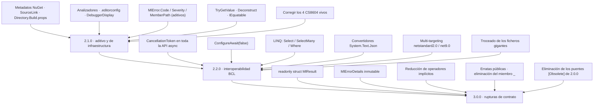

# Mejoras del proyecto `MoralesLarios.OOFP.Core`

> **Proyecto analizado** · `src/MoralesLarios.OOFP.Core`
> **Versión actual** · 2.0.0 · `net8.0`
> **Fecha del análisis** · tras el commit `0a6f8fc` (rama `release/2.0.0-nomenclatura`)
> **Objetivo** · identificar todas las mejoras que hacen el núcleo **más compatible con la BCL** y **más estándar** respecto a las convenciones de diseño de .NET
> **Naturaleza** · documento de análisis y planificación. No contiene cambios de código aplicados.

---

## Índice

1. [Qué es este conjunto de documentos](#1-qué-es-este-conjunto-de-documentos)
2. [Fotografía cuantitativa del núcleo](#2-fotografía-cuantitativa-del-núcleo)
3. [Resumen ejecutivo: los 12 hallazgos de mayor impacto](#3-resumen-ejecutivo-los-12-hallazgos-de-mayor-impacto)
4. [Índice de documentos](#4-índice-de-documentos)
5. [Matriz de prioridad y esfuerzo](#5-matriz-de-prioridad-y-esfuerzo)
6. [Hoja de ruta propuesta por versiones](#6-hoja-de-ruta-propuesta-por-versiones)
7. [Relación con la planificación ya existente](#7-relación-con-la-planificación-ya-existente)
8. [Convenciones de estos documentos](#8-convenciones-de-estos-documentos)

---

## 1. Qué es este conjunto de documentos

`MoralesLarios.OOFP.Core` es el **corazón** del ecosistema: los 29 proyectos restantes de la solución
dependen, directa o indirectamente, de `MlResult<T>`, `MlError`, `MlErrorDetails` y de las familias de
combinadores (`Bind`, `Map`, `Match`, `ExecSelf`, `Several`, `ChangeReturnResult`, `Collections`,
`Conversions`) y de las guardias `EnsureFp`.

Esto implica que **cualquier mejora en el núcleo se multiplica por 29**, y también que cualquier ruptura
se multiplica por 29. Por eso este análisis separa cuidadosamente:

- Mejoras **aditivas** (no rompen nada, se pueden meter en una versión menor).
- Mejoras **de comportamiento** (compilan igual pero se ejecutan distinto → riesgo alto, hay que documentar).
- Mejoras **rupturistas** (el compilador avisa → hay que planificar puentes `[Obsolete]`).

El análisis se ha hecho leyendo el código fuente real del proyecto y midiendo su superficie pública con
scripts deterministas. **Todas las cifras de estos documentos son medidas, no estimadas**, y cada
hallazgo se referencia con `fichero:línea`.

---

## 2. Fotografía cuantitativa del núcleo

### 2.1 Tamaño y distribución

| Métrica | Valor |
|---------|-------|
| Ficheros `.cs` (sin `bin`/`obj`) | **40** |
| Líneas de código totales | **36.054** |
| Ficheros puente `*.Obsolete.cs` | 10 (de los 73 de la solución) |
| Líneas en puentes `[Obsolete]` | 2.913 (**8,1 %** del proyecto) |

Los dos ficheros más grandes concentran **más de la mitad del núcleo**:

| Fichero | Líneas | % del proyecto |
|---------|-------:|---------------:|
| `Types/MlResultBindExtensions.cs` | 12.217 | 33,9 % |
| `Types/MlResultMapExtensions.cs` | 7.917 | 22,0 % |
| **Subtotal 2 ficheros** | **20.134** | **55,9 %** |
| `Types/MlResultExecSelfExtensions.cs` | 2.117 | 5,9 % |
| `Types/MlResultSeveralExtensions.cs` | 1.498 | 4,2 % |
| `Types/MlResultSeveralExtensions.Obsolete.cs` | 1.471 | 4,1 % |
| `Types/MlResultConversions.cs` | 1.290 | 3,6 % |
| `Types/MlResultCollections.cs` | 1.174 | 3,3 % |
| `Types/MlResultChangeReturnResult.cs` | 1.018 | 2,8 % |
| Resto (32 ficheros) | 7.352 | 20,4 % |

### 2.2 Superficie pública

| Métrica | Valor | Comentario |
|---------|------:|------------|
| Declaraciones `public static` | **2.019** | superficie enorme para una librería de 40 ficheros |
| Métodos de extensión (`this `) | **1.826** | el 90 % de la API son extensiones |
| Nombres de método distintos | **354** | → ~5,7 sobrecargas de media por nombre |
| Tipos públicos declarados | **15** | 2 `record` genéricos + 2 `record` de tupla + 11 clases estáticas |
| `implicit operator` | **21** | 10 en `MlResult<T>`, 11 en `MlErrorDetails` |
| Firmas `*Async` | **3.436** | |

Las familias con más sobrecargas (medido sobre los ficheros **no** `Obsolete`):

| Nombre de método | Sobrecargas |
|------------------|------------:|
| `TryMapIfFailWithoutExceptionAsync` | 48 |
| `TryBindIfFailWithoutExceptionAsync` | 47 |
| `TryMapIfFailWithExceptionErrorAsync` | 44 |
| `TryMapIfFailWithExceptionAsync` | 44 |
| `TryBindIfFailWithExceptionAsync` | 44 |
| `TryBindIfFailWithExceptionErrorAsync` | 44 |
| `TryBindIfFailWithValueAsync` | 24 |
| `TryMapIfFailWithValueAsync` | 24 |
| `TryBindIfAsync` | 24 |
| `BindIfFailWithoutExceptionAsync` | 24 |

### 2.3 Lo que **falta** (el dato más revelador)

| Elemento estándar de .NET | Ocurrencias en Core |
|---------------------------|--------------------:|
| `CancellationToken` | **5** (sólo en `EnsureFp.Async.cs`, 2 métodos) |
| `ConfigureAwait` | **0** |
| `ValueTask` / `ValueTask<T>` | **0** |
| `IAsyncEnumerable<T>` | **0** |
| `IEquatable<T>` | **0** |
| `IFormattable` / `ISpanFormattable` | **0** |
| `IParsable<T>` | **0** |
| `SelectMany` (sintaxis `from … in`) | **0** |
| `Select<` / `Where<` sobre `MlResult<T>` | **0** |
| `Deconstruct` | **0** |
| `TryGetValue` | **0** |
| `GetEnumerator` | **0** |
| `ExceptionDispatchInfo` | **0** |
| `[DebuggerDisplay]` | **0** |
| `[StackTraceHidden]` | **0** |
| `[MethodImpl(AggressiveInlining)]` | **0** |
| `[NotNull]` / `[MaybeNull]` / `[DoesNotReturn]` | **0** |
| `#nullable` (directivas locales) | **0** |

Y lo que hay en exceso:

| Elemento | Ocurrencias | Comentario |
|----------|------------:|------------|
| `null!` (null-forgiving) | **443** | de los cuales **417** son `= null!` en parámetros opcionales |
| `default!` | 19 | |
| `try` / `catch` | 24 / 22 | en 36.054 líneas, con 3.436 firmas `Try*` |
| `CallerArgumentExpression` | 67 | ✅ esto sí es buena práctica, bien usada en `EnsureFp` |

> **Lectura de la tabla.** El núcleo tiene 3.436 superficies asíncronas y **cero** soporte de
> cancelación, **cero** `ConfigureAwait(false)` y **cero** `ValueTask`. Para una librería que se
> consume desde ASP.NET Core y Entity Framework Core esto es el hallazgo de **mayor impacto
> práctico** de todo el análisis.

---

## 3. Resumen ejecutivo: los 12 hallazgos de mayor impacto

| # | Hallazgo | Documento | Prioridad | Rompe |
|--:|----------|-----------|-----------|:-----:|
| 1 | **Cancelación inexistente**: 3.436 firmas `async` sin `CancellationToken` | [02](02-Interoperabilidad-BCL.md) | 🔴 crítica | no (aditivo) |
| 2 | **Sin `ConfigureAwait(false)`**: riesgo de deadlock en hosts con `SynchronizationContext` | [02](02-Interoperabilidad-BCL.md) | 🔴 crítica | no |
| 3 | **`MlError` no tiene `Code`**: imposible mapear a RFC 7807 / `ProblemDetails` sin heurísticas de texto | [03](03-Modelo-de-Error.md) | 🔴 crítica | no (aditivo) |
| 4 | **`MlErrorDetails.Metadata` expone un `Dictionary<string,object>` mutable** y `Errors` un `IEnumerable<MlError>` perezoso | [03](03-Modelo-de-Error.md) | 🟠 alta | sí |
| 5 | **21 `implicit operator`** con solapamientos peligrosos (`T` vs `MlError` vs `string`) | [04](04-Nulabilidad-Genericos-y-Contratos.md) | 🟠 alta | sí |
| 6 | **Sin integración LINQ** (`Select`/`SelectMany`/`Where`): no se puede usar la sintaxis `from … in` | [02](02-Interoperabilidad-BCL.md) | 🟡 media | no (aditivo) |
| 7 | **`MlResult<T>` es `record` (heap)**: una asignación por paso de cadena | [06](06-Rendimiento.md) | 🟡 media | sí |
| 8 | **Mensajes en inglés incrustados** (`"Not right value"`, `"MlError:"`, `"Details:"`) | [01](01-Nomenclatura-y-Estandares.md) | 🟡 media | no |
| 9 | **Miembro público llamado `_`** (`MlResult._`, `MlResult<T>._`) | [01](01-Nomenclatura-y-Estandares.md) | 🟡 media | sí |
| 10 | **Un `.csproj` sin metadatos NuGet, sin SourceLink, sin analizadores, sin multi-targeting** | [07](07-Empaquetado-y-Compatibilidad.md) | 🟠 alta | no |
| 11 | **20.134 líneas en 2 ficheros** (55,9 % del proyecto) → inmantenible | [05](05-Superficie-de-API-y-Arquitectura.md) | 🟡 media | no |
| 12 | **417 parámetros `= null!`**: la nulabilidad declarada miente al consumidor | [04](04-Nulabilidad-Genericos-y-Contratos.md) | 🟠 alta | sí |

---

## 4. Índice de documentos

| Documento | Contenido | Hallazgos |
|-----------|-----------|----------:|
| [`01-Nomenclatura-y-Estandares.md`](01-Nomenclatura-y-Estandares.md) | Convenciones de nombres de .NET, erratas públicas, PascalCase en parámetros, el miembro `_`, disciplina del sufijo `Async`, semántica de `Try*`, literales en inglés | 14 |
| [`02-Interoperabilidad-BCL.md`](02-Interoperabilidad-BCL.md) | `CancellationToken`, `ConfigureAwait`, `ValueTask`, `IAsyncEnumerable`, LINQ (`Select`/`SelectMany`/`Where`), `IEquatable`, `IFormattable`, `IParsable`, `Deconstruct`, `TryGetValue`, `System.Text.Json`, pattern matching | 16 |
| [`03-Modelo-de-Error.md`](03-Modelo-de-Error.md) | `MlError.Code`/`Severity`/`MemberPath`, inmutabilidad de `MlErrorDetails`, `ExceptionDispatchInfo`, RFC 7807, `Activity`/OpenTelemetry, localización | 13 |
| [`04-Nulabilidad-Genericos-y-Contratos.md`](04-Nulabilidad-Genericos-y-Contratos.md) | Los 443 `null!`, los 4 CS8604 vivos, restricciones `notnull`, inferencia de `TException`, ambigüedad de sobrecargas, los 21 operadores implícitos | 12 |
| [`05-Superficie-de-API-y-Arquitectura.md`](05-Superficie-de-API-y-Arquitectura.md) | Explosión combinatoria de sobrecargas, troceado de los ficheros gigantes, `PublicAPI.Shipped.txt`, higiene de `EditorBrowsable`, generadores de código, tipo no genérico `MlResult` | 11 |
| [`06-Rendimiento.md`](06-Rendimiento.md) | `record` → `readonly struct`, camino feliz sin asignaciones, cierres, `AggressiveInlining`, `ArrayPool`, BenchmarkDotNet | 9 |
| [`07-Empaquetado-y-Compatibilidad.md`](07-Empaquetado-y-Compatibilidad.md) | Multi-targeting, `Directory.Build.props`, metadatos NuGet, SourceLink, builds deterministas, AOT/trimming, SemVer, limpieza del bloque `Scc*` | 12 |
| [`08-Calidad-Pruebas-y-Documentacion.md`](08-Calidad-Pruebas-y-Documentacion.md) | Analizadores, `.editorconfig`, `TreatWarningsAsErrors`, pruebas basadas en propiedades, mutación, cobertura, `<example>`/`<exception>`, sitio DocFX, guía de migración | 10 |

**Total: 97 hallazgos documentados.**

---

## 5. Matriz de prioridad y esfuerzo

> **Esfuerzo** · XS (<2 h) · S (½ jornada) · M (1 jornada) · L (2 jornadas) · XL (3+ jornadas)
> **Riesgo** · 🟢 bajo · 🟡 medio · 🟠 alto · 🔴 muy alto (rompe compatibilidad)

### 5.1 Ganancia alta / coste bajo — hacer primero

| Mejora | Doc | Esfuerzo | Riesgo |
|--------|-----|:--------:|:------:|
| Metadatos NuGet + SourceLink + build determinista | 07 | S | 🟢 |
| `Directory.Build.props` centralizando versión y propiedades | 07 | S | 🟢 |
| Eliminar el `PropertyGroup` muerto `Scc*` | 07 | XS | 🟢 |
| `[DebuggerDisplay]` en `MlResult<T>`, `MlError`, `MlErrorDetails` | 06 | XS | 🟢 |
| Corregir los 4 CS8604 vivos de `EnsureFp.Strings.cs` | 04 | XS | 🟢 |
| `TryGetValue` / `Deconstruct` en `MlResult<T>` | 02 | S | 🟢 |
| `MlError.Code` y `MlError.Severity` opcionales | 03 | M | 🟢 |
| Activar analizadores (`EnableNETAnalyzers`, `AnalysisLevel latest`) | 08 | S | 🟡 |

### 5.2 Ganancia alta / coste alto — planificar

| Mejora | Doc | Esfuerzo | Riesgo |
|--------|-----|:--------:|:------:|
| Propagar `CancellationToken` por toda la API asíncrona | 02 | XL | 🟡 |
| `ConfigureAwait(false)` en los 3.436 `await` | 02 | L | 🟡 |
| Integración LINQ (`Select`/`SelectMany`/`Where`) | 02 | M | 🟢 |
| Convertidores `System.Text.Json` para `MlResult<T>`/`MlError` | 02 | L | 🟢 |
| Trocear `MlResultBindExtensions.cs` y `MlResultMapExtensions.cs` | 05 | L | 🟢 |
| Multi-targeting `netstandard2.0` + `net8.0` + `net9.0` | 07 | L | 🟡 |
| `PublicAPI.Shipped.txt` + `Microsoft.CodeAnalysis.PublicApiAnalyzers` | 05 | M | 🟢 |

### 5.3 Rupturista — sólo en 3.0.0

| Mejora | Doc | Esfuerzo | Riesgo |
|--------|-----|:--------:|:------:|
| `MlResult<T>`: `record` → `readonly struct` | 06 | XL | 🔴 |
| `MlErrorDetails` inmutable (`IReadOnlyList`/`IReadOnlyDictionary`) | 03 | L | 🔴 |
| Reducir de 21 a 4 los operadores implícitos | 04 | M | 🔴 |
| Renombrar el miembro `_` a `Discard`/`Unit` | 01 | S | 🔴 |
| Eliminar los 417 `= null!` sustituyéndolos por sobrecargas reales | 04 | XL | 🔴 |
| Corregir las erratas públicas (`Succes`, `Valu`, `Faild`, `Alwais`…) | 01 | XL | 🔴 |

---

## 6. Hoja de ruta propuesta por versiones

| Versión | Carácter | Contenido | Jornadas estimadas |
|---------|----------|-----------|-------------------:|
| **2.1.0** | aditivo | Infraestructura de paquete, analizadores, API aditiva de error, utilidades de consumo | ~8 |
| **2.2.0** | aditivo con cambios de comportamiento acotados | Cancelación, `ConfigureAwait`, LINQ, serialización, multi-targeting, troceado | ~22 |
| **3.0.0** | rupturista | Tipo valor, inmutabilidad, limpieza de operadores, erratas, retirada de puentes | ~35 |

---

## 7. Relación con la planificación ya existente

Este análisis **no duplica** la planificación que ya existe en el repositorio. Cuando un hallazgo ya
estaba recogido en otro documento, se referencia en lugar de repetirse:

| Documento existente | Qué cubre ya | Cómo se relaciona |
|---------------------|--------------|-------------------|
| [`../../Next_Versions/2.1/Epica-Erratas-Identificadores-Publicos.md`](../../Next_Versions/2.1/Epica-Erratas-Identificadores-Publicos.md) | Campaña de erratas `Faild`, `Diferent`, `Erros`, `Alwais`, `Lenght`, `FusionFailErros` | El documento [01](01-Nomenclatura-y-Estandares.md) **referencia** esa épica y sólo añade las erratas no cubiertas (`Succes`, `Valu`, `Aggregat`, `Witout`, `printipal`) |
| [`../../Next_Versions/2.1/Epica-Mensajes-Y-Localizacion.md`](../../Next_Versions/2.1/Epica-Mensajes-Y-Localizacion.md) | Centralización y localización de mensajes | El documento [03](03-Modelo-de-Error.md) aporta el inventario de literales **del núcleo** |
| [`../../Next_Versions/2.1/Epica-Serializacion-y-Errores-Http.md`](../../Next_Versions/2.1/Epica-Serializacion-y-Errores-Http.md) | RFC 7807 y serialización en la capa HTTP | El documento [03](03-Modelo-de-Error.md) aporta los **cambios en el núcleo** que esa épica necesita (`MlError.Code`) |
| [`../../Next_Versions/2.1/Epica-Coherencia-Y-Documentacion.md`](../../Next_Versions/2.1/Epica-Coherencia-Y-Documentacion.md) | Coherencia de la documentación XML | El documento [08](08-Calidad-Pruebas-y-Documentacion.md) añade `<example>`, `<exception>` y el sitio DocFX |
| [`../../Temas Pendientes/Revision-Map-Bind-ExecSelf.md`](../../Temas%20Pendientes/Revision-Map-Bind-ExecSelf.md) | Revisión R1-R4 de los combinadores | El documento [04](04-Nulabilidad-Genericos-y-Contratos.md) retoma los puntos de inferencia de `TException` y ambigüedad de sobrecargas |
| [`../../Temas Pendientes/consejos_mejora_mlresult.md`](../../Temas%20Pendientes/consejos_mejora_mlresult.md) | Consejos previos sobre `MlResult` | Base histórica; este análisis la supera en alcance y aporta medidas |

---

## 8. Convenciones de estos documentos

### 8.1 Estructura de cada documento

Todos los documentos siguen la misma plantilla:

1. Cabecera en cita con metadatos (proyecto, versión destino, estado, esfuerzo, riesgo).
2. `## Índice` con enlaces de ancla.
3. `## 1. Contexto y problema` con una tabla `Punto │ Fichero │ Líneas │ Naturaleza` y una subsección
   `### Punto NN — …` por hallazgo, con el **código real** anotado.
4. `## 2. Alcance` (dentro / fuera).
5. `## 3. Historias de usuario` con criterios de aceptación en casillas.
6. `## 4. Orden de ejecución` con grafo Mermaid.
7. `## 5. Decisiones abiertas`.
8. `## 6. Definición de terminado`.
9. `## 7. Apéndice · código actual y propuesto`.
10. `## Ver también`.

### 8.2 Marcado del código

En los bloques de código:

- La primera línea es un comentario con `// fichero, Lnn-nn` que localiza el fragmento.
- Las anotaciones del analista van con `// ← …`.
- En los apéndices, las versiones se separan con `// ───── 2.0.0 ─────` y `// ───── 3.0.0 ─────`.

### 8.3 Obligación de documentar rupturas

> ⚠️ **Obligatorio.** Toda ruptura de compatibilidad que se decida implementar a partir de estos
> documentos debe quedar registrada en
> [`../../Copilot/.github/prompts/oofp-upgrade-2.prompt.md`](../../Copilot/.github/prompts/oofp-upgrade-2.prompt.md) (§3.3)
> y, si es un renombrado, además en el anexo
> [`../../Copilot/.github/prompts/oofp-upgrade-2.renames.md`](../../Copilot/.github/prompts/oofp-upgrade-2.renames.md).

### 8.4 Definición de terminado común

Cualquier historia de estos documentos sólo se considera terminada cuando:

- [ ] La solución compila con `dotnet build MoralesLarios.OOFP.sln -c Release --no-incremental` con
      **0 errores** y **`CS1591 = 0`**.
- [ ] Los **1.060 tests** de la solución están en verde.
- [ ] El número de advertencias no supera la línea base de **238**.
- [ ] Si hay ruptura, está registrada según §8.3.

---

## Ver también

- [`../../Next_Versions/2.1/README.md`](../../Next_Versions/2.1/README.md) — índice de las 9 épicas de la versión 2.1.
- [`../../Temas Pendientes/README.md`](../../Temas%20Pendientes/README.md) — índice de temas pendientes.
- [`../../../MoralesLarios.OOFP.Core/README.md`](../../../MoralesLarios.OOFP.Core/README.md) — documentación funcional del núcleo.
- [Framework Design Guidelines](https://learn.microsoft.com/dotnet/standard/design-guidelines/) — referencia normativa usada en todo el análisis.
