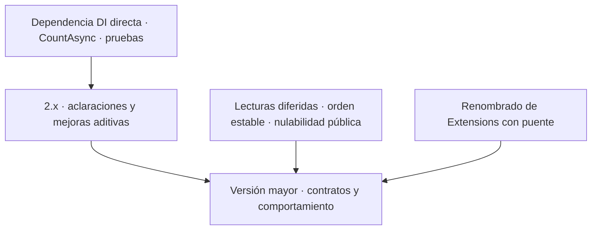

# Mejoras del proyecto `MoralesLarios.OOFP.EntityFrameworkCore`

> **Proyecto analizado** · `src/MoralesLarios.OOFP.EntityFrameworkCore`
> **Versión actual** · 2.0.0 · `net8.0` · EF Core 8.0.3
> **Fecha del análisis** · 2026-11-04 · commit `2d07c33` · rama `release/2.0.0-nomenclatura`
> **Objetivo** · verificar contratos de repositorio, consultas EF Core, unidad de trabajo, empaquetado y pruebas
> **Naturaleza** · documento de análisis y planificación. No contiene cambios de código aplicados.

---

## Índice

1. [Qué es este conjunto de documentos](#1-qué-es-este-conjunto-de-documentos)
2. [Fotografía cuantitativa](#2-fotografía-cuantitativa)
3. [Resumen ejecutivo](#3-resumen-ejecutivo)
4. [Índice de documentos](#4-índice-de-documentos)
5. [Matriz de prioridad y esfuerzo](#5-matriz-de-prioridad-y-esfuerzo)
6. [Hoja de ruta propuesta por versiones](#6-hoja-de-ruta-propuesta-por-versiones)
7. [Relación con la planificación ya existente](#7-relación-con-la-planificación-ya-existente)
8. [Convenciones de estos documentos](#8-convenciones-de-estos-documentos)

---

## 1. Qué es este conjunto de documentos

`MoralesLarios.OOFP.EntityFrameworkCore` implementa repositorios genéricos sobre `DbContext`, compone las operaciones con `MlResult<T>` y proporciona paginación y unidad de trabajo. El alcance incluye todo el código C# de producción del proyecto y sus cuatro ficheros C# de pruebas de integración; no se modificaron código, tests ni proyectos.

Se documentan **13 hallazgos**. Se distinguen mejoras aditivas, problemas de comportamiento que pueden cambiar resultados o tratamiento de errores sin cambiar firmas, y cambios de API que pueden romper consumidores. Las propuestas no sustituyen la comprobación de compatibilidad ni la validación con proveedores y cargas reales.

## 2. Fotografía cuantitativa

### 2.1 Tamaño y superficie

| Métrica | Valor medido | Método |
|---|---:|---|
| Ficheros `.cs` de producción | **28** | `Get-ChildItem -Recurse`, excluyendo `bin` y `obj` |
| Líneas de esos ficheros | **2.905** | suma de `Get-Content(...).Count` |
| Declaraciones de tipos públicos | **26** | `Select-String` sobre declaraciones `public class/interface/enum/record`; incluye parciales |
| Líneas de declaraciones de métodos públicos | **144** | patrón de firma `public ... nombre(` en ficheros de producción |
| Referencias a `CancellationToken` | **98** | coincidencias literales en los 28 ficheros |
| Supresiones `null!` / `default!` | **26 / 21** | coincidencias literales |
| Etiquetas XML `
` | **232** | coincidencias literales |

### 2.2 Patrones de consultas y BCL

| Elemento | Ocurrencias | Observación |
|---|---:|---|
| `AsNoTracking` | **8** | utilizado en lecturas y paginación |
| `ToListAsync` | **4** | materialización asíncrona |
| `CountAsync` | **0** | el total de la página se consulta con `Count()` síncrono |
| `ConfigureAwait` | **0** | no es el hallazgo principal de este análisis |
| `ValueTask` / `IAsyncEnumerable` | **0 / 0** | no se proponen por ausencia solamente |
| `null!` en parámetros opcionales de paginación | **6** | la interfaz declara no nulos valores que admite como `null` |

### 2.3 Pruebas y dependencias

| Métrica | Valor medido |
|---|---:|
| Ficheros C# del proyecto `Tests.Integration` | **4** |
| Líneas de esos ficheros | **914** |
| Métodos marcados `[Fact]` o `[Theory]` | **33** |
| Proyecto `MoralesLarios.OOFP.EntityFrameworkCore.Tests.Unit` | **No existe** |
| Proyectos que referencian la biblioteca | **4**: Application, Sample, TestSupport y Tests.Integration |

Los recuentos se obtuvieron sobre el árbol fuente, excluyendo `bin` y `obj`. Las declaraciones públicas se contaron mediante los patrones descritos; no equivalen a símbolos únicos cuando existe una declaración parcial.

## 3. Resumen ejecutivo

| # | Hallazgo | Documento | Prioridad | Rompe |
|--:|---|---|:---:|:---:|
| 1 | El parámetro genérico de entidad usa `T` contra la convención del repositorio | [01](01-Nomenclatura-y-Estandares.md) | 🟡 | no |
| 2 | La clase pública `Extensions` tiene un nombre genérico y un `
` vacío | [01](01-Nomenclatura-y-Estandares.md) | 🟠 | sí |
| 3 | La documentación XML de producción está en español, contra `CONTRIBUTING.md` | [01](01-Nomenclatura-y-Estandares.md) | 🟡 | no |
| 4 | Las lecturas síncronas devuelven consultas diferidas y las excepciones de enumeración escapan de `MlResult` | [03](03-Modelo-de-Error.md) | 🔴 | sí, de comportamiento |
| 5 | La clave nula se formatea antes de pasar por la guarda en `TryFind` | [03](03-Modelo-de-Error.md) | 🟠 | sí, de comportamiento |
| 6 | Los parámetros de paginación aceptan `null` pero se declaran no anulables | [04](04-Nulabilidad-Genericos-y-Contratos.md) | 🟠 | posible ruptura de fuente al corregir |
| 7 | La documentación de transacciones no distingue las transacciones externas | [05](05-Superficie-de-API-y-Arquitectura.md) | 🟠 | no (aclaración del contrato) |
| 8 | `IMlUnitOfWork` no genérica resuelve el último contexto registrado si hay varios | [05](05-Superficie-de-API-y-Arquitectura.md) | 🟡 | sí, de comportamiento |
| 9 | `TryGetLast` trae todas las filas coincidentes para devolver una | [06](06-Rendimiento.md) | 🟠 | no, si se conserva el orden definido |
| 10 | El método asíncrono de paginación ejecuta el conteo con I/O síncrono | [06](06-Rendimiento.md) | 🟡 | no |
| 11 | La paginación permite `Skip/Take` sin orden estable | [06](06-Rendimiento.md) | 🟠 | sí, de comportamiento |
| 12 | El paquete usa `IServiceCollection` sin declarar directamente su paquete de abstracciones | [07](07-Empaquetado-y-Compatibilidad.md) | 🟡 | no |
| 13 | La prueba de `TryAllAsync` solo comprueba que la secuencia no sea nula | [08](08-Calidad-Pruebas-y-Documentacion.md) | 🟡 | no |

## 4. Índice de documentos

| Documento | Contenido | Hallazgos |
|---|---|---:|
| [01-Nomenclatura-y-Estandares.md](01-Nomenclatura-y-Estandares.md) | Convenciones de identificadores y documentación XML | 3 |
| [03-Modelo-de-Error.md](03-Modelo-de-Error.md) | Captura de errores, evaluación diferida y validación de claves | 2 |
| [04-Nulabilidad-Genericos-y-Contratos.md](04-Nulabilidad-Genericos-y-Contratos.md) | Anotaciones NRT en parámetros opcionales | 1 |
| [05-Superficie-de-API-y-Arquitectura.md](05-Superficie-de-API-y-Arquitectura.md) | Transacciones externas y resolución DI de unidad de trabajo | 2 |
| [06-Rendimiento.md](06-Rendimiento.md) | Materialización de `Last`, conteo asíncrono y orden de páginas | 3 |
| [07-Empaquetado-y-Compatibilidad.md](07-Empaquetado-y-Compatibilidad.md) | Dependencia pública transitiva de DI | 1 |
| [08-Calidad-Pruebas-y-Documentacion.md](08-Calidad-Pruebas-y-Documentacion.md) | Fortaleza de la aserción de lectura general | 1 |

**Total: 13 hallazgos documentados.** No se crearon documentos 02 (Interoperabilidad BCL) ni AOT: el análisis no encontró problemas concretos que justificaran recomendaciones en esos temas.

## 5. Matriz de prioridad y esfuerzo

El esfuerzo queda **sin estimar**: requiere descomponer y verificar cada propuesta con los mantenedores.

### 5.1 Ganancia alta / coste bajo

| Mejora | Doc | Prioridad |
|---|---|:---:|
| Documentar explícitamente la propiedad de transacciones externas | 05 | 🟠 |
| Usar `CountAsync` y propagar el token de cancelación | 06 | 🟡 |
| Añadir una aserción de contenido a `TryAllAsync` | 08 | 🟡 |
| Declarar la dependencia directa de DI usada por la API pública | 07 | 🟡 |

### 5.2 Ganancia alta / coste alto — planificar

| Mejora | Doc | Prioridad |
|---|---|:---:|
| Definir materialización y manejo de errores de las lecturas síncronas | 03 | 🔴 |
| Acordar un orden total y estable para la paginación | 06 | 🟠 |
| Corregir contratos de nulabilidad de selectores y filtros opcionales | 04 | 🟠 |

### 5.3 Rupturista — solo tras decisión de compatibilidad

| Mejora | Doc | Prioridad |
|---|---|:---:|
| Renombrar `Extensions` con puente compatible o en versión mayor | 01 | 🟠 |
| Cambiar el comportamiento observable de lecturas diferidas o páginas sin orden | 03, 06 | 🔴 |

## 6. Hoja de ruta propuesta por versiones

| Destino | Contenido | Esfuerzo |
|---|---|---|
| 2.x por decidir | Dependencia directa, `CountAsync`, documentación y refuerzo de tests | Sin estimar |
| Versión mayor por decidir | Contratos de consulta y nulabilidad que alteren resultados o avisos del consumidor | Sin estimar |

## 7. Relación con la planificación ya existente

No se encontró una carpeta previa `src/docs_next/Mejoras/EntityFrameworkCore`. La documentación del proyecto está en `src/MoralesLarios.OOFP.EntityFrameworkCore/README.md`; este análisis la complementa y no la reemplaza. Las propuestas no se convierten aquí en épicas ni historias desarrolladas.

## 8. Convenciones de estos documentos

- Cada hallazgo incluye rutas y líneas del código o tests que lo sustentan.
- 🔴 indica prioridad crítica; 🟠 alta; 🟡 media. La clasificación de compatibilidad se explica dentro de cada punto.
- Las cifras son mediciones del árbol del commit indicado; no se midieron latencia, planes SQL ni cobertura de líneas.
- No se ejecutaron build ni tests: hacerlo puede escribir artefactos fuera de la carpeta documental autorizada.
