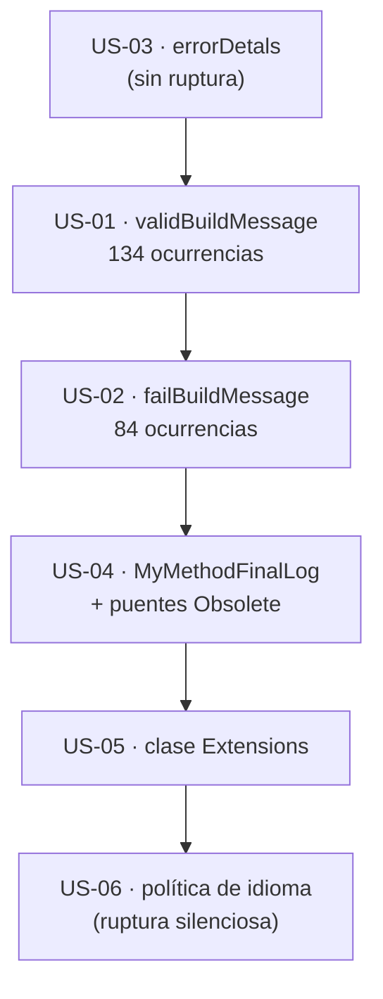

# 01 · Nomenclatura y estándares — `MoralesLarios.OOFP.Logging`

> **Proyecto** · `src/MoralesLarios.OOFP.Logging`
> **Versión actual** · 2.0.0 · `net8.0`
> **Versión destino propuesta** · 2.2.0 (puentes `[Obsolete]`) · retirada en 3.0.0
> **Estado** · ⬜ pendiente · documento de análisis, sin cambios aplicados
> **Esfuerzo** · S (½ jornada) para los renombrados · XS para los mensajes
> **Riesgo** · 🔴 muy alto · 5 de los 6 puntos rompen la compilación del consumidor

---

## Índice

1. [Contexto y problema](#1-contexto-y-problema)
2. [Alcance](#2-alcance)
3. [Historias de usuario](#3-historias-de-usuario)
4. [Orden de ejecución](#4-orden-de-ejecución)
5. [Decisiones abiertas](#5-decisiones-abiertas)
6. [Definición de terminado](#6-definición-de-terminado)
7. [Apéndice · código actual y propuesto](#7-apéndice--código-actual-y-propuesto)
8. [Ver también](#ver-también)

---

## 1. Contexto y problema

La capa de *logging* expone **347 métodos de extensión públicos** repartidos en 92 nombres distintos.
Esa superficie es coherente en su estructura —paridad perfecta de 47 miembros en cada uno de los seis
ficheros de nivel— pero arrastra **erratas ortográficas en los nombres de parámetros**, **residuos de
plantilla de ejemplo** y un **nombre de clase sin dominio**, exactamente el mismo problema que la
US-11 del núcleo resolvió en la 2.1.1.

Lo agravante es que las erratas están en **parámetros públicos**, que forman parte del contrato: el
consumidor que usa argumentos con nombre (`validBuilMessage: x => …`) depende de la errata para
compilar.

| Punto | Fichero | Líneas | Ocurrencias | Naturaleza |
|------:|---------|--------|------------:|------------|
| **01** | `MlResultLogExtensions.*.cs` | `Critical.cs:47,52,54,62` y 130 más | **134** | ruptura de compilación |
| **02** | `MlResultLogExtensions.*.cs` | `Critical.cs:426,430,431,454,458,459` y 78 más | **84** | ruptura de compilación |
| **03** | `MlResultLogExtensions.cs` | 1089, 1100, 1111 | **3** | ninguna (variable local) |
| **04** | `Extensions.cs` | 20, 35 | **2** | ruptura de compilación |
| **05** | `Extensions.cs` | 9 | **1** | ruptura de compilación |
| **06** | `Extensions.cs` | 24-25, 38-39 | **4** | ruptura de comportamiento (texto del log) |

> **Todas las cifras de este documento son medidas, no estimadas**, y cada hallazgo se referencia con
> `fichero:línea`.

---

### Punto 01 — `validBuilMessage`: falta la `d` de *Build* (134 ocurrencias)

El parámetro que recibe el constructor del mensaje de éxito se llama `validBuilMessage`. En la
**misma firma**, su pareja está bien escrita: `failBuildMessage`.

```csharp
// MoralesLarios.OOFP.Logging/MlResultLogExtensions.Critical.cs, L47-54
public static MlResult<T> LogMlResultCritical<T>(this MlResult<T> source,
                                                      ILogger logger,
                                                      Func<T, string> validBuilMessage = null!,
//                                                                    ^^^^^^^^^^^^^^^^  ← falta la 'd'
                                                      Func<MlErrorDetails, string> failBuildMessage = null!)
//                                                                                 ^^^^^^^^^^^^^^^^  ← correcto
```

El contraste dentro de una sola firma es lo que delata que es una errata y no una convención. Además
se propaga a la documentación generada vía `<param name="validBuilMessage">` (hallazgo **X4** del
[README](README.md#56-documentación-xml)).

| Aspecto | Valor |
|---------|-------|
| **Ocurrencias** | 134 |
| **Nombre propuesto** | `validBuildMessage` |
| **Ruptura** | **de compilación**, sólo para quien use argumentos con nombre |
| **Puente posible** | ❌ no · C# no admite dos nombres para el mismo parámetro. Hay que **duplicar la sobrecarga** y marcar la antigua `[Obsolete]`, o aceptar la ruptura en una versión mayor |

---

### Punto 02 — `faildMessage`: `d` sobrante (84 ocurrencias)

```csharp
// MoralesLarios.OOFP.Logging/MlResultLogExtensions.Critical.cs, L426-431
public static MlResult<T> LogMlResultCriticalIfFail<T>(this MlResult<T> source,
                                                            ILogger logger,
                                                            Func<MlErrorDetails, string> faildMessage)
//                                                                                       ^^^^^^^^^^^^  ← 'faild' no existe
    => source.LogMlResultIfFail(logger, LogLevel.Critical, faildMessage);
```

Conviven en el mismo proyecto **tres grafías** para el mismo concepto: `failBuildMessage` (correcto,
el mayoritario), `faildMessage` (84) y `failMessage`. La elección del nombre nuevo debe unificar las
tres, no sólo corregir la errata.

| Aspecto | Valor |
|---------|-------|
| **Ocurrencias** | 84 |
| **Nombre propuesto** | `failBuildMessage`, para unificar con el mayoritario |
| **Ruptura** | **de compilación**, sólo con argumentos con nombre |

---

### Punto 03 — `errorDetals`: falta la `i` (3 ocurrencias)

```csharp
// MoralesLarios.OOFP.Logging/MlResultLogExtensions.cs, L1089
    => source.LogMlResultErrorIfFail(logger, failBuildMessage : errorDetals => errorDetals.GetErrorsSummary());
//                                                              ^^^^^^^^^^^  ← falta la 'i' de Details
```

Aquí la errata está en el **parámetro de una lambda local**, no en una firma pública.

| Aspecto | Valor |
|---------|-------|
| **Ocurrencias** | 3 (líneas 1089, 1100, 1111) |
| **Nombre propuesto** | `errorDetails` |
| **Ruptura** | **ninguna** · es una variable local ⇒ se corrige sin registrar nada |

> ✅ Este punto puede corregirse **de inmediato**, en cualquier épica, sin coordinación.

---

### Punto 04 — `MyMethodFinalLog`: residuo de plantilla publicado como API

```csharp
// MoralesLarios.OOFP.Logging/Extensions.cs, L20-26
public static MlResult<T> MyMethodFinalLog<T>(this MlResult<T> source, ILogger logger, string methodActionDesc)
//                        ^^^^^^^^^^^^^^^^  ← "MyMethod…" es un marcador de posición, no un nombre de API
    => source.LogCompletedResult(logger,
                                 validBuildMessage: item   => $"{methodActionDesc} done correctly.",
                                 failBuildMessage : errors => $"Error when {methodActionDesc} Error: {errors.ToErrorsDetailsDescription()}");
```

`MyMethod…` es el nombre que se pone en un ejemplo de documentación para que el lector lo sustituya
por el suyo. Aquí llegó a la API pública junto con su gemelo `MyMethodFinalLogAsync`.

Funcionalmente es un *wrapper* de conveniencia sobre `LogCompletedResult` que compone los dos
mensajes a partir de una descripción de la acción. El nombre debería reflejar **eso**:
`LogActionResult`, `LogMethodOutcome` o similar.

| Aspecto | Valor |
|---------|-------|
| **Ocurrencias** | 2 (`MyMethodFinalLog`, `MyMethodFinalLogAsync`) |
| **Nombre propuesto** | a decidir · ver [D-01](#5-decisiones-abiertas) |
| **Ruptura** | **de compilación** |
| **Puente posible** | ✅ sí · patrón ya usado en `MlResultLogExtensions.Obsolete.cs` |

---

### Punto 05 — Clase pública llamada sólo `Extensions`

```csharp
// MoralesLarios.OOFP.Logging/Extensions.cs, L9
/// <summary>
/// Métodos de extension de <c></c>.
/// </summary>
//                           ^^^^^^^  ← summary vacío (hallazgo X2)
public static class Extensions
//                  ^^^^^^^^^^  ← nombre sin dominio, idéntico al caso de la US-11 del núcleo
```

Es **exactamente** el problema que la US-11 de la 2.1.1 resolvió en el núcleo, donde la clase
`Extensions` se troceó en cuatro clases con nombre propio. El precedente ya existe, así que la
decisión aquí es sólo **qué nombre** darle, no si hay que renombrarla.

A diferencia del núcleo, aquí **no hay que trocear nada**: la clase sólo contiene los dos métodos del
[punto 04](#punto-04--mymethodfinallog-residuo-de-plantilla-publicado-como-api), así que basta con
renombrarla.

| Aspecto | Valor |
|---------|-------|
| **Ocurrencias** | 1 |
| **Nombre propuesto** | a decidir · ver [D-02](#5-decisiones-abiertas) |
| **Ruptura** | **de compilación** sólo si alguien la invoca de forma estática (`Extensions.MyMethodFinalLog(…)`); como extensión, el renombrado es transparente |
| **Puente posible** | ✅ sí · dejar la clase antigua con los puentes `[Obsolete]` |

> **Matiz importante.** Para el 99 % de los consumidores, que la llaman como método de extensión
> (`resultado.MyMethodFinalLog(logger, "…")`), **el nombre de la clase es irrelevante** y el
> renombrado no rompe nada. La ruptura real de este punto es el **nombre del método**, no el de la
> clase.

---

### Punto 06 — Mensajes de la librería en inglés

```csharp
// MoralesLarios.OOFP.Logging/Extensions.cs, L24-25 y L38-39
validBuildMessage: item   => $"{methodActionDesc} done correctly.",
failBuildMessage : errors => $"Error when {methodActionDesc} Error: {errors.ToErrorsDetailsDescription()}"
//                            ^^^^^^^^^^^  ← inglés, y además con la preposición mal construida
```

Son los **únicos** textos que la librería escribe por su cuenta en el log; todo lo demás lo construye
el consumidor. Conviven con documentación XML en castellano, de modo que el proyecto no tiene una
política de idioma explícita.

Además, `"Error when {acción} Error: …"` repite la palabra *Error* y no es gramatical en ninguno de
los dos idiomas.

| Aspecto | Valor |
|---------|-------|
| **Ocurrencias** | 4 (2 por cada uno de los dos métodos) |
| **Ruptura** | ⚠️ **de comportamiento (silenciosa)** · el texto del log cambia. Rompe a quien tenga alertas o pruebas que casen con la cadena literal |
| **Registro obligatorio** | sí, si se cambia · ver [§6](#6-definición-de-terminado) |

---

### Lo que **no** hay que arreglar

El análisis preliminar apuntaba un séptimo punto —«24 métodos con el orden de nombre invertido
`IfX+NIVEL` en lugar de `NIVEL+IfX`»— que la medición **refuta**:

| Familia de nombres | Nombres | Firmas |
|--------------------|--------:|-------:|
| `NIVEL` + `IfX` · p. ej. `LogMlResultCriticalIfFailWithException` | **60** | 210 |
| `IfX` + `NIVEL` (orden invertido) | **0** | **0** |
| Sin nivel en el nombre · p. ej. `LogMlResultIfFailWithException` (el nivel va por parámetro) | 32 | 129 |

⇒ **La nomenclatura de los 92 nombres es coherente.** Los 32 nombres «sin nivel» no son una
inconsistencia: son la familia genérica que recibe el `LogLevel` como argumento. El falso positivo
venía de que `-match` en PowerShell es insensible a mayúsculas, y `LogMlResultTrace` casaba con el
patrón de búsqueda.

---

## 2. Alcance

**Dentro:**

- Renombrado de los parámetros públicos `validBuilMessage` y `faildMessage`.
- Renombrado de los métodos `MyMethodFinalLog` / `MyMethodFinalLogAsync`.
- Renombrado de la clase `Extensions`.
- Corrección de la variable local `errorDetals`.
- Decisión y aplicación de la política de idioma de los mensajes que emite la librería.
- Puentes `[Obsolete]` para todo lo que rompa compilación, siguiendo el patrón de
  `MlResultLogExtensions.Obsolete.cs`.

**Fuera:**

- El contenido de los `<param>` y `<summary>` (épica 05 · documentación XML), salvo el `<param>` que
  arrastra la errata del punto 01.
- El código comentado y el `using` accidental (épica 02 · higiene interna).
- El bug funcional `F1` (épica 03).
- `IsEnabled`, `EventId` y `LoggerMessage` (épica 06).
- Los nombres de los 60 métodos `NIVEL+IfX`, que son correctos.

---

## 3. Historias de usuario

### US-01 · Unificar el nombre del constructor del mensaje de éxito

Como consumidor de la librería, quiero que el parámetro se llame `validBuildMessage`, igual que su
pareja `failBuildMessage`, para no tener que recordar una errata.

- [ ] Las 134 ocurrencias de `validBuilMessage` pasan a `validBuildMessage`.
- [ ] Existe un puente que permite al consumidor seguir compilando (o la ruptura está aceptada y
      documentada para una versión mayor).
- [ ] Los `<param name="…">` correspondientes se actualizan en el mismo cambio.
- [ ] La ruptura está registrada en `oofp-upgrade-2.prompt.md` §3.3 y en el anexo de renombrados.

### US-02 · Unificar el nombre del constructor del mensaje de error

Como consumidor, quiero una sola grafía para el mensaje de error en toda la API.

- [ ] Las 84 ocurrencias de `faildMessage` pasan a `failBuildMessage`.
- [ ] No queda ninguna firma pública con `faildMessage` ni con `failMessage`.
- [ ] La ruptura está registrada en los 6 sitios del prompt de migración.

### US-03 · Corregir la variable local `errorDetals`

- [ ] Las 3 ocurrencias pasan a `errorDetails`.
- [ ] Se verifica que no hay ruptura (es una variable local) ⇒ **no** se registra en el prompt.

### US-04 · Dar nombre de dominio a `MyMethodFinalLog`

- [ ] `MyMethodFinalLog` y `MyMethodFinalLogAsync` adoptan el nombre acordado en [D-01](#5-decisiones-abiertas).
- [ ] Se añaden los puentes `[Obsolete("Renamed to …. Will be removed in 3.0.0.", false)]` con
      `[EditorBrowsable(EditorBrowsableState.Never)]`, en `MlResultLogExtensions.Obsolete.cs` o en un
      fichero `Extensions.Obsolete.cs`.
- [ ] El build sigue con `CS0618` = 0 dentro de la solución.
- [ ] Los renombrados están en `oofp-upgrade-2.renames.md`.

### US-05 · Dar nombre de dominio a la clase `Extensions`

- [ ] La clase adopta el nombre acordado en [D-02](#5-decisiones-abiertas).
- [ ] Su `<summary>` deja de estar vacío.
- [ ] Se documenta en el prompt que la invocación **estática** deja de compilar, y que la invocación
      como extensión no se ve afectada.

### US-06 · Fijar la política de idioma de los mensajes emitidos

- [ ] Se decide en [D-03](#5-decisiones-abiertas) si los mensajes van en castellano o en inglés.
- [ ] Los 4 textos de `Extensions.cs` se ajustan a la decisión y se corrige la redacción
      (`"Error when … Error: …"`).
- [ ] Si el texto cambia, la **ruptura silenciosa** queda registrada con su patrón de detección.

---

## 4. Orden de ejecución



**Justificación.** La US-03 va primera porque no rompe nada y valida el procedimiento de renombrado
masivo. Las US-01 y US-02 son el grueso del volumen (218 ocurrencias) y conviene hacerlas antes de
tocar firmas completas. La US-06 va última porque su ruptura es silenciosa y requiere el registro más
cuidadoso.

> ⚠️ **Prerrequisito.** Esta épica **no debe empezar** antes de que exista
> `MoralesLarios.OOFP.Logging.Tests.Unit` (épica 01 · red de seguridad). Sin tests directos no hay
> forma de demostrar que un renombrado masivo de 218 ocurrencias no ha alterado ninguna llamada.

---

## 5. Decisiones abiertas

| ID | Decisión | Opciones | Estado |
|----|----------|----------|--------|
| **D-01** | Nombre nuevo de `MyMethodFinalLog` | (a) `LogActionResult` · (b) `LogMethodOutcome` · (c) `LogCompletedAction` · (d) retirarlo y que el consumidor use `LogCompletedResult` directamente | ⬜ abierta |
| **D-02** | Nombre nuevo de la clase `Extensions` | (a) `MlResultLogActionExtensions` · (b) `MlResultMethodLogExtensions` · (c) fusionar su contenido en `MlResultLogExtensions` como otro `partial` y eliminar la clase | ⬜ abierta |
| **D-03** | Idioma de los mensajes que emite la librería | (a) castellano, coherente con la documentación XML · (b) inglés, coherente con la BCL y con los nombres de la API · (c) no emitir texto propio: exigir siempre los dos constructores de mensaje | ⬜ abierta |
| **D-04** | Estrategia para los parámetros renombrados | (a) sobrecarga nueva + la antigua `[Obsolete]`, duplicando 218 firmas · (b) renombrado directo, aceptando la ruptura y documentándola para la 3.0.0 · (c) renombrado directo en una 2.2.0, asumiendo que el uso de argumentos con nombre es minoritario | ⬜ abierta |

> **Sobre D-04.** Es la decisión de mayor impacto del documento. La opción (a) es la única que no
> rompe nada, pero **duplica 218 firmas** y multiplica una superficie pública que ya tiene 347
> métodos. La opción (c) es la más pragmática, pero es una ruptura de compilación en una versión
> menor, lo que contradice el versionado semántico. Conviene resolverla **antes** de empezar la
> épica.

> **Sobre D-02 opción (c).** Fusionar `Extensions` dentro de `MlResultLogExtensions` tiene una
> ventaja: deja **un solo tipo público** en todo el proyecto, lo que simplifica la superficie y hace
> innecesario elegir un nombre. Es la opción más limpia si se acepta que los dos métodos pertenecen
> conceptualmente a la misma familia.

---

## 6. Definición de terminado

- [ ] `dotnet build MoralesLarios.OOFP.sln -c Release --no-incremental` con **0 errores** y
      **`CS1591` = 0**.
- [ ] Los **1.136 tests** de la solución en verde, más los nuevos de la épica 01.
- [ ] Avisos **≤ 238** (línea base de la solución).
- [ ] `CS0618` = 0 dentro de la solución (los puentes no se usan internamente).
- [ ] **0 ocurrencias** de `validBuilMessage`, `faildMessage`, `errorDetals` y `MyMethodFinalLog` en
      código vivo, verificado con búsqueda *case-sensitive*.
- [ ] Toda ruptura registrada en
      [`../../Copilot/.github/prompts/oofp-upgrade-2.prompt.md`](../../Copilot/.github/prompts/oofp-upgrade-2.prompt.md)
      en **los 6 sitios**: fila en la tabla §3.3, subsección `#### N` de detalle, barrido de búsqueda
      de la Fase 5 (punto 4), lista del informe de la Fase 6 (punto 5), tabla del apéndice de
      versiones y, para los renombrados,
      [`../../Copilot/.github/prompts/oofp-upgrade-2.renames.md`](../../Copilot/.github/prompts/oofp-upgrade-2.renames.md).
- [ ] La ruptura **silenciosa** de la US-06 incluye en su registro **cómo detectarla** (patrón de
      búsqueda del texto literal antiguo).
- [ ] Las cuatro decisiones `D-01` … `D-04` están resueltas y anotadas.

---

## 7. Apéndice · código actual y propuesto

### 7.1 Firma con la errata del punto 01

```csharp
// MoralesLarios.OOFP.Logging/MlResultLogExtensions.Critical.cs, L47-54

// ───── 2.0.0 (actual) ─────
public static MlResult<T> LogMlResultCritical<T>(this MlResult<T> source,
                                                      ILogger logger,
                                                      Func<T, string> validBuilMessage = null!,
                                                      Func<MlErrorDetails, string> failBuildMessage = null!)

// ───── propuesta ─────
public static MlResult<T> LogMlResultCritical<T>(this MlResult<T> source,
                                                      ILogger logger,
                                                      Func<T, string> validBuildMessage = null!,
                                                      Func<MlErrorDetails, string> failBuildMessage = null!)
```

### 7.2 Patrón de puente ya existente en el proyecto

El proyecto **ya tiene** el patrón resuelto, usado para los 6 puentes de la 2.0.0. Hay que replicarlo
tal cual:

```csharp
// MoralesLarios.OOFP.Logging/MlResultLogExtensions.Obsolete.cs
// Puentes [Obsolete] de la v2.0.0: nombres antiguos que reenvian al nombre nuevo.
// Se eliminan en la v3.0.0.

[global::System.Obsolete("Renamed to LogCompletedResult. Will be removed in 3.0.0.", false)]
[global::System.ComponentModel.EditorBrowsable(global::System.ComponentModel.EditorBrowsableState.Never)]
public static MlResult<T> LogMlResultFinal<T>(this MlResult<T> source, /* … */)
    => source.LogCompletedResult(/* … */);
```

### 7.3 El método completo del punto 04

```csharp
// MoralesLarios.OOFP.Logging/Extensions.cs, L20-45

// ───── 2.0.0 (actual) ─────
public static MlResult<T> MyMethodFinalLog<T>(this MlResult<T> source, ILogger logger, string methodActionDesc)
    => source.LogCompletedResult(logger,
                                 validBuildMessage: item   => $"{methodActionDesc} done correctly.",
                                 failBuildMessage : errors => $"Error when {methodActionDesc} Error: {errors.ToErrorsDetailsDescription()}");

public static async Task<MlResult<T>> MyMethodFinalLogAsync<T>(this Task<MlResult<T>> sourceAsync, ILogger logger, string methodActionDesc)
    => await (await sourceAsync).LogCompletedResultAsync(logger,
                                                         validBuildMessage: item   => $"{methodActionDesc} done correctly.",
                                                         failBuildMessage : errors => $"Error when {methodActionDesc} Error: {errors.ToErrorsDetailsDescription()}");
```

El nombre nuevo (D-01) y el idioma de los dos textos (D-03) se deciden a la vez, porque los dos
afectan a estas mismas cuatro líneas.

### 7.4 Comprobación final de erratas

Búsqueda *case-sensitive* que debe devolver **0** en código vivo al cerrar la épica:

| Patrón | Ocurrencias ahora | Objetivo |
|--------|------------------:|---------:|
| `validBuilMessage` | 134 | 0 |
| `faildMessage` | 84 | 0 |
| `errorDetals` | 3 | 0 |
| `MyMethodFinalLog` | 2 | 0 (vivo) · 2 (puentes `[Obsolete]`) |
| `class Extensions` | 1 | 0 |
| `LogMlResultt` | 13 (todas en código comentado) | 0, al borrar el código muerto en la épica 02 |

---

## Ver también

- [`README.md`](README.md) — índice del análisis de `MoralesLarios.OOFP.Logging` y catálogo completo de los 35 hallazgos.
- [`../Core/01-Nomenclatura-y-Estandares.md`](../Core/01-Nomenclatura-y-Estandares.md) — documento equivalente del núcleo, cuya metodología se replica.
- [`../../Next_Versions/2.1.1/Core/Epica-03-Miembros-Publicos-y-Firmas.md`](../../Next_Versions/2.1.1/Core/Epica-03-Miembros-Publicos-y-Firmas.md) — precedente ya cerrado: la US-11 troceó la clase `Extensions` del núcleo.
- [`../../Copilot/.github/prompts/oofp-upgrade-2.prompt.md`](../../Copilot/.github/prompts/oofp-upgrade-2.prompt.md) — contrato de migración donde se registran las rupturas.
- [`../../Copilot/.github/prompts/oofp-upgrade-2.renames.md`](../../Copilot/.github/prompts/oofp-upgrade-2.renames.md) — anexo de renombrados en formato buscar-y-reemplazar.
- [Names of Parameters](https://learn.microsoft.com/dotnet/standard/design-guidelines/names-of-type-members#names-of-parameters) — referencia normativa de .NET sobre nombres de parámetros.
