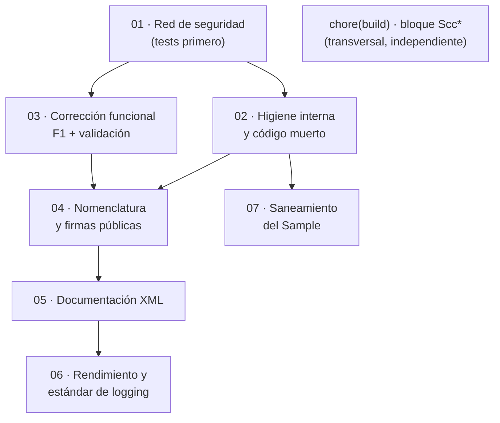

# Mejoras del proyecto `MoralesLarios.OOFP.Logging`

> **Proyectos analizados** · `src/MoralesLarios.OOFP.Logging` y `src/MoralesLarios.OOFP.Logging.Sample`
> **Versión actual** · 2.0.0 · `net8.0`
> **Fecha del análisis** · tras el commit `2193ea7` (rama `release/2.0.0-nomenclatura`)
> **Objetivo** · identificar todas las mejoras que hacen la capa de *logging* **más compatible con `Microsoft.Extensions.Logging`** y **más estándar** respecto a las convenciones de diseño de .NET
> **Naturaleza** · documento de análisis y planificación. No contiene cambios de código aplicados.

---

## Índice

1. [Qué es este conjunto de documentos](#1-qué-es-este-conjunto-de-documentos)
2. [Fotografía cuantitativa](#2-fotografía-cuantitativa)
3. [Resumen ejecutivo: los 10 hallazgos de mayor impacto](#3-resumen-ejecutivo-los-10-hallazgos-de-mayor-impacto)
4. [Índice de documentos](#4-índice-de-documentos)
5. [Catálogo completo de hallazgos](#5-catálogo-completo-de-hallazgos)
6. [Matriz de prioridad y esfuerzo](#6-matriz-de-prioridad-y-esfuerzo)
7. [Épicas propuestas y orden de ejecución](#7-épicas-propuestas-y-orden-de-ejecución)
8. [Correcciones sobre el análisis preliminar](#8-correcciones-sobre-el-análisis-preliminar)
9. [Convenciones de estos documentos](#9-convenciones-de-estos-documentos)

---

## 1. Qué es este conjunto de documentos

`MoralesLarios.OOFP.Logging` es la capa que conecta el raíl funcional del núcleo
(`MlResult`, `MlResult<T>`, `MlErrorDetails`) con `Microsoft.Extensions.Logging`. Su API completa son
métodos de extensión que **registran el estado del raíl sin romperlo**: reciben un `MlResult<T>`,
escriben en el `ILogger` y devuelven el mismo `MlResult<T>` para que la cadena continúe.

Este análisis se ha hecho leyendo el código fuente real y midiendo su superficie con scripts
deterministas. **Todas las cifras de estos documentos son medidas, no estimadas**, y cada hallazgo se
referencia con `fichero:línea`.

Igual que en el análisis del núcleo, las mejoras se separan en tres categorías:

- Mejoras **aditivas** · no rompen nada, caben en una versión menor.
- Mejoras **de comportamiento** · compilan igual pero se ejecutan distinto ⇒ **ruptura silenciosa**,
  riesgo alto, obligatorio documentarlas (ver [§9.3](#93-obligación-de-documentar-rupturas)).
- Mejoras **rupturistas** · el compilador avisa al consumidor ⇒ hay que planificar puentes `[Obsolete]`.

### 1.1 Alcance real del análisis

El alcance se amplió a toda la familia de *logging*. Al medirla se comprobó que **sólo existen dos
proyectos**:

| Proyecto | Estado | Incluido |
|----------|--------|:--------:|
| `MoralesLarios.OOFP.Logging` | existe · 10 ficheros `.cs` | ✅ |
| `MoralesLarios.OOFP.Logging.Sample` | existe · 1 fichero `.cs` | ✅ |
| `MoralesLarios.OOFP.Extensions.Loggers` | **no existe en disco** · entrada fantasma del árbol del editor, no está en la solución | ❌ |
| `MoralesLarios.OOFP.Extensions.Loggers.Console.Tests` | **no existe en disco** · ídem | ❌ |

> **Dato relevante.** `MoralesLarios.OOFP.Logging.Tests.Unit` **tampoco existe**. Los 347 métodos de
> extensión públicos no tienen **ni un solo test directo**. Ver el hallazgo
> [T1](#55-cobertura-de-pruebas).

### 1.2 Quién consume este proyecto

Cuatro proyectos de la solución referencian `MoralesLarios.OOFP.Logging.csproj`:

| Proyecto consumidor | Tipo de cobertura que aporta |
|---------------------|------------------------------|
| `MoralesLarios.OOFP.Application` | ninguna (producción) |
| `MoralesLarios.OOFP.Http` | ninguna (producción) |
| `MoralesLarios.OOFP.Http.Tests.Integration` | **indirecta** · 33 tests de integración |
| `MoralesLarios.OOFP.Logging.Sample` | manual (consola de pruebas) |

⇒ Toda ruptura afecta a **4 proyectos internos** más los consumidores externos de la librería.

---

## 2. Fotografía cuantitativa

### 2.1 Tamaño y distribución

| Métrica | Valor |
|---------|------:|
| Ficheros `.cs` (sin `bin`/`obj`) | **10** |
| Líneas totales | **6.619** |
| Líneas en blanco | **1.159** (17,5 %) |
| Líneas comentadas que no son documentación XML | **530** (8,0 %) |
| Clases públicas (tipos distintos) | **2** |
| Declaraciones `public static partial class` | 8 (todas de `MlResultLogExtensions`) |

| Líneas | Fichero | Blancas | Comentadas | Regiones |
|-------:|---------|--------:|-----------:|---------:|
| 1.121 | `MlResultLogExtensions.cs` | 150 | 3 | 7 |
| 910 | `MlResultLogExtensions.Debug.cs` | 184 | 87 | 7 |
| 897 | `MlResultLogExtensions.Warning.cs` | 171 | 87 | 7 |
| 896 | `MlResultLogExtensions.Trace.cs` | 170 | 87 | 7 |
| 888 | `MlResultLogExtensions.Critical.cs` | 161 | 87 | 7 |
| 884 | `MlResultLogExtensions.Information.cs` | 157 | 88 | 7 |
| 883 | `MlResultLogExtensions.Error.cs` | 157 | 87 | 7 |
| 85 | `MlResultLogExtensions.Obsolete.cs` | 1 | 1 | 0 |
| 46 | `Extensions.cs` | 8 | 3 | 0 |
| 9 | `GlobalUsings.cs` | 0 | 0 | 0 |
| **6.619** | **10 ficheros** | **1.159** | **530** | **42** |

Más `README.md` (733 líneas) y el `.csproj`.

### 2.2 Superficie pública

| Métrica | Vivo | Comentado | Total |
|---------|-----:|----------:|------:|
| Líneas `public static` | **348** | 102 | 450 |
| Métodos de extensión (`(this `) | **347** | 102 | 449 |
| Nombres de método distintos (vivos) | **92** | — | — |
| Miembros `[Obsolete]` | 6 | — | — |

⇒ **~3,7 sobrecargas de media por nombre** (339 firmas sobre 92 nombres; 9 de las 348 líneas
`public static` continúan en la línea siguiente).

**Paridad entre niveles de log** (líneas `public static` vivas por fichero):

| Fichero | `public static` vivas |
|---------|----------------------:|
| `MlResultLogExtensions.Critical.cs` | 47 |
| `MlResultLogExtensions.Debug.cs` | 47 |
| `MlResultLogExtensions.Error.cs` | 47 |
| `MlResultLogExtensions.Information.cs` | 47 |
| `MlResultLogExtensions.Trace.cs` | 47 |
| `MlResultLogExtensions.Warning.cs` | 47 |
| `MlResultLogExtensions.cs` (genérico por `LogLevel`) | 57 |
| `MlResultLogExtensions.Obsolete.cs` | 6 |
| `Extensions.cs` | 3 |

> ✅ **Punto fuerte a preservar.** La paridad entre los seis niveles es **perfecta**: 47 miembros
> exactos en cada uno, y las mismas 7 regiones (`LogMlResult<Nivel>`, `…IfValid`, `…IfFail`,
> `…IfFailWithValue`, `…IfFailWithException`, `…IfFailWithoutException`, más
> `LogGeneralErrorIfFail` en el fichero genérico). Cualquier refactor debe mantener esta simetría.

### 2.3 Lo que **falta** (el dato más revelador)

| Elemento estándar de .NET / `Microsoft.Extensions.Logging` | Ocurrencias |
|------------------------------------------------------------|------------:|
| `ILogger.IsEnabled(logLevel)` | **0** |
| `LoggerMessage` / `[LoggerMessage]` (generador de código) | **0** |
| `EventId` | **0** |
| `BeginScope` | **0** |
| `ILogger<T>` (logger genérico por categoría) | **0** |
| `ILoggerFactory` | **0** |
| Sobrecargas tipadas (`LogError`, `LogDebug`, `LogWarning`…) | **0** |
| Plantillas de mensaje con marcadores (`"{Id}"`) | **0** |
| `CancellationToken` | **0** |
| `ConfigureAwait(false)` | **0** |
| `ValueTask` / `ValueTask<T>` | **0** |
| `ArgumentNullException` / `ThrowIfNull` | **0** |
| `nameof(` | **0** |
| `<exception>` en documentación XML | **0** |
| `<example>` en documentación XML | **0** |
| `[MethodImpl]` · `[DebuggerDisplay]` · `[StackTraceHidden]` | **0** |
| `TimeProvider` / `Stopwatch` | **0** |

Y lo que hay en exceso:

| Elemento | Ocurrencias | Comentario |
|----------|------------:|------------|
| `null!` en valores por omisión de parámetros | **132** | la nulabilidad declarada miente al consumidor |
| Parámetro mal escrito `validBuilMessage` | **134** | falta la `d` de *Build* |
| Parámetro mal escrito `faildMessage` | **84** | `d` sobrante |
| `<param>` de plantilla «Mensaje descriptivo.» | **383** | mismo texto para semánticas distintas |
| Palabras sin tilde (`unicamente`, `operacion`, `envian`…) | **603** | conviven con las mismas acentuadas |
| Interpolaciones `$"` | 4 | |

> **Lectura de la tabla.** El proyecto tiene 347 métodos de extensión que escriben en un `ILogger` y
> **cero** comprobaciones de `IsEnabled`, **cero** `EventId`, **cero** plantillas de mensaje y **cero**
> validaciones de argumento. Construye siempre la cadena del mensaje **antes** de saber si el nivel
> está habilitado. Para una librería de *logging* esto es el hallazgo de **mayor impacto práctico**
> de todo el análisis, junto con el bug funcional [F1](#51-corrección-funcional).

### 2.4 Estado de compilación

| Métrica | Valor |
|---------|------:|
| `dotnet build … Logging.csproj -c Release --no-incremental` | **EXIT = 0** |
| Avisos **propios** de `MoralesLarios.OOFP.Logging` | **0** |
| Avisos heredados de `Core` al compilar Logging | 8 (4 `CS8604` únicos, en `EnsureFp.Strings.cs`) |
| Avisos **propios** de `MoralesLarios.OOFP.Logging.Sample` | **1** (`CS8604` · `Program.cs:33`) |
| `CS1591` (documentación XML ausente) | **0** |

---

## 3. Resumen ejecutivo: los 10 hallazgos de mayor impacto

| # | Hallazgo | Ref. | Prioridad | Rompe |
|--:|----------|------|-----------|:-----:|
| 1 | **Bug funcional** · `LogMlResultIfFailWithExceptionAsync` delega en `…WithValueAsync`, así que lee la excepción con `GetMetadataValue<Exception>()` en lugar de `GetException()` | [F1](#51-corrección-funcional) | 🔴 crítica | sí (silenciosa al corregir) |
| 2 | **Cobertura directa = 0** · no existe `MoralesLarios.OOFP.Logging.Tests.Unit`; 347 métodos públicos sin un solo test | [T1](#55-cobertura-de-pruebas) | 🔴 crítica | no |
| 3 | **134 `validBuilMessage`** · errata en un parámetro público, que convive con `failBuildMessage` bien escrito en la misma firma | [N1](#52-nomenclatura-y-estándares) | 🔴 alta | sí (compilación) |
| 4 | **84 `faildMessage`** · errata en un parámetro público | [N2](#52-nomenclatura-y-estándares) | 🔴 alta | sí (compilación) |
| 5 | **Nunca se comprueba `IsEnabled`** · el mensaje se construye siempre, aunque el nivel esté desactivado | [D1](#53-diseño-y-alineamiento-con-la-bcl) | 🟠 alta | no (aditivo) |
| 6 | **`MyMethodFinalLog` / `MyMethodFinalLogAsync`** · nombres de plantilla de ejemplo publicados como API | [N4](#52-nomenclatura-y-estándares) | 🟠 alta | sí (compilación) |
| 7 | **Clase pública llamada sólo `Extensions`** · mismo caso que la US-11 del núcleo | [N5](#52-nomenclatura-y-estándares) | 🟠 alta | sí (compilación) |
| 8 | **530 líneas comentadas**, de ellas ~87 clonadas en cada uno de los 6 ficheros de nivel | [M1](#54-higiene-interna-y-código-muerto) | 🟡 media | no |
| 9 | **383 `<param>` con el texto «Mensaje descriptivo.»** · documentación XML sin valor informativo | [X1](#56-documentación-xml) | 🟡 media | no |
| 10 | **0 validación de argumentos** · un `logger` nulo produce `NullReferenceException` en lugar de `ArgumentNullException` | [D8](#53-diseño-y-alineamiento-con-la-bcl) | 🟡 media | sí (silenciosa) |

---

## 4. Índice de documentos

| Documento | Contenido | Hallazgos | Estado |
|-----------|-----------|----------:|--------|
| [`01-Nomenclatura-y-Estandares.md`](01-Nomenclatura-y-Estandares.md) | Erratas en parámetros públicos, residuos de plantilla, nombre de la clase `Extensions`, orden de los componentes del nombre, mensajes en inglés | 6 | ✅ escrito |
| `02-Correccion-Funcional-y-Validacion.md` | El bug `F1`, validación de argumentos, `errorDetals`, contratos de nulabilidad | 4 | ⬜ pendiente |
| `03-Higiene-Interna-y-Codigo-Muerto.md` | `using` accidental de `JSType`, `GlobalUsings` redundantes, bloque `Scc*`, `RootNamespace`, código comentado | 8 | ⬜ pendiente |
| `04-Documentacion-XML.md` | «Mensaje descriptivo.», tildes, `<exception>`, `<example>`, summaries copiados | 7 | ⬜ pendiente |
| `05-Rendimiento-y-Estandar-de-Logging.md` | `IsEnabled`, `EventId`, `LoggerMessage`, plantillas, `ILogger<T>`, `BeginScope`, `CA2254` | 6 | ⬜ pendiente |
| `06-Red-de-Seguridad-y-Pruebas.md` | Proyecto de tests propio, `InternalsVisibleTo`, cobertura de la matriz nivel × región | 4 | ⬜ pendiente |

**Total: 35 hallazgos catalogados** (ver [§5](#5-catálogo-completo-de-hallazgos)).

---

## 5. Catálogo completo de hallazgos

### 5.1 Corrección funcional

#### F1 · `LogMlResultIfFailWithExceptionAsync` delega en la familia equivocada 🔴

```csharp
// MoralesLarios.OOFP.Logging/MlResultLogExtensions.cs, L947-951
public static async Task<MlResult<T>> LogMlResultIfFailWithExceptionAsync<T>(this Task<MlResult<T>> sourceAsync,
                                                                                  ILogger logger, LogLevel logLevel,
                                                                                  Func<MlErrorDetails, Exception, string> failBuildMessage)
    => await (await sourceAsync).LogMlResultIfFailWithValueAsync(logger, logLevel, failBuildMessage);
//                               ^^^^^^^^^^^^^^^^^^^^^^^^^^^^^  ← debería ser LogMlResultIfFailWithExceptionAsync
```

Sus dos sobrecargas hermanas sí resuelven contra `GetException()`. Esta resuelve contra
`GetMetadataValue<Exception>()`, porque `Exception` encaja como `TValue` del método `…WithValue…`.
**Compila sin un solo aviso**, y por eso ha sobrevivido: no hay tests.

| Aspecto | Valor |
|---------|-------|
| **Naturaleza** | defecto de comportamiento |
| **Ruptura al corregirlo** | ⚠️ **silenciosa** · el consumidor compila igual, pero el mensaje cambia y el método puede empezar (o dejar de) registrar |
| **Registro obligatorio** | sí · en los **6 sitios** de `oofp-upgrade-2.prompt.md` |

### 5.2 Nomenclatura y estándares

| # | Hallazgo | Ocurrencias | Evidencia | Ruptura |
|---|----------|------------:|-----------|---------|
| **N1** | Parámetro `validBuilMessage` (falta la `d` de *Build*); convive con `failBuildMessage` bien escrito en la **misma** firma | **134** | `MlResultLogExtensions.Critical.cs:47,52,54,62` | compilación |
| **N2** | Parámetro `faildMessage` (`d` sobrante) | **84** | `MlResultLogExtensions.Critical.cs:426,430,431,454,458,459` | compilación |
| **N3** | Lambda local `errorDetals` (falta la `i`) | **3** | `MlResultLogExtensions.cs:1089,1100,1111` | ninguna (es local) |
| **N4** | `MyMethodFinalLog` / `MyMethodFinalLogAsync` · residuo de plantilla de ejemplo en la API pública | 2 | `Extensions.cs:20,35` | compilación |
| **N5** | Clase pública llamada sólo `Extensions` · nombre sin dominio, idéntico al caso resuelto por la US-11 del núcleo | 1 | `Extensions.cs:9` | compilación |
| **N6** | Mensajes de la propia librería **en inglés** (`"done correctly."`, `"Error when …"`) mientras la documentación XML está en castellano | 4 | `Extensions.cs:24-25,38-39` | comportamiento (texto del log) |

Detalle completo en [`01-Nomenclatura-y-Estandares.md`](01-Nomenclatura-y-Estandares.md).

### 5.3 Diseño y alineamiento con la BCL

| # | Hallazgo | Evidencia |
|---|----------|-----------|
| **D1** | **Nunca se comprueba `ILogger.IsEnabled(logLevel)`** · el mensaje se construye antes de llamar al logger, incluso si el nivel está desactivado | patrón general · `MlResultLogExtensions.cs:33,49,192,211,233` |
| **D2** | `logger.Log(logLevel, message)` con un mensaje **no constante** · riesgo de `CA2254`, sin plantilla de marcadores ni `EventId` | 5 · mismas líneas |
| **D3** | **132 `null!`** como valor por omisión de parámetros | `MlResultLogExtensions.Critical.cs:52,53,67,68,83,84,99,100` |
| **D4** | `ILogger` **nunca** genérico · 0 usos de `ILogger<T>`, así que la categoría del log no refleja el tipo que la origina | las 347 firmas |
| **D5** | **Asincronía falsa** · métodos `…Async` que sólo envuelven el resultado con `.ToAsync()`, sin trabajo asíncrono real | `MlResultLogExtensions.cs:46-51,88-95` |
| **D6** | `LogMlResult` devuelve `MlResult<ILogger>` · meter el logger en el raíl funcional es discutible | `MlResultLogExtensions.cs:28-35` |
| **D7** | `Match` devolviendo `null!` cuando el delegado es nulo | `MlResultLogExtensions.cs:71-76` |
| **D8** | **0 validación de argumentos** · un `logger` nulo produce `NullReferenceException` en lugar de `ArgumentNullException` | las 347 firmas |
| **D9** | **0 `BeginScope`, 0 `EventId`, 0 `LoggerMessage`** · no se aprovecha nada del logging estructurado moderno | todo el proyecto |

### 5.4 Higiene interna y código muerto

| # | Hallazgo | Evidencia |
|---|----------|-----------|
| **G1** | `using static System.Runtime.InteropServices.JavaScript.JSType;` · `using` insertado accidentalmente por Visual Studio, sin ninguna relación con el proyecto | `MlResultLogExtensions.cs:8` y `MlResultLogExtensions.Obsolete.cs:2` (**2**) |
| **G2** | `GlobalUsings.cs:1-5` redundantes con `ImplicitUsings` (`System`, `System.Collections.Generic`, `System.Linq`, `System.Threading.Tasks`); `System.Text` además **no se usa** | `GlobalUsings.cs:1-5` |
| **G3** | `PropertyGroup Label="Globals"` con 4 propiedades `Scc*` vacías · residuo de Visual SourceSafe. **Afecta a 28 `.csproj` de la solución, `Core` incluido** ⇒ se trata como [limpieza transversal](#71-limpieza-transversal-del-bloque-scc) en un commit `chore(build)` aparte | `MoralesLarios.OOFP.Logging.csproj` y 27 más |
| **G4** | `.csproj` sin `RootNamespace` (`Core` sí lo declara) y sin `InternalsVisibleTo` | `MoralesLarios.OOFP.Logging.csproj` |
| **G5** | `.csproj` declara `AssemblyVersion` y `FileVersion` · `Core` **no** lo hace ⇒ incoherencia de versionado entre proyectos de la misma solución | ídem |
| **G6** | 17,5 % de líneas en blanco, con bloques de 4-6 líneas vacías consecutivas entre sobrecargas | los 6 ficheros de nivel |
| **M1** | **530 líneas comentadas** no documentales, de ellas **87-88 clonadas en cada uno de los 6 ficheros de nivel** ⇒ el mismo bloque muerto replicado seis veces | Critical 87 · Debug 87 · Error 87 · Information 88 · Trace 87 · Warning 87 |
| **M2** | Errata `LogMlResultt` (doble `t`) · **13 ocurrencias, todas en código comentado**. Verificado *case-sensitive*: **vivo = 0, documentación XML = 0** ⇒ **no afecta a la API** | dentro del bloque de M1 |

### 5.5 Cobertura de pruebas

| # | Hallazgo | Evidencia |
|---|----------|-----------|
| **T1** | **No existe `MoralesLarios.OOFP.Logging.Tests.*`** ⇒ cobertura directa de los 347 métodos públicos = **0**. Es la causa raíz de que [F1](#51-corrección-funcional) sobreviviera a dos versiones | ausencia en la solución |
| **T2** | Única cobertura existente: **indirecta**, vía los 33 tests de `MoralesLarios.OOFP.Http.Tests.Integration` | ver [§1.2](#12-quién-consume-este-proyecto) |
| **T3** | La matriz real a cubrir es **6 niveles × 7 regiones × {sync, async}**, y la paridad perfecta de [§2.2](#22-superficie-pública) permite generarla sistemáticamente | — |
| **T4** | Sin `InternalsVisibleTo`, un futuro proyecto de tests no podría verificar nada interno | `MoralesLarios.OOFP.Logging.csproj` |

### 5.6 Documentación XML

| # | Hallazgo | Ocurrencias | Evidencia |
|---|----------|------------:|-----------|
| **X1** | `<param>` con el texto de plantilla **«Mensaje descriptivo.»** repetido para parámetros de semántica distinta | **383** | `MlResultLogExtensions.Critical.cs:24,34,47` |
| **X2** | Summary vacío · `/// Métodos de extension de <c></c>.` | 1 | `Extensions.cs:9` |
| **X3** | Palabras **sin tilde** (`unicamente`, `envian`, `operacion`, `Version asincrona`) conviviendo con las mismas acentuadas | **603** | `Extensions.cs:17,32` · `MlResultLogExtensions.Critical.cs:23,33` |
| **X4** | `<param name="validBuilMessage">` propaga la errata de [N1](#52-nomenclatura-y-estándares) a la documentación generada | 134 | — |
| **X5** | **0 `<exception>` y 0 `<example>`** en 347 métodos públicos | 0 | todo el proyecto |
| **X6** | Summaries copiados con tipos **que no existen**: `<c>MlResultError</c>`, `<c>MlResultTrace</c>` (el tipo real es `MlResult`) | varias | `MlResultLogExtensions.Error.cs:517,531` |
| **X7** | `<typeparam name="TValue">Tipo del valor.</typeparam>` · sin indicar **de qué** valor se trata (el del metadato, no el del raíl) | región `…WithValue` | — |

### 5.7 Proyecto `MoralesLarios.OOFP.Logging.Sample`

| # | Hallazgo | Evidencia |
|---|----------|-----------|
| **S1** | **33,9 % del fichero está comentado** · 59 de 174 líneas, más 68 en blanco (39,1 %) ⇒ sólo ~47 líneas vivas | `Program.cs` |
| **S2** | Residuos de plantilla de Visual Studio · `// See https://aka.ms/new-console-template…` y `Console.WriteLine("Hello, World!")` | `Program.cs:1,13` |
| **S3** | **1 aviso propio `CS8604`** · se pasa un `ILogger<Program>?` obtenido con `GetService<T>()` (que puede ser nulo) a `LogInformation`; lo correcto es `GetRequiredService<T>()` | `Program.cs:30,33` |
| **S4** | El `.csproj` **no declara `<Version>`**, a diferencia de los demás proyectos de producción (todos `2.0.0`); además ejercita sólo la familia `…IfFailWithoutException` y **no** prueba `LogCompletedResult` ni `MyMethodFinalLog` | `MoralesLarios.OOFP.Logging.Sample.csproj` · `Program.cs` |

---

## 6. Matriz de prioridad y esfuerzo

> **Esfuerzo** · XS (<2 h) · S (½ jornada) · M (1 jornada) · L (2 jornadas) · XL (3+ jornadas)
> **Riesgo** · 🟢 bajo · 🟡 medio · 🟠 alto · 🔴 muy alto (rompe compatibilidad)

### 6.1 Ganancia alta / coste bajo — hacer primero

| Mejora | Hallazgos | Esfuerzo | Riesgo |
|--------|-----------|:--------:|:------:|
| Retirar el `using` de `JSType` y limpiar `GlobalUsings` | G1, G2 | XS | 🟢 |
| Eliminar el bloque `Scc*` (transversal, 28 `.csproj`) | G3 | XS | 🟢 |
| Añadir `RootNamespace` e `InternalsVisibleTo`; alinear el versionado | G4, G5 | XS | 🟢 |
| Borrar las ~530 líneas de código muerto clonado | M1, M2 | S | 🟢 |
| Corregir el `CS8604` del Sample y sus residuos de plantilla | S2, S3, S4 | XS | 🟢 |
| Crear `MoralesLarios.OOFP.Logging.Tests.Unit` con la matriz nivel × región | T1, T3, T4 | L | 🟢 |
| **Corregir el bug `F1`** (con el test que lo demuestre) | F1 | XS | 🟠 |

### 6.2 Ganancia alta / coste medio — planificar

| Mejora | Hallazgos | Esfuerzo | Riesgo |
|--------|-----------|:--------:|:------:|
| Comprobar `IsEnabled` antes de construir el mensaje | D1 | M | 🟢 |
| Introducir `EventId` y sobrecargas con `LoggerMessage` (aditivo) | D2, D9 | M | 🟢 |
| Sobrecargas con `ILogger<T>` (aditivo) | D4 | S | 🟢 |
| Validar argumentos con `ArgumentNullException.ThrowIfNull` | D8 | S | 🟡 |
| Reescribir los 383 `<param>` y corregir las 603 faltas de tilde | X1, X3, X6, X7 | L | 🟢 |
| Añadir `<exception>` y `<example>` a la API | X5 | L | 🟢 |

### 6.3 Rupturista — con puente `[Obsolete]`

| Mejora | Hallazgos | Esfuerzo | Riesgo |
|--------|-----------|:--------:|:------:|
| Renombrar `validBuilMessage` → `validBuildMessage` | N1, X4 | S | 🔴 |
| Renombrar `faildMessage` → `failMessage` | N2 | S | 🔴 |
| Renombrar `MyMethodFinalLog` → nombre con dominio real | N4 | XS | 🔴 |
| Renombrar la clase `Extensions` → `MlResultLogFinalExtensions` (o similar) | N5 | XS | 🔴 |
| Traducir los mensajes de la librería al castellano | N6 | XS | 🟠 |

### 6.4 Diferido a la 3.0.0

| Mejora | Hallazgos | Motivo |
|--------|-----------|--------|
| Retirar la asincronía falsa | D5 | cambia la forma de toda la mitad asíncrona de la API |
| Dejar de devolver `MlResult<ILogger>` | D6 | cambia el tipo de retorno ⇒ ruptura binaria |
| Eliminar los `null!` por sobrecargas reales | D3, D7 | 132 parámetros afectados |
| Retirar los 6 puentes `[Obsolete]` de la 2.0.0 | — | ciclo normal de retirada |

---

## 7. Épicas propuestas y orden de ejecución

| Épica | Contenido | Hallazgos | Rupturas |
|-------|-----------|-----------|----------|
| **01 · Red de seguridad** | Proyecto `MoralesLarios.OOFP.Logging.Tests.Unit` + `InternalsVisibleTo` + matriz nivel × región | T1, T3, T4 | ninguna |
| **02 · Higiene interna y código muerto** | `using` de `JSType`, `GlobalUsings`, `.csproj`, 530 líneas muertas | G1, G2, G4, G5, G6, M1, M2 | ninguna |
| **03 · Corrección funcional y validación** | El bug `F1`, validación de argumentos, `errorDetals` | F1, D8, N3 | 2 **silenciosas** |
| **04 · Nomenclatura y firmas públicas** | Erratas de parámetros, residuos de plantilla, nombre de la clase, mensajes en inglés | N1, N2, N4, N5, N6 | 5 de compilación (con puentes `[Obsolete]`) |
| **05 · Documentación XML** | «Mensaje descriptivo.», tildes, `<exception>`, `<example>`, summaries erróneos | X1, X2, X3, X4, X5, X6, X7 | ninguna |
| **06 · Rendimiento y estándar de logging** | `IsEnabled`, `EventId`, `LoggerMessage`, `ILogger<T>` (todo aditivo) | D1, D2, D4, D9 | ninguna si es aditivo |
| **07 · Saneamiento del Sample** | Residuos de plantilla, `CS8604`, `<Version>`, cobertura de ejemplos | S1, S2, S3, S4 | ninguna |

### 7.1 Limpieza transversal del bloque `Scc*`

El hallazgo **G3** **no** forma parte de ninguna épica de Logging. Las 4 propiedades `Scc*` vacías
aparecen en **28 `.csproj` de la solución**, incluido `MoralesLarios.OOFP.Core`, así que arreglarlas
sólo en Logging dejaría la solución incoherente.

| Aspecto | Decisión |
|---------|----------|
| **Tratamiento** | limpieza **transversal**, fuera del alcance de las épicas de Logging |
| **Commit** | uno solo · `chore(build): retirar el bloque muerto Scc* de los 28 .csproj` |
| **Ruptura** | **ninguna** · son propiedades vacías que MSBuild ignora ⇒ no hay que registrarlas en el prompt de migración |
| **Verificación** | `dotnet build … -c Release --no-incremental` debe seguir en **EXIT = 0** con el mismo número de avisos |

### 7.2 Orden recomendado



**Justificación del orden.** La épica 01 va primera porque sin tests **no se puede demostrar** que el
arreglo de `F1` es correcto ni que los renombrados de la épica 04 no cambian el comportamiento. La
épica 02 no rompe nada y reduce el ruido (530 líneas menos) antes de tocar firmas. Las rupturas se
concentran en las épicas 03 y 04, que son las dos que obligan a registrar puntos nuevos en el prompt
de migración.

---

## 8. Correcciones sobre el análisis preliminar

Durante la medición se detectaron **dos falsos positivos** del análisis preliminar, causados por el
operador `-match` de PowerShell, que es **insensible a mayúsculas por omisión**. Quedan registrados
aquí para que no vuelvan a darse por buenos:

| Afirmación preliminar | Resultado tras medir *case-sensitive* | Veredicto |
|-----------------------|---------------------------------------|-----------|
| «La errata `LogMlResultt` aparece 74 veces» | **13** ocurrencias, **todas** en código comentado · vivo = 0 · documentación XML = 0 | corregido · sigue siendo sólo código muerto ([M2](#54-higiene-interna-y-código-muerto)) |
| «24 métodos usan el orden `IfX+NIVEL` en lugar de `NIVEL+IfX`» | **0** nombres con orden invertido. Los 60 nombres que combinan nivel y condición usan **todos** `NIVEL+IfX` | ❌ **refutado** · la nomenclatura es coherente, no hay nada que arreglar |
| «El proyecto tiene 450 `public static` y 9 clases públicas» | **348** `public static` vivas (+102 comentadas) y **2** tipos públicos (`MlResultLogExtensions`, declarada `partial` en 8 ficheros, y `Extensions`) | precisado |
| «324 líneas comentadas, 54 por fichero de nivel» | **530** líneas comentadas no documentales, **87-88** por fichero de nivel | precisado |

> **Lección metodológica.** Para contar ocurrencias en PowerShell 5.1 hay que usar
> `[regex]::IsMatch` (sensible a mayúsculas por omisión) o `-cmatch`, y
> `[regex]::Matches(…).Count` en lugar de `Select-String -AllMatches`, cuya propiedad
> `Matches.Count` no se rellena.

---

## 9. Convenciones de estos documentos

### 9.1 Estructura de cada documento

Todos los documentos temáticos siguen la misma plantilla que los del núcleo:

1. Cabecera en cita con metadatos (proyecto, versión destino, estado, esfuerzo, riesgo).
2. `## Índice` con enlaces de ancla.
3. `## 1. Contexto y problema`, con una tabla `Punto │ Fichero │ Líneas │ Naturaleza` y una subsección
   `### Punto NN — …` por hallazgo, con el **código real** anotado.
4. `## 2. Alcance` (dentro / fuera).
5. `## 3. Historias de usuario`, con criterios de aceptación en casillas.
6. `## 4. Orden de ejecución`, con grafo Mermaid.
7. `## 5. Decisiones abiertas`.
8. `## 6. Definición de terminado`.
9. `## 7. Apéndice · código actual y propuesto`.
10. `## Ver también`.

### 9.2 Marcado del código

- La primera línea de cada bloque es un comentario `// fichero, Lnn-nn` que localiza el fragmento.
- Las anotaciones del analista van con `// ← …`.
- En los apéndices, las versiones se separan con `// ───── 2.0.0 ─────` y `// ───── siguiente ─────`.

### 9.3 Obligación de documentar rupturas

> ⚠️ **Obligatorio.** Toda ruptura de compatibilidad que se decida implementar a partir de estos
> documentos debe quedar registrada en
> [`../../Copilot/.github/prompts/oofp-upgrade-2.prompt.md`](../../Copilot/.github/prompts/oofp-upgrade-2.prompt.md),
> en **los 6 sitios** (tabla §3.3, subsección de detalle, barrido de la Fase 5, lista de la Fase 6,
> apéndice de versiones) y, si es un renombrado, además en el anexo
> [`../../Copilot/.github/prompts/oofp-upgrade-2.renames.md`](../../Copilot/.github/prompts/oofp-upgrade-2.renames.md).
>
> Las rupturas **silenciosas** de la épica 03 son las más peligrosas: el consumidor compila igual y
> el comportamiento cambia. Para ellas el registro debe incluir **cómo detectarlas**.

### 9.4 Definición de terminado común

Cualquier historia de estos documentos sólo se considera terminada cuando:

- [ ] La solución compila con `dotnet build MoralesLarios.OOFP.sln -c Release --no-incremental` con
      **0 errores** y **`CS1591` = 0**.
- [ ] Los **1.136 tests** de la solución están en verde.
- [ ] El número de avisos no supera la línea base de **238**.
- [ ] Si hay ruptura, está registrada según [§9.3](#93-obligación-de-documentar-rupturas).

---

## Ver también

- [`../Core/README.md`](../Core/README.md) — análisis equivalente del núcleo, cuya metodología se replica aquí.
- [`../Core/01-Nomenclatura-y-Estandares.md`](../Core/01-Nomenclatura-y-Estandares.md) — convenciones de nombres aplicadas al núcleo.
- [`../../Next_Versions/2.1.1/Core/README.md`](../../Next_Versions/2.1.1/Core/README.md) — épicas ya cerradas del núcleo, modelo de formato para las de Logging.
- [`../../../MoralesLarios.OOFP.Logging/README.md`](../../../MoralesLarios.OOFP.Logging/README.md) — documentación funcional de la capa de *logging*.
- [Logging in .NET](https://learn.microsoft.com/dotnet/core/extensions/logging) — referencia normativa de `Microsoft.Extensions.Logging`.
- [High-performance logging](https://learn.microsoft.com/dotnet/core/extensions/high-performance-logging) — `LoggerMessage` y patrones sin asignaciones.
- [Framework Design Guidelines](https://learn.microsoft.com/dotnet/standard/design-guidelines/) — referencia normativa de diseño de API.
