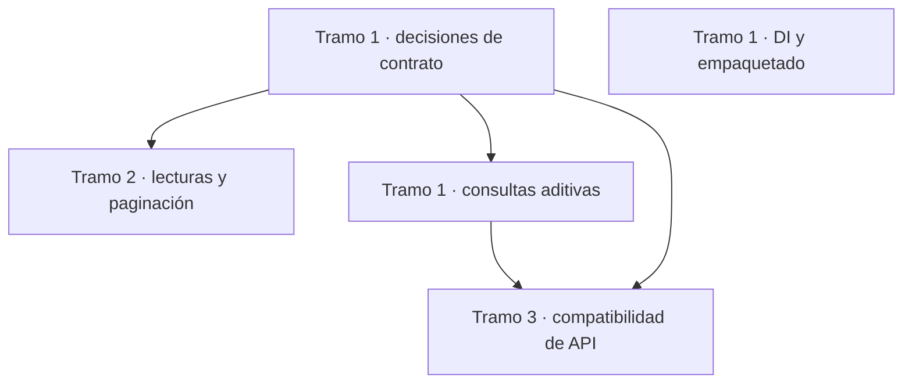

# Pendientes · `MoralesLarios.OOFP.EntityFrameworkCore`

> **Versión de planificación** · `2.0.0`, congelada hasta autorización del propietario
> **Origen** · [análisis de mejoras de EntityFrameworkCore](../../../../Mejoras/EntityFrameworkCore/README.md)
> **Estado** · 0 épicas pendientes · 7 completadas y archivadas

Las siete épicas EFCore están completadas y archivadas en [`Realizados/EFCore/`](../../Realizados/EFCore/README.md). Esta carpeta se conserva como índice de trazabilidad. La planificación no autoriza publicar una versión.

## Índice

| Orden | Épica | Hallazgos del análisis | Compatibilidad | Tramo | Estado |
|---:|---|---|---|---|---|
| — | [Simplificación de repositorios](../../Realizados/EFCore/Epica-Simplificacion-Repositorios-EFCore.md) | 64, 67–70 | Completada | — | ✅ |
| — | [Unidad de trabajo y transacciones](../../Realizados/EFCore/Epica-Unidad-de-Trabajo-y-Transacciones.md) | 7, 40, 62–66, 71–72 | Completada | — | ✅ |
| — | [Lecturas funcionales y captura de errores](../../Realizados/EFCore/Epica-Lecturas-Funcionales-y-Errores.md) | 4, 5, 13 | Completada | — | ✅ |
| — | [Paginación determinista y asíncrona](../../Realizados/EFCore/Epica-Paginacion-Determinista-y-Asincrona.md) | 6, 10, 11 | Completada | — | ✅ |
| — | [Selección eficiente del último resultado](../../Realizados/EFCore/Epica-Last-Eficiente.md) | 9 | Completada | — | ✅ |
| — | [Registro DI multicontexto y dependencias](../../Realizados/EFCore/Epica-Registro-DI-Multicontexto.md) | 8, 12 | Completada | — | ✅ |
| — | [Nomenclatura y documentación de la API](../../Realizados/EFCore/Epica-Nomenclatura-y-Documentacion-API.md) | 1–3 | Completada | — | ✅ |

## Trazabilidad

| Hallazgo del análisis | Destino |
|---:|---|
| 1–3 | [Épica de nomenclatura](../../Realizados/EFCore/Epica-Nomenclatura-y-Documentacion-API.md) · completada · US-01…04 |
| 4–5, 13 | [Épica de lecturas](../../Realizados/EFCore/Epica-Lecturas-Funcionales-y-Errores.md) · completada · US-01 … US-03 |
| 7 | **Ya cubierto** · guía del proyecto, `README.md:490`, y [épica de unidad de trabajo](../../Realizados/EFCore/Epica-Unidad-de-Trabajo-y-Transacciones.md) |
| 6, 10–11 | [Épica de paginación](../../Realizados/EFCore/Epica-Paginacion-Determinista-y-Asincrona.md) · completada · US-01 … US-04 |
| 8, 12 | [Épica de DI multicontexto](../../Realizados/EFCore/Epica-Registro-DI-Multicontexto.md) · completada · US-01 … US-02 |
| 9 | [Épica de selección del último](../../Realizados/EFCore/Epica-Last-Eficiente.md) · completada · US-01 … US-02 |

## Orden recomendado y tramos

Las decisiones de lecturas, orden de página, semántica de “último”, DI y transición de nombres están cerradas y archivadas. El tipo `Extensions` se conserva en 2.0.0.

## Cambios de compatibilidad

- **Ruptura de comportamiento**: materializar las lecturas síncronas cambia el momento de ejecución y memoria; convertir claves nulas de excepción a `MlResult.Fail` cambia el tratamiento de entrada inválida; estabilizar orden de página puede cambiar filas devueltas.
- **Ruptura potencial de fuente**: las anotaciones `?` de parámetros públicos pueden introducir advertencias en consumidores NRT con warnings-as-errors.
- **Ruptura de compilación**: renombrar o retirar el tipo público `Extensions` sin fachada compatible.
- Los números de migración se asignan al implementar. Cada ruptura debe registrar los seis sitios aplicables de `oofp-upgrade-2.prompt.md`; los renombrados también requieren el anexo `oofp-upgrade-2.renames.md`.

## Ver también

- [Plan de pendientes de 2.0.0](../README.md)
- [Índice de 2.0.0](../../README.md)
- [Análisis fuente](../../../../Mejoras/EntityFrameworkCore/README.md)
- [Épicas EFCore completadas](../../Realizados/EFCore/README.md)
