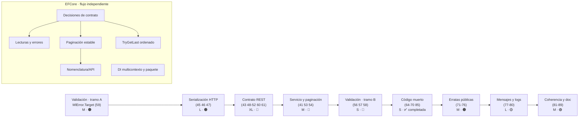

# Pendientes · Épicas de ejecución por hacer

> **Estado global:** 🔄 7 épicas pendientes (3 parciales) · 8 completadas y archivadas (7 EFCore, 1 Http)
> **Origen:** [`Temas Pendientes/Mejoras-Prioridad-Media.md`](../../../Temas%20Pendientes/Mejoras-Prioridad-Media.md) (puntos 38-63) · [`Temas Pendientes/Mejoras-Prioridad-Baja.md`](../../../Temas%20Pendientes/Mejoras-Prioridad-Baja.md) (puntos 64-89)
> **Plan maestro del que se desgajan:** [`Temas Pendientes/Plan-Ejecucion-Prioridad-Media.md`](../../../Temas%20Pendientes/Plan-Ejecucion-Prioridad-Media.md)

Esta carpeta contiene **7 épicas pendientes** del inventario transversal de los puntos **38 a 89**.
Las épicas de simplificación de repositorios, unidad de trabajo, lecturas, paginación, selección del último,
DI y nomenclatura ya se completaron y están archivadas en
[`Realizados/EFCore/`](../Realizados/EFCore/README.md). Cada épica pendiente parte del **código real
de hoy** (con fichero y número de línea), propone el contrato de destino y desglosa historias de
usuario con criterios de aceptación verificables.

La épica de limpieza de código muerto ya está completada y archivada en
[`Realizados/Http/`](../Realizados/Http/README.md).

Los puntos **1-37** (prioridad crítica y alta) y el **objetivo 9** (documentación XML) están
cerrados y no generan épica.

---

## Índice

1. [Las épicas pendientes](#1-las-épicas-pendientes)
2. [Orden de ejecución recomendado](#2-orden-de-ejecución-recomendado)
3. [Decisiones pendientes del propietario](#3-decisiones-pendientes-del-propietario)
4. [Rupturas de compatibilidad previstas](#4-rupturas-de-compatibilidad-previstas)
5. [Estructura común de los documentos](#5-estructura-común-de-los-documentos)
6. [Cobertura de los puntos del inventario](#6-cobertura-de-los-puntos-del-inventario)

---

## 1. Las épicas pendientes

### 1.1 · Prioridad media · puntos 38-63

| # | Épica | Proyecto principal | Puntos cubiertos | Esfuerzo | Riesgo |
|---|---|---|---|---|---|
| 1 | [Serialización y errores HTTP](Epica-Serializacion-y-Errores-Http.md) | `OOFP.Http` | 45, 46, 47 (+42, 44, 63) | **L** (~1-2 j) | 🟢 / 🟠 |
| 2 | [Contrato REST](Epica-Contrato-Rest.md) | `OOFP.AspNetCore.Controllers` | 43, 48, 49, 50, 51, 52, 60, 61 | **XL** (~3-4 j) | 🔴 |
| 3 | [Servicio y paginación](Epica-Servicio-y-Paginacion.md) | `OOFP.Application` | 41, 53, 54 | **M** (~1 j) | 🔴 |
| 4 | [Validación](Epica-Validacion.md) | `OOFP.Validation*` | 56, 57, 58, 59 | **L** (~1-2 j) | 🟠 |

### 1.2 · Prioridad baja · puntos 64-89

| # | Épica | Proyecto principal | Puntos cubiertos | Esfuerzo | Riesgo |
|---|---|---|---|---|---|
| 5 | [Erratas en identificadores públicos](Epica-Erratas-Identificadores-Publicos.md) | `OOFP.Core` · `ValueObjects` · `Application` | 71, 72, 73, 74, 75, 76 | **M** (~1-2 j) | 🟠 |
| 6 | [Mensajes, idioma e instrumentación de logs](Epica-Mensajes-Y-Localizacion.md) | `OOFP.Validation*` · `AspNetCore.Controllers` · `Application` | 77, 78, 79, 80 | **L** (~2 j) | 🟡 / 🟠 |
| 7 | [Coherencia de contratos y documentación](Epica-Coherencia-Y-Documentacion.md) | `OOFP.Shared` · `Http` · `AspNetCore.Controllers` | 81-89 | **M** (~5-6 j con los `README`) | 🟢 / 🟠 |

### 1.3 · Auditoría específica · `MoralesLarios.OOFP.EntityFrameworkCore`

| # | Épica | Hallazgos fuente | Esfuerzo/tamaño inicial | Riesgo | Estado |
|---|---|---|---|---|---|

El hallazgo **7** del análisis EFCore ya está cubierto por la guía del proyecto (`README.md:490`) y la
[épica completada de unidad de trabajo](../Realizados/EFCore/Epica-Unidad-de-Trabajo-y-Transacciones.md); no crea trabajo duplicado.

> **Leyenda de esfuerzo:** XS (<2 h) · S (½ jornada) · M (1 jornada) · L (2 jornadas) · XL (3+ jornadas)
> **Leyenda de riesgo:** 🟢 bajo · 🟡 medio · 🟠 alto · 🔴 muy alto (rompe compatibilidad)

**Estimación existente · inventario transversal 38-89:**

| Bloque | Jornadas |
|---|---|
| Prioridad media restante | ~8-11 |
| Prioridad baja restante (Erratas, Mensajes y Coherencia) | ~9-11 |
| **Trabajo transversal pendiente de 2.0.0** | **~17-22** |

Las siete épicas EFCore y la épica de limpieza Http archivadas no se incluyen en esa suma. El esfuerzo restante incluye completar las tres épicas de prioridad baja que siguen en Pendientes.

---

## 2. Orden de ejecución recomendado

El orden no es arbitrario: la épica de **Validación** introduce `MlError.Target`, y tanto la
serialización HTTP (`ProblemDetails`) como el contrato REST dependen de ese miembro para poder
devolver errores por campo. Por eso se parte en dos tramos. Las épicas de prioridad baja van
**después**, porque varias de ellas documentan o renombran superficie que las de prioridad media
todavía pueden mover.

| Orden | Épica | Por qué va aquí |
|---|---|---|
| 1 | Validación (US-01 · `Target`) | 🎯 Hito habilitante: sin `Target` no hay errores por campo en HTTP |
| 2 | Serialización y errores HTTP | Consume `Target`; fija la forma del error en el borde |
| 3 | Contrato REST | Depende de la forma del error ya estabilizada |
| 4 | Servicio y paginación | Los controladores ya tienen contrato estable al que adaptarse |
| 5 | Validación (resto) | Limpieza que no bloquea a nadie |
| 6 | Limpieza de código muerto | ✅ Completada y archivada en `Realizados/Http/`; sus puntos ya están cerrados antes de Erratas |
| 7 | Erratas en identificadores públicos | Renombrados con puente `[Obsolete]`; requiere superficie estable |
| 8 | Mensajes y logs | Reescribe textos; mejor cuando las firmas ya no se mueven |
| 9 | Coherencia y documentación | 🎯 Hito final: documenta el estado definitivo, no uno intermedio |

### 2.1 · Épicas EFCore · flujo independiente

| Orden recomendado | Épica | Por qué va aquí |
|---|---|---|
| A | Registro DI multicontexto y dependencias | ✅ Completada y archivada; consumidor del `.nupkg` compilado |
| B | Definir semántica de lecturas/paginación/último | ✅ Decisiones cerradas y documentadas en las épicas archivadas |
| C | Lecturas funcionales y captura de errores | ✅ Completada y archivada; puntos 73–74 migratorios |
| D | Paginación determinista y asíncrona | ✅ Completada y archivada; punto 76 migratorio |
| E | Selección eficiente del último resultado | ✅ Completada y archivada; punto 75 aditivo |
| F | Nomenclatura y documentación de API | ✅ Completada y archivada; `TEntity`, XML e `Extensions` compatibles |

Esta secuencia no depende de la cadena REST/Validation de la tabla anterior; las épicas EFCore pueden planificarse como una rama paralela.

> ✅ Las épicas de simplificación, unidad de trabajo, lecturas, paginación, selección del último y DI están completadas;
> consulta [`Realizados/EFCore/`](../Realizados/EFCore/README.md).

> 🔒 El producto permanece en `2.0.0` hasta que el propietario autorice la primera publicación. No se
> prevén versiones *preview*; los cambios se priorizan por dependencias y se validan antes del cierre.
>
> 💡 **Atajo de bajo riesgo:** la épica 7 de Coherencia contiene trabajo de documentación y metadatos
> que puede adelantarse sin tocar firmas públicas; la limpieza de código muerto ya se completó.

---

## 3. Decisiones pendientes del propietario

Las épicas pendientes conservan sus decisiones abiertas; la épica de unidad de trabajo EFCore ya
cerró D-1…D-7. Aquí están las decisiones **transversales** que siguen pendientes.

### 3.1 · Prioridad media

| # | Decisión | Afecta a |
|---|---|---|
| 1 | Punto **41**: ¿`PageRequest` obligatorio o sobrecarga adicional? | Servicio y paginación |
| 2 | Punto **61**: ¿implementar el `IOperationFilter` o eliminar el atributo? | Contrato REST |
| 3 | Punto **50**: ¿eliminar las sobrecargas o marcarlas `[Obsolete]`? | Contrato REST |
| 4 | Punto **58**: ¿asincronía real o simetría documentada? | Validación |
| 5 | Fase 3 completa: ¿`2.0.0` o `3.0.0`? | Contrato REST |

### 3.2 · Prioridad baja

| # | Decisión | Afecta a |
|---|---|---|
| 6 | ¿Se eliminan los constructores con `ILogger` o se mantienen con puente? | Código muerto |
| 7 | ¿Los renombrados de erratas llevan puente `[Obsolete]` o se rompen en seco? | Erratas públicas |
| 8 | ¿Los mensajes al usuario quedan en inglés, en español o localizados con `IStringLocalizer`? | Mensajes y logs |
| 9 | ¿`Headers` pasa a `IReadOnlyDictionary` (ruptura) o solo se le quita el `null!`? | Coherencia y doc |
| 10 | ¿Los 11 proyectos de test llevan `README.md` propio o uno agregado en `docs/`? | Coherencia y doc |

### 3.3 · Auditoría EFCore

| Decisión | Épica afectada | Recomendación inicial |
|---|---|---|
| Materializar lecturas síncronas o conservar secuencias diferidas | Lecturas funcionales | Materializar para cumplir captura de errores; revisar coste de memoria |
| Orden total por selector obligatorio o clave primaria EF como desempate | Paginación | Clave EF como desempate si se soportan claves compuestas y proveedores objetivo |
| Definir selector estable para “último” | Last eficiente | Añadir operación ordenada sin alterar los métodos actuales |
| Promesa de `IMlUnitOfWork` no genérica con varios contextos | Registro DI | Recomendar la interfaz genérica para multicontexto |
| Transición del tipo público `Extensions` | Nomenclatura | Fachada compatible sin duplicar extensiones; el propietario decide `[Obsolete]`/versión |

> Las decisiones D-01…D-07 de la épica de repositorios EFCore ya están resueltas o explícitamente
> diferidas en [`Realizados/EFCore/Epica-Simplificacion-Repositorios-EFCore.md`](../Realizados/EFCore/Epica-Simplificacion-Repositorios-EFCore.md).

---

## 4. Rupturas de compatibilidad previstas

> ⚠️ **Obligatorio:** toda ruptura que llegue a implementarse debe quedar documentada en
> [`Copilot/.github/prompts/oofp-upgrade-2.prompt.md`](../../../Copilot/.github/prompts/oofp-upgrade-2.prompt.md)
> (§3.3) y, si es un renombrado, en el anexo
> [`oofp-upgrade-2.renames.md`](../../../Copilot/.github/prompts/oofp-upgrade-2.renames.md).

| Épica | Ruptura principal | ¿La detecta el compilador? |
|---|---|---|
| Validación | `MlError` gana `Target`; la forma de los errores de validación cambia | ⚠️ solo si se consumía la forma concreta |
| Serialización HTTP | El error deja de ser texto plano y pasa a llevar código de estado | ⚠️ parcial |
| Contrato REST | Rutas `id-str/{id}` unificadas; sobrecargas retiradas | ✅ en firmas · ❌ en rutas |
| Servicio y paginación | `GetAllAsync` deja de devolver la colección completa | ✅ |
| Unidad de trabajo EFCore | ✅ `Scoped` único y retirada de los registros alternativos (punto **62** del prompt); `IEfRepository<T>.UnitOfWork` añadido y autocommit retirado (puntos **71–72** del prompt) | ✅ en las firmas para implementadores · ⚠️ autocommit: ruptura silenciosa para repositorios directos; `CrudServiceFp` conserva la persistencia automática |
| Código muerto | Cambian firmas de constructor público (parámetro `ILogger`) | ✅ |
| Erratas públicas | `TryMapIAsyncf`, `…Alwais…`, `…Lenght…`, `Bydouble`, `TEnumrableResponse` renombrados | ⚠️ advertencia con puente `[Obsolete]` |
| Mensajes y logs | Cambia el **texto** de los mensajes de error y validación | ❌ no — rompe aserciones de tests y consumidores que comparan texto |
| Coherencia y doc | `[Range]` empieza a validar de verdad · `Headers` cambia de tipo · Swagger pasa de `200` a `204` | ❌ en `[Range]` y Swagger · ✅ en `Headers` |
| Repos EF Core · ✅ completada | Puntos 67-70: cambia el namespace de `IGetContextable`, se retiran tres contratos públicos y sus registros, desaparece el localizador y los agregados comparten el `DbContext` | ✅ en firmas y resolución DI · ❌ en el contexto compartido |
| Auditoría EFCore · Lecturas | Materialización síncrona y validación de claves | ⚠️ sí, en comportamiento |
| Auditoría EFCore · Paginación | Orden estable puede cambiar las filas de cada página; anotaciones NRT pueden añadir avisos fuente | ❌ en orden · ⚠️ con warnings-as-errors |
| Auditoría EFCore · `TryGetLast` | Nueva API ordenada y limitada a una fila | No, si se añade sin alterar los métodos actuales |
| Auditoría EFCore · Registro DI | Uso genérico para distinguir contextos; dependencia DI explícita | No, mientras se conserve el alias existente |
| Auditoría EFCore · Nomenclatura | Renombrar `Extensions` puede retirar un tipo público | ✅ si se elimina sin fachada; `[Obsolete]` también avisa |

> Las rupturas marcadas con ❌ son las **más peligrosas**: no hay error ni advertencia que avise al
> consumidor, así que necesitan entrada destacada en la guía de migración.

---

## 5. Estructura común de los documentos

Las siete épicas transversales pendientes comparten el mismo esqueleto, de modo que se puedan leer en cualquier
orden sin reaprender el formato. Las cinco épicas EFCore siguen la misma estructura numerada.
Las dos épicas anteriores de EFCore están completadas y archivadas en
`Realizados/EFCore/`; sus documentos conservan la variante de auditoría con «Radiografía del código
actual», «Debilidades detectadas» y «Arquitectura de destino».

| Sección | Contenido |
|---|---|
| Cabecera | Versión destino, origen, plan, estado, esfuerzo y riesgo |
| **1** Contexto y problema | Tabla `Punto │ Fichero │ Líneas │ Naturaleza` + código real anotado con `// ← …` + consecuencias |
| **2** Hallazgos colaterales | Lo que apareció durante la auditoría y **no** estaba en el punto original |
| **3** Alcance | Qué entra y qué queda explícitamente fuera |
| **4** Historias de usuario | `US-0n` con *Como/quiero/para*, esfuerzo, riesgo, criterios `- [ ]`, API propuesta, notas, tests mínimos y riesgo principal |
| **5** Orden de ejecución | Grafo `mermaid`, tabla de orden con hitos 🎯 y total de jornadas |
| **6** Decisiones abiertas | Tabla `Id │ Decisión │ Opciones │ Recomendación` |
| **7** Definición de terminado | Incluye build `Release --no-incremental`, `CS1591 = 0` y tests específicos de cada épica |
| **8** Apéndice | Código **Hoy** (fichero + línea) → **Después**, separadores `// ───── 2.0.0 ─────` / `// ───── 2.1.0 ─────` y resumen de rupturas |

> Todo el código de la sección 8 marcado como *"Después"* es **ilustrativo**: fija la intención y el
> contrato, no la implementación definitiva.

---

## 6. Cobertura de los puntos del inventario

Los **52 puntos** de prioridad media y baja (38-89) están cubiertos. La tabla resuelve también los
puntos que la auditoría encontró **ya resueltos** en la 2.0.0 y los que se han **reubicado** porque
el tipo que citaban se renombró.

| Puntos | Épica | Observación |
|---|---|---|
| 38, 39 | — | ✅ Resueltos en la 2.0.0 |
| 40 | [Unidad de trabajo](../Realizados/EFCore/Epica-Unidad-de-Trabajo-y-Transacciones.md) | ✅ Implementado y archivado en EFCore |
| 41, 53, 54 | [Servicio y paginación](Epica-Servicio-y-Paginacion.md) | |
| 42, 44, 45, 46, 47, 63 | [Serialización y errores HTTP](Epica-Serializacion-y-Errores-Http.md) | 42, 44 y 63 entran como colaterales |
| 43, 48, 49, 50, 51, 52, 60, 61 | [Contrato REST](Epica-Contrato-Rest.md) | |
| 55, 62 | — | ✅ Resueltos en la 2.0.0 |
| 56, 57, 58, 59 | [Validación](Epica-Validacion.md) | |
| 64, 68, 69, 70 | [Código muerto](../Realizados/Http/Epica-Limpieza-Codigo-Muerto.md) | ✅ Resueltos y archivados en Http |
| 65, 66, 67 | [Código muerto](../Realizados/Http/Epica-Limpieza-Codigo-Muerto.md) | ✅ Resueltos en la 2.0.0; citados para dejar constancia |
| 71, 72, 73, 74, 75, 76 | [Erratas públicas](Epica-Erratas-Identificadores-Publicos.md) | |
| 77, 78, 79, 80 | [Mensajes y logs](Epica-Mensajes-Y-Localizacion.md) | |
| 81, 82, 83, 84, 86, 87, 89 | [Coherencia y documentación](Epica-Coherencia-Y-Documentacion.md) | 82, 84, 86 y 89 **reubicados**: los tipos citados se renombraron en 2.0.0 |
| 85 | [Código muerto](../Realizados/Http/Epica-Limpieza-Codigo-Muerto.md) · [Coherencia y doc](Epica-Coherencia-Y-Documentacion.md) | ✅ Resuelto en la 2.0.0; citado en las dos épicas |
| 88 | [Coherencia y documentación](Epica-Coherencia-Y-Documentacion.md) | ✅ Resuelto: 0 `global using` duplicados en 27 ficheros |

> La épica de simplificación EFCore no cubre los puntos 38-89; fue una auditoría específica del
> propietario y absorbió el punto **64**, cuya ubicación real son **26 líneas** comentadas en
> `Repositories/IEfRepository.cs`. La unidad de trabajo cubre el punto **40**. Ambas están archivadas
> en [`Realizados/EFCore/`](../Realizados/EFCore/README.md).

---

### 6.1 · Trazabilidad de la auditoría EFCore

| Hallazgo de `Mejoras/EntityFrameworkCore/README.md` | Destino |
|---:|---|
| 1-3 | Épica EFCore 5 · US-01 … US-04 |
| 4-5 | Épica EFCore 1 · US-01 … US-03 |
| 6, 10-11 | Épica EFCore 2 · US-01 … US-04 |
| 7 | ✅ Cubierto por `MoralesLarios.OOFP.EntityFrameworkCore/README.md:490` y la épica UoW completada |
| 8, 12 | Épica EFCore 4 · US-01 … US-02 |
| 9 | Épica EFCore 3 · US-01 … US-02 |
| 13 | Épica EFCore 1 · US-02 |

## Ver también

- [`Realizados/EFCore/README.md`](../Realizados/EFCore/README.md) · épica de repositorios ya completada
- [`Realizados/EFCore/Epica-Unidad-de-Trabajo-y-Transacciones.md`](../Realizados/EFCore/Epica-Unidad-de-Trabajo-y-Transacciones.md) · cierre del punto 40
- [`Temas Pendientes/Plan-Ejecucion-Prioridad-Media.md`](../../../Temas%20Pendientes/Plan-Ejecucion-Prioridad-Media.md) · auditoría y plan por fases
- [`Temas Pendientes/Mejoras-Prioridad-Media.md`](../../../Temas%20Pendientes/Mejoras-Prioridad-Media.md) · catálogo original de puntos 38-63
- [`Temas Pendientes/Mejoras-Prioridad-Baja.md`](../../../Temas%20Pendientes/Mejoras-Prioridad-Baja.md) · catálogo original de puntos 64-89
- [`Temas Pendientes/Mejoras-Prioridad-Critica-y-Alta.md`](../../../Temas%20Pendientes/Mejoras-Prioridad-Critica-y-Alta.md) · puntos 1-37
- [`Temas Pendientes/Profesionalizacion-Ingenieria-y-Calidad.md`](../../../Temas%20Pendientes/Profesionalizacion-Ingenieria-y-Calidad.md) · analizadores, `.editorconfig` y calidad transversal
- [`Copilot/.github/prompts/oofp-upgrade-2.prompt.md`](../../../Copilot/.github/prompts/oofp-upgrade-2.prompt.md) · §3.3, registro de rupturas de compatibilidad
