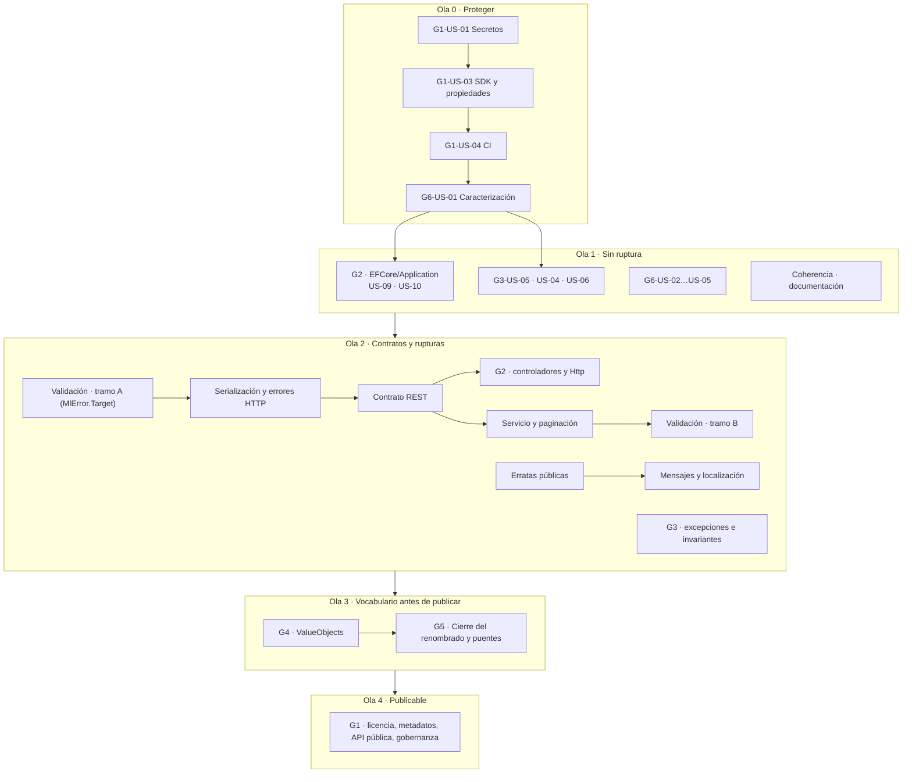

# 03 · Plan maestro

> **Alcance:** ordenar las **7 épicas pendientes existentes** y las **6 nuevas (G1-G6)** en una sola secuencia
> **Principio:** primero lo que protege, después lo que cambia, al final lo que decide el propietario
> **Versión:** 2.0.0 congelada hasta autorización del propietario · nada de este plan sube versiones ni publica

## Índice

1. [Mapa global](#1-mapa-global)
2. [Olas de trabajo](#2-olas-de-trabajo)
3. [Solapes entre épicas](#3-solapes-entre-épicas)
4. [Decisiones del propietario](#4-decisiones-del-propietario)
5. [Definición de terminado común](#5-definición-de-terminado-común)
6. [Reglas de ejecución](#6-reglas-de-ejecución)

---

## 1. Mapa global

## 2. Olas de trabajo

### Ola 0 · Proteger (sin tocar comportamiento)

| Paso | Historia | Por qué primero |
|---:|---|---|
| 1 | G1-US-01 · retirar credenciales versionadas | Es el único hallazgo con riesgo de seguridad |
| 2 | G1-US-03 · `global.json` y propiedades | Las compilaciones pasan a ser reproducibles |
| 3 | G1-US-08 · reparar enlaces Markdown | El CI los comprobará |
| 4 | G1-US-04 · CI de compilación y pruebas | Desde aquí cada cambio se valida solo |
| 5 | G6-US-01 · pruebas de caracterización | Los cambios de las olas 1-2 se verán en el *diff* de tests |

### Ola 1 · Correcciones sin ruptura de contrato

| Historia | Contenido |
|---|---|
| G2-US-09 · G2-US-10 | Una consulta al actualizar; destino de `TryGetLast` |
| G3-US-04 · US-05 · US-06 | Pruebas de compilación, `MapAlways`, auditoría de `.Result` |
| G6-US-02 · US-03 · US-04 · US-05 · US-06 | Leyes, cobertura, integración reproducible, *benchmarks*, arquitectura |
| [Coherencia](../Epica-Coherencia-Y-Documentacion.md) | Lo que es documentación y metadatos |
| G1-US-05 · US-06 | Paquetes centrales, analizadores, línea base de API |

### Ola 2 · Contratos y rupturas (se publican juntas)

Se mantiene la cadena que ya recoge [`Pendientes/README.md`](../README.md#2-orden-de-ejecución-recomendado):
**Validación (`MlError.Target`) → Serialización → Contrato REST → Servicio y paginación**. Las historias de G2 y G3 se
intercalan según la [tabla de solapes](#3-solapes-entre-épicas). Todo lo que rompe se publica **junto**, para que el
consumidor afronte una sola migración.

### Ola 3 · Vocabulario antes de publicar

[G4](Epica-G4-ValueObjects-Nomenclatura-y-Diseno.md) y [G5](Epica-G5-Cierre-Renombrado-y-Puentes.md) cierran los nombres.
**Es la última ventana en la que cambiar un nombre es barato.** La matriz G4-US-00 y la decisión D-G5-1 se firman
antes de continuar.

### Ola 4 · Publicable

Licencia, metadatos NuGet, API pública congelada, `CHANGELOG`, gobernanza. La publicación sigue siendo decisión
del propietario; este plan solo la deja preparada.

## 3. Solapes entre épicas

Ficheros que dos o más épicas modifican. Se resuelven con el orden indicado, no en paralelo:

| Fichero o zona | Épicas | Orden |
|---|---|---|
| `AspNetCore.Controllers/Helpers/Extensions.cs` | Contrato REST US-01, US-02 · G2-US-03, US-04 | REST → G2 |
| `AspNetCore.Controllers/Controllers/*Base.cs` | Contrato REST US-03…US-08 · G2-US-01, US-02, US-07 | REST → G2 |
| `Http/HttpApiInvoker.cs` | Serialización US-02, US-03, US-06 · G2-US-05 · Mensajes US-04 | SER → G2 → MSG |
| `Http/Helpers/MlHttpRequestExtensions.cs` | Serialización US-09 · G2-US-06 | SER → G2 |
| `Application/Services/CrudServiceFp.cs` | Servicio y paginación · G2-US-09 · Mensajes US-07 | SRV → G2 → MSG |
| `Core/Types/Errors/MlError.cs` y `MlErrorDetails*.cs` | Validación US-01 · Serialización US-04 · G3-US-02, US-03 | VAL → SER → G3 |
| `ValueObjects/*` | Erratas · G4 | ERR → G4 |
| Prompt de migración y anexo de renombrados | todas las que rompen | un solo commit por ruptura |

## 4. Decisiones del propietario

Las decisiones **bloquean** la historia indicada. Las que figuran con el mismo origen en `Pendientes/README.md`
se mantienen allí.

| Id | Decisión | Bloquea | Recomendación |
|---|---|---|---|
| D-G1-1 | Rotar o purgar credenciales ya versionadas | G1-US-01 (purga) | Rotar; **no reescribir historial sin tu autorización** |
| D-G1-2 | Licencia | G1-US-02 | Apache-2.0 (cabeceras actuales) |
| D-G2-4 | Cuerpo remoto en errores por defecto | G2-US-08 | Desactivado |
| D-G2-5 | `TryGetLast` antiguo | G2-US-10 | Obsoletar |
| D-G3-1 | Excepción de `GetValueOrThrow` | G3-US-01 | Tipo propio con detalles |
| D-G3-2 | Fallo sin errores | G3-US-02 | Error por defecto |
| D-G4-1…5 | Matriz N1-N21 | G4 completa | Decidir todo antes de publicar |
| D-G5-1 | Política de puentes | G5-US-02 | Retirar los que sustituyen nombres intermedios |
| D-G6-1…4 | Herramientas de prueba | G6 | ver épica |

## 5. Definición de terminado común

Para **toda** historia de G1-G6, además de sus criterios propios:

- [ ] **Compilación:** `dotnet build MoralesLarios.OOFP.sln -c Release --no-incremental -v q --nologo` → 0 errores y 0 `CS1591`.
- [ ] **Pruebas:** `dotnet test … -c Release --no-build --nologo` → todo en verde; el recuento de tests no baja de la línea base (1.715 el 2026-11-12).
- [ ] **Regresión:** existe un test que **falla** sin el cambio.
- [ ] **Migración:** si rompe compilación, contrato o binario, **los seis sitios** de `oofp-upgrade-2.prompt.md` (tabla §3.3, subsección `#### N`, Fase 5 punto 4, Fase 6 punto 5, apéndice de versiones y, si hay renombrado, `oofp-upgrade-2.renames.md`). El `MIG-nn` se asigna **al implementar**, buscando `^#### \d+` para continuar la secuencia.
- [ ] **Verificadores:** `check-migration-prompt.ps1`, `check-md-links2.ps1`, `check-md-anchors4.ps1`.
- [ ] **Documentación:** la épica marcada y los índices de `Pendientes/` y de `2.0.0/` sincronizados.
- [ ] **Commit:** Conventional Commits en castellano, `!` si rompe, mensaje con `git commit -F` desde un fichero UTF-8 sin BOM. **Ningún `git push` sin tu confirmación.**
- [ ] Al completar una épica: se mueve a `Realizados/<Área>/` con `git mv` y se actualizan ambos índices (`epicas-completadas.instructions.md`).

## 6. Reglas de ejecución

1. **Un cambio de comportamiento por commit**, con su test y su registro en el prompt.
2. **No acumular rupturas sin registrar**: el registro se escribe en el mismo commit que el código.
3. **Las rupturas silenciosas llevan patrón de búsqueda** en el barrido de la Fase 5.
4. **Si una historia descubre que ya estaba resuelta**, se cierra con la evidencia y se corrige la auditoría; no se «arregla» por tener algo que mostrar.
5. **Si dos épicas piden cosas incompatibles**, se detiene la ejecución y se pregunta al propietario.
6. **Editar `oofp-upgrade-2.prompt.md` y su anexo con inserciones ancladas** y verificando el recuento de líneas antes y después.
