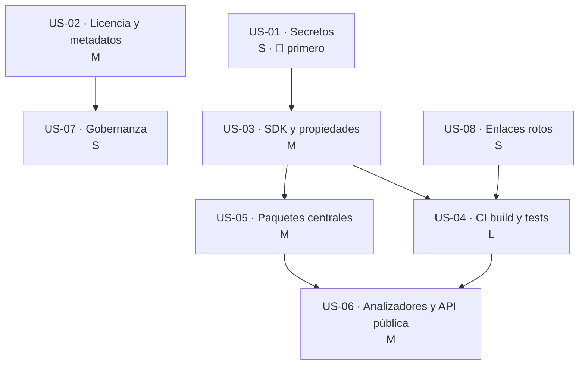

# Épica G1 · Higiene del repositorio, CI y publicación

> **Versión destino:** 2.0.0
> **Proyecto:** repositorio completo (sin tocar la API pública)
> **Origen:** `Temas Pendientes/Profesionalizacion-Ingenieria-y-Calidad.md` (Bloque 0) · omisiones detectadas en [la auditoría](../../Realizados/general_old_version/02-Auditoria-Documentos-Complementarios.md#6-profesionalización--ingeniería-y-calidad)
> **Estado:** 🔄 En curso · US-01/03/05/08 ✅ (US-01 aún requiere decidir rotación); US-02/04/07 parciales; US-06 pendiente
> **Esfuerzo:** L · **Riesgo:** 🟢 bajo (no cambia comportamiento) · 🟠 solo la US-01 si hay que retirar secretos del historial
> **Compatibilidad:** ✅ Aditiva. No requiere registro en `oofp-upgrade-2.prompt.md`

---

## Índice

1. [Contexto y problema](#1-contexto-y-problema)
2. [Alcance](#2-alcance)
3. [Historias de usuario](#3-historias-de-usuario)
4. [Orden de ejecución](#4-orden-de-ejecución)
5. [Decisiones abiertas](#5-decisiones-abiertas)
6. [Definición de terminado](#6-definición-de-terminado)

---

## 1. Contexto y problema

La biblioteca se ha migrado a `net11.0` y tiene un núcleo sólido, pero el **entorno que la rodea** no está al
nivel de un paquete publicable. Hechos medidos el 2026-11-12:

| Hecho | Evidencia |
|---|---|
| `appsettings.test.json` **versionados** con contraseñas no vacías y nombres de equipo personales | 11 ficheros `appsettings.test.json` en `git ls-files`; contraseñas en `Configuration.Tests.Unit` (1) y `EntityFrameworkCore.Tests.Integration` (2) |
| No hay `LICENSE` en el repositorio, aunque el código lleva la cabecera `Licensed under the Apache License, Version 2.0` | `git ls-files` sin `LICENSE`; cabecera en `EfReadRepository.cs` |
| No hay `global.json`: cada máquina compila con el SDK que tenga | búsqueda de `global.json` sin resultados |
| El único *workflow* valida el prompt de migración; **no compila ni ejecuta tests** | `.github/workflows/prompt-migracion.yml` |
| `Directory.Build.props` solo contiene `EnforceCodeStyleInBuild`; sin `.gitattributes` | `src/Directory.Build.props` |
| Sin `Directory.Packages.props`, `NuGetAudit`, Dependabot, `PublicAPI.*.txt` ni analizadores | búsqueda sin resultados |
| 7 proyectos arrastran `PackageReference` que el SDK 11 ya considera incluidas (`NU1510`) | `dotnet restore` del 2026-11-12: Application, Configuration, FileSystem, EntityFrameworkCore, Logging, Logging.Sample, EntityFrameworkCore.TestSupport |
| 60 enlaces y 1 ancla Markdown rotos | `src/scripts/check-md-links2.ps1`, `check-md-anchors4.ps1` |
| Sin `CHANGELOG.md`, `SECURITY.md`, `CODE_OF_CONDUCT.md` ni plantillas de *issue* | `git ls-files` |

**Lo que sí está bien:** una sola solución; **0** ficheros `bin/obj` versionados; `.gitignore` correcto;
`CONTRIBUTING.md` y plantilla de PR; el *workflow* del prompt de migración.

## 2. Alcance

**Dentro:** secretos, licencia, SDK fijado, CI de compilación y tests, metadatos NuGet, gestión central de
paquetes, línea base de analizadores y API pública, gobernanza, enlaces rotos.

**Fuera:** publicar en NuGet; reescribir la API; retirar puentes `[Obsolete]` ([G5](Epica-G5-Cierre-Renombrado-y-Puentes.md)).

---

## 3. Historias de usuario

### G1-US-01 · Sacar las credenciales de la configuración versionada · 🔴 máxima prioridad · S

> **Como** mantenedor **quiero** que ningún fichero versionado contenga credenciales ni nombres de equipo
> **para** poder abrir el repositorio sin exponer secretos.

**Contexto:** `appsettings.test.json` contiene cadenas de conexión a SQL Server con `User Id=sa` y contraseña, y
nombres de equipo personales. El proyecto de integración de EFCore ya usa SQLite en memoria en parte de sus pruebas.

**Criterios de aceptación**

- [x] Los 11 `appsettings.test.json` no contienen contraseñas, ni `User Id` con credenciales, ni nombres de equipo; usan marcadores (`<SET_IN_USER_SECRETS>`) o valores ficticios. *(Valores ficticios `*.example.invalid` e `Integrated Security=true`; ningún test lee esas claves.)*
- [x] Los valores reales viven en *user secrets* o variables de entorno; las pruebas que los necesitan se omiten con motivo explícito si faltan. *(Ninguna prueba los necesita hoy; el procedimiento está en `CONTRIBUTING.md`.)*
- [x] `git ls-files` + búsqueda de `Password=`/`Pwd=` en ficheros versionados da **0** coincidencias. *(Fuera de `docs_next`.)*
- [x] Se documenta en `CONTRIBUTING.md` cómo configurar los secretos locales.
- [ ] **Decisión del propietario (D-G1-1):** si las credenciales eran reales, se **rotan**. Reescribir el historial para purgarlas es una operación destructiva: **no se hace sin autorización expresa**. *(Siguen en el historial de Git: la contraseña de `sa` de los dos ficheros debe rotarse si era real.)*

**Compatibilidad:** Ninguna. **Dependencias:** ninguna. Es lo primero de todo el plan.

### G1-US-02 · Licencia y metadatos de paquete · M

**Criterios de aceptación**

- [x] `LICENSE` en la raíz (**D-G1-2:** el código ya declara Apache-2.0 en sus cabeceras; el propietario confirma la licencia). *(Añadido con el texto Apache-2.0 y `Copyright 2023 Juan Francisco Morales Larios`, tomado de las cabeceras. **El propietario debe confirmarlo.**)*
- [x] `Directory.Build.props` define `Authors`, `Description`, `PackageTags`, `RepositoryUrl`, `PackageProjectUrl` y `PackageReadmeFile`; el README se incluye en el paquete. *(Revisado en el `.nuspec` de Core. No hay icono que incluir.)*
- [ ] `PackageLicenseExpression` pendiente de confirmar Apache-2.0 (D-G1-2); no se declara una licencia en los paquetes hasta tener aprobación del propietario.
- [x] Source Link, `IncludeSymbols`/`snupkg`, `Deterministic` y `ContinuousIntegrationBuild` (solo en CI). *(`Microsoft.SourceLink.GitHub` 11.0.100; sin avisos `NU19xx` en el empaquetado.)*
- [x] `dotnet pack -c Release` de los 19 proyectos empaquetables termina sin avisos de metadatos (`NU5xxx`); se inspecciona el `.nuspec` de Core. *(19 `.nupkg` y 19 `.snupkg`, 0 errores.)*

**Compatibilidad:** Aditiva.

### G1-US-03 · Fijar SDK y centralizar propiedades de compilación · M

**Criterios de aceptación**

- [x] `global.json` fija el SDK 11 con política de *roll-forward* documentada (**D-G1-3:** `latestFeature` o más estricta). *(`11.0.100`, `latestFeature`, sin preliminares; está en la raíz del repositorio.)*
- [x] `Directory.Build.props` centraliza `Nullable`, `ImplicitUsings`, `LangVersion` y `GenerateDocumentationFile` **solo** para proyectos de biblioteca (no para tests, `Sample` ni herramientas bajo `src/scripts/`). *(Centralizados `Nullable` e `ImplicitUsings`, que eran idénticos en los 34 proyectos. `LangVersion` no se fija (ningún proyecto lo hacía). `GenerateDocumentationFile` se queda en cada biblioteca porque `Sample` lo activa y los tests no: centralizarlo exigía condicionales que añadían más ruido que valor.)*
- [x] `.gitattributes` define EOL y codificación; `.editorconfig` añade `charset`. *(`* text=auto` sin renormalizar: el índice ya estaba en LF.)*
- [x] Una **línea base de avisos** queda registrada y el *build* Release `--no-incremental` mantiene **0 errores y 0 `CS1591`**. `TreatWarningsAsErrors` se activa por proyecto y de forma gradual, **no de golpe con `NoWarn` amplio** (ocultaría deuda). *(Línea base 2026-11-12: 215 avisos distintos — IDE0005 59, CS0108 44, CS8625 35, NU1510 16, CS8600 14, IDE0052 7, IDE0051 7. 1.715 tests en verde. `TreatWarningsAsErrors` queda para G1-US-06.)*

### G1-US-04 · CI de compilación y pruebas · L

**Criterios de aceptación**

- [x] `.github/workflows/ci.yml`: restaura, compila en Release `--no-incremental` y ejecuta `dotnet test` de la solución en Windows y Linux, con el SDK de `global.json`. *(El *job* de Linux es informativo (`continue-on-error`) hasta que G6-US-04 elimine las rutas de Windows de las pruebas. El flujo no se ha podido ejecutar en GitHub desde local: el equivalente local, 0 errores y 1.715 tests en verde, sí.)*
- [ ] Las pruebas que requieran un servidor local se separan con un `Trait`/categoría y no bloquean el flujo por defecto (ver [G6-US-04](Epica-G6-Pruebas-Calidad-y-Rendimiento.md)).
- [x] El *workflow* `prompt-migracion.yml` existente se conserva.
- [x] Se compilan también `MlDoc` y `MlRename` (están fuera de la solución).
- [ ] **D-G1-4:** análisis de seguridad (CodeQL) y publicación automática quedan para una segunda iteración y requieren decisión del propietario sobre credenciales de publicación.

### G1-US-05 · Gestión central de paquetes y limpieza de referencias redundantes · M

**Criterios de aceptación**

- [x] `Directory.Packages.props` con `ManagePackageVersionsCentrally` y `NuGetAudit` activos (fuente de vulnerabilidades en la restauración). *(`NuGetAuditMode=all`, nivel `low`; `nuget.config` en la raíz fija `nuget.org` con *package source mapping*, lo que elimina 88 avisos `NU1507`.)*
- [x] Dependabot (o Renovate) para NuGet y GitHub Actions.
- [x] Los 7 `NU1510` se resuelven **después** de ejecutar `dotnet pack` y comprobar en el `.nuspec` que quitar la referencia no cambia las dependencias que ve el consumidor del paquete. Si cambian, se conserva la referencia y se suprime el aviso con motivo. *(Los siete `.nuspec` previos no declaraban esas dependencias; se retiraron las referencias redundantes y las supresiones locales. Los siete proyectos vuelven a empaquetar sin `NU1510`.)*
- [x] Un único criterio de versiones para `xunit`, `Moq`, `FluentAssertions` y `coverlet` en los 13 proyectos de tests (hoy hay versiones distintas por proyecto). *(Unificados en `Directory.Packages.props`: xunit 2.9.3, runner 3.1.0, Moq 4.20.72, FluentAssertions 8.2.0, coverlet 6.0.4, AutoFixture 4.18.1, Scrutor 6.0.1, Xunit.DependencyInjection 9.9.0. 1.715 tests en verde.)*

### G1-US-06 · Analizadores y línea base de API pública · M

**Criterios de aceptación**

- [ ] Conjunto de analizadores elegido (**D-G1-5**) y activado en modo *advertencia* con una línea base de avisos.
- [ ] `PublicApiAnalyzers` en los proyectos de biblioteca con `PublicAPI.Unshipped.txt` completo: como **nada se ha publicado**, toda la API va en `Unshipped` hasta la primera publicación, que la moverá a `Shipped`.
- [ ] Una guarda automática detecta `global using` duplicados (INV-88 ✅ hoy, sin vigilancia).
- [ ] Documentado en `CONTRIBUTING.md`: cualquier cambio de API pública exige actualizar el fichero de API y el prompt de migración.

### G1-US-07 · Gobernanza y política de versiones · S

**Criterios de aceptación**

- [x] `SECURITY.md`, `CODE_OF_CONDUCT.md`, plantillas de *issue* y plantilla de PR ya existente enlazada. *(Plantillas `defecto.yml` y `propuesta.yml`; la plantilla de PR ya existía.)*
- [x] `CHANGELOG.md` con la 2.0.0 apuntando a `oofp-upgrade-2.prompt.md`.
- [ ] Política SemVer escrita (**D-G1-6:** versión escrita en cada `.csproj` o derivada de etiquetas con MinVer) y regla «nada rompedor fuera de una versión mayor, y siempre con `[Obsolete]` durante un ciclo».
- [ ] `PendingTasks-legacy.md` se da por **absorbido** (ver [backlog](04-Backlog-3.0-y-Descartados.md)); las ideas vigentes pasan a *issues*.

### G1-US-08 · Reparar los enlaces Markdown rotos · S

**Criterios de aceptación**

- [x] `src/scripts/check-md-links2.ps1` → `rotos = 0` y `check-md-anchors4.ps1` → `rotos = 0`.
- [x] Los enlaces rotos de `README.md` (`./Temas%20Pendientes/…`, `./Cambios%20Realizados/…`), de `Mejoras/Core/*` (ficheros `02`…`08` inexistentes), de `Mejoras/Application/*` (épicas movidas a `Realizados/`) y de `Temas Pendientes/*` se corrigen o se retiran con motivo. *(Los enlaces a los ficheros `02`…`08` de `Mejoras/Core` que nunca se redactaron pasan a texto sin enlace; `Temas Pendientes` vive ahora en `Realizados/Temas Pendientes/`; se borra `_Seccion-para-README.md`, ya integrado en `src/README.md`.)*
- [x] Ambos verificadores se ejecutan en `ci.yml`.

---

## 4. Orden de ejecución

| Orden | Historia | Tamaño | Hito |
|---:|---|:---:|---|
| 1 | US-01 · Secretos | S | 🎯 Repositorio sin credenciales |
| 2 | US-03 · SDK y propiedades | M | |
| 3 | US-08 · Enlaces rotos | S | |
| 4 | US-04 · CI | L | 🎯 Cada PR compila y prueba en net11.0 |
| 5 | US-05 · Paquetes centrales | M | |
| 6 | US-02 · Licencia y metadatos | M | |
| 7 | US-06 · Analizadores y API pública | M | 🎯 La API pública queda congelada y revisable |
| 8 | US-07 · Gobernanza | S | 🎯 Repositorio publicable |

## 5. Decisiones abiertas

| Id | Decisión | Opciones | Recomendación |
|---|---|---|---|
| D-G1-1 | Credenciales ya versionadas | (a) rotar y dejarlas en el historial · (b) rotar y purgar el historial | (a) si eran de pruebas locales; (b) solo si eran reales y accesibles. **Reescribir historial exige tu autorización** |
| D-G1-2 | Licencia | Apache-2.0 (la de las cabeceras) · otra | Apache-2.0 |
| D-G1-3 | *Roll-forward* del SDK | `latestFeature` · `latestPatch` | `latestFeature` mientras 11.0 esté en evolución |
| D-G1-4 | CodeQL y publicación automática | ahora · segunda iteración | Segunda iteración |
| D-G1-5 | Conjunto de analizadores | Roslyn *built-in* · Meziantou · Roslynator · otros | Empezar por *built-in* + Meziantou en advertencia |
| D-G1-6 | Origen de la versión | `<Version>` manual · MinVer | Manual hasta la primera publicación |

## 6. Definición de terminado

- [ ] Los 11 `appsettings.test.json` limpios y verificados con búsqueda.
- [ ] `LICENSE`, `global.json`, `Directory.Packages.props`, `ci.yml`, `SECURITY.md` y `CHANGELOG.md` existen.
- [ ] `dotnet build -c Release --no-incremental` de la solución y de las dos herramientas: 0 errores, 0 `CS1591`.
- [ ] `dotnet test -c Release` en verde en el CI en Windows y Linux.
- [ ] `dotnet pack` sin avisos `NU5xxx`.
- [ ] Verificadores Markdown con `rotos = 0`.
- [ ] `check-migration-prompt.ps1` sin errores.
- [ ] Esta épica y los índices de `Pendientes/` actualizados; al completarla se archiva en `Realizados/Framework/` según `epicas-completadas.instructions.md`.
