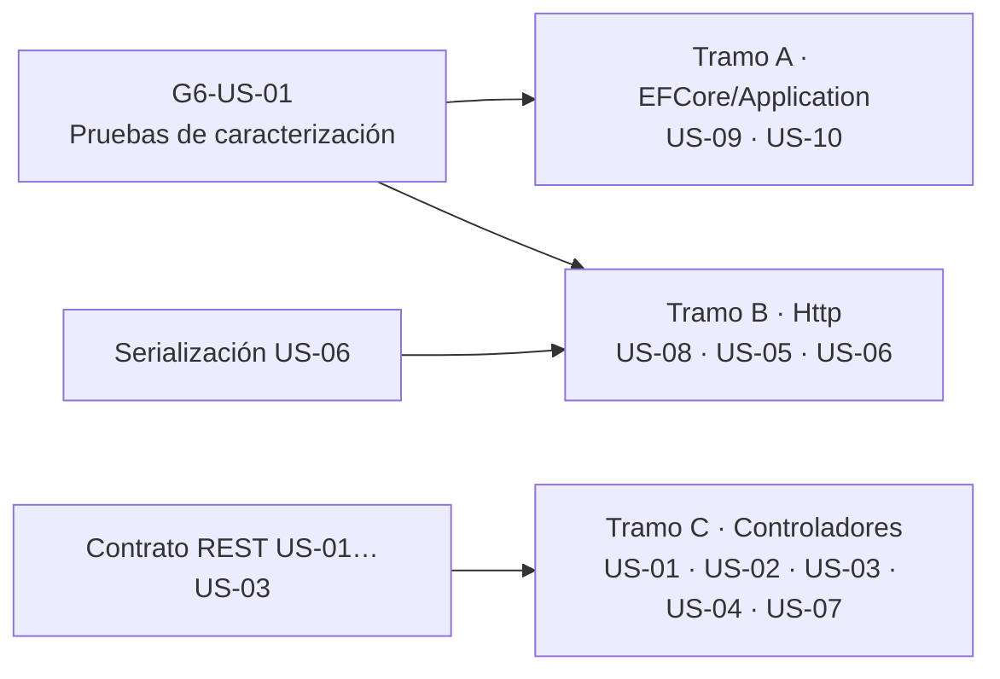

# Épica G2 · Brechas de Http, EFCore y controladores sin historia previa

> **Versión destino:** 2.0.0
> **Proyectos:** `MoralesLarios.OOFP.Http` · `AspNetCore.Controllers` · `AspNetCore.Results` · `Application` · `EntityFrameworkCore`
> **Origen:** [INV-17, 18, 19, 23, 25, 26, 27, 29, 30, 31, 33 y 38](../../Realizados/general_old_version/01-Auditoria-Inventario-89-Puntos.md) de `Mejoras-Prioridad-Critica-y-Alta.md` y `Mejoras-Prioridad-Media.md`
> **Estado:** ⬜ No iniciada
> **Esfuerzo:** L · **Riesgo:** 🟠 alto (varias rupturas silenciosas)
> **Compatibilidad:** ⚠️ cada US indica su tipo; **todas** las que rompen se registran en los seis sitios de `oofp-upgrade-2.prompt.md`

---

## Índice

1. [Contexto y problema](#1-contexto-y-problema)
2. [Relación con las épicas existentes](#2-relación-con-las-épicas-existentes)
3. [Historias de usuario](#3-historias-de-usuario)
4. [Orden de ejecución](#4-orden-de-ejecución)
5. [Decisiones abiertas](#5-decisiones-abiertas)
6. [Definición de terminado](#6-definición-de-terminado)

---

## 1. Contexto y problema

La auditoría encontró **12 puntos** del inventario original que **no tienen historia de usuario en ninguna
de las siete épicas pendientes**. Son defectos reales y vigentes:

| INV | Defecto | Evidencia |
|---:|---|---|
| 17 | Incluir el cuerpo remoto en los mensajes de error sigue **activado por defecto** | `MlResponseWebExtensions.cs:18,25` |
| 18 | El puente síncrono de lectura de errores bloquea el hilo | `MlResponseWebExtensions.Obsolete.cs:31` |
| 19 | Los controladores devuelven texto de excepción e identificadores internos | `MlCrudControllerBase.cs:43,47` |
| 23 | El selector de clave compuesta solo se pasa como `Func` al constructor | `MlCompositeKeyCrudControllerBase.cs:10` |
| 25-26 | Parseo de identificadores: formatos de fecha ambiguos; sin `Guid`, `DateOnly`, `TimeOnly`, `enum`; puede devolver `null` | `Controllers/Helpers/Extensions.cs:22,34,84,97` |
| 27 | La URL se compone con `Uri` pero **no se escapan** los segmentos variables | `HttpApiInvoker.cs:419` |
| 29 | Extensiones sobre `HttpClient` que mutan `DefaultRequestHeaders` | `MlHttpRequestExtensions.cs:24` |
| 30 | Clave inválida: GET→404, PUT/DELETE→500 | `MlCrudControllerBase.cs:43,85` |
| 31 | El `Location` del POST es `/`, no identifica el recurso creado | `MlCrudControllerBase.cs:61`; `MlResultActionResultExtensions.cs:83` |
| 33 | Actualizar consulta **dos veces** la misma entidad | `CrudServiceFp.cs:167` + `EfUpdateRepository.cs:135` |
| 38 | `TryGetLast` antiguo materializa todas las filas | `EfReadRepository.cs:105,123` |

## 2. Relación con las épicas existentes

Esta épica **no compite** con las anteriores; toca los mismos ficheros y por eso exige coordinar el orden:

| Fichero | Otras épicas que lo tocan | Regla |
|---|---|---|
| `Controllers/Helpers/Extensions.cs` | [Contrato REST](../Epica-Contrato-Rest.md) US-01 y US-02 | G2-US-03/04 se hacen **después** de REST US-01/02 |
| `MlCrudControllerBase.cs` | Contrato REST US-03…US-06 | G2-US-01/02/07 en el mismo tramo que REST US-03 |
| `HttpApiInvoker.cs`, `MlHttpRequestExtensions.cs` | [Serialización y errores HTTP](../Epica-Serializacion-y-Errores-Http.md) US-02, US-03, US-06, US-09 | G2-US-05/06 **después** de SER US-06 |
| `CrudServiceFp.cs` | [Servicio y paginación](../Epica-Servicio-y-Paginacion.md) | G2-US-09 en el mismo tramo |

## 3. Historias de usuario

### G2-US-01 · Un único estado HTTP para una clave inválida · INV-30 · S

> **Como** consumidor de la API **quiero** recibir `400` cuando la clave no se puede interpretar, en GET, PUT y DELETE
> **para** distinguir un error del cliente de un recurso inexistente o un fallo del servidor.

**Criterios de aceptación**

- [ ] GET, PUT y DELETE con clave imposible de parsear responden `400` con `ProblemDetails`.
- [ ] Un recurso inexistente sigue respondiendo `404`.
- [ ] Prueba parametrizada por los cuatro verbos y las cuatro bases.

**Compatibilidad:** **Silenciosa** (404→400 y 500→400). Registrar `MIG-nn` con barrido `StatusCode == 404` en tests del consumidor.

### G2-US-02 · Separar el detalle técnico del mensaje público · INV-19 · M

**Criterios de aceptación**

- [ ] La respuesta pública no incluye texto de excepciones, tipos de clave ni identificadores internos.
- [ ] El detalle técnico queda en el `MlErrorDetails` y se registra en log (nivel configurable).
- [ ] Test que provoca una excepción con texto sensible y comprueba que **no** llega al cuerpo.
- [ ] Mensajes en inglés, coherentes con [Mensajes y localización](../Epica-Mensajes-Y-Localizacion.md) US-03.

**Compatibilidad:** **Silenciosa** (cambia el cuerpo de error).

### G2-US-03 · Selector de clave resoluble sin constructor ad hoc · INV-23 · M

**Contexto:** [Contrato REST US-01](../Epica-Contrato-Rest.md) propone resolver la clave desde el modelo de EF. Si esa
historia elimina la necesidad del `Func<TEntity, object[]>`, **esta se cierra allí sin trabajo propio**.

**Criterios de aceptación**

- [ ] Se decide (D-G2-1) entre: derivar la clave del modelo, o una interfaz `IKeySelector<TEntity>` registrable por DI.
- [ ] El controlador compuesto se puede instanciar por DI sin pasar un `Func`.
- [ ] Prueba de resolución por DI con `ValidateOnBuild`.

**Compatibilidad:** **Compilación** si cambia el constructor; puente `[Obsolete]` si se conserva.

### G2-US-04 · Parseo de identificadores completo y estricto · INV-25, INV-26 · M

**Criterios de aceptación**

- [ ] Fechas: ISO 8601 estricto (decisión D-G2-2 sobre qué formatos adicionales se admiten).
- [ ] Soporta `Guid`, `DateOnly`, `TimeOnly` y `enum`; los numéricos usan `CultureInfo.InvariantCulture`.
- [ ] Nunca devuelve `null`: un fallo de parseo es un `MlResult` fallido con mensaje.
- [ ] Una prueba por tipo, éxito y fallo.

**Compatibilidad:** **Silenciosa** (formatos que antes se aceptaban pueden rechazarse) y **de compilación** si cambia la firma.

### G2-US-05 · Escapar los segmentos variables de la URL · INV-27 · S

**Criterios de aceptación**

- [ ] Cada segmento variable se escapa con `Uri.EscapeDataString` antes de componer la ruta.
- [ ] Prueba con claves que contienen `/`, `?`, `#`, espacios, `%` y `,`.
- [ ] Coordinada con [REST US-02](../Epica-Contrato-Rest.md) (el separador de clave compuesta debe seguir siendo distinguible tras escapar).

**Compatibilidad:** **Silenciosa** (cambia la URL emitida para claves con caracteres reservados).

### G2-US-06 · Retirar la mutación de `DefaultRequestHeaders` · INV-29 · S

**Criterios de aceptación**

- [ ] Las extensiones sobre `HttpClient` que mutan `DefaultRequestHeaders` se marcan `[Obsolete]` con puente y la alternativa por petición.
- [ ] Prueba que demuestra que dos llamadas consecutivas con distinta paginación no se contaminan.

**Compatibilidad:** **Compilación** (`CS0618`) para quien las use; el camino del invocador no cambia.

### G2-US-07 · `Location` que apunta al recurso creado · INV-31 · M

**Criterios de aceptación**

- [ ] El POST base usa la sobrecarga con `Uri` o `CreatedAtAction` apuntando al recurso (decisión D-G2-3 si la clave es compuesta).
- [ ] El test asserta el valor de `Location`, no solo `201` (hoy `MlResultActionResultExtensionsTests.cs:88` solo comprueba el estado).
- [ ] Alineado con la tabla de la épica de [Coherencia](../Epica-Coherencia-Y-Documentacion.md) (`201` + `Location`).

**Compatibilidad:** **Silenciosa** (cabecera `Location`).

### G2-US-08 · Valor por defecto del cuerpo remoto en los errores · INV-17, INV-18 · S

**Criterios de aceptación**

- [ ] Decisión D-G2-4: `IncludeResponseBodyInErrors` **desactivado por defecto**, o activado con truncado documentado.
- [ ] El comportamiento por defecto tiene un test que lo fija.
- [ ] El puente síncrono bloqueante se documenta como tal; su retirada se decide en [G5-US-02](Epica-G5-Cierre-Renombrado-y-Puentes.md).

**Compatibilidad:** **Silenciosa** si cambia el valor por defecto.

### G2-US-09 · Una sola consulta al actualizar · INV-33 · M

**Criterios de aceptación**

- [ ] `CrudServiceFp.UpdateAsync` no vuelve a buscar la entidad que acaba de rastrear.
- [ ] Un test de integración con `CommandCaptureInterceptor` (ya existe) cuenta las consultas: **exactamente una** `SELECT` por actualización.
- [ ] El tratamiento de errores y la unidad de trabajo no cambian (siguen las reglas de [la épica de UoW](../../Realizados/EFCore/Epica-Unidad-de-Trabajo-y-Transacciones.md)).

**Compatibilidad:** Ninguna si se mantiene la firma pública.

### G2-US-10 · Decidir el futuro de `TryGetLast` · INV-38 · S

**Criterios de aceptación**

- [ ] Decisión D-G2-5: conservar los métodos antiguos documentando su coste, o marcarlos `[Obsolete]` con `TryGetLastBy` como sustituto.
- [ ] Cualquiera que sea la opción, un test fija el comportamiento de los antiguos.
- [ ] La XML-doc avisa de la materialización.

**Compatibilidad:** **Compilación** (`CS0618`) si se marcan obsoletos; ninguna si solo se documenta.

---

## 4. Orden de ejecución

| Orden | Historia | Tamaño | Tipo de ruptura |
|---:|---|:---:|---|
| 1 | US-09 · Una consulta al actualizar | M | — |
| 2 | US-10 · `TryGetLast` | S | compilación (opcional) |
| 3 | US-08 · Cuerpo remoto por defecto | S | silenciosa |
| 4 | US-05 · Escapar segmentos | S | silenciosa |
| 5 | US-06 · `DefaultRequestHeaders` | S | compilación |
| 6 | US-01 · 400 coherente | S | silenciosa |
| 7 | US-02 · Mensajes públicos | M | silenciosa |
| 8 | US-04 · Parseo de identificadores | M | silenciosa / compilación |
| 9 | US-03 · Selector de clave | M | compilación |
| 10 | US-07 · `Location` | M | silenciosa |

## 5. Decisiones abiertas

| Id | Decisión | Opciones | Recomendación |
|---|---|---|---|
| D-G2-1 | Origen de la clave compuesta | modelo EF · `IKeySelector` | Modelo EF si REST US-01 lo implementa |
| D-G2-2 | Formatos de fecha admitidos | solo ISO 8601 · ISO + los actuales | Solo ISO 8601 |
| D-G2-3 | `Location` con clave compuesta | `CreatedAtAction` con ruta unificada · URL construida a mano | `CreatedAtAction` tras REST US-03 |
| D-G2-4 | Cuerpo remoto en errores | desactivado por defecto · activo y truncado | Desactivado |
| D-G2-5 | `TryGetLast` antiguo | conservar y documentar · obsoletar | Obsoletar con puente |

## 6. Definición de terminado

- [ ] Cada punto INV listado resuelto o cerrado por otra épica con evidencia.
- [ ] Test de regresión por historia (ver [G6-US-01](Epica-G6-Pruebas-Calidad-y-Rendimiento.md)).
- [ ] Cada ruptura registrada con su `MIG-nn` en los seis sitios de `oofp-upgrade-2.prompt.md` (**número asignado al implementar**) y los patrones de búsqueda en la Fase 5, punto 4.
- [ ] `dotnet build -c Release --no-incremental` sin errores ni `CS1591`; `dotnet test` en verde.
- [ ] `check-migration-prompt.ps1` sin errores.
- [ ] Índices de `Pendientes/` y de 2.0.0 actualizados.
