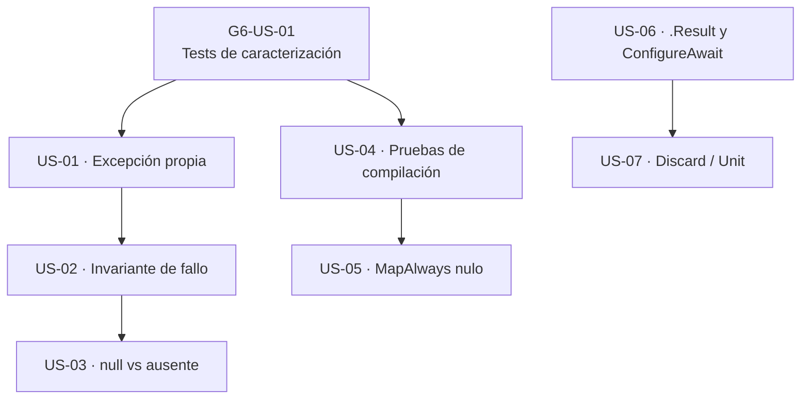

# Épica G3 · Robustez del núcleo `MlResult` y `MlErrorDetails`

> **Versión destino:** 2.0.0
> **Proyecto:** `MoralesLarios.OOFP.Core`
> **Origen:** `consejos_mejora_mlresult.md` (MR4, 8, 9, 12, 14, 22…) · `Revision-Map-Bind-ExecSelf.md` (R2, R3, R4a) · [auditoría](02-Auditoria-Documentos-Complementarios.md#3-consejos-de-mejora-de-mlresult-mr1-mr23)
> **Estado:** ⬜ No iniciada
> **Esfuerzo:** M · **Riesgo:** 🟠 alto (cambia excepciones y estados límite que algún consumidor puede observar)
> **Compatibilidad:** ⚠️ **silenciosa** en US-01…US-03; de compilación solo si se decide cambiar firmas (US-04)

---

## Índice

1. [Contexto y problema](#1-contexto-y-problema)
2. [Alcance](#2-alcance)
3. [Historias de usuario](#3-historias-de-usuario)
4. [Orden de ejecución](#4-orden-de-ejecución)
5. [Decisiones abiertas](#5-decisiones-abiertas)
6. [Definición de terminado](#6-definición-de-terminado)

---

## 1. Contexto y problema

El núcleo ya recibió cuatro épicas (constantes, higiene, nomenclatura, metadatos de error). Lo que queda son
**estados límite sin invariante definido**. Ninguno es un fallo de uso común, pero todos son sorpresas para quien
integra la biblioteca, y las correcciones **cambian lo observable**, por eso conviene hacerlas antes de publicar.

| Ref | Estado límite | Evidencia |
|---|---|---|
| MR12 | `GetValueOrThrow` lanza `InvalidProgramException` y no adjunta los detalles | `MlResultExtensions.cs:360` |
| MR22 | Ese mensaje es un literal inglés fuera de la infraestructura de mensajes | `MlResultExtensions.cs:360` |
| MR8 | `MlResult.Fail(MlErrorDetails)` acepta un detalle **sin errores** | `MlResult.cs:35`; `MlErrorDetails.cs:47` |
| MR14 | `MlErrorDetails.ToString()` devuelve vacío si no hay errores ni metadatos | `MlErrorDetails.cs` |
| MR9 | `GetDetail<T>`: un valor `null`, una clave ausente y un tipo incorrecto son indistinguibles | `MlResultErrorDetailsExtensions.cs:28`; `MlErrorDetails.Metadata.cs:255` |
| MR4 | Las conversiones implícitas desde `T` y desde `MlError` colisionan en `MlResult<MlError>` | `MlResult.cs:412` |
| R3 | `Try*(…, null)` es ambiguo entre `string` y `Func<Exception,string>` | familias `Try*` |
| R4a | `MapAlways` valida el retorno, no el delegado | `MlResultMapExtensions.cs:7609` |
| — | `.Result` en operaciones sobre colecciones asíncronas | `MlResultCollections.cs` |

## 2. Alcance

**Dentro:** invariantes, excepciones, mensajes, pruebas de compilación y revisión de `.Result`/`ConfigureAwait`.

**Fuera:** rediseñar `MlErrorDetails` como `record` o inmutable, `ValueTask`, contrato JSON y analizador de retorno
descartado → [backlog 3.0](04-Backlog-3.0-y-Descartados.md). **Sin alias nuevos** (`BindSelf`, `TransformData`, `MakeBind`…): ver descartes.

---

## 3. Historias de usuario

### G3-US-01 · Una excepción adecuada en `GetValueOrThrow` · MR12, MR22 · S

> **Como** consumidor **quiero** que acceder al valor de un fallo lance una excepción propia con los detalles
> **para** diagnosticar el error sin reconstruirlo.

**Criterios de aceptación**

- [ ] `GetValueOrThrow` sobre un fallo lanza un tipo específico (D-G3-1) que **expone** el `MlErrorDetails`.
- [ ] El mensaje procede de la infraestructura de mensajes del núcleo (mismo patrón que `EnsureFpMessages`).
- [ ] Tests: tipo de excepción, mensaje y acceso a los detalles.

**Compatibilidad:** **Silenciosa**: un `catch (InvalidProgramException)` deja de capturar. Patrón de búsqueda: `InvalidProgramException`.

### G3-US-02 · Invariante «un fallo siempre explica algo» · MR8, MR14 · S

**Criterios de aceptación**

- [ ] Decisión D-G3-2 y aplicación: rechazar un detalle sin errores, o sustituirlo por un error por defecto.
- [ ] `MlErrorDetails.ToString()` nunca devuelve cadena vacía.
- [ ] Tests de los dos estados límite, sincrónicos y asíncronos.

**Compatibilidad:** **Silenciosa** si se sustituye por un error por defecto; el patrón de búsqueda son los `Fail(new MlErrorDetails…)` del consumidor.

### G3-US-03 · Distinguir `null`, clave ausente y tipo incorrecto · MR9 · S

**Criterios de aceptación**

- [ ] `TryGetMetadata<T>` informa de las tres situaciones por separado (resultado o razón).
- [ ] `GetDetail<T>` conserva su comportamiento documentado y su XML-doc lo describe.
- [ ] Un test por situación.

**Compatibilidad:** **Silenciosa** (`null` válido pasa a no confundirse con ausente).

### G3-US-04 · Pruebas de compilación de las ambigüedades · MR4, R3 · M

**Criterios de aceptación**

- [ ] Una suite compila fragmentos con Roslyn (`CSharpCompilation`) y comprueba que `MlResult<MlError>` y `TryMap(x, null)` **producen o no** ambigüedad, tal como se documenta.
- [ ] Si hay ambigüedad real: decisión D-G3-3 (documentar o cambiar firma con puente).
- [ ] La conclusión queda en el `README.md` del núcleo.

**Compatibilidad:** Ninguna si se documenta; **de compilación** si cambia la firma.

### G3-US-05 · `MapAlways` y delegados nulos · R4a · XS

**Criterios de aceptación**

- [ ] `MapAlways` y sus variantes asíncronas validan el delegado antes de invocarlo (mismo mensaje que el resto de la familia).
- [ ] Un test por variante.

**Compatibilidad:** **Silenciosa** (una `NullReferenceException` pasa a ser un fallo controlado).

### G3-US-06 · Auditar `.Result`, `Wait` y `ConfigureAwait` · M

**Criterios de aceptación**

- [ ] Inventario de cada `.Result`/`.Wait()`/`GetAwaiter().GetResult()` en `Core`, `Logging`, `Http` y `Application`, con veredicto «bloquea» o «ya completado».
- [ ] Los que bloquean se sustituyen por `await`; los demás se documentan con un comentario de una línea.
- [ ] Decisión D-G3-4 sobre `ConfigureAwait(false)` en las bibliotecas.
- [ ] Test que ejecuta cada operación asíncrona bajo un `SynchronizationContext` de un solo hilo y comprueba que **no** se bloquea.

**Compatibilidad:** Ninguna si no cambian las firmas.

### G3-US-07 · Decidir el valor de `Discard` · MR18 · S

**Criterios de aceptación**

- [ ] Decisión D-G3-5 sobre `MlResult<T>.Discard` (`default(T)!`): documentar el valor `null` válido o devolver un tipo `Unit` (enlaza con [G4-US-03](Epica-G4-ValueObjects-Nomenclatura-y-Diseno.md)).
- [ ] La decisión se registra en el `README.md` del núcleo.

---

## 4. Orden de ejecución

| Orden | Historia | Tamaño | Tipo de ruptura |
|---:|---|:---:|---|
| 1 | US-05 · `MapAlways` nulo | XS | silenciosa |
| 2 | US-04 · Pruebas de compilación | M | — |
| 3 | US-01 · Excepción propia | S | silenciosa |
| 4 | US-02 · Invariante de fallo | S | silenciosa |
| 5 | US-03 · `null` vs ausente | S | silenciosa |
| 6 | US-06 · `.Result` y `ConfigureAwait` | M | — |
| 7 | US-07 · `Discard` / `Unit` | S | según decisión |

## 5. Decisiones abiertas

| Id | Decisión | Opciones | Recomendación |
|---|---|---|---|
| D-G3-1 | Tipo de excepción de `GetValueOrThrow` | `InvalidOperationException` · tipo propio con detalles | Tipo propio que derive de `InvalidOperationException` |
| D-G3-2 | Fallo sin errores | rechazar con excepción · error por defecto | Error por defecto (no lanza desde un constructor) |
| D-G3-3 | Ambigüedad `MlResult<MlError>` | documentar · cambiar firma | Documentar si Roslyn confirma que no compila ambiguo en usos reales |
| D-G3-4 | `ConfigureAwait(false)` | en toda la biblioteca · solo en I/O | Solo en I/O (`Http`, `EntityFrameworkCore`) |
| D-G3-5 | `Discard` | documentar el `null` · `Unit` | Documentar ahora; `Unit` junto a G4-US-03 |

## 6. Definición de terminado

- [ ] Todos los criterios con su test de regresión, comprobando que el test **falla sin el cambio**.
- [ ] Cada ruptura silenciosa registrada con su `MIG-nn` (asignado al implementar) en los seis sitios del prompt, incluidos los patrones de búsqueda.
- [ ] `README.md` del núcleo actualizado con las decisiones D-G3-x.
- [ ] `dotnet build -c Release --no-incremental`: 0 errores y 0 `CS1591`; `dotnet test` en verde.
- [ ] `check-migration-prompt.ps1` sin errores.
