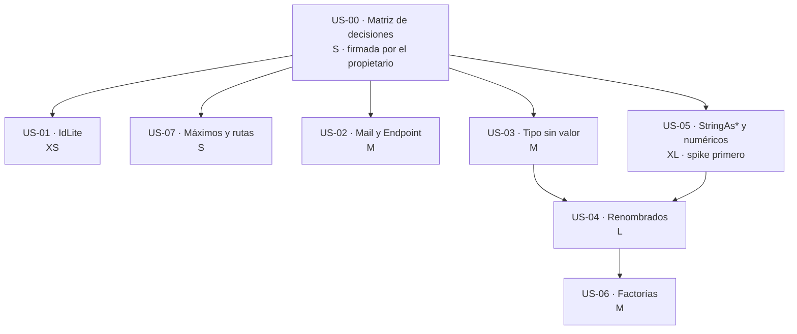

# Épica G4 · `ValueObjects`: nomenclatura y diseño antes de publicar

> **Versión destino:** 2.0.0 (decisiones y renombrados) · 3.0.0 (solo la retirada de puentes)
> **Proyectos:** `MoralesLarios.OOFP.ValueObjects` · `MoralesLarios.OOFP.ValueObjects.FileSystem`
> **Origen:** `Analisis-Nomenclatura-ValueObjects.md` (N1-N21) · INV-6 e INV-10 · [auditoría](../../Realizados/general_old_version/02-Auditoria-Documentos-Complementarios.md#1-análisis-de-nomenclatura-de-valueobjects-n1-n21)
> **Estado:** ⬜ No iniciada
> **Esfuerzo:** XL · **Riesgo:** 🔴 muy alto (rompe compilación en la mayoría de las historias)
> **Compatibilidad:** ⚠️ renombrados de tipos y parámetros públicos → anexo `oofp-upgrade-2.renames.md` **y** los seis sitios del prompt

---

## Índice

1. [Contexto y problema](#1-contexto-y-problema)
2. [Principio de la épica: decidir ahora, no dos veces](#2-principio-de-la-épica-decidir-ahora-no-dos-veces)
3. [Historias de usuario](#3-historias-de-usuario)
4. [Orden de ejecución](#4-orden-de-ejecución)
5. [Decisiones abiertas](#5-decisiones-abiertas)
6. [Definición de terminado](#6-definición-de-terminado)

---

## 1. Contexto y problema

De los 21 puntos del análisis de `ValueObjects`, **1 está resuelto, 10 parciales y 10 pendientes**. Los
«parciales» son engañosos: en casi todos el código **eligió un destino distinto** al propuesto
(`ServiceKey` y `MemberName` en lugar de `EntityKey` y `DisplayName`; `EnumRangeValueObject` en lugar de
`EnumName`) o solo existe el puente `[Obsolete]`. El documento original ya no describe el código y la
solución a medias es la peor: hay dos vocabularios a la vez.

Estado de los tipos públicos más afectados:

| Tipo actual | Propuesta original | Situación |
|---|---|---|
| `Mail` | `EmailAddress` | sin cambio (`EndpointPattern` obsoleto, `ValidationPattern` vigente) |
| `Endpoint` | `HttpsUrl` | sin cambio; solo acepta host HTTPS y puerto, **sin ruta** |
| `IdLite` | `Int32Id` | sin cambio; mensaje con errata (`IdLite.cs:27`) |
| `Void` y `EmptyValue` | `Unit` | dos tipos para la misma idea |
| `NotEmptyString` | `NonBlankString` | sin cambio |
| `RegexValue` | `RegexString` | sin cambio |
| `IntMoreThan`, `IntBetween`… | `GreaterThan`, `InRange` o genéricos con `INumber<T>` | sin cambio; una clase por tipo numérico |
| `StringAsInt` + 11 derivados | `NumericString<T>` | sin cambio; **44 `CS0108` deducidos** por miembros estáticos heredados |
| `ValueObject<TValue>` | abstracta `SingleValueObject<TValue>` | sigue pública y concreta (`ValueObject.cs:96`) |

## 2. Principio de la épica: decidir ahora, no dos veces

Los paquetes **no se han publicado**. Cambiar un nombre hoy cuesta un renombrado y una entrada en la guía de
migración; cambiarlo después de publicar cuesta eso **más** un ciclo `[Obsolete]` completo y una versión mayor.
Por eso la regla de esta épica es:

> **Cada uno de los 20 puntos se decide —aplicar, aplazar a 3.0.0 o descartar— antes de la primera publicación.**
> Lo que se aplique **no** deja un puente `[Obsolete]` en 2.0.0 si el tipo nunca se publicó con el nombre antiguo.
> Si se conserva el puente es porque el consumidor 1.x ya conocía ese nombre (ver el anexo de renombrados).

Cada decisión queda escrita en la tabla de la [US-00](#g4-us-00--matriz-de-decisiones-n1-n21--s).

## 3. Historias de usuario

### G4-US-00 · Matriz de decisiones N1-N21 · S

> **Como** propietario **quiero** una decisión escrita por cada punto **para** no publicar un vocabulario a medias.

**Criterios de aceptación**

- [ ] Una tabla `N · Opciones · Decisión · Justificación · ¿Puente? · Versión` con **las 21 filas** completas (N3 ya cerrado).
- [ ] La tabla está firmada por el propietario antes de empezar G4-US-01…US-06.
- [ ] N17 cita el recuento **medido** de `CS0108` (ver G4-US-05).

### G4-US-01 · Erratas vivas de `IdLite` · N2, N5 · XS

**Criterios de aceptación**

- [ ] `BuildErrorMessIdLite` → `BuildErrorMessage` (o nombre decidido); texto «can be mayor 0» corregido.
- [ ] Test del mensaje exacto.

**Compatibilidad:** **Compilación** (miembro público) y **silenciosa** (texto). Registro en los seis sitios.

### G4-US-02 · `Mail`, `Endpoint` y sus patrones · N4, N9, N10 · M

**Criterios de aceptación**

- [ ] Decidido y aplicado: `EmailAddress`/`HttpsUrl` o se conservan `Mail`/`Endpoint` documentando por qué.
- [ ] Si `Endpoint` pasa a `HttpsUrl`, se decide si **admite ruta** y consulta (hoy no); un test fija el contrato.
- [ ] El patrón de validación se expone con un solo nombre (`ValidationPattern`); `EndpointPattern` desaparece o queda puenteado según G4-US-00.

**Compatibilidad:** **Compilación** (tipo público); **silenciosa** si cambia lo que se acepta.

### G4-US-03 · Un único tipo «sin valor» · N7, N8 · M

**Criterios de aceptación**

- [ ] Decidido entre `Void`, `EmptyValue` y `Unit` (D-G4-2); queda **uno** como canónico.
- [ ] `Void.Create()` desaparece o queda marcado.
- [ ] `IdLite`→`Int32Id` decidido; `Int64Id` solo se crea si hay un caso de uso real (el antiguo `Id` se eliminó).
- [ ] Coordina con [G3-US-07](Epica-G3-Nucleo-MlResult-Robustez.md) (`Discard`).

**Compatibilidad:** **Compilación**.

### G4-US-04 · Renombrados de tipos y parámetros · N1, N11-N16, N21 · L

**Criterios de aceptación**

- [ ] N1: los puentes `Lenght` se retiran o se justifican con G5-US-02.
- [ ] N11-N16: se aplica lo decidido en la matriz (`StringMinLength`/`StringMaxLength`, `MoreThan`/`Between`, `NotEmptyString`, `RegexValue`, `ServiceKey`/`MemberName`, `EnumRangeValueObject`).
- [ ] N21: los parámetros públicos `length`/`minLength`/`maxLength` pasan a nombres que digan si el límite es exclusivo; **un renombrado de parámetro rompe los argumentos con nombre y no admite puente**: se anota con prioridad en el prompt.
- [ ] Cada renombrado figura en `oofp-upgrade-2.renames.md` en formato apto para buscar y reemplazar, con nota de ambigüedad (`Key`, `Name`, `Empty`, `Value`…).

**Compatibilidad:** **Compilación** (tipos, y argumentos con nombre en N21).

### G4-US-05 · Rediseño de `StringAs*` y de las familias numéricas · N17, N18, N19 · XL

**Criterios de aceptación**

- [ ] **Paso 0 (medición):** se compila con las advertencias de `ValueObjects` y se registra el número real de `CS0108` (el documento dice 44; es una deducción).
- [ ] **Spike:** prototipo en rama de `NumericString<T>` y de `INumber<T>` para `IntMoreThan`/`IntBetween`/… con **equivalencia de límites demostrada por tests** (los mismos casos que hoy pasan en las clases por tipo).
- [ ] Decisión D-G4-3: adoptar, aplazar a 3.0.0 o descartar. N19 (`ValueObject` abstracta) solo se adopta si el spike lo exige.
- [ ] Si se adopta: los tipos antiguos se retiran o puentean según G4-US-00, con los seis sitios del prompt y el anexo de renombrados.

**Compatibilidad:** **Compilación**, de gran alcance. Es la historia que más cuesta migrar a un consumidor.

### G4-US-06 · Factorías unificadas · N20 · M

**Criterios de aceptación**

- [ ] Una sola convención (`CreateFrom…` lanza, `From…` devuelve `MlResult`; `TryCreate` descartado o adoptado según D-G4-4) aplicada a **todos** los tipos.
- [ ] Los puentes `By…` se retiran o se justifican con G5-US-02.
- [ ] Tabla de equivalencias en el `README.md` de `ValueObjects`.

**Compatibilidad:** **Compilación** (si se retiran puentes); **silenciosa** si cambia la semántica de lanzar o devolver.

### G4-US-07 · Longitud máxima de `ServiceKey`/`MemberName` y vía lanzadora de rutas · INV-6, INV-10 · S

**Criterios de aceptación**

- [ ] **INV-6:** decisión D-G4-5 sobre si estos tipos necesitan **máximo**; si sí, valor y test; si no, se documenta que solo hay mínimo.
- [ ] **INV-10:** se documenta la diferencia entre `CreateFromPath`/conversión implícita (lanzan) y `FromPath` (devuelve `MlResult`), o se retira la vía lanzadora.
- [ ] Un test por tipo.

**Compatibilidad:** **Silenciosa** si se introduce un máximo (rechaza entradas antes válidas).

---

## 4. Orden de ejecución

| Orden | Historia | Tamaño | Hito |
|---:|---|:---:|---|
| 1 | US-00 · Matriz | S | 🎯 Vocabulario decidido |
| 2 | US-01 · `IdLite` | XS | |
| 3 | US-07 · Máximos y rutas | S | |
| 4 | US-02 · `Mail`/`Endpoint` | M | |
| 5 | US-03 · Tipo sin valor | M | |
| 6 | US-05 · `StringAs*` y numéricos | XL | 🎯 Diseño numérico cerrado |
| 7 | US-04 · Renombrados | L | |
| 8 | US-06 · Factorías | M | 🎯 `ValueObjects` coherente |

## 5. Decisiones abiertas

| Id | Decisión | Opciones | Recomendación |
|---|---|---|---|
| D-G4-1 | ¿Se renombra algo más antes de publicar? | todo lo decidido · solo erratas | **Todo lo decidido**: es la última ventana barata |
| D-G4-2 | Tipo canónico «sin valor» | `EmptyValue` · `Unit` · `Void` | `Unit`, con `EmptyValue` y `Void` retirados antes de publicar |
| D-G4-3 | Rediseño numérico (`INumber<T>`, `NumericString<T>`) | adoptar · aplazar a 3.0.0 · descartar | Aplazar a 3.0.0 si el spike no demuestra equivalencia total |
| D-G4-4 | `TryCreate` | adoptar · descartar | Descartar: la convención `CreateFrom…`/`From…` ya está extendida |
| D-G4-5 | Máximo en `ServiceKey`/`MemberName` | sí, con valor · no | No, salvo caso de uso; documentar |

## 6. Definición de terminado

- [ ] La matriz de la US-00 está completa y firmada.
- [ ] Los 21 puntos N cerrados como aplicado, aplazado a 3.0.0 o descartado, cada uno con justificación.
- [ ] Cada renombrado en `oofp-upgrade-2.renames.md` y cada ruptura en los seis sitios del prompt (**números asignados al implementar**).
- [ ] `dotnet build -c Release --no-incremental`: 0 errores y 0 `CS1591`; el recuento de `CS0108` baja o queda justificado.
- [ ] `dotnet test` en verde; los tests de `ObsoleteBridgeContractTests` actualizados.
- [ ] `check-migration-prompt.ps1` y `check-old-names.ps1` sin errores nuevos.
- [ ] `README.md` de `ValueObjects` con la tabla de equivalencias y las convenciones.
