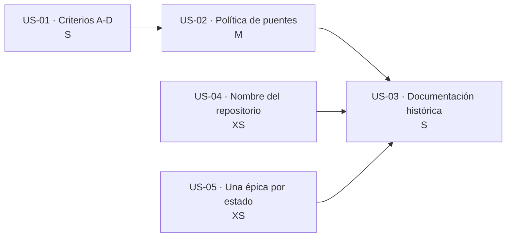

# Épica G5 · Cierre del renombrado 2.0.0 y política de puentes `[Obsolete]`

> **Versión destino:** 2.0.0 (cierre y decisión) · 3.0.0 (retirada de puentes, si se mantienen)
> **Proyecto:** transversal (documentación, `*.Obsolete.cs` y herramientas de inventario)
> **Origen:** `Plan-Renombrados-2.0.0.md` (4 criterios de cierre) · `Consejos-Nomenclatura.md` · INV-18, 72, 73 · [auditoría](../../Realizados/general_old_version/02-Auditoria-Documentos-Complementarios.md#2-consejos-nomenclaturamd-y-plan-renombrados-200md)
> **Estado:** 🟡 En curso · G5-US-01 parcial (A/B ✅; C/D pendientes); US-02/03/04 pendientes
> **Esfuerzo:** M · **Riesgo:** 🟡 medio (la decisión de puentes cambia la promesa de migración gradual)
> **Compatibilidad:** Depende de D-G5-1: **retirar** puentes es una ruptura de compilación; **conservarlos** no cambia nada

---

## Índice

1. [Contexto y problema](#1-contexto-y-problema)
2. [Historias de usuario](#2-historias-de-usuario)
3. [Orden de ejecución](#3-orden-de-ejecución)
4. [Decisiones abiertas](#4-decisiones-abiertas)
5. [Definición de terminado](#5-definición-de-terminado)

---

## 1. Contexto y problema

El renombrado 2.0.0 está ejecutado: el inventario cifra **904 cambios** (885 de nomenclatura y 19 de contrato) y el
prompt de migración documenta **187 puentes `[Obsolete]`** con el mensaje «Will be removed in 3.0.0». Pero:

- `Plan-Renombrados-2.0.0.md` mantiene **cuatro criterios de cierre sin verificar**.
- `Consejos-Nomenclatura.md` los da por completos, **contradiciendo** al plan y al código.
- Todo el trabajo ocurre **antes de la primera publicación de la 2.x**. Un puente solo protege a quien conoce el
  nombre antiguo: los puentes de **nombres 1.x publicados** son útiles a los consumidores que migran; los que
  sustituyen **nombres intermedios de la propia rama 2.0** (renombrados dos veces durante el desarrollo, nunca
  publicados) no protegen a nadie y solo añaden ruido.
- El prompt promete la «migración gradual» como alternativa a la completa; eso **depende** de que los puentes existan.

## 2. Historias de usuario

### G5-US-01 · Verificar los cuatro criterios de cierre · S

> **Como** mantenedor **quiero** comprobar que el renombrado cumple su propia definición de terminado **para** dar
> por cerrado un trabajo de 904 cambios con evidencia.

**Criterios de aceptación**

- [x] **A** · Build Release `--no-incremental`: exit 0; `CS0618=0` fuera de los tests de contrato y sin `CS1591`.
- [x] **B** · `dotnet test -c Release`: **1.814/1.814** aprobados en 14 proyectos, sin fallos ni omitidos; la línea base de 1.715 no baja.
- [x] **C** · Inventario de 157 términos y `check-old-names.ps1 -IncludeCs`: 0 hallazgos C# fuera de la whitelist; las coincidencias Markdown se clasificaron manualmente.
- [x] **D** · Las 36 coincidencias Markdown restantes (16 `docs_next`, 13 `docs`, 3 `CONTRIBUTING.md`, 4 READMEs) son referencias explícitas de migración, historial o puentes aún públicos; los ejemplos activos se actualizaron para no recomendar `Secure*` obsoletos.
- [x] Los cuatro resultados se anotan en `Plan-Renombrados-2.0.0.md` junto al commit verificado `bba9f89`. *(Build y tests se ejecutaron sobre el mismo árbol antes de crear el commit.)*

**Compatibilidad:** Ninguna.

### G5-US-02 · Política de puentes `[Obsolete]` · M

**Criterios de aceptación**

- [ ] Decisión D-G5-1 por **familia de puentes**: conservar hasta 3.0.0, o retirar antes de publicar.
- [ ] Inventario de los 187 puentes agrupados por proyecto y tipo, distinguiendo los que **protegen un nombre 1.x publicado** de los que sustituyen un nombre intermedio de la rama 2.0 (comprobable con el anexo `oofp-upgrade-2.renames.md` y el historial de git).
- [ ] Si se retiran: el prompt de migración pasa de «migración gradual recomendada» a «migración completa obligatoria» en la Fase 4.1 y se actualizan `README.md` de Copilot y los números de puentes.
- [ ] Si se conservan: cada puente lleva `EditorBrowsable(Never)` y el texto «Will be removed in 3.0.0» (ya vigente) y se crea la lista de retirada para 3.0.0.
- [ ] Casos concretos: INV-72 (`ChangeReturnResultAlwais*`), INV-73 (`Lenght`), INV-18 (puente síncrono bloqueante de lectura de errores) y los `By…` de G4-US-06.

**Compatibilidad:** **Compilación** si se retiran; ninguna si se conservan.

### G5-US-03 · Reconciliar la documentación histórica · S

**Criterios de aceptación**

- [x] Los 11 documentos fuente de `Temas Pendientes/` reciben un aviso histórico de dos líneas con enlace al plan; el contenido original se conserva.
- [x] `Consejos-Nomenclatura.md` aclara que sus casillas son el registro de la propuesta original y remite al estado auditado en [`02-Auditoria`](../../Realizados/general_old_version/02-Auditoria-Documentos-Complementarios.md).
- [x] Se corrigió la contradicción entre `Epica-Simplificacion-Repositorios-EFCore.md` y `Epica-Unidad-de-Trabajo-y-Transacciones.md`: la segunda conserva el análisis previo y añade la resolución posterior de `BuildServiceProvider`/`GetRepository<T>()`.
- [x] Las épicas desactualizadas ([lista](../../Realizados/general_old_version/01-Auditoria-Inventario-89-Puntos.md#3-correcciones-al-inventario-original)) corrigen las afirmaciones vigentes y las referencias de línea de Servicio y Paginación; los ejemplos anteriores quedan identificados como históricos.
- [x] Se borra `Temas Pendientes/_Seccion-para-README.md` (su contenido ya está en `src/README.md`).

### G5-US-04 · Nombre del repositorio y de la carpeta raíz · N6 · XS

**Criterios de aceptación**

- [ ] Decisión D-G5-2: el repositorio y la carpeta raíz conservan `FOOP` o pasan a `OOFP`.
- [ ] Si cambia: se actualizan scripts, plantilla de PR, workflows y enlaces; si no cambia, se documenta el motivo en `CONTRIBUTING.md`.

**Compatibilidad:** Ninguna para la API; afecta a rutas y herramientas.

### G5-US-05 · Una sola épica por estado · XS

**Criterios de aceptación**

- [ ] La copia indicada de `Pendientes/Epica-Limpieza-Codigo-Muerto.md` no existe en el árbol ni está registrada en Git; solo existe la versión archivada en `Realizados/Http/`. Al faltar la copia, queda sin verificar si su contenido único se integró antes.
- [x] Ninguna épica completada permanece en `Pendientes/`; la limpieza de código muerto solo aparece en `Realizados/Http/` y G3 solo en `Realizados/Core/`.
- [x] Los índices de `Pendientes/` y de `2.0.0/` coinciden con el contenido real de las carpetas; verificados también los enlaces y anclas Markdown.

---

## 3. Orden de ejecución

| Orden | Historia | Tamaño | Hito |
|---:|---|:---:|---|
| 1 | US-05 · Una épica por estado | XS | |
| 2 | US-01 · Criterios A-D | S | 🎯 Renombrado verificado |
| 3 | US-02 · Política de puentes | M | 🎯 Promesa de migración decidida |
| 4 | US-04 · Nombre del repositorio | XS | |
| 5 | US-03 · Documentación histórica | S | 🎯 Una sola fuente de verdad |

**Va después de [G4](Epica-G4-ValueObjects-Nomenclatura-y-Diseno.md)** salvo US-05 y US-01 (parte A), que se pueden hacer antes.

## 4. Decisiones abiertas

| Id | Decisión | Opciones | Recomendación |
|---|---|---|---|
| D-G5-1 | Puentes `[Obsolete]` | (a) conservar los 187 hasta 3.0.0 · (b) retirar los que sustituyen nombres intermedios nunca publicados · (c) retirarlos todos | **(b)**: se conserva lo que protege a consumidores reales de 1.x y se elimina el ruido |
| D-G5-2 | Nombre de repositorio y carpeta raíz | `FOOP` · `OOFP` | Conservar `FOOP` si renombrar rompe enlaces externos; documentar |

## 5. Definición de terminado

- [ ] Los cuatro criterios A-D cumplidos y registrados en `Plan-Renombrados-2.0.0.md`.
- [ ] Política de puentes decidida, aplicada y reflejada en el prompt de migración (los seis sitios si se retira algo).
- [ ] `Temas Pendientes/` con aviso de histórico; contradicciones documentales corregidas.
- [ ] `check-migration-prompt.ps1`, `check-md-links2.ps1` y `check-md-anchors4.ps1` sin errores.
- [ ] Build Release `--no-incremental` sin errores y tests en verde.
