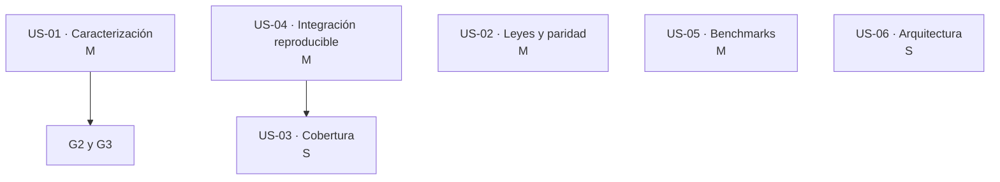

# Épica G6 · Pruebas, calidad y rendimiento

> **Versión destino:** 2.0.0
> **Proyectos:** todos los `*.Tests.Unit` y `*.Tests.Integration` + proyecto nuevo de *benchmarks*
> **Origen:** `Profesionalizacion-Ingenieria-y-Calidad.md` (estrategia de pruebas) · vacíos detectados en la [auditoría de los 89 puntos](../../Realizados/general_old_version/01-Auditoria-Inventario-89-Puntos.md) · `consejos_mejora_mlresult.md` MR19
> **Estado:** 🟡 En curso (G6-US-01 parcial; US-02/03/04/05/06 completadas)
> **Esfuerzo:** L · **Riesgo:** 🟢 bajo (solo añade pruebas y mediciones)
> **Compatibilidad:** ⚠️ Retirada de la dependencia transitiva `Internals`/`Shared` → `ValueObjects` (punto 85 del prompt de migración)

---

## Índice

1. [Contexto y problema](#1-contexto-y-problema)
2. [Historias de usuario](#2-historias-de-usuario)
3. [Orden de ejecución](#3-orden-de-ejecución)
4. [Decisiones abiertas](#4-decisiones-abiertas)
5. [Definición de terminado](#5-definición-de-terminado)

---

## 1. Contexto y problema

La línea base anterior a estas historias era de **1.715 tests** en verde sobre `net11.0` en 13 proyectos. Tras las
caracterizaciones y las historias de esta tanda hay **1.814 tests** descubiertos: 1.781 pasan en el filtro CI predeterminado y 33
requieren los servidores HTTP locales. La auditoría detectó que varias
correcciones «hechas» **no tienen un test que las ancle**, y que casi todos los defectos pendientes carecen de
prueba que los reproduzca. Sin ese test, un cambio futuro puede reintroducir el defecto sin que nada falle.

| Hueco | Evidencia |
|---|---|
| `MapAlwaysAsync` espera al origen (INV-2): el test solo cubre la no recursión | `MapAlwaysAsync_TaskSource_WaitsForIncompleteSourceBeforeInvokingDelegate` |
| El cliente compuesto: se comprueba la clave, no una petición real (INV-14) | `AddCompositeKeyRestClient_GetByIdAsync_SendsRequestThroughConfiguredClient` |
| `ProblemDetails.type = about:blank` por defecto (INV-32) sin test específico | `BadRequest_WithoutType_UsesAboutBlankTypeByDefault` |
| Conteo paginado síncrono **con filtro** (INV-36): el test síncrono no filtra | `TryGetDataPagination_FilteredSyncResult_CountsOnlyMatchingRows` |
| Cabeceras de paginación: sin test de contrato cliente↔servidor (INV-55) | `AddPaginationHeaders_ClientRequestIsReadAsExpectedByServer` |
| `MlHttpRequestExtensionsTests` **está vacío** (INV-63) | `AddPaginationHeaders_HttpClient_SendsCurrentDefaultHeaderValues` |
| Valor por defecto de `IncludeResponseBodyInErrors` (INV-17) | `ReadErrorDescriptionAsync_OmitsResponseBodyByDefault` |
| Número de consultas al actualizar (INV-33) | `CrudServiceUpdateAsync_ByKey_ExecutesOneSelectForTrackedEntity` |
| Sin pruebas de leyes del funtor/mónada ni de paridad sistemática sync/async | `MlResultLawsTests.cs` · FsCheck 3.6.0 |
| Configuración de pruebas de integración | La semilla SQLite versionada se copia a una base `:memory:` al arrancar EFCore; `UnitOfWorkTransactionTests.TestDatabase` también usa SQLite en memoria |
| Sin medición de rendimiento | sin BenchmarkDotNet |

## 2. Historias de usuario

### G6-US-01 · Pruebas de caracterización de lo que se va a cambiar · M

> **Como** mantenedor **quiero** que cada defecto abierto tenga primero un test que lo reproduzca **para** ver el cambio
> de comportamiento en el *diff* de pruebas.

**Criterios de aceptación**

- [x] Un test por cada hueco de la tabla anterior (INV-2, 14, 17, 32, 33, 36, 55, 63).
- [ ] Para cada defecto de [G2](Epica-G2-Brechas-Http-EFCore-y-Controladores.md) y [G3](../../Realizados/Core/Epica-G3-Nucleo-MlResult-Robustez.md): un test **que hoy falla o documenta el comportamiento actual** y que la historia correspondiente invierte.
- [ ] Se comprueba que cada test nuevo **falla** si se deshace el cambio que protege.
- [x] `MlHttpRequestExtensionsTests` deja de estar vacío.

**Evidencia añadida en esta tanda**

| Área | Tests de caracterización |
|---|---|
| INV-2, G3-US-05 | `MapAlwaysAsync_TaskSource_WaitsForIncompleteSourceBeforeInvokingDelegate`; `MapAlways_NullDelegate_ReturnsFailure`; `MapAlwaysAsync_ResultWithAsyncDelegateNull_ReturnsFailure`; `MapAlwaysAsync_ResultWithSyncDelegateNull_ReturnsFailure`; `MapAlwaysAsync_TaskSourceWithAsyncDelegateNull_ReturnsFailure`; `MapAlwaysAsync_TaskSourceWithSyncDelegateNull_ReturnsFailure` (los cinco casos fallan antes del fix y pasan después) |
| G3-US-06 | `TraverseParallelAsync_AllOverloadsCompleteUnderSingleThreadSynchronizationContext` (las cuatro sobrecargas y callbacks con `Task.Yield`) |
| HTTP · US-06 ciclo de vida | `InternalHttpActionAsync_DisposesRequestsAndResponsesAcrossRepeatedSuccessAndFailure` (1.000 envíos con handler falso; libera request y contenido response) |
| HTTP · US-06 rutas | `SendAndReadAsync_SerializesRequestAndDisposesResponse`; `ActionEmptyAsync_DisposesSuccessfulAndFailedResponses` |
| G3-US-04 | `MlResultOfMlError_ImplicitConversionReportsAmbiguity` (`CS0457`); `TryMap_WithNullErrorMessageReportsAmbiguity` (`CS0121`) |
| HTTP-US-06 | `InternalHttpActionAsync_DisposesRequestsAndResponsesAcrossRepeatedSuccessAndFailure` (1.000 envíos con handler falso y disposición en éxito/error) |
| INV-14 | `AddCompositeKeyRestClient_GetByIdAsync_SendsRequestThroughConfiguredClient` |
| G2-US-05 / REST-US-02 | `RestClientPathEncodingTests.GetByIdAsync_EncodesReservedIdentifierCharacters`; `GetPutAndDeleteByIdAsync_UseOneEncodedPathSegment`; `CompositeKeyClient_EncodesComponentsAndPreservesCommaSeparatorForAllVerbs`; `CompositeKeyClient_PreservesAnEmptyComponentBoundary`; `CompositeKeyClient_PreservesOverriddenRestClientMethods`; `EncodedRouteValueTests.Routing_DecodesSingleEncodedCommaBeforeController`; `Routing_PreservesComponentEscapeWhenPathIsDoubleEncoded`; `Routing_KeepsEncodedSlashInsideOneRouteValue`; `GetByIdAsync_EncodedStringRouteValue_IsDecodedBeforeCallingService`; `ParseKeyValues_DecodesComponentsAfterSplittingTheSeparator`; `ParseKeyValues_PreservesAnEmptyStringComponent` |
| INV-17, G2-US-08 | `ReadErrorDescriptionAsync_OmitsResponseBodyByDefault` (falla antes del cambio; no incluye el cuerpo remoto por defecto) |
| INV-32 | `BadRequest_WithoutType_UsesAboutBlankTypeByDefault` |
| INV-33, G2-US-09 | `CrudServiceUpdateAsync_ByKey_ExecutesOneSelectForTrackedEntity` (SQLite en memoria; el interceptor observa un `SELECT`) |
| INV-36 | `TryGetDataPagination_FilteredSyncResult_CountsOnlyMatchingRows` |
| INV-55 | `AddPaginationHeaders_ClientRequestIsReadAsExpectedByServer` |
| INV-63, G2-US-06 | `AddPaginationHeaders_HttpRequestMessage_KeepsConsecutiveRequestsIsolated`; `HttpClientHeaderExtensions_AreObsoleteAndHavePerRequestAlternatives` (diez overloads); migración de `InternalAddPagInfoAsync` a `BuildPagedRequest` |
| G2-US-10 | `TryGetLast_SynchronousQueryHasNoLimitClause`; `TryGetLastAsync_QueryHasNoLimitClause` |
| G2-US-01 | `SimpleController_InvalidIntegerKey_CurrentlyReturns404ForGetAnd500ForPutDelete`; `DuplexController_InvalidIntegerKey_CurrentlyReturns404ForGetAnd500ForPutDelete`; `CompositeKeyController_InvalidIntegerKey_CurrentlyReturns404ForGetAnd500ForPutDelete`; `CompositeKeyDuplexController_InvalidIntegerKey_CurrentlyReturns404ForGetAnd500ForPutDelete`; `GetByIdAsync_ValidIntegerKeyForMissingResource_Remains404` (GET inválido→404 y PUT/DELETE inválidos→500 en las cuatro bases; recurso ausente con clave válida→404) |
| G2-US-02 | `GetByIdAsync_InvalidIntegerKey_CurrentProblemDetailIncludesIdentifierAndKeyType` (caracteriza que el ProblemDetails actual publica el identificador de ruta y `Int32` en las bases simple y dúplex) |
| G2-US-04 | `GetByIdAsync_Int32RouteKey_CurrentlyPassesParsedValueToService`; `GetByIdAsync_GuidRouteKey_CurrentlyReturnsNotFoundWithoutCallingService` (conversión `int` vigente y rechazo actual de `Guid`) |
| G2-US-07 | `PostAsync_SimpleCrudBase_CurrentlyReturnsCreatedAtRootLocation`; `PostAsync_DuplexCrudBase_CurrentlyReturnsCreatedAtRootLocation` (201, cuerpo creado y `Location: /`) |
| G3-US-01/02/03 | `GetValueOrThrow_FailedResult_ThrowsMlResultFailureExceptionWithDetails`; `Fail_WithoutErrors_UsesDefaultError`; `FailAsync_WithoutErrors_UsesDefaultError`; `MlErrorDetails_ToString_WithoutErrorsOrMetadata_ReturnsDefaultMessage`; `TryGetMetadata_ConClaveNula_DevuelveFalse`; `TryGetMetadata_ValorNuloAusenteYTipoIncorrecto_DevuelveRazones` |

**Bloqueos que mantienen G6-US-01 parcial**

- G2-US-01/02/04/07 tienen caracterizaciones del comportamiento actual en `MoralesLarios.OOFP.AspNetCore.Controllers.Tests.Unit`; no implementan los cambios deseados. En US-02 se fija la informacion de identificador/tipo observable en GET invalido, no una divulgacion de `Exception.Message` que la respuesta actual no demuestra.
- G2-US-05 y el transporte de REST-US-02 ya tienen pruebas cliente-servidor del escape por segmento, la decodificacion de ASP.NET, el separador compuesto y la decodificacion posterior al split.
- G2-US-03 sigue sin prueba de resolucion DI porque D-G2-1 debe decidir primero entre clave derivada del modelo e interfaz registrable; no se congela la construccion actual con `Func<TEntity, object[]>`. En US-04 no se caracterizan formatos de fecha mientras D-G2-2 siga abierta, y en US-07 no se caracteriza `Location` de clave compuesta mientras D-G2-3 siga abierta.
- El criterio de revertir cada comportamiento no se probó con mutaciones de producción, porque esta historia prohíbe modificarlas. Las aserciones se revisaron para que fijen resultados/efectos concretos; la comprobación dinámica queda pendiente junto con cada cambio G2/G3 que invierta la caracterización.

**Compatibilidad:** Ninguna.

**Línea base final de esta tanda:** 1.781/1.781 tests del filtro CI, 0 fallidos; 33 tests HTTP locales verificados por separado (1.814 en total). El gate de cobertura pasa: `AspNetCore.Controllers` 42,4% (mínimo 40,6%), `Http` 40,9% (mínimo 25,5%) y `Shared` 75% (mínimo 66,7%); ninguna biblioteca cae bajo su baseline.

### G6-US-02 · Leyes del funtor y la mónada y paridad sync/async · M

**Criterios de aceptación**

- [x] D-G6-1 resuelta (biblioteca de propiedades). *(FsCheck.Xunit 3.6.0; las propiedades se ejecutan con `Check.QuickThrowOnFailureAll` desde un `Fact` por incompatibilidad de descubrimiento del runner actual con `PropertyAttribute`.)*
- [x] Leyes sobre `MlResult<T>`: identidad y composición de `Map`; identidad por la izquierda, por la derecha y asociatividad de `Bind`. *(`MlResultLaws.Map_Identity`, `Map_Composition`, `Bind_LeftIdentity`, `Bind_RightIdentity`, `Bind_Associativity`.)*
- [x] Para cada par `X` / `XAsync` de la familia `Map`, `Bind` y `ExecSelf`: ambos producen el mismo resultado ante las mismas entradas (válida, fallo, delegado que lanza). *(Tests `Map_SyncAsync_*`, `Bind_SyncAsync_*`, `ExecSelf_SyncAsync_*` y equivalentes `TryMap`, `TryBind`, `TryExecSelf` en `Core.Tests.Unit/Types/MlResultLawsTests.cs`.)*
- [x] Un fallo de generación reproduce la semilla en el mensaje. *(`Check.QuickThrowOnFailureAll` usa el reporte/replay predeterminado de FsCheck.)*

**Ejecución:** `MlResultLawsTests` 43/43 casos; semilla predeterminada de FsCheck, 100 tests por ley.

### G6-US-03 · Línea base de cobertura y umbral · S

**Criterios de aceptación**

- [x] Cobertura medida con `coverlet` en el CI de [G1-US-04](Epica-G1-Higiene-Repositorio-CI-y-Publicacion.md) y publicada como artefacto. *(`XPlat Code Coverage`; los XML Cobertura se suben en `TestResults`.)*
- [x] Umbral de entrada = **la línea base medida**, que solo puede subir (D-G6-2). *(Decisión: baseline de líneas por biblioteca; el CI falla si una biblioteca baja de su porcentaje inicial. Un proyecto nuevo con líneas instrumentables requiere añadir entrada a `coverage-baseline.json`.)*
- [x] Informe por proyecto en la PR. *(`coverage-summary.ps1` publica en el resumen del job un agregado de líneas fuente únicas por biblioteca; se excluye `obj` y se combinan todos los reportes.)*

**Cobertura local actual (Windows, 2026-11-13):** 1.781 tests del filtro CI y 33 tests HTTP locales excluidos. Cobertura de líneas fuente agregada entre reportes, excluyendo `obj`; el gate se compara con el mínimo versionado en `src/scripts/coverage-baseline.json` y pasó sin descensos:

| Proyecto | Cubiertas / válidas | Actual | Mínimo |
|---|---:|---:|---:|
| `Application` | 105 / 407 | 25,8 % | 25,8 % |
| `AspNetCore.Controllers` | 109 / 257 | 42,4 % | 40,6 % |
| `AspNetCore.Results` | 205 / 409 | 50,1 % | 46,0 % |
| `Configuration` | 13 / 18 | 72,2 % | 72,2 % |
| `Core` | 2.286 / 10.398 | 22,0 % | 21,1 % |
| `EntityFrameworkCore` | 515 / 665 | 77,4 % | 77,3 % |
| `EntityFrameworkCore.TestSupport` | 90 / 168 | 53,6 % | 53,5 % |
| `Http` | 224 / 548 | 40,9 % | 25,5 % |
| `Logging` | 356 / 903 | 39,4 % | 39,4 % |
| `Shared` | 6 / 8 | 75,0 % | 66,7 % |
| `Validation` | 0 / 0 | Sin líneas | n/a |
| `Validation.DataAnnotations` | 25 / 39 | 64,1 % | 64,1 % |
| `Validation.FluentValidation` | 22 / 30 | 73,3 % | 73,3 % |
| `ValueObjects` | 342 / 523 | 65,4 % | 64,6 % |
| `ValueObjects.FileSystem` | 22 / 44 | 50,0 % | 50,0 % |

### G6-US-04 · Pruebas de integración reproducibles · M

**Criterios de aceptación**

- [x] Ningún test depende de una instancia SQL Server, de un nombre de equipo ni de credenciales de un entorno personal. *(Búsqueda en tests y configuración: no hay conexiones a SQL Server; se retiraron las cadenas locales sin uso `DemoDb` y `AdventureWorks`.)*
- [x] Las cadenas `DemoDb` y `AdventureWorks` de `appsettings.test.json` se retiran o se sustituyen por SQLite en memoria; si un test las necesita de verdad, se marca con una categoría y se omite con motivo cuando no hay servidor. *(Ningún test las consume; se eliminaron de `Configuration.Tests.Unit` y `EntityFrameworkCore.Tests.Integration`. Se conserva `DefaultConnection` para la SQLite de datos existentes.)*
- [x] D-G6-3 resuelta: SQLite en memoria como regla, Testcontainers solo para lo que SQLite no pueda representar. *(La conexión `:memory:` abierta se registra como singleton; `jfcatas.db` se usa solo como fuente de seed y se copia a memoria al iniciar el host.)*
- [x] Los tests de `Http.Tests.Integration` se miden y se separan los lentos con una categoría. *(El último run sin filtro midió 119,5 s para 33 pruebas; las cinco clases que llaman a endpoints locales llevan `RequiresLocalServer` y se excluyen del flujo predeterminado.)*

**Decisiones G6-US-04:** SQLite en memoria por defecto; la base versionada se conserva como semilla, no como almacenamiento de las pruebas. Testcontainers queda reservado para comportamientos que SQLite no modele.

### G6-US-05 · Proyecto de *benchmarks* y línea base · M

**Criterios de aceptación**

- [x] Proyecto `MoralesLarios.OOFP.Benchmarks` con BenchmarkDotNet, **fuera de la solución de tests** y fuera de la ruta crítica del CI. *(No aparece en `dotnet sln list`; el workflow CI no lo construye.)*
- [x] Mediciones de: `Map`/`Bind` encadenados, creación de un `MlResult` válido (MR19), `MlErrorDetails` con metadatos y el `Merge` de errores. *(Los cuatro casos pasan `--job Dry` en proceso aislado y el trabajo estándar.)*
- [x] Resultados y entorno guardados en `docs_next/` como línea base. *(Se registran en esta épica; los valores solo son comparables en el mismo hardware/runtime y no son un umbral de CI.)*
- [x] **Regla:** ninguna optimización de asignaciones (MR19, inmutabilidad, `ValueTask`) se aplica sin una medición **antes y después**.

**Línea base local (2026-11-13; job estándar):** BenchmarkDotNet `0.16.0-preview.2`, Windows 11 25H2, AMD Ryzen 9 7940HS (3.99 GHz; 1 CPU, 8 cores/16 hilos), .NET SDK `11.0.100`, runtime `.NET 11.0.0`, x64 RyuJIT. Se usa esta versión preview porque BDN `0.15.8` no reconoce `net11.0` en su toolchain aislado; el Dry solo valida ejecución y no se toma como resultado.

| Benchmark | Media | Error | Desv. estándar | Asignado |
|---|---:|---:|---:|---:|
| `MapBindChain` | 35,57 ns | 0,384 ns | 0,341 ns | 416 B |
| `CreateValidResult` | 13,74 ns | 0,129 ns | 0,115 ns | 184 B |
| `CreateErrorDetailsWithMetadata` | 62,40 ns | 1,162 ns | 1,087 ns | 432 B |
| `MergeErrorDetails` | 345,50 ns | 6,834 ns | 14,711 ns | 1.320 B |

### G6-US-06 · Pruebas de arquitectura · S

**Criterios de aceptación**

- [x] Reglas ejecutables (D-G6-4): `Core` no depende de `Logging`, `Http` ni `AspNetCore.*`; `Shared` no depende de otros proyectos; las bibliotecas de validación no dependen de `Http`. *(Guardia XML de `ProjectReference` en `src/scripts/check-project-architecture.ps1`.)*
- [x] Las reglas fallan si se añade una referencia de proyecto prohibida. *(La comprobación se ejecuta en el job Markdown de CI.)*

**Compatibilidad G6-US-06:** se retiró la referencia transitiva `Internals`/`Shared` → `ValueObjects` que existía en 1.x. Application y Http.Tests.Integration declaran ahora la dependencia que ya consumían; el punto 85 del prompt de migración guía a consumidores externos que dependían de esa transitividad. También se retiró el overload de `PageRequest` para tuplas de `IntNonNegative`, que solo existía en el API 2.0.0 aún no publicado; la conversión por tupla sigue compilando mediante la conversión implícita de cada elemento a `int`.

---

## 3. Orden de ejecución

| Orden | Historia | Tamaño | Hito |
|---:|---|:---:|---|
| 1 | US-01 · Caracterización | M | 🎯 Red de seguridad antes de cambiar nada |
| 2 | US-04 · Integración reproducible | M | |
| 3 | US-03 · Cobertura | S | |
| 4 | US-02 · Leyes y paridad | M | 🎯 Dos de los defectos críticos originales se habrían detectado solos |
| 5 | US-06 · Arquitectura | S | |
| 6 | US-05 · Benchmarks | M | 🎯 Línea base antes de optimizar |

US-01 fue el requisito de caracterización para G2 y G3; G3 ya está completada y archivada, mientras que G6-US-01 conserva los bloqueos anotados arriba.

## 4. Decisiones abiertas

| Id | Decisión | Opciones | Recomendación |
|---|---|---|---|
| D-G6-1 | Pruebas basadas en propiedades | FsCheck · CsCheck · ninguna | CsCheck o FsCheck, la que se integre mejor con xUnit actual |
| D-G6-2 | Umbral de cobertura | línea base · valor fijo | Línea base medida que solo sube |
| D-G6-3 | Base de datos de integración | SQLite en memoria · Testcontainers | **Resuelta:** SQLite en memoria; Testcontainers solo por incompatibilidad de proveedor |
| D-G6-4 | Pruebas de arquitectura | NetArchTest · ArchUnitNET · script PowerShell nativo | Resuelta: XML de `ProjectReference` sin paquete externo; ejecutado en CI |

## 5. Definición de terminado

- [ ] Cada hueco de la tabla de contexto tiene su test.
- [ ] Suite en verde en el CI en Windows y Linux; el recuento de tests **sube** respecto a 1.715.
- [ ] Ningún `appsettings.test.json` con credenciales, instancias locales o nombres de equipo.
- [ ] Informe de cobertura y línea base de *benchmarks* publicados en `docs_next/`.
- [ ] `dotnet build -c Release --no-incremental`: 0 errores y 0 `CS1591`.
