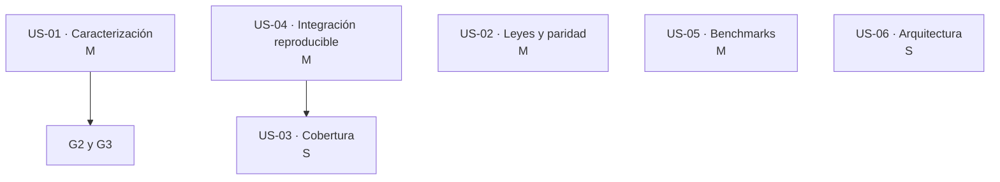

# Épica G6 · Pruebas, calidad y rendimiento

> **Versión destino:** 2.0.0
> **Proyectos:** todos los `*.Tests.Unit` y `*.Tests.Integration` + proyecto nuevo de *benchmarks*
> **Origen:** `Profesionalizacion-Ingenieria-y-Calidad.md` (estrategia de pruebas) · vacíos detectados en la [auditoría de los 89 puntos](../../Realizados/general_old_version/01-Auditoria-Inventario-89-Puntos.md) · `consejos_mejora_mlresult.md` MR19
> **Estado:** ⬜ No iniciada
> **Esfuerzo:** L · **Riesgo:** 🟢 bajo (solo añade pruebas y mediciones)
> **Compatibilidad:** ✅ Aditiva

---

## Índice

1. [Contexto y problema](#1-contexto-y-problema)
2. [Historias de usuario](#2-historias-de-usuario)
3. [Orden de ejecución](#3-orden-de-ejecución)
4. [Decisiones abiertas](#4-decisiones-abiertas)
5. [Definición de terminado](#5-definición-de-terminado)

---

## 1. Contexto y problema

La suite actual tiene **1.715 tests** en verde sobre `net11.0` en 13 proyectos. Pero la auditoría detectó que varias
correcciones «hechas» **no tienen un test que las ancle**, y que casi todos los defectos pendientes carecen de
prueba que los reproduzca. Sin ese test, un cambio futuro puede reintroducir el defecto sin que nada falle.

| Hueco | Evidencia |
|---|---|
| `MapAlwaysAsync` espera al origen (INV-2): el test solo cubre la no recursión | `MlResultBindMapFixesTests.cs:423` |
| El cliente compuesto: se comprueba la clave, no una petición real (INV-14) | `Http.Tests.Unit/RegisterServicesTests.cs:67` |
| `ProblemDetails.type = about:blank` por defecto (INV-32) sin test específico | `AspNetCore.Results.Tests.Unit` |
| Conteo paginado síncrono **con filtro** (INV-36): el test síncrono no filtra | `EfPagedRepositoryIntegrationTests.cs:47` |
| Cabeceras de paginación: sin test de contrato cliente↔servidor (INV-55) | `MlPaginationHeaders` |
| `MlHttpRequestExtensionsTests` **está vacío** (INV-63) | `Http.Tests.Unit/Helpers/MlHttpRequestExtensionsTests.cs:28` |
| Valor por defecto de `IncludeResponseBodyInErrors` (INV-17) | sin test |
| Número de consultas al actualizar (INV-33) | `CrudServiceFpUnitOfWorkTests.cs:126` no cuenta consultas |
| Sin pruebas de leyes del funtor/mónada ni de paridad sistemática sync/async | sin FsCheck/CsCheck |
| Configuración de pruebas de integración dependiente de equipos y SQL Server locales | `appsettings.test.json` |
| Sin medición de rendimiento | sin BenchmarkDotNet |

## 2. Historias de usuario

### G6-US-01 · Pruebas de caracterización de lo que se va a cambiar · M

> **Como** mantenedor **quiero** que cada defecto abierto tenga primero un test que lo reproduzca **para** ver el cambio
> de comportamiento en el *diff* de pruebas.

**Criterios de aceptación**

- [ ] Un test por cada hueco de la tabla anterior (INV-2, 14, 17, 32, 33, 36, 55, 63).
- [ ] Para cada defecto de [G2](Epica-G2-Brechas-Http-EFCore-y-Controladores.md) y [G3](Epica-G3-Nucleo-MlResult-Robustez.md): un test **que hoy falla o documenta el comportamiento actual** y que la historia correspondiente invierte.
- [ ] Se comprueba que cada test nuevo **falla** si se deshace el cambio que protege.
- [ ] `MlHttpRequestExtensionsTests` deja de estar vacío.

**Compatibilidad:** Ninguna.

### G6-US-02 · Leyes del funtor y la mónada y paridad sync/async · M

**Criterios de aceptación**

- [ ] D-G6-1 resuelta (biblioteca de propiedades).
- [ ] Leyes sobre `MlResult<T>`: identidad y composición de `Map`; identidad por la izquierda, por la derecha y asociatividad de `Bind`.
- [ ] Para cada par `X` / `XAsync` de la familia `Map`, `Bind` y `ExecSelf`: ambos producen el mismo resultado ante las mismas entradas (válida, fallo, delegado que lanza).
- [ ] Un fallo de generación reproduce la semilla en el mensaje.

### G6-US-03 · Línea base de cobertura y umbral · S

**Criterios de aceptación**

- [ ] Cobertura medida con `coverlet` en el CI de [G1-US-04](Epica-G1-Higiene-Repositorio-CI-y-Publicacion.md) y publicada como artefacto.
- [ ] Umbral de entrada = **la línea base medida**, que solo puede subir (D-G6-2).
- [ ] Informe por proyecto en la PR.

### G6-US-04 · Pruebas de integración reproducibles · M

**Criterios de aceptación**

- [ ] Ningún test depende de una instancia SQL Server, de un nombre de equipo ni de credenciales de un entorno personal.
- [ ] Las cadenas `DemoDb` y `AdventureWorks` de `appsettings.test.json` se retiran o se sustituyen por SQLite en memoria; si un test las necesita de verdad, se marca con una categoría y se omite con motivo cuando no hay servidor.
- [ ] D-G6-3 resuelta: SQLite en memoria como regla, Testcontainers solo para lo que SQLite no pueda representar.
- [ ] Los tests de `Http.Tests.Integration` (36 s hoy) se miden y se separan los lentos con una categoría.

### G6-US-05 · Proyecto de *benchmarks* y línea base · M

**Criterios de aceptación**

- [ ] Proyecto `MoralesLarios.OOFP.Benchmarks` con BenchmarkDotNet, **fuera de la solución de tests** y fuera de la ruta crítica del CI.
- [ ] Mediciones de: `Map`/`Bind` encadenados, creación de un `MlResult` válido (MR19), `MlErrorDetails` con metadatos y el `Merge` de errores.
- [ ] Resultados y entorno guardados en `docs_next/` como línea base.
- [ ] **Regla:** ninguna optimización de asignaciones (MR19, inmutabilidad, `ValueTask`) se aplica sin una medición **antes y después**.

### G6-US-06 · Pruebas de arquitectura · S

**Criterios de aceptación**

- [ ] Reglas ejecutables (D-G6-4): `Core` no depende de `Logging` ni de ninguna capa web; `Shared` no depende de nada; las bibliotecas de validación no dependen de `Http`.
- [ ] Las reglas fallan si se añade una referencia de proyecto prohibida.

---

## 3. Orden de ejecución

| Orden | Historia | Tamaño | Hito |
|---:|---|:---:|---|
| 1 | US-01 · Caracterización | M | 🎯 Red de seguridad antes de cambiar nada |
| 2 | US-04 · Integración reproducible | M | |
| 3 | US-03 · Cobertura | S | |
| 4 | US-02 · Leyes y paridad | M | 🎯 Dos de los defectos críticos originales se habrían detectado solos |
| 5 | US-06 · Arquitectura | S | |
| 6 | US-05 · Benchmarks | M | 🎯 Línea base antes de optimizar |

US-01 es **requisito previo** de G2 y G3; el resto es independiente.

## 4. Decisiones abiertas

| Id | Decisión | Opciones | Recomendación |
|---|---|---|---|
| D-G6-1 | Pruebas basadas en propiedades | FsCheck · CsCheck · ninguna | CsCheck o FsCheck, la que se integre mejor con xUnit actual |
| D-G6-2 | Umbral de cobertura | línea base · valor fijo | Línea base medida que solo sube |
| D-G6-3 | Base de datos de integración | SQLite en memoria · Testcontainers | SQLite por defecto |
| D-G6-4 | Pruebas de arquitectura | NetArchTest · ArchUnitNET · ninguna | NetArchTest |

## 5. Definición de terminado

- [ ] Cada hueco de la tabla de contexto tiene su test.
- [ ] Suite en verde en el CI en Windows y Linux; el recuento de tests **sube** respecto a 1.715.
- [ ] Ningún `appsettings.test.json` con credenciales, instancias locales o nombres de equipo.
- [ ] Informe de cobertura y línea base de *benchmarks* publicados en `docs_next/`.
- [ ] `dotnet build -c Release --no-incremental`: 0 errores y 0 `CS1591`.
