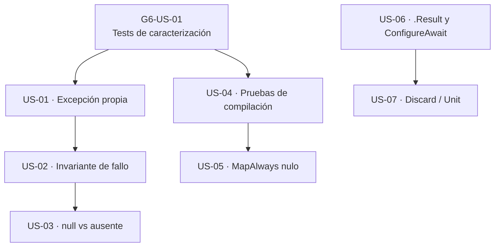

# Épica G3 · Robustez del núcleo `MlResult` y `MlErrorDetails`

> **Versión destino:** 2.0.0
> **Proyecto:** `MoralesLarios.OOFP.Core`
> **Origen:** `consejos_mejora_mlresult.md` (MR4, 8, 9, 12, 14, 22…) · `Revision-Map-Bind-ExecSelf.md` (R2, R3, R4a) · [auditoría](../general_old_version/02-Auditoria-Documentos-Complementarios.md#3-consejos-de-mejora-de-mlresult-mr1-mr23)
> **Estado:** ✅ Completada
> **Esfuerzo:** M · **Riesgo:** 🟠 alto (cambia excepciones y estados límite que algún consumidor puede observar)
> **Compatibilidad:** ⚠️ **silenciosa** en US-01/02/05; aditiva en US-03/04/06/07

---

## Índice

1. [Contexto y problema](#1-contexto-y-problema)
2. [Alcance](#2-alcance)
3. [Historias de usuario](#3-historias-de-usuario)
4. [Orden de ejecución](#4-orden-de-ejecución)
5. [Decisiones abiertas](#5-decisiones-abiertas)
6. [Definición de terminado](#6-definición-de-terminado)

---

## 1. Contexto y problema

El núcleo ya recibió cuatro épicas (constantes, higiene, nomenclatura, metadatos de error). Lo que queda son
**estados límite sin invariante definido**. Ninguno es un fallo de uso común, pero todos son sorpresas para quien
integra la biblioteca, y las correcciones **cambian lo observable**, por eso conviene hacerlas antes de publicar.

| Ref | Estado límite | Evidencia |
|---|---|---|
| MR12 | `GetValueOrThrow` lanza `InvalidProgramException` y no adjunta los detalles | `MlResultExtensions.cs:360` |
| MR22 | Ese mensaje es un literal inglés fuera de la infraestructura de mensajes | `MlResultExtensions.cs:360` |
| MR8 | `MlResult.Fail(MlErrorDetails)` acepta un detalle **sin errores** | `MlResult.cs:35`; `MlErrorDetails.cs:47` |
| MR14 | `MlErrorDetails.ToString()` devuelve vacío si no hay errores ni metadatos | `MlErrorDetails.cs` |
| MR9 | `GetDetail<T>`: un valor `null`, una clave ausente y un tipo incorrecto son indistinguibles | `MlResultErrorDetailsExtensions.cs:28`; `MlErrorDetails.Metadata.cs:255` |
| MR4 | Las conversiones implícitas desde `T` y desde `MlError` colisionan en `MlResult<MlError>` | `MlResult.cs:412` |
| R3 | `Try*(…, null)` es ambiguo entre `string` y `Func<Exception,string>` | familias `Try*` |
| R4a | `MapAlways` valida el retorno, no el delegado | `MlResultMapExtensions.cs:7609` |
| — | `.Result` en operaciones sobre colecciones asíncronas | `MlResultCollections.cs` |

## 2. Alcance

**Dentro:** invariantes, excepciones, mensajes, pruebas de compilación y revisión de `.Result`/`ConfigureAwait`.

**Fuera:** rediseñar `MlErrorDetails` como `record` o inmutable, `ValueTask`, contrato JSON y analizador de retorno
descartado → [backlog 3.0](../../Pendientes/general_old_version/04-Backlog-3.0-y-Descartados.md). **Sin alias nuevos** (`BindSelf`, `TransformData`, `MakeBind`…): ver descartes.

---

## 3. Historias de usuario

### G3-US-01 · Una excepción adecuada en `GetValueOrThrow` · MR12, MR22 · S

> **Como** consumidor **quiero** que acceder al valor de un fallo lance una excepción propia con los detalles
> **para** diagnosticar el error sin reconstruirlo.

**Criterios de aceptación**

- [x] `GetValueOrThrow` sobre un fallo lanza `MlResultFailureException : InvalidOperationException` (D-G3-1), que **expone** el `MlErrorDetails` mediante `ErrorDetails`.
- [x] El mensaje por defecto procede de `EnsureFpMessages` y conserva el texto previo.
- [x] Tests sync/async verifican el tipo, el mensaje y la misma instancia de detalles (`GetValueOrThrow_FailedResult_ThrowsMlResultFailureExceptionWithDetails`).

**Compatibilidad:** **Silenciosa**: un `catch (InvalidProgramException)` deja de capturar; `MlResultFailureException` deriva de `InvalidOperationException`. MIG-87 del prompt de migración.

### G3-US-02 · Invariante «un fallo siempre explica algo» · MR8, MR14 · S

**Criterios de aceptación**

- [x] D-G3-2 resuelta: sustituir un fallo sin errores por `The MlResult failed without error details.` y conservar los metadatos.
- [x] `MlErrorDetails.ToString()` nunca devuelve cadena vacía: usa el mensaje predeterminado si no hay errores ni metadatos.
- [x] Tests sync/async de las fábricas sin errores y test de `ToString()` para detalles vacíos.

**Compatibilidad:** **Silenciosa** (MIG-88): los fallos sin errores ahora contienen un `MlError` predeterminado y `ToString()` vacío devuelve el mensaje de fallback.

### G3-US-03 · Distinguir `null`, clave ausente y tipo incorrecto · MR9 · S

**Criterios de aceptación**

- [x] Un overload aditivo de `TryGetMetadata<T>` informa de `NullKey`, `KeyNotFound`, `NullValue` y `TypeMismatch`; `None` indica éxito. El overload booleano existente conserva su comportamiento.
- [x] `GetDetail<T>` conserva su comportamiento y su XML-doc indica que un valor almacenado nulo produce fallo.
- [x] Tests cubren cada razón, el éxito y la clave nula.

**Compatibilidad:** Aditiva; no cambia el comportamiento ni la firma del overload existente.

### G3-US-04 · Pruebas de compilación de las ambigüedades · MR4, R3 · M

**Criterios de aceptación**

- [x] Una suite compila fragmentos con Roslyn (`CSharpCompilation`): `MlResult<MlError>` produce `CS0457` y `TryMap(x => ..., null)` produce `CS0121` (`MlResultOfMlError_ImplicitConversionReportsAmbiguity`, `TryMap_WithNullErrorMessageReportsAmbiguity`).
- [x] D-G3-3 resuelta: documentar las ambigüedades y conservar las firmas; son usos ya problemáticos y cambiar overloads rompería consumidores válidos.
- [x] La conclusión queda en el `README.md` del núcleo, con formas explícitas de desambiguar.

**Compatibilidad:** Ninguna si se documenta; **de compilación** si cambia la firma.

### G3-US-05 · `MapAlways` y delegados nulos · R4a · XS

**Criterios de aceptación**

- [x] `MapAlways` y sus variantes asíncronas validan el delegado antes de invocarlo con el mensaje estándar de parámetro nulo. *(Las variantes `Task<MlResult<T>>` reenvían a las implementaciones validadas.)*
- [x] Un test por variante. *(Cinco casos cubren sync, async y ambas sobrecargas basadas en `Task`.)*

**Compatibilidad:** **Silenciosa** (una `NullReferenceException` pasa a un `MlResult` fallido; MIG-86 del prompt de migración).

### G3-US-06 · Auditar `.Result`, `Wait` y `ConfigureAwait` · M

**Criterios de aceptación**

- [x] Inventario de cada `.Result`/`.Wait()`/`GetAwaiter().GetResult()` en `Core`, `Logging`, `Http` y `Application`, con veredicto «bloquea» o «ya completado». *(Core tenía cuatro lecturas tras `await Task.WhenAll`; ahora usa el array de resultados del propio await. Logging y Application no tenían coincidencias. Http conserva solo `ToResponseErrorsDescription`, puente síncrono `[Obsolete]` cuya XML-doc advierte que bloquea.)*
- [x] Los accesos síncronos a resultados se sustituyen por `await`; el puente síncrono de Http permanece documentado por compatibilidad hasta retirarlo en 3.0.0.
- [x] Decisión D-G3-4: no aplicar `ConfigureAwait(false)` globalmente; reservarlo para operaciones de I/O cuando proceda. No hay llamadas explícitas en las cuatro bibliotecas auditadas.
- [x] Test que ejecuta las cuatro sobrecargas de `TraverseParallelAsync` bajo un `SynchronizationContext` de un solo hilo y comprueba que **no** se bloquean (`TraverseParallelAsync_AllOverloadsCompleteUnderSingleThreadSynchronizationContext`).

**Compatibilidad:** Ninguna si no cambian las firmas.

### G3-US-07 · Decidir el valor de `Discard` · MR18 · S

**Criterios de aceptación**

- [x] D-G3-5 resuelta: `MlResult<T>.Discard` representa un éxito con `default(T)`; `null` es válido para tipos de referencia. La decisión sobre un tipo `Unit` se aplaza a [G4-US-03](../../Pendientes/general_old_version/Epica-G4-ValueObjects-Nomenclatura-y-Diseno.md), antes de publicar.
- [x] La decisión se registra en el `README.md` del núcleo.

**Compatibilidad:** Ninguna; no cambia el valor devuelto ni las firmas.

---

## 4. Orden de ejecución

| Orden | Historia | Tamaño | Tipo de ruptura |
|---:|---|:---:|---|
| 1 | US-05 · `MapAlways` nulo | XS | silenciosa |
| 2 | US-04 · Pruebas de compilación | M | — |
| 3 | US-01 · Excepción propia | S | silenciosa |
| 4 | US-02 · Invariante de fallo | S | silenciosa |
| 5 | US-03 · `null` vs ausente | S | silenciosa |
| 6 | US-06 · `.Result` y `ConfigureAwait` | M | — |
| 7 | US-07 · `Discard` / `Unit` | S | según decisión |

## 5. Decisiones abiertas

| Id | Decisión | Opciones | Recomendación |
|---|---|---|---|
| D-G3-1 | Tipo de excepción de `GetValueOrThrow` | `InvalidOperationException` · tipo propio con detalles | **Resuelta:** `MlResultFailureException : InvalidOperationException`, expone `ErrorDetails` |
| D-G3-2 | Fallo sin errores | rechazar con excepción · error por defecto | **Resuelta:** añadir el error predeterminado sin lanzar desde un constructor |
| D-G3-3 | Ambigüedades `MlResult<MlError>` y `TryMap(..., null)` | documentar · cambiar firma | **Resuelta:** documentar `CS0457`/`CS0121` y mantener las firmas |
| D-G3-4 | `ConfigureAwait(false)` | en toda la biblioteca · solo en I/O | **Resuelta:** solo en I/O; no añadir llamadas globales a Core |
| D-G3-5 | `Discard` | documentar `default(T)` · introducir `Unit` | **Resuelta:** documentar `default(T)` como válido y decidir `Unit` junto a [G4-US-03](../../Pendientes/general_old_version/Epica-G4-ValueObjects-Nomenclatura-y-Diseno.md) |

## 6. Definición de terminado

- [x] Todos los criterios tienen tests o una decisión documentada; las regresiones de comportamiento fallaron antes del cambio.
- [x] Las rupturas silenciosas están registradas como MIG-86, MIG-87 y MIG-88; MIG-89 registra la API aditiva.
- [x] `README.md` del núcleo actualizado con las decisiones D-G3-x.
- [x] `dotnet build -c Release --no-incremental`: 0 errores y 0 `CS1591`; `dotnet test` en verde.
- [x] `check-migration-prompt.ps1` sin errores.
