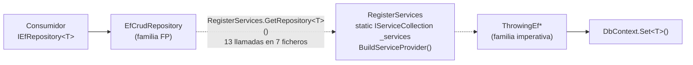

# Épica · Simplificación de la capa de repositorios de `EntityFrameworkCore`

> **Versión destino:** 2.0.0
> **Proyecto afectado:** `MoralesLarios.OOFP.EntityFrameworkCore` (en exclusiva)
> **Origen:** auditoría específica de la capa `Repositories` solicitada por el propietario
> **Estado:** ✅ Completada · `US-01` … `US-10` cerradas · commit de cierre documental `b66a9fd`
> **Esfuerzo:** XL (~4-6 jornadas: ~1 para la red de seguridad, ~2-3 para desacoplar, ~1 para el registro y el `README`)
> **Riesgo:** 🔴 muy alto · retira 18 ficheros, 149 métodos y 4 miembros públicos de registro
> **Objetivo del propietario:** conservar **solo** los repositorios funcionales (los que devuelven
> `MlResult`), desechar los imperativos y dejar el registro en el contenedor reducido a algo sencillo.

---

> ## ⚠️ Actualización · el eje del ciclo de vida ya está resuelto (`Scoped` único)
>
> Parte de esta épica **ya se ha ejecutado**, por decisión expresa del propietario, dentro de la
> simplificación general de la librería: **`Scoped` es el único ciclo de vida de toda la solución** y
> el ciclo de vida **deja de ser un eje de la API pública**. Un repositorio vive al lado del
> `DbContext` que recibe por constructor, y ese contexto es `Scoped`: alinear los dos es lo natural.
>
> **Lo que ya está hecho** (registrado como puntos **62** a **66** de
> [`oofp-upgrade-2.prompt.md`](../../../../Copilot/.github/prompts/oofp-upgrade-2.prompt.md) §3.3):
>
> - ✅ **D11 resuelto** · `AddOofpRepositoriesTransient`, `AddOofpRepositoriesScoped` y
>   `AddOofpRepositoriesSingleton` **se han retirado**. Queda un **único**
>   `AddOofpRepositories<T, TContext>()` que registra las 16 interfaces con `AddScoped`, que es
>   exactamente el ciclo de vida que ya tenía `AddOofpRepositories` en la 1.x: quien lo llamara **no
>   cambia de comportamiento**.
> - ✅ **D10 resuelto por eliminación** · ya no existe forma de registrar un repositorio como
>   `Singleton`, así que la *captive dependency* sobre el `DbContext` **es inalcanzable**.
> - ✅ **D9 resuelto** · `EfRepository` y `ThrowingEfRepository` **ya no implementan `IDisposable`**
>   ni llaman a `GetContext().Dispose()`. El **propietario** del `DbContext` es `AddDbContext`, no el
>   repositorio, y el contenedor lo libera al cerrar el ámbito. Si el repositorio fuera `IDisposable`,
>   el contenedor lo rastrearía y el repositorio destruiría un `DbContext` ajeno.
> - ✅ En la capa de aplicación, los 6 métodos
>   `Add{Transient|Scoped|Singleton}CrudServices[Duplex]FpWithoutRepositories` se han reducido a
>   `AddCrudServicesFpWithoutRepositories()` y `AddCrudServicesDuplexFpWithoutRepositories()`.
> - ✅ `AddOOFPIO()` registra `IMlFileSystem` como `Scoped` (antes `Singleton`).
> - ✅ `AddMlConfigurationReader()` registra `IMlConfigurationReader` como `Scoped` (antes
>   `Transient`), y la capa HTTP (`AddMlHttp`, `AddRestClient`, `AddCompositeKeyRestClient`) registra
>   sus **seis** servicios como `Scoped` (antes `Transient`).
> - ✅ **9 puentes `[Obsolete]`** del eje del ciclo de vida **retirados**. El único superviviente en
>   `RegisterServices.Obsolete.cs` es `ResolveRepoFp` → `GetRepository`.
> - ✅ `TestSupport/RegisterServices.cs` actualizado a `AddOofpRepositories`.
>
> **Decisiones que esto cierra:**
>
> - **D-03 · CERRADA** · la pregunta «¿debe `AddOofpRepositories` rechazar `ServiceLifetime.Singleton`?»
>   **desaparece**: el parámetro `lifetime` de la §4.4 **no se añade**. No hay nada que rechazar porque
>   no hay nada que elegir. Si el anfitrión necesita de verdad un `Singleton`, registra él su propia
>   envoltura e inyecta `IServiceScopeFactory` para abrir un ámbito por operación.
> - La firma propuesta en la **§4.4** queda **superada**: léela sin el parámetro
>   `ServiceLifetime lifetime` y con `services.AddScoped<…>()` en lugar de `services.Add(new
>   ServiceDescriptor(…, lifetime))`.
>
> **Excepción documentada** · el único `AddSingleton` que sobrevive en la solución está en
> `MoralesLarios.OOFP.Logging.Sample\Program.cs` L22:
> `AddSingleton<ILoggerFactory>(… new SerilogLoggerFactory(serilogLogger, dispose: false))`. Es
> **infraestructura de Serilog**, que *debe* ser singleton por contrato de `ILoggerFactory`, está en un
> proyecto de muestra y **no forma parte de la API pública**. Queda **fuera** del alcance de la
> unificación.
>
> **Lo que sigue pendiente de esta épica** · todo el resto: el desacoplamiento de la familia imperativa
> (US-03, US-04, US-05), la retirada de `BuildServiceProvider()` (D2) y la red de seguridad (US-01).

---

---

## Índice

1. [Contexto y problema](#1-contexto-y-problema)
2. [Radiografía del código actual](#2-radiografía-del-código-actual)
3. [Debilidades detectadas](#3-debilidades-detectadas)
4. [Arquitectura de destino](#4-arquitectura-de-destino)
5. [Alcance](#5-alcance)
6. [Historias de usuario](#6-historias-de-usuario)
7. [Orden de ejecución](#7-orden-de-ejecución)
8. [Rupturas y registro obligatorio](#8-rupturas-y-registro-obligatorio)
9. [Decisiones abiertas](#9-decisiones-abiertas)
10. [Definición de terminado](#10-definición-de-terminado)
11. [Apéndice · código actual y propuesto](#11-apéndice--código-actual-y-propuesto)

---

## 1. Contexto y problema

El proyecto mantiene **dos familias paralelas de repositorios** sobre la misma funcionalidad:

| Familia | Carpeta | Ficheros | Métodos | Devuelve |
|---|---|---:|---:|---|
| Funcional (**se conserva**) | `Repositories/` | 18 | **178** | `MlResult<T>` |
| Imperativa (**se desecha**) | `Repositories.Imperative/` | 18 | **149** | la entidad, o lanza excepción |

El objetivo parece a primera vista una tarea de borrado. **No lo es**, y ahí está el riesgo real de
esta épica: aunque **ningún proyecto de la solución consume la familia imperativa desde fuera**, la
familia funcional **sí la consume por dentro**, y lo hace a través de un **localizador de servicios
estático**. Borrar la carpeta sin más deja la capa funcional sin implementación.



La cadena correcta debería ser `Consumidor → FP → DbSet<T>`. Hoy hay **dos saltos artificiales** en
medio, y uno de ellos construye un contenedor de dependencias nuevo en cada acceso.

---

## 2. Radiografía del código actual

### 2.1 Estructura del proyecto

```text
MoralesLarios.OOFP.EntityFrameworkCore/
├── Enums/SortDirection.cs                    (solo lo usa la familia FP)
├── GlobalUsings.cs                           (18 entradas; la 8.ª importa el namespace imperativo)
├── Helpers/Extensions.cs                     (FormatCompositeKey, PrivateOrderBy — solo FP)
├── Helpers/Extensions.Obsolete.cs            (puente GetPkValues, 0 llamadas internas)
├── RegisterServices.cs                       (~150 líneas, 3 métodos casi idénticos)
├── RegisterServices.Obsolete.cs              (4 puentes [Obsolete])
├── README.md                                 (1037 líneas, desactualizado)
├── Repositories/                             (18 ficheros — familia FP, SE CONSERVA)
└── Repositories.Imperative/                  (18 ficheros — familia imperativa, SE DESECHA)
```

### 2.2 El acoplamiento crítico · 13 llamadas en 7 ficheros

`RegisterServices` expone un localizador de servicios estático:

```csharp
// RegisterServices.cs
private static IServiceCollection? _services;

internal static IServiceProvider ServiceProvider
    => _services?.BuildServiceProvider() ?? throw new ArgumentNullException("The field Provider is null");

public static TRepo GetRepository<TRepo>()
    => ServiceProvider.GetService<TRepo>() ?? throw new ArgumentException($"{typeof(TRepo).Name} is not registered …");
```

Los repositorios funcionales lo invocan **en la inicialización de campo**, de modo que la resolución
ocurre al construir el objeto, fuera de todo control del contenedor:

| Fichero FP | Llamadas | Campos | Resuelve |
|---|---:|---|---|
| `EfCreateRepository.cs` | 1 | `_internalRepoAdder` | **imperativo** |
| `EfReadRepository.cs` | 1 | `_repoReader` | **imperativo** |
| `EfDeleteRepository.cs` | 2 | `_internalRepoDeleter`, `_repoReaderFp` | imperativo + FP |
| `EfUpdateRepository.cs` | 2 | `_internalRepoUpdater`, `_repoReaderFp` | imperativo + FP |
| `EfCrudRepository.cs` | 2 | `_repoReaderFp`, `_repoWriterFp` | FP |
| `EfWriteRepository.cs` | 3 | `_repoAdderFp`, `_repoDeleterFp`, `_repoUpdaterFp` | FP |
| `EfPagedRepository.cs` | 2 | `_repoReaderPaginatorFp`, `_repoWriterFp` | FP |

**4 llamadas resuelven la familia imperativa** y **9 resuelven la propia familia funcional**. Las dos
mitades hay que desmontarlas: las primeras porque su destino desaparece, las segundas porque el
mecanismo es inaceptable aunque el destino se conserve.

> `ResolveRepoFp` (el puente `[Obsolete]`) tiene **0 usos internos**.

### 2.3 Lo que hace realmente cada capa

La capa imperativa es una envoltura **finísima** sobre `DbSet<T>`; la funcional es una envoltura
sobre la imperativa que añade la validación y el raíl de error:

```csharp
// Repositories.Imperative/ThrowingEfReadRepository.cs — el trabajo real
public T Find(params object[] keys) => internalDbContext.Set<T>().Find(keys)!;

// Repositories/EfReadRepository.cs — la envoltura funcional
public virtual MlResult<T> TryFind(MlErrorDetails notFoundErrorDetails, params object[] keyValues)
    => EnsureFp.NotNull(keyValues, "The object array pk cannot be null")
               .TryMap (x => EnsureFp.NotEmpty(keyValues, "The object array pk cannot be empty"))
               .TryMap (x => _repoReader!.Find(keyValues))      // ← único punto de contacto con EF
               .TryBind(x => x.FailIfNull(notFoundErrorDetails));
```

**Este es el dato que hace viable la épica:** la capa imperativa no aporta lógica, solo indirección.
Sustituir `_repoReader!.Find(keyValues)` por `GetContext().Set<T>().Find(keyValues)` conserva el
comportamiento **exacto** y elimina la dependencia.

### 2.4 Visibilidad real de la familia imperativa

De sus 149 métodos, **solo 13 son públicos**, repartidos en 4 interfaces:

| Tipo | Visibilidad | Métodos públicos |
|---|---|---:|
| `IGetContextable` | `public` | 1 |
| `IThrowingEfCreateRepository<T>` | `public` ← incoherente | 4 |
| `IThrowingEfUpdateRepository<T>` | `public` ← incoherente | 4 |
| `IThrowingEfDeleteRepository<T>` | `public` ← incoherente | 4 |
| Las otras 5 interfaces y las 9 clases | `internal` | 0 |

Tres interfaces son `public` y sus cinco hermanas `internal`, sin ningún criterio que lo justifique:
es una **fuga de visibilidad**, no un contrato deliberado.

> ⚠️ **`IGetContextable` es el detalle que se escapa.** Es `public`, vive en el namespace
> `…Repositories.Imperative`, pero **la implementa la clase base funcional `EfRepository`**. Borrar
> la carpeta sin rescatarlo antes rompe la compilación de la capa que queremos conservar.

### 2.5 Consumidores externos dentro de la solución

Cuatro proyectos referencian el `.csproj`:

| Proyecto | Qué usa | ¿Usa lo imperativo? |
|---|---|---|
| `OOFP.Application` | `IEfRepository<TEntity>` en `Services/CrudServiceFp.cs` (L14, L306) | **No** |
| `…EntityFrameworkCore.TestSupport` | 4 interfaces heredan de `IEfRepository<T>`; 4 clases derivan de `EfCrudRepository<T, TestDbContext>`; `AddOofpRepositories` para 4 entidades (✅ ya renombrado desde `AddOofpRepositoriesTransient`) | **No** |
| `…EntityFrameworkCore.Tests.Integration` | recibe `IVinosRepo`; **las 4 llamadas están comentadas y no hay ningún `[Fact]`** | **No** |
| `…EntityFrameworkCore.Sample` | referencia el `.csproj` pero no usa ningún tipo de repositorio | **No** |

**Cero referencias a `IThrowingEf*` o `ThrowingEf*` en toda la solución.** El borrado no rompe a
ningún consumidor interno. Y, como el paquete `2.0.0` **no está publicado en NuGet**, tampoco hay
consumidores externos reales que dependan de las 3 interfaces filtradas.

### 2.6 Red de seguridad disponible: ninguna

**0 tests activos** ejercitan los repositorios, ni funcionales ni imperativos. El único fichero
relacionado, `…Tests.Integration/Repos/RepoVinorFpTests.cs`, tiene 4 escenarios **comentados** y
ningún atributo de test. `OOFP.Application.Tests.Unit` no referencia `CrudServiceFp` ni
`IEfRepository`.

> Esto convierte la red de seguridad en la **primera** historia de usuario, no en la última.

---

## 3. Debilidades detectadas

Agrupadas por naturaleza, con las cifras verificadas. Las marcadas con ⛔ son las que **no deben
repetirse** en el diseño de destino.

### 3.1 Resolución de dependencias

| # | Debilidad | Cifra | Consecuencia |
|---|---|---|---|
| D1 ⛔ | **Localizador de servicios estático** | 13 llamadas en 7 ficheros | El repositorio decide sus dependencias; no se puede sustituir ni simular en un test |
| D2 ⛔ | **`BuildServiceProvider()` en una propiedad** | 1 llamada, invocada desde los 13 puntos | Construye un **contenedor nuevo en cada acceso**: grafos duplicados, singletons falsos, fugas de memoria y un `DbContext` **distinto** del inyectado al repositorio |
| D3 ⛔ | **Estado estático mutable** | `private static IServiceCollection? _services` | No es seguro entre hilos, el último registro gana y los tests en paralelo se pisan |
| D4 | **Resolución en inicializador de campo** | 13 campos | La resolución ocurre al construir, no al usar; un registro posterior no se ve |

### 3.2 Arquitectura

| # | Debilidad | Cifra | Consecuencia |
|---|---|---|---|
| D5 ⛔ | **Doble capa para la misma funcionalidad** | 178 + 149 = 327 métodos | Todo cambio hay que hacerlo dos veces; la capa imperativa solo aporta indirección |
| D6 ⛔ | **Agregados por localizador en vez de por herencia o composición** | 9 de las 13 llamadas | `EfCrudRepository` y `EfWriteRepository` podrían delegar sin tocar el contenedor |
| D7 | **Fuga de visibilidad** | 3 interfaces `public` frente a 5 `internal` | Superficie pública involuntaria |
| D8 | **`IGetContextable` mal ubicado** | `public`, en el namespace imperativo, implementado por la base **FP** | Acopla la capa que se conserva a la carpeta que se borra |
| D9 ✅ **RESUELTA** | **`IDisposable` sobre un `DbContext` inyectado** | `EfRepository.Dispose()` y `ThrowingEfRepository.Dispose()` hacían `GetContext()?.Dispose()` | Con `AddScoped` el contenedor **también** lo disponía → doble `Dispose` y `ObjectDisposedException`. **Ya corregido**: ambas clases dejan de implementar `IDisposable` (punto **63**) |
| D10 ✅ **RESUELTA** | **`AddOofpRepositoriesSingleton`** | 1 método público | Un repositorio singleton capturaba un `DbContext` scoped: *captive dependency* de manual. **Ya corregido por eliminación**: el método se ha retirado (punto **62**) |

### 3.3 Registro en el contenedor

| # | Debilidad | Cifra | Consecuencia |
|---|---|---|---|
| D11 ✅ **RESUELTA** | **3 métodos casi idénticos** | `…Transient`, `…Scoped`, `…Singleton` | La única diferencia era el tiempo de vida. **Ya corregido**: se ha unificado en un solo `AddOofpRepositories` que registra siempre `Scoped`, el mismo ciclo de vida que el `DbContext`, sin parámetro de ciclo de vida (punto **62**) |
| D12 | **16 servicios registrados por llamada** | 8 `IThrowingEf*` + 8 `IEf*` | La mitad sobra en cuanto desaparezca la familia imperativa |
| D13 | **Nombres de interfaz y clase que no concuerdan** | `IEfRepository<T>` → `EfCrudRepository<T,TContext>` | Dificulta leer el registro; además coexisten `EfRepository` (base no genérica) e `IEfRepository<T>` |
| D14 | **Formato roto** | alineación de espacios desalineada tras los renombrados | Ruido en cada diff |

### 3.4 Calidad del código

| # | Debilidad | Cifra |
|---|---|---|
| D15 | **Código comentado en una interfaz pública** | **26 líneas** de firmas en `IEfRepository<T>` (L14-39) |
| D16 | **Duplicación literal de firmas** | 6 firmas paginadas repetidas entre `IThrowingEfPagedReadRepository<T>` e `IThrowingEfPagedRepository<T>` |
| D17 | **`virtual` incoherente** | 137 declaraciones (135 públicas + 2 `protected`); pero `EfUpdateRepository` tiene **2 métodos públicos no virtuales**, contradiciendo al `README` |
| D18 | **`where` ausentes** | `IThrowingEfRepository<T>` e `IThrowingEfPagedRepository<T>` no declaran `where T : class` |
| D19 | **Campo de instancia innecesario** | `private string typeName = typeof(T).Name;` en `EfReadRepository` se recalcula por instancia en vez de ser `static readonly` |
| D20 | **Global using de la capa que se borra** | `GlobalUsings.cs`, línea 8 |
| D21 | **5 atributos `[Obsolete]`** | `GetPkValues`, `ResolveRepoFp`, `AddTransientOOFPRepos`, `AddScopedOOFPRepos`, `AddSingletonOOFPRepos` (todos `error: false`) |
| D22 | **Sin `InternalsVisibleTo`** | los tipos `internal` no son testeables |
| D23 | **`README` desactualizado** | 1037 líneas: describe carpetas `Repos/` y `OopRepos/` y un `Helpers/Constants.cs` **inexistentes**, y documenta la versión `1.0.14` cuando el `.csproj` dice `2.0.0` |

### 3.5 Errata detectada en documentación ya existente

La épica [`Epica-Limpieza-Codigo-Muerto.md`](../../Pendientes/Epica-Limpieza-Codigo-Muerto.md) sitúa el **punto 64**
(«22 declaraciones comentadas») en `Repositories/IEfWriteRepository.cs`, líneas 13-34. **La
ubicación real es `Repositories/IEfRepository.cs`, líneas 14-39, y son 26 líneas.**
`IEfWriteRepository.cs` tiene 14 líneas en total y su cuerpo está vacío. Hay que corregir esa épica
o absorber el punto 64 en la US-07 de esta.

---

## 4. Arquitectura de destino

### 4.1 Principio rector

> Un repositorio funcional recibe su `DbContext` por constructor, habla **directamente** con
> `DbSet<T>` dentro del raíl `Try*`, y **no conoce el contenedor de dependencias**.

### 4.2 Estructura resultante

```text
MoralesLarios.OOFP.EntityFrameworkCore/
├── Enums/SortDirection.cs                    (sin cambios)
├── GlobalUsings.cs                           (17 entradas: se retira el namespace imperativo)
├── Helpers/Extensions.cs                     (sin cambios)
├── RegisterServices.cs                       (~40 líneas, 1 método + sobrecargas)
├── Repositories/
│   ├── IGetContextable.cs                    ← RESCATADO del namespace imperativo
│   └── … los 18 ficheros FP, ya sin localizador
└── (Repositories.Imperative/ ELIMINADA)
```

Balance: **−18 ficheros**, **−149 métodos**, **−110 líneas** en `RegisterServices`, **−13 llamadas**
al localizador, **−1 `BuildServiceProvider()`**, **−1 campo estático mutable**.

### 4.3 Cómo se resuelven los agregados sin localizador

Es la decisión de diseño central. Tres opciones; la recomendada es la **B**.

**Opción A · herencia en cadena.** `EfReadRepository` → `EfWriteRepository` → `EfCrudRepository` →
`EfPagedRepository`. Cero duplicación, pero `EfWriteRepository` heredaría los 16 métodos de lectura,
que su interfaz no declara: semántica sucia.

**Opción B · composición en el constructor (recomendada).** El agregado instancia sus colaboradores
con el mismo `DbContext`, mediante métodos factoría `protected virtual` que preservan la
extensibilidad:

```csharp
public class EfCrudRepository<T, TContext>(TContext dbContext) : EfRepository(dbContext), IEfRepository<T>
    where T        : class
    where TContext : DbContext
{
    private readonly IEfReadRepository<T>  _reader = CreateReader(dbContext);
    private readonly IEfWriteRepository<T> _writer = CreateWriter(dbContext);

    /// <summary>Crea el colaborador de lectura. Sobrescribible para sustituirlo en pruebas.</summary>
    protected static virtual IEfReadRepository<T> CreateReader(TContext context) => new EfReadRepository<T, TContext>(context);
    …
}
```

Ventajas: no toca las firmas públicas, no toca el contenedor, el `DbContext` es **siempre el mismo
objeto** (hoy no lo es), los cuerpos actuales (`_repoReaderFp.TryFind(keyValues)`) **se conservan
tal cual** cambiando solo el origen del campo, e interfaces y jerarquía quedan intactas.

**Opción C · núcleo estático interno.** Un `internal static class EfOps<T>` con la lógica de EF, y
todos los repositorios como envolturas `Try*`. Elimina toda duplicación real, pero obliga a
reescribir los 178 cuerpos: más alcance y más riesgo para el mismo beneficio funcional.

> Decisión **D-01**.

### 4.4 El nuevo `RegisterServices`

> ✅ **Ya implementado**, aunque con dos desviaciones respecto al diseño original de esta sección:
> **no hay parámetro `lifetime`** (el ciclo de vida ya no es un eje de la API: siempre `Scoped`, el
> mismo que el `DbContext`) y **se siguen registrando las 16 interfaces**, porque el desacople de los
> repositorios imperativos (US-03/04/05) todavía no se ha hecho. Registrado como punto **62** de
> [`oofp-upgrade-2.prompt.md`](../../../../Copilot/.github/prompts/oofp-upgrade-2.prompt.md) §3.3.

Un **único** punto de entrada, sin parámetros y con un **único ciclo de vida**:

```csharp
public static IServiceCollection AddOofpRepositories<T, TContext>(this IServiceCollection services)
    where T        : class
    where TContext : DbContext
{
    // 8 interfaces imperativas (IThrowingEf*Repository<T>)  -> ThrowingEf*Repository<T, TContext>
    // 8 interfaces funcionales  (IEf*Repository<T>)         -> Ef*Repository<T, TContext>
    services.AddScoped<IEfReadRepository<T>,      EfReadRepository<T, TContext>>();
    services.AddScoped<IEfCreateRepository<T>,    EfCreateRepository<T, TContext>>();
    services.AddScoped<IEfUpdateRepository<T>,    EfUpdateRepository<T, TContext>>();
    services.AddScoped<IEfDeleteRepository<T>,    EfDeleteRepository<T, TContext>>();
    services.AddScoped<IEfWriteRepository<T>,     EfWriteRepository<T, TContext>>();
    services.AddScoped<IEfRepository<T>,          EfCrudRepository<T, TContext>>();
    services.AddScoped<IEfPagedReadRepository<T>, EfPagedReadRepository<T, TContext>>();
    services.AddScoped<IEfPagedRepository<T>,     EfPagedRepository<T, TContext>>();
    // … y las 8 imperativas equivalentes

    return services;
}
```

**Ya han desaparecido**: `AddOofpRepositoriesTransient`, `AddOofpRepositoriesScoped`,
`AddOofpRepositoriesSingleton` y 3 de los 4 puentes `[Obsolete]` de `RegisterServices.Obsolete.cs`.

**Se conservan todavía** (su retirada sigue siendo parte de esta épica y de la de unidad de trabajo):
`_services`, `ServiceProvider`, `BuildServiceProvider()`, `GetRepository<TRepo>()` y su único puente
`[Obsolete]`, `ResolveRepoFp`.

> ✅ **D10 resuelto y D-03 sin efecto.** `AddOofpRepositoriesSingleton` no se ha sustituido por
> `ServiceLifetime.Singleton`: se ha **eliminado**, y con ella la posibilidad de elegir. Al no existir
> ningún parámetro `lifetime`, la pregunta de si el método debe rechazar `Singleton` en tiempo de
> ejecución (**D-03**) deja de tener sentido. El `DbContext` lo sigue registrando el anfitrión con
> `AddDbContext`, normalmente `Scoped`, y los repositorios son **`Scoped` también**: comparten
> contexto y unidad de trabajo dentro del ámbito, y mueren exactamente cuando muere el contexto.

---

## 5. Alcance

### 5.1 Dentro

- Eliminar íntegra la carpeta `Repositories.Imperative/` (18 ficheros, 149 métodos).
- Desacoplar los 13 puntos de resolución de la familia funcional.
- Rescatar `IGetContextable` al namespace de la familia que se conserva.
- Reescribir `RegisterServices.cs` y eliminar `RegisterServices.Obsolete.cs`.
- Corregir `Dispose`, el `virtual` incoherente, `typeName`, las 26 líneas comentadas y
  `GlobalUsings.cs`.
- Crear la red de seguridad de tests que hoy no existe.
- Actualizar el `README.md` del proyecto y el prompt de migración.

### 5.2 Fuera

- **Cualquier otro proyecto de la solución**, salvo los ajustes mínimos e inevitables en
  `TestSupport` y `Tests.Integration` para que compilen y para alojar los tests nuevos.
- La **unidad de trabajo y las transacciones**: es la
      [épica de unidad de trabajo](Epica-Unidad-de-Trabajo-y-Transacciones.md) (punto 40) y no se solapa con esta.
- **Subir la versión del paquete.** Todo queda en `2.0.0`; cualquier cambio de versión se consulta
  antes con el propietario.

---

## 6. Historias de usuario

### US-01 · Red de seguridad antes de tocar nada · 🟢 bajo · M

Sin tests, el desacoplamiento es indemostrable.

- [x] Reactivar `…Tests.Integration/Repos/RepoVinorFpTests.cs`: descomentar los 4 escenarios
      (`TryAllAsync`, `TryAddAsync`, `TryUpdateAsync`, `TryRemoveAsync`) y dotarlos de `[Fact]`.
- [x] Añadir cobertura de **cada una de las 8 interfaces funcionales** sobre `TestDbContext`,
      verificando camino válido **y** camino fallido (`IsFailure` con sus `MlErrorDetails`).
- [x] Cubrir expresamente los comportamientos que el desacoplamiento podría alterar: `TryFind` con
      clave compuesta, `TryGetLast`, el `ORDER BY` de la paginación y el `TotalCount`.
- [x] Los tests se escriben **contra la API pública** y **sin** `RegisterServices.GetRepository`.
- [x] Build y suite completos en verde; el total de tests **sube** respecto a la línea base.

> No se usa `IsValid`/`IsFail` (obsoletos): la definición de terminado exige `CS0618 = 0`.

### US-02 · Rescatar `IGetContextable` · 🟠 alto · XS

- [x] Mover `IGetContextable.cs` a `Repositories/`, con namespace
      `MoralesLarios.OOFP.EntityFrameworkCore.Repositories`.
- [x] `EfRepository` compila sin el global using del namespace imperativo.
- [x] Decidir si sigue siendo `public` → decisión **D-02**.
- [x] Cambio de namespace registrado en los 6 sitios como punto **67**, y el movimiento a
      `Repositories` incluido en `oofp-upgrade-2.renames.md`.

### US-03 · Desacoplar los repositorios hoja de la familia imperativa · 🔴 muy alto · L

Afecta a `EfCreateRepository`, `EfReadRepository`, `EfUpdateRepository` y `EfDeleteRepository`.

- [x] ✅ Retirar los 4 campos `_internalRepoAdder`, `_repoReader`, `_internalRepoUpdater` y
      `_internalRepoDeleter`.
- [x] ✅ Sustituir cada llamada `_repoXxx!.Metodo(...)` por la operación equivalente sobre
      `GetContext().Set<T>()`, **respetando literalmente** la semántica actual: `AsNoTracking()` en
      las lecturas, `Where(filter).AsEnumerable().Last()` en `TryGetLast`, y el mismo tratamiento de
      `null!`.
- [x] ✅ Los envoltorios `EnsureFp` / `TryMap` / `TryBind` y los mensajes de error **no cambian**.
- [x] ✅ El operador `!` desaparece de esas llamadas: ya no hay campo anulable.
- [x] ✅ Los tests de la US-01 siguen en verde **sin modificarse** (1619 pruebas, 0 errores).

> Nota de implementación: al compartir ahora `EfUpdateRepository` un único `DbContext`/`ChangeTracker`
> entre `Find` y `Update` (antes usaban dos repositorios internos con contextos distintos, por lo que el
> conflicto no podía darse), fue necesario desvincular (`EntityState.Detached`) la instancia encontrada
> por `Find`/`FindAsync` antes de `Update(item)` cuando `item` es una instancia distinta, para evitar
> `InvalidOperationException` por doble tracking de la misma clave. Es un detalle interno que preserva el
> comportamiento externo exacto; no constituye ruptura pública ni de comportamiento observable (los
> campos retirados eran `internal`, no `public`).

### US-04 · Desacoplar los agregados de la familia funcional · 🔴 muy alto · M

Afecta a `EfCrudRepository`, `EfWriteRepository` y `EfPagedRepository` (las 9 llamadas FP→FP).

- [x] Aplicar la opción elegida en **D-01** (recomendada: composición con factorías
      `protected virtual`).
- [x] El constructor primario `(TContext dbContext)` **se conserva**: `TestSupport` deriva de
      `EfCrudRepository<T, TestDbContext>` y no debe tocarse.
- [x] Todos los colaboradores comparten **la misma instancia** de `DbContext` que el agregado.
- [x] `RegisterServices.GetRepository` queda con **0 usos** en todo el proyecto.

> Nota de implementación: se aplicó la Decisión D-01 Opción B — cada agregado expone métodos de
> factoría `protected virtual CreateXxx(TContext context)` que devuelven la implementación por
> defecto (`new EfXxxRepository<T, TContext>(context)`), invocados desde el constructor. El
> constructor público `(TContext dbContext)` no cambia de firma. Al compartir los tres colaboradores
> la misma instancia de `DbContext` recibida por el agregado (antes cada uno podía resolver su propio
> contexto vía el contenedor), se considera **ruptura silenciosa de comportamiento** y se registra
> como punto 69 en `oofp-upgrade-2.prompt.md`. Build `--no-incremental` en Release: 0 errores, 234
> avisos. Suite completa: 1619 pruebas, 0 errores.

### US-05 · Eliminar la carpeta `Repositories.Imperative/` · 🔴 muy alto · S

- [x] Borrar los 17 ficheros con `git rm` (no con borrado manual). *(Nota: el recuento original de
      esta historia decía «18 ficheros»; la carpeta contenía realmente 17 — 8 interfaces + 9 clases
      de implementación. Corregido aquí tras verificación con `git status --porcelain`.)*
- [x] Retirar la línea 8 de `GlobalUsings.cs`.
- [x] Comprobar que `Helpers/` y `Enums/` siguen compilando (su uso era exclusivamente funcional).
- [x] Build `--no-incremental` con **0 errores** y sin aumento de avisos.
- [x] Las 3 interfaces públicas filtradas (`IThrowingEfCreateRepository`,
      `IThrowingEfUpdateRepository`, `IThrowingEfDeleteRepository`) registradas como ruptura de
      compilación.

> **Cierre US-05**: eliminada toda la carpeta `Repositories.Imperative/` (17 ficheros: 8 interfaces
> `IThrowingEf*` + 9 clases `ThrowingEf*`), ya inalcanzable tras el desacoplamiento de US-03/US-04.
> Ruptura de **compilación pública** (desaparecen `IThrowingEfCreateRepository<T>`,
> `IThrowingEfUpdateRepository<T>` e `IThrowingEfDeleteRepository<T>`, además del resto de tipos
> imperativos). Registro formal en `oofp-upgrade-2.prompt.md` **aplazado a US-10** (registro en
> bloque de las rupturas 67+ junto con el resto de historias, por decisión del usuario). Build
> `--no-incremental` en Release: 0 errores, 117 avisos reales (234 es el recuento duplicado por
> MSBuild al repetir warnings en SDK multi-target; cifra sin cambios respecto a US-04). Suite
> completa: 1619 pruebas, 0 errores — sin regresión.

### US-06 · Simplificar el registro en el contenedor · 🔴 muy alto · M

- [x] Reescribir `RegisterServices.cs` según §4.4: **1 método**, **8 registros**, sin estado
      estático y sin `BuildServiceProvider()`.
- [x] Eliminar `RegisterServices.Obsolete.cs` y sus 4 puentes.
- [x] 
      `AddOofpRepositoriesSingleton` y la firma de `AddOofpRepositories` registradas en los 6 sitios.
- [x] Corregir la alineación del fichero (D14).
- [x] Documentar en el `README` que los repositorios solo se registran como `Scoped`, el mismo ciclo
      de vida que su `DbContext`.
- [x] 
      `AddOofpRepositoriesSingleton` y la firma de `AddOofpRepositories` registradas en los 6 sitios.

> **Cierre US-06 (parcial)**: `RegisterServices.cs` reducido a un único método
> `AddOofpRepositories<T, TContext>` con los 8 `AddScoped` ya existentes, eliminando el campo
> estático `_services`, la propiedad `ServiceProvider` (con su `BuildServiceProvider()` por
> acceso, D2) y el método público `GetRepository<TRepo>()` (D1/D3/D4 resueltas por eliminación).
> Eliminado también `RegisterServices.Obsolete.cs` completo (puente `[Obsolete] ResolveRepoFp`,
> D21 reducida en 1), confirmado con `grep_search` que no tenía usos reales fuera de su propia
> definición y comentarios de documentación. Ruptura de **compilación pública** (desaparecen
> `GetRepository<TRepo>()` y `ResolveRepoFp<TRepo>()`), pendiente de registro formal en
> `oofp-upgrade-2.prompt.md` junto con el resto de rupturas, aplazado a US-10 por decisión del
> usuario. Build `--no-incremental` en Release: 0 errores, 117 avisos reales (234 recuento
> duplicado). Suite completa: 1619 pruebas, 0 errores — sin regresión. Queda pendiente documentar
> en el `README` por qué no debe usarse `ServiceLifetime.Singleton` (se abordará en US-09, al
> reescribir el README completo).

### US-07 · Limpieza de la capa conservada · 🟢 bajo · S

- [x] Retirar las **26 líneas** comentadas de `IEfRepository<T>` (L14-39) y corregir la errata del
      punto 64 en `Epica-Limpieza-Codigo-Muerto.md` (§3.5).
- [x] Homogeneizar `virtual`: los 2 métodos públicos no virtuales de `EfUpdateRepository` pasan a
      serlo, o el `README` deja de afirmar que todos lo son → decisión **D-04**.
- [x] `typeName` pasa a `private static readonly`.
- [x] Decidir el destino de `Extensions.GetPkValues` (`[Obsolete]` con 0 llamadas) → **D-05**.
- [x] Evaluar si hace falta `InternalsVisibleTo` tras el borrado (D22): previsiblemente **no**,
      porque dejan de existir tipos `internal` relevantes.

> **Cierre US-07**: retiradas las 26 líneas comentadas de `IEfRepository<T>` (interfaz ahora con
> cuerpo vacío `{ }`); corregida la errata del punto 64 en `Epica-Limpieza-Codigo-Muerto.md` §3.5
> (la ubicación real era `IEfRepository.cs` con 26 declaraciones, no `IEfWriteRepository.cs` con
> 22), marcando ese punto como absorbido por esta US-07. Homogeneizado `virtual` (D-04) en los 2
> métodos de `EfUpdateRepository` que no lo tenían (`TryUpdate(T item)` y
> `TryUpdate(T item, MlErrorDetails, params object[])`), coherente con los otros 135 métodos ya
> virtuales. `typeName` cambiado a `private static readonly string` en `EfDeleteRepository`,
> `EfReadRepository` y `EfUpdateRepository`. D-05 resuelta sin cambio de código: se mantiene
> `Extensions.GetPkValues` (`[Obsolete]`) tal y como anuncia su comentario. D22 confirmada: no se
> necesita `InternalsVisibleTo`, no quedan tipos `internal` relevantes tras la poda de US-01…US-06.
> **Sin rupturas de compilación ni de contrato**: los 3 cambios de código son coherencia interna
> (añadir `virtual` es aditivo, el modificador de un campo `private` no es observable desde fuera
> del ensamblado) y no generan ninguna entrada nueva en la tabla de rupturas §8 (puntos 62-69, que
> cubren exclusivamente US-02…US-06); por tanto **no requiere registro en los 6 sitios** de
> `oofp-upgrade-2.prompt.md` ni en `oofp-upgrade-2.renames.md`.

### US-08 · Corregir la propiedad del `DbContext` · 🟠 alto · XS

- [x] `EfRepository` no dispone el `DbContext` que recibe; el contenedor lo libera al cerrar el
      ámbito.
- [x] D-06 resuelta: retirar `IDisposable` de `EfRepository`; es ruptura de compilación registrada
      como punto **63**, no una ruptura silenciosa.
- [x] Añadir un test `RepositorioScoped_UsaElDbContextDelAmbito_SinSerSuPropietario` que confirma
      que el repositorio resuelto comparte el `TestDbContext` del ámbito y no implementa IDisposable.
- [x] Punto **63** documentado con los patrones de búsqueda y acciones para el consumidor.

### US-09 · Actualizar el `README.md` del proyecto · 🟢 bajo · M

Sobre el README anterior de 1037 líneas:

- [x] Sustituir la arquitectura de dos capas y el localizador estático por la composición con
      factorías y el `DbContext` compartido.
- [x] Corregir «Estructura del proyecto»: `Repositories/`, sin `OopRepos/` ni
      `Helpers/Constants.cs`.
- [x] Corregir la versión documentada a `2.0.0`.
- [x] Revisar las 12 particularidades: retirar el localizador y los defectos ya corregidos; explicar
      la propiedad del contexto, el namespace público de `IGetContextable` y el campo `typeName`.
- [x] Reescribir «Registro en el contenedor» alrededor del único método `AddOofpRepositories`.
- [x] `scripts\check-md-anchors4.ps1`: **0 anclas rotas**.

### US-10 · Registro de rupturas y puerta de control · 🟠 alto · S

- [x] ✅ Cada ruptura de §8 presente en los **6 sitios** de `oofp-upgrade-2.prompt.md`.
- [x] ✅ Renombrados y cambios de namespace en `oofp-upgrade-2.renames.md`.
- [x] ✅ Numeración continuada sin reutilizaciones; los puntos **62–66** existentes se completan
      con los puntos **67–70** de esta épica.
- [x] Build Release `--no-incremental`: **0 errores, CS1591 = 0, CS0618 = 0, 117 avisos**;
      suite completa: **1620 correctas, 0 errores y 0 omitidas**.
- [x] Commit de cierre documental con Conventional Commits en castellano, creado con `git commit -F`
      desde un fichero UTF-8 sin BOM.

---

## 7. Orden de ejecución

El orden **no es negociable**: la familia funcional depende de la imperativa, así que el borrado va
necesariamente al final del desacoplamiento.


| Hito | Historias | Entregable verificable |
|---|---|---|
| **H1 · Protección** | US-01 | La suite cubre las 8 interfaces funcionales |
| **H2 · Desacoplamiento** | US-02 … US-04 | `GetRepository` con **0 usos**; tests en verde sin tocarlos |
| **H3 · Borrado** | US-05 | `Repositories.Imperative/` no existe; build en verde |
| **H4 · Registro** | US-06 | `RegisterServices.cs` ≈ 40 líneas, 1 método, 8 registros |
| **H5 · Pulido** | US-07 … US-09 | Sin código comentado; `README` veraz; anclas en verde |
| **H6 · Contrato** | US-10 | Las rupturas en los 6 sitios; commit conforme |

> **H2 es el tramo crítico.** Hasta que `GetRepository` tenga 0 usos no se puede borrar nada, y es
> donde la red de seguridad de H1 se gana su coste.

---

## 8. Rupturas y registro obligatorio

> ⚠️ Cada punto necesita sus **6 sitios**: tabla §3.3, subsección `#### N`, barrido de la Fase 5
> (punto 4), lista de la Fase 6 (punto 5), tabla del apéndice de versiones y, si hay renombrado o
> cambio de namespace, `oofp-upgrade-2.renames.md`.

**Último `#### N` usado en el prompt: 70.** Los puntos 62–66 ya estaban registrados; el cierre de
US-10 añadió los puntos definitivos **67–70** para las rupturas de US-02, US-05, US-06 y US-04.

| Nº previsto | Ruptura | Tipo | US |
|---:|---|---|---|
| **62** ✅ | Desaparecen `AddOofpRepositoriesTransient`, `AddOofpRepositoriesScoped` y `AddOofpRepositoriesSingleton` (y sus 3 puentes), y los 6 `Add*CrudServices[Duplex]FpWithoutRepositories`; queda un método por cosa registrable, siempre `Scoped` | compilación (quien ya llamaba a `AddOofpRepositories` **no cambia de comportamiento**) | US-06 · **ya registrada** |
| **63** ✅ | `EfRepository` y `ThrowingEfRepository` dejan de implementar `IDisposable` | compilación | US-08 · **ya registrada** |
| **64** ✅ | `AddOOFPIO()` registra `IMlFileSystem` como `Scoped` en vez de `Singleton` | ⚠️ silenciosa | US-06 · **ya registrada** |
| **65** ✅ | `AddMlConfigurationReader()` registra `IMlConfigurationReader` como `Scoped` en vez de `Transient` | ⚠️ silenciosa | US-06 · **ya registrada** |
| **66** ✅ | La capa HTTP registra sus 6 servicios (`IHttpApiInvoker`, clientes REST y sus `TService`) como `Scoped` en vez de `Transient` | ⚠️ silenciosa | US-06 · **ya registrada** |
| **67** ✅ | `IGetContextable` cambia de `…Repositories.Imperative` a `…Repositories` | compilación + renombrado de namespace | US-02 · **registrada** |
| **68** ✅ | Desaparecen los tres contratos públicos `IThrowingEfCreateRepository<T>`, `IThrowingEfUpdateRepository<T>` e `IThrowingEfDeleteRepository<T>` y los ocho registros imperativos en DI; los otros cinco contratos eran `internal` | compilación y resolución DI | US-05 · **registrada** |
| **69** ✅ | Desaparecen `RegisterServices.GetRepository<TRepo>()` y el puente `ResolveRepoFp<TRepo>()` | compilación | US-06 · **registrada** |
| **70** ✅ | Los agregados funcionales y sus colaboradores comparten el mismo `DbContext` inyectado | **silenciosa** ⚠️ | US-04 · **registrada** |

La ruptura **silenciosa** del punto **70** es la que requiere revisión: el consumidor compila igual y el
comportamiento cambia. **Arregla** el seguimiento de entidades, pero quien dependiera de tener grafos
de cambios separados verá un único `ChangeTracker`. Necesita su apartado «cómo detectarla» y sus
patrones `grep`.

> ℹ️ Con `Scoped` como único ciclo de vida, los repositorios resueltos en el mismo ámbito ya comparten
> la instancia de `DbContext`; el punto 70 cambia además los colaboradores internos de los agregados
> para que reciban explícitamente ese mismo contexto.

> La decisión **D-02** mantiene `IGetContextable` como `public`; el punto 67 es únicamente el
> cambio de namespace al que apunta la tabla de migración.

---

## 9. Decisiones abiertas

| Id | Decisión | Opciones | Recomendación |
|---|---|---|---|
| **D-01** ✅ **CERRADA** | Cómo resuelven sus colaboradores los agregados | A herencia en cadena · **B composición con factorías** · C núcleo estático interno | **B**: las factorías protegidas reciben el `TContext` del agregado |
| **D-02** ✅ **CERRADA** | ¿`IGetContextable` sigue siendo `public`? | mantener `public` en `…Repositories` · pasar a `internal` · eliminar y dejar solo `EfRepository.GetContext()` | **Mantener `public`**: `GetContext()` ya es público en `EfRepository` y es el punto de extensión natural |
| **D-03** ✅ **CERRADA · sin efecto** | ¿Debe `AddOofpRepositories` rechazar `ServiceLifetime.Singleton`? | aceptarlo y documentar el riesgo · lanzar `ArgumentException` · avisar por log | **La pregunta desaparece**: no se añade ningún parámetro `lifetime`, así que no hay nada que rechazar. El método registra siempre `Scoped`, el mismo ciclo de vida que el `DbContext` (punto **62**) |
| **D-04** ✅ **CERRADA** | `virtual` en toda la superficie funcional | hacer virtuales los 2 métodos de `EfUpdateRepository` · corregir el `README` | **Hacerlos virtuales**: coherencia con los otros 135 |
| **D-05** ✅ **CERRADA** | Destino de los `[Obsolete]` de `RegisterServices` y de `GetPkValues` | retirar los de `RegisterServices` · mantener `GetPkValues` hasta 3.0.0 | Se retiraron todos los miembros obsoletos de `RegisterServices`, incluido `ResolveRepoFp`; se mantiene `Extensions.GetPkValues` tal como anuncia su atributo |
| **D-06** ✅ **CERRADA** | ¿`EfRepository` sigue implementando `IDisposable`? | sí, con `Dispose` vacío · **no**, retirarlo | Retirado: el repositorio no es propietario del contexto. La ruptura de compilación queda registrada en el punto **63** |
| **D-07** ✅ **CERRADA · diferida** | ¿Sobrecarga que registre todas las entidades de un `DbContext`? | añadir `AddOofpRepositories<TContext>()` recorriendo el modelo · no añadirla | **No añadirla en esta épica**: ampliaría el alcance y puede abordarse después |

---

## 10. Definición de terminado

- [x] `Repositories.Imperative/` **no existe**; se retiraron sus 17 ficheros.
- [x] `RegisterServices.GetRepository` y `BuildServiceProvider()` con **0 apariciones** en el
      proyecto.
- [x] **0 campos estáticos mutables** en `RegisterServices`.
- [x] `RegisterServices.cs` ≈ 40 líneas, **1 método público** y **8 registros**;
      `RegisterServices.Obsolete.cs` eliminado.
- [x] `GlobalUsings.cs` con 17 entradas, sin el namespace imperativo.
- [x] **0 líneas comentadas** en las interfaces públicas del proyecto.
- [x] Los tests de la US-01 cubren las 8 interfaces funcionales y **pasan sin modificarse** tras el
      desacoplamiento.
- [x] `dotnet build MoralesLarios.OOFP.sln -c Release --no-incremental`: **EXITCODE=0, 0 errores**,
      `CS1591 = 0`, `CS0618 = 0`, 117 avisos (por debajo de la línea base 236).
- [x] `dotnet test MoralesLarios.OOFP.sln -c Release --no-build`: **EXITCODE=0, 0 con error,
      0 omitidos, 1620 correctas** (más de 1606).
- [x] `scripts\check-md-anchors4.ps1`: **0 anclas rotas**.
- [x] `README.md` del proyecto sin referencias a la capa imperativa, a `Repos/`, a `OopRepos/`, a
      `Helpers/Constants.cs` ni a la versión `1.0.14`.
- [x] Los puntos **67-70** registrados en los **6 sitios** de `oofp-upgrade-2.prompt.md`.
- [x] Renombrados y cambios de namespace en `oofp-upgrade-2.renames.md`.
- [x] Errata del punto 64 corregida en `Epica-Limpieza-Codigo-Muerto.md`.
- [x] Todos los criterios de aceptación de las US-01…US-10 marcados.
- [x] Commit de cierre documental creado con Conventional Commits y `git commit -F`; **sin `git push`
      sin confirmación**.
- [x] **La versión del paquete sigue en `2.0.0`**, sin cambio de versión.

---

## 11. Apéndice · código actual y propuesto

### 11.1 Un repositorio hoja · antes y después

```csharp
// ───────── ANTES · Repositories/EfReadRepository.cs
public class EfReadRepository<T, TContext>(TContext dbContext) : EfRepository(dbContext), IEfReadRepository<T>
    where T : class  where TContext : DbContext
{
    internal readonly IThrowingEfReadRepository<T>? _repoReader
        = RegisterServices.GetRepository<IThrowingEfReadRepository<T>>();   // ← localizador estático

    public virtual MlResult<T> TryFind(MlErrorDetails notFoundErrorDetails, params object[] keyValues)
        => EnsureFp.NotNull(keyValues, "The object array pk cannot be null")
                   .TryMap (x => EnsureFp.NotEmpty(keyValues, "The object array pk cannot be empty"))
                   .TryMap (x => _repoReader!.Find(keyValues))              // ← salto a lo imperativo
                   .TryBind(x => x.FailIfNull(notFoundErrorDetails));
}

// ───────── DESPUÉS
public class EfReadRepository<T, TContext>(TContext dbContext) : EfRepository(dbContext), IEfReadRepository<T>
    where T : class  where TContext : DbContext
{
    private static readonly string typeName = typeof(T).Name;               // ← ya no es de instancia

    public virtual MlResult<T> TryFind(MlErrorDetails notFoundErrorDetails, params object[] keyValues)
        => EnsureFp.NotNull(keyValues, "The object array pk cannot be null")
                   .TryMap (x => EnsureFp.NotEmpty(keyValues, "The object array pk cannot be empty"))
                   .TryMap (x => GetContext().Set<T>().Find(keyValues)!)    // ← EF directo, misma semántica
                   .TryBind(x => x.FailIfNull(notFoundErrorDetails));
}
```

El raíl, los mensajes y el tipo de retorno son **idénticos**. Solo cambia el origen del dato.

### 11.2 `Dispose` · antes y después

```csharp
// ───────── ANTES · dispone un DbContext que no es suyo
public class EfRepository(DbContext dbContext) : IGetContextable, IDisposable
{
    public DbContext GetContext() => dbContext;
    public virtual void Dispose() => GetContext()?.Dispose();   // ⚠️ el contenedor también lo dispone
}

// ───────── DESPUÉS (según D-06, opción recomendada)
public class EfRepository(DbContext dbContext) : IGetContextable
{
    /// <summary>Obtiene el contexto de datos recibido por constructor.</summary>
    /// <remarks>El ciclo de vida del contexto pertenece a quien lo crea (normalmente el contenedor
    /// de dependencias). El repositorio no lo libera.</remarks>
    public DbContext GetContext() => dbContext;
}
```

### 11.3 El registro · antes y después

```csharp
// ───────── ANTES · 3 métodos × 16 registros = 48 líneas de registro + estado estático
public static IServiceCollection AddOofpRepositories<T, TContext>(this IServiceCollection services)
    where T : class  where TContext : DbContext
{
    _services = services;                                      // ⚠️ estado estático mutable
    services.AddScoped<IThrowingEfReadRepository  <T>, ThrowingEfReadRepository  <T, TContext>>();
    services.AddScoped<IThrowingEfCreateRepository<T>, ThrowingEfCreateRepository<T, TContext>>();
    // … 6 registros imperativos más …
    services.AddScoped<IEfReadRepository<T>, EfReadRepository<T, TContext>>();
    // … 7 registros funcionales más …
    return services;
}
// ✅ AddOofpRepositoriesTransient / …Scoped / …Singleton ya se han retirado (punto 62)
// ⚠️ AddOofpRepositoriesSingleton era idéntico pero con AddSingleton → captive dependency

// ───────── DESPUÉS · 1 método × 16 registros, sin eje de ciclo de vida
services.AddOofpRepositories<Vino, BodegaContext>();   // Scoped, igual que el DbContext
services.AddOofpRepositories<Cata, BodegaContext>();   // Scoped, no hay nada que elegir
```

### 11.4 Cómo reconocer el problema para no repetirlo

Las tres cifras que resumen esta épica, y que conviene vigilar en cualquier proyecto futuro:

| Síntoma | Cómo detectarlo |
|---|---|
| Localizador de servicios | `grep` de `GetService` o `GetRequiredService` **fuera** de la composición raíz |
| Contenedor construido en caliente | `grep` de `BuildServiceProvider` — debe aparecer **0 veces** en una librería |
| Estado estático de registro | `grep` de `static IServiceCollection` o `static IServiceProvider` |

---

## Ver también

- [`README.md` del proyecto](../../../../../MoralesLarios.OOFP.EntityFrameworkCore/README.md) · documentación de la capa afectada
- [Épica · Unidad de trabajo y transacciones](Epica-Unidad-de-Trabajo-y-Transacciones.md) · punto 40, sobre el mismo proyecto
- [Épica · Limpieza de código muerto](../../Pendientes/Epica-Limpieza-Codigo-Muerto.md) · punto 64, con la errata descrita en §3.5
- [Índice de pendientes](../../Pendientes/README.md)
