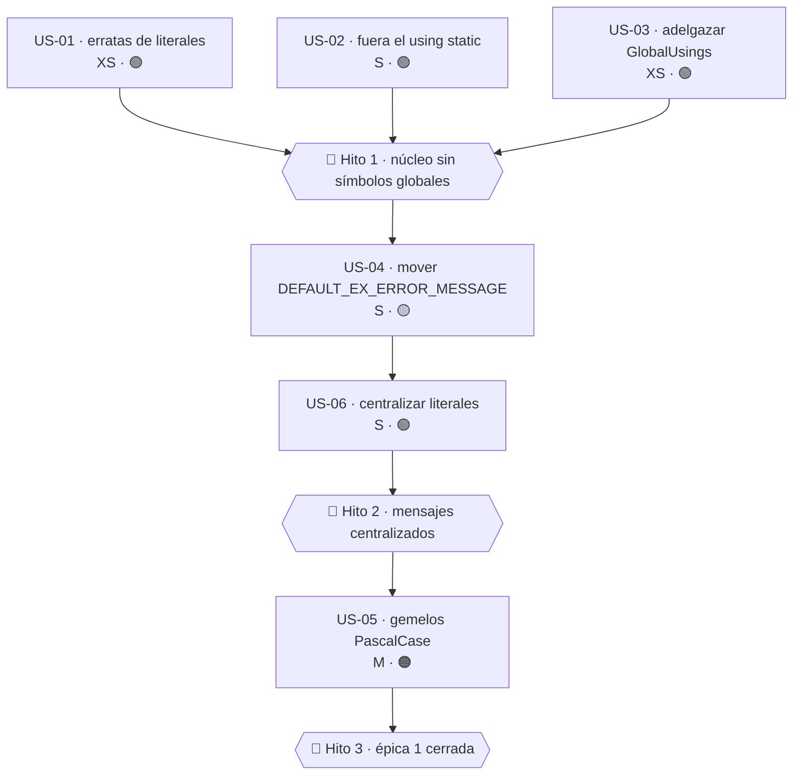

# Épica 1 · Constantes, literales y `using` globales

> **Versión destino** · 2.1.1 (US-01 … US-04, US-06) · 3.0.0 (retirada de puentes de US-05)
> **Origen** · [`Mejoras/Core/01-Nomenclatura-y-Estandares.md`](../../../Mejoras/Core/01-Nomenclatura-y-Estandares.md) · puntos 01, 02, 06, 07, 13
> **Plan del que se desgaja** · [`README.md`](README.md) de la versión 2.1.1
> **Proyecto** · `src/MoralesLarios.OOFP.Core`
> **Estado** · ⬜ no iniciada
> **Esfuerzo** · **L** (~2,5 jornadas)
> **Riesgo** · 🟢 bajo en US-01 … US-04 y US-06 · 🟠 alto en US-05
>
> **Leyenda de esfuerzo:** XS (<2 h) · S (½ jornada) · M (1 jornada) · L (2 jornadas) · XL (3+ jornadas)
> **Leyenda de riesgo:** 🟢 bajo · 🟡 medio · 🟠 alto · 🔴 muy alto (rompe compatibilidad)

---

## Índice

1. [Contexto y problema](#1-contexto-y-problema)
   - [Punto 01 — Identificadores en `SCREAMING_SNAKE_CASE`](#punto-01--identificadores-en-screaming_snake_case)
   - [Punto 02 — Un «constante» que en realidad es un método](#punto-02--un-constante-que-en-realidad-es-un-método)
   - [Punto 07 — Erratas en los literales de mensaje](#punto-07--erratas-en-los-literales-de-mensaje)
   - [Punto 13 — `global using static` que contamina 40 ficheros](#punto-13--global-using-static-que-contamina-40-ficheros)
   - [Punto 06 — Literales de mensaje dispersos](#punto-06--literales-de-mensaje-dispersos)
2. [Alcance](#2-alcance)
3. [Historias de usuario](#3-historias-de-usuario)
   - [US-01 · Corregir las erratas de los literales de mensaje](#us-01--corregir-las-erratas-de-los-literales-de-mensaje)
   - [US-02 · Eliminar `global using static Constants`](#us-02--eliminar-global-using-static-constants)
   - [US-03 · Adelgazar los `global using` redundantes](#us-03--adelgazar-los-global-using-redundantes)
   - [US-04 · Mover `DEFAULT_EX_ERROR_MESSAGE` a `EnsureFpMessages`](#us-04--mover-default_ex_error_message-a-ensurefpmessages)
   - [US-05 · Dar gemelos `PascalCase` a los miembros con guión bajo](#us-05--dar-gemelos-pascalcase-a-los-miembros-con-guión-bajo)
   - [US-06 · Centralizar los literales de mensaje del núcleo](#us-06--centralizar-los-literales-de-mensaje-del-núcleo)
4. [Orden de ejecución](#4-orden-de-ejecución)
5. [Decisiones abiertas](#5-decisiones-abiertas)
6. [Definición de terminado](#6-definición-de-terminado)
7. [Apéndice · código actual y propuesto](#7-apéndice--código-actual-y-propuesto)
8. [Ver también](#ver-también)

---

## 1. Contexto y problema

`Helpers/Constants.cs` tiene **52 líneas** y concentra cinco defectos distintos. Es, con mucho, el
fichero con peor relación defectos/línea de todo el núcleo. Y, por culpa de la última línea de
`GlobalUsings.cs`, su contenido está inyectado como vocabulario global en **los 40 ficheros** del
proyecto.

| Punto | Fichero | Líneas | Naturaleza | Rompe |
|------:|---------|--------|------------|:-----:|
| 01 | `Helpers/Constants.cs` | 10-40 | CA1707 · nombres con guión bajo | sí (3.0.0) |
| 02 | `Helpers/Constants.cs` | 48 | método con nombre de constante | sí (puente) |
| 07 | `Helpers/Constants.cs` | 10, 48 | comilla sin cerrar · falta un espacio | no (invisible) |
| 13 | `GlobalUsings.cs` | 1-12 | `global using static` + 4 redundantes | no (interno) |
| 06 | `Types/MlResult.cs` · `Types/Errors/MlErrorDetails.cs` | 395 · ~300 | literales de UI incrustados | no |

---

### Punto 01 — Identificadores en `SCREAMING_SNAKE_CASE`

```csharp
// Helpers/Constants.cs, L7-46
public static partial class Constants
{
    public static string DEFAULT_ERROR_MESSAGE { get; }     // ← propiedad pública con guiones bajos → CA1707
        = "Without custom error message. For more info, view 'Ex(s) details exceptions.";

    public static string ExceptionMetadataKey { get; } = "Ex";      // ← ésta sí es PascalCase
    public static string ValueMetadataKey     { get; } = "Value";   // ← ésta sí es PascalCase

    public const string NOT_FOUND_KEY      = "NotFound";        // ← const con guiones bajos
    public const string PARAM_NAME_KEY     = "ParamName";       // ← const con guiones bajos
    public const string FAILED_INDEXES_KEY = "FailedIndexes";    // ← const con guiones bajos
    public const string EXPECTED_KEY       = "Expected";        // ← const con guiones bajos
}
```

Tres problemas simultáneos en el mismo fichero:

1. **CA1707** («los identificadores no deben contener guiones bajos») se dispara en los seis
   miembros con guión bajo. Como son `public` y el `.csproj` no declara `NoWarn`, cualquier
   consumidor que active los analizadores de .NET verá esas advertencias y **no podrá suprimirlas**
   sin ensuciar su propio proyecto.
2. **Incoherencia interna**: conviven `ExceptionMetadataKey` (correcto) y `NOT_FOUND_KEY`
   (incorrecto) para conceptos idénticos — ambos son claves de metadatos del diccionario
   `MlErrorDetails.Metadata`.
3. **Mezcla de mecanismos**: `DEFAULT_ERROR_MESSAGE`, `ExceptionMetadataKey` y `ValueMetadataKey`
   son `static get-only property`; `NOT_FOUND_KEY` y sus tres hermanos son `const`. Sin
   justificación aparente.

---

### Punto 02 — Un «constante» que en realidad es un método

```csharp
// Helpers/Constants.cs, L48
public static string DEFAULT_EX_ERROR_MESSAGE(Exception ex)   // ← ¡es un MÉTODO!
    => $"An error occurred while executing the function. Error: {ex.Message}.More info in Ex Details.";
```

Está declarado en una clase llamada `Constants`, con nombre de constante, y es una **función con
parámetro**. El consumidor que lo vea en IntelliSense dentro de `Constants` esperará un valor.

Y se invoca aprovechando el `global using static`, por lo que en el punto de uso parece una
palabra del lenguaje:

```csharp
// Types/Errors/MlErrorDetailsActions.cs, L57
=> source.AppendExDetailsToMlDetails(
       errorMessageBuilder != null ? errorMessageBuilder(ex) : DEFAULT_EX_ERROR_MESSAGE(ex),  // ← símbolo global
       ex);
```

**Lugar correcto**: `Helpers/EnsureFpMessages.cs` (187 líneas), cuyo cometido declarado es
exactamente éste: construir mensajes de error.

---

### Punto 07 — Erratas en los literales de mensaje

```csharp
// Helpers/Constants.cs, L10
public static string DEFAULT_ERROR_MESSAGE { get; }
    = "Without custom error message. For more info, view 'Ex(s) details exceptions.";
//                                                       ^
//                                                       └── comilla simple ABIERTA que nunca se cierra
```

```csharp
// Helpers/Constants.cs, L48
=> $"An error occurred while executing the function. Error: {ex.Message}.More info in Ex Details.";
//                                                                      ^^^^^ ← falta el espacio tras el punto
```

Estos dos literales son los que **más veces** ve el usuario final de la librería, porque
`DEFAULT_ERROR_MESSAGE` es el mensaje de reserva de **todo** `MlError` sin mensaje explícito:

```csharp
// Types/Errors/MlError.cs — constructor
Message = string.IsNullOrWhiteSpace(message) ? DEFAULT_ERROR_MESSAGE : message;
```

Es decir: **cada error sin mensaje muestra un texto con una comilla sin cerrar**. Coste de
corrección XS, visibilidad máxima.

> ⚠️ Este cambio **no lo detecta el compilador**: un test que compare la cadena completa seguirá
> compilando y fallará en ejecución. Hay que buscar el literal en toda la solución antes de tocarlo.

---

### Punto 13 — `global using static` que contamina 40 ficheros

```csharp
// GlobalUsings.cs, L1-12
global using System;                      // ← redundante: ImplicitUsings=enable ya lo incluye
global using System.Collections.Generic;  // ← redundante
global using System.Linq;                 // ← redundante
global using System.Text;                 // ← NO está en ImplicitUsings → éste sí hace falta
global using System.Threading.Tasks;      // ← redundante

global using MoralesLarios.OOFP.Types.Errors;
global using MoralesLarios.OOFP.Helpers;
global using MoralesLarios.OOFP.Helpers.Extensions;
global using MoralesLarios.OOFP.Types;

global using static MoralesLarios.OOFP.Helpers.Constants;   // ← ESTO es el problema
```

El `global using static Constants` introduce en los 40 ficheros los símbolos
`DEFAULT_ERROR_MESSAGE`, `DEFAULT_EX_ERROR_MESSAGE`, `ExceptionMetadataKey`, `ValueMetadataKey`,
`NOT_FOUND_KEY`, `PARAM_NAME_KEY`, `FAILED_INDEXES_KEY` y `EXPECTED_KEY`. Consecuencias:

1. Al leer `DEFAULT_EX_ERROR_MESSAGE(ex)` en `MlErrorDetailsActions.cs` es **imposible saber de
   dónde viene** sin ir a la definición.
2. Cualquier variable local con el mismo nombre lo **oculta silenciosamente**.
3. Si en el futuro se añade un miembro a `Constants` que colisione con un identificador existente,
   la rotura aparece en ficheros que nadie ha tocado.

Los cuatro `using` de `System*` marcados son redundantes con
`<ImplicitUsings>enable</ImplicitUsings>`; **`System.Text` no lo es** (no forma parte del conjunto
implícito de `Microsoft.NET.Sdk`) y debe conservarse.

---

### Punto 06 — Literales de mensaje dispersos

Los mensajes que el núcleo emite están **repartidos entre cuatro ficheros** y escritos directamente
en el punto de uso:

```csharp
// Types/MlResult.cs, L395
public override string ToString()
    => this.Match(fail : errors => errors.ToString(),
                  valid: value  => value?.ToString() ?? "Not right value");
//                                                      ^^^^^^^^^^^^^^^^^ ← literal incrustado, además mal redactado
```

```csharp
// Types/Errors/MlErrorDetails.cs — ToString()
sb.AppendLine("MlError:");    // ← cabecera incrustada
sb.AppendLine("Details:");    // ← cabecera incrustada
```

El proyecto documenta **3.400 miembros en castellano** y emite los errores en **inglés**: es una
incoherencia de producto, el desarrollador lee la documentación en un idioma y ve los errores en
otro. Además `"Not right value"` no es inglés idiomático (lo esperable sería `"<null>"` o
`"No value"`).

Esta épica **no localiza** los mensajes —eso es la épica
[`Epica-Mensajes-Y-Localizacion.md`](../../2.1/Epica-Mensajes-Y-Localizacion.md)— pero sí los
**centraliza**, que es el prerrequisito para poder localizarlos después.

---

## 2. Alcance

### Dentro

- Reescritura completa de `Helpers/Constants.cs` y de `GlobalUsings.cs`.
- Traslado de `DEFAULT_EX_ERROR_MESSAGE` a `EnsureFpMessages`.
- Corrección del valor de los dos literales con errata.
- Inventario y centralización de los literales de mensaje de `MlResult.cs` y `MlErrorDetails.cs`.
- Los puentes `[Obsolete]` necesarios en `Helpers/Constants.Obsolete.cs` (19 líneas hoy).

### Fuera

- La **traducción** de los mensajes a otros idiomas y el mecanismo `.resx` → épica de localización.
- Los parámetros y miembros públicos de `MlResult` / `MlError` / `MlErrorDetails` → [épica 3](Epica-03-Miembros-Publicos-y-Firmas.md).
- Las erratas en identificadores locales y el código comentado → [épica 2](Epica-02-Higiene-Interna-y-Codigo-Muerto.md).
- La activación de los analizadores que hacen visible CA1707 (`EnableNETAnalyzers`,
  `AnalysisLevel`) → documento de empaquetado, pendiente.

---

## 3. Historias de usuario

### US-01 · Corregir las erratas de los literales de mensaje

> **Como** desarrollador que consume la librería
> **quiero** que los mensajes de error por defecto estén bien escritos
> **para** no mostrar texto roto a mis propios usuarios.

- **Esfuerzo** · XS (~1 h) · **Riesgo** · 🟢 · **Depende de** · nada · **Versión** · 2.1.1

Criterios de aceptación:

- [ ] `DEFAULT_ERROR_MESSAGE` no contiene comillas simples sin cerrar.
- [ ] `DEFAULT_EX_ERROR_MESSAGE` tiene un espacio tras el punto de `{ex.Message}.`.
- [ ] Se ha ejecutado `grep` del fragmento `"Without custom error message"` en **toda** la solución
      (`.cs` y `.md`) y actualizado cada aparición.
- [ ] Los tests que comparan literalmente con estos mensajes se han actualizado.

**API propuesta** (sin cambio de firma, sólo del valor):

```csharp
// ───── 2.0.0 ─────
= "Without custom error message. For more info, view 'Ex(s) details exceptions.";

// ───── 2.1.1 ─────
= "Without custom error message. For more info, view the 'Ex' details exceptions.";
```

**Tests mínimos**:

| Test | Comprueba |
|------|-----------|
| `MlError_SinMensaje_UsaMensajePorDefecto` | el literal exacto nuevo |
| `Constants_DefaultErrorMessage_ComillasBalanceadas` | `count('\'') % 2 == 0` |
| `EnsureFpMessages_DefaultExceptionError_TieneEspacioTrasPunto` | no contiene `".More"` |

**Riesgo principal** · el cambio **no lo detecta el compilador**. Si un test de otro proyecto
compara la cadena completa, fallará en ejecución. El `grep` previo es obligatorio, no opcional.

---

### US-02 · Eliminar `global using static Constants`

> **Como** mantenedor del núcleo
> **quiero** saber de dónde viene cada símbolo que leo
> **para** poder razonar sobre el código sin saltar a la definición.

- **Esfuerzo** · S (½ j) · **Riesgo** · 🟢 · **Depende de** · nada · **Versión** · 2.1.1

Criterios de aceptación:

- [ ] `global using static MoralesLarios.OOFP.Helpers.Constants;` ha desaparecido de
      `GlobalUsings.cs`.
- [ ] Los ~30 usos de los símbolos de `Constants` están cualificados con `Constants.`.
- [ ] La solución compila con 0 errores y el número de advertencias **no sube**.
- [ ] No se ha añadido ningún `using static` de ámbito de fichero como sustituto encubierto.

**Notas técnicas** · los `global using` **no se exportan al consumidor**, así que el cambio es
puramente interno y **no hay ninguna ruptura**. El trabajo es mecánico y autoverificable: se borra
la línea, se compila, y el compilador señala con CS0103 («el nombre no existe en el contexto
actual») exactamente los sitios a cualificar.

Ficheros con usos conocidos a cualificar:

| Fichero | Símbolos usados |
|---------|-----------------|
| `Types/Errors/MlError.cs` | `DEFAULT_ERROR_MESSAGE` |
| `Types/Errors/MlErrorDetails.cs` | `ExceptionMetadataKey`, `ValueMetadataKey` |
| `Types/Errors/MlErrorDetailsActions.cs` | `ExceptionMetadataKey`, `DEFAULT_EX_ERROR_MESSAGE` |
| `Helpers/EnsureFp.*.cs` | `PARAM_NAME_KEY`, `EXPECTED_KEY`, `NOT_FOUND_KEY`, `FAILED_INDEXES_KEY` |

**Tests mínimos** · ninguno nuevo; basta con que los 1.060 existentes sigan en verde.

**Riesgo principal** · ninguno significativo. Es el cambio con **mejor relación
beneficio/riesgo** de toda la versión 2.1.1.

---

### US-03 · Adelgazar los `global using` redundantes

> **Como** mantenedor
> **quiero** que `GlobalUsings.cs` declare sólo lo que no viene ya por defecto
> **para** que se vea de un golpe de vista qué añade el proyecto.

- **Esfuerzo** · XS (<1 h) · **Riesgo** · 🟢 · **Depende de** · nada · **Versión** · 2.1.1

Criterios de aceptación:

- [ ] Se han eliminado `global using System;`, `System.Collections.Generic`, `System.Linq` y
      `System.Threading.Tasks` (los cuatro incluidos por `ImplicitUsings=enable`).
- [ ] **Se conserva** `global using System.Text;` (no forma parte del conjunto implícito).
- [ ] Los cuatro `global using` del propio namespace se mantienen y quedan ordenados
      alfabéticamente.
- [ ] La solución compila con 0 errores.

**API propuesta**:

```csharp
// GlobalUsings.cs — después de US-02 y US-03
global using System.Text;

global using MoralesLarios.OOFP.Helpers;
global using MoralesLarios.OOFP.Helpers.Extensions;
global using MoralesLarios.OOFP.Types;
global using MoralesLarios.OOFP.Types.Errors;
```

**Notas técnicas** · si en algún momento se desactivara `ImplicitUsings`, estos cuatro `using`
harían falta otra vez. Conviene dejar un comentario en el fichero que lo advierta.

**Tests mínimos** · ninguno; la compilación es la prueba.

**Riesgo principal** · ninguno. Se puede hacer en el mismo *commit* que US-02.

---

### US-04 · Mover `DEFAULT_EX_ERROR_MESSAGE` a `EnsureFpMessages`

> **Como** consumidor
> **quiero** que `Constants` contenga sólo constantes
> **para** que el IntelliSense sea predecible.

- **Esfuerzo** · S (½ j) · **Riesgo** · 🟡 (es API pública) · **Depende de** · US-02 · **Versión** · 2.1.1

Criterios de aceptación:

- [ ] `EnsureFpMessages` expone `public static string DefaultExceptionError(Exception ex)`.
- [ ] El método valida que `ex` no sea `null` o documenta explícitamente el comportamiento con
      `null` (hoy lanzaría `NullReferenceException`).
- [ ] `Constants.DEFAULT_EX_ERROR_MESSAGE` permanece como puente `[Obsolete]` que **delega**.
- [ ] El puente lleva `[EditorBrowsable(Never)]` y el mensaje
      `"Renamed to EnsureFpMessages.DefaultExceptionError. Will be removed in 3.0.0."`.
- [ ] Los usos internos (2 conocidos) apuntan al nombre nuevo.
- [ ] La ruptura futura está registrada en `oofp-upgrade-2.prompt.md` §3.3 y en el anexo de
      renombrados.

**API propuesta**:

```csharp
// Helpers/EnsureFpMessages.cs
/// <summary>
/// Construye el mensaje de error utilizado cuando una función envuelta por la familia
/// <c>Try*</c> lanza una excepción y no se ha proporcionado un mensaje personalizado.
/// </summary>
/// <param name="ex">Excepción capturada. No puede ser <see langword="null"/>.</param>
/// <returns>Mensaje de error compuesto, apto para mostrarse al usuario final.</returns>
public static string DefaultExceptionError(Exception ex)
    => $"An error occurred while executing the function. Error: {ex.Message}. More info in 'Ex' details.";
```

```csharp
// Helpers/Constants.Obsolete.cs
[Obsolete("Renamed to EnsureFpMessages.DefaultExceptionError. Will be removed in 3.0.0.", false)]
[EditorBrowsable(EditorBrowsableState.Never)]
public static string DEFAULT_EX_ERROR_MESSAGE(Exception ex)
    => EnsureFpMessages.DefaultExceptionError(ex);
```

**Tests mínimos**:

| Test | Comprueba |
|------|-----------|
| `EnsureFpMessages_DefaultExceptionError_FormatoCorrecto` | el texto resultante completo |
| `Constants_DefaultExErrorMessage_DelegaEnEnsureFpMessages` | ambos devuelven lo mismo |

**Riesgo principal** · el símbolo viajaba por el `global using static` eliminado en US-02, así que
todos los usos internos se detectan en compilación. El riesgo residual es que un consumidor externo
lo invoque; el puente lo cubre.

---

### US-05 · Dar gemelos `PascalCase` a los miembros con guión bajo

> **Como** consumidor con analizadores activados
> **quiero** que la API del núcleo no dispare CA1707
> **para** no tener que suprimir advertencias ajenas en mi proyecto.

- **Esfuerzo** · M (1 j) · **Riesgo** · 🟠 · **Depende de** · US-01, US-02, US-04 · **Versión** · 2.1.1 (nombres nuevos) + 3.0.0 (retirada)

Criterios de aceptación:

- [ ] Los seis miembros con guión bajo tienen un **gemelo en `PascalCase`** declarado en
      `Constants.cs`.
- [ ] Se ha resuelto [D-01](#5-decisiones-abiertas) y aplicado el mecanismo elegido
      (`const` vs `static readonly`) de forma **homogénea** a los ocho miembros.
- [ ] Los nombres antiguos quedan como puentes `[Obsolete]` en `Constants.Obsolete.cs`, delegando
      en los nuevos.
- [ ] CA1707 **no aparece** en el núcleo tras activar los analizadores de .NET.
- [ ] La ruptura está registrada en `oofp-upgrade-2.prompt.md` §3.3 y en el anexo de renombrados.

**Mapa de renombrados**:

| 2.0.0 | 2.1.1 (nombre nuevo) | 3.0.0 | Mecanismo propuesto |
|-------|----------------------|-------|---------------------|
| `DEFAULT_ERROR_MESSAGE` | `DefaultErrorMessage` | se retira el antiguo | `static readonly string` |
| `NOT_FOUND_KEY` | `NotFoundKey` | se retira el antiguo | `static readonly string` |
| `PARAM_NAME_KEY` | `ParameterNameKey` | se retira el antiguo | `static readonly string` |
| `FAILED_INDEXES_KEY` | `FailedIndexesKey` | se retira el antiguo | `static readonly string` |
| `EXPECTED_KEY` | `ExpectedKey` | se retira el antiguo | `static readonly string` |
| `DEFAULT_EX_ERROR_MESSAGE(ex)` | `EnsureFpMessages.DefaultExceptionError(ex)` | se retira el antiguo | método (US-04) |
| `ExceptionMetadataKey` | *(sin cambio de nombre)* | pasa de propiedad a campo | `static readonly string` |
| `ValueMetadataKey` | *(sin cambio de nombre)* | pasa de propiedad a campo | `static readonly string` |

**Notas técnicas** · ojo con `PARAM_NAME_KEY` → `ParameterNameKey`: las guías de .NET prohíben las
abreviaturas en identificadores públicos, así que `ParamNameKey` **no** sería correcto aunque fuera
la traducción literal.

Los cuatro miembros que hoy son `public const` tienen una peculiaridad: un `const` se **incrusta**
en el ensamblado del consumidor en tiempo de compilación, así que una corrección futura del valor
no le llegará hasta que recompile. Eso es precisamente lo que [D-01](#5-decisiones-abiertas) decide.

**Tests mínimos**:

| Test | Comprueba |
|------|-----------|
| `Constants_NombresNuevos_CoincidenConLosAntiguos` | valor idéntico para cada uno de los 8 pares |
| `Constants_ClavesDeMetadatos_MecanismoHomogeneo` | vía reflexión, los 8 son del mismo tipo de miembro |
| `Constants_MiembrosConGuionBajo_EstanObsoletos` | vía reflexión, los 6 llevan `[Obsolete]` |

**Riesgo principal** · `ExceptionMetadataKey` y `ValueMetadataKey` pasan de **propiedad** a
**campo**. Eso es compatible a nivel de **origen** (el consumidor lee `Constants.ExceptionMetadataKey`
igual) pero **rompe a nivel binario**: un ensamblado ya compilado contra el *getter* fallará con
`MissingMethodException`. Por eso ese tramo concreto va en 3.0.0 y debe constar en la guía de
migración.

---

### US-06 · Centralizar los literales de mensaje del núcleo

> **Como** mantenedor que prepara la localización
> **quiero** que ningún mensaje esté escrito en el punto de uso
> **para** poder traducirlos sin recorrer 40 ficheros.

- **Esfuerzo** · S (½ j) · **Riesgo** · 🟢 · **Depende de** · US-01, US-02 · **Versión** · 2.1.1

Criterios de aceptación:

- [ ] Existe un inventario completo (tabla en este documento) de **todos** los literales de mensaje
      del núcleo, con `fichero:línea`.
- [ ] Ningún literal de mensaje queda escrito dentro de `MlResult.cs` ni de `MlErrorDetails.cs`:
      todos se referencian desde `EnsureFpMessages` o `Constants`.
- [ ] `"Not right value"` se ha sustituido por un texto correcto (recomendado: `"<null>"`).
- [ ] Las cabeceras `"MlError:"` y `"Details:"` son miembros con nombre, no literales incrustados.
- [ ] Se ha resuelto [D-05](#5-decisiones-abiertas) (idioma por defecto) y documentado la decisión.

**Inventario de literales de mensaje del núcleo**:

| Literal | Fichero | Línea | Destino propuesto |
|---------|---------|------:|-------------------|
| `"Without custom error message. …"` | `Helpers/Constants.cs` | 10 | `Constants.DefaultErrorMessage` (ya está) |
| `"An error occurred while executing…"` | `Helpers/Constants.cs` | 48 | `EnsureFpMessages.DefaultExceptionError` (US-04) |
| `"Not right value"` | `Types/MlResult.cs` | 395 | `EnsureFpMessages.NoValueRepresentation` |
| `"MlError:"` | `Types/Errors/MlErrorDetails.cs` | ~300 | `EnsureFpMessages.ErrorsSectionHeader` |
| `"Details:"` | `Types/Errors/MlErrorDetails.cs` | ~310 | `EnsureFpMessages.MetadataSectionHeader` |

**API propuesta**:

```csharp
// Types/MlResult.cs — después
public override string ToString()
    => this.Match(fail : errors => errors.ToString(),
                  valid: value  => value?.ToString() ?? EnsureFpMessages.NoValueRepresentation);
```

**Notas técnicas** · el `ToString()` de `MlResult<T>` devolviendo un **mensaje de error** cuando el
valor es `null` rompe la expectativa de `ToString()` (que es dar una representación del objeto, no
un diagnóstico). El rediseño completo de `ToString()` con `IFormattable` se trata en el documento de
interoperabilidad; aquí sólo se centraliza el literal.

**Tests mínimos**:

| Test | Comprueba |
|------|-----------|
| `MlResult_ToString_ValorNulo_UsaRepresentacionCentralizada` | coincide con `EnsureFpMessages.NoValueRepresentation` |
| `MlErrorDetails_ToString_CabecerasCentralizadas` | las dos cabeceras salen de `EnsureFpMessages` |

**Riesgo principal** · igual que US-01: el cambio de `"Not right value"` **no lo detecta el
compilador**. `grep` obligatorio antes de tocar.

---

## 4. Orden de ejecución



| Orden | Historia | Esfuerzo | Jornadas | Versión | Acumulado |
|------:|----------|:--------:|---------:|:-------:|----------:|
| 1 | US-02 · eliminar `global using static` | S | 0,5 | 2.1.1 | 0,5 |
| 2 | US-03 · adelgazar `GlobalUsings` | XS | 0,125 | 2.1.1 | 0,625 |
| 3 | US-01 · erratas de literales | XS | 0,125 | 2.1.1 | 0,75 |
| — | 🎯 **Hito 1 · núcleo sin símbolos globales** | | | | **0,75** |
| 4 | US-04 · mover `DEFAULT_EX_ERROR_MESSAGE` | S | 0,5 | 2.1.1 | 1,25 |
| 5 | US-06 · centralizar literales | S | 0,5 | 2.1.1 | 1,75 |
| — | 🎯 **Hito 2 · mensajes centralizados** | | | | **1,75** |
| 6 | US-05 · gemelos `PascalCase` | M | 0,75 | 2.1.1 | 2,5 |
| — | 🎯 **Hito 3 · épica 1 cerrada** | | | | **2,5** |

**Total: 2,5 jornadas.**

> **Nota de secuenciación** · US-02 va **primera** aunque no sea la más urgente, porque al eliminar
> el `global using static` el compilador pasa a señalar con CS0103 todos los puntos de uso de
> `Constants`. Eso convierte US-04 y US-05 en refactorizaciones guiadas por el compilador en lugar
> de búsquedas manuales.

---

## 5. Decisiones abiertas

| Id | Decisión | Opciones | Recomendación | Bloquea |
|----|----------|----------|---------------|---------|
| **D-01** | ¿Las claves de metadatos deben ser `const` o `static readonly`? | (a) `const`: cero indirección, pero el consumidor incrusta el valor y hay ruptura binaria si cambia · (b) `static readonly`: compatible binariamente, coste despreciable | **(b) `static readonly`** · el valor se resuelve en ejecución, así que una corrección futura llega al consumidor sin recompilar. El coste de rendimiento es nulo para claves de diccionario | US-05 |
| **D-05** | ¿Idioma por defecto de los mensajes de error? | (a) inglés (actual) · (b) castellano (coherente con los 3.400 miembros documentados) · (c) inglés + recursos localizados | **(c)** · inglés como neutro (es lo que esperan los paquetes NuGet) + `.resx` para castellano. La implementación queda en manos de la épica de localización | US-06 |
| **D-07** | ¿`EnsureFpMessages.DefaultExceptionError(null)` debe lanzar o devolver un texto genérico? | (a) `ArgumentNullException` · (b) devolver un mensaje genérico | **(a)** · un `null` ahí es un error de programación del llamante, no una condición de negocio | US-04 |

---

## 6. Definición de terminado

Además de los [criterios comunes](README.md#8-definición-de-terminado-común):

- [ ] `Helpers/Constants.cs` no contiene ningún identificador con guión bajo (los antiguos viven
      sólo en `Constants.Obsolete.cs`).
- [ ] `Helpers/Constants.cs` no declara ningún **método**.
- [ ] `GlobalUsings.cs` tiene **5 líneas** de `global using` y ningún `using static`.
- [ ] Ningún literal de mensaje está escrito dentro de `Types/`.
- [ ] CA1707 no se dispara en el núcleo con los analizadores de .NET activados.
- [ ] Las rupturas de US-04 y US-05 constan en
      [`oofp-upgrade-2.prompt.md`](../../../Copilot/.github/prompts/oofp-upgrade-2.prompt.md) §3.3 y en
      [`oofp-upgrade-2.renames.md`](../../../Copilot/.github/prompts/oofp-upgrade-2.renames.md).

---

## 7. Apéndice · código actual y propuesto

### 7.1 · `Helpers/Constants.cs`

**Hoy — L7-50**

```csharp
// ───── 2.0.0 ─────
public static partial class Constants
{
    public static string DEFAULT_ERROR_MESSAGE { get; }
        = "Without custom error message. For more info, view 'Ex(s) details exceptions.";

    public static string ExceptionMetadataKey { get; } = "Ex";
    public static string ValueMetadataKey     { get; } = "Value";

    public const string NOT_FOUND_KEY      = "NotFound";
    public const string PARAM_NAME_KEY     = "ParamName";
    public const string FAILED_INDEXES_KEY = "FailedIndexes";
    public const string EXPECTED_KEY       = "Expected";

    public static string DEFAULT_EX_ERROR_MESSAGE(Exception ex)
        => $"An error occurred while executing the function. Error: {ex.Message}.More info in Ex Details.";
}
```

**Después — opción (b) de D-01, recomendada**

```csharp
// ───── 2.1.1 ─────
public static partial class Constants
{
    /// <summary>Mensaje de error utilizado cuando no se proporciona ninguno.</summary>
    public static readonly string DefaultErrorMessage
        = "Without custom error message. For more info, view the 'Ex' details exceptions.";

    /// <summary>Clave de metadatos bajo la que se almacena la excepción capturada.</summary>
    public static readonly string ExceptionMetadataKey = "Ex";

    /// <summary>Clave de metadatos bajo la que se almacena el valor que provocó el error.</summary>
    public static readonly string ValueMetadataKey = "Value";

    /// <summary>Clave de metadatos que indica que el elemento buscado no se encontró.</summary>
    public static readonly string NotFoundKey = "NotFound";

    /// <summary>Clave de metadatos con el nombre del parámetro que incumplió la guardia.</summary>
    public static readonly string ParameterNameKey = "ParamName";

    /// <summary>Clave de metadatos con los índices de los elementos que fallaron.</summary>
    public static readonly string FailedIndexesKey = "FailedIndexes";

    /// <summary>Clave de metadatos con el valor esperado por la guardia.</summary>
    public static readonly string ExpectedKey = "Expected";
}
```

### 7.2 · `Helpers/Constants.Obsolete.cs`

```csharp
// ───── 2.1.1 ─────
// Puentes [Obsolete] de la v2.0.0: nombres antiguos que reenvian al nombre nuevo. Se eliminan en la v3.0.0.
public static partial class Constants
{
    [global::System.Obsolete("Renamed to DefaultErrorMessage. Will be removed in 3.0.0.", false)]
    [global::System.ComponentModel.EditorBrowsable(global::System.ComponentModel.EditorBrowsableState.Never)]
    public static string DEFAULT_ERROR_MESSAGE => DefaultErrorMessage;

    [global::System.Obsolete("Renamed to NotFoundKey. Will be removed in 3.0.0.", false)]
    [global::System.ComponentModel.EditorBrowsable(global::System.ComponentModel.EditorBrowsableState.Never)]
    public static string NOT_FOUND_KEY => NotFoundKey;

    [global::System.Obsolete("Renamed to ParameterNameKey. Will be removed in 3.0.0.", false)]
    [global::System.ComponentModel.EditorBrowsable(global::System.ComponentModel.EditorBrowsableState.Never)]
    public static string PARAM_NAME_KEY => ParameterNameKey;

    [global::System.Obsolete("Renamed to FailedIndexesKey. Will be removed in 3.0.0.", false)]
    [global::System.ComponentModel.EditorBrowsable(global::System.ComponentModel.EditorBrowsableState.Never)]
    public static string FAILED_INDEXES_KEY => FailedIndexesKey;

    [global::System.Obsolete("Renamed to ExpectedKey. Will be removed in 3.0.0.", false)]
    [global::System.ComponentModel.EditorBrowsable(global::System.ComponentModel.EditorBrowsableState.Never)]
    public static string EXPECTED_KEY => ExpectedKey;

    [global::System.Obsolete("Renamed to EnsureFpMessages.DefaultExceptionError. Will be removed in 3.0.0.", false)]
    [global::System.ComponentModel.EditorBrowsable(global::System.ComponentModel.EditorBrowsableState.Never)]
    public static string DEFAULT_EX_ERROR_MESSAGE(Exception ex) => EnsureFpMessages.DefaultExceptionError(ex);
}
```

> **Atención** · los puentes de los cuatro `const` **no pueden ser `const`** (un `const` no admite
> inicializarse con el valor de otro miembro `static readonly`). Pasan a propiedades de sólo
> lectura, lo que ya es por sí mismo una ruptura binaria para quien tuviera el `const` incrustado.
> Ése es el coste de la opción (b) de D-01 y hay que asumirlo conscientemente.

### 7.3 · `GlobalUsings.cs`

```csharp
// ───── 2.0.0 ─────
global using System;
global using System.Collections.Generic;
global using System.Linq;
global using System.Text;
global using System.Threading.Tasks;

global using MoralesLarios.OOFP.Types.Errors;
global using MoralesLarios.OOFP.Helpers;
global using MoralesLarios.OOFP.Helpers.Extensions;
global using MoralesLarios.OOFP.Types;

global using static MoralesLarios.OOFP.Helpers.Constants;
```

```csharp
// ───── 2.1.1 ─────
// System, System.Collections.Generic, System.Linq y System.Threading.Tasks los aporta
// <ImplicitUsings>enable</ImplicitUsings>. System.Text NO forma parte del conjunto implicito.
global using System.Text;

global using MoralesLarios.OOFP.Helpers;
global using MoralesLarios.OOFP.Helpers.Extensions;
global using MoralesLarios.OOFP.Types;
global using MoralesLarios.OOFP.Types.Errors;
```

### 7.4 · Resumen de rupturas

| Elemento | 2.0.0 | 2.1.1 / 3.0.0 | ¿Lo detecta el compilador? |
|----------|-------|---------------|:--------------------------:|
| `Constants.DEFAULT_ERROR_MESSAGE` (nombre) | propiedad | `[Obsolete]` → `DefaultErrorMessage` | ✅ sí (advertencia CS0618) |
| `Constants.DEFAULT_ERROR_MESSAGE` (**valor**) | `…view 'Ex(s) details exceptions.` | `…view the 'Ex' details exceptions.` | ❌ **NO** |
| `Constants.DEFAULT_EX_ERROR_MESSAGE` (**valor**) | `…{ex.Message}.More info…` | `…{ex.Message}. More info…` | ❌ **NO** |
| `Constants.NOT_FOUND_KEY` y los 3 hermanos | `public const string` | propiedad `[Obsolete]` | ✅ sí en origen · ❌ **no** en binario |
| `Constants.ExceptionMetadataKey` / `ValueMetadataKey` | propiedad | `static readonly` campo | ✅ sí en origen · ❌ **no** en binario |
| `Constants.DEFAULT_EX_ERROR_MESSAGE(ex)` (ubicación) | `Constants` | `EnsureFpMessages.DefaultExceptionError` | ✅ sí (advertencia CS0618) |
| `MlResult<T>.ToString()` con valor nulo | `"Not right value"` | `"<null>"` | ❌ **NO** |

> ⚠️ **Obligatorio.** Las cuatro filas marcadas con ❌ **NO** son rupturas de **comportamiento**:
> compilan igual y se ejecutan distinto. Deben constar sin excepción en
> [`../../../Copilot/.github/prompts/oofp-upgrade-2.prompt.md`](../../../Copilot/.github/prompts/oofp-upgrade-2.prompt.md) §3.3,
> y los renombrados además en
> [`../../../Copilot/.github/prompts/oofp-upgrade-2.renames.md`](../../../Copilot/.github/prompts/oofp-upgrade-2.renames.md).

---

## Ver también

- [`README.md`](README.md) · índice de las épicas de la versión 2.1.1
- [`Epica-02-Higiene-Interna-y-Codigo-Muerto.md`](Epica-02-Higiene-Interna-y-Codigo-Muerto.md) · épica que conviene ejecutar antes
- [`Epica-03-Miembros-Publicos-y-Firmas.md`](Epica-03-Miembros-Publicos-y-Firmas.md) · épica que conviene ejecutar después
- [`Mejoras/Core/01-Nomenclatura-y-Estandares.md`](../../../Mejoras/Core/01-Nomenclatura-y-Estandares.md) · análisis de origen (puntos 01, 02, 06, 07, 13)
- [`Next_Versions/2.1/Epica-Mensajes-Y-Localizacion.md`](../../2.1/Epica-Mensajes-Y-Localizacion.md) · traducción de los mensajes centralizados aquí
