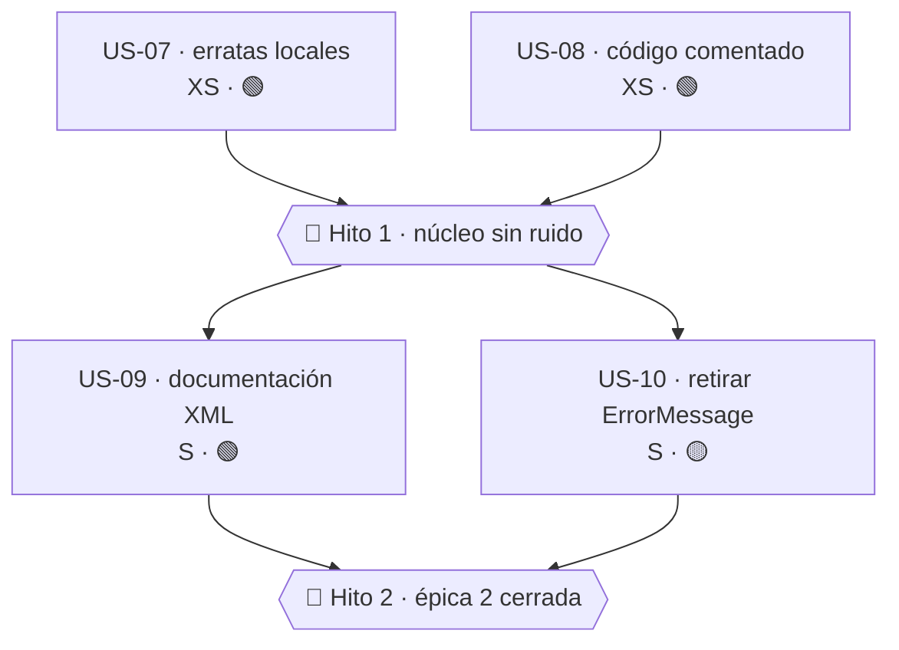

# Épica 2 · Higiene interna: erratas, código muerto y documentación XML

> **Versión destino** · 2.1.1 (US-07 … US-10) · 3.0.0 (retirada del puente de US-10)
> **Origen** · [`Mejoras/Core/01-Nomenclatura-y-Estandares.md`](../../../Mejoras/Core/01-Nomenclatura-y-Estandares.md) · puntos 05 (documentación) y 12, más dos hallazgos colaterales
> **Plan del que se desgaja** · [`README.md`](README.md) de la versión 2.1.1
> **Proyecto** · `src/MoralesLarios.OOFP.Core`
> **Estado** · ✅ completada (commits `179162f` + éste) · US-07 … US-10 cerradas en 2.1.1
> **Esfuerzo** · **M** (~1,25 jornadas)
> **Riesgo** · 🟢 bajo en US-07 … US-09 · 🟡 medio en US-10
>
> **Leyenda de esfuerzo:** XS (<2 h) · S (½ jornada) · M (1 jornada) · L (2 jornadas) · XL (3+ jornadas)
> **Leyenda de riesgo:** 🟢 bajo · 🟡 medio · 🟠 alto · 🔴 muy alto (rompe compatibilidad)

---

## Índice

1. [Contexto y problema](#1-contexto-y-problema)
   - [Punto 12 — Erratas en identificadores locales](#punto-12--erratas-en-identificadores-locales)
   - [Hallazgo A — Bloques de código comentado](#hallazgo-a--bloques-de-código-comentado)
   - [Punto 05 (documentación) — `<summary>` de plantilla sin rellenar](#punto-05-documentación--summary-de-plantilla-sin-rellenar)
   - [Hallazgo B — `ErrorMessage.cs` es código muerto](#hallazgo-b--errormessagecs-es-código-muerto)
2. [Alcance](#2-alcance)
3. [Historias de usuario](#3-historias-de-usuario)
   - [US-07 · Corregir `printipal` / `Witout` en identificadores locales](#us-07--corregir-printipal--witout-en-identificadores-locales)
   - [US-08 · Eliminar los bloques de código comentado](#us-08--eliminar-los-bloques-de-código-comentado)
   - [US-09 · Rellenar los `<summary>` de plantilla y las `<c></c>` vacías](#us-09--rellenar-los-summary-de-plantilla-y-las-c-vacías)
   - [US-10 · Retirar el tipo muerto `ErrorMessage`](#us-10--retirar-el-tipo-muerto-errormessage)
4. [Orden de ejecución](#4-orden-de-ejecución)
5. [Decisiones abiertas](#5-decisiones-abiertas)
6. [Definición de terminado](#6-definición-de-terminado)
7. [Apéndice · código actual y propuesto](#7-apéndice--código-actual-y-propuesto)
8. [Ver también](#ver-también)

---

## 1. Contexto y problema

Esta épica es la **más barata y la de menor riesgo** de las tres, y por eso va primera: no toca
ninguna firma pública relevante, no requiere puentes `[Obsolete]` salvo en una historia, y deja los
ficheros del núcleo legibles antes de que las épicas 1 y 3 los modifiquen de verdad.

Su valor no es cosmético. El núcleo tiene **3.400 miembros documentados** y **36.054 líneas**: el
ruido acumulado (erratas, código comentado, documentación de plantilla) es precisamente lo que hace
que una revisión de código del núcleo sea agotadora y que los defectos reales pasen inadvertidos.

| Hallazgo | Fichero | Naturaleza | Rompe |
|----------|---------|------------|:-----:|
| Punto 12 | `Types/Errors/MlErrorDetailsActions.cs` | erratas en variables locales | no |
| Hallazgo A | 5 ficheros | bloques de código comentado | no |
| Punto 05 (doc) | `Helpers/Extensions/Extensions.cs` · `Types/MlResultBindExtensions.cs` | `<summary>` de plantilla sin rellenar | no |
| Hallazgo B | `Types/Errors/ErrorMessage.cs` | tipo público sin cometido real | sí (puente) |

---

### Punto 12 — Erratas en identificadores locales

```csharp
// Types/Errors/MlErrorDetailsActions.cs, L86-97
var principalDetailsWithEx    = …;   // ← correcto
…
var printipalDetailsWitoutEx  = …;   // ← "printipal" → principal · "Witout" → Without
var otherDetailsWitoutEx      = …;   // ← "Witout" → Without
```

Lo revelador es que **las tres variables están en el mismo método** y una de ellas está bien
escrita. Es decir: no es una convención personal, es un descuido.

| Errata | Correcto | Ocurrencias | Visibilidad |
|--------|----------|------------:|-------------|
| `printipal` | `principal` | 2 | 🟢 variable local |
| `Witout` | `Without` | 4 | 🟢 variable local |

> **Importante** · estos identificadores **no son públicos**. Corregirlos no rompe nada y no
> necesita puente. Por eso van en 2.1.1 y no en 3.0.0, al contrario que las erratas públicas
> (`Faild`, `Diferent`, `Erros`, `Alwais`, `Lenght`, `FusionFailErros`), que tienen su propia épica:
> [`Epica-Erratas-Identificadores-Publicos.md`](../../2.1/Epica-Erratas-Identificadores-Publicos.md).

---

### Hallazgo A — Bloques de código comentado

Hay **al menos cinco ficheros** del núcleo con código comentado que nunca se ha retirado:

| Fichero | Líneas aprox. | Contenido |
|---------|--------------:|-----------|
| `Helpers/Extensions/Extensions.cs` | 10 | un `ValidateObject` comentado íntegro |
| `Types/Errors/ErrorMessage.cs` | 16 | versión anterior del tipo, comentada |
| `Types/Errors/MlErrorDetailsActions.cs` | 2 | dos líneas sueltas (L92-93) |
| `Helpers/EnsureFp.cs` | 2 bloques | guardias descartadas |
| `Helpers/EnsureFp.Core.cs` | 1 bloque | variante anterior de `BuildMessage` |

El problema del código comentado es doble:

1. **No compila, así que no se mantiene.** Si la API cambia, ese código queda obsoleto en silencio
   y deja de ser una referencia válida: pasa a ser una referencia *engañosa*.
2. **Contamina las búsquedas.** Un `grep` de un identificador devuelve coincidencias en código que
   no se ejecuta, lo que hace que los inventarios de impacto (como los que sustentan estas épicas)
   necesiten filtrado manual.

El repositorio tiene historial Git completo. **El código comentado no aporta nada que `git log -p`
no dé mejor.**

---

### Punto 05 (documentación) — `<summary>` de plantilla sin rellenar

```csharp
// Helpers/Extensions/Extensions.cs, L8-11
/// <summary>
/// Métodos de extension de <c></c>.
/// </summary>
//                     ^^^^^^^ ← etiqueta <c> VACÍA: residuo de la plantilla de generación
public static class Extensions
```

```csharp
// Types/MlResultBindExtensions.cs, L8
/// Métodos de extension de <c>MlResultBind</c>.
//                             ^^^^^^^^^^^^ ← ese tipo NO EXISTE: la clase se llama MlResultBindExtensions
//                                             y opera sobre MlResult<T>
```

Dos variantes del mismo defecto, ambas originadas en la campaña de documentación masiva que llevó
`CS1591` a cero:

- La `<c></c>` **vacía** genera XML sintácticamente válido pero semánticamente absurdo. **No
  dispara CS1591** (el miembro *está* documentado), así que la métrica de calidad no lo detecta,
  pero IntelliSense muestra «Métodos de extension de .» al consumidor.
- La `<c>MlResultBind</c>` **miente**: apunta a un tipo inexistente.

Hay además documentación XML con **idiomas mezclados** dentro del mismo fichero (`MlResultBindExtensions.cs`
tiene `<summary>` en castellano y `<param>` en inglés) y varias `<returns></returns>` vacías.

> **Criterio de esta épica** · aquí se corrigen los `<summary>` de **tipo** y las etiquetas vacías
> localizables mecánicamente. La revisión completa de los 3.400 miembros documentados es un trabajo
> de otra magnitud y queda para `Mejoras/Core/08-Calidad-Pruebas-y-Documentacion.md`.

---

### Hallazgo B — `ErrorMessage.cs` es código muerto

```csharp
// Types/Errors/ErrorMessage.cs — 25 líneas EN TOTAL
// … 16 líneas de una versión anterior, comentadas …

public record ErrorMessage(string Message);
```

Un fichero de 25 líneas de las cuales **16 son comentario** y la única línea efectiva declara un
`record` de un solo campo `string`. Tres problemas:

1. **Duplica a `MlError`.** `MlError` es también un `record` cuyo único dato esencial es
   `Message { get; init; }`. No hay ninguna diferencia funcional entre ambos.
2. **Es público pero no forma parte del modelo.** No aparece en ninguna firma de `MlResult`, ni de
   `MlErrorDetails`, ni de `EnsureFp`. Aparece en **7 sitios dispersos**, todos ellos usos internos
   que podrían usar `MlError` o directamente `string`.
3. **Confunde al consumidor.** Quien explore `MoralesLarios.OOFP.Types.Errors` verá `MlError`,
   `MlErrorDetails` y `ErrorMessage`, y tendrá que averiguar por su cuenta cuál es el tipo canónico.

---

## 2. Alcance

### Dentro

- Renombrado de los 6 identificadores locales con errata en `MlErrorDetailsActions.cs`.
- Eliminación de los bloques de código comentado de los 5 ficheros listados.
- Corrección de los `<summary>` de tipo con etiquetas vacías o referencias inexistentes.
- Retirada del tipo `ErrorMessage` y sustitución de sus 7 usos.

### Fuera

- Las erratas en identificadores **públicos** (`Faild`, `Diferent`, `Erros`, `Alwais`, `Lenght`,
  `FusionFailErros`) → [`Epica-Erratas-Identificadores-Publicos.md`](../../2.1/Epica-Erratas-Identificadores-Publicos.md).
- La revisión exhaustiva de los 3.400 `<summary>` de miembro y la homogeneización de idioma →
  `Mejoras/Core/08-Calidad-Pruebas-y-Documentacion.md` *(pendiente)*.
- El rediseño de `MlError` para añadirle `Code` / `Severity` → `Mejoras/Core/03-Modelo-de-Error.md` *(pendiente)*.
- El formato alineado por columnas de los ficheros grandes (`MlResultBindExtensions.cs` y hermanos),
  que `dotnet format` destruiría → decisión [D-08](#5-decisiones-abiertas).

---

## 3. Historias de usuario

### US-07 · Corregir `printipal` / `Witout` en identificadores locales

> **Como** mantenedor del núcleo
> **quiero** que los identificadores no tengan faltas de ortografía
> **para** que el código se lea con confianza.

- **Esfuerzo** · XS (<1 h) · **Riesgo** · 🟢 · **Depende de** · nada · **Versión** · 2.1.1

Criterios de aceptación:

- [x] `printipalDetailsWitoutEx` → `principalDetailsWithoutEx` (2 ocurrencias).
- [x] `otherDetailsWitoutEx` → `otherDetailsWithoutEx` (2 ocurrencias).
- [x] Un `grep` de `printipal` y de `Witout` en **todo** `src/` devuelve **0 coincidencias**.
- [x] No se ha tocado ningún identificador público en esta historia.

> **Resultado de la ejecución** · `printipal` y `Witout` → **0 coincidencias** en `src/`. El barrido
> localizó además **119 erratas en identificadores PÚBLICOS** (`Faild`, `Alwais`, `Erros`,
> `Diferent`, `Lenght`) que, conforme a las notas técnicas de esta historia, **no se corrigen aquí**
> y quedan **remitidas a la épica de erratas públicas**.

**API propuesta** · ninguna; los identificadores son locales.

**Notas técnicas** · hay que hacer el `grep` sobre toda la solución, no sólo sobre el núcleo: las
mismas erratas podrían haberse copiado a otros proyectos o a los tests. Si aparecen en un
identificador **público** de otro proyecto, **no se corrige aquí**: se anota y se remite a la épica
de erratas públicas.

**Tests mínimos** · ninguno; la compilación es la prueba.

**Riesgo principal** · ninguno. Es un renombrado de ámbito local verificado por el compilador.

---

### US-08 · Eliminar los bloques de código comentado

> **Como** mantenedor
> **quiero** que el núcleo no contenga código comentado
> **para** que las búsquedas de impacto no devuelvan falsos positivos.

- **Esfuerzo** · XS (~1 h) · **Riesgo** · 🟢 · **Depende de** · nada · **Versión** · 2.1.1

Criterios de aceptación:

- [x] Eliminado el `ValidateObject` comentado de `Helpers/Extensions/Extensions.cs` (~10 líneas).
- [x] Eliminadas las 16 líneas comentadas de `Types/Errors/ErrorMessage.cs`.
- [x] Eliminadas las líneas comentadas de `Types/Errors/MlErrorDetailsActions.cs` (L92-93).
- [x] Eliminados los 2 bloques comentados de `Helpers/EnsureFp.cs`.
- [x] Eliminado el bloque comentado de `Helpers/EnsureFp.Core.cs`.
- [x] **Se conservan** los comentarios explicativos (`//` de una línea que explican *por qué*), las
      cabeceras de licencia y las regiones `#region`.
- [x] El recuento de líneas de cada fichero modificado se ha verificado antes y después.

**Notas técnicas** · el criterio de distinción es claro: se borra lo que **sería código si se le
quitaran las barras**; se conserva lo que es **prosa**. En caso de duda, `git log -p` recupera
cualquier cosa borrada, así que el sesgo debe ser hacia borrar.

Conviene registrar en el mensaje de *commit* qué se ha borrado y de dónde, para que el día que
alguien lo echa de menos sepa dónde buscarlo.

**Tests mínimos** · ninguno.

**Riesgo principal** · borrar por accidente una línea activa. Mitigación: comprobar el recuento de
líneas por fichero y revisar el `git diff` completo antes de confirmar.

---

### US-09 · Rellenar los `<summary>` de plantilla y las `<c></c>` vacías

> **Como** consumidor que usa IntelliSense
> **quiero** que la documentación de cada tipo diga algo verdadero
> **para** no tener que leer el código fuente para entender qué hace.

- **Esfuerzo** · S (½ j) · **Riesgo** · 🟢 · **Depende de** · nada · **Versión** · 2.1.1

Criterios de aceptación:

- [x] Un `grep` de `<c></c>` en el núcleo devuelve **0 coincidencias**.
- [x] Un `grep` de `<returns></returns>` en el núcleo devuelve **0 coincidencias**.
- [x] Ningún `<summary>` de tipo referencia un tipo inexistente (se ha verificado
      `MlResultBind` y los 6 hermanos del patrón `MlResult*Extensions`).
- [x] Los `<summary>` de los **15 tipos públicos** del núcleo describen el cometido del tipo, no su
      nombre reescrito.
- [x] `CS1591` sigue en **0** (la historia no debe introducir ninguna regresión documental).
- [x] Toda la documentación XML tocada está en **castellano**, coherente con los 3.400 miembros ya
      documentados.

**API propuesta** (ejemplos del antes y después):

```csharp
// ───── 2.0.0 ─────
/// <summary>
/// Métodos de extension de <c></c>.
/// </summary>
public static class Extensions

// ───── 2.1.1 ─────
/// <summary>
/// Utilidades generales de conversión y mutación empleadas internamente por el núcleo
/// y disponibles para el consumidor.
/// </summary>
/// <remarks>
/// Esta clase se trocea en clases con nombre propio en la historia US-11 de la épica 3.
/// </remarks>
public static class Extensions
```

```csharp
// ───── 2.0.0 ─────
/// Métodos de extension de <c>MlResultBind</c>.

// ───── 2.1.1 ─────
/// <summary>
/// Combinadores de la familia <c>Bind</c> para <see cref="MlResult{T}"/>: encadenan una función
/// que a su vez devuelve un <see cref="MlResult{T}"/>, propagando el fallo sin ejecutarla.
/// </summary>
```

**Notas técnicas** · ⚠️ **`MlResultBindExtensions.cs` (12.217 líneas) y `MlResultMapExtensions.cs`
(7.917 líneas) no deben editarse con herramientas de aplicación de parches difusos**: el riesgo de
corrupción es real y ya se ha materializado en este repositorio. En esos dos ficheros la edición
debe ser **puntual y verificada**: una única `<summary>` de clase al principio del fichero,
comprobando el recuento de líneas antes y después.

El formato alineado por columnas de esos ficheros es **deliberado** y `dotnet format` lo destruiría
→ ver [D-08](#5-decisiones-abiertas).

**Tests mínimos**:

| Test | Comprueba |
|------|-----------|
| `Documentacion_NoHayEtiquetasVacias` | script que recorre el XML generado buscando `<c/>` y `<returns/>` |

**Riesgo principal** · corromper uno de los dos ficheros grandes. Mitigación: edición puntual con
anclas de cadena únicas y verificación del recuento de líneas; **nunca** reescritura completa.

---

### US-10 · Retirar el tipo muerto `ErrorMessage`

> **Como** consumidor que explora el espacio de nombres de errores
> **quiero** que haya un único tipo canónico de error
> **para** no tener que averiguar cuál de los tres debo usar.

- **Esfuerzo** · S (½ j) · **Riesgo** · 🟡 · **Depende de** · US-08 · **Versión** · 2.1.1 (puente) + 3.0.0 (retirada)

Criterios de aceptación:

- [x] Se ha resuelto [D-09](#5-decisiones-abiertas) (retirar vs. conservar).
- [x] Los **7 usos internos** de `ErrorMessage` se han sustituido por `MlError` o por `string`,
      según corresponda en cada punto.
- [x] `ErrorMessage` queda marcado `[Obsolete]` con el mensaje
      `"Use MlError instead. Will be removed in 3.0.0."` y `[EditorBrowsable(Never)]`.
- [x] El `record` conserva su forma actual (no se cambia la firma del constructor) para que el
      puente sea de uso transparente.
- [x] La ruptura futura está registrada en `oofp-upgrade-2.prompt.md` §3.3.
- [ ] En 3.0.0 el fichero `Types/Errors/ErrorMessage.cs` desaparece.

**Inventario real de usos** (verificado en la ejecución): **0 usos reales del tipo**. Los 6 aciertos
del `grep` eran 1 declaración del propio tipo y 5 falsos positivos:

| Fichero | Uso | Sustitución aplicada |
|---------|-----|----------------------|
| `Core/Types/Errors/ErrorMessage.cs` | declaración del `record` | marcado `[Obsolete]` + `[EditorBrowsable(Never)]` |
| `AspNetCore.Results/.../MlProblemDetails.cs:93` | `ValidationResult.ErrorMessage` | ninguna · falso positivo |
| `AspNetCore.Results/.../MlResults.cs:103` | `ValidationResult.ErrorMessage` | ninguna · falso positivo |
| `Validation.DataAnnotations/Helpers/Extensions.cs:39` | `ValidationResult.ErrorMessage` | ninguna · falso positivo |
| `Validation.FluentValidation/Helpers/Extensions.cs:40` | `ValidationFailure.ErrorMessage` | ninguna · falso positivo |
| `scripts/tools/MlDoc/Vocabulary.cs:155` | entrada de vocabulario | ninguna · falso positivo |

> Al no haber ningún uso real, el puente `[Obsolete]` no ha requerido tocar ni una línea de código
> de producción más allá del propio `ErrorMessage.cs`.

> La historia **empieza** por elaborar ese inventario: `grep -r "ErrorMessage" src/` filtrando los
> falsos positivos (`errorMessage` como nombre de parámetro, muy abundante tras la épica 1, y
> `ErrorMessageBuilder`). Usar **límites de palabra** en la expresión regular; una búsqueda por
> subcadena devuelve centenares de falsos positivos.

**API propuesta**:

```csharp
// ───── 2.1.1 ─────
// Types/Errors/ErrorMessage.cs
/// <summary>
/// Representa un mensaje de error simple.
/// </summary>
/// <remarks>
/// Tipo heredado sin cometido propio en el modelo de error. Usar <see cref="MlError"/>.
/// </remarks>
[Obsolete("Use MlError instead. Will be removed in 3.0.0.", false)]
[EditorBrowsable(EditorBrowsableState.Never)]
public record ErrorMessage(string Message);
```

**Tests mínimos**:

| Test | Comprueba |
|------|-----------|
| `ErrorMessage_EstaMarcadoObsoleto` | vía reflexión, el tipo lleva `[Obsolete]` |
| `ModeloDeError_TiposPublicos_SonLosEsperados` | el namespace `Types.Errors` expone sólo los tipos canónicos no obsoletos |

**Riesgo principal** · que alguno de los 7 usos esté en una firma pública de otro de los 29
proyectos dependientes, lo que convertiría la retirada en una ruptura de mayor alcance. El
inventario previo es obligatorio y puede obligar a reclasificar la historia a 🟠.

---

## 4. Orden de ejecución



| Orden | Historia | Esfuerzo | Jornadas | Versión | Acumulado |
|------:|----------|:--------:|---------:|:-------:|----------:|
| 1 | US-07 · erratas locales | XS | 0,125 | 2.1.1 | 0,125 |
| 2 | US-08 · código comentado | XS | 0,125 | 2.1.1 | 0,25 |
| — | 🎯 **Hito 1 · núcleo sin ruido** | | | | **0,25** |
| 3 | US-09 · documentación XML | S | 0,5 | 2.1.1 | 0,75 |
| 4 | US-10 · retirar `ErrorMessage` | S | 0,5 | 2.1.1 | 1,25 |
| — | 🎯 **Hito 2 · épica 2 cerrada** | | | | **1,25** |

**Total: 1,25 jornadas.**

> **Nota de secuenciación** · US-08 va **antes** de US-10 a propósito: al eliminar las 16 líneas
> comentadas de `ErrorMessage.cs`, el fichero queda reducido a su única línea efectiva y la decisión
> de retirarlo se vuelve evidente a simple vista.

---

## 5. Decisiones abiertas

| Id | Decisión | Opciones | Decisión tomada | Bloquea |
|----|----------|----------|-----------------|---------|
| **D-08** | ¿Se adopta `dotnet format` / `.editorconfig` en el núcleo? | (a) sí, con el formato por defecto · (b) sí, pero configurando `.editorconfig` para preservar la alineación por columnas · (c) no | **(c) no, por ahora** · el formato alineado de los dos ficheros grandes (20.134 líneas, 55,9 % del núcleo) es deliberado y un reformateo masivo generaría un *diff* ilegible que sepultaría los cambios reales de estas épicas. Reconsiderar cuando esos ficheros se troceen | US-09 |
| **D-09** | ¿Se retira `ErrorMessage` o se le da un cometido propio? | (a) retirar en favor de `MlError` · (b) conservarlo como tipo ligero sin metadatos · (c) conservarlo y documentar la diferencia | **(a) retirar** · no hay ninguna diferencia funcional con `MlError`, y tener dos tipos para el mismo concepto es exactamente el problema que estas épicas intentan resolver | US-10 |
| **D-10** | ¿La documentación XML debe estar en castellano o en inglés? | (a) castellano (estado actual, 3.400 miembros) · (b) inglés (norma en NuGet) · (c) ambos vía ficheros `.xml` satélite | **(a) castellano** para 2.1.1 · cambiar de idioma 3.400 miembros no es una decisión de esta épica. Anotar la tensión con [D-05](Epica-01-Constantes-Literales-y-Usings.md#5-decisiones-abiertas) (mensajes en inglés + documentación en castellano) para resolverla de forma conjunta más adelante | US-09 |

---

## 6. Definición de terminado

Además de los [criterios comunes](README.md#8-definición-de-terminado-común):

- [x] `grep` de `printipal` y `Witout` en `src/` → **0 coincidencias**.
- [x] `grep` de `<c></c>` y `<returns></returns>` en el núcleo → **0 coincidencias**.
- [x] Ningún fichero del núcleo contiene bloques de código comentado.
- [x] `ErrorMessage` está marcado `[Obsolete]` y no se usa en ningún sitio del núcleo.
- [x] El recuento de líneas de los dos ficheros grandes (`MlResultBindExtensions.cs` = 12.217,
      `MlResultMapExtensions.cs` = 7.917) **no ha variado** más allá de las líneas de documentación
      añadidas conscientemente.
- [x] La ruptura de US-10 consta en
      [`oofp-upgrade-2.prompt.md`](../../../Copilot/.github/prompts/oofp-upgrade-2.prompt.md) §3.3
      (punto **39**, más el apéndice de versiones y los puntos 4 de la Fase 5 y 5 de la Fase 6).

> **Verificación final** · `dotnet build MoralesLarios.OOFP.sln -c Debug` → **0 errores** y **0**
> avisos `CS0618`/`CS0619`. `dotnet test MoralesLarios.OOFP.Core.Tests.Unit` → **795 superados**,
> 0 fallidos (793 de línea base + los 2 nuevos de `ModeloDeErrorTests`).

---

## 7. Apéndice · código actual y propuesto

### 7.1 · `Types/Errors/MlErrorDetailsActions.cs`

**Hoy — L86-97**

```csharp
// ───── 2.0.0 ─────
var principalDetailsWithEx   = source.AppendExDetails(ex);
// var algoComentado = …;                     // ← L92-93: líneas muertas
// var otraCosaComentada = …;
var printipalDetailsWitoutEx = source;        // ← dos erratas
var otherDetailsWitoutEx     = other;         // ← una errata
```

**Después**

```csharp
// ───── 2.1.1 ─────
var principalDetailsWithEx    = source.AppendExDetails(ex);
var principalDetailsWithoutEx = source;
var otherDetailsWithoutEx     = other;
```

### 7.2 · `Helpers/Extensions/Extensions.cs`

**Hoy — L1-20 (extracto)**

```csharp
// ───── 2.0.0 ─────
/// <summary>
/// Métodos de extension de <c></c>.
/// </summary>
public static class Extensions
{
    //public static MlResult<T> ValidateObject<T>(this T source)
    //{
    //    …
    //}                                        // ← ~10 líneas de código comentado
```

**Después**

```csharp
// ───── 2.1.1 ─────
/// <summary>
/// Utilidades generales de conversión, mutación y elevación a <see cref="Task{TResult}"/>
/// empleadas internamente por el núcleo y disponibles para el consumidor.
/// </summary>
/// <remarks>
/// Esta clase se trocea en clases con nombre propio en la historia US-11 de la épica 3.
/// </remarks>
public static class Extensions
{
```

### 7.3 · `Types/Errors/ErrorMessage.cs`

**Hoy — 25 líneas**

```csharp
// ───── 2.0.0 ─────
//public class ErrorMessage
//{
//    …                                        // ← 16 líneas de una versión anterior
//}

public record ErrorMessage(string Message);
```

**Después — opción (a) de D-09, recomendada**

```csharp
// ───── 2.1.1 ─────
/// <summary>
/// Representa un mensaje de error simple.
/// </summary>
/// <remarks>
/// Tipo heredado sin cometido propio en el modelo de error del nucleo.
/// Usar <see cref="MlError"/>, que ademas admite metadatos.
/// </remarks>
[Obsolete("Use MlError instead. Will be removed in 3.0.0.", false)]
[EditorBrowsable(EditorBrowsableState.Never)]
public record ErrorMessage(string Message);
```

```csharp
// ───── 3.0.0 ─────
// El fichero Types/Errors/ErrorMessage.cs desaparece.
```

### 7.4 · Resumen de rupturas

| Elemento | 2.0.0 | 2.1.1 | 3.0.0 | ¿Lo detecta el compilador? |
|----------|-------|-------|-------|:--------------------------:|
| `printipalDetailsWitoutEx` y hermanos | variable local | renombrada | — | ✅ sí (ámbito local) |
| Bloques de código comentado | presentes | eliminados | — | ✅ sí (no eran código) |
| `<summary>` de tipo | vacíos o incorrectos | corregidos | — | n/a (no afecta al binario) |
| `ErrorMessage` | `public record` | `[Obsolete]` | **eliminado** | ✅ sí (CS0618 → CS0246) |

> ⚠️ **Obligatorio.** La única ruptura real de esta épica es la retirada de `ErrorMessage`. Debe
> constar en
> [`../../../Copilot/.github/prompts/oofp-upgrade-2.prompt.md`](../../../Copilot/.github/prompts/oofp-upgrade-2.prompt.md) §3.3.
> No es un renombrado, así que **no** procede anotarla en
> [`oofp-upgrade-2.renames.md`](../../../Copilot/.github/prompts/oofp-upgrade-2.renames.md).

---

## Ver también

- [`README.md`](README.md) · índice de las épicas de la versión 2.1.1
- [`Epica-01-Constantes-Literales-y-Usings.md`](Epica-01-Constantes-Literales-y-Usings.md) · épica que conviene ejecutar después
- [`Epica-03-Miembros-Publicos-y-Firmas.md`](Epica-03-Miembros-Publicos-y-Firmas.md) · trocea la clase `Extensions` documentada aquí
- [`Mejoras/Core/01-Nomenclatura-y-Estandares.md`](../../../Mejoras/Core/01-Nomenclatura-y-Estandares.md) · análisis de origen (puntos 05 y 12)
- [`Next_Versions/2.1/Epica-Erratas-Identificadores-Publicos.md`](../../2.1/Epica-Erratas-Identificadores-Publicos.md) · erratas **públicas**, fuera de esta épica
