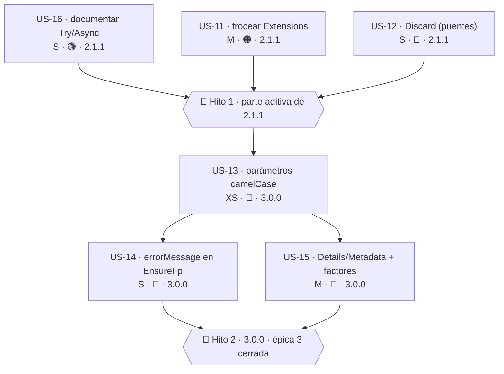

# Épica 3 · Nomenclatura de la superficie pública

> **Versión destino** · 2.1.1 (US-11, US-12 aditiva, US-16) · 3.0.0 (US-12 retirada, US-13, US-14, US-15)
> **Origen** · [`Mejoras/Core/01-Nomenclatura-y-Estandares.md`](../../../Mejoras/Core/01-Nomenclatura-y-Estandares.md) · puntos 03, 04, 05, 08, 09, 10, 11, 14
> **Plan del que se desgaja** · [`README.md`](README.md) de la versión 2.1.1
> **Proyecto** · `src/MoralesLarios.OOFP.Core` (+ 29 proyectos dependientes)
> **Estado** · 🔄 en curso · US-16 ✅ completada · US-11 ✅ completada · US-12 ⬜
> **Esfuerzo** · **L** (~3,0 jornadas)
> **Riesgo** · 🟠 alto en US-11 · 🔴 muy alto en US-12 … US-15 · 🟢 bajo en US-16
>
> **Leyenda de esfuerzo:** XS (<2 h) · S (½ jornada) · M (1 jornada) · L (2 jornadas) · XL (3+ jornadas)
> **Leyenda de riesgo:** 🟢 bajo · 🟡 medio · 🟠 alto · 🔴 muy alto (rompe compatibilidad)

---

## Índice

1. [Contexto y problema](#1-contexto-y-problema)
   - [Punto 05 + 14 — La clase `Extensions` y el *stuttering* de tipos](#punto-05--14--la-clase-extensions-y-el-stuttering-de-tipos)
   - [Punto 04 — Tres nombres para «resultado sin valor»](#punto-04--tres-nombres-para-resultado-sin-valor)
   - [Punto 03 — Parámetros en `PascalCase`](#punto-03--parámetros-en-pascalcase)
   - [Punto 11 — `message` vs `errorMessage` entre guardias hermanas](#punto-11--message-vs-errormessage-entre-guardias-hermanas)
   - [Punto 08 — `Details` / `Metadata` / `errorsDetails`](#punto-08--details--metadata--errorsdetails)
   - [Puntos 09 y 10 — `Async` sin asincronía y `Try*` sin semántica BCL](#puntos-09-y-10--async-sin-asincronía-y-try-sin-semántica-bcl)
2. [Alcance](#2-alcance)
3. [Historias de usuario](#3-historias-de-usuario)
   - [US-11 · Trocear la clase `Extensions` en clases con nombre propio](#us-11--trocear-la-clase-extensions-en-clases-con-nombre-propio)
   - [US-12 · Retirar el miembro público `_` en favor de `Discard`](#us-12--retirar-el-miembro-público-_-en-favor-de-discard)
   - [US-13 · Pasar a `camelCase` los parámetros en `PascalCase`](#us-13--pasar-a-camelcase-los-parámetros-en-pascalcase)
   - [US-14 · Unificar el nombre del parámetro de mensaje en `EnsureFp`](#us-14--unificar-el-nombre-del-parámetro-de-mensaje-en-ensurefp)
   - [US-15 · Unificar `Details` / `Metadata` y simplificar los factores](#us-15--unificar-details--metadata-y-simplificar-los-factores)
   - [US-16 · Documentar la semántica propia de `Try*` y del sufijo `Async`](#us-16--documentar-la-semántica-propia-de-try-y-del-sufijo-async)
4. [Orden de ejecución](#4-orden-de-ejecución)
5. [Decisiones abiertas](#5-decisiones-abiertas)
6. [Definición de terminado](#6-definición-de-terminado)
7. [Apéndice · código actual y propuesto](#7-apéndice--código-actual-y-propuesto)
8. [Ver también](#ver-también)

---

## 1. Contexto y problema

Esta es **la épica caliente**. Las dos anteriores tocan constantes, literales y código interno;
esta toca **nombres que el consumidor escribe en su propio código**. Cada historia de aquí tiene un
coste de migración para los 29 proyectos dependientes y para cualquier consumidor externo.

Por eso la épica está construida sobre una regla estricta:

> **En 2.1.1 sólo entra lo que se puede añadir sin quitar.** Todo lo que obliga al consumidor a
> editar su código queda en 3.0.0.

Esta regla tiene una consecuencia incómoda: **tres de las seis historias no se pueden hacer en
2.1.1 de ninguna manera**, porque los renombrados de parámetro no admiten puente. Se documentan
aquí de todos modos para que el plan de la 3.0.0 esté escrito mientras el análisis está fresco.

| Punto | Fichero | Líneas | Naturaleza | Rompe |
|------:|---------|--------|------------|:-----:|
| 05 | `Helpers/Extensions/Extensions.cs` | 11 | nombre de clase sin información | parcial |
| 14 | `Types/MlResultBindExtensions.cs` | 8 | *stuttering* de tipos | descartado |
| 04 | `Types/MlResult.cs` | 12-16, 118-126, 141-145 | tres nombres para un concepto | sí |
| 03 | `Types/Errors/MlError.cs` · `MlErrorDetails.cs` | 69 · 12 | parámetros en `PascalCase` | sí |
| 11 | `Helpers/EnsureFp.cs` · `EnsureFp.Strings.cs` | 60 vs 30 usos | `message` vs `errorMessage` | sí |
| 08 | `Types/Errors/MlErrorDetails.cs` | 12, 20, 24 | `Details` / `Metadata` / `errorsDetails` | sí |
| 09 | `Types/MlResultBindExtensions.cs` | 40-42, 127-130 | `Async` sin asincronía | no |
| 10 | familia `Try*` | 1.000+ métodos | semántica divergente de la BCL | no |

---

### Punto 05 + 14 — La clase `Extensions` y el *stuttering* de tipos

```csharp
// Helpers/Extensions/Extensions.cs, L11
namespace MoralesLarios.OOFP.Helpers.Extensions;

public static class Extensions   // ← MoralesLarios.OOFP.Helpers.Extensions.Extensions
```

Un tipo llamado `Extensions` dentro de un espacio de nombres llamado `Extensions`. Dos problemas:

1. **Tartamudeo** · el nombre completo repite el segmento. Las directrices de .NET lo desaconsejan
   expresamente.
2. **Riesgo de conflicto real** · ese espacio de nombres está en el `global using` del núcleo, así
   que **cualquier** clase `Extensions` del consumidor entra en ambigüedad.

Y lo más importante: **el nombre no informa de nada**. La clase contiene siete métodos de cuatro
familias distintas, sin relación entre sí:

| Método | Familia | Cometido |
|--------|---------|----------|
| `ToNullable<T>` | nulabilidad | convierte a `T?` |
| `AppendExDetails` | metadatos de excepción | añade la excepción a los detalles |
| `With<T>` | mutación | aplica cambios a un objeto |
| `WithAsync<T>` ×2 | mutación | variantes asíncronas de `With` |
| `VoidToAsync<T>` | elevación a `Task` | devuelve `Task.CompletedTask` |
| `ToFuncTask` ×5 | elevación a `Task` | eleva una `Func` sincrónica a `Func<Task>` |

El punto 14 es el mismo defecto en otra escala: `MlResultBindExtensions` repite `Ml` + `Result` +
familia + `Extensions`. Pero aquí la conclusión del análisis es **distinta**: `<Tipo>Extensions`
**es** la convención de la BCL, y eliminar el prefijo `Ml` sería una ruptura masiva sin ningún
beneficio → ver [D-02](README.md#6-decisiones-pendientes-del-propietario). Lo que sí queda señalado
es que `MlResultExtensions` (632 líneas) es un **cajón de sastre**: mezcla enriquecimiento de error
(`AddMlErrorDetailIfFail`, `AddValueDetailIfFail`) con completado de valor
(`CompleteWithDataValueIfValid`, `CompleteWithDetailsValueIfFail`).

---

### Punto 04 — Tres nombres para «resultado sin valor»

```csharp
// Types/MlResult.cs, L12-16
public static MlResult _ => new(default!);          // ← miembro público llamado "_"

// Types/MlResult.cs, L118-126
public static MlResult<object> Empty() => …;        // ← devuelve MlResult<object>, no MlResult

// Types/MlResult.cs, L141-145
public static MlResult Discard => _;                // ← alias del anterior
```

Tres miembros públicos para **un solo concepto**. Y el peor de los tres es el que menos se puede
defender: `_` es, en C# moderno, el **descarte** del lenguaje (`out _`, `_ => …`, patrones). Usarlo
como nombre de un miembro público:

- impide escribir `MlResult._` en cualquier contexto donde `_` esté ya ligado a un descarte,
- no es descubrible por IntelliSense de forma razonable,
- no existe en ninguna biblioteca funcional comparable.

`Empty()` añade un segundo problema: **devuelve `MlResult<object>`**, no `MlResult`. Así que no es
intercambiable con los otros dos, y el consumidor que lo use arrastra un `object` por toda la
cadena.

---

### Punto 03 — Parámetros en `PascalCase`

```csharp
// Types/Errors/MlError.cs, L69
public static MlError FromErrorMessage(string Message) => …;
//                                            ^^^^^^^ ← PascalCase en un parámetro
```

```csharp
// Types/Errors/MlErrorDetails.cs, L12
public class MlErrorDetails(IEnumerable<MlError>? Errors, Dictionary<string, object>? Details)
//                                                ^^^^^^                             ^^^^^^^
```

El caso de `MlErrorDetails` es el más engañoso de los dos. **Es una `class`, no un `record`**, así
que los parámetros del constructor primario **no generan propiedades**. El consumidor que escribe
argumentos con nombre ve `Errors:` y `Details:` sugeridos por el IDE y asume que existen
propiedades homónimas. No existen:

```csharp
// Types/Errors/MlErrorDetails.cs, L20-24
public IEnumerable<MlError> Errors   => …;                 // sí existe, pero es una propiedad calculada
public Dictionary<string, object> Metadata = Details ?? new();
//                                ^^^^^^^^ ← el parámetro "Details" se llama "Metadata" como propiedad
```

Un renombrado de parámetro **no admite puente `[Obsolete]`**: los argumentos con nombre
(`FromErrorMessage(Message: "x")`) son parte del contrato de código fuente. Ruptura de origen pura
→ 3.0.0.

---

### Punto 11 — `message` vs `errorMessage` entre guardias hermanas

```csharp
// Helpers/EnsureFp.cs
public static MlResult<IEnumerable<T>> NotEmpty<T>(IEnumerable<T> source, string message)
//                                                                               ^^^^^^^
public static MlResult<IEnumerable<T>> NotEmpty<T>(IEnumerable<T> source, MlErrorDetails errorsDetails)
```

```csharp
// Helpers/EnsureFp.Strings.cs, L246-253
public static MlResult<string> NotEmpty(string source, string errorMessage)
//                                                            ^^^^^^^^^^^^ ← la hermana usa otro nombre
```

**Dos sobrecargas del mismo método, en la misma clase estática parcial, con el mismo cometido y
distinto nombre de parámetro.** La incoherencia es sistemática y abarca cuatro conceptos:

| Concepto | Nombres en uso | Nombre objetivo |
|----------|----------------|-----------------|
| Mensaje de error | `message` (~60) · `errorMessage` (~30) · `exceptionAdditionalMessage` | **`errorMessage`** |
| Detalles de error | `errorsDetails` · `errorDetails` · `details` · `Details` | **`errorsDetails`** |
| Función a aplicar | `func` · `funcAsync` · `errorMessageBuilder` · `voidAction` · `changes` | según cometido |
| Origen | `source` · `sourceAsync` · `value` · `t` | **`value`** en guardias · **`source`** en combinadores |

---

### Punto 08 — `Details` / `Metadata` / `errorsDetails`

Un solo concepto —el diccionario de datos asociados a un error— tiene **tres nombres** según dónde
se mire:

| Donde | Nombre | Ocurrencias |
|-------|--------|------------:|
| Parámetro del constructor de `MlErrorDetails` (L12) | `Details` | 1 |
| Propiedad pública de `MlErrorDetails` (L24) | `Metadata` | 1 |
| Parámetro de ~1.800 métodos de extensión | `errorsDetails` | ~1.800 |

A eso se suman **14 factores estáticos con 10 variantes de nomenclatura**:

```
FromErrorsMessagesDetails   FromErrorMessageDetails      FromEnumerableErrors
FromEnumerableErrorsDetails FromEnumerableStrings        FromError
FromErrorDetails (×2)       FromErrorMessage             FromErrorMessageWithException
FromErrorMessageWithValue (×2)
```

Dos defectos concretos:

1. **`FromEnumerableStrings` duplica funcionalmente a `FromErrorsMessagesDetails`** con
   `details = null`.
2. **`Enumerable` como prefijo de nombre de método está desaconsejado** por las directrices de
   .NET: el tipo del parámetro ya lo dice.

---

### Puntos 09 y 10 — `Async` sin asincronía y `Try*` sin semántica BCL

```csharp
// Types/MlResultBindExtensions.cs, L40-42
public static Task<MlResult<TResult>> BindAsync<T, TResult>(this MlResult<T> source,
                                                            Func<T, MlResult<TResult>> func)
    => source.Bind(func).ToAsync();     // ← NO hay nada asíncrono aquí
```

El sufijo `Async` sobre un método **completamente sincrónico**. El propósito es legítimo —permitir
iniciar una cadena que luego sigue con `Await`— pero el coste es doble:

- **Semántico** · el consumidor asume E/S, asume que puede cancelar, asume que no debe bloquear el
  hilo. Nada de eso aplica.
- **Rendimiento** · una asignación de `Task<MlResult<TResult>>` por llamada, en un método que no
  espera nada.

El punto 10 es análogo pero de mayor escala: **más de 1.000 métodos `Try*`** cuya semántica no es la
de la BCL (`TryParse` / `TryGetValue` devuelven `bool` + `out`). Aquí `Try*` significa *«envuelve en
`try/catch` y convierte la excepción en fallo»*. Es una semántica razonable y coherente dentro de la
biblioteca, pero **divergente del ecosistema**.

Renombrar 1.000 métodos no es rentable → [D-04](README.md#6-decisiones-pendientes-del-propietario):
**no tocar, pero documentar**.

---

## 2. Alcance

### Dentro

- Troceado de `Extensions` en cuatro clases con nombre propio, con puentes `[Obsolete]`.
- Consolidación de `_` / `Empty()` / `Discard` en un único miembro canónico.
- Plan de renombrado de los parámetros `PascalCase` de `MlError` y `MlErrorDetails` (ejecución 3.0.0).
- Plan de unificación de `message` → `errorMessage` en `EnsureFp` (ejecución 3.0.0).
- Plan de unificación de `Details` / `Metadata` y simplificación de los 14 factores (ejecución 3.0.0).
- Documentación `<remarks>` de la semántica propia de `Try*` y del sufijo `Async` sincrónico.

### Fuera

- **Eliminar el prefijo `Ml` de los tipos** → **descartado** explícitamente ([D-02](README.md#6-decisiones-pendientes-del-propietario)).
- Renombrar la familia `Try*` → **descartado** ([D-04](README.md#6-decisiones-pendientes-del-propietario)).
- El paso de `Task<T>` a `ValueTask<T>` en los métodos sincrónicos → `Mejoras/Core/06-Rendimiento.md` *(pendiente)*.
- Añadir `CancellationToken` a los 3.436 métodos asíncronos → `Mejoras/Core/02-Interoperabilidad-BCL.md` *(pendiente)*.
- Excluir `OperationCanceledException` del `catch` de los `Try*` → `Mejoras/Core/03-Modelo-de-Error.md` *(pendiente)*.
- Trocear los 20.134 líneas de `MlResultBindExtensions` + `MlResultMapExtensions` y repartir el
  cajón de sastre `MlResultExtensions` → `Mejoras/Core/05-Superficie-de-API-y-Arquitectura.md` *(pendiente)*.
- Las erratas públicas (`Faild`, `Diferent`, `Alwais`, `Lenght`) → [`Epica-Erratas-Identificadores-Publicos.md`](../../2.1/Epica-Erratas-Identificadores-Publicos.md).

---

## 3. Historias de usuario

### US-11 · Trocear la clase `Extensions` en clases con nombre propio

> **Como** consumidor del núcleo
> **quiero** que las clases de extensión digan qué extienden
> **para** encontrar el método que busco sin leer la clase entera.

- **Esfuerzo** · M (~0,75 j) · **Riesgo** · 🟠 · **Depende de** · US-09 (épica 2) · **Versión** · 2.1.1
- **Estado** · ✅ **completada**

Criterios de aceptación:

- [x] Resuelta [D-06](README.md#6-decisiones-pendientes-del-propietario) sobre `With<T>`: se
      mantiene la mutación y se documenta explícitamente (opción **a**).
- [x] Existen las cuatro clases nuevas con los métodos repartidos según la tabla de abajo.
- [x] `Extensions` sigue existiendo como `partial` con puentes `[Obsolete]` para la invocación en
      forma estática.
- [x] Cada clase nueva tiene `<summary>` propio que describe su familia.
- [x] El código de los 29 proyectos dependientes **compila sin un solo cambio**.
- [x] Los tests siguen en verde sin modificar ninguno.

**Entregables** (commit de US-11):

| Entregable | Detalle |
|------------|---------|
| `Helpers/Extensions/NullableExtensions.cs` | nuevo · `ToNullable<T>` |
| `Helpers/Extensions/ExceptionMetadataExtensions.cs` | nuevo · `AppendExDetails` |
| `Helpers/Extensions/MutationExtensions.cs` | nuevo · `With<T>` + `WithAsync<T>` ×2 · `<remarks>` que advierte de la **mutación en sitio** (D-06) |
| `Helpers/Extensions/TaskLiftExtensions.cs` | nuevo · `VoidToAsync<T>` + `ToFuncTask` ×5 |
| `Helpers/Extensions/Extensions.cs` | reducido a la declaración `public static partial class Extensions` con el `<summary>`/`<remarks>` de compatibilidad |
| `Helpers/Extensions/Extensions.Obsolete.cs` | nuevo · **11 puentes NO-extensión** (sin `this`) con `<inheritdoc>`, `[Obsolete("Moved to <Clase>. Will be removed in 3.0.0.", false)]` y `[EditorBrowsable(EditorBrowsableState.Never)]` |
| Tests | `ExtensionsSplitTests` (3) · total del núcleo **850 → 853** |

**Verificación** · `dotnet build` de la solución en `Release --no-incremental`: `EXIT=0`, **0
errores**, 119 advertencias (todas preexistentes), **0 `CS0121`** y **0 `CS1591`**. `dotnet test` de
la solución: `EXIT=0`, **853/853** en el núcleo y `Con error: 0` en los 9 proyectos de pruebas.

**Reparto propuesto:**

| Clase nueva | Métodos que recibe |
|-------------|--------------------|
| `NullableExtensions` | `ToNullable<T>` |
| `ExceptionMetadataExtensions` | `AppendExDetails` |
| `MutationExtensions` | `With<T>`, `WithAsync<T>` ×2 |
| `TaskLiftExtensions` | `VoidToAsync<T>`, `ToFuncTask` ×5 |

**Notas técnicas** · aquí está **la clave que hace esta historia sorprendentemente barata para su
impacto**:

> Mover un método de extensión estático de una clase estática a otra **no rompe la invocación en
> forma de extensión**. `x.ToNullable()` sigue compilando mientras el espacio de nombres esté
> importado, porque la resolución de métodos de extensión busca en **todas** las clases estáticas
> del espacio de nombres, no en una concreta.

Lo único que se rompe es la invocación en **forma estática**: `Extensions.ToNullable(x)`. Y eso se
cubre con puentes `[Obsolete]` en la `Extensions` original, que se mantiene `partial`.

El espacio de nombres **no cambia** (`MoralesLarios.OOFP.Helpers.Extensions`), con lo cual el
`global using` del núcleo sigue cubriendo todo.

> **Nota sobre el punto 14** · el *stuttering* `MlResultBindExtensions` **no se corrige**: el patrón
> `<Tipo>Extensions` es la convención correcta, y quitar el prefijo `Ml` está descartado por
> [D-02](README.md#6-decisiones-pendientes-del-propietario). El reparto del cajón de sastre
> `MlResultExtensions` queda para el documento de arquitectura.

**Tests mínimos**:

| Test | Comprueba | Estado |
|------|-----------|--------|
| `Extensiones_InvocacionComoExtension_SigueFuncionando` | `x.ToNullable()`, `x.With(…)`, `f.ToFuncTask()` compilan e invocan la implementación nueva (las 11 firmas, en forma de extensión) | ✅ |
| `Extensions_PuentesEstaticos_EstanObsoletos` | vía reflexión, los puentes de `Extensions` llevan `[Obsolete]` con `IsError == false` y mensaje que cita `3.0.0`, y **no** están marcados con `ExtensionAttribute` | ✅ |
| `ClasesDeExtension_TienenSummary` | el XML generado contiene `<summary>` no vacío para las cuatro clases nuevas | ✅ |

**Riesgo principal** · que algún consumidor use la forma estática. El puente lo cubre, pero genera
`CS0618` en su compilación. Mitigación: `[Obsolete(…, false)]` (advertencia, no error) y registro en
el documento de migración.

---

### US-12 · Retirar el miembro público `_` en favor de `Discard`

> **Como** consumidor
> **quiero** un único nombre para «resultado válido sin valor relevante»
> **para** no tener que elegir entre tres miembros equivalentes.

- **Esfuerzo** · S (½ j) · **Riesgo** · 🔴 · **Depende de** · nada · **Versión** · 2.1.1 (puente) + 3.0.0 (retirada)

Criterios de aceptación:

- [ ] Resuelta [D-03](README.md#6-decisiones-pendientes-del-propietario) sobre `Empty()` / `EmptyAsync()`.
- [ ] `Discard` pasa a ser la **implementación**, no el alias: `public static MlResult Discard => new (default!);`.
- [ ] `_` pasa a ser un puente `[Obsolete]` que reenvía a `Discard`, en `Types/MlResult.Obsolete.cs`.
- [ ] `Empty()` y `EmptyAsync()` quedan `[Obsolete]` en favor de `Discard`.
- [ ] `Discard` tiene `<summary>` que dice: *«Resultado válido sin valor relevante. Equivalente
      funcional a `Unit`.»*
- [ ] Todos los usos internos del núcleo y de los 29 proyectos usan `Discard`.
- [ ] En 3.0.0 desaparecen `_`, `Empty()` y `EmptyAsync()`.

**API propuesta**:

```csharp
// ───── 2.1.1 · Types/MlResult.cs ─────
/// <summary>
/// Resultado válido sin valor relevante. Equivalente funcional a <c>Unit</c>.
/// </summary>
public static MlResult Discard => new (default!);
```

```csharp
// ───── 2.1.1 · Types/MlResult.Obsolete.cs ─────
// Puentes [Obsolete] de la v2.0.0: nombres antiguos que reenvian al nombre nuevo. Se eliminan en la v3.0.0.
[Obsolete("Renamed to Discard. Will be removed in 3.0.0.", false)]
[EditorBrowsable(EditorBrowsableState.Never)]
public static MlResult _ => Discard;

[Obsolete("Use Discard instead. Will be removed in 3.0.0.", false)]
[EditorBrowsable(EditorBrowsableState.Never)]
public static MlResult<object> Empty() => …;
```

**Notas técnicas** · el cambio de `Discard => _` a `_ => Discard` es **puramente de dirección**: el
comportamiento observable es idéntico, pero deja el nombre canónico como implementación y el antiguo
como puente, lo que permite borrar el puente en 3.0.0 sin tocar nada más.

Sobre `Empty()`: devuelve `MlResult<object>`, no `MlResult`, así que **no es un alias de `Discard`**
y la sustitución no es mecánica. Si se quiere un «sin valor» con tipo explícito, lo correcto es
introducir un tipo `Unit` → queda anotado como [D-12](#5-decisiones-abiertas).

**Tests mínimos**:

| Test | Comprueba |
|------|-----------|
| `MlResult_Discard_EsValido` | `MlResult.Discard.IsValid == true` |
| `MlResult_Guion_DelegaEnDiscard` | `MlResult._` y `MlResult.Discard` son equivalentes |
| `MlResult_MiembrosDescartados_EstanObsoletos` | `_`, `Empty`, `EmptyAsync` llevan `[Obsolete]` |

**Riesgo principal** · `_` puede estar muy usado en código de consumidor por su brevedad. La
advertencia `CS0618` es suficiente aviso, pero el documento de migración debe dar la sustitución
exacta.

---

### US-13 · Pasar a `camelCase` los parámetros en `PascalCase`

> **Como** consumidor que usa argumentos con nombre
> **quiero** que los parámetros sigan la convención de .NET
> **para** que el IDE me sugiera nombres coherentes con el resto de la biblioteca.

- **Esfuerzo** · XS (<2 h) · **Riesgo** · 🔴 · **Depende de** · nada · **Versión** · **3.0.0** (sin puente posible)

Criterios de aceptación:

- [ ] `MlError.FromErrorMessage(string Message)` → `(string errorMessage)`.
- [ ] `MlErrorDetails(IEnumerable<MlError>? Errors, Dictionary<string, object>? Details)` →
      `(IEnumerable<MlError>? errors, Dictionary<string, object>? metadata)`.
- [ ] Un análisis de la solución confirma que **ningún** sitio usa esos parámetros como argumento
      con nombre (o se han corregido todos).
- [ ] La ruptura está registrada en `oofp-upgrade-2.prompt.md` §3.3 y en el anexo de renombrados.
- [ ] `CA1707` / el analizador de nomenclatura no señala ningún parámetro del núcleo.

**Notas técnicas** · ⚠️ **esta historia no se puede entregar en 2.1.1 de ninguna forma.** No existe
mecanismo de puente para un nombre de parámetro: no se puede marcar `[Obsolete]` un parámetro, y
añadir una sobrecarga con el nombre nuevo generaría ambigüedad irresoluble. Es ruptura de **código
fuente** pura.

El renombrado de `Details` → `metadata` resuelve además el punto 08 en su mitad más visible: hace
que el nombre del parámetro coincida con el de la propiedad que alimenta (`Metadata`), eliminando la
sugerencia engañosa del IDE.

**Tests mínimos**:

| Test | Comprueba |
|------|-----------|
| `Parametros_TodosCamelCase` | recorrido por reflexión de todos los métodos públicos del núcleo verificando que ningún parámetro empieza por mayúscula |

**Riesgo principal** · un consumidor que escriba `FromErrorMessage(Message: "x")` no compila tras
la actualización. El diagnóstico (`CS1739`) es claro y señala la línea exacta, así que la migración
es guiada por el compilador.

---

### US-14 · Unificar el nombre del parámetro de mensaje en `EnsureFp`

> **Como** consumidor de las guardias
> **quiero** que sobrecargas hermanas usen el mismo nombre de parámetro
> **para** poder usar argumentos con nombre sin consultar la firma exacta.

- **Esfuerzo** · S (½ j) · **Riesgo** · 🔴 · **Depende de** · US-13 · **Versión** · **3.0.0**

Criterios de aceptación:

- [ ] Todo parámetro `string` de mensaje de error en `EnsureFp.*` se llama **`errorMessage`**
      (~60 renombrados desde `message`).
- [ ] Todo parámetro de detalles se llama **`errorsDetails`**.
- [ ] En las guardias el origen se llama **`value`**; en los combinadores, **`source`**.
- [ ] `exceptionAdditionalMessage` se conserva, porque **no es** el mensaje de error principal: es un
      añadido. Se documenta la diferencia en su `<param>`.
- [ ] La ruptura está registrada en `oofp-upgrade-2.prompt.md` §3.3 y en el anexo de renombrados.

**Alcance medido:**

| Nombre actual | Ocurrencias aprox. | Nombre objetivo |
|---------------|-------------------:|-----------------|
| `message` | ~60 | `errorMessage` |
| `errorMessage` | ~30 | *(sin cambio)* |
| `errorDetails` / `details` | varios | `errorsDetails` |
| `t` | varios | `value` |

**Notas técnicas** · como US-13, es ruptura de origen sin puente. La diferencia es de **alcance**:
aquí hay ~90 firmas afectadas y la biblioteca de guardias es, con diferencia, la parte del núcleo
donde los argumentos con nombre son más habituales (`EnsureFp.NotEmpty(source, message: "…")`), con
lo cual el impacto real sobre consumidores es **mayor** que el de US-13 pese a ser técnicamente la
misma clase de cambio.

**Tests mínimos**:

| Test | Comprueba |
|------|-----------|
| `EnsureFp_ParametroDeMensaje_SeLlamaErrorMessage` | recorrido por reflexión de todos los métodos públicos de `EnsureFp`: ningún parámetro `string` de mensaje se llama `message` |
| `EnsureFp_ParametroDeDetalles_SeLlamaErrorsDetails` | ídem para `MlErrorDetails` |

**Riesgo principal** · alto volumen de rupturas silenciosas para quien use argumentos con nombre.
Mitigación: tabla exhaustiva de antes/después en el anexo de renombrados, para que la migración se
pueda automatizar con búsqueda y reemplazo.

---

### US-15 · Unificar `Details` / `Metadata` y simplificar los factores

> **Como** consumidor del modelo de error
> **quiero** un único nombre para el diccionario de datos del error y un juego de factores coherente
> **para** no tener que aprender tres nombres y diez variantes.

- **Esfuerzo** · M (~0,75 j) · **Riesgo** · 🔴 · **Depende de** · US-13 · **Versión** · **3.0.0**

Criterios de aceptación:

- [ ] Resuelta [D-11](#5-decisiones-abiertas) sobre el nombre canónico del diccionario.
- [ ] El parámetro del constructor, la propiedad y los ~1.800 parámetros de método usan la
      nomenclatura canónica decidida.
- [ ] `FromEnumerableStrings` queda retirado por duplicar a `FromErrorsMessagesDetails`.
- [ ] Los factores con prefijo `FromEnumerable*` se renombran quitando `Enumerable`.
- [ ] Los 14 factores quedan documentados en una tabla del `README.md` del núcleo, indicando cuál
      usar en cada caso.
- [ ] Las rupturas están registradas en `oofp-upgrade-2.prompt.md` §3.3 y en el anexo de renombrados.

**Mapa de factores propuesto:**

| Hoy | 3.0.0 | Motivo |
|-----|-------|--------|
| `FromEnumerableErrors` | `FromErrors` | `Enumerable` es redundante con el tipo |
| `FromEnumerableErrorsDetails` | `FromErrorsWithDetails` | ídem + sufijo coherente |
| `FromEnumerableStrings` | **retirado** | duplica `FromErrorsMessagesDetails` con `details = null` |
| `FromErrorDetails` ×2 | *(revisar las 2 sobrecargas)* | mismo nombre, dos firmas: verificar que la ambigüedad es intencionada |
| resto | *(sin cambio)* | — |

**Notas técnicas** · ⚠️ **esta es la historia de mayor alcance mecánico de las tres épicas**:
~1.800 parámetros. No es difícil —es un renombrado verificado por el compilador— pero toca los dos
ficheros grandes (`MlResultBindExtensions.cs`, `MlResultMapExtensions.cs`), que **no admiten
edición con herramientas de parche difuso**. La ejecución debe ser con una herramienta de
renombrado basada en Roslyn (como `scripts/tools/MlRename`, ya usada en la campaña de 888
renombrados de la 2.0.0), no con búsqueda y reemplazo textual.

**Tests mínimos**:

| Test | Comprueba |
|------|-----------|
| `MlErrorDetails_NombreDelDiccionario_EsCoherente` | el parámetro del constructor y la propiedad tienen el mismo nombre módulo `camelCase`/`PascalCase` |
| `MlError_Factores_SinPrefijoEnumerable` | ningún método público de `MlError`/`MlErrorDetails` contiene `Enumerable` en su nombre |

**Riesgo principal** · corromper uno de los dos ficheros grandes durante el renombrado masivo.
Mitigación obligatoria: herramienta Roslyn + verificación del recuento de líneas + compilación
`--no-incremental` + los 1.060 tests.

---

### US-16 · Documentar la semántica propia de `Try*` y del sufijo `Async`

> **Como** consumidor
> **quiero** que la documentación me diga en qué se diferencian `Try*` y `*Async` de lo que espero
>  de la BCL
> **para** no cometer errores por analogía.

- **Esfuerzo** · S (½ j) · **Riesgo** · 🟢 · **Depende de** · nada · **Versión** · 2.1.1
- **Estado** · ✅ **completada**

Criterios de aceptación:

- [x] Cada familia `Try*` tiene un `<remarks>` compartido que explica la semántica propia:
      *«envuelve la ejecución en `try/catch` y convierte la excepción en un fallo de `MlResult`; no
      devuelve `bool` ni usa parámetros `out`, al contrario que `TryParse` o `TryGetValue` de la
      BCL»*.
- [x] Los métodos `*Async` que **no** son asíncronos documentan en su `<returns>` que la tarea
      devuelta **ya está completada** y que su único propósito es iniciar una cadena asíncrona.
- [x] El `README.md` del núcleo contiene una sección «Convenios de nomenclatura» que recoge
      ambas semánticas.
- [x] Se ha inventariado qué métodos `*Async` son realmente sincrónicos (al menos los de
      `MlResultBindExtensions.cs` L40-42 y L127-130) y el inventario queda en el documento de
      rendimiento.
- [x] `CS1591` sigue en 0.

**Entregables** (commit de US-16):

| Entregable | Detalle |
|------------|---------|
| `<remarks>` de familia | 6 clases: `EnsureFp`, `MlResultBindExtensions`, `MlResultConversions`, `MlResultExecSelfExtensions`, `MlResultMapExtensions`, `MlResultMatchExtensions` |
| `<returns>` con `<para>` | **248** métodos `*Async` sin asincronía real, en 14 ficheros |
| `Types/MlResult.TryGet.cs` | nuevo · `TryGetValue(out T)` y `TryGetErrors(out MlErrorDetails)` (D-13, aditivo) |
| `README.md` del núcleo | nueva sección [§15 «Convenios de nomenclatura»](../../../../MoralesLarios.OOFP.Core/README.md#15-convenios-de-nomenclatura) (2.042 → 2.135 líneas) |
| `Mejoras/Core/06-Rendimiento.md` | inventario completo de los 248 métodos, implicaciones y acciones aplazadas |
| Tests | `MlResultTryGetTests` (9) + `NamingConventionsDocTests` (6) · total del núcleo **835 → 850** |

**Verificación** · `dotnet build` del núcleo: `EXIT=0`, 4 advertencias preexistentes (`CS8604` en
`Helpers/EnsureFp.Strings.cs`), **0 `CS1591`**. `dotnet test` del núcleo: **850/850 correctas**.

**API propuesta**:

```csharp
// ───── 2.1.1 ─────
/// <summary>
/// Encadena <paramref name="func"/> sobre el valor de <paramref name="source"/> si es válido.
/// </summary>
/// <returns>
/// Una tarea <b>ya completada</b> con el resultado. Este método no realiza ninguna operación
/// asíncrona: el sufijo <c>Async</c> existe para permitir iniciar una cadena que continúa con
/// combinadores asíncronos. No admite cancelación.
/// </returns>
public static Task<MlResult<TResult>> BindAsync<T, TResult>(…)
```

**Notas técnicas** · ésta es la historia que **cierra los puntos 09 y 10 sin romper nada**, y es por
eso la única de las seis que entra en 2.1.1 junto con US-11 y la parte aditiva de US-12.

Las dos mejoras de fondo quedan explícitamente fuera y remitidas:

- `Task<T>` → `ValueTask<T>` en los métodos sincrónicos (una asignación por llamada) →
  `Mejoras/Core/06-Rendimiento.md`.
- Excluir `OperationCanceledException` del `catch` de los `Try*` (hoy una cancelación se convierte
  en un fallo de negocio, lo cual es un defecto real) → `Mejoras/Core/03-Modelo-de-Error.md`.

**Tests mínimos**:

| Test | Comprueba | Estado |
|------|-----------|--------|
| `BindAsync_SinAsincronia_DevuelveTareaCompletada` | la `Task` devuelta tiene `IsCompleted == true` inmediatamente | ✅ |
| `MapAsync_SinAsincronia_DevuelveTareaCompletada` | ídem para la familia `Map` | ✅ |
| `ValidAsync_SinAsincronia_DevuelveTareaCompletada` | ídem para el factor `MlResult{T}.ValidAsync` | ✅ |
| `Documentacion_FamiliaTry_TieneRemarks` | el XML generado contiene `<remarks>` en las 6 familias, con las palabras `Try`, `try/catch` y `BCL` | ✅ |
| `Documentacion_SufijoAsync_SeExplicaEnCadaFamilia` | el `<remarks>` de las 6 familias menciona `Async` y «completada» | ✅ |
| `Documentacion_TryGetValue_Y_TryGetErrors_EstanDocumentados` | el XML contiene los dos miembros nuevos con documentación | ✅ |
| `MlResultTryGetTests` (9 casos) | contrato `bool` + `out` de `TryGetValue` / `TryGetErrors` y su complementariedad | ✅ |

**Riesgo principal** · ninguno técnico. El riesgo es de **esfuerzo**: documentar 1.000 métodos
individualmente sería desproporcionado. El criterio es un `<remarks>` **por familia**, no por
método, y un `<returns>` sólo en los `*Async` sincrónicos realmente identificados.

---

## 4. Orden de ejecución



| Orden | Historia | Esfuerzo | Jornadas | Versión | Acumulado |
|------:|----------|:--------:|---------:|:-------:|----------:|
| 1 | US-16 · documentar `Try*` / `Async` | S | 0,5 | 2.1.1 | 0,5 |
| 2 | US-11 · trocear `Extensions` | M | 0,75 | 2.1.1 | 1,25 |
| 3 | US-12 · `Discard` (nombre nuevo + puentes) | S | 0,5 | 2.1.1 | 1,75 |
| — | 🎯 **Hito 1 · parte aditiva de 2.1.1** | | | | **1,75** |
| 4 | US-13 · parámetros a `camelCase` | XS | 0,125 | 3.0.0 | 1,875 |
| 5 | US-14 · `errorMessage` en `EnsureFp` | S | 0,5 | 3.0.0 | 2,375 |
| 6 | US-15 · `Details`/`Metadata` + factores | M | 0,625 | 3.0.0 | 3,0 |
| — | 🎯 **Hito 2 · épica 3 cerrada** | | | | **3,0** |

**Total: 3,0 jornadas** · de las cuales **1,75 son entregables en 2.1.1** y **1,25 quedan para la
3.0.0**.

> **Nota de secuenciación** · US-16 va primera porque es la única sin riesgo y porque obliga a
> inventariar qué `*Async` son sincrónicos, información que luego aprovecha el documento de
> rendimiento. US-13 va antes que US-14 y US-15 porque fija el convenio (`camelCase`) que esas dos
> aplican a escala.

---

## 5. Decisiones abiertas

Esta épica hereda cuatro decisiones del análisis ([D-02](README.md#6-decisiones-pendientes-del-propietario),
[D-03](README.md#6-decisiones-pendientes-del-propietario), [D-04](README.md#6-decisiones-pendientes-del-propietario),
[D-06](README.md#6-decisiones-pendientes-del-propietario)) y añade tres propias:

| Id | Decisión | Opciones | Recomendación | Bloquea |
|----|----------|----------|---------------|---------|
| **D-02** *(heredada)* | ¿Se mantiene el prefijo `Ml` en los tipos? | (a) mantener · (b) quitar | **(a) mantener** · quitarlo rompe los 15 tipos públicos y los 29 proyectos sin aportar nada; el prefijo cumple además la función de desambiguar frente a `Result` de otras bibliotecas | US-11 |
| **D-03** *(heredada)* | ¿Qué hacer con `MlResult.Empty()` / `EmptyAsync()`? | (a) conservar · (b) `[Obsolete]` en favor de `Discard` · (c) cambiar su tipo de retorno a `MlResult` | **(b)** · devuelven `MlResult<object>`, lo que arrastra un `object` por la cadena; la opción (c) sería una ruptura binaria silenciosa | US-12 |
| **D-04** *(heredada)* | ¿Se renombra la familia `Try*`? | (a) renombrar a `Attempt*` · (b) renombrar sólo las colisiones con la BCL · (c) no tocar, documentar | **(c)** · son 1.000+ métodos; el coste de migración es inasumible frente al beneficio. Se complementa introduciendo `TryGet*` donde la semántica BCL sí aplica | US-16 |
| **D-06** *(heredada)* | ¿`With<T>` debe copiar en vez de mutar? | (a) dejar la mutación y renombrar a `Mutate` · (b) cambiar a copia manteniendo el nombre · (c) ofrecer ambos | **(a)** · la opción (b) cambia el comportamiento **sin que el compilador avise**, que es la peor clase de ruptura posible | US-11 |
| **D-11** | ¿Cuál es el nombre canónico del diccionario de datos del error? | (a) `Metadata` (nombre de la propiedad actual) · (b) `Details` (nombre del parámetro) · (c) `ErrorsDetails` (nombre de los ~1.800 parámetros) | **(a) `Metadata`** · es el único de los tres que describe *qué es* y no *dónde está*; además es el nombre que ya ve el consumidor al acceder a la propiedad. Implica renombrar ~1.800 parámetros a `metadata`, lo cual es mecánico | US-15 |
| **D-12** | ¿Se introduce un tipo `Unit` explícito? | (a) no, `Discard` basta · (b) sí, `MlResult<Unit>` como sustituto de `Empty()` | **(a) no** en 2.1.1 · añadir un tipo público nuevo merece su propia decisión de diseño; reconsiderar en el documento de arquitectura | US-12 |
| **D-13** | ¿Se añade `TryGet*` con semántica BCL (`bool` + `out`)? | (a) sí, para `TryGetValue` y `TryGetErrors` · (b) no, mantener sólo el estilo propio | **(a) sí** · es puramente aditivo, no rompe nada y da al consumidor la forma que espera del ecosistema para los dos casos donde realmente aplica | US-16 |

---

## 6. Definición de terminado

Además de los [criterios comunes](README.md#8-definición-de-terminado-común):

### Para la parte de 2.1.1 (US-11, US-12 aditiva, US-16)

- [ ] Las cuatro clases de extensión nuevas existen y `Extensions` conserva puentes `[Obsolete]`.
- [ ] `MlResult.Discard` es la implementación; `_`, `Empty()` y `EmptyAsync()` son puentes
      `[Obsolete]` en `Types/MlResult.Obsolete.cs`.
- [x] Cada familia `Try*` tiene `<remarks>` y cada `*Async` sincrónico tiene `<returns>` explícito.
- [x] El `README.md` del núcleo tiene la sección «Convenios de nomenclatura».
- [ ] **Los 29 proyectos dependientes compilan sin ningún cambio de código.**
- [ ] Las rupturas constan en
      [`oofp-upgrade-2.prompt.md`](../../../Copilot/.github/prompts/oofp-upgrade-2.prompt.md) §3.3 y
      los renombrados en
      [`oofp-upgrade-2.renames.md`](../../../Copilot/.github/prompts/oofp-upgrade-2.renames.md).

### Para la parte de 3.0.0 (US-13, US-14, US-15)

- [ ] Ningún parámetro público del núcleo empieza por mayúscula.
- [ ] Ningún parámetro `string` de mensaje de error se llama `message`.
- [ ] El diccionario de datos del error tiene **un solo nombre** en toda la superficie.
- [ ] Ningún método público contiene `Enumerable` en su nombre.
- [ ] Los ficheros `*.Obsolete.cs` de los puentes de 2.1.1 han desaparecido.
- [ ] La tabla completa de antes/después está en el anexo de renombrados, en formato apto para
      búsqueda y reemplazo.

---

## 7. Apéndice · código actual y propuesto

### 7.1 · `Helpers/Extensions/Extensions.cs` · troceado

```csharp
// ───── 2.0.0 ─────
namespace MoralesLarios.OOFP.Helpers.Extensions;

public static class Extensions
{
    public static T? ToNullable<T>(this T source) where T : struct => …;
    public static MlErrorDetails AppendExDetails(this MlErrorDetails source, Exception ex) => …;
    public static T With<T>(this T source, Action<T> changes) => …;
    public static Task<T> WithAsync<T>(this T source, Action<T> changes) => …;
    public static Task<T> WithAsync<T>(this T source, Func<T, Task> changes) => …;
    public static Task VoidToAsync<T>(this T source) => Task.CompletedTask;
    public static Func<Task<TResult>> ToFuncTask<TResult>(this Func<TResult> func) => …;
    // … 4 sobrecargas más de ToFuncTask …
}
```

```csharp
// ───── 2.1.1 ─────
namespace MoralesLarios.OOFP.Helpers.Extensions;   // ← el espacio de nombres NO cambia

/// <summary>Extensiones de conversión a tipos nulables.</summary>
public static class NullableExtensions
{
    public static T? ToNullable<T>(this T source) where T : struct => …;
}

/// <summary>Extensiones para adjuntar información de excepción a los detalles de un error.</summary>
public static class ExceptionMetadataExtensions
{
    public static MlErrorDetails AppendExDetails(this MlErrorDetails source, Exception ex) => …;
}

/// <summary>Extensiones de mutación en sitio de un objeto.</summary>
/// <remarks>Estos métodos MUTAN el objeto recibido; no devuelven una copia. Ver decisión D-06.</remarks>
public static class MutationExtensions
{
    public static T With<T>(this T source, Action<T> changes) => …;
    public static Task<T> WithAsync<T>(this T source, Action<T> changes) => …;
    public static Task<T> WithAsync<T>(this T source, Func<T, Task> changes) => …;
}

/// <summary>Extensiones de elevación de valores y funciones sincrónicas a <see cref="Task"/>.</summary>
public static class TaskLiftExtensions
{
    public static Task VoidToAsync<T>(this T source) => Task.CompletedTask;
    public static Func<Task<TResult>> ToFuncTask<TResult>(this Func<TResult> func) => …;
    // … 4 sobrecargas más …
}
```

```csharp
// ───── 2.1.1 · Helpers/Extensions/Extensions.Obsolete.cs ─────
// Puentes [Obsolete] de la v2.0.0: nombres antiguos que reenvian al nombre nuevo. Se eliminan en la v3.0.0.
// Solo son necesarios para la invocacion en forma ESTATICA: Extensions.ToNullable(x).
// La invocacion como extension (x.ToNullable()) resuelve sola contra las clases nuevas.
public static partial class Extensions
{
    [Obsolete("Moved to NullableExtensions. Will be removed in 3.0.0.", false)]
    [EditorBrowsable(EditorBrowsableState.Never)]
    public static T? ToNullable<T>(T source) where T : struct => NullableExtensions.ToNullable(source);

    // … resto de puentes …
}
```

### 7.2 · `Types/MlResult.cs` · consolidación en `Discard`

```csharp
// ───── 2.0.0 ─────
public static MlResult _       => new(default!);     // L12-16
public static MlResult<object> Empty() => …;         // L118-126
public static MlResult Discard => _;                 // L141-145
```

```csharp
// ───── 2.1.1 ─────
/// <summary>
/// Resultado válido sin valor relevante. Equivalente funcional a <c>Unit</c>.
/// </summary>
public static MlResult Discard => new (default!);
// (_ , Empty() y EmptyAsync() se mueven a Types/MlResult.Obsolete.cs como puentes)
```

```csharp
// ───── 3.0.0 ─────
// Solo queda Discard. Desaparecen _, Empty() y EmptyAsync().
```

### 7.3 · Parámetros · `camelCase`

```csharp
// ───── 2.0.0 ─────
public static MlError FromErrorMessage(string Message) => …;
public class MlErrorDetails(IEnumerable<MlError>? Errors, Dictionary<string, object>? Details)
```

```csharp
// ───── 3.0.0 ─────
public static MlError FromErrorMessage(string errorMessage) => …;
public class MlErrorDetails(IEnumerable<MlError>? errors, Dictionary<string, object>? metadata)
```

### 7.4 · `EnsureFp` · unificación del parámetro de mensaje

```csharp
// ───── 2.0.0 ─────
// Helpers/EnsureFp.cs
public static MlResult<IEnumerable<T>> NotEmpty<T>(IEnumerable<T> source, string message)
// Helpers/EnsureFp.Strings.cs, L246-253
public static MlResult<string> NotEmpty(string source, string errorMessage)
```

```csharp
// ───── 3.0.0 ─────
public static MlResult<IEnumerable<T>> NotEmpty<T>(IEnumerable<T> value, string errorMessage)
public static MlResult<string>         NotEmpty   (string             value, string errorMessage)
```

### 7.5 · Resumen de rupturas

| Elemento | 2.0.0 | 2.1.1 | 3.0.0 | ¿Lo detecta el compilador? |
|----------|-------|-------|-------|:--------------------------:|
| `Extensions.ToNullable(x)` (forma estática) | válido | `[Obsolete]` | **eliminado** | ✅ sí (CS0618 → CS0117) |
| `x.ToNullable()` (forma de extensión) | válido | válido | válido | n/a · **no se rompe** |
| `MlResult._` | válido | `[Obsolete]` | **eliminado** | ✅ sí (CS0618 → CS0117) |
| `MlResult.Empty()` | `MlResult<object>` | `[Obsolete]` | **eliminado** | ✅ sí |
| `FromErrorMessage(Message: …)` | válido | válido | **error** | ✅ sí (CS1739) |
| `NotEmpty(src, message: …)` | válido | válido | **error** | ✅ sí (CS1739) |
| `new MlErrorDetails(Errors: …, Details: …)` | válido | válido | **error** | ✅ sí (CS1739) |
| `FromEnumerableStrings(…)` | válido | válido | **eliminado** | ✅ sí (CS0117) |
| Semántica de `With<T>` (muta) | muta | muta | muta | n/a · **se documenta, no se cambia** |

> ⚠️ **Obligatorio.** Todas las rupturas de esta tabla deben quedar registradas en
> [`../../../Copilot/.github/prompts/oofp-upgrade-2.prompt.md`](../../../Copilot/.github/prompts/oofp-upgrade-2.prompt.md) §3.3,
> y los renombrados (`_` → `Discard`, `Message` → `errorMessage`, `message` → `errorMessage`,
> `Details` → `metadata`, `FromEnumerable*` → `From*`) además en el anexo
> [`oofp-upgrade-2.renames.md`](../../../Copilot/.github/prompts/oofp-upgrade-2.renames.md).

> ✅ **Buena noticia.** Toda ruptura de esta épica **la detecta el compilador**, a diferencia de las
> de la épica 1 (donde cambiaban valores de literales en silencio). La migración del consumidor es
> guiada: compila, lee el error, aplica la sustitución del anexo.

---

## Ver también

- [`README.md`](README.md) · índice de las épicas de la versión 2.1.1
- [`Epica-01-Constantes-Literales-y-Usings.md`](Epica-01-Constantes-Literales-y-Usings.md) · constantes, literales y `using` globales
- [`Epica-02-Higiene-Interna-y-Codigo-Muerto.md`](Epica-02-Higiene-Interna-y-Codigo-Muerto.md) · documenta la clase `Extensions` que aquí se trocea
- [`Mejoras/Core/01-Nomenclatura-y-Estandares.md`](../../../Mejoras/Core/01-Nomenclatura-y-Estandares.md) · análisis de origen (puntos 03, 04, 05, 08, 09, 10, 11, 14)
- [`Next_Versions/2.1/Epica-Erratas-Identificadores-Publicos.md`](../../2.1/Epica-Erratas-Identificadores-Publicos.md) · erratas públicas, fuera de esta épica
- [`oofp-upgrade-2.prompt.md`](../../../Copilot/.github/prompts/oofp-upgrade-2.prompt.md) · guía de migración donde se registran las rupturas
