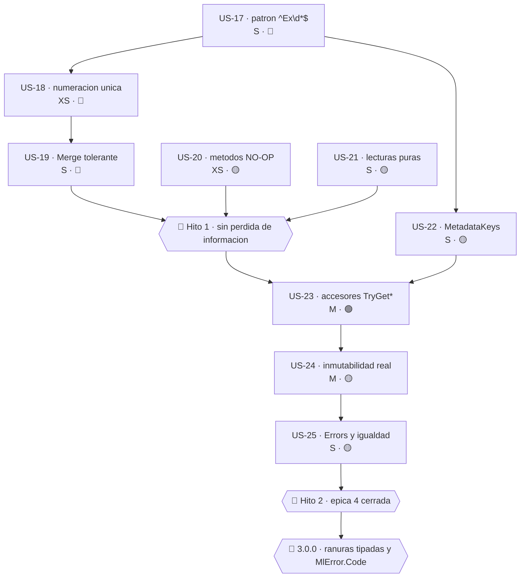

# Épica 4 · El contenedor de metadatos de `MlErrorDetails`

> **Versión destino** · 2.1.1 (US-17 … US-25) · 3.0.0 (rupturas de tipo y ranuras tipadas)
> **Origen** · análisis del contenedor `Dictionary<string, object>` de `MlErrorDetails` · hallazgos **#3** y **#4** de [`Mejoras/Core/README.md`](../../../Mejoras/Core/README.md), más **6 defectos funcionales no catalogados**
> **Plan del que se desgaja** · [`README.md`](README.md) de la versión 2.1.1
> **Proyecto** · `src/MoralesLarios.OOFP.Core` (impacto en `MoralesLarios.OOFP.AspNetCore.Results`)
> **Estado** · ⬜ no iniciada
> **Esfuerzo** · **XL** (~4,75 jornadas)
> **Riesgo** · 🔴 muy alto en US-17 … US-19 (cambian comportamiento observable) · 🟢 / 🟡 en el resto
>
> **Leyenda de esfuerzo:** XS (<2 h) · S (½ jornada) · M (1 jornada) · L (2 jornadas) · XL (3+ jornadas)
> **Leyenda de riesgo:** 🟢 bajo · 🟡 medio · 🟠 alto · 🔴 muy alto (rompe compatibilidad)

---

## Índice

1. [Contexto y problema](#1-contexto-y-problema)
   - [El diseño actual y por qué es defendible](#el-diseño-actual-y-por-qué-es-defendible)
   - [Defecto A — `"Expected"` secuestra la ranura de excepción](#defecto-a--expected-secuestra-la-ranura-de-excepción)
   - [Defecto B — Dos esquemas de numeración incompatibles](#defecto-b--dos-esquemas-de-numeración-incompatibles)
   - [Defecto C — `Merge` lanza `ArgumentException` con claves repetidas](#defecto-c--merge-lanza-argumentexception-con-claves-repetidas)
   - [Defecto D — `AddMetadataRange` descarta su parámetro](#defecto-d--addmetadatarange-descarta-su-parámetro)
   - [Defecto E — El `ToMlErrorsDetails` de tupla pierde los metadatos](#defecto-e--el-tomlerrorsdetails-de-tupla-pierde-los-metadatos)
   - [Defecto F — Lecturas con efecto secundario y doble búsqueda](#defecto-f--lecturas-con-efecto-secundario-y-doble-búsqueda)
   - [Defecto G — Mutabilidad bajo una fachada inmutable](#defecto-g--mutabilidad-bajo-una-fachada-inmutable)
2. [Alcance](#2-alcance)
3. [Historias de usuario](#3-historias-de-usuario)
   - [US-17 · Discriminar las claves de excepción con un patrón exacto](#us-17--discriminar-las-claves-de-excepción-con-un-patrón-exacto)
   - [US-18 · Unificar el esquema de numeración de excepciones](#us-18--unificar-el-esquema-de-numeración-de-excepciones)
   - [US-19 · Hacer `Merge` tolerante a las claves duplicadas](#us-19--hacer-merge-tolerante-a-las-claves-duplicadas)
   - [US-20 · Reparar los dos métodos que descartan su parámetro](#us-20--reparar-los-dos-métodos-que-descartan-su-parámetro)
   - [US-21 · Lecturas sin efecto secundario y con una sola búsqueda](#us-21--lecturas-sin-efecto-secundario-y-con-una-sola-búsqueda)
   - [US-22 · Centralizar las claves bien conocidas en `MetadataKeys`](#us-22--centralizar-las-claves-bien-conocidas-en-metadatakeys)
   - [US-23 · Accesores de metadatos con la semántica de la BCL](#us-23--accesores-de-metadatos-con-la-semántica-de-la-bcl)
   - [US-24 · Metadatos realmente inmutables](#us-24--metadatos-realmente-inmutables)
   - [US-25 · Materializar `Errors` y dar igualdad estructural](#us-25--materializar-errors-y-dar-igualdad-estructural)
4. [Orden de ejecución](#4-orden-de-ejecución)
5. [Decisiones abiertas](#5-decisiones-abiertas)
6. [Definición de terminado](#6-definición-de-terminado)
7. [Apéndice · código actual y propuesto](#7-apéndice--código-actual-y-propuesto)
8. [Ver también](#ver-también)

---

## 1. Contexto y problema

Las tres épicas anteriores tratan **nomenclatura**: cómo se llaman las cosas. Esta épica es
distinta y por eso se separa: trata **el comportamiento** del contenedor de metadatos de
`MlErrorDetails`, y **seis de sus nueve historias corrigen defectos funcionales reales** que hoy
provocan pérdida de información o excepciones lanzadas desde el propio carril de error.

Es la primera épica de esta carpeta que **no es cosmética**.

### Inventario medido

| Métrica | Valor |
|---|---:|
| Firmas **públicas** de Core que exponen `Dictionary<string, object>` | **51** |
| Reparto de esas firmas | `MlResult.cs` 20 · `MlErrorDetails.cs` 18 · `MlResultConversions.cs` 8 · resto 5 |
| Apariciones de `Dictionary<string, object>` en toda la solución | **251** en 25 ficheros |
| Usos de `IReadOnlyDictionary` / `IDictionary` en Core | **0 / 0** |
| Usos de `TryGetValue` en Core | **0** |
| Usos de `ContainsKey` en Core (patrón de doble búsqueda) | **6** |
| Llamadas a `ToDictionary` sobre metadatos en Core | **13** |
| Menciones de `ProblemDetails` en la solución | **253** en 15 ficheros |
| Usos del identificador `errorsDetails` en Core | **687** |

| Defecto | Fichero | Líneas | Naturaleza | Rompe comportamiento |
|---------|---------|-------:|------------|:--------------------:|
| A | `Helpers/Extensions/Extensions.cs` | ~44 | clave mal discriminada | **sí** 🔴 |
| B | `Extensions.cs` + `Types/Errors/MlErrorDetailsActions.cs` | ~44 / ~89 | numeración divergente | **sí** 🔴 |
| C | `Types/Errors/MlErrorDetailsActions.cs` | ~95 | `ToDictionary` con duplicados | **sí** 🔴 |
| D | `Types/Errors/MlErrorDetailsActions.cs` | 2 sobrecargas | parámetro descartado | **sí** 🟡 |
| E | `Types/Errors/MlErrorDetails.cs` | 1 sobrecarga | metadatos descartados | **sí** 🟡 |
| F | `Types/MlResultErrorDetailsExtensions.cs` | varias | lectura con efecto secundario | **sí** 🟡 |
| G | `Types/Errors/MlErrorDetailsActions.cs` | varias | mutación en sitio | no (latente) |

---

### El diseño actual y por qué es defendible

```csharp
// Types/Errors/MlErrorDetails.cs
public partial class MlErrorDetails(IEnumerable<MlError>       Errors  = null!,
                                    Dictionary<string, object> Details = null!)
{
    public IEnumerable<MlError>       Errors   { get; init; } = Errors  ?? new List<MlError>();
    public Dictionary<string, object> Metadata { get; init; } = Details ?? new();
}
```

Una colección de errores **más una bolsa abierta de metadatos** sobre la que se han construido
convenciones de clave: `"Ex"` para la excepción capturada por los `Try*`, `"Value"` para el valor
de entrada, `"ParamName"` / `"Expected"` / `"FailedIndexes"` para las guardias de `EnsureFp`,
`"NotFound"` para que la capa ASP.NET decida un `404`.

**Esta épica no cuestiona la decisión de fondo, que es acertada:**

1. **Extensibilidad a coste cero.** El núcleo no conoce el dominio del consumidor. Sin la bolsa,
   cada uno de los **29 proyectos dependientes** tendría que derivar o envolver el tipo de error.
2. **Evita la explosión de tipos.** La alternativa "pura" (una unión discriminada de errores) en C#
   sin uniones nativas se paga con veinte clases y un `switch` que nunca se cierra.
3. **Las fábricas con nombre ya ocultan el diccionario.** `FromErrorMessageWithException`,
   `FromErrorMessageWithValue<T>`, `AddValueMetadata`, `GetException<T>()`, `ContainsException()`…
   El consumidor habitual no escribe `new Dictionary<string, object>` jamás. **Es la parte mejor
   resuelta del diseño.**
4. **Interopera con el *logging* estructurado** de `Microsoft.Extensions.Logging` sin adaptadores.

Lo que esta épica corrige son **las dos consecuencias no deseadas** de haber llevado esa idea
demasiado lejos:

- **Codificar semántica en prefijos de cadena** (`"Ex"`, `"Ex2"`, `"Ex3"`) en lugar de en una
  ranura tipada. De ahí salen los defectos A, B y C.
- **Publicar el `Dictionary<string, object>` como tipo del contrato** en 51 firmas, lo que convierte
  cada corrección de tipo en una ruptura binaria y deja la "inmutabilidad" en apariencia (defecto G).

---

### Defecto A — `"Expected"` secuestra la ranura de excepción

Es el más grave de la épica, porque **pierde silenciosamente la excepción original**.

```csharp
// Helpers/Extensions/Extensions.cs, L~44
public static Dictionary<string, object> AppendExDetails(this Dictionary<string, object> source, Exception ex)
{
    var exKeys = source.Keys.Where(x => x.StartsWith(ExceptionMetadataKey)).ToList();  // "Ex"
    //                                  ^^^^^^^^^^ ← PREFIJO de 2 caracteres
    var exKey  = exKeys.Any() ? $"{ExceptionMetadataKey}{exKeys.Count + 1}" : ExceptionMetadataKey;
    var result = source.ToDictionary(x => x.Key, x => x.Value);
    result.Add(exKey, ex);
    return result;
}
```

`ExceptionMetadataKey` vale `"Ex"`. Y en el mismo `Constants.cs`:

```csharp
public const string EXPECTED_KEY = "Expected";   // ← empieza por "Ex"
```

**Secuencia reproducible:**

| Paso | Acción | Estado del diccionario | Comentario |
|-----:|--------|------------------------|------------|
| 1 | Una guardia de `EnsureFp.Numbers` falla | `{ "Expected": 100 }` | normal |
| 2 | El fallo se propaga y se adjunta la excepción | `exKeys = ["Expected"]` | ❌ falso positivo |
| 3 | `exKey = "Ex" + (1 + 1)` | `{ "Expected": 100, "Ex2": ex }` | ❌ ranura equivocada |
| 4 | El consumidor llama a `GetException()` | busca la clave exacta `"Ex"` | ❌ **no existe** |
| 5 | Resultado | `MlResult` de fallo: *«The key Ex does not exist»* | 🔴 **excepción perdida** |

Y no es sólo `"Expected"`: **cualquier** clave del consumidor que empiece por `"Ex"`
(`"ExecutionTime"`, `"ExternalId"`, `"ExportFormat"`…) produce el mismo efecto. El diseño reserva
de facto un prefijo de dos caracteres sin documentarlo en ninguna parte.

> **Lo peor del defecto no es el fallo, es su silencio.** No hay excepción, no hay advertencia:
> simplemente la excepción original deja de ser recuperable y el consumidor recibe un mensaje de
> error genérico sobre una clave que, desde su punto de vista, nunca pidió.

---

### Defecto B — Dos esquemas de numeración incompatibles

Los dos sitios del núcleo que numeran excepciones **no usan el mismo esquema**:

```csharp
// Helpers/Extensions/Extensions.cs  →  Ex, Ex2, Ex3, Ex4…
var exKey = exKeys.Any() ? $"{ExceptionMetadataKey}{exKeys.Count + 1}" : ExceptionMetadataKey;
```

```csharp
// Types/Errors/MlErrorDetailsActions.cs, Merge  →  Ex, Ex1, Ex2, Ex3…
$"{ExceptionMetadataKey}{(index == 0 ? string.Empty : index.ToString())}"
```

| Operación | 1.ª excepción | 2.ª | 3.ª | 4.ª |
|-----------|---------------|-----|-----|-----|
| `AppendExDetails` | `Ex` | `Ex2` | `Ex3` | `Ex4` |
| `Merge` | `Ex` | **`Ex1`** | **`Ex2`** | **`Ex3`** |

Consecuencias:

1. **`Merge` renumera las claves existentes.** Un `MlErrorDetails` con `{Ex, Ex2}` sale de un
   `Merge` como `{Ex, Ex1}`. Cualquier consumidor que hubiera guardado la clave `"Ex2"` la pierde.
2. **`Merge` puede generar una colisión con `AppendExDetails`.** Tras un `Merge` que produce
   `{Ex, Ex1}`, llamar a `AppendExDetails` calcula `exKeys.Count + 1 = 3` → `"Ex3"`, dejando un
   hueco en `"Ex2"`. La numeración deja de ser densa y recorrerla con un bucle `for` falla.
3. **No hay una función única de recuperación.** El consumidor que quiera *todas* las excepciones
   tiene que adivinar cuál de los dos esquemas se aplicó.

---

### Defecto C — `Merge` lanza `ArgumentException` con claves repetidas

```csharp
// Types/Errors/MlErrorDetailsActions.cs, L~95
var details = printipalDetailsWitoutEx.Concat(otherDetailsWitoutEx)
                                      .Concat(principalDetailsWithEx)
                                      .ToDictionary(x => x.Key, x => x.Value);
//                                     ^^^^^^^^^^^^ ← lanza ArgumentException si la clave se repite
```

`Enumerable.ToDictionary` **no tolera claves duplicadas**: lanza
`ArgumentException: An item with the same key has already been added`.

**Escenario de alta probabilidad:** fusionar dos fallos de `EnsureFp`. Ambos llevan la clave
`"ParamName"`, porque es la que ponen todas las guardias. Y `MergeErrorsDetailsIfFail` existe
precisamente para fusionar fallos.

```csharp
var a = EnsureFp.NotNull(x, nameof(x));        // Metadata = { "ParamName": "x" }
var b = EnsureFp.NotNull(y, nameof(y));        // Metadata = { "ParamName": "y" }
var c = a.MergeErrorsDetailsIfFail(b);         // 🔴 ArgumentException
```

> **Una excepción lanzada desde el camino de error es el peor sitio posible para una excepción.**
> Toda la razón de ser de `MlResult<T>` es que los fallos no se propaguen como excepciones. Aquí el
> propio mecanismo de acumulación de errores rompe esa garantía justo cuando el programa ya está
> gestionando un fallo, con lo que la causa original se pierde y se sustituye por una
> `ArgumentException` sobre un detalle de implementación interno.

Hay además una **asimetría de política** no documentada: las claves de excepción se renumeran para
convivir, pero las demás claves colisionan y revientan. No hay ninguna razón para tratarlas de
forma distinta.

---

### Defecto D — `AddMetadataRange` descarta su parámetro

**Las dos sobrecargas** calculan el resultado y devuelven el original:

```csharp
// Types/Errors/MlErrorDetailsActions.cs
public static MlErrorDetails AddMetadataRange(this MlErrorDetails source,
                                              IEnumerable<KeyValuePair<string, object>> metadata)
{
    var details = …;                           // ← se calcula…
    return (source.Errors, source.Metadata);   // ← …y se descarta: NO-OP silenciosa
}
```

Son **dos métodos públicos que no hacen nada**. No fallan, no avisan: los metadatos que el
consumidor añade desaparecen. El compilador no lo detecta porque `details` sí se usa (se asigna), y
el tipo de retorno es correcto gracias a la conversión implícita desde la tupla.

---

### Defecto E — El `ToMlErrorsDetails` de tupla pierde los metadatos

```csharp
// Types/Errors/MlErrorDetails.cs · MlErrorDetailsExtensions
public static MlErrorDetails ToMlErrorsDetails(this (MlError error, Dictionary<string, object> details) source)
    => new(source.error.ToMlErrors());
//        ^^^^^^^^^^^^^^^^^^^^^^^^^^^ ← source.details NO se pasa al constructor
```

La sobrecanga hermana, la que recibe `(IEnumerable<MlError>, Dictionary<string, object>)`, **sí**
propaga los detalles. Es un olvido puntual, no una decisión: el parámetro `details` sólo existe en
la tupla para ser ignorado.

Como el tipo tiene **11 operadores implícitos**, esta conversión puede dispararse sin que aparezca
ninguna llamada explícita en el código, lo que hace el defecto especialmente difícil de localizar.

---

### Defecto F — Lecturas con efecto secundario y doble búsqueda

```csharp
// Types/MlResultErrorDetailsExtensions.cs
public static MlResult<T> GetDetail<T>(this MlErrorDetails source, string key)
{
    if ( ! source.Metadata.ContainsKey(key)) return source.AddError($"The key {key} does not exist in the details");
    //                     ^^^^^^^^^^^ 1.ª búsqueda                 ^^^^^^^^^^ ← MUTA el objeto consultado
    var result = source.Metadata[key] is T value ? MlResult<T>.Valid(value)
    //                  ^^^^^^^^^^^^^ 2.ª búsqueda
                 : source.AddError($"The key {key} does not contain a value of type {typeof(T).Name}");
    return result;
}
```

Tres problemas en siete líneas:

1. **Un `get` que escribe.** `AddError` añade un error a la lista del objeto que se estaba
   *consultando*. Consultar una clave ausente **modifica el error**, y hacerlo dos veces añade dos
   errores. Viola el principio de mínima sorpresa de forma grave.
2. **Doble búsqueda** (`ContainsKey` + indexador) donde `TryGetValue` hace una. Con `TryGetValue = 0`
   en todo el núcleo, el patrón está replicado en los **6** usos de `ContainsKey`.
3. **Mensajes en inglés incrustados**, incoherentes con la documentación XML en castellano
   (tensión ya registrada entre [D-05](Epica-01-Constantes-Literales-y-Usings.md#5-decisiones-abiertas)
   y [D-10](Epica-02-Higiene-Interna-y-Codigo-Muerto.md#5-decisiones-abiertas)).

El mismo patrón se repite en `GetMetadataValue<T>`, que además conserva una alternativa comentada
(la retira [US-08](Epica-02-Higiene-Interna-y-Codigo-Muerto.md#us-08--eliminar-los-bloques-de-código-comentado)).

---

### Defecto G — Mutabilidad bajo una fachada inmutable

`{ get; init; }` protege **la referencia**, no el contenido:

```csharp
public static MlErrorDetails AddMetadataOrThrow<T>(this MlErrorDetails source, string key, T value)
{
    source.Metadata.Add(key, value!);          // ← MUTA el diccionario del objeto "inmutable"
    return (source.Errors, source.Metadata);   // ← y devuelve una instancia que COMPARTE la referencia
}
```

Dos consecuencias:

1. **Aliasing.** Toda la familia `AddError*` devuelve `(source.Errors.Append(x), source.Metadata)`:
   la instancia nueva y la antigua **comparten el mismo diccionario**. Añadir un metadato a la nueva
   lo añade también a la antigua, y a todas sus ancestras.
2. **Lanza al segundo intento.** `Dictionary.Add` revienta con clave repetida, de ahí el sufijo
   `OrThrow`. No hay ninguna alternativa no lanzadora: `TryAdd` no se expone y el nombre honesto no
   compensa la falta de una vía segura.

`AddValueMetadata<T>` hace `Remove` + `AddMetadataOrThrow` sobre el diccionario vivo, es decir
**dos mutaciones** sobre un valor supuestamente inmutable.

Además, el diccionario se crea con `new()`, es decir con el comparador **ordinal sensible a
mayúsculas** por omisión. Nunca se eligió: se heredó. Y no está documentado, así que `"ex"` y `"Ex"`
son claves distintas por accidente, no por diseño.

---

## 2. Alcance

**Dentro:**

- Los **seis defectos funcionales** A-F, con sus pruebas de regresión.
- La **mutabilidad** del contenedor (defecto G) en su parte **aditiva**: añadir una vía inmutable y
  desaconsejar la mutadora, sin cambiar el tipo de la propiedad.
- La **centralización de las claves bien conocidas** en un único punto con espacio de nombres.
- **Accesores de lectura** con la semántica de la BCL (`TryGet*`), sin efectos secundarios.
- La **materialización** de `Errors` y la **igualdad estructural** de `MlErrorDetails`.
- Documentar la **política de colisión** y el **comparador de claves**.

**Fuera:**

| Tema | Dónde |
|------|-------|
| Cambiar el tipo de `Metadata` a `IReadOnlyDictionary<string, object?>` (ruptura en 51 firmas) | **3.0.0** · esta épica sólo añade la vista |
| Añadir `MlError.Code` y el mapeo a RFC 7807 | `Mejoras/Core/03-Modelo-de-Error.md` *(pendiente)* → ver [D-17](#5-decisiones-abiertas) |
| Ranuras tipadas de primera clase (`Exceptions`, `Value`, `ParameterName`) | **3.0.0** · ver el [apéndice 7.6](#76--la-forma-objetivo-de-300) |
| Recorte de los 11 operadores implícitos | `Mejoras/Core/04-Nulabilidad-Genericos-y-Contratos.md` *(pendiente)* |
| Unificación del nombre `Details` / `Metadata` (~1.800 parámetros) | [US-15](Epica-03-Miembros-Publicos-y-Firmas.md) de la épica 3 (D-11) |
| Renombrado de los parámetros `Errors` / `Details` a `camelCase` | [US-13](Epica-03-Miembros-Publicos-y-Firmas.md) de la épica 3 |
| Literales `"MlError:"` / `"Details:"` de `ToString()` | [US-06](Epica-01-Constantes-Literales-y-Usings.md) de la épica 1 |
| Erratas `printipal` / `Witout` en `Merge` | [US-07](Epica-02-Higiene-Interna-y-Codigo-Muerto.md) de la épica 2 |
| Retirada del array `NotFoundDetailKeys` de `AspNetCore.Results` | depende de `MlError.Code` → **3.0.0** |

> **Nota de solape** · US-19 y US-07 tocan el **mismo método** `Merge`. US-07 (erratas, épica 2) va
> antes a propósito: así US-19 trabaja sobre identificadores ya corregidos y los dos *diffs* no se
> pisan.

---

## 3. Historias de usuario

### US-17 · Discriminar las claves de excepción con un patrón exacto

> **Como** consumidor que captura una excepción dentro de un `Try*`
> **quiero** poder recuperarla siempre con `GetException()`
> **para** no perder la causa raíz del fallo por el nombre de otra clave de metadatos.

- **Esfuerzo** · S (½ j) · **Riesgo** · 🔴 (cambia comportamiento observable) · **Depende de** · nada · **Versión** · 2.1.1

Criterios de aceptación:

- [ ] La discriminación de claves de excepción usa el patrón exacto `^Ex\d*$`, no `StartsWith("Ex")`.
- [ ] Un `MlErrorDetails` con `{ "Expected": 100 }` que recibe una excepción la guarda en `"Ex"`,
      **no** en `"Ex2"`.
- [ ] `GetException()` la recupera correctamente en ese escenario.
- [ ] Las claves `"ExecutionTime"`, `"ExternalId"`, `"Expected"` y `"ExpectedValue"` **no** se
      cuentan como ranuras de excepción en ningún punto del núcleo.
- [ ] La lógica de discriminación vive en **un único sitio** (un método privado o `internal`
      compartido), no duplicada en `Extensions.cs` y en `MlErrorDetailsActions.cs`.
- [ ] La convención (`"Ex"` reservado, patrón `Ex`, `Ex2`, `Ex3`…) está documentada en el
      `<remarks>` de `MlErrorDetails` y en el `README.md` del núcleo.

**API propuesta:**

```csharp
// Types/Errors/MlErrorDetails.cs
public partial class MlErrorDetails
{
    private static readonly Regex ExceptionKeyPattern =
        new(@"^Ex\d*$", RegexOptions.Compiled | RegexOptions.CultureInvariant);

    internal static bool IsExceptionKey(string key) => ExceptionKeyPattern.IsMatch(key);
}
```

**Notas técnicas** · la alternativa sin `Regex` (y sin su coste de inicialización) es
`key.StartsWith("Ex", StringComparison.Ordinal) && key.AsSpan(2).IsDigitsOrEmpty()`. Dado que el
núcleo compila para `net8.0`, un `[GeneratedRegex]` es la opción preferible: coste nulo en ejecución
y legible. Decide [D-14](#5-decisiones-abiertas).

Hay que comprobar si existe algún consumidor que dependa del comportamiento actual (una clave
`"Ex…"` propia que *quisiera* ser tratada como excepción). El inventario dice que no hay ninguno
dentro de la solución; para el código externo, el cambio se anuncia como corrección de defecto.

**Tests mínimos:**

| Test | Comprueba |
|------|-----------|
| `AppendExDetails_ConClaveExpected_GuardaEnEx` | el escenario del defecto A, paso a paso |
| `GetException_TrasClaveExpected_RecuperaLaExcepcion` | la recuperación ya funciona |
| `IsExceptionKey_ClavesDeUsuarioConPrefijoEx_DevuelveFalse` | `"ExecutionTime"`, `"ExternalId"`, `"ExportFormat"` |
| `IsExceptionKey_ClavesCanonicas_DevuelveTrue` | `"Ex"`, `"Ex2"`, `"Ex10"` |

**Riesgo principal** · es un **cambio de comportamiento sin señal de compilación**. Un consumidor
que leyera `"Ex2"` a mano empezará a encontrar su valor en `"Ex"`. Mitigación: documentarlo como
corrección de defecto en `oofp-upgrade-2.prompt.md` §3.3 y aportar los accesores de
[US-23](#us-23--accesores-de-metadatos-con-la-semántica-de-la-bcl), que eliminan la necesidad de
leer claves numeradas a mano.

---

### US-18 · Unificar el esquema de numeración de excepciones

> **Como** consumidor que recoge varias excepciones acumuladas
> **quiero** que las claves sigan una única secuencia predecible
> **para** poder recorrerlas sin adivinar qué operación las generó.

- **Esfuerzo** · XS (~1 h) · **Riesgo** · 🔴 (cambia claves existentes) · **Depende de** · US-17 · **Versión** · 2.1.1

Criterios de aceptación:

- [ ] Existe **un único** generador de claves de excepción en el núcleo.
- [ ] El esquema es `Ex`, `Ex2`, `Ex3`, `Ex4`… (sin `Ex1`, para no romper el caso de una sola
      excepción, que hoy es `"Ex"`).
- [ ] `Merge` **ya no renumera** las claves de excepción que la parte principal ya tenía: sólo
      asigna claves nuevas a las que entran.
- [ ] La secuencia resultante es **densa**: nunca hay un hueco (`{Ex, Ex3}` sin `Ex2`).
- [ ] `AppendExDetails` llamado tras un `Merge` continúa la secuencia sin colisionar.
- [ ] Un `grep` de `ExceptionMetadataKey}{` en el núcleo devuelve **1 sola** coincidencia.

**API propuesta:**

```csharp
// Types/Errors/MlErrorDetails.cs
internal static string NextExceptionKey(IEnumerable<string> existingKeys)
{
    var used = existingKeys.Where(IsExceptionKey).ToHashSet(StringComparer.Ordinal);
    if ( ! used.Contains(ExceptionMetadataKey)) return ExceptionMetadataKey;
    for (var i = 2; ; i++)
    {
        var candidate = $"{ExceptionMetadataKey}{i}";
        if ( ! used.Contains(candidate)) return candidate;
    }
}
```

**Notas técnicas** · el generador busca el **primer hueco libre**, no `Count + 1`. Eso es lo que
garantiza la densidad y hace que la función sea idempotente frente a estados heredados
inconsistentes (como los `{Ex, Ex1}` que `Merge` produce hoy). El bucle está acotado en la práctica
por el número de excepciones acumuladas, siempre pequeño.

**Tests mínimos:**

| Test | Comprueba |
|------|-----------|
| `NextExceptionKey_SinClaves_DevuelveEx` | primer caso |
| `NextExceptionKey_ConEx_DevuelveEx2` | no genera `Ex1` |
| `NextExceptionKey_ConHueco_RellenaElHueco` | `{Ex, Ex3}` → `Ex2` |
| `Merge_NoRenumeraLasClavesDeLaParteprincipal` | el defecto B |
| `AppendExDetails_TrasMerge_NoColisiona` | la interacción de los dos esquemas |

**Riesgo principal** · igual que US-17: cambio silencioso de claves. Se mitiga con los accesores de
US-23, que hacen innecesario conocer el esquema.

---

### US-19 · Hacer `Merge` tolerante a las claves duplicadas

> **Como** consumidor que acumula varios fallos de validación
> **quiero** que fusionarlos nunca lance una excepción
> **para** que el carril de error no se convierta él mismo en un fallo no gestionado.

- **Esfuerzo** · S (½ j) · **Riesgo** · 🔴 (elimina una excepción que hoy se lanza) · **Depende de** · US-18, [US-07](Epica-02-Higiene-Interna-y-Codigo-Muerto.md#us-07--corregir-printipal--witout-en-identificadores-locales) · **Versión** · 2.1.1

Criterios de aceptación:

- [ ] Fusionar dos `MlErrorDetails` con la misma clave no lanza **ninguna** excepción.
- [ ] El caso concreto `EnsureFp.NotNull(x) ⊕ EnsureFp.NotNull(y)` (ambos con `"ParamName"`)
      produce un `MlErrorDetails` válido con los dos errores.
- [ ] La política de colisión está **decidida** ([D-15](#5-decisiones-abiertas)), **implementada de
      forma uniforme** y **documentada** en el `<remarks>` de `Merge`.
- [ ] Ninguna llamada a `ToDictionary` sobre metadatos puede lanzar `ArgumentException`: un `grep`
      de `ToDictionary` en el núcleo (13 ocurrencias) revisa todas y las que agrupan metadatos usan
      el indexador o una política explícita.
- [ ] `Merge(this MlErrorDetails, IEnumerable<MlErrorDetails>)` deja de ser O(n²): acumula en un
      único diccionario en lugar de recopiarlo en cada vuelta.
- [ ] La misma política se aplica a `AppendExDetails`, cuyo `result.Add(exKey, ex)` tampoco puede
      lanzar.

**API propuesta:**

```csharp
// ───── 2.1.1 ─────   política (b) de D-15: sufijar la clave en conflicto
private static void MergeMetadataInto(Dictionary<string, object> target,
                                      IEnumerable<KeyValuePair<string, object>> source)
{
    foreach (var (key, value) in source)
    {
        if ( ! target.ContainsKey(key)) { target[key] = value; continue; }

        var index = 2;
        while (target.ContainsKey($"{key}{index}")) index++;
        target[$"{key}{index}"] = value;
    }
}
```

**Notas técnicas** · la política (b) preserva **toda** la información, que es lo que se espera de
una operación de acumulación de errores: `{ "ParamName": "x", "ParamName2": "y" }`. Es además
coherente con lo que ya se hace con las excepciones, eliminando la asimetría actual. La política (a)
(«el último gana», con el indexador) es de una línea pero **pierde datos en silencio**, justo el
pecado que esta épica corrige.

**Tests mínimos:**

| Test | Comprueba |
|------|-----------|
| `Merge_ConClaveParamNameEnAmbos_NoLanza` | el defecto C |
| `Merge_ConClaveDuplicada_PreservaLosDosValores` | la política de D-15 |
| `MergeErrorsDetailsIfFail_DosGuardiasEnsureFp_Funciona` | el escenario realista |
| `Merge_DeColeccion_ConservaTodasLasClaves` | la variante de `IEnumerable` |
| `Merge_DeColeccionGrande_NoEsCuadratico` | prueba de rendimiento, 1.000 elementos |

**Riesgo principal** · algún test existente podría estar afirmando que `Merge` **lanza** con claves
duplicadas (es decir, documentando el defecto como comportamiento). Hay que revisar los **1.060
tests** de la solución antes de cambiar nada; si existe tal test, se reescribe y se anota en el
registro de rupturas.

---

### US-20 · Reparar los dos métodos que descartan su parámetro

> **Como** consumidor que añade metadatos en bloque
> **quiero** que los métodos que llamo hagan lo que su nombre dice
> **para** no perder información sin ningún aviso.

- **Esfuerzo** · XS (~1 h) · **Riesgo** · 🟡 · **Depende de** · nada · **Versión** · 2.1.1

Criterios de aceptación:

- [ ] Las **dos** sobrecargas de `AddMetadataRange` devuelven los metadatos que reciben.
- [ ] `ToMlErrorsDetails(this (MlError error, Dictionary<string, object> details) source)` propaga
      `source.details` al constructor.
- [ ] Se ha revisado el resto de las **8** sobrecargas de `ToMlErrorsDetails` y de las **11**
      fábricas estáticas buscando el mismo olvido, y el resultado del barrido queda anotado en la
      historia.
- [ ] Se ha revisado la coherencia de los **11 operadores implícitos**: todos los que reciben un
      diccionario lo propagan.
- [ ] Existe un test que, para **cada** vía de construcción que acepta metadatos, verifica que los
      metadatos llegan al objeto construido.

**API propuesta:**

```csharp
// ───── 2.0.0 ─────
public static MlErrorDetails ToMlErrorsDetails(this (MlError error, Dictionary<string, object> details) source)
    => new(source.error.ToMlErrors());

// ───── 2.1.1 ─────
public static MlErrorDetails ToMlErrorsDetails(this (MlError error, Dictionary<string, object> details) source)
    => new(source.error.ToMlErrors(), source.details);
```

**Notas técnicas** · el test tabular (un `[Theory]` que recorra todas las vías de construcción) es
más valioso que los arreglos en sí: es lo que impide que el olvido vuelva, dado que el tipo tiene
**30 vías distintas** de construirse (11 fábricas + 11 operadores implícitos + 8 extensiones).

**Tests mínimos:**

| Test | Comprueba |
|------|-----------|
| `AddMetadataRange_AñadeLosMetadatos` | el defecto D, las 2 sobrecargas |
| `ToMlErrorsDetails_DeTuplaConDetalles_PropagaLosDetalles` | el defecto E |
| `TodasLasViasDeConstruccion_PropaganLosMetadatos` | `[Theory]` tabular, barrido completo |

**Riesgo principal** · bajo. Que algún consumidor dependa de que `AddMetadataRange` no haga nada es
inverosímil.

---

### US-21 · Lecturas sin efecto secundario y con una sola búsqueda

> **Como** consumidor que consulta un metadato
> **quiero** que la consulta no modifique el error que estoy consultando
> **para** poder inspeccionar un fallo sin alterarlo.

- **Esfuerzo** · S (½ j) · **Riesgo** · 🟡 · **Depende de** · nada · **Versión** · 2.1.1

Criterios de aceptación:

- [ ] `GetDetail<T>` y `GetMetadataValue<T>` **no llaman a `AddError`** sobre el objeto consultado:
      construyen el `MlErrorDetails` de fallo que devuelven sin tocar la instancia de origen.
- [ ] Consultar dos veces una clave ausente produce **el mismo** resultado (idempotencia).
- [ ] Ambos usan `TryGetValue`: un `grep` de `ContainsKey` en los ficheros tocados devuelve **0**.
- [ ] `TryGetValue` pasa de **0** a al menos **4** usos en el núcleo.
- [ ] Los mensajes de error de estos métodos salen de `EnsureFpMessages`
      ([US-04](Epica-01-Constantes-Literales-y-Usings.md) / [US-06](Epica-01-Constantes-Literales-y-Usings.md)), no de literales incrustados.
- [ ] `GetException<T>` y `GetException` reciben el mismo tratamiento.

**API propuesta:**

```csharp
// ───── 2.1.1 ─────
public static MlResult<T> GetDetail<T>(this MlErrorDetails source, string key)
    => source.Metadata.TryGetValue(key, out var raw)
           ? raw is T value
                 ? MlResult<T>.Valid(value)
                 : MlResult<T>.Fail(MlErrorDetails.FromErrorMessage(ErrorMessages.MetadataTypeMismatch(key, typeof(T))))
           : MlResult<T>.Fail(MlErrorDetails.FromErrorMessage(ErrorMessages.MetadataKeyNotFound(key)));
```

**Notas técnicas** · hay que decidir si el `MlResult` de fallo debe **arrastrar** los errores
originales de `source` (comportamiento actual, pero sin mutarlo) o ser un fallo limpio sobre la
clave ausente. Lo primero es más útil al depurar y preserva la compatibilidad del *contenido*; lo
segundo es más limpio. Recomendación: **arrastrarlos**, construyendo un `MlErrorDetails` nuevo con
`source.Errors` más el error de clave, sin tocar `source`.

**Tests mínimos:**

| Test | Comprueba |
|------|-----------|
| `GetDetail_ConClaveAusente_NoModificaElOrigen` | el defecto F |
| `GetDetail_LlamadoDosVeces_EsIdempotente` | no acumula errores |
| `GetDetail_ConTipoIncorrecto_NoModificaElOrigen` | la segunda rama |
| `GetDetail_ConClavePresente_DevuelveElValor` | no hay regresión |

**Riesgo principal** · que algún test existente dependa del número de errores acumulados tras una
consulta fallida. Revisar antes de cambiar.

---

### US-22 · Centralizar las claves bien conocidas en `MetadataKeys`

> **Como** autor de una capa que adjunta metadatos
> **quiero** un único catálogo de claves reservadas
> **para** no pisar las del núcleo ni las de otra capa sin darme cuenta.

- **Esfuerzo** · S (½ j) · **Riesgo** · 🟡 · **Depende de** · US-17 · **Versión** · 2.1.1

Criterios de aceptación:

- [ ] Existe `MlErrorDetails.MetadataKeys`, clase anidada estática con las claves bien conocidas
      como `const string`.
- [ ] Incluye las **6** claves actuales de `Constants` más la `ProblemsDetails` de
      `AspNetCore.Results`, documentando esta última como clave de capa web.
- [ ] Las claves de `Constants` **se conservan** y reenvían a `MetadataKeys` (coordinado con
      [US-05](Epica-01-Constantes-Literales-y-Usings.md), que les da gemelos `PascalCase`).
- [ ] La documentación XML de cada clave indica **qué capa la escribe** y **qué tipo** guarda.
- [ ] El `<remarks>` de `MlErrorDetails` enumera el contrato completo: claves reservadas, prefijo
      `Ex` reservado, política de colisión y comparador de claves.
- [ ] Hay un test que verifica que **ninguna** clave del catálogo coincide con el patrón de
      excepción `^Ex\d*$` (el guardián contra una recaída del defecto A).

**API propuesta:**

```csharp
// ───── 2.1.1 ─────
public partial class MlErrorDetails
{
    /// <summary>
    /// Claves de metadatos reservadas por el nucleo y por las capas oficiales.
    /// </summary>
    /// <remarks>
    /// El prefijo <c>Ex</c> seguido de digitos esta reservado para las excepciones
    /// acumuladas: no deben usarse claves que encajen en el patron <c>^Ex\d*$</c>.
    /// </remarks>
    public static class MetadataKeys
    {
        /// <summary>Excepcion capturada. Tipo: <see cref="Exception"/>. La escribe la familia <c>Try*</c>.</summary>
        public const string Exception     = "Ex";
        /// <summary>Valor de entrada que provoco el fallo. La escribe <c>AddValueMetadata</c>.</summary>
        public const string Value         = "Value";
        /// <summary>Nombre del parametro invalido. Tipo: <see cref="string"/>. La escribe <c>EnsureFp</c>.</summary>
        public const string ParameterName = "ParamName";
        /// <summary>Valor esperado por la guardia. La escribe <c>EnsureFp</c>.</summary>
        public const string Expected      = "Expected";
        /// <summary>Indices que fallaron en una validacion de coleccion. La escribe <c>EnsureFp.Collections</c>.</summary>
        public const string FailedIndexes = "FailedIndexes";
        /// <summary>Marca de recurso no encontrado. La consume la capa ASP.NET para emitir un 404.</summary>
        public const string NotFound      = "NotFound";
    }
}
```

**Notas técnicas** · ⚠️ `"Expected"` **encaja con el prefijo** `"Ex"` pero **no** con el patrón
`^Ex\d*$`, así que tras US-17 es seguro. Esta historia **depende de US-17** por ese motivo: sin la
corrección previa, centralizar las claves no arregla la colisión, sólo la hace más visible.

Sobre `const` frente a `static readonly`: aquí sí conviene `const`, porque permite usar las claves en
`switch`, en atributos y en patrones constantes. Es exactamente la tensión de
[D-01](Epica-01-Constantes-Literales-y-Usings.md#5-decisiones-abiertas); al ser miembros **nuevos**
no hay ruptura binaria que considerar, así que la recomendación de D-01 (`static readonly`, por
compatibilidad) no aplica a este catálogo.

**Tests mínimos:**

| Test | Comprueba |
|------|-----------|
| `MetadataKeys_NingunaClaveEncajaEnElPatronDeExcepcion` | guardián del defecto A |
| `MetadataKeys_CoincidenConLasConstantesDeConstants` | los dos catálogos no divergen |
| `MetadataKeys_TodasDocumentadas` | vía reflexión sobre el XML generado |

**Riesgo principal** · divergencia entre los dos catálogos durante el periodo en que coexisten. El
segundo test lo cubre.

---

### US-23 · Accesores de metadatos con la semántica de la BCL

> **Como** consumidor
> **quiero** leer metadatos con la misma forma que uso en la BCL
> **para** no tener que conocer el esquema de claves interno del núcleo.

- **Esfuerzo** · M (1 j) · **Riesgo** · 🟢 (sólo añade) · **Depende de** · US-18, US-22 · **Versión** · 2.1.1

Criterios de aceptación:

- [ ] `bool TryGetMetadata<T>(string key, out T value)` con la semántica exacta de
      `IDictionary.TryGetValue`: `false` y `default` en lugar de excepción o de `MlResult` de fallo.
- [ ] `bool TryGetException(out Exception exception)` que resuelve la clave canónica.
- [ ] `IEnumerable<Exception> GetExceptions()` que devuelve **todas** las excepciones acumuladas en
      orden, **sin que el consumidor conozca** el esquema `Ex` / `Ex2` / `Ex3`.
- [ ] `bool HasMetadata(string key)` como alias legible de `ContainsMetadata`.
- [ ] Ninguno de los nuevos accesores **lanza** ni **muta**.
- [ ] Los accesores existentes (`GetDetail<T>`, `GetMetadataValue<T>`, `GetException`,
      `ContainsMetadata`, `ContainsException`, `ContainsValueMetadata`) **se conservan sin cambios
      de firma**: esta historia sólo añade.
- [ ] La documentación XML de cada accesor nuevo indica explícitamente que no lanza.
- [ ] El `README.md` del núcleo muestra el patrón recomendado de lectura de metadatos.

**API propuesta:**

```csharp
// ───── 2.1.1 ─────
public partial class MlErrorDetails
{
    public bool TryGetMetadata<T>(string key, [MaybeNullWhen(false)] out T value)
    {
        if (Metadata.TryGetValue(key, out var raw) && raw is T typed) { value = typed; return true; }
        value = default;
        return false;
    }

    public bool TryGetException([MaybeNullWhen(false)] out Exception exception)
        => TryGetMetadata(MetadataKeys.Exception, out exception);

    public IEnumerable<Exception> GetExceptions()
        => Metadata.Where(x => IsExceptionKey(x.Key))
                   .OrderBy(x => ExceptionKeyOrder(x.Key))
                   .Select(x => x.Value)
                   .OfType<Exception>();
}
```

**Notas técnicas** · `GetExceptions()` es la pieza clave de la épica: **convierte los defectos A y B
en irrelevantes para el consumidor**. Mientras la recuperación dependa de conocer el nombre exacto
de la clave, cualquier cambio en el esquema es una ruptura; en cuanto se recupera por colección
ordenada, el esquema pasa a ser un detalle interno que se puede cambiar libremente (y de hecho
cambia en 3.0.0, cuando se convierte en una ranura tipada).

`ExceptionKeyOrder` ordena por el número de la clave (`"Ex"` → 1, `"Ex2"` → 2…) para que el orden sea
el de acumulación y no el alfabético, en el que `"Ex10"` iría antes de `"Ex2"`.

El atributo `[MaybeNullWhen(false)]` es necesario para que el análisis de nulabilidad del consumidor
funcione (`Nullable = enable` en todo el núcleo).

**Tests mínimos:**

| Test | Comprueba |
|------|-----------|
| `TryGetMetadata_ConClaveAusente_DevuelveFalseYDefault` | semántica BCL |
| `TryGetMetadata_ConTipoIncorrecto_DevuelveFalse` | no lanza `InvalidCastException` |
| `TryGetMetadata_NoMutaElOrigen` | sin efectos secundarios |
| `GetExceptions_ConVariasExcepciones_LasDevuelveEnOrden` | `Ex`, `Ex2`, `Ex10` en ese orden |
| `GetExceptions_SinExcepciones_DevuelveVacio` | no lanza |
| `GetExceptions_IgnoraLasClavesDeUsuarioConPrefijoEx` | integración con US-17 |

**Riesgo principal** · ampliar la superficie pública de un tipo que ya tiene **30 vías de
construcción** y una API extensa. Mitigación: son **4 miembros** con nombres de la BCL, y hacen
innecesarios varios patrones de uso actuales, que se desaconsejan en la documentación.

---

### US-24 · Metadatos realmente inmutables

> **Como** consumidor que recibe un `MlErrorDetails`
> **quiero** que añadir un metadato no modifique el error del que partí
> **para** que un valor presentado como inmutable se comporte como tal.

- **Esfuerzo** · M (1 j) · **Riesgo** · 🟡 (desaconseja API existente) · **Depende de** · US-19, US-22 · **Versión** · 2.1.1

Criterios de aceptación:

- [ ] `MlErrorDetails WithMetadata(string key, object value)` devuelve una instancia **nueva** con
      una **copia** del diccionario; la original no cambia.
- [ ] `MlErrorDetails WithMetadata(IEnumerable<KeyValuePair<string, object>> metadata)` ídem.
- [ ] `IReadOnlyDictionary<string, object> MetadataView` expone los metadatos sin permitir
      mutación, **sin** cambiar el tipo de la propiedad `Metadata` (eso es ruptura → 3.0.0).
- [ ] Ninguna instancia de `MlErrorDetails` comparte el diccionario con otra: la familia
      `AddError*` (6 sobrecargas) **copia** en lugar de reutilizar la referencia.
- [ ] Un `MlErrorDetails` sin metadatos **no asigna** un diccionario: usa una instancia vacía
      compartida de solo lectura.
- [ ] El comparador de claves se elige **explícitamente** y se documenta
      ([D-16](#5-decisiones-abiertas)).
- [ ] `AddMetadataOrThrow`, `AddMetadataRange` y `AddValueMetadata` quedan **documentados como
      mutadores** con un `<remarks>` que remite a `WithMetadata`. **No** se marcan `[Obsolete]` en
      2.1.1 (son 11 usos internos vivos); la marca llega en 3.0.0.
- [ ] Hay un test que verifica la **no compartición**: mutar la copia no afecta al original.

**API propuesta:**

```csharp
// ───── 2.1.1 ─────
public partial class MlErrorDetails
{
    private static readonly IReadOnlyDictionary<string, object> EmptyMetadata =
        new ReadOnlyDictionary<string, object>(new Dictionary<string, object>(0, MetadataKeyComparer));

    internal static StringComparer MetadataKeyComparer => StringComparer.Ordinal;   // ← D-16

    public IReadOnlyDictionary<string, object> MetadataView
        => Metadata.Count == 0 ? EmptyMetadata : Metadata;

    public MlErrorDetails WithMetadata(string key, object value)
    {
        var copy = new Dictionary<string, object>(Metadata, MetadataKeyComparer);
        copy[key] = value;                      // ← indexador: no lanza
        return new MlErrorDetails(Errors, copy);
    }
}
```

**Notas técnicas** · la copia defensiva tiene coste, pero **sólo se paga en el carril de error**,
que por definición no es el camino caliente. El precedente existe: `AppendExDetails` ya hace
`source.ToDictionary(...)` precisamente por esto.

`EmptyMetadata` elimina la asignación de un diccionario vacío en cada fallo sin metadatos, que es
hoy el caso **mayoritario**. En un carril de validación masiva es basura pura.

⚠️ No se puede devolver `EmptyMetadata` desde la propiedad `Metadata` (su tipo es
`Dictionary<string, object>`, no una interfaz), de ahí la necesidad de `MetadataView` como paso
intermedio hasta que 3.0.0 cambie el tipo. Es exactamente el precio de haber publicado el tipo
concreto en **51 firmas**.

**Tests mínimos:**

| Test | Comprueba |
|------|-----------|
| `WithMetadata_NoModificaElOriginal` | inmutabilidad real |
| `WithMetadata_ConClaveExistente_Sobrescribe` | no lanza, a diferencia de `AddMetadataOrThrow` |
| `AddError_NoComparteElDiccionarioConElOrigen` | el *aliasing* del defecto G |
| `SinMetadatos_NoAsignaDiccionario` | vía `ReferenceEquals` con `EmptyMetadata` |
| `MetadataView_NoPermiteMutacion` | la vista es de solo lectura |

**Riesgo principal** · tener **dos** vías (`Metadata` mutable y `MetadataView` de solo lectura)
durante todo el ciclo 2.1.1 es confuso. Mitigación: documentarlo como transición explícita hacia
3.0.0 y decirlo en el `README.md` del núcleo.

---

### US-25 · Materializar `Errors` y dar igualdad estructural

> **Como** mantenedor y como autor de tests
> **quiero** que dos `MlErrorDetails` con el mismo contenido sean iguales y que enumerar los errores
> no reejecute proyecciones
> **para** escribir aserciones directas y evitar un coste oculto.

- **Esfuerzo** · S (½ j) · **Riesgo** · 🟡 · **Depende de** · US-24 · **Versión** · 2.1.1

Criterios de aceptación:

- [ ] `Errors` se **materializa** en el constructor y en las 6 sobrecargas de la familia `AddError*`
      (hoy acumulan `Select` / `Append` / `Concat` perezosos).
- [ ] Enumerar `Errors` dos veces **no** reejecuta la proyección
      `errorMessages.Select(MlError.FromErrorMessage)` del constructor protegido.
- [ ] El tipo de la propiedad **sigue siendo** `IEnumerable<MlError>` (cambiarlo a
      `IReadOnlyList<MlError>` es ruptura → 3.0.0, ver [D-18](#5-decisiones-abiertas)).
- [ ] `MlErrorDetails` implementa `IEquatable<MlErrorDetails>` comparando errores (en orden) y
      metadatos (por clave y valor).
- [ ] `GetHashCode` es coherente con `Equals`.
- [ ] `ToString()` enumera `Errors` **una sola vez** (hoy lo hace dos: `Any()` y `foreach`).
- [ ] Hay un test que verifica que una cadena de 100 `AddError` no degrada en profundidad de
      iteradores.

**Notas técnicas** · la pereza de `Errors` es invisible desde fuera, así que materializar **no es
ruptura**: lo que cambia es el momento de la evaluación y el coste de la reenumeración. El riesgo
real es el inverso al habitual: si algún punto del núcleo dependiera de que la proyección se evalúa
*tarde* (por ejemplo, para capturar una variable modificada después), materializar cambiaría el
resultado. El inventario dice que no, pero **hay que verificarlo** antes.

Sobre la igualdad: `MlResult<T>` **es** un `record` y por tanto compara por valor sus miembros… pero
`MlErrorDetails` es una `class` sin `Equals`, y `Dictionary<,>` tampoco lo tiene. El efecto neto es
que **dos `MlResult<T>` de fallo con contenido idéntico no son iguales**, lo que obliga a todos los
tests a comparar campo por campo. Esta historia lo arregla.

**Tests mínimos:**

| Test | Comprueba |
|------|-----------|
| `Errors_EnumeradoDosVeces_NoReejecutaLaProyeccion` | materialización |
| `Equals_ConMismoContenido_DevuelveTrue` | igualdad estructural |
| `Equals_ConMetadatosDistintos_DevuelveFalse` | los metadatos cuentan |
| `GetHashCode_EsCoherenteConEquals` | contrato de la BCL |
| `MlResult_DeFalloConMismoContenido_SonIguales` | el beneficio real |
| `ToString_EnumeraLosErroresUnaSolaVez` | vía un `IEnumerable` instrumentado |

**Riesgo principal** · introducir igualdad estructural en un tipo que antes comparaba por referencia
cambia el comportamiento de cualquier `HashSet<MlErrorDetails>` o `Dictionary` con esa clave, y de
cualquier `==` sobre `MlResult<T>`. Es un cambio **deseable** pero observable: hay que anotarlo y
revisar los 1.060 tests.

---

## 4. Orden de ejecución



| Orden | Historia | Esfuerzo | Jornadas | Versión | Acumulado |
|------:|----------|:--------:|---------:|:-------:|----------:|
| 1 | US-17 · patrón `^Ex\d*$` | S | 0,5 | 2.1.1 | 0,5 |
| 2 | US-18 · numeración única | XS | 0,125 | 2.1.1 | 0,625 |
| 3 | US-19 · `Merge` tolerante | S | 0,5 | 2.1.1 | 1,125 |
| 4 | US-20 · métodos NO-OP | XS | 0,125 | 2.1.1 | 1,25 |
| 5 | US-21 · lecturas puras | S | 0,5 | 2.1.1 | 1,75 |
| — | 🎯 **Hito 1 · sin pérdida de información** | | | | **1,75** |
| 6 | US-22 · `MetadataKeys` | S | 0,5 | 2.1.1 | 2,25 |
| 7 | US-23 · accesores `TryGet*` | M | 1,0 | 2.1.1 | 3,25 |
| 8 | US-24 · inmutabilidad real | M | 1,0 | 2.1.1 | 4,25 |
| 9 | US-25 · `Errors` e igualdad | S | 0,5 | 2.1.1 | 4,75 |
| — | 🎯 **Hito 2 · épica 4 cerrada** | | | | **4,75** |

**Total: 4,75 jornadas**, todas en 2.1.1.

**Por qué este orden:**

1. **Los defectos primero (US-17 … US-21, hito 1).** Son correcciones de comportamiento y aportan
   valor de forma inmediata e independiente. Si la épica se interrumpiera, el hito 1 ya justifica el
   trabajo por sí solo: **hoy el núcleo pierde excepciones y lanza desde el carril de error**.
2. **US-17 antes que todo lo demás** porque es el defecto más grave y porque US-18 y US-22 dependen
   de su patrón de discriminación.
3. **US-20 y US-21 son independientes** y pueden ir en paralelo con las tres primeras si hay dos
   personas.
4. **Las adiciones después (US-22 … US-25, hito 2).** Construyen la API que hace que los esquemas de
   clave dejen de ser visibles, lo que es el requisito para poder cambiarlos en 3.0.0.
5. **US-25 al final** porque la igualdad estructural debe comparar metadatos ya estabilizados por
   US-24.

> **Coordinación con las otras épicas** · US-19 toca el mismo método que
> [US-07](Epica-02-Higiene-Interna-y-Codigo-Muerto.md#us-07--corregir-printipal--witout-en-identificadores-locales)
> de la épica 2 (erratas `printipal` / `Witout`), y US-22 se solapa con
> [US-05](Epica-01-Constantes-Literales-y-Usings.md) de la épica 1 (gemelos `PascalCase` de las
> constantes). **Ejecutar las épicas 2 y 1 antes de esta**, según el orden global del
> [`README.md`](README.md#4-orden-de-ejecución-recomendado).

---

## 5. Decisiones abiertas

| Id | Decisión | Opciones | Recomendación | Bloquea |
|----|----------|----------|---------------|---------|
| **D-14** | ¿Cómo se discrimina una clave de excepción? | (a) `[GeneratedRegex(@"^Ex\d*$")]` · (b) comprobación manual sobre `ReadOnlySpan<char>` · (c) prefijo más largo e improbable (`"__Ex"`) | **(a)** · `net8.0` permite `[GeneratedRegex]`, que no tiene coste de inicialización ni de ejecución frente a (b) y es mucho más legible. (c) resolvería el defecto pero rompe las claves de todos los consumidores actuales, que leen `"Ex"` | US-17 |
| **D-15** | ¿Política de colisión de claves en `Merge`? | (a) el último gana (indexador) · (b) sufijar la clave entrante (`ParamName`, `ParamName2`) · (c) agrupar los valores en una lista · (d) seguir lanzando | **(b)** · preserva toda la información, que es lo que se espera de una acumulación de errores, y es coherente con el trato que ya reciben las excepciones. (a) pierde datos en silencio, (c) cambia el tipo del valor y rompe a los consumidores que hacen `is T`, (d) es el defecto actual | US-19 |
| **D-16** | ¿Qué comparador de claves se usa? | (a) `StringComparer.Ordinal` (equivalente al actual, explícito) · (b) `StringComparer.OrdinalIgnoreCase` | **(a)** · es lo que ya hay de facto; cambiar a (b) sería un cambio de comportamiento sin señal de compilación y haría que `"value"` y `"Value"` colisionaran en código que hoy funciona. El valor de la decisión está en **hacerlo explícito y documentarlo** | US-24 |
| **D-17** | ¿`MlError.Code` entra en 2.1.1 como propiedad opcional? | (a) no, se queda en `Mejoras/Core/03-Modelo-de-Error.md` para 3.0.0 · (b) sí, como `string? Code { get; init; }` aditivo · (c) sí, y además se retira ya el array `NotFoundDetailKeys` | **(a)** · aunque añadir la propiedad es técnicamente aditivo, el valor sólo aparece cuando **todo** el núcleo la rellena y la capa web la consume, lo que es un rediseño del modelo de error, no una historia. Mantener el foco de esta épica en el contenedor de metadatos | ninguna |
| **D-18** | ¿`Errors` pasa a `IReadOnlyList<MlError>`? | (a) no en 2.1.1, sólo materializar por dentro · (b) sí, aceptando la ruptura · (c) añadir `ErrorList` como propiedad nueva | **(a)** · cambiar el tipo rompe las firmas públicas que lo exponen y no aporta nada que la materialización interna no dé ya. Programarlo para 3.0.0 junto con el cambio de tipo de `Metadata` | US-25 |
| **D-19** | ¿`AddMetadataOrThrow` y familia se marcan `[Obsolete]` en 2.1.1? | (a) no, sólo `<remarks>` que remite a `WithMetadata` · (b) sí, con puente | **(a)** · hay **11 usos internos vivos** en 4 ficheros del núcleo; marcarlos obsoletos antes de migrarlos generaría advertencias en la propia compilación del núcleo y subiría la línea base de 238. Marcarlos en 3.0.0, cuando los usos internos ya estén migrados | US-24 |

---

## 6. Definición de terminado

Además de los [criterios comunes](README.md#8-definición-de-terminado-común):

- [ ] Los **seis defectos** A-F tienen un test de regresión que **falla** en el código de 2.0.0 y
      **pasa** tras la corrección (verificado en ese orden).
- [ ] `grep` de `StartsWith(ExceptionMetadataKey)` en el núcleo → **0 coincidencias**.
- [ ] `grep` de `ExceptionMetadataKey}{` en el núcleo → **1 sola** coincidencia (el generador único).
- [ ] `TryGetValue` en el núcleo pasa de **0** a **≥ 4** usos.
- [ ] Ninguna llamada a `ToDictionary` sobre metadatos puede lanzar `ArgumentException` (las **13**
      ocurrencias revisadas una a una).
- [ ] `Dictionary.Add` no se usa sobre metadatos en ningún punto del núcleo (se usa el indexador o
      la política de D-15).
- [ ] Ninguna instancia de `MlErrorDetails` comparte el diccionario de metadatos con otra.
- [ ] El contrato de metadatos (claves reservadas, prefijo `Ex` reservado, política de colisión,
      comparador) está documentado en el `<remarks>` de `MlErrorDetails` **y** en el `README.md` del
      núcleo.
- [ ] El número de firmas públicas del núcleo que exponen `Dictionary<string, object>`
      **sigue siendo 51**: esta épica no añade ninguna nueva (las adiciones usan
      `IReadOnlyDictionary` o `IEnumerable<KeyValuePair<,>>`).
- [ ] Los **1.060 tests** siguen en verde y los nuevos están contados en el total actualizado.
- [ ] Las correcciones de comportamiento de US-17, US-18, US-19 y US-25 constan en
      [`oofp-upgrade-2.prompt.md`](../../../Copilot/.github/prompts/oofp-upgrade-2.prompt.md) §3.3,
      señaladas explícitamente como **cambios silenciosos** (no los detecta el compilador).

---

## 7. Apéndice · código actual y propuesto

### 7.1 · `Helpers/Extensions/Extensions.cs` · la discriminación de la clave

```csharp
// ───── 2.0.0 ─────
public static Dictionary<string, object> AppendExDetails(this Dictionary<string, object> source, Exception ex)
{
    var exKeys = source.Keys.Where(x => x.StartsWith(ExceptionMetadataKey)).ToList();
    //                                  ^^^^^^^^^^ ← "Expected" cuenta como excepcion
    var exKey  = exKeys.Any() ? $"{ExceptionMetadataKey}{exKeys.Count + 1}" : ExceptionMetadataKey;
    //                                                   ^^^^^^^^^^^^^^^^^ ← deja huecos
    var result = source.ToDictionary(x => x.Key, x => x.Value);
    result.Add(exKey, ex);
    //     ^^^ ← lanza si la clave ya existe
    return result;
}
```

```csharp
// ───── 2.1.1 ─────
public static Dictionary<string, object> AppendExDetails(this Dictionary<string, object> source, Exception ex)
{
    var result = new Dictionary<string, object>(source, MlErrorDetails.MetadataKeyComparer);
    result[MlErrorDetails.NextExceptionKey(result.Keys)] = ex;   // ← patron exacto, hueco libre, indexador
    return result;
}
```

### 7.2 · `Types/Errors/MlErrorDetailsActions.cs` · `Merge`

```csharp
// ───── 2.0.0 ─────
var principalDetailsWithEx   = …
        .Select((x, index) => new KeyValuePair<string, object>(
                    $"{ExceptionMetadataKey}{(index == 0 ? string.Empty : index.ToString())}", x.Value));
//                                            ^^^^^^^^^^^^^^^^^^^^^^^^ ← Ex, Ex1, Ex2 (otro esquema)

var details = printipalDetailsWitoutEx.Concat(otherDetailsWitoutEx)
                                      .Concat(principalDetailsWithEx)
                                      .ToDictionary(x => x.Key, x => x.Value);
//                                     ^^^^^^^^^^^^ ← ArgumentException con claves repetidas
```

```csharp
// ───── 2.1.1 ─────
var details = new Dictionary<string, object>(MlErrorDetails.MetadataKeyComparer);

MergeMetadataInto(details, source.Metadata);   // conserva las claves de excepcion de la principal
MergeMetadataInto(details, other.Metadata);    // asigna claves nuevas a las entrantes

return (source.Errors.Concat(other.Errors).ToList(), details);
```

### 7.3 · `Types/Errors/MlErrorDetailsActions.cs` · las NO-OP

```csharp
// ───── 2.0.0 ─────
public static MlErrorDetails AddMetadataRange(this MlErrorDetails source,
                                              IEnumerable<KeyValuePair<string, object>> metadata)
{
    var details = …;                           // ← calculado
    return (source.Errors, source.Metadata);   // ← y descartado
}
```

```csharp
// ───── 2.1.1 ─────
public static MlErrorDetails AddMetadataRange(this MlErrorDetails source,
                                              IEnumerable<KeyValuePair<string, object>> metadata)
    => source.WithMetadata(metadata);          // ← copia e incorpora de verdad
```

### 7.4 · `Types/Errors/MlErrorDetails.cs` · la tupla que pierde los detalles

```csharp
// ───── 2.0.0 ─────
public static MlErrorDetails ToMlErrorsDetails(this (MlError error, Dictionary<string, object> details) source)
    => new(source.error.ToMlErrors());

// ───── 2.1.1 ─────
public static MlErrorDetails ToMlErrorsDetails(this (MlError error, Dictionary<string, object> details) source)
    => new(source.error.ToMlErrors(), source.details);
```

### 7.5 · `Types/MlResultErrorDetailsExtensions.cs` · la lectura con efecto secundario

```csharp
// ───── 2.0.0 ─────
public static MlResult<T> GetDetail<T>(this MlErrorDetails source, string key)
{
    if ( ! source.Metadata.ContainsKey(key)) return source.AddError($"The key {key} does not exist in the details");
    //                                              ^^^^^^^^^^^^^^ ← muta el objeto consultado
    var result = source.Metadata[key] is T value ? MlResult<T>.Valid(value)
                 : source.AddError($"The key {key} does not contain a value of type {typeof(T).Name}");
    return result;
}
```

```csharp
// ───── 2.1.1 ─────
public static MlResult<T> GetDetail<T>(this MlErrorDetails source, string key)
    => source.TryGetMetadata<T>(key, out var value)
           ? MlResult<T>.Valid(value)
           : MlResult<T>.Fail(source.Errors, source.Metadata,
                              ErrorMessages.MetadataKeyNotFoundOrTypeMismatch(key, typeof(T)));
//            ^^^^^^^^^^^^^^^ construye un fallo NUEVO sin tocar `source`
```

### 7.6 · La forma objetivo de 3.0.0

Esta épica **no** implementa lo que sigue; lo documenta para que las adiciones de US-22 … US-25
apunten en la dirección correcta y no haya que deshacerlas.

```csharp
// ───── 3.0.0 ─────
public sealed partial class MlErrorDetails : IEquatable<MlErrorDetails>
{
    public IReadOnlyList<MlError>   Errors        { get; }   // ← tipo cerrado (D-18)
    public IReadOnlyList<Exception> Exceptions    { get; }   // ← ranura tipada: adios a Ex/Ex2/Ex3
    public object?                  Value         { get; }   // ← ranura tipada: adios a "Value"
    public string?                  ParameterName { get; }   // ← ranura tipada: adios a "ParamName"

    /// <summary>Puerta de escape para los metadatos que el nucleo no puede conocer.</summary>
    public IReadOnlyDictionary<string, object?> Metadata { get; }   // ← solo lectura
}

public record MlError
{
    public string  Message { get; init; }
    public string? Code    { get; init; }   // ← permite RFC 7807 y retira NotFoundDetailKeys
}
```

**Lo que esto desbloquea:** los **253** usos de `ProblemDetails` en 15 ficheros podrían mapearse por
`Code` en lugar de por comparación de cadenas. Hoy la capa web hace esto:

```csharp
// MoralesLarios.OOFP.AspNetCore.Results/Helpers/MlResultActionResultExtensionsLegacy.cs, L14
private static readonly IEnumerable<string> NotFoundDetailKeys =
    [NOT_FOUND_KEY, "Not Found", "Not_Found", "not found",
     "NoEncontrado", "No Encontrado", "No_Encontrado", "no encontrado", …];
```

> **Ese array es el síntoma clínico del problema.** Ocho grafías distintas de «no encontrado» para
> decidir un código HTTP es lo que ocurre cuando el modelo de error no tiene un `Code` y la
> semántica viaja en claves de cadena libre. Mientras exista, el contenedor de metadatos estará
> haciendo un trabajo que no le corresponde.

### 7.7 · Resumen de rupturas

| Elemento | 2.0.0 | 2.1.1 | 3.0.0 | ¿Lo detecta el compilador? |
|----------|-------|-------|-------|:--------------------------:|
| Clave asignada a una excepción con `"Expected"` presente | `"Ex2"` | **`"Ex"`** | ranura tipada | ❌ **no** · cambio silencioso |
| Esquema de numeración de `Merge` | `Ex`, `Ex1`, `Ex2` | **`Ex`, `Ex2`, `Ex3`** | ranura tipada | ❌ **no** · cambio silencioso |
| `Merge` con claves no-excepción repetidas | `ArgumentException` | **sufija la clave** (D-15) | ídem | ❌ **no** · cambio silencioso |
| `AddMetadataRange` | NO-OP | **funciona** | `[Obsolete]` → `WithMetadata` | ❌ **no** · cambio silencioso |
| `ToMlErrorsDetails` de tupla | pierde detalles | **los propaga** | ídem | ❌ **no** · cambio silencioso |
| `GetDetail<T>` con clave ausente | muta el origen | **no lo muta** | ídem | ❌ **no** · cambio silencioso |
| `Errors` | `IEnumerable` perezoso | **materializado** | `IReadOnlyList<MlError>` | ❌ 2.1.1 · ✅ 3.0.0 (CS0266) |
| Igualdad de `MlErrorDetails` | por referencia | **estructural** | ídem | ❌ **no** · cambio silencioso |
| `Metadata` (tipo) | `Dictionary<string, object>` | igual + `MetadataView` | **`IReadOnlyDictionary`** | ✅ 3.0.0 (CS0266 / CS1061) |
| `AddMetadataOrThrow` y familia | mutan | mutan + `<remarks>` | **`[Obsolete]`** | ✅ 3.0.0 (CS0618) |
| `MlError.Code` | no existe | no existe (D-17) | **añadido** | n/a (aditivo) |

> ⚠️ **Obligatorio.** Esta épica es **la más peligrosa de las cuatro para el consumidor**, porque
> **ocho de sus once cambios no los detecta el compilador**. Todos deben constar en
> [`../../../Copilot/.github/prompts/oofp-upgrade-2.prompt.md`](../../../Copilot/.github/prompts/oofp-upgrade-2.prompt.md) §3.3,
> en una sección propia señalada como **cambios de comportamiento silenciosos**, con el escenario
> concreto de cada uno. Ninguno es un renombrado, así que **no** procede anotarlos en
> [`oofp-upgrade-2.renames.md`](../../../Copilot/.github/prompts/oofp-upgrade-2.renames.md), salvo
> el cambio de tipo de `Metadata` en 3.0.0 si se decide renombrar la propiedad en el mismo
> movimiento (ver [US-15](Epica-03-Miembros-Publicos-y-Firmas.md) y D-11).

---

## Ver también

- [`README.md`](README.md) · índice de las épicas de la versión 2.1.1
- [`Epica-01-Constantes-Literales-y-Usings.md`](Epica-01-Constantes-Literales-y-Usings.md) · US-05 (gemelos de las claves) y US-06 (literales de mensaje)
- [`Epica-02-Higiene-Interna-y-Codigo-Muerto.md`](Epica-02-Higiene-Interna-y-Codigo-Muerto.md) · US-07 corrige las erratas del mismo método `Merge`
- [`Epica-03-Miembros-Publicos-y-Firmas.md`](Epica-03-Miembros-Publicos-y-Firmas.md) · US-15 unifica `Details` / `Metadata` (D-11)
- [`Mejoras/Core/README.md`](../../../Mejoras/Core/README.md) · hallazgos **#3** (`MlError` sin `Code`) y **#4** (`Metadata` mutable, `Errors` perezoso)
- `Mejoras/Core/03-Modelo-de-Error.md` *(pendiente)* · destino del rediseño del modelo de error y de `MlError.Code`
