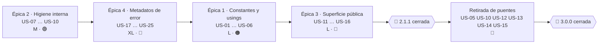

# Versión 2.1.1 · `MoralesLarios.OOFP.Core` · Épicas de nomenclatura, estándares y modelo de error

> **Estado global** · ✅ Épicas 1, 2 y 4 completadas (commits `6df1466`, `179162f`, `77ed10e` + ésta) · ⬜ Épica 3 pendiente
> **Proyecto afectado** · `src/MoralesLarios.OOFP.Core`
> **Origen** · [`Mejoras/Core/01-Nomenclatura-y-Estandares.md`](../../../Mejoras/Core/01-Nomenclatura-y-Estandares.md) (puntos 01-14) · [`Mejoras/Core/README.md`](../../../Mejoras/Core/README.md) (hallazgos #3 y #4)
> **Versiones destino** · 2.1.1 (parte aditiva y no rupturista) · 3.0.0 (retirada de puentes y rupturas de origen)
> **Esfuerzo total** · ~11,5 jornadas

Esta carpeta descompone los **14 puntos** del análisis de nomenclatura del núcleo más los **dos
hallazgos del contenedor de metadatos de error** en **4 épicas pequeñas y temáticamente cerradas**,
con **25 historias de usuario** de esfuerzo XS/S/M. Ninguna historia supera 1 jornada, y cada épica
se puede ejecutar y cerrar de forma independiente.

El reparto no es arbitrario: agrupa los hallazgos por **la superficie que tocan**, de modo que cada
épica abre un único frente de conflicto en el control de versiones.

---

## Índice

1. [Las cuatro épicas](#1-las-cuatro-épicas)
2. [Reparto de los hallazgos del análisis](#2-reparto-de-los-hallazgos-del-análisis)
3. [Mapa de las 25 historias](#3-mapa-de-las-25-historias)
4. [Orden de ejecución recomendado](#4-orden-de-ejecución-recomendado)
5. [Separación 2.1.1 / 3.0.0](#5-separación-211--300)
6. [Decisiones pendientes del propietario](#6-decisiones-pendientes-del-propietario)
7. [Qué queda fuera de esta carpeta](#7-qué-queda-fuera-de-esta-carpeta)
8. [Definición de terminado común](#8-definición-de-terminado-común)

---

## 1. Las cuatro épicas

| # | Épica | Superficie que toca | Historias | Esfuerzo | Riesgo | Estado |
|---|-------|---------------------|:---------:|:--------:|:------:|:------:|
| 1 | [Constantes, literales y `using` globales](Epica-01-Constantes-Literales-y-Usings.md) | `Helpers/Constants.cs` · `GlobalUsings.cs` · `Helpers/EnsureFpMessages.cs` | US-01 … US-06 | **L** (~2,5 j) | 🟢 / 🟠 | ✅ |
| 2 | [Higiene interna: erratas, código muerto y documentación XML](Epica-02-Higiene-Interna-y-Codigo-Muerto.md) | identificadores locales, comentarios, `<summary>`, `ErrorMessage.cs` | US-07 … US-10 | **M** (~1,25 j) | 🟢 / 🟡 | ✅ |
| 3 | [Nomenclatura de la superficie pública](Epica-03-Miembros-Publicos-y-Firmas.md) | `MlResult.cs` · `MlError.cs` · `MlErrorDetails.cs` · `EnsureFp.*` · `Extensions.cs` | US-11 … US-16 | **L** (~3,0 j) | 🟠 / 🔴 | ⬜ |
| 4 | [El contenedor de metadatos de `MlErrorDetails`](Epica-04-Modelo-de-Metadatos-de-Error.md) | `MlErrorDetails.cs` · `MlErrorDetails.Metadata.cs` · `MlErrorDetailsActions.cs` · `MlResultErrorDetailsExtensions.cs` · `Helpers/Extensions/Extensions.cs` · `Helpers/Constants.cs` | US-17 … US-25 | **XL** (~4,75 j) | 🔴 / 🟡 | ✅ |

> **Leyenda de estado** · ✅ completada · 🔄 en curso · ⬜ no iniciada

> **Leyenda de esfuerzo** · XS (<2 h) · S (½ jornada) · M (1 jornada) · L (2 jornadas) · XL (3+ jornadas)
> **Leyenda de riesgo** · 🟢 bajo · 🟡 medio · 🟠 alto · 🔴 muy alto (rompe compatibilidad)

> **Nota sobre la épica 4.** Es la única que **corrige defectos de comportamiento**, no de estilo:
> siete de sus nueve historias arreglan errores reproducibles del contenedor
> `Dictionary<string, object>` (claves de excepción secuestradas, dos esquemas de numeración
> incompatibles, `Merge` que lanza, dos métodos que descartan su parámetro, lecturas con efecto
> secundario). Su riesgo 🔴 no viene de romper firmas, sino de que **cambia comportamiento
> observable** que algún consumidor podría estar aprovechando.
>
> **Resultado de la ejecución** · cerrada con **doce rupturas**, de las cuales **nueve no las detecta
> el compilador**. Durante la ejecución apareció un **séptimo defecto** no catalogado en el análisis
> (cinco llamadas internas en `MlResultBindExtensions.cs` descartaban el retorno de
> `AddValueDetailIfFail`, que funcionaba por mutación del diccionario compartido). Todo ello está
> registrado como **punto 40** de
> [`oofp-upgrade-2.prompt.md`](../../../Copilot/.github/prompts/oofp-upgrade-2.prompt.md) §3.3, con una
> subsección propia de cambios silenciosos.

---

## 2. Reparto de los hallazgos del análisis

Cada punto del documento de origen cae en **una sola** épica, para que no haya solapes de edición:

| Punto del análisis | Resumen | Épica | Historia |
|-------------------:|---------|:-----:|----------|
| 01 | `SCREAMING_SNAKE_CASE` en la API pública de `Constants` | 1 | US-05 |
| 02 | `DEFAULT_EX_ERROR_MESSAGE` es un método dentro de `Constants` | 1 | US-04 |
| 03 | Parámetros en `PascalCase` (`MlError`, `MlErrorDetails`) | 3 | US-13 |
| 04 | El miembro público llamado `_` | 3 | US-12 |
| 05 | Clase pública llamada `Extensions` (nombre) | 3 | US-11 |
| 05 | `<summary>` con `<c></c>` vacía (documentación) | 2 | US-09 |
| 06 | Literales de mensaje en inglés incrustados | 1 | US-06 |
| 07 | Erratas en el literal `DEFAULT_ERROR_MESSAGE` | 1 | US-01 |
| 08 | Incoherencia `Details` / `Metadata` / `ErrorsDetails` | 3 | US-15 |
| 09 | Sufijo `Async` sobre métodos sincrónicos | 3 | US-16 |
| 10 | Semántica de `Try*` divergente de la BCL | 3 | US-16 |
| 11 | `message` vs `errorMessage` entre guardias hermanas | 3 | US-14 |
| 12 | Erratas internas `printipal` / `Witout` | 2 | US-07 |
| 13 | `global using static Constants` | 1 | US-02, US-03 |
| 14 | *Stuttering* de nombres de tipo | 3 | US-11 (nota) |

Dos puntos adicionales detectados durante el análisis de nomenclatura y no numerados en el origen:

| Hallazgo | Épica | Historia |
|----------|:-----:|----------|
| Bloques de código comentado en 5 ficheros | 2 | US-08 |
| `Types/Errors/ErrorMessage.cs` es código muerto | 2 | US-10 |

Y los hallazgos del índice [`Mejoras/Core/README.md`](../../../Mejoras/Core/README.md) que esta
carpeta sí puede atacar en 2.1.1, todos ellos en la épica 4:

| Hallazgo de `Mejoras/Core` | Resumen | Épica | Historias |
|---------------------------:|---------|:-----:|-----------|
| #4 | `Metadata` mutable a través de la referencia y `Errors` perezoso | 4 | US-24, US-25 |
| #3 (parte aditiva) | Claves de metadatos sin namespace y accesores ajenos a la BCL | 4 | US-22, US-23 |

Los siete defectos de comportamiento del contenedor (A … G) se detallan en la
[§1 de la épica 4](Epica-04-Modelo-de-Metadatos-de-Error.md#1-contexto-y-problema):

| Defecto | Resumen | Historia |
|:-------:|---------|----------|
| A | `EXPECTED_KEY = "Expected"` secuestra la ranura `"Ex"` y rompe `GetException()` | US-17 |
| B | `AppendExDetails` numera `Ex, Ex2, Ex3` y `Merge` numera `Ex, Ex1, Ex2` | US-18 |
| C | `Merge` lanza `ArgumentException` cuando dos fallos comparten clave | US-19 |
| D | Las dos sobrecargas de `AddMetadataRange` descartan su parámetro | US-20 |
| E | `ToMlErrorsDetails((MlError, Dictionary))` pierde los metadatos | US-20 |
| F | `GetDetail<T>` tiene efecto secundario al leer y hace doble búsqueda | US-21 |
| G | Mutabilidad bajo una fachada inmutable (`AddMetadataOrThrow`) | US-24 |

---

## 3. Mapa de las 25 historias

| Historia | Título | Épica | Esfuerzo | Riesgo | Versión |
|----------|--------|:-----:|:--------:|:------:|:-------:|
| US-01 | Corregir las erratas de los literales de mensaje | 1 | XS | 🟢 | 2.1.1 |
| US-02 | Eliminar `global using static Constants` | 1 | S | 🟢 | 2.1.1 |
| US-03 | Adelgazar los `global using` redundantes | 1 | XS | 🟢 | 2.1.1 |
| US-04 | Mover `DEFAULT_EX_ERROR_MESSAGE` a `EnsureFpMessages` | 1 | S | 🟡 | 2.1.1 |
| US-05 | Dar gemelos `PascalCase` a los miembros con guión bajo | 1 | M | 🟠 | 2.1.1 + 3.0.0 |
| US-06 | Centralizar los literales de mensaje del núcleo | 1 | S | 🟢 | 2.1.1 |
| US-07 | Corregir `printipal` / `Witout` en identificadores locales | 2 | XS | 🟢 | 2.1.1 |
| US-08 | Eliminar los bloques de código comentado | 2 | XS | 🟢 | 2.1.1 |
| US-09 | Rellenar los `<summary>` de plantilla y las `<c></c>` vacías | 2 | S | 🟢 | 2.1.1 |
| US-10 | Retirar el tipo muerto `ErrorMessage` | 2 | S | 🟡 | 2.1.1 + 3.0.0 |
| US-11 | Trocear la clase `Extensions` en clases con nombre propio | 3 | M | 🟠 | 2.1.1 |
| US-12 | Retirar el miembro público `_` en favor de `Discard` | 3 | S | 🔴 | 2.1.1 + 3.0.0 |
| US-13 | Pasar a `camelCase` los parámetros en `PascalCase` | 3 | XS | 🔴 | 3.0.0 |
| US-14 | Unificar el nombre del parámetro de mensaje en `EnsureFp` | 3 | S | 🔴 | 3.0.0 |
| US-15 | Unificar `Details` / `Metadata` y simplificar los factores | 3 | M | 🔴 | 3.0.0 |
| US-16 | Documentar la semántica propia de `Try*` y del sufijo `Async` | 3 | S | 🟢 | 2.1.1 |
| US-17 | Discriminar las claves de excepción con un patrón exacto | 4 | S | 🔴 | 2.1.1 |
| US-18 | Unificar el esquema de numeración de excepciones | 4 | XS | 🔴 | 2.1.1 |
| US-19 | Hacer `Merge` tolerante a las claves duplicadas | 4 | S | 🔴 | 2.1.1 |
| US-20 | Reparar los dos métodos que descartan su parámetro | 4 | XS | 🟡 | 2.1.1 |
| US-21 | Lecturas sin efecto secundario y con una sola búsqueda | 4 | S | 🟡 | 2.1.1 |
| US-22 | Centralizar las claves bien conocidas en `MetadataKeys` | 4 | S | 🟡 | 2.1.1 |
| US-23 | Accesores de metadatos con la semántica de la BCL | 4 | M | 🟢 | 2.1.1 |
| US-24 | Metadatos realmente inmutables | 4 | M | 🟡 | 2.1.1 |
| US-25 | Materializar `Errors` y dar igualdad estructural | 4 | S | 🟡 | 2.1.1 |

**Totales**: 20 historias entran en 2.1.1 (**~8,75 jornadas**) · 5 historias cierran en 3.0.0
(**~2,75 jornadas**).

---

## 4. Orden de ejecución recomendado



> **Nota sobre el orden realmente seguido.** Las épicas **2** y **1** se cerraron antes que la 4,
> invirtiendo los pasos 2 y 3 del grafo. El motivo: la épica 1 es de riesgo 🟢 en cinco de sus seis
> historias y no necesitaba en realidad el nombre canónico de claves de US-22, porque
> [D-01](Epica-01-Constantes-Literales-y-Usings.md#5-decisiones-resueltas) se resolvió manteniendo
> los nombres actuales (`ExceptionMetadataKey`, `ValueMetadataKey`) y sólo cambiando su mecanismo a
> `static readonly`. La centralización en `MetadataKeys` de US-22 sigue siendo compatible con lo
> hecho. Quedan por ejecutar las épicas **4** y **3**, en ese orden.

**Por qué este orden:**

1. **Épica 2 primero** porque es la de riesgo cero: limpia el ruido (código muerto, erratas
   internas, documentación de plantilla) y deja los ficheros legibles antes de tocarlos de verdad.
   Además US-07 (`printipal` / `Witout`) toca el mismo `Merge` que reescribe US-19, y conviene que
   el renombrado trivial vaya antes del cambio de lógica.
2. **Épica 4 en segundo lugar** porque son **errores**, no estilo: cuanto antes se corrijan, menos
   consumidores habrá que dependan del comportamiento roto. También es la que fija el nombre
   canónico de las claves (`MetadataKeys`, US-22), del que depende US-05 de la épica 1.
3. **Épica 1 después** porque la eliminación del `global using static` (US-02) obliga a cualificar
   todos los usos de `Constants`, y eso es mucho más fácil sobre ficheros ya limpios y con las
   claves ya centralizadas.
4. **Épica 3 al final** porque es la única que rompe contratos públicos y la que más se beneficia
   de que el núcleo esté estabilizado. US-15 (unificar `Details` / `Metadata`) toca exactamente las
   firmas que la épica 4 habrá dejado en su forma definitiva.

---

## 5. Separación 2.1.1 / 3.0.0

La regla aplicada a lo largo de las cuatro épicas:

| Naturaleza del cambio | Versión | Mecanismo |
|-----------------------|:-------:|-----------|
| Identificadores locales, comentarios, documentación XML | 2.1.1 | cambio directo |
| Valor de un literal de mensaje | 2.1.1 | cambio directo (⚠️ invisible al compilador) |
| Corrección de un defecto de comportamiento | 2.1.1 | cambio directo + test de regresión (⚠️ invisible al compilador) |
| Miembro nuevo **añadido** junto al existente | 2.1.1 | miembro nuevo + `<remarks>` que remite al nuevo |
| Nombre nuevo **añadido** junto al antiguo | 2.1.1 | nombre nuevo + puente `[Obsolete]` sobre el antiguo |
| Retirada del nombre antiguo | 3.0.0 | eliminación del fichero `*.Obsolete.cs` |
| Renombrado de parámetro (argumentos con nombre) | 3.0.0 | sin puente posible |
| Cambio de tipo de una propiedad pública | 3.0.0 | ruptura binaria y de origen |
| Propiedad → `const` / `static readonly` | 3.0.0 | ruptura binaria |

> ⚠️ **Obligatorio.** Toda ruptura de compatibilidad de estas épicas debe quedar registrada en
> [`../../../Copilot/.github/prompts/oofp-upgrade-2.prompt.md`](../../../Copilot/.github/prompts/oofp-upgrade-2.prompt.md) §3.3,
> y si es un renombrado, además en el anexo
> [`../../../Copilot/.github/prompts/oofp-upgrade-2.renames.md`](../../../Copilot/.github/prompts/oofp-upgrade-2.renames.md).
> Las correcciones de comportamiento de la épica 4 **también** se registran ahí, aunque no cambien
> ninguna firma: un consumidor que lea la clave `"Ex2"` dejará de encontrarla.

Todo puente nuevo sigue el patrón ya establecido en los 73 ficheros `*.Obsolete.cs` del repositorio:

```csharp
// Puentes [Obsolete] de la v2.0.0: nombres antiguos que reenvian al nombre nuevo. Se eliminan en la v3.0.0.
[global::System.Obsolete("Renamed to X. Will be removed in 3.0.0.", false)]
[global::System.ComponentModel.EditorBrowsable(global::System.ComponentModel.EditorBrowsableState.Never)]
```

---

## 6. Decisiones pendientes del propietario

Las decisiones abiertas del análisis se reparten así. **Ninguna épica puede cerrarse sin resolver
las suyas.**

| Id | Decisión | Épica que la bloquea | Recomendación del análisis |
|----|----------|:--------------------:|----------------------------|
| ~~**D-01**~~ | ✅ **resuelta**: claves de metadatos como `static readonly` | 1 (US-05) | `static readonly`: compatible binariamente |
| **D-02** | ¿Se mantiene el prefijo `Ml` en los tipos? | 3 (US-11) | mantener: la ruptura no aporta nada |
| ~~**D-03**~~ | ✅ **resuelta** (variante **b**): `Empty()` / `EmptyAsync()` **siguen vivos** en 2.1.1; sólo se invierte `_` → `Discard` | 3 (US-12) | `[Obsolete]` en favor de `Discard` → **descartado**: devuelven `MlResult<object>`, no hay combinadores sobre el `MlResult` no genérico (no hay sustituto mecánico) y generaría 57 `CS0618` propios en 32 ficheros. Se aplaza a 3.0.0 con `Unit` (D-12) |
| **D-04** | ¿Se renombra la familia `Try*`? | 3 (US-16) | no tocar, pero documentar la semántica |
| ~~**D-05**~~ | ✅ **resuelta**: inglés neutro en 2.1.1; `.resx` diferido a la épica de localización | 1 (US-06) | inglés neutro + `.resx` para castellano |
| **D-06** | ¿`With<T>` debe copiar en vez de mutar? | 3 (US-11) | renombrar a `Mutate` y dejar la mutación |
| ~~**D-07**~~ … ~~**D-10**~~ | ✅ **resueltas**: D-07 `ArgumentNullException` · D-08 sin `dotnet format`/`.editorconfig` · D-09 retirar `ErrorMessage` · D-10 documentación XML en castellano | 1, 2 | ver cada épica |
| **D-11** … **D-13** | nombre canónico `Metadata`, `Unit`, accesores `Try*` | 3 | ver la épica 3 |
| **D-14** | ¿Cómo se discrimina una clave de excepción? | 4 (US-17) | `[GeneratedRegex(@"^Ex\d*$")]` |
| **D-15** | ¿Política de colisión de claves en `Merge`? | 4 (US-19) | sufijar la clave entrante, no perder datos |
| **D-16** | ¿Qué comparador de claves se usa? | 4 (US-24) | `StringComparer.Ordinal`, explícito y documentado |
| **D-17** | ¿`MlError.Code` entra en 2.1.1? | 4 (ninguna) | no: es un rediseño del modelo, va a 3.0.0 |
| **D-18** | ¿`Errors` pasa a `IReadOnlyList<MlError>`? | 4 (US-25) | no en 2.1.1; sólo materializar por dentro |
| **D-19** | ¿`AddMetadataOrThrow` se marca `[Obsolete]` ya? | 4 (US-24) | no: 11 usos internos vivos; `<remarks>` y a 3.0.0 |

---

## 7. Qué queda fuera de esta carpeta

| Tema | Dónde está |
|------|------------|
| Erratas **públicas** `Faild`, `Diferent`, `Erros`, `Alwais`, `Lenght`, `FusionFailErros` | [`../../2.1/Epica-Erratas-Identificadores-Publicos.md`](../../2.1/Epica-Erratas-Identificadores-Publicos.md) |
| Localización de mensajes a varios idiomas | [`../../2.1/Epica-Mensajes-Y-Localizacion.md`](../../2.1/Epica-Mensajes-Y-Localizacion.md) |
| `CancellationToken`, `ConfigureAwait`, `ValueTask`, LINQ, `IEquatable` | `Mejoras/Core/02-Interoperabilidad-BCL.md` *(pendiente)* |
| **`MlError.Code`**, `Severity`, RFC 7807, ranuras tipadas, `catch (Exception)` | `Mejoras/Core/03-Modelo-de-Error.md` *(pendiente)* · la parte **accionable en 2.1.1** está en [`Epica-04-Modelo-de-Metadatos-de-Error.md`](Epica-04-Modelo-de-Metadatos-de-Error.md) |
| 443 `null!`, `implicit operator` solapados, ambigüedad de sobrecargas | `Mejoras/Core/04-Nulabilidad-Genericos-y-Contratos.md` *(pendiente)* |
| Troceado de los 20.134 líneas de `Bind` + `Map`, `readonly struct` | `Mejoras/Core/05-Superficie-de-API-y-Arquitectura.md` *(pendiente)* |
| Metadatos NuGet, SourceLink, multi-targeting, analizadores | `Mejoras/Core/07-Empaquetado-y-Compatibilidad.md` *(pendiente)* |
| Deriva documental del `README.md` del núcleo | `Mejoras/Core/08-Calidad-Pruebas-y-Documentacion.md` *(pendiente)* |
| Eliminación del prefijo `Ml` de los tipos | **descartado** explícitamente (D-02) |

---

## 8. Definición de terminado común

Aplica a las cuatro épicas. Cada una añade además sus propios criterios.

- [ ] `dotnet build MoralesLarios.OOFP.sln -c Release --no-incremental` termina con **0 errores** y
      **`CS1591 = 0`**.
- [ ] Los **1.060 tests** de la solución están en verde
      (`dotnet test MoralesLarios.OOFP.sln -c Release --no-build`).
- [ ] El número de advertencias no supera la línea base de **238**.
- [ ] Cada ruptura está registrada en `oofp-upgrade-2.prompt.md` §3.3 (y en el anexo de renombrados
      si procede).
- [ ] El `README.md` del núcleo refleja los nombres nuevos.
- [ ] Los enlaces y anclas de los `.md` modificados pasan
      `scripts/check-md-links2.ps1` y `scripts/check-md-anchors4.ps1`.
- [ ] La codificación de los `.md` nuevos pasa `scripts/check-md-encoding.ps1` sin ningún `NO-UTF8`.

---

## Ver también

- [`Mejoras/Core/README.md`](../../../Mejoras/Core/README.md) · índice del análisis del núcleo
- [`Mejoras/Core/01-Nomenclatura-y-Estandares.md`](../../../Mejoras/Core/01-Nomenclatura-y-Estandares.md) · documento de origen de las épicas 1, 2 y 3
- [`Next_Versions/2.1/README.md`](../../2.1/README.md) · las nueve épicas de la versión 2.1.0
