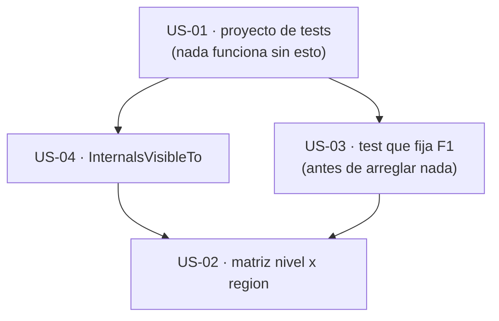

# Épica 1 · Red de seguridad: el proyecto de tests que no existe

> **Versión destino** · 2.2.0 (US-01 … US-04)
> **Origen** · [`Mejoras/Logging/README.md`](../../../Mejoras/Logging/README.md) · hallazgos T1, T3 y T4
> **Plan del que se desgaja** · [`README.md`](README.md) de la versión 2.2.0
> **Proyecto** · `src/MoralesLarios.OOFP.Logging` · proyecto nuevo `src/MoralesLarios.OOFP.Logging.Tests.Unit`
> **Estado** · ✅ completada
> **Esfuerzo** · **L** (~2,0 jornadas)
> **Riesgo** · 🟢 bajo · no toca una sola línea de producción
>
> **Leyenda de esfuerzo:** XS (<2 h) · S (½ jornada) · M (1 jornada) · L (2 jornadas) · XL (3+ jornadas)
> **Leyenda de riesgo:** 🟢 bajo · 🟡 medio · 🟠 alto · 🔴 muy alto (rompe compatibilidad)

---

## Índice

1. [Contexto y problema](#1-contexto-y-problema)
   - [Punto 01 — No existe ningún proyecto de tests de Logging](#punto-01--no-existe-ningún-proyecto-de-tests-de-logging)
   - [Punto 02 — La cobertura indirecta es insuficiente y engañosa](#punto-02--la-cobertura-indirecta-es-insuficiente-y-engañosa)
   - [Punto 03 — La simetría de la API hace la matriz de tests barata](#punto-03--la-simetría-de-la-api-hace-la-matriz-de-tests-barata)
2. [Alcance](#2-alcance)
3. [Historias de usuario](#3-historias-de-usuario)
   - [US-01 · Crear el proyecto de tests](#us-01--crear-el-proyecto-de-tests)
   - [US-02 · Matriz de tests nivel × región](#us-02--matriz-de-tests-nivel--región)
   - [US-03 · Test que fija el defecto F1 antes de arreglarlo](#us-03--test-que-fija-el-defecto-f1-antes-de-arreglarlo)
   - [US-04 · InternalsVisibleTo hacia el proyecto de tests](#us-04--internalsvisibleto-hacia-el-proyecto-de-tests)
4. [Orden de ejecución](#4-orden-de-ejecución)
5. [Decisiones abiertas](#5-decisiones-abiertas)
6. [Definición de terminado](#6-definición-de-terminado)
7. [Apéndice · andamiaje propuesto](#7-apéndice--andamiaje-propuesto)
8. [Ver también](#8-ver-también)

---

## 1. Contexto y problema

Esta épica va **primera** del plan, y no por orden alfabético. `MoralesLarios.OOFP.Logging` publica
**339 firmas de métodos de extensión** y tiene **cero tests directos**. Esa cifra no describe una
laguna de cobertura: describe **la causa** de que el resto del plan sea arriesgado.

La prueba está en el propio código. El defecto `F1` —`LogMlResultIfFailWithExceptionAsync<T>` llama a
`LogMlResultIfFailWithValueAsync` en lugar de a `…WithExceptionAsync`— **compila sin un solo aviso**,
porque `Exception` encaja como `TValue`. Lleva publicado desde la 2.0.0. Un único test que comprobase
que el mensaje registrado contiene el `Message` de la excepción lo habría cazado el primer día.

| Hallazgo | Qué falta | Naturaleza | Rompe |
|----------|-----------|------------|:-----:|
| **T1** | el proyecto `MoralesLarios.OOFP.Logging.Tests.Unit` | ausencia total | no |
| **T3** | `InternalsVisibleTo` en el `.csproj` de Logging | configuración | no |
| **T4** | una matriz que cubra las 7 regiones × 6 niveles | diseño de tests | no |

---

### Punto 01 — No existe ningún proyecto de tests de Logging

La solución tiene **32 proyectos** y **9 ensamblados de test** que suman **1.136 tests en verde**.
Ninguno de los nueve prueba `MoralesLarios.OOFP.Logging`:

| Ensamblado de test | Tests | ¿Prueba Logging? |
|--------------------|------:|:----------------:|
| `MoralesLarios.OOFP.Core.Tests.Unit` | 857 | no |
| `MoralesLarios.OOFP.ValueObjects.Tests.Unit` | 117 | no |
| `MoralesLarios.OOFP.AspNetCore.Results.Tests.Unit` | 54 | no |
| `MoralesLarios.OOFP.Http.Tests.Integration` | 33 | **indirectamente** |
| `MoralesLarios.OOFP.ValueObjects.FileSystem.Tests.Unit` | 22 | no |
| `MoralesLarios.OOFP.Configuration.Tests.Unit` | 18 | no |
| `MoralesLarios.OOFP.Validation.FluentValidation.Tests.Unit` | 16 | no |
| `MoralesLarios.OOFP.Validation.DataAnnotations.Tests.Unit` | 12 | no |
| `MoralesLarios.OOFP.Http.Tests.Unit` | 7 | no |

> **Importante** · El patrón de nombres de la solución es inequívoco: cada proyecto `X` tiene su
> `X.Tests.Unit`. Logging es, junto al `Sample`, **la única excepción** de la solución. El proyecto
> que falta no es una pieza nueva: es la pieza que se saltó.

---

### Punto 02 — La cobertura indirecta es insuficiente y engañosa

`MoralesLarios.OOFP.Logging` lo referencian **4 proyectos**:

| Proyecto que lo referencia | Qué ejercita |
|----------------------------|--------------|
| `MoralesLarios.OOFP.Application` | sin tests propios que lleguen al log |
| `MoralesLarios.OOFP.Http` | sin tests unitarios que lleguen al log |
| `MoralesLarios.OOFP.Http.Tests.Integration` | **33 tests**, que atraviesan el log como efecto colateral |
| `MoralesLarios.OOFP.Logging.Sample` | ejecutable de demostración, no es un test |

Los 33 tests de integración de HTTP son la única red que hay, y es una red de arrastre: pasan por el
log sin **afirmar nada** sobre lo que se registró. Si mañana `LogMlResultErrorIfFail` dejase de
escribir, esos 33 tests seguirían verdes.

> **Importante** · Una cobertura indirecta que no afirma sobre el efecto observado es **peor que
> ninguna**, porque genera la falsa sensación de que el código está probado.

---

### Punto 03 — La simetría de la API hace la matriz de tests barata

Lo que haría caro probar 339 métodos es que fuesen 339 casos distintos. No lo son. La superficie es
**un producto cartesiano casi perfecto**:

| Fichero de nivel | `public static` vivas | Comentadas | Regiones |
|------------------|----------------------:|-----------:|:--------:|
| `MlResultLogExtensions.Critical.cs` | 47 | 17 | 7 |
| `MlResultLogExtensions.Debug.cs` | 47 | 17 | 7 |
| `MlResultLogExtensions.Error.cs` | 47 | 17 | 7 |
| `MlResultLogExtensions.Information.cs` | 47 | 17 | 7 |
| `MlResultLogExtensions.Trace.cs` | 47 | 17 | 7 |
| `MlResultLogExtensions.Warning.cs` | 47 | 17 | 7 |
| `MlResultLogExtensions.cs` | 57 | 0 | 7 |
| `Extensions.cs` | 3 | 0 | — |
| `MlResultLogExtensions.Obsolete.cs` | 6 | 0 | — |

**La paridad es exacta: 47 + 17 en los seis niveles.** Esa regularidad es una **fortaleza del
diseño** y hay que preservarla, pero sobre todo permite escribir la matriz con `[Theory]` y
`[InlineData]` sobre el `LogLevel`, en lugar de con 339 `[Fact]`.

> **Importante** · El valor real de la matriz no es la cobertura: es que **convierte la simetría en
> un invariante verificado**. Si alguien añade un método a `Error.cs` y no a `Warning.cs`, la matriz
> lo señala.

---

## 2. Alcance

**Entra en esta épica:**

- Crear `src/MoralesLarios.OOFP.Logging.Tests.Unit` con xUnit + FluentAssertions, igual que el resto.
- Añadir el proyecto al `.sln`.
- Una matriz `[Theory]` que recorra los 6 niveles × 7 regiones.
- Un `ILogger` de doble que capture `LogLevel`, mensaje y excepción.
- El test que **fija** el defecto `F1`, marcado como conocido hasta que la épica 3 lo arregle.
- `InternalsVisibleTo` en el `.csproj` de Logging.

**No entra:**

- Arreglar `F1` (épica 3 · US-11).
- Borrar código comentado (épica 2 · US-09).
- Renombrar nada (épica 4).
- Tests de rendimiento (épica 6 · US-31).

---

## 3. Historias de usuario

### US-01 · Crear el proyecto de tests

**Como** mantenedor, **quiero** un proyecto de tests unitarios para Logging **para** poder demostrar
cualquier cambio de comportamiento antes de publicarlo.

- [x] Existe `src/MoralesLarios.OOFP.Logging.Tests.Unit/MoralesLarios.OOFP.Logging.Tests.Unit.csproj`.
- [x] El `TargetFramework` coincide con el del resto de los `*.Tests.Unit` de la solución.
- [x] Referencia a `MoralesLarios.OOFP.Logging` y a xUnit + FluentAssertions, con las **mismas
      versiones** que `MoralesLarios.OOFP.Core.Tests.Unit`.
- [x] El proyecto está dado de alta en `MoralesLarios.OOFP.sln`.
- [x] El `.csproj` **no** incluye el bloque `PropertyGroup Label="Globals"` con las `Scc*`.
- [x] `dotnet test` lo descubre y ejecuta.

**Esfuerzo** · S · **Riesgo** · 🟢

---

### US-02 · Matriz de tests nivel × región

**Como** mantenedor, **quiero** una matriz que recorra los 6 niveles y las 7 regiones **para** que la
simetría del diseño quede verificada y no sólo documentada.

- [x] Existe un doble de `ILogger` que captura `LogLevel`, el mensaje formateado y la `Exception`.
- [x] Hay un `[Theory]` con `[InlineData]` por cada `LogLevel` de los seis soportados.
- [x] Cada una de las 7 regiones tiene al menos un caso válido y un caso fallido.
- [x] Se comprueba que el `LogLevel` registrado es **exactamente** el del nombre del método.
- [x] Se comprueba que el valor devuelto es el `source` original, sin alterar.
- [x] Un test comprueba que los 6 ficheros de nivel exponen **el mismo número** de firmas públicas,
      para que la asimetría futura falle el build.
- [x] El alcance de la matriz es el acordado en [D-05](#5-decisiones-abiertas).

**Esfuerzo** · M · **Riesgo** · 🟢

---

### US-03 · Test que fija el defecto F1 antes de arreglarlo

**Como** mantenedor, **quiero** que el defecto `F1` esté capturado por un test **antes** de tocarlo
**para** que el arreglo de la épica 3 sea demostrable y no un acto de fe.

- [x] Hay un test que invoca `LogMlResultIfFailWithExceptionAsync<T>` sobre un `MlResult<T>` fallido
      que **sí** lleva excepción en los metadatos.
- [x] El test afirma que el mensaje registrado contiene el `Message` de la excepción.
- [x] Mientras `F1` no esté arreglado, el test está marcado con `Skip` y un comentario que apunta a
      la épica 3 · US-11, o bien documenta el comportamiento actual con un nombre que lo diga
      (`…RegistraElValorEnLugarDeLaExcepcion_DefectoConocidoF1`).
- [x] El mismo test comprueba, en paralelo, el comportamiento de `LogMlResultIfFailWithValueAsync`,
      para que la diferencia entre ambos quede explícita.

**Esfuerzo** · XS · **Riesgo** · 🟢

> **Importante** · Esta historia es la justificación entera del orden del plan: **el test se escribe
> antes que el arreglo**. Si se arregla primero, nunca se sabrá si el test habría fallado.

---

### US-04 · InternalsVisibleTo hacia el proyecto de tests

**Como** mantenedor, **quiero** que Logging exponga sus internos al proyecto de tests **para**
poder probar los auxiliares sin tener que hacerlos públicos.

- [x] El `.csproj` de `MoralesLarios.OOFP.Logging` declara `InternalsVisibleTo` hacia
      `MoralesLarios.OOFP.Logging.Tests.Unit`.
- [x] La forma de declararlo es **la misma** que ya usa `MoralesLarios.OOFP.Core`, para no introducir
      un segundo estilo en la solución.
- [x] No se amplía la superficie **pública** del ensamblado.

**Esfuerzo** · XS · **Riesgo** · 🟢

---

## 4. Orden de ejecución



**Justificación.** La US-01 es el prerrequisito físico de las otras tres. La US-03 va antes que la
US-02 porque es **un solo test** y es el que desbloquea la épica 3: no conviene esperar a tener la
matriz completa para poder empezar a arreglar el defecto. La US-02 va al final porque es la más larga
y la que menos urge.

> ⚠️ **Esta épica bloquea a las épicas 3 y 4.** Ninguna de las dos debe empezar antes de que la US-03
> esté cerrada.

---

## 5. Decisiones abiertas

| # | Decisión | Opciones | Estado |
|:-:|----------|----------|:------:|
| **D-05** | Alcance de la matriz de tests | (a) las **339** firmas, una por una · (b) **42 casos** (6 niveles × 7 regiones) más los bordes · (c) sólo las 7 regiones del nivel `Error`, asumiendo la simetría | ✅ resuelta · **(b)** |
| **D-07** | Doble de `ILogger` | (a) escribirlo a mano en el proyecto de tests · (b) usar una librería de dobles ya referenciada en la solución · (c) usar el proveedor en memoria de `Microsoft.Extensions.Logging` | ✅ resuelta · **(a)** |
| **D-08** | Qué hacer con el test de `F1` hasta que se arregle | (a) `Skip` con referencia a la US-11 · (b) afirmar el comportamiento **actual** y cambiar el test al arreglarlo · (c) dejarlo en rojo | ✅ resuelta · **(b)** |

> **Sobre D-05.** La opción (a) es inviable en dos jornadas. La (b) es la que propone este documento:
> cubre la simetría y los bordes con ~60 tests. La (c) deja cinco de los seis niveles sin una sola
> afirmación, lo que es exactamente el estado actual con más pasos.

> **Sobre D-08 opción (c).** Dejar un test en rojo rompe el criterio «1.136 tests en verde» que
> comparten todas las épicas de la carpeta, así que sólo es admisible si el arreglo de la US-11 entra
> en la misma tanda de cambios.

---

## 5.1 Resolución de las decisiones (al cerrar la épica)

| # | Opción elegida | Justificación |
|:-:|----------------|---------------|
| **D-05** | **(b)** matriz de 42 casos (6 niveles × 7 regiones) más los bordes | Materializada en `MlResultLogExtensionsMatrixTests.cs` con una tabla `Dictionary<(LogLevel, string), LogOperation>` de **36 entradas** (6 niveles × 6 regiones condicionales) más la región completa y los invariantes de simetría. Resultado: **173 tests** nuevos. |
| **D-07** | **(a)** doble escrito a mano | `Support/LoggerSpy.cs`: `ILogger` con `ConcurrentQueue<LoggedEntry>`, `MinimumLevel`, `Enabled`, `IsEnabledCallCount` y `Messages`. Ni Moq ni el proveedor en memoria permiten afirmar el `LogLevel` exacto y el mensaje ya formateado con esta comodidad. |
| **D-08** | **(b)** afirmar el comportamiento **actual** | Los tests de `F1` llevan el sufijo `_DefectoConocidoF1` y un `because` que explica qué debe pasar a esperar la [US-11](Epica-03-Correccion-Funcional-y-Validacion.md). Se añade además un test `…ComportamientoDeReferencia` sobre la sobrecarga **síncrona**, que sí distingue la excepción y fija la conducta correcta. |

### 5.2 Hallazgo nuevo · el mecanismo exacto de `F1`

Al escribir los tests de la US-03 se descubrió **por qué** falla `F1`, y no es lo que decía el informe
de mejoras:

```csharp
// MlResultLogExtensions.cs ≈ L948
public static async Task<MlResult<T>> LogMlResultIfFailWithExceptionAsync<T>(
        this Task<MlResult<T>>                  sourceAsync,
        ILogger                                 logger,
        LogLevel                                logLevel,
        Func<MlErrorDetails, Exception, string> failBuildMessage)
    => await (await sourceAsync).LogMlResultIfFailWithValueAsync(logger, logLevel, failBuildMessage);
//                                                ^^^^^ delega en la familia equivocada
```

Como el constructor de mensaje es `Func<MlErrorDetails, Exception, string>`, la resolución de
sobrecarga elige la variante **`<T, TValue>` con `TValue = Exception`**. La consecuencia observable es
más estrecha de lo que parecía:

- un fallo que lleva **sólo** el metadato `Ex` **no registra nada**;
- un fallo que lleva el metadato `Value` de tipo `string` **tampoco registra nada**;
- sólo registra si existe el metadato **`Value` y además es de tipo `Exception`**, caso que en la
  práctica no produce ninguna factoría de `MlErrorDetails`.

Es decir, la sobrecarga es **inoperante en la práctica**, no «mira el valor en lugar de la excepción».
El arreglo de la US-11 es de **una palabra** (`WithValueAsync` → `WithExceptionAsync`), y el mismo
defecto copiado-pegado está en los seis ficheros de nivel, en su sobrecarga equivalente
(`MlResultLogExtensions.Error.cs` ≈ L646 y sus homólogas).

### 5.3 Resultados medidos al cerrar la épica

| Métrica | Valor |
|---------|-------|
| `dotnet build … -c Release --no-incremental` | **EXIT = 0** · 0 errores · **119 avisos únicos** · 0 `CS1591` · 0 `CS0618` |
| `dotnet test … -c Release --no-build` | **EXIT = 0** · **10 ensamblados** · **1.309 tests** (1.136 previos + **173** nuevos) · 0 fallos · 0 omitidos |
| `*.Tests.Unit` en el `.sln` | **10** |
| `InternalsVisibleTo` en `MoralesLarios.OOFP.Logging.csproj` | **1** |
| `<Scc` en el `.csproj` nuevo | **0** |

---

## 6. Definición de terminado

- [x] `MoralesLarios.OOFP.Logging.Tests.Unit` existe, está en el `.sln` y `dotnet test` lo ejecuta.
- [x] `dotnet build MoralesLarios.OOFP.sln -c Release --no-incremental` → **EXIT = 0**, **0 errores**,
      **0 `CS1591`**, **0 `CS0618`**, **no más de 236 avisos**.
- [x] `dotnet test MoralesLarios.OOFP.sln -c Release --no-build` → los **1.136** tests previos siguen
      en verde, **más** los nuevos. Medido: **1.309** tests en **10 ensamblados** (1.136 + **173**).
- [x] El defecto `F1` está capturado por un test según la decisión [D-08](#5-decisiones-abiertas).
- [x] La matriz cubre el alcance acordado en [D-05](#5-decisiones-abiertas).
- [x] **No hay rupturas que registrar** en
      [`oofp-upgrade-2.prompt.md`](../../../Copilot/.github/prompts/oofp-upgrade-2.prompt.md): esta
      épica no cambia nada observable por el consumidor. Esa ausencia se hace **constar
      explícitamente** en el cuerpo del commit.
- [x] Las decisiones `D-05`, `D-07` y `D-08` están resueltas y anotadas aquí.
- [x] Commit `test(logging): …`, sin `!`, creado con `git commit -F` desde un fichero UTF-8 sin BOM.

---

## 7. Apéndice · andamiaje propuesto

### 7.1 Las 7 regiones que hay que cubrir por nivel

Cada fichero de nivel está dividido en **7 regiones**, idénticas en los seis. La matriz de la US-02
se construye sobre esta lista:

| Región | Qué registra | Con qué dato construye el mensaje |
|--------|--------------|-----------------------------------|
| incondicional | siempre | el mensaje que se le pasa |
| sólo si válido | el camino de éxito | el valor |
| sólo si fallido | el camino de error | los detalles de error |
| si fallido, con valor | el camino de error | los detalles **más** el valor almacenado |
| si fallido, con excepción | el camino de error | los detalles **más** la excepción de los metadatos |
| si fallido, sin excepción | el camino de error sin excepción | sólo los detalles |
| completo | ambos caminos | dos constructores de mensaje |

> **Importante** · Las tres variantes «con valor», «con excepción» y «sin excepción» son
> precisamente donde vive `F1`. Son las que hay que probar primero.

### 7.2 Lo que el doble de `ILogger` tiene que capturar

```csharp
// MoralesLarios.OOFP.Logging.Tests.Unit/Support/LoggerSpy.cs  (propuesto)
// Debe registrar, por cada llamada:
//   - LogLevel     -> para afirmar que Warning no escribe como Information
//   - mensaje YA formateado (el resultado del formatter)
//   - Exception    -> para afirmar que F1 esta arreglado
//   - EventId      -> hoy siempre default; util cuando entre la epica 6 (US-29)
// Y debe permitir controlar IsEnabled(LogLevel), para la epica 6 (US-28).
```

El control de `IsEnabled` se añade **ya**, aunque la épica 6 esté lejos: es una línea en el doble y
evita rehacerlo después.

### 7.3 Invariante de simetría de la US-02

```csharp
// Comprueba que los 6 ficheros de nivel siguen exponiendo el mismo numero de firmas.
// Hoy el valor es 47 por nivel. Si alguien anade un metodo a un solo nivel, falla.
//   Critical = Debug = Error = Information = Trace = Warning = 47
```

La afirmación no se escribe contra el número literal `47`, sino **comparando los seis entre sí**: así
el test sigue siendo válido cuando la épica 6 añada sobrecargas a todos los niveles.

### 7.4 Búsquedas de verificación al cerrar la épica

| Búsqueda | Resultado esperado |
|----------|--------------------|
| proyectos `*.Tests.Unit` en el `.sln` | **10** (los 9 actuales + Logging) |
| `InternalsVisibleTo` en `MoralesLarios.OOFP.Logging.csproj` | **1** |
| `<Scc` en el `.csproj` nuevo | **0** |
| tests totales de la solución | **> 1.136** |

---

## 8. Ver también

- [`README.md`](README.md) — plan de la versión 2.2.0 y las otras seis épicas.
- [`Epica-03-Correccion-Funcional-y-Validacion.md`](Epica-03-Correccion-Funcional-y-Validacion.md) — la épica que arregla `F1`, bloqueada por la US-03.
- [`Mejoras/Logging/README.md`](../../../Mejoras/Logging/README.md) — el análisis con los hallazgos T1, T3 y T4 medidos.
