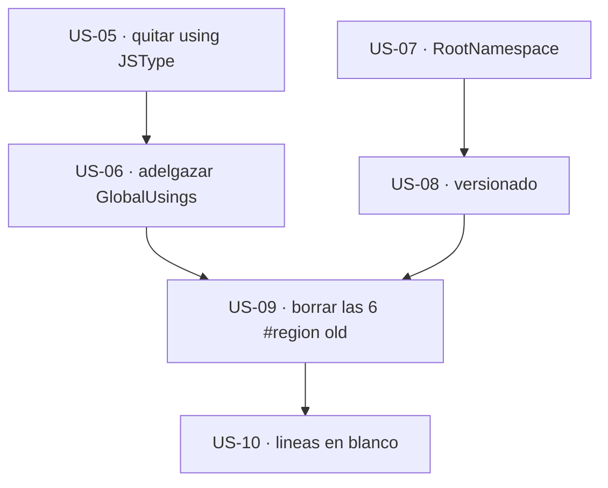

# Épica 2 · Higiene interna: `using` espurios, código muerto y ruido

> **Versión destino** · 2.2.0 (US-05 … US-10)
> **Origen** · [`Mejoras/Logging/README.md`](../../../Mejoras/Logging/README.md) · hallazgos `G1`, `G2`, `G4`, `G5`, `G6`, `M1`, `M2`
> **Plan del que se desgaja** · [`README.md`](README.md) de la versión 2.2.0
> **Proyecto** · `src/MoralesLarios.OOFP.Logging`
> **Estado** · ✅ completada
> **Esfuerzo** · **S** (~0,5 jornadas)
> **Riesgo** · 🟢 bajo · ninguna historia toca una sola línea de código vivo
>
> **Leyenda de esfuerzo:** XS (<2 h) · S (½ jornada) · M (1 jornada) · L (2 jornadas) · XL (3+ jornadas)
> **Leyenda de riesgo:** 🟢 bajo · 🟡 medio · 🟠 alto · 🔴 muy alto (rompe compatibilidad)

---

## Índice

1. [Contexto y problema](#1-contexto-y-problema)
   - [Punto 04 — Un `using static` de WebAssembly en una librería de logging](#punto-04--un-using-static-de-webassembly-en-una-librería-de-logging)
   - [Punto 05 — `GlobalUsings.cs` repite lo que `ImplicitUsings` ya da](#punto-05--globalusingscs-repite-lo-que-implicitusings-ya-da)
   - [Punto 06 — El `.csproj` se desvía del patrón del núcleo](#punto-06--el-csproj-se-desvía-del-patrón-del-núcleo)
   - [Punto 07 — 530 líneas comentadas: el mismo bloque clonado seis veces](#punto-07--530-líneas-comentadas-el-mismo-bloque-clonado-seis-veces)
   - [Punto 08 — 1.159 líneas en blanco, el 17,5 % del proyecto](#punto-08--1159-líneas-en-blanco-el-175--del-proyecto)
2. [Alcance](#2-alcance)
3. [Historias de usuario](#3-historias-de-usuario)
4. [Orden de ejecución](#4-orden-de-ejecución)
5. [Decisiones abiertas](#5-decisiones-abiertas)
6. [Definición de terminado](#6-definición-de-terminado)
7. [Apéndice · código actual y propuesto](#7-apéndice--código-actual-y-propuesto)
8. [Ver también](#8-ver-también)

---

## 1. Contexto y problema

`MoralesLarios.OOFP.Logging` tiene **6.619 líneas** repartidas en **10 ficheros**. De ellas,
**1.689 no aportan nada**: 530 están comentadas y 1.159 están en blanco. Es el **25,5 %** del
proyecto.

Esta épica es la **única del plan que no cambia ni un carácter de código vivo**. Su valor no es
estético: es que **reduce el ruido antes de que las épicas 3 y 4 tengan que buscar impacto**. Las 530
líneas comentadas contienen **102 firmas `public static`** y las **13** ocurrencias de la errata
`LogMlResultt`. Si se renombran los 218 parámetros de la épica 4 sin haber limpiado antes, cada
búsqueda de impacto obliga a filtrar código muerto a mano, y el riesgo de «arreglar» una firma
comentada —que no compila, no se prueba y no existe para el consumidor— es alto.

| Hallazgo | Fichero | Naturaleza | Rompe |
|:--------:|---------|------------|:-----:|
| `G1` | `MlResultLogExtensions.cs:8` · `MlResultLogExtensions.Obsolete.cs:2` | `using static` de un tipo de WebAssembly, sin uso | no |
| `G2` | `GlobalUsings.cs:1-5` | 5 `global using` que `ImplicitUsings` ya aporta · `System.Text` sin usar | no |
| `G4` | `MoralesLarios.OOFP.Logging.csproj` | sin `RootNamespace` ni `InternalsVisibleTo` | no |
| `G5` | `MoralesLarios.OOFP.Logging.csproj` | declara `AssemblyVersion` y `FileVersion`; el núcleo no | no |
| `G6` | los 8 ficheros de extensiones | 1.159 líneas en blanco · 98 bloques de 4 o más seguidas | no |
| `M1` | los 6 ficheros de nivel | 530 líneas comentadas · el mismo bloque clonado 6 veces | no |
| `M2` | `MlResultLogExtensions.Debug.cs:775,779,784,792…` | errata `LogMlResultt` · 13 ocurrencias, **todas** comentadas | no |

**Medición de partida** (fichero a fichero, contada sobre disco):

| Fichero | Comentadas (no `///`) | En blanco | Total | % inútil |
|---------|----------------------:|----------:|------:|---------:|
| `MlResultLogExtensions.cs` | 3 | 150 | 1.121 | 13,6 % |
| `MlResultLogExtensions.Debug.cs` | 87 | 184 | 910 | 29,8 % |
| `MlResultLogExtensions.Warning.cs` | 87 | 171 | 897 | 28,8 % |
| `MlResultLogExtensions.Trace.cs` | 87 | 170 | 896 | 28,7 % |
| `MlResultLogExtensions.Critical.cs` | 87 | 161 | 888 | 27,9 % |
| `MlResultLogExtensions.Information.cs` | 88 | 157 | 884 | 27,7 % |
| `MlResultLogExtensions.Error.cs` | 87 | 157 | 883 | 27,6 % |
| `MlResultLogExtensions.Obsolete.cs` | 1 | 1 | 85 | 2,4 % |
| `Extensions.cs` | 3 | 8 | 46 | 23,9 % |
| `GlobalUsings.cs` | 0 | 0 | 9 | 0 % |
| **Total** | **530** | **1.159** | **6.619** | **25,5 %** |

> **Lo que confirma la tabla.** Los **seis ficheros de nivel** tienen 87 u 88 líneas comentadas
> **cada uno**. No son seis problemas distintos: es **un mismo bloque copiado seis veces**. Se borra
> una vez y se repite la operación, sin análisis caso por caso.

### Punto 04 — Un `using static` de WebAssembly en una librería de logging

Dos ficheros abren un `using static` de un tipo que pertenece al *interop* de JavaScript:

```csharp
// MoralesLarios.OOFP.Logging/MlResultLogExtensions.cs, L8
using static System.Runtime.InteropServices.JavaScript.JSType;
```

```csharp
// MoralesLarios.OOFP.Logging/MlResultLogExtensions.Obsolete.cs, L2
using static System.Runtime.InteropServices.JavaScript.JSType;
```

Es el residuo clásico de un «importar el que falta» del IDE: `JSType` expone tipos anidados llamados
`Object`, `String`, `Number`, `Function`, `Error`… y el autocompletado lo propone cuando se escribe
`Error` o `String` en un contexto ambiguo. **No se usa ninguno de ellos.**

El daño no es sólo cosmético: `using static` **mete en el ámbito** nombres como `Error`, `Object` y
`String`, que pueden ganar una resolución de sobrecarga frente a los tipos esperados. En una librería
cuyo dominio son los errores, tener un `Error` ajeno en el ámbito es una trampa esperando a que
alguien escriba `Error` sin cualificar.

### Punto 05 — `GlobalUsings.cs` repite lo que `ImplicitUsings` ya da

El `.csproj` tiene `<ImplicitUsings>enable</ImplicitUsings>`, que ya inyecta `System`,
`System.Collections.Generic`, `System.Linq`, `System.Threading.Tasks` y `System.IO`, entre otros.
Aun así, el fichero los vuelve a declarar:

```csharp
// MoralesLarios.OOFP.Logging/GlobalUsings.cs, L1-9
global using System;                                 // ya lo da ImplicitUsings
global using System.Collections.Generic;             // ya lo da ImplicitUsings
global using System.Linq;                            // ya lo da ImplicitUsings
global using System.Text;                            // NO se usa en ningun fichero
global using System.Threading.Tasks;                 // ya lo da ImplicitUsings
global using MoralesLarios.OOFP.Types;               // necesario
global using Microsoft.Extensions.Logging;           // necesario
global using MoralesLarios.OOFP.Helpers.Extensions;  // necesario
global using MoralesLarios.OOFP.Types.Errors;        // necesario
```

De los 9, **sobran 5**: cuatro por duplicados de `ImplicitUsings` y `System.Text` porque el proyecto
no usa `StringBuilder` ni `Encoding` en ninguna de sus 6.619 líneas (medido: 0 ocurrencias de
`StringBuilder` y 0 de `Encoding`). Los **4 restantes son imprescindibles** y hay que conservarlos.

### Punto 06 — El `.csproj` se desvía del patrón del núcleo

Puestos uno al lado del otro, el contraste es inmediato:

```xml
<!-- MoralesLarios.OOFP.Core/MoralesLarios.OOFP.Core.csproj -->
<PropertyGroup>
  <TargetFramework>net8.0</TargetFramework>
  <ImplicitUsings>enable</ImplicitUsings>
  <Nullable>enable</Nullable>
  <Version>2.0.0</Version>
  <GenerateDocumentationFile>true</GenerateDocumentationFile>
  <RootNamespace>MoralesLarios.OOFP</RootNamespace>
</PropertyGroup>

<ItemGroup>
  <AssemblyAttribute Include="System.Runtime.CompilerServices.InternalsVisibleToAttribute">
    <_Parameter1>MoralesLarios.OOFP.Core.Tests.Unit</_Parameter1>
  </AssemblyAttribute>
</ItemGroup>
```

```xml
<!-- MoralesLarios.OOFP.Logging/MoralesLarios.OOFP.Logging.csproj -->
<PropertyGroup>
  <TargetFramework>net8.0</TargetFramework>
  <ImplicitUsings>enable</ImplicitUsings>
  <Nullable>enable</Nullable>
  <AssemblyVersion>2.0.0</AssemblyVersion>   <!-- el nucleo no lo declara -->
  <FileVersion>2.0.0</FileVersion>           <!-- el nucleo no lo declara -->
  <Version>2.0.0</Version>
  <GenerateDocumentationFile>true</GenerateDocumentationFile>
  <!-- falta RootNamespace -->
</PropertyGroup>
<!-- falta el ItemGroup de InternalsVisibleTo -->
```

Tres desviaciones:

1. **Falta `RootNamespace`.** El núcleo lo fija a `MoralesLarios.OOFP` para que los ficheros nuevos
   no hereden un espacio de nombres derivado del nombre del ensamblado. En Logging, un fichero nuevo
   nace en `MoralesLarios.OOFP.Logging` por omisión, que **no** es el espacio de nombres real de las
   clases del proyecto.
2. **Sobran `AssemblyVersion` y `FileVersion`.** Declarar los tres números a mano obliga a tocar tres
   líneas en cada publicación. El núcleo declara sólo `Version` y deja que el SDK derive los otros
   dos; es un número menos que se puede quedar desincronizado.
3. **Falta `InternalsVisibleTo`.** Es la pieza que la [épica 1](Epica-01-Red-de-Seguridad.md)
   necesita (US-04). Aquí se registra el hallazgo; **la implementación es de la épica 1**, para no
   tocar el mismo fichero desde dos épicas.

### Punto 07 — 530 líneas comentadas: el mismo bloque clonado seis veces

Cada fichero de nivel termina con una `#region old` que conserva la API anterior comentada. Éste es
el bloque de `Debug`, representativo de los seis:

```csharp
// MoralesLarios.OOFP.Logging/MlResultLogExtensions.Debug.cs, L772-799
    #region old

    //public static MlResult<ILogger> LogMlResulttDebug(this ILogger  logger,
    //                                                    string   message)
    //    => logger.LogMlResult(LogLevel.Debug, message);

    //public static Task<MlResult<ILogger>> LogMlResulttDebugAsync(this ILogger  logger,
    //                                                               string   message)
    //    => logger.LogMlResultAsync(LogLevel.Debug, message);

    //public static MlResult<T> LogMlResulttDebug<T>(this MlResult<T>                 value,
    //                                                 ILogger                       logger,
    //                                                 Func<T, string>               validBuildMessage = null!,
    //                                                 Func<MlErrorDetails, string>  failBuildMessage  = null!)
    //    => value.LogMlResult<T>(logger, LogLevel.Debug, validBuilMessage: validBuildMessage, failBuildMessage: failBuildMessage);
```

Hay **tres razones** para borrarlo, y ninguna es de estilo:

1. **El historial ya lo guarda.** Está en Git. Comentar código para «no perderlo» es duplicar una
   función que el control de versiones hace mejor.
2. **Contiene 102 firmas `public static` fantasma.** Cualquier búsqueda de `public static` en el
   proyecto devuelve 450 resultados cuando los reales son **348**. Eso falsea toda medición de
   superficie pública y obliga a filtrar a mano en las épicas 4 y 5.
3. **Perpetúa la errata `M2`.** Las 13 ocurrencias de `LogMlResultt` —con la `t` duplicada— viven
   **sólo** aquí. En código vivo hay **0**. Borrar la región **cierra `M2` sin escribir una sola
   línea**: no hay nada que renombrar, hay algo que suprimir.

> **Importante** · el bloque comentado cita `validBuilMessage:` como nombre de argumento. Es la misma
> errata `N1` que arregla la [épica 4](Epica-04-Nomenclatura-y-Firmas-Publicas.md). Si la épica 2 se
> ejecuta antes, el recuento de `validBuilMessage` baja de **134** a su valor real en código vivo, y
> la épica 4 trabaja sobre una cifra limpia. **Éste es el argumento de orden principal del plan.**

### Punto 08 — 1.159 líneas en blanco, el 17,5 % del proyecto

No molesta una línea en blanco entre métodos: molestan los **98 bloques de cuatro o más seguidas**
que hay repartidos por los 8 ficheros de extensiones (14 por fichero de nivel, 14 en
`MlResultLogExtensions.cs`). El efecto práctico es que un fichero de 910 líneas muestra, en una
pantalla, menos de la mitad del código que podría.

| Fichero | Bloques de ≥ 4 líneas en blanco |
|---------|--------------------------------:|
| `MlResultLogExtensions.cs` | 14 |
| `MlResultLogExtensions.Critical.cs` | 14 |
| `MlResultLogExtensions.Debug.cs` | 14 |
| `MlResultLogExtensions.Error.cs` | 14 |
| `MlResultLogExtensions.Trace.cs` | 14 |
| `MlResultLogExtensions.Warning.cs` | 14 |
| `MlResultLogExtensions.Information.cs` | 13 |
| `Extensions.cs` | 1 |
| **Total** | **98** |

Esta historia es la **última de la épica** a propósito: ejecutarla antes de borrar la `#region old`
sería normalizar espacios de código que va a desaparecer.

---

## 2. Alcance

**Entra en esta épica:**

- Retirar los 2 `using static …JSType`.
- Adelgazar `GlobalUsings.cs` de 9 a 4 `global using`.
- Añadir `RootNamespace` al `.csproj` y retirar `AssemblyVersion` y `FileVersion`.
- Borrar las 6 `#region old` completas (530 líneas) y, con ellas, la errata `LogMlResultt`.
- Normalizar los 98 bloques de líneas en blanco.

**No entra en esta épica:**

| Asunto | Dónde va |
|--------|----------|
| `InternalsVisibleTo` en el `.csproj` | [épica 1](Epica-01-Red-de-Seguridad.md) · US-04 · aquí sólo se registra el hallazgo `G4` |
| El bloque `Label="Globals"` con las 4 `Scc*` vacías (`G3`) | **ya resuelto** · commit transversal `chore(build)` sobre los 28 `.csproj` de la solución, fuera de estas épicas |
| El arreglo del defecto `F1` | [épica 3](Epica-03-Correccion-Funcional-y-Validacion.md) · US-11 |
| Renombrar `validBuilMessage` y `faildMessage` en código **vivo** | [épica 4](Epica-04-Nomenclatura-y-Firmas-Publicas.md) · US-15 y US-16 |
| Los `///` de los métodos públicos | [épica 5](Epica-05-Documentacion-XML.md) |
| `TreatWarningsAsErrors` | fuera de alcance · decisión de solución completa, no de un proyecto |

---

## 3. Historias de usuario

### US-05 · Retirar el `using static` de `JSType`

**Como** mantenedor de la librería
**quiero** que ningún fichero importe tipos del *interop* de WebAssembly
**para** que nombres como `Error`, `Object` o `String` no entren en el ámbito por accidente.

- **Esfuerzo** · XS · **Riesgo** · 🟢 · **Rompe** · no

**Criterios de aceptación**

- [x] Suprimida la línea 8 de `MlResultLogExtensions.cs`.
- [x] Suprimida la línea 2 de `MlResultLogExtensions.Obsolete.cs`.
- [x] Búsqueda de `JavaScript.JSType` en todo el proyecto → **0 ocurrencias**.
- [x] El proyecto compila sin errores nuevos: si alguna línea dependía de un tipo anidado de
      `JSType`, el compilador lo señala y **se cualifica el tipo correcto**, nunca se reinstaura el
      `using`.

### US-06 · Adelgazar `GlobalUsings.cs`

**Como** mantenedor
**quiero** que `GlobalUsings.cs` declare sólo lo que `ImplicitUsings` no aporta
**para** que el fichero diga algo y no repita la configuración del `.csproj`.

- **Esfuerzo** · XS · **Riesgo** · 🟢 · **Rompe** · no

**Criterios de aceptación**

- [x] El fichero queda con **4 `global using`**: `MoralesLarios.OOFP.Types`,
      `Microsoft.Extensions.Logging`, `MoralesLarios.OOFP.Helpers.Extensions` y
      `MoralesLarios.OOFP.Types.Errors`.
- [x] Retirados `System`, `System.Collections.Generic`, `System.Linq` y `System.Threading.Tasks`
      (los da `ImplicitUsings`).
- [x] Retirado `System.Text`, comprobando antes que `StringBuilder` y `Encoding` siguen dando
      **0 ocurrencias**.
- [x] El proyecto compila con **0 errores** y sin avisos nuevos.

### US-07 · Añadir `RootNamespace` al `.csproj`

**Como** mantenedor
**quiero** que Logging fije `RootNamespace` igual que el núcleo
**para** que un fichero nuevo nazca en el espacio de nombres correcto sin tener que corregirlo.

- **Esfuerzo** · XS · **Riesgo** · 🟢 · **Rompe** · no

**Criterios de aceptación**

- [x] `<RootNamespace>MoralesLarios.OOFP</RootNamespace>` presente en el `PropertyGroup` principal.
- [x] Ningún fichero existente cambia de espacio de nombres (se comprueba que los `namespace`
      declarados son explícitos y no dependen del valor por omisión).
- [x] Build y los **1.136 tests** de la solución siguen en verde.

### US-08 · Homogeneizar el versionado con el del núcleo

**Como** responsable de publicación
**quiero** declarar un único número de versión
**para** no tener tres propiedades que puedan desincronizarse entre sí.

- **Esfuerzo** · XS · **Riesgo** · 🟢 · **Rompe** · no

**Criterios de aceptación**

- [x] Retiradas `<AssemblyVersion>` y `<FileVersion>` del `.csproj`.
- [x] Conservada `<Version>`, que será la que el SDK propague.
- [x] Comprobado sobre el ensamblado compilado que la versión resultante sigue siendo la esperada.
- [x] El `.csproj` de Logging y el del núcleo declaran **el mismo conjunto** de propiedades de
      versionado.

### US-09 · Borrar las 530 líneas comentadas (y con ellas `LogMlResultt`)

**Como** mantenedor
**quiero** suprimir las 6 `#region old`
**para** que una búsqueda de `public static` devuelva la superficie real y no 102 firmas fantasma.

- **Esfuerzo** · S · **Riesgo** · 🟢 · **Rompe** · no

**Criterios de aceptación**

- [x] Las 6 `#region old` de los ficheros de nivel quedan suprimidas **por completo**, incluida la
      directiva `#endregion`.
- [x] Búsqueda de `LogMlResultt` en el proyecto → **0 ocurrencias** (cierra `M2`).
- [x] Búsqueda de `#region old` → **0 ocurrencias**.
- [x] El recuento de `public static` vivas sigue siendo **348** antes y después (es decir: **no se
      ha borrado ni una sola firma viva**).
- [x] El recuento de `#region`/`#endregion` emparejadas sigue siendo **consistente** en los seis
      ficheros, y la paridad **47 vivas + 17 comentadas** pasa a ser **47 vivas + 0 comentadas** en
      los seis, exactamente igual en todos.
- [x] Build con **0 errores** y los 1.136 tests en verde.

> **Importante** · esta historia borra **1.689 − 1.159 = 530** líneas sin tocar código ejecutable.
> Es la única del plan en la que el `git diff` debe tener **0 inserciones**. Si aparece alguna
> inserción, algo se ha reescrito y hay que revisarlo.

### US-10 · Normalizar las líneas en blanco

**Como** lector del código
**quiero** que no haya bloques de 4 o más líneas en blanco seguidas
**para** ver más código útil por pantalla.

- **Esfuerzo** · XS · **Riesgo** · 🟢 · **Rompe** · no

**Criterios de aceptación**

- [x] Ningún fichero tiene más de **2** líneas en blanco consecutivas.
- [x] Búsqueda del patrón de 4 o más saltos seguidos → **0 bloques** (partiendo de 98).
- [x] Se conserva **una** línea en blanco entre miembros y **dos** como separador entre regiones,
      de forma homogénea en los seis ficheros de nivel.
- [x] Se ejecuta **después** de la US-09, para no normalizar espacios de código que va a borrarse.
- [x] Build y tests en verde; el `git diff` **no contiene ningún cambio de línea con código**.

---

## 4. Orden de ejecución



**Justificación.**

1. **US-05 y US-06 van primero** porque son las que pueden revelar una dependencia oculta: si algo
   usaba `JSType` o `System.Text`, el compilador lo dice de inmediato y sobre un árbol todavía
   intacto, no sobre uno al que se le acaban de quitar 530 líneas.
2. **US-07 y US-08 son independientes** del código y tocan sólo el `.csproj`. Van en su propia rama
   del grafo para que su `diff` quede aislado.
3. **US-09 antes de US-10, siempre.** Normalizar el espaciado de un bloque que se va a borrar es
   trabajo tirado, y además ensucia el `diff` de la US-09, que debe tener **0 inserciones**.
4. **US-10 cierra la épica** porque es la única puramente cosmética y la que más líneas toca; dejarla
   al final evita que sus cambios se mezclen con los demás en la revisión.

> ⚠️ **Prerrequisito de épica.** Esta épica **no modifica comportamiento**, así que podría ejecutarse
> sin la red de seguridad de la [épica 1](Epica-01-Red-de-Seguridad.md). Pese a ello, el
> [plan](README.md#4-orden-de-ejecución-recomendado) la coloca **después**, porque la US-09 borra
> firmas comentadas y conviene tener la matriz de tests capturando el comportamiento vivo antes de
> hacer cualquier borrado masivo.
>
> ⚠️ **Esta épica es prerrequisito de la [épica 4](Epica-04-Nomenclatura-y-Firmas-Publicas.md).** Sin
> la US-09, los recuentos de `validBuilMessage` (134) y `faildMessage` (84) incluyen código muerto y
> el barrido de renombrado trabaja sobre cifras falsas.

---

## 5. Decisiones abiertas

| # | Decisión | Opciones | Estado |
|:-:|----------|----------|:------:|
| **D-09** | Qué hacer con las `#region` **vivas** (7 por fichero, 42 en total) | (a) conservarlas tal cual · (b) renombrarlas a un texto homogéneo en castellano · (c) retirarlas y confiar en el orden de los miembros | ✅ **(a)** |
| **D-10** | Hasta dónde llevar la normalización de blancos | (a) máximo 2 líneas seguidas, como propone la US-10 · (b) máximo 1 · (c) fijar un `.editorconfig` en la solución y dejar que la herramienta decida | ✅ **(a)** |
| **D-11** | Si añadir `TreatWarningsAsErrors` a Logging | (a) no, es decisión de solución completa · (b) sí, sólo en Logging, aprovechando que tiene **0 avisos propios** · (c) sí, pero con `WarningsNotAsErrors` para los 8 `CS8604` transitivos del núcleo | ✅ **(a)** |

> **D-11 es más interesante de lo que parece.** Logging tiene **cero avisos propios**: los 8
> `CS8604` que aparecen vienen de anotaciones del núcleo. Es, por tanto, el candidato natural a ser
> el **primer proyecto** de la solución con `TreatWarningsAsErrors`, y a servir de prueba antes de
> extenderlo. **Ratificada en (a)**: activarlo sólo aquí dejaría el proyecto expuesto a que un
> cambio del núcleo rompa su build sin haberlo tocado, así que se decidirá junto con la política de
> la solución completa, no sólo de este proyecto.

---

### 5.1 Resolución de las decisiones (al cerrar la épica)

Las tres decisiones se aplicaron con la **opción menos invasiva**, porque ninguna de ellas era
bloqueante y lo hecho es reversible. El propietario las ha **revisado en bloque al cerrar el plan**
y ha **ratificado la opción (a) en las tres**, de modo que quedan cerradas.

| # | Decisión | Aplicado | Estado | Motivo |
|:-:|----------|----------|:------:|--------|
| **D-09** | `#region` vivas | **(a) conservarlas tal cual** | ✅ **(a)** ratificada | Las 42 regiones vivas (6 por fichero de nivel y 7 en `MlResultLogExtensions.cs`) son el único índice navegable de ficheros de 700 líneas. Renombrarlas (b) es trabajo de la épica 4, que ya toca nomenclatura; retirarlas (c) empeoraría la lectura antes de tener la documentación XML de la épica 5. |
| **D-10** | Normalización de blancos | **(a) máximo 2 líneas seguidas** | ✅ **(a)** ratificada | Se ha aplicado la regla con un matiz: **1** línea en blanco entre miembros y **2** sólo como separador antes de un `#region` o después de un `#endregion`. Fijar un `.editorconfig` (c) es una decisión de solución completa y se deja para una épica transversal. |
| **D-11** | `TreatWarningsAsErrors` | **(a) no** | ✅ **(a)** ratificada | Confirmado que Logging tiene **0 avisos propios**: de los 238 avisos del build, ninguno procede de este proyecto. Es, por tanto, el candidato natural, pero activarlo aquí dejaría el proyecto expuesto a que un cambio del núcleo rompa su build sin tocarlo. Se propone decidirlo junto con la política de la solución. |

> Las tres se presentaron en la **lista final de las 25 decisiones** al cerrar el plan y el
> propietario **ratificó la opción (a) en las tres**. `D-11` queda como **propuesta viva** para una
> épica transversal: cuando la solución completa adopte una política de avisos, Logging es el
> primer candidato, porque tiene **0 avisos propios**.

### 5.2 Resultados medidos al cerrar la épica

| Métrica | Antes | Después | Objetivo |
|---------|------:|--------:|----------|
| Líneas totales del proyecto | 6.619 | **5.435** | ~5.400 |
| Líneas comentadas | 530 | **25** | 0 no documentales |
| Líneas en blanco | 1.159 | **499** | — |
| Bloques de ≥4 blancas seguidas | 98 | **0** | 0 |
| `public static` vivas | 348 | **348** | 348 (ninguna perdida) |
| `JavaScript.JSType` | 2 | **0** | 0 |
| `LogMlResultt` (errata `M2`) | 13 | **0** | 0 |
| `#region old` | 6 | **0** | 0 |
| `global using` en `GlobalUsings.cs` | 9 | **4** | 4 |

Las **25 líneas comentadas** que quedan **no son código muerto**: son las tres líneas de cabecera de
licencia de ocho ficheros (24) más la nota que explica el propósito de
`MlResultLogExtensions.Obsolete.cs` (1). Son documentales y se conservan a propósito.

Verificación de equilibrio de regiones tras el borrado (`#region` = `#endregion` en los diez
ficheros):

| Fichero | `#region` | `#endregion` |
|---------|:---------:|:------------:|
| `MlResultLogExtensions.cs` | 7 | 7 |
| `MlResultLogExtensions.Critical.cs` | 6 | 6 |
| `MlResultLogExtensions.Debug.cs` | 6 | 6 |
| `MlResultLogExtensions.Error.cs` | 6 | 6 |
| `MlResultLogExtensions.Information.cs` | 6 | 6 |
| `MlResultLogExtensions.Trace.cs` | 6 | 6 |
| `MlResultLogExtensions.Warning.cs` | 6 | 6 |
| `Extensions.cs` · `GlobalUsings.cs` · `MlResultLogExtensions.Obsolete.cs` | 0 | 0 |

**Build y tests** (desde `src`, en `Release`, con `--no-incremental`):

- `dotnet build` → **EXIT = 0**, **0 errores**, **119 avisos únicos** (238 en total, ninguno de
  Logging), **0 `CS1591`**, **0 `CS0618`**.
- `dotnet test --no-build` → **EXIT = 0**, **10 ensamblados**, **1.309 tests**, **0 fallidos**,
  **0 omitidos**. Cifra idéntica a la del cierre de la épica 1: el borrado masivo **no ha alterado
  ningún comportamiento**.

### 5.3 Hallazgo nuevo · el borrado real fue mayor de lo previsto

El documento estimaba 530 líneas comentadas en 6 `#region old`. El borrado efectivo ha retirado
**862 líneas** de los seis ficheros de nivel, porque cada región venía precedida y seguida de
bloques de líneas en blanco que también se han suprimido, y porque la normalización posterior
(US-10) ha recortado otras 269. El recuento de `public static` vivas se ha comprobado **antes y
después** del borrado y es **348 en los dos casos**, que es la garantía de que no se ha perdido
ninguna firma viva.

Dato colateral: el recuento de bloques de ≥4 blancas medido justo antes de la US-10 era **52**, no
98, precisamente porque la US-09 ya se había llevado por delante 46 de ellos al borrar las regiones.
Esto confirma el orden `US-09 → US-10` que fijaba el apartado 4.

---

## 6. Definición de terminado

- [x] Las **6 historias** (US-05 … US-10) tienen todos sus criterios de aceptación marcados.
- [x] `dotnet build MoralesLarios.OOFP.sln -c Release --no-incremental` → **EXIT = 0**,
      **0 errores**, **0 `CS1591`**, **0 `CS0618`** y **no más de 236 avisos**.
- [x] `dotnet test MoralesLarios.OOFP.sln -c Release --no-build` → **1.136 tests** en verde (más los
      que haya añadido la épica 1).
- [x] El proyecto baja de **6.619** líneas a **~5.400**, con **0** comentadas no documentales y
      **0** bloques de 4 blancos seguidos.
- [x] Búsquedas de cierre a **0**: `JavaScript.JSType`, `LogMlResultt`, `#region old`.
- [x] El recuento de `public static` vivas sigue en **348** (ninguna firma viva perdida).
- [x] **No hay rupturas que registrar.** Ninguna de las 6 historias altera la superficie pública ni
      el comportamiento observable: los `using` son detalles de compilación, el `GlobalUsings` es
      interno, las propiedades del `.csproj` no cambian la versión publicada y lo borrado estaba
      comentado. Por tanto **no se añade ningún punto** a
      [`oofp-upgrade-2.prompt.md`](../../../Copilot/.github/prompts/oofp-upgrade-2.prompt.md) ni a
      [`oofp-upgrade-2.renames.md`](../../../Copilot/.github/prompts/oofp-upgrade-2.renames.md), y
      esa ausencia **se hace constar explícitamente en el cuerpo del commit**.
- [x] Commit `refactor(logging): …` **sin `!`**, en castellano, creado con `git commit -F` desde un
      fichero UTF-8 sin BOM.
- [x] Este documento queda marcado como `✅ completada` en su línea de **Estado** y en la tabla de
      [`README.md`](README.md#1-las-siete-épicas).

---

## 7. Apéndice · código actual y propuesto

### 7.1 `GlobalUsings.cs` · antes y después

```csharp
// ANTES · 9 lineas
global using System;
global using System.Collections.Generic;
global using System.Linq;
global using System.Text;
global using System.Threading.Tasks;
global using MoralesLarios.OOFP.Types;
global using Microsoft.Extensions.Logging;
global using MoralesLarios.OOFP.Helpers.Extensions;
global using MoralesLarios.OOFP.Types.Errors;
```

```csharp
// DESPUES · 4 lineas
global using Microsoft.Extensions.Logging;
global using MoralesLarios.OOFP.Types;
global using MoralesLarios.OOFP.Types.Errors;
global using MoralesLarios.OOFP.Helpers.Extensions;
```

### 7.2 `.csproj` · antes y después

```xml
<!-- ANTES -->
<PropertyGroup>
  <TargetFramework>net8.0</TargetFramework>
  <ImplicitUsings>enable</ImplicitUsings>
  <Nullable>enable</Nullable>
  <AssemblyVersion>2.0.0</AssemblyVersion>
  <FileVersion>2.0.0</FileVersion>
  <Version>2.0.0</Version>
  <GenerateDocumentationFile>true</GenerateDocumentationFile>
</PropertyGroup>
```

```xml
<!-- DESPUES · alineado con el nucleo. El ItemGroup de InternalsVisibleTo
     lo aporta la US-04 de la epica 1, no esta epica. -->
<PropertyGroup>
  <TargetFramework>net8.0</TargetFramework>
  <ImplicitUsings>enable</ImplicitUsings>
  <Nullable>enable</Nullable>
  <Version>2.0.0</Version>
  <GenerateDocumentationFile>true</GenerateDocumentationFile>
  <RootNamespace>MoralesLarios.OOFP</RootNamespace>
</PropertyGroup>
```

### 7.3 Las 6 `#region old` que desaparecen

| Fichero | Líneas comentadas | Firmas fantasma | Ocurrencias de `LogMlResultt` |
|---------|------------------:|----------------:|------------------------------:|
| `MlResultLogExtensions.Critical.cs` | 87 | 17 | 2 |
| `MlResultLogExtensions.Debug.cs` | 87 | 17 | 3 |
| `MlResultLogExtensions.Error.cs` | 87 | 17 | 2 |
| `MlResultLogExtensions.Information.cs` | 88 | 17 | 2 |
| `MlResultLogExtensions.Trace.cs` | 87 | 17 | 2 |
| `MlResultLogExtensions.Warning.cs` | 87 | 17 | 2 |
| **Total** | **523** | **102** | **13** |

> Las **7** líneas comentadas restantes hasta 530 están en `MlResultLogExtensions.cs` (3),
> `Extensions.cs` (3) y `MlResultLogExtensions.Obsolete.cs` (1). Son comentarios **explicativos**,
> no código muerto: **se conservan**. En particular, la cabecera de `Obsolete.cs` documenta cuándo se
> retiran los puentes de la 2.0.0 y es información que hay que mantener.

### 7.4 Búsquedas de verificación

Al cerrar la épica, estas búsquedas deben dar el valor indicado:

| Búsqueda | Valor esperado |
|----------|---------------:|
| `JavaScript.JSType` | 0 |
| `LogMlResultt` | 0 |
| `#region old` | 0 |
| `global using` en `GlobalUsings.cs` | 4 |
| `AssemblyVersion` o `FileVersion` en el `.csproj` | 0 |
| `RootNamespace` en el `.csproj` | 1 |
| `public static` vivas | **348** (igual que antes) |
| bloques de 4 o más líneas en blanco | 0 |
| líneas totales del proyecto | ~5.400 (desde 6.619) |

---

## 8. Ver también

- [`README.md`](README.md) — plan de la versión 2.2.0 y reparto de las 33 historias.
- [`Epica-01-Red-de-Seguridad.md`](Epica-01-Red-de-Seguridad.md) — la red de tests; aporta el `InternalsVisibleTo` que aquí sólo se registra.
- [`Epica-04-Nomenclatura-y-Firmas-Publicas.md`](Epica-04-Nomenclatura-y-Firmas-Publicas.md) — depende de la US-09 para contar con cifras limpias.
- [`Mejoras/Logging/README.md`](../../../Mejoras/Logging/README.md) — análisis de origen, hallazgos `G1`, `G2`, `G4`, `G5`, `G6`, `M1` y `M2`.
- [`2.1.1/Core/Epica-02-Higiene-Interna-y-Codigo-Muerto.md`](../../2.1.1/Core/Epica-02-Higiene-Interna-y-Codigo-Muerto.md) — la épica equivalente ya cerrada en el núcleo, modelo de esta.
