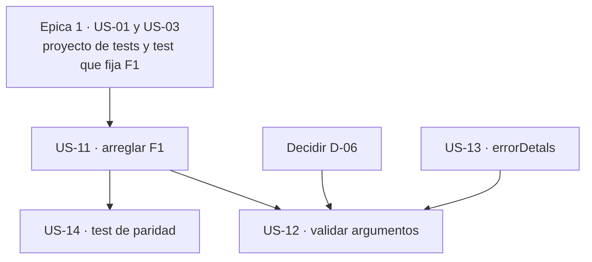

# Épica 3 · Corrección funcional: el defecto que nadie vio y la validación que falta

> **Versión destino** · 2.2.0 (US-11 … US-14)
> **Origen** · [`Mejoras/Logging/README.md`](../../../Mejoras/Logging/README.md) · hallazgos `F1`, `D8`, `N3`
> **Plan del que se desgaja** · [`README.md`](README.md) de la versión 2.2.0
> **Proyecto** · `src/MoralesLarios.OOFP.Logging`
> **Estado** · ✅ completada
> **Esfuerzo** · **M** (~1,0 jornada)
> **Riesgo** · 🟠 alto · **2 rupturas silenciosas**: compilan igual y cambian el comportamiento
>
> **Leyenda de esfuerzo:** XS (<2 h) · S (½ jornada) · M (1 jornada) · L (2 jornadas) · XL (3+ jornadas)
> **Leyenda de riesgo:** 🟢 bajo · 🟡 medio · 🟠 alto · 🔴 muy alto (rompe compatibilidad)

---

## Índice

1. [Contexto y problema](#1-contexto-y-problema)
   - [Punto 09 — `F1`: una sobrecarga llama a la función equivocada](#punto-09--f1-una-sobrecarga-llama-a-la-función-equivocada)
   - [Punto 10 — Ninguna de las 339 firmas valida sus argumentos](#punto-10--ninguna-de-las-339-firmas-valida-sus-argumentos)
   - [Punto 11 — `errorDetals`, la errata inofensiva](#punto-11--errordetals-la-errata-inofensiva)
2. [Alcance](#2-alcance)
3. [Historias de usuario](#3-historias-de-usuario)
4. [Orden de ejecución](#4-orden-de-ejecución)
5. [Decisiones abiertas](#5-decisiones-abiertas)
6. [Definición de terminado](#6-definición-de-terminado)
7. [Apéndice · código actual y propuesto](#7-apéndice--código-actual-y-propuesto)
8. [Ver también](#8-ver-también)

---

## 1. Contexto y problema

Ésta es la épica que **justifica todo el plan**. Las demás mejoran el código; ésta **arregla algo que
está mal**.

`MoralesLarios.OOFP.Logging` expone **339 firmas públicas** y tiene **cero tests propios**. En ese
escenario, un error de copiar y pegar en una sola línea puede sobrevivir indefinidamente, porque
compila, no lanza ninguna excepción y produce un mensaje de traza que *parece* correcto. Es
exactamente lo que ha pasado con `F1`.

| Hallazgo | Fichero | Naturaleza | Rompe |
|:--------:|---------|------------|:-----:|
| `F1` | `MlResultLogExtensions.cs:903` | **Defecto real** · una sobrecarga delega en la función equivocada | **silenciosa** |
| `D8` | las 339 firmas públicas | 0 validaciones de argumento · `null` reventará dentro de la librería | **silenciosa** |
| `N3` | `MlResultLogExtensions.cs:1089`, `:1100`, `:1111` | errata `errorDetals` en un parámetro de lambda local | no |

La diferencia entre `F1`/`D8` y el resto del plan es que aquí el compilador del consumidor **no va a
avisar de nada**. Su código seguirá compilando y su comportamiento cambiará. Por eso las dos son de
registro **obligatorio** en los seis sitios del prompt de migración, con el apartado de «cómo
detectarlas» redactado con especial cuidado.

### Punto 09 — `F1`: una sobrecarga llama a la función equivocada

La familia `LogMlResultIfFailWith*` tiene tres miembros con semánticas **distintas**:

| Método | Qué registra |
|--------|--------------|
| `LogMlResultIfFailWithValue` | el fallo **y el valor** asociado al detalle de error |
| `LogMlResultIfFailWithException` | el fallo **y la excepción** contenida en el detalle de error |
| `LogMlResultIfFailWithoutException` | el fallo **sólo si NO hay** excepción |

Las dos primeras sobrecargas de `…WithExceptionAsync` están bien. Ésta es la correcta, que delega en
`GetExceptionAsync()`:

```csharp
// MoralesLarios.OOFP.Logging/MlResultLogExtensions.cs, L927-937  ·  CORRECTA
public static async Task<MlResult<T>> LogMlResultIfFailWithExceptionAsync<T>(this MlResult<T>                        source,
                                                                                 ILogger                            logger,
                                                                                 LogLevel                           logLevel,
                                                                                 Func<MlErrorDetails, Exception, string> failBuildMessage)
    => await source.MatchAsync(
                                validAsync: x             => source.ToAsync(),
                                failAsync : errorsDetails => errorsDetails.GetExceptionAsync()
                                                                .BindAsync( ex => source.LogMlResultAsync(logger, logLevel, failBuildMessage(errorsDetails, ex)))
                            );
```

Y ésta es la tercera —la que recibe un `Task<MlResult<T>>`— **con el defecto**:

```csharp
// MoralesLarios.OOFP.Logging/MlResultLogExtensions.cs, L947-951  ·  DEFECTUOSA
public static async Task<MlResult<T>> LogMlResultIfFailWithExceptionAsync<T>(this Task<MlResult<T>>                  sourceAsync,
                                                                                 ILogger                            logger,
                                                                                 LogLevel                           logLevel,
                                                                                 Func<MlErrorDetails, Exception, string> failBuildMessage)
    => await (await sourceAsync).LogMlResultIfFailWithValueAsync(logger, logLevel, failBuildMessage);
//                               ^^^^^^^^^^^^^^^^^^^^^^^^^^^^^^  deberia ser LogMlResultIfFailWithExceptionAsync
```

**Por qué compila.** `LogMlResultIfFailWithValueAsync` es genérico en el tipo del valor y acepta un
`Func<MlErrorDetails, TValue, string>`. Al pasarle un `Func<MlErrorDetails, Exception, string>`, el
compilador **infiere `TValue = Exception`** y la llamada encaja perfectamente. No hay aviso, no hay
error, no hay nada.

**Qué hace de más y de menos.**

| | `…WithExceptionAsync` (lo esperado) | `…WithValueAsync` (lo que ocurre) |
|---|---|---|
| De dónde saca el segundo argumento | `GetException()` · la **excepción** del detalle | `GetDetailValue<Exception>()` · el **valor** del detalle, interpretado como excepción |
| Si el detalle tiene excepción pero no valor | registra la traza | **no registra nada**: devuelve fallo por valor ausente |
| Si el detalle tiene un valor que no es excepción | no aplica | **no registra nada**: falla la conversión |
| Resultado devuelto | el `source` original | un `MlResult` fallido **distinto** del original |

El efecto neto para el consumidor es que **las trazas no aparecen** y, en algunos caminos, que el
`MlResult` que sale de la cadena **no es el que entró**. Un fallo de logging que se come el error que
pretendía registrar.

> **Importante** · arreglarlo es una **ruptura silenciosa**. El código del consumidor compila
> exactamente igual, pero a partir de la 2.2.0 **empezarán a aparecer trazas que antes no salían**, y
> los `MlResult` devueltos por esa sobrecarga dejarán de estar fallidos en los casos descritos. Si el
> consumidor tiene tests que afirman la ausencia de traza, pasarán a fallar — y estarán fallando
> *correctamente*.

### Punto 10 — Ninguna de las 339 firmas valida sus argumentos

Medido sobre las 6.619 líneas del proyecto:

| Búsqueda | Ocurrencias |
|----------|------------:|
| `ArgumentNullException` | **0** |
| `ArgumentException` | **0** |
| `nameof(` | **0** |
| `ThrowIfNull` | **0** |
| `null!` como valor por omisión | **132** |

La combinación es el problema. Las firmas declaran sus constructores de mensaje con `null!` por
omisión:

```csharp
public static MlResult<T> LogMlResult<T>(this MlResult<T>                 value,
                                              ILogger                      logger,
                                              LogLevel                     logLevel,
                                              Func<T, string>              validBuilMessage = null!,
                                              Func<MlErrorDetails, string> failBuildMessage  = null!)
```

Es decir: la librería **invita** a omitirlos —son opcionales— y además apaga con `!` el aviso del
compilador que diría que ese `null` es sospechoso. Si el consumidor omite el que luego hace falta, o
pasa un `logger` nulo, la `NullReferenceException` se lanza **dentro** de la librería, con una pila
que apunta a un fichero que el consumidor no puede ver ni arreglar.

Para una librería cuyo propósito es **railway-oriented programming** —no propagar fallos por
excepción, sino por `MlResult`— esto es doblemente incoherente: la pieza que debería registrar los
fallos es la única que los lanza sin control.

Hay tres respuestas posibles, y la elección **es una ruptura silenciosa en dos de los tres casos**.
Por eso se registra como [`D-06`](README.md#6-decisiones-pendientes-del-propietario) y no se decide
en este documento.

### Punto 11 — `errorDetals`, la errata inofensiva

```csharp
// MoralesLarios.OOFP.Logging/MlResultLogExtensions.cs, L1089, L1100, L1111
public static MlResult<T> LogGeneralErrorIfFail<T>(this MlResult<T> source, ILogger logger)
    => source.LogMlResultErrorIfFail(logger, failBuildMessage : errorDetals => errorDetals.GetErrorsSummary());
//                                                              ^^^^^^^^^^^  falta la 'i'
```

Tres ocurrencias, las tres en el **parámetro de una lambda local**. A diferencia de
`validBuilMessage` y `faildMessage` —que son **nombres de parámetro públicos** y por tanto parte del
contrato, y que trata la [épica 4](Epica-04-Nomenclatura-y-Firmas-Publicas.md)—, el nombre de un
parámetro de lambda **no es observable** desde fuera: no se puede usar como argumento con nombre, no
aparece en los metadatos del ensamblado y no se documenta.

Por eso se arregla aquí, junto a las correcciones funcionales, y **sin registrar ninguna ruptura**:
es el único renombrado de todo el plan que no tiene consecuencias.

---

## 2. Alcance

**Entra en esta épica:**

- Arreglar la llamada cruzada de `F1`.
- Decidir y aplicar una política de validación de argumentos.
- Corregir las 3 ocurrencias de `errorDetals`.
- Añadir el test de regresión que fija la **paridad** entre las tres variantes `IfFailWith*`.
- Registrar las **2 rupturas silenciosas** en los seis sitios del prompt de migración.

**No entra en esta épica:**

| Asunto | Dónde va |
|--------|----------|
| Crear el proyecto de tests y el test que **fija** `F1` antes de arreglarlo | [épica 1](Epica-01-Red-de-Seguridad.md) · US-01 y US-03 |
| Renombrar `validBuilMessage` y `faildMessage` (parámetros **públicos**) | [épica 4](Epica-04-Nomenclatura-y-Firmas-Publicas.md) · US-15 y US-16 |
| Sustituir los `null!` por sobrecargas sin parámetro opcional (`D3`) | **3.0.0** · requiere rediseñar las 132 firmas afectadas |
| Que `LogMlResult` devuelva `MlResult<ILogger>` (`D6`) y el `Match` que devuelve `null!` (`D7`) | **3.0.0** |
| Consultar `IsEnabled` antes de construir el mensaje (`D1`) | [épica 6](Epica-06-Rendimiento-y-Estandar-de-Logging.md) · US-28 |
| Documentar con `<exception>` las excepciones que la US-12 introduzca | [épica 5](Epica-05-Documentacion-XML.md) · US-25 |

---

## 3. Historias de usuario

### US-11 · Arreglar `F1`, la llamada cruzada

**Como** consumidor de `LogMlResultIfFailWithExceptionAsync`
**quiero** que la sobrecarga que recibe una `Task` registre la **excepción**, igual que sus hermanas
**para** que mis trazas de error aparezcan y mi `MlResult` no se altere por el camino.

- **Esfuerzo** · S · **Riesgo** · 🟠 · **Rompe** · **silenciosa**

**Criterios de aceptación**

- [x] En `MlResultLogExtensions.cs:903`, la llamada pasa de `LogMlResultIfFailWithValueAsync` a
      `LogMlResultIfFailWithExceptionAsync`.
- [x] El test de la US-03 —que fijaba el comportamiento **defectuoso**— se actualiza para afirmar el
      comportamiento **correcto**, y el cambio de ese test se señala explícitamente en el commit como
      la prueba documental de la ruptura.
- [x] Se comprueba que las otras **dos** sobrecargas de la familia siguen intactas y en verde.
- [x] Se revisan las **tres** familias `IfFailWithValue`, `IfFailWithException` e
      `IfFailWithoutException` en los **6 ficheros de nivel** buscando el mismo patrón de llamada
      cruzada; si aparece otro caso, **se añade a esta historia**, no se deja para después.
- [x] La ruptura queda registrada en los **seis sitios** de
      [`oofp-upgrade-2.prompt.md`](../../../Copilot/.github/prompts/oofp-upgrade-2.prompt.md): fila
      en la §3.3, subsección `#### N` de detalle, barrido de búsqueda de la Fase 5, lista de la
      Fase 6, tabla del apéndice de versiones y —si procede— el anexo de renombrados.
- [x] La subsección de detalle incluye el apartado **«cómo detectarla»**: buscar
      `LogMlResultIfFailWithExceptionAsync` sobre una expresión de tipo `Task<MlResult<T>>` y revisar
      los tests que afirmen **ausencia** de traza.
- [x] Build con **0 errores** y todos los tests en verde.

### US-12 · Validar `logger` y los constructores de mensaje

**Como** consumidor
**quiero** que un argumento nulo produzca un fallo claro y atribuible
**para** no recibir una `NullReferenceException` lanzada dentro de una librería que no puedo depurar.

- **Esfuerzo** · M · **Riesgo** · 🟠 · **Rompe** · **silenciosa**

**Criterios de aceptación**

- [x] **Resuelta [`D-06`](README.md#6-decisiones-pendientes-del-propietario)** y anotada en este
      documento antes de escribir una sola línea.
- [x] La política elegida se aplica de forma **homogénea** a las 339 firmas: no se admite que unas
      validen y otras no.
- [x] La validación se concentra en el **punto de entrada** de cada familia; las sobrecargas que
      delegan **no** repiten la comprobación.
- [x] Hay un test por cada forma de argumento nulo contemplada: `logger` nulo, constructor de mensaje
      nulo cuando es necesario y constructor de mensaje nulo cuando es prescindible.
- [x] Si la opción elegida es (a) o (b), la ruptura queda registrada en los **seis sitios** del
      prompt, con «cómo detectarla» redactado así: buscar las llamadas que **omiten** los parámetros
      opcionales y las que pasan un `logger` obtenido de `GetService<T>()`, que puede devolver nulo.
- [x] Si la opción elegida es (c), se hace constar en el commit que **no hay ruptura** y por qué.
- [x] Los avisos de la solución **no suben** de 236.

> **Importante** · esta historia es la que explica el aviso `CS8604` del `Sample`
> ([épica 7](Epica-07-Saneamiento-del-Sample.md), US-33): el propio ejemplo de la librería obtiene su
> `logger` con `GetService<ILogger<Program>>()`, que **puede devolver nulo**, y se lo pasa sin
> comprobar. El compilador avisa en el `Sample` de un riesgo que la librería no cubre.

### US-13 · Corregir `errorDetals`

**Como** mantenedor
**quiero** escribir bien el nombre del parámetro de las tres lambdas
**para** que no quede ninguna errata visible en el código del proyecto.

- **Esfuerzo** · XS · **Riesgo** · 🟢 · **Rompe** · no

**Criterios de aceptación**

- [x] Las 3 ocurrencias de `errorDetals` (`:1034`, `:1045`, `:1056`) pasan a `errorDetails`.
- [x] Búsqueda de `errorDetals` en el proyecto → **0 ocurrencias**.
- [x] Se comprueba expresamente que las tres son **parámetros de lambda** y no nombres de parámetro
      público, y que por tanto **no procede** registrar ruptura. Se hace constar en el commit.
- [x] Build y tests en verde.

### US-14 · Test de regresión de la paridad entre las tres `IfFailWith*`

**Como** mantenedor
**quiero** un test que compare el comportamiento de las tres familias entre sí
**para** que una llamada cruzada como `F1` no pueda volver a pasar desapercibida.

- **Esfuerzo** · S · **Riesgo** · 🟢 · **Rompe** · no

**Criterios de aceptación**

- [x] Existe un test que, para un mismo detalle de error **con** excepción, comprueba que
      `IfFailWithException` registra y `IfFailWithoutException` **no** registra.
- [x] Existe su simétrico: para un detalle **sin** excepción, `IfFailWithoutException` registra y
      `IfFailWithException` **no** registra.
- [x] Las **tres** sobrecargas de cada familia —`MlResult<T>`, `Task<MlResult<T>>` y la que recibe un
      mensaje fijo— se ejercitan y se comprueba que producen **el mismo** resultado observable. Es el
      test que habría detectado `F1`.
- [x] El test se escribe de forma que **falle** si alguien vuelve a cruzar una llamada, y su nombre
      cita la US-11 para que quede clara su razón de ser.
- [x] El test se apoya en el doble de `ILogger` de la
      [épica 1](Epica-01-Red-de-Seguridad.md#7-apéndice--código-actual-y-propuesto) (US-02); **no**
      se escribe otro doble distinto.

---

## 4. Orden de ejecución



**Justificación.**

1. **Nada empieza antes de la épica 1.** Arreglar `F1` sin un test que capture el comportamiento
   anterior es cambiar el comportamiento a ciegas. La US-03 existe precisamente para que el `diff`
   del arreglo venga acompañado de la prueba de qué hacía antes y qué hace ahora.
2. **US-11 antes que US-12** porque la validación de argumentos toca las 339 firmas y dejaría el
   `diff` de `F1` —que es **una línea**— enterrado entre cientos de cambios. Un defecto funcional
   merece un commit propio y legible.
3. **US-13 antes que US-12** por la misma razón inversa: es un cambio de 3 líneas que conviene que
   viaje solo, no mezclado con el barrido grande.
4. **US-14 justo después de US-11**, mientras el análisis de las tres familias está fresco. Es el
   test que convierte el arreglo en algo permanente.
5. **`D-06` bloquea la US-12 por completo.** No se escribe código de validación hasta que el
   propietario elija entre excepción, `MlResult` fallido o no-operación. Las tres opciones producen
   código distinto y dos de ellas obligan a registrar una ruptura.

> ⚠️ **Esta épica es prerrequisito de la [épica 4](Epica-04-Nomenclatura-y-Firmas-Publicas.md).**
> Conviene que el comportamiento esté **correcto** antes de renombrar 218 parámetros: si se renombra
> primero, cualquier fallo que aparezca después será difícil de atribuir entre «el renombrado» y «el
> defecto que ya estaba».

---

## 5. Decisiones abiertas

| # | Decisión | Opciones | Estado |
|:-:|----------|----------|:------:|
| **D-06** | Qué hacer cuando `logger` es nulo (US-12) | (a) lanzar `ArgumentNullException` · (b) devolver un `MlResult` fallido · **(c) no registrar y devolver el `source` intacto** | ✅ **(c)** |
| **D-12** | Qué hacer cuando el constructor de mensaje necesario es nulo | **(a) la misma política que `D-06`** · (b) usar un mensaje por omisión derivado de `GetErrorsSummary()` · (c) no registrar | ✅ **(a)** |
| **D-13** | Si la US-11 debe llevar también un puente de compatibilidad | **(a) no · es un defecto, y mantener el comportamiento erróneo accesible no tiene sentido** · (b) sí · una sobrecarga `[Obsolete]` que conserve el comportamiento anterior durante la 2.2.0 | ✅ **(a)** |

> **Decisiones adoptadas al implementar la épica** · `D-06` → **(c)**, `D-12` → **(a)** (es decir,
> la misma política que `D-06`) y `D-13` → **(a)**. En consecuencia:
>
> - cuando el `logger` es nulo **no se registra nada** y se devuelve el `source` **intacto**, salvo
>   en las dos sobrecargas de entrada cuyo tipo de retorno es `MlResult<ILogger>` —que no tienen
>   ningún `source` que devolver— y que por eso devuelven un resultado **fallido** con el mensaje
>   «El parámetro 'logger' no puede ser nulo.»;
> - cuando el constructor de mensaje es nulo tampoco se registra nada y se devuelve el `source`
>   intacto, gracias al auxiliar interno `MlResultLogGuards.Build(...)`;
> - la US-11 **no** lleva puente de compatibilidad: el comportamiento anterior era un defecto.
>
> Por tanto la **US-12 no es una ruptura** y la única ruptura de la épica es la silenciosa de `F1`
> (US-11), registrada con el número **44** de la secuencia global.

> **`D-06` es la decisión más consecuente de esta épica.** La opción (c) —no registrar y devolver el
> `source`— es la **única que no rompe nada**, y es además la más coherente con el estilo
> *railway-oriented* de la librería: un fallo de logging no debería alterar el flujo que está
> intentando registrar. Las opciones (a) y (b) son más explícitas pero convierten la US-12 en una
> ruptura silenciosa que hay que registrar y explicar.
>
> **`D-13` conviene resolverla rápido y, previsiblemente, con la opción (a).** Ofrecer un puente que
> conserve un comportamiento **defectuoso** obligaría a documentar «esta sobrecarga está mal a
> propósito», lo cual es peor que la ruptura.

---

## 6. Definición de terminado

- [x] Las **4 historias** (US-11 … US-14) tienen todos sus criterios de aceptación marcados.
- [x] **`D-06`, `D-12` y `D-13` resueltas** y anotadas en la §5 de este documento.
- [x] `dotnet build MoralesLarios.OOFP.sln -c Release --no-incremental` → **EXIT = 0**,
      **0 errores**, **0 `CS1591`**, **0 `CS0618`** y **no más de 236 avisos**.
- [x] `dotnet test MoralesLarios.OOFP.sln -c Release --no-build` → **1.325 tests** en verde (incluidos los
      de la épica 1 y los nuevos de las US-12 y US-14).
- [x] Búsqueda de `errorDetals` → **0 ocurrencias**.
- [x] Búsqueda de `LogMlResultIfFailWithValueAsync` dentro del cuerpo de un
      `…WithExceptionAsync` → **0 ocurrencias**.
- [x] **Las 2 rupturas silenciosas están registradas en los SEIS sitios** de
      [`oofp-upgrade-2.prompt.md`](../../../Copilot/.github/prompts/oofp-upgrade-2.prompt.md), con su
      número en la secuencia global, y **cada una con su apartado explícito de «cómo detectarla»**.
      Si la US-12 se resuelve por la opción (c), queda **1** ruptura en lugar de 2 y se hace constar.
- [x] Los números asignados aparecen también en la tabla del apéndice de versiones del prompt, en el
      barrido de la Fase 5 y en la lista del informe de la Fase 6.
- [x] Commits en castellano creados con `git commit -F` desde ficheros UTF-8 sin BOM:
      - `fix(logging)!: …` para la US-11, con el pie `BREAKING CHANGE` y la mención expresa de que
        la ruptura es **silenciosa**;
      - `fix(logging)` o `fix(logging)!` para la US-12, según la opción de `D-06`;
      - `refactor(logging)` para la US-13, **sin** `!`;
      - `test(logging)` para la US-14.
- [x] Este documento queda marcado como `✅ completada` en su línea de **Estado** y en la tabla de
      [`README.md`](README.md#1-las-siete-épicas).

---

## 7. Apéndice · código actual y propuesto

### 7.1 `F1` · la única línea que cambia

```csharp
// ANTES  ·  MlResultLogExtensions.cs, L903
=> await (await sourceAsync).LogMlResultIfFailWithValueAsync(logger, logLevel, failBuildMessage);
```

```csharp
// DESPUES
=> await (await sourceAsync).LogMlResultIfFailWithExceptionAsync(logger, logLevel, failBuildMessage);
```

### 7.2 Las tres familias y su delegación esperada

| Familia | Extrae del detalle | Sobrecarga `MlResult<T>` | Sobrecarga `Task<MlResult<T>>` |
|---------|--------------------|--------------------------|--------------------------------|
| `IfFailWithValue` | `GetDetailValue<TValue>()` | ✅ correcta | ✅ correcta |
| `IfFailWithException` | `GetException()` | ✅ correcta | ❌ **`F1`** · delega en `…WithValueAsync` |
| `IfFailWithoutException` | `GetException().BindIfFail(…)` | ✅ correcta | ✅ correcta |

La tabla es, en sí misma, la especificación del test de la US-14: **las seis celdas deben poder
comprobarse**, y cinco de ellas ya pasan hoy.

### 7.3 Comportamiento antes y después de arreglar `F1`

| Caso | Antes (2.0.0) | Después (2.2.0) |
|------|---------------|-----------------|
| Detalle **con** excepción | **no registra** · devuelve fallo por valor ausente | **registra** la excepción · devuelve el `source` |
| Detalle con un valor que **es** una excepción | registra · por casualidad funciona | registra · ahora por el motivo correcto |
| Detalle **sin** excepción y **sin** valor | no registra · devuelve fallo | no registra · devuelve fallo |
| Resultado válido | no registra · devuelve el `source` | no registra · devuelve el `source` |

> La fila que importa es la **primera**: es el uso normal y es el que estaba roto. Nótese que la
> segunda fila explica por qué nadie lo detectó nunca con una prueba manual: si el consumidor metía
> la excepción como *valor* del detalle en lugar de como *excepción*, la traza salía.

### 7.4 Patrón de validación propuesto para la US-12

Pendiente de [`D-06`](#5-decisiones-abiertas). Las tres formas, para que la decisión se tome sobre
código y no sobre descripciones:

```csharp
// OPCION (a) · excepcion. Explicita, pero rompe el estilo railway-oriented.
ArgumentNullException.ThrowIfNull(logger);

// OPCION (b) · MlResult fallido. Coherente con la libreria, pero cambia el valor devuelto.
if (logger is null) return $"El parametro 'logger' no puede ser nulo.".ToMlResultFail<T>();

// OPCION (c) · no-operacion. No rompe nada; el fallo de logging no altera el flujo.
if (logger is null) return source;
```

### 7.5 Búsquedas de verificación

| Búsqueda | Valor esperado al cerrar |
|----------|-------------------------:|
| `errorDetals` | 0 |
| `LogMlResultIfFailWithValueAsync` en cuerpos de `…WithException*` | 0 |
| tests que citan `US-11` | ≥ 1 |
| `#### N` nuevos en el prompt de migración | 1 o 2, según `D-06` |
| avisos de la solución | ≤ 236 |

---

## 8. Ver también

- [`README.md`](README.md) — plan de la versión 2.2.0 y reparto de las 33 historias.
- [`Epica-01-Red-de-Seguridad.md`](Epica-01-Red-de-Seguridad.md) — prerrequisito: el proyecto de tests y el test que fija `F1` (US-03).
- [`Epica-02-Higiene-Interna-y-Codigo-Muerto.md`](Epica-02-Higiene-Interna-y-Codigo-Muerto.md) — limpia el ruido antes de este trabajo.
- [`Epica-04-Nomenclatura-y-Firmas-Publicas.md`](Epica-04-Nomenclatura-y-Firmas-Publicas.md) — renombra los parámetros **públicos**; depende de esta épica.
- [`Epica-07-Saneamiento-del-Sample.md`](Epica-07-Saneamiento-del-Sample.md) — el `CS8604` del `Sample` es el síntoma visible de `D8`.
- [`Mejoras/Logging/README.md`](../../../Mejoras/Logging/README.md) — análisis de origen, hallazgos `F1`, `D8` y `N3`.
- [`oofp-upgrade-2.prompt.md`](../../../Copilot/.github/prompts/oofp-upgrade-2.prompt.md) — contrato de migración donde se registran las 2 rupturas silenciosas.
