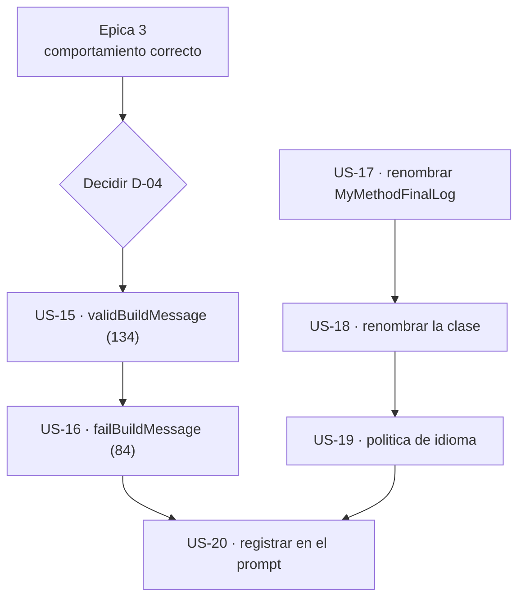

# Épica 4 · Nomenclatura y firmas públicas: 218 parámetros mal escritos

> **Versión destino** · 2.2.0 (US-15 … US-20)
> **Origen** · [`Mejoras/Logging/01-Nomenclatura-y-Estandares.md`](../../../Mejoras/Logging/01-Nomenclatura-y-Estandares.md) · hallazgos `N1`, `N2`, `N4`, `N5`, `N6`, `D9`
> **Plan del que se desgaja** · [`README.md`](README.md) de la versión 2.2.0
> **Proyecto** · `src/MoralesLarios.OOFP.Logging`
> **Estado** · ✅ completada
> **Esfuerzo** · **S** (~0,5 jornadas)
> **Riesgo** · 🔴 muy alto · **4 rupturas de compilación + 1 silenciosa**; es la épica que decide si cabe en una 2.2.0
>
> **Leyenda de esfuerzo:** XS (<2 h) · S (½ jornada) · M (1 jornada) · L (2 jornadas) · XL (3+ jornadas)
> **Leyenda de riesgo:** 🟢 bajo · 🟡 medio · 🟠 alto · 🔴 muy alto (rompe compatibilidad)

---

## Índice

1. [Contexto y problema](#1-contexto-y-problema)
   - [Punto 12 — `validBuilMessage`: la errata que convive con el nombre correcto](#punto-12--validbuilmessage-la-errata-que-convive-con-el-nombre-correcto)
   - [Punto 13 — `faildMessage`: la segunda errata, 84 veces](#punto-13--faildmessage-la-segunda-errata-84-veces)
   - [Punto 14 — `MyMethodFinalLog`: residuo de plantilla en la API pública](#punto-14--mymethodfinallog-residuo-de-plantilla-en-la-api-pública)
   - [Punto 15 — Una clase pública llamada `Extensions`](#punto-15--una-clase-pública-llamada-extensions)
   - [Punto 16 — Los mensajes de la librería están en inglés](#punto-16--los-mensajes-de-la-librería-están-en-inglés)
2. [Alcance](#2-alcance)
3. [Historias de usuario](#3-historias-de-usuario)
4. [Orden de ejecución](#4-orden-de-ejecución)
5. [Decisiones abiertas](#5-decisiones-abiertas)
6. [Definición de terminado](#6-definición-de-terminado)
7. [Apéndice · código actual y propuesto](#7-apéndice--código-actual-y-propuesto)
8. [Ver también](#8-ver-también)

---

## 1. Contexto y problema

En C#, **el nombre de un parámetro público es parte del contrato**. Desde que existen los argumentos
con nombre, cambiar `validBuilMessage` por `validBuildMessage` rompe la compilación de todo
consumidor que escribiera `validBuilMessage:` al llamar. Y en esta librería, cuyos constructores de
mensaje son parámetros **opcionales**, llamar con argumentos con nombre no es una rareza: es **la
forma natural de usarla**.

| Hallazgo | Ocurrencias | Naturaleza | Rompe |
|:--------:|------------:|------------|:-----:|
| `N1` · `validBuilMessage` | **134** | errata en nombre de parámetro público | **compilación** |
| `N2` · `faildMessage` | **84** | errata en nombre de parámetro público | **compilación** |
| `N4` · `MyMethodFinalLog` | 2 métodos | residuo de plantilla en la API pública | **compilación** (con puente) |
| `N5` · clase `Extensions` | 1 tipo | nombre sin información | **compilación** (con puente) |
| `N6` · mensajes en inglés | 4 | el texto que emite la librería | **silenciosa** |
| `D9` | — | política de idioma, transversal | — |

**218 parámetros** entre `N1` y `N2`. Es, con mucha diferencia, la mayor concentración de ruptura de
todo el plan.

### Punto 12 — `validBuilMessage`: la errata que convive con el nombre correcto

Lo llamativo no es la errata, sino que el nombre **correcto** y el **incorrecto** aparecen en la
misma firma:

```csharp
// MoralesLarios.OOFP.Logging/MlResultLogExtensions.Critical.cs, L47-54
public static MlResult<T> LogMlResultCritical<T>(this MlResult<T>                 value,
                                                      ILogger                      logger,
                                                      Func<T, string>              validBuilMessage = null!,
//                                                                                 ^^^^^^^^^^^^^^^^  falta la 'd'
                                                      Func<MlErrorDetails, string> failBuildMessage  = null!)
//                                                                                 ^^^^^^^^^^^^^^^^  correcto
```

El mismo fichero, la misma firma, dos convenios. Y en el código **comentado** del `#region old` que
retira la [épica 2](Epica-02-Higiene-Interna-y-Codigo-Muerto.md) aparece la prueba de que alguien ya
se dio cuenta: declara el parámetro como `validBuildMessage` —bien escrito— y acto seguido lo invoca
como `validBuilMessage:` —mal escrito—, porque era el nombre que tenía que usar para que compilara.

Distribución de las 134 ocurrencias: están repartidas por los **6 ficheros de nivel** y por
`MlResultLogExtensions.cs`, siempre en el mismo papel.

### Punto 13 — `faildMessage`: la segunda errata, 84 veces

```csharp
// MoralesLarios.OOFP.Logging/MlResultLogExtensions.Critical.cs, L426-431
public static MlResult<T> LogMlResultCriticalIfFail<T>(this MlResult<T>                 source,
                                                            ILogger                      logger,
                                                            Func<MlErrorDetails, string> faildMessage)
//                                                                                       ^^^^^^^^^^^^  "faild"
```

Aquí el nombre correcto no es `failMessage` sino `failBuildMessage`, para que **toda** la librería use
el mismo convenio: `<validez>BuildMessage` para los constructores de mensaje. Hoy conviven **tres**
formas —`validBuildMessage`, `validBuilMessage`, `faildMessage`— más un `failMessage` legítimo en las
sobrecargas que reciben un **mensaje fijo** en lugar de un constructor. Esa última **no** se toca: es
un `string`, no un `Func`, y su nombre es correcto.

### Punto 14 — `MyMethodFinalLog`: residuo de plantilla en la API pública

```csharp
// MoralesLarios.OOFP.Logging/Extensions.cs, L20-25
public static MlResult<T> MyMethodFinalLog<T>(this MlResult<T> source,
                                                   ILogger     logger,
                                                   string      methodActionDesc)
    => source.LogCompletedResult(logger,
                               validBuildMessage: item   => $"{methodActionDesc} done correctly.",
                               failBuildMessage : errors => $"Error when {methodActionDesc} Error: {errors.ToErrorsDetailsDescription()}");
```

`MyMethodFinalLog` es el nombre que uno escribe en un borrador, no en una librería pública. El `My`
es un marcador de ejemplo y `FinalLog` ya se abandonó en la 2.0.0 cuando `LogMlResultFinal` pasó a
llamarse `LogCompletedResult` —de hecho este método **delega** en el nombre nuevo, lo que deja el
suyo aún más descolocado—. Hay dos métodos afectados: `MyMethodFinalLog` y `MyMethodFinalLogAsync`.

### Punto 15 — Una clase pública llamada `Extensions`

```csharp
// MoralesLarios.OOFP.Logging/Extensions.cs, L6-9
/// <summary>
/// Métodos de extension de <c></c>.
/// </summary>
public static class Extensions
```

`MoralesLarios.OOFP.Logging.Extensions` no dice de qué es extensión —y el `<summary>` tampoco, porque
el `<c></c>` está **vacío**: alguien iba a rellenarlo y no lo hizo—. Es el mismo problema que la
versión 2.1.1 ya resolvió en el núcleo troceando la clase `Extensions` en cuatro con nombre propio
(US-11 de la [épica 2 de la 2.1.1](../../2.1.1/Core/Epica-02-Higiene-Interna-y-Codigo-Muerto.md)).
Aquí el proyecto sólo tiene **dos tipos públicos reales**, y uno de los dos se llama `Extensions`.

El `<c></c>` vacío se arregla en la [épica 5](Epica-05-Documentacion-XML.md) (US-22); el **nombre**
se arregla aquí.

### Punto 16 — Los mensajes de la librería están en inglés

```csharp
// MoralesLarios.OOFP.Logging/Extensions.cs, L24-25 y L38-39
validBuildMessage: item   => $"{methodActionDesc} done correctly."
failBuildMessage : errors => $"Error when {methodActionDesc} Error: {errors.ToErrorsDetailsDescription()}"
```

Son las **4 únicas** cadenas de texto que la librería emite por su cuenta; todo lo demás lo construye
el consumidor. Están en inglés, mientras la documentación XML y los mensajes del núcleo están en
castellano. Y la del fallo, además, está mal escrita: `"Error when X Error: …"` repite «Error» dos
veces.

Cambiarlas es una **ruptura silenciosa**: el consumidor compila igual, pero el texto que aparece en
sus trazas —y cualquier test o alerta que lo busque por contenido— cambia.

> **Importante** · estas 4 cadenas desaparecen si `D-01` se resuelve por la opción (d), retirar
> `MyMethodFinalLog` y que el consumidor use `LogCompletedResult` con sus propios mensajes. En ese
> caso la US-19 se cierra sin escribir texto nuevo, y la ruptura silenciosa **sigue existiendo** pero
> queda absorbida por la de la US-17.

---

## 2. Alcance

**Entra en esta épica:**

- Renombrar los **218** parámetros públicos mal escritos (`N1` y `N2`).
- Renombrar los 2 métodos `MyMethodFinalLog*` y la clase `Extensions`.
- Fijar y aplicar la política de idioma de las 4 cadenas que emite la librería.
- Registrar las **5 rupturas** en los seis sitios del prompt y en el anexo de renombrados.

**No entra en esta épica:**

| Asunto | Dónde va |
|--------|----------|
| `errorDetals` · parámetro de **lambda**, no público | [épica 3](Epica-03-Correccion-Funcional-y-Validacion.md) · US-13 |
| El `<c></c>` vacío del `<summary>` de `Extensions` | [épica 5](Epica-05-Documentacion-XML.md) · US-22 |
| Alinear los `<param name="…">` con los nombres nuevos | [épica 5](Epica-05-Documentacion-XML.md) · US-24 |
| Retirar los 6 puentes `[Obsolete]` de la 2.0.0 | **3.0.0** |
| Sustituir los `null!` por sobrecargas (`D3`) | **3.0.0** |
| Los nombres de los **métodos** `LogMlResult*` | **no se tocan** · son correctos y los fijó la 2.0.0 |
| `failMessage` en las sobrecargas de **mensaje fijo** | **no se toca** · es un `string`, el nombre es correcto |

---

## 3. Historias de usuario

### US-15 · `validBuilMessage` → `validBuildMessage`

**Como** consumidor
**quiero** que el parámetro se llame como dice la documentación
**para** no tener que recordar que en esta librería «build» se escribe sin la `d`.

- **Esfuerzo** · S · **Riesgo** · 🔴 · **Rompe** · **compilación**

**Criterios de aceptación**

- [ ] **Resuelta [`D-04`](#5-decisiones-abiertas)** antes de empezar: es la decisión que determina si
      esta historia cabe en una 2.2.0.
- [ ] Las **134** ocurrencias de `validBuilMessage` pasan a `validBuildMessage`.
- [ ] Búsqueda de `validBuilMessage` en toda la solución → **0 ocurrencias**, incluidos los
      `<param name="…">` de la documentación XML y los proyectos consumidores.
- [ ] Se comprueba que los **4 proyectos internos** que consumen `Logging` —`Application`, `Http`,
      `Http.Tests.Integration` y `Logging.Sample`— compilan sin cambios, o se adaptan en el mismo
      commit.
- [ ] La ruptura queda registrada en los **seis sitios** de
      [`oofp-upgrade-2.prompt.md`](../../../Copilot/.github/prompts/oofp-upgrade-2.prompt.md) **y** en
      [`oofp-upgrade-2.renames.md`](../../../Copilot/.github/prompts/oofp-upgrade-2.renames.md), en
      formato apto para buscar y reemplazar.
- [ ] Build con **0 errores**, **0 `CS1591`** y **no más de 238 avisos**.

### US-16 · `faildMessage` → `failBuildMessage`

**Como** consumidor
**quiero** que los dos constructores de mensaje sigan el mismo convenio
**para** poder deducir el nombre de uno sabiendo el del otro.

- **Esfuerzo** · S · **Riesgo** · 🔴 · **Rompe** · **compilación**

**Criterios de aceptación**

- [ ] Las **84** ocurrencias de `faildMessage` pasan a `failBuildMessage`.
- [ ] Búsqueda de `faildMessage` → **0 ocurrencias**.
- [ ] Se comprueba expresamente que **no** se ha tocado `failMessage` en las sobrecargas que reciben
      un **mensaje fijo** (`string`), y se hace constar en el commit cuántas son.
- [ ] Tras esta historia, la librería usa **un solo** convenio: `validBuildMessage` y
      `failBuildMessage` para los `Func`, `failMessage` para los `string`. Se verifica que no queda
      ninguna cuarta forma.
- [ ] Ruptura registrada en los **seis sitios** y en el anexo de renombrados.
- [ ] Build con **0 errores** y tests en verde.

### US-17 · Renombrar `MyMethodFinalLog`

**Como** consumidor
**quiero** que el método no se llame como un borrador
**para** poder leer mi propio código y entender qué hace esa llamada.

- **Esfuerzo** · XS · **Riesgo** · 🔴 · **Rompe** · **compilación** (con puente)

**Criterios de aceptación**

- [ ] **Resuelta [`D-01`](#5-decisiones-abiertas)**: nombre nuevo elegido, o decisión de retirarlo.
- [ ] `MyMethodFinalLog` y `MyMethodFinalLogAsync` pasan al nombre nuevo.
- [ ] Se deja un puente `[Obsolete("Renamed to <nuevo>. Will be removed in 3.0.0.", false)]` con el
      nombre antiguo, **siguiendo exactamente el patrón** de
      `MlResultLogExtensions.Obsolete.cs` —incluido `[EditorBrowsable(EditorBrowsableState.Never)]`—
      para que el consumidor reciba un `CS0618` y no un error.
- [ ] Los puentes se colocan en `MlResultLogExtensions.Obsolete.cs`, junto a los 6 ya existentes, o
      en un fichero `.Obsolete.cs` propio si el nombre de la clase cambia (US-18).
- [ ] Ruptura registrada en los **seis sitios** y en el anexo de renombrados.
- [ ] Build con **0 `CS0618`** en la propia solución: si los puentes se usan internamente, se
      actualizan las llamadas.

### US-18 · Renombrar la clase `Extensions`

**Como** consumidor
**quiero** que el tipo diga de qué es extensión
**para** encontrarlo y para que no colisione con los `Extensions` de otras librerías.

- **Esfuerzo** · XS · **Riesgo** · 🔴 · **Rompe** · **compilación** (con puente)

**Criterios de aceptación**

- [ ] **Resuelta [`D-02`](#5-decisiones-abiertas)**: nombre nuevo, o fusión con
      `MlResultLogExtensions` como otro `partial`.
- [ ] El fichero se renombra en consonancia con la clase.
- [ ] Al ser una clase de **métodos de extensión**, se verifica si el renombrado afecta realmente al
      consumidor: si siempre se invocan **como extensión**, el nombre del tipo no aparece en su
      código y la ruptura es **teórica**. Se documenta el resultado de esa comprobación, porque
      determina si hace falta puente.
- [ ] Si se opta por la opción (c) de `D-02` —fusionar—, el tipo `Extensions` desaparece y el
      proyecto queda con **un solo** tipo público; se hace constar en el commit.
- [ ] Ruptura registrada en los **seis sitios** y en el anexo de renombrados, con la nota de
      ambigüedad que exige la regla para nombres genéricos como `Extensions`.
- [ ] Build y tests en verde.

### US-19 · Fijar la política de idioma de los mensajes

**Como** propietario de la librería
**quiero** que las 4 cadenas que emite estén en el idioma que yo decida
**para** no tener una librería documentada en castellano que escribe trazas en inglés.

- **Esfuerzo** · XS · **Riesgo** · 🟠 · **Rompe** · **silenciosa**

**Criterios de aceptación**

- [ ] **Resuelta [`D-03`](#5-decisiones-abiertas)**.
- [ ] Las 4 cadenas (`Extensions.cs:24-25` y `:38-39`) se ajustan a la política elegida.
- [ ] Se corrige la duplicación de «Error» del mensaje de fallo, independientemente del idioma.
- [ ] Búsqueda de literales en inglés en el proyecto → sólo los que la política admita.
- [ ] La ruptura silenciosa queda registrada en los **seis sitios**, con el apartado **«cómo
      detectarla»**: buscar tests, alertas o reglas de agregación de logs que comparen el **texto**
      de la traza, no su nivel.
- [ ] Si `D-01` se resolvió por la opción (d) y los métodos desaparecen, esta historia se cierra
      haciendo constar que las 4 cadenas ya no existen.

### US-20 · Registrar las 5 rupturas en los 6 sitios del prompt

**Como** consumidor que viene de la 2.0.0
**quiero** un documento que me diga exactamente qué buscar y con qué reemplazarlo
**para** poder subir de versión sin leerme el `diff` de la librería.

- **Esfuerzo** · S · **Riesgo** · 🟢 · **Rompe** · —

**Criterios de aceptación**

- [ ] Cada una de las rupturas de las US-15 … US-19 tiene **fila** en la tabla de la §3.3 del prompt.
- [ ] Cada una tiene su **subsección `#### N`** con el antes/después, qué debe hacer el consumidor y,
      para la US-19, **cómo detectarla**.
- [ ] Los **patrones de búsqueda** están en la Fase 5, punto 4 del prompt: `validBuilMessage`,
      `faildMessage`, `MyMethodFinalLog`, `Logging.Extensions`.
- [ ] Los números están en la lista del informe de la **Fase 6**, punto 5.
- [ ] Los números están en la fila de la **2.2.0** de la tabla del apéndice de versiones, creándola
      si no existe, con su nota de salto de versión.
- [ ] Los renombrados están en
      [`oofp-upgrade-2.renames.md`](../../../Copilot/.github/prompts/oofp-upgrade-2.renames.md), en
      una sección propia de la 2.2.0, en formato **buscar → reemplazar**, con nota de ambigüedad para
      `Extensions`.
- [ ] La numeración continúa la **secuencia global** del prompt sin reutilizar ni reordenar números.
- [ ] Se verifica el recuento de líneas del prompt **antes y después** de cada edición y se revisa el
      resultado con `git diff -U1`, por el riesgo conocido de truncado en ficheros largos.

---

## 4. Orden de ejecución



**Justificación.**

1. **`D-04` bloquea todo el bloque de los 218 parámetros.** Si la respuesta es (a) —sobrecargas con
    `[Obsolete]`—, el esfuerzo de la US-15 y la US-16 se multiplica y la épica deja de ser **S**.
    No se escribe nada hasta tenerla.
2. **US-15 antes que US-16** porque son el mismo barrido mecánico y conviene hacer el grande primero:
    si el enfoque falla, falla con 134 ocurrencias y no con 218.
3. **US-17 antes que US-18** porque renombrar el método es independiente del nombre de su clase, y si
    `D-01` se resuelve por «retirarlo», la US-18 puede quedar sin contenido —la clase se vaciaría—.
4. **US-19 después de US-17 y US-18** porque las 4 cadenas viven dentro de esos métodos: si
    desaparecen, la historia se cierra sola.
5. **US-20 al final, y en el mismo commit que el último renombrado.** La regla del repositorio exige
    que el registro viaje **con** el código, no después; se deja al final del orden de trabajo, no de
    la entrega.

> ⚠️ **Prerrequisitos ineludibles.** Esta épica va **después** de la
> [épica 1](Epica-01-Red-de-Seguridad.md) —hacen falta tests que detecten si un renombrado masivo
> rompe algo— y **después** de la [épica 3](Epica-03-Correccion-Funcional-y-Validacion.md) —el
> comportamiento debe estar correcto antes de mover 218 nombres, para poder atribuir cualquier fallo
> posterior—. Conviene además que la [épica 2](Epica-02-Higiene-Interna-y-Codigo-Muerto.md) haya
> borrado ya las 530 líneas comentadas: contienen ocurrencias de `validBuilMessage` que
> contaminarían los recuentos de verificación.

---

## 5. Decisiones abiertas

| # | Decisión | Opciones | Estado |
|:-:|----------|----------|:------:|
| **D-01** | Nombre nuevo de `MyMethodFinalLog` | (a) `LogActionResult` · (b) `LogMethodOutcome` · (c) `LogCompletedAction` · (d) retirarlo y que el consumidor use `LogCompletedResult` | ✅ **(a)** `LogActionResult` |
| **D-02** | Nombre nuevo de la clase `Extensions` | (a) `MlResultLogActionExtensions` · (b) `MlResultMethodLogExtensions` · (c) fusionar su contenido en `MlResultLogExtensions` como otro `partial` | ✅ **(a)** `MlResultLogActionExtensions` |
| **D-03** | Idioma de los mensajes que emite la librería | (a) castellano · (b) inglés · (c) no emitir texto propio | ✅ **(b)** inglés |
| **D-04** | Estrategia para los 218 parámetros renombrados | (a) sobrecarga nueva + antigua `[Obsolete]` · (b) renombrado directo aceptando la ruptura · (c) renombrado directo en la 2.2.0 asumiendo que el uso de argumentos con nombre es minoritario | ✅ **(c)** renombrado directo en la 2.2.0 |
| **D-14** | Si esta épica cabe en la 2.2.0 o debe esperar a la 3.0.0 | (a) 2.2.0 · consecuencia de `D-04` (a) · (b) 3.0.0 · si `D-04` se resuelve por (b) o (c), agrupando la ruptura con el resto de las de la mayor | ✅ **(a)** 2.2.0 |

> **⚠️ `D-04` es el punto más delicado de todo el plan de la 2.2.0, y hay que decirlo sin rodeos:
> C# no admite ningún puente para un parámetro renombrado.** Un `[Obsolete]` se pone sobre un tipo o
> un miembro, nunca sobre un parámetro. Las únicas salidas reales son:
>
> - **(a)** duplicar las firmas afectadas —una con el nombre nuevo y otra, `[Obsolete]`, con el
>   antiguo—, lo que llevaría las 339 firmas públicas a más de 500 y dejaría a la resolución de
>   sobrecargas de C# decidiendo entre pares casi idénticos. Es técnicamente posible y
>   funcionalmente desagradable.
> - **(b)** o **(c)** renombrar y aceptar que el consumidor que use argumentos con nombre **no
>   compilará**, lo cual, en rigor, es una ruptura de versión **mayor**.
>
> De ahí la existencia de `D-14`: lo honesto puede ser llevar esta épica entera a la 3.0.0 y dejar la
> 2.2.0 con las épicas 1, 2, 3, 5, 6 y 7, que no rompen compilación. **Esta decisión es del
> propietario** y condiciona el alcance de la versión.

---

## 6. Definición de terminado

- [ ] Las **6 historias** (US-15 … US-20) tienen todos sus criterios de aceptación marcados.
- [ ] **`D-01`, `D-02`, `D-03`, `D-04` y `D-14` resueltas** y anotadas en la §5 de este documento.
- [ ] Búsquedas en toda la solución → **0 ocurrencias** de `validBuilMessage`, `faildMessage`,
      `MyMethodFinalLog` y de la clase `Extensions` con su nombre antiguo.
- [ ] La librería usa **un solo** convenio de nombres para los constructores de mensaje.
- [ ] `dotnet build MoralesLarios.OOFP.sln -c Release --no-incremental` → **EXIT = 0**,
      **0 errores**, **0 `CS1591`**, **0 `CS0618`** y **no más de 238 avisos**.
- [ ] `dotnet test MoralesLarios.OOFP.sln -c Release --no-build` → **1.136 tests** en verde, más los
      de la épica 1.
- [ ] Se conserva la **paridad 47 + 17 por nivel** de firmas públicas de los 6 ficheros de nivel: un
      renombrado no debe alterar el recuento. Si cambia, hay un error.
- [ ] **Las 5 rupturas están registradas en los SEIS sitios** del prompt y en el anexo de
      renombrados, con la silenciosa de la US-19 acompañada de su «cómo detectarla».
- [ ] El recuento de líneas del prompt y del anexo se ha verificado **antes y después** de cada
      edición, y el resultado se ha revisado con `git diff -U1`.
- [ ] Commits en castellano creados con `git commit -F` desde ficheros UTF-8 sin BOM, **todos con
      `!`** salvo el de la US-20:
      - `refactor(logging)!: renombrar validBuilMessage a validBuildMessage (US-15)`
      - `refactor(logging)!: renombrar faildMessage a failBuildMessage (US-16)`
      - `refactor(logging)!: renombrar MyMethodFinalLog y la clase Extensions (US-17, US-18)`
      - `fix(logging)!: fijar el idioma de los mensajes que emite la libreria (US-19)`
      - `docs(copilot): registrar las rupturas de la 2.2.0 en el prompt de migracion (US-20)`
      Cada uno con su pie `BREAKING CHANGE`.
- [ ] Este documento queda marcado como `✅ completada` en su línea de **Estado** y en la tabla de
      [`README.md`](README.md#1-las-siete-épicas).

---

## 7. Apéndice · código actual y propuesto

### 7.1 Tabla de renombrados

| Antiguo | Nuevo | Ocurrencias | Tipo de ruptura | Puente posible |
|---------|-------|------------:|-----------------|----------------|
| `validBuilMessage` | `validBuildMessage` | 134 | compilación con argumento con nombre | **no** · es un parámetro |
| `faildMessage` | `failBuildMessage` | 84 | compilación con argumento con nombre | **no** · es un parámetro |
| `MyMethodFinalLog` | pendiente de `D-01` | 1 método | compilación | **sí** · `[Obsolete]` |
| `MyMethodFinalLogAsync` | pendiente de `D-01` | 1 método | compilación | **sí** · `[Obsolete]` |
| `Extensions` | pendiente de `D-02` | 1 tipo | compilación | **sí** · tipo puente o `partial` |

Ésta es, literalmente, la tabla que hay que trasladar a
[`oofp-upgrade-2.renames.md`](../../../Copilot/.github/prompts/oofp-upgrade-2.renames.md) en la US-20.

### 7.2 El convenio final de nombres

| Parámetro | Tipo | Cuándo | Estado |
|-----------|------|--------|:------:|
| `validBuildMessage` | `Func<T, string>` | constructor del mensaje del caso válido | ✅ nombre final |
| `failBuildMessage` | `Func<MlErrorDetails, string>` | constructor del mensaje del caso fallido | ✅ nombre final |
| `failBuildMessage` | `Func<MlErrorDetails, Exception, string>` | ídem, con la excepción | ✅ nombre final |
| `failMessage` | `string` | mensaje **fijo** del caso fallido | ✅ **no se toca** |
| `validBuilMessage` | — | — | ❌ se retira (US-15) |
| `faildMessage` | — | — | ❌ se retira (US-16) |

### 7.3 `Extensions.cs` antes y después

```csharp
// ANTES
namespace MoralesLarios.OOFP.Logging;
/// <summary>
/// Métodos de extension de <c></c>.
/// </summary>
public static class Extensions
{
    public static MlResult<T> MyMethodFinalLog<T>(this MlResult<T> source,
                                                       ILogger     logger,
                                                       string      methodActionDesc)
        => source.LogCompletedResult(logger,
                                   validBuildMessage: item   => $"{methodActionDesc} done correctly.",
                                   failBuildMessage : errors => $"Error when {methodActionDesc} Error: {errors.ToErrorsDetailsDescription()}");
```

```csharp
// DESPUES  ·  con D-01 = (a), D-02 = (a) y D-03 = (a), a modo de ilustracion
namespace MoralesLarios.OOFP.Logging;
/// <summary>
/// Metodos de extension de <c>MlResult&lt;T&gt;</c> para registrar el desenlace de una accion.
/// </summary>
public static class MlResultLogActionExtensions
{
    public static MlResult<T> LogActionResult<T>(this MlResult<T> source,
                                                      ILogger     logger,
                                                      string      methodActionDesc)
        => source.LogCompletedResult(logger,
                                   validBuildMessage: item   => $"{methodActionDesc} finalizado correctamente.",
                                   failBuildMessage : errors => $"Fallo al {methodActionDesc}: {errors.ToErrorsDetailsDescription()}");
```

### 7.4 El puente, con el patrón ya establecido en la 2.0.0

```csharp
// MlResultLogExtensions.Obsolete.cs  ·  mismo patron que los 6 puentes existentes
[global::System.Obsolete("Renamed to LogActionResult. Will be removed in 3.0.0.", false)]
[global::System.ComponentModel.EditorBrowsable(global::System.ComponentModel.EditorBrowsableState.Never)]
public static MlResult<T> MyMethodFinalLog<T>(this MlResult<T> source,
                                                   ILogger     logger,
                                                   string      methodActionDesc)
    => source.LogActionResult(logger, methodActionDesc);
```

### 7.5 Búsquedas de verificación

| Búsqueda | Valor esperado al cerrar |
|----------|-------------------------:|
| `validBuilMessage` | 0 |
| `faildMessage` | 0 |
| `MyMethodFinalLog` fuera de `.Obsolete.cs` | 0 |
| `failBuildMessage` | 134 + 84 + las ya existentes |
| `public static` vivas en los 6 ficheros de nivel | 47 por fichero · **sin cambios** |
| avisos de la solución | ≤ 236 |
| `CS0618` en la solución | 0 |

---

## 8. Ver también

- [`README.md`](README.md) — plan de la versión 2.2.0; la §5 explica por qué `D-04` condiciona el alcance.
- [`Epica-01-Red-de-Seguridad.md`](Epica-01-Red-de-Seguridad.md) — prerrequisito: sin tests no se renombran 218 parámetros.
- [`Epica-02-Higiene-Interna-y-Codigo-Muerto.md`](Epica-02-Higiene-Interna-y-Codigo-Muerto.md) — borra las líneas comentadas que contaminarían los recuentos.
- [`Epica-03-Correccion-Funcional-y-Validacion.md`](Epica-03-Correccion-Funcional-y-Validacion.md) — prerrequisito: el comportamiento correcto antes del renombrado.
- [`Epica-05-Documentacion-XML.md`](Epica-05-Documentacion-XML.md) — alinea los `<param>` con los nombres nuevos (US-24) y rellena el `<c></c>` vacío (US-22).
- [`Mejoras/Logging/01-Nomenclatura-y-Estandares.md`](../../../Mejoras/Logging/01-Nomenclatura-y-Estandares.md) — análisis de origen detallado de los 6 puntos.
- [`2.1.1/Core/Epica-02-Higiene-Interna-y-Codigo-Muerto.md`](../../2.1.1/Core/Epica-02-Higiene-Interna-y-Codigo-Muerto.md) — precedente: el troceado de la clase `Extensions` del núcleo.
- [`oofp-upgrade-2.renames.md`](../../../Copilot/.github/prompts/oofp-upgrade-2.renames.md) — anexo donde viven las tablas de renombrado.
