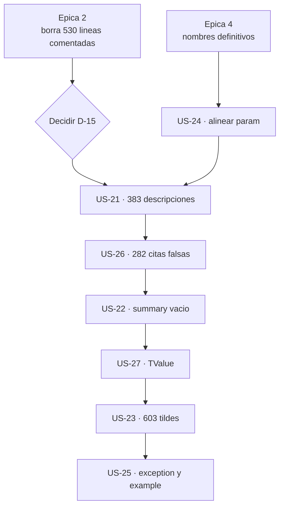

# Épica 5 · Documentación XML: 383 descripciones de plantilla y 282 citas a tipos que no existen

> **Versión destino** · 2.2.0 (US-21 … US-27)
> **Origen** · [`Mejoras/Logging/README.md`](../../../Mejoras/Logging/README.md) · hallazgos `X1` … `X7`
> **Plan del que se desgaja** · [`README.md`](README.md) de la versión 2.2.0
> **Proyecto** · `src/MoralesLarios.OOFP.Logging`
> **Estado** · ⬜ pendiente
> **Esfuerzo** · **M** (~1,5 jornadas)
> **Riesgo** · 🟢 bajo · ninguna historia toca código ejecutable; el riesgo es **abandonarla a medias**
>
> **Leyenda de esfuerzo:** XS (<2 h) · S (½ jornada) · M (1 jornada) · L (2 jornadas) · XL (3+ jornadas)
> **Leyenda de riesgo:** 🟢 bajo · 🟡 medio · 🟠 alto · 🔴 muy alto (rompe compatibilidad)

---

## Índice

1. [Contexto y problema](#1-contexto-y-problema)
   - [Punto 17 — «Mensaje descriptivo.» repetido 383 veces](#punto-17--mensaje-descriptivo-repetido-383-veces)
   - [Punto 18 — 282 citas a tipos que no existen](#punto-18--282-citas-a-tipos-que-no-existen)
   - [Punto 19 — 49 `param` que ya no se llamarán así](#punto-19--49-param-que-ya-no-se-llamarán-así)
   - [Punto 20 — El `summary` con la referencia vacía](#punto-20--el-summary-con-la-referencia-vacía)
   - [Punto 21 — 603 palabras sin tilde](#punto-21--603-palabras-sin-tilde)
   - [Punto 22 — Cero `exception` y cero `example`](#punto-22--cero-exception-y-cero-example)
   - [Punto 23 — `TValue` documentado con media frase](#punto-23--tvalue-documentado-con-media-frase)
2. [Alcance](#2-alcance)
3. [Historias de usuario](#3-historias-de-usuario)
4. [Orden de ejecución](#4-orden-de-ejecución)
5. [Decisiones abiertas](#5-decisiones-abiertas)
6. [Definición de terminado](#6-definición-de-terminado)
7. [Apéndice · código actual y propuesto](#7-apéndice--código-actual-y-propuesto)
8. [Ver también](#8-ver-también)

---

## 1. Contexto y problema

El proyecto tiene `GenerateDocumentationFile` activado y **0 avisos `CS1591`**: todo miembro público
está documentado. El problema no es la **cobertura**, es el **contenido**. La documentación se generó
en masa a partir de una plantilla y, en buena parte, **no se rellenó**.

| Hallazgo | Medido | Naturaleza |
|:--------:|-------:|------------|
| `X1` · «Mensaje descriptivo.» literal | **383** | texto de plantilla sin rellenar |
| `X6` · `<c>` citando tipos inexistentes | **282** | documentación **falsa** |
| `X4` · `<param>` con los nombres erróneos | **49** | se desalinea al cerrar la épica 4 |
| `X2` · `<summary>` con `<c></c>` vacío | **1** | referencia sin destino |
| `X3` · palabras sin tilde | **603** | inconsistencia ortográfica |
| `X5` · `<exception>` + `<example>` | **0 + 0** | lo que el consumidor realmente necesita |
| `X7` · `<typeparam name="TValue">` | **21** | «Tipo del valor.», sin decir de qué |

Para dimensionarlo: hay **356 `<summary>`**, **1.126 `<param>`**, **354 `<typeparam>`** y
**347 `<returns>`** en 10 ficheros. Es un volumen que sólo se arregla con un barrido sistemático.

### Punto 17 — «Mensaje descriptivo.» repetido 383 veces

```csharp
// MoralesLarios.OOFP.Logging/MlResultLogExtensions.Critical.cs
/// <param name="validBuildMessage">Mensaje descriptivo.</param>
/// <param name="failBuildMessage">Mensaje descriptivo.</param>
```

«Mensaje descriptivo.» no dice **cuál** de los dos es, ni **cuándo** se invoca, ni que es un `Func` y
no un `string`, ni que se puede omitir —son parámetros opcionales con `null!` por defecto—, ni qué
pasa si se omite. Es exactamente la información que el consumidor necesita y no tiene.

Reparto de las 383: `MlResultLogExtensions.cs` **67** · los 6 ficheros de nivel **51 cada uno**
(=306) · `MlResultLogExtensions.Obsolete.cs` **10**.

### Punto 18 — 282 citas a tipos que no existen

Éste es el hallazgo más grave de la épica, porque la documentación no está **incompleta**: está
**equivocada**.

```csharp
// MoralesLarios.OOFP.Logging/MlResultLogExtensions.Error.cs
/// Métodos de extension de <c>MlResultError</c>.
```

No existe ningún tipo `MlResultError`. Ni `MlResultTrace`, ni `MlResultCritical`, ni
`MlResultWarning`, ni `MlResultDebug`, ni `MlResultInformation`. Se ha comprobado sobre **toda** la
solución: ninguno de los seis está declarado como `class`, `record`, `struct` ni `interface` en
ningún sitio. Alguien construyó el nombre concatenando el tipo real —`MlResult`— con el nivel de
traza del fichero, y lo repitió **47 veces por fichero × 6 ficheros = 282 veces**.

Lo que esos métodos extienden es `MlResult<T>` y `Task<MlResult<T>>`. El `<c>` debería decir eso.

### Punto 19 — 49 `param` que ya no se llamarán así

```csharp
/// <param name="validBuilMessage">Mensaje descriptivo.</param>   ← 21 veces
/// <param name="faildMessage">Mensaje descriptivo.</param>       ← 28 veces
```

Cuando la [épica 4](Epica-04-Nomenclatura-y-Firmas-Publicas.md) renombre los parámetros, estos 49
`<param name="…">` apuntarán a **parámetros que no existen**. El compilador avisa con `CS1572`
—«parámetro no encontrado»— sólo si el aviso está habilitado; si no, queda documentación fantasma que
IntelliSense simplemente **no muestra**.

Esta historia es, por tanto, la **consecuencia obligatoria** de la épica 4, no una mejora opcional.

### Punto 20 — El `summary` con la referencia vacía

```csharp
// MoralesLarios.OOFP.Logging/Extensions.cs, L6-9
/// <summary>
/// Métodos de extension de <c></c>.
/// </summary>
public static class Extensions
```

El `<c></c>` está literalmente vacío. Es la huella de la misma generación automática del punto 18:
ahí el generador sí tenía un nombre que poner —aunque fuera inventado— y aquí no tenía ninguno.

### Punto 21 — 603 palabras sin tilde

```csharp
/// <param name="logger">Registrador al que se envian las trazas.</param>
//                                              ^^^^^^ envían
```

«envian», «extension», «operacion», «asincrona», «version»… 603 ocurrencias. No rompe nada, pero es
el texto que el consumidor ve en IntelliSense, y conviene que una librería documentada en castellano
esté escrita en castellano correcto.

### Punto 22 — Cero `exception` y cero `example`

```
<exception  = 0
<example    = 0
```

En **6.619 líneas** no hay un solo `<exception>` ni un solo `<example>`. Y sí hay condiciones que
documentar: hoy un `logger` nulo produce un `NullReferenceException`, y cuando la
[épica 3](Epica-03-Correccion-Funcional-y-Validacion.md) añada la validación de argumentos (US-12)
pasará a lanzar `ArgumentNullException`. Eso **debe** estar en un `<exception>`.

Los `<example>` importan aún más aquí: con **92 nombres distintos y 339 firmas** —unas 3,7
sobrecargas por nombre—, el consumidor necesita ver **cuál** elegir. Un `<example>` por familia vale
más que 383 `<param>` correctos.

### Punto 23 — `TValue` documentado con media frase

```csharp
/// <typeparam name="TValue">Tipo del valor.</typeparam>     ← 21 veces
/// <typeparam name="T">Tipo del valor transportado por el resultado.</typeparam>   ← 333 veces
```

Los dos parámetros de tipo conviven con dos calidades de documentación muy distintas. Y `TValue`
tiene un significado **propio**: aparece en las familias `…IfFailWithValue`, donde **no** es el tipo
del resultado sino el tipo del **valor adicional** que viaja en los detalles del error. «Tipo del
valor.» no lo dice.

> **Importante** · `TValue` es justo el parámetro de tipo implicado en el defecto `F1` de la
> [épica 3](Epica-03-Correccion-Funcional-y-Validacion.md): el método defectuoso compila **porque**
> `TValue` se infiere silenciosamente como `Exception`. Documentarlo bien es parte de que ese error
> no se repita.

---

## 2. Alcance

**Entra en esta épica:**

- Las **383** descripciones de plantilla.
- Las **282** citas a tipos inexistentes.
- Los **49** `<param>` desalineados y el `<c></c>` vacío.
- Las **603** tildes.
- Los `<exception>` y `<example>` que hoy no existen.
- La documentación real de `TValue`.

**No entra en esta épica:**

| Asunto | Dónde va |
|--------|----------|
| Renombrar los parámetros (`N1`, `N2`) | [épica 4](Epica-04-Nomenclatura-y-Firmas-Publicas.md) · US-15, US-16 |
| Renombrar la clase `Extensions` | [épica 4](Epica-04-Nomenclatura-y-Firmas-Publicas.md) · US-18 |
| Borrar los `///` del código comentado | [épica 2](Epica-02-Higiene-Interna-y-Codigo-Muerto.md) · US-09 |
| El `README.md` de 733 líneas del proyecto | **fuera** · es documentación de usuario, no XML |
| Documentar `IsEnabled` y `EventId` | [épica 6](Epica-06-Rendimiento-y-Estandar-de-Logging.md) · con los miembros nuevos |

> **Nota de orden.** La épica 2 borra **530 líneas comentadas** que arrastran sus propios bloques
> `///`. Si esta épica se hiciera antes, parte del trabajo se tiraría a la basura. De ahí que vaya
> después (§4).

---

## 3. Historias de usuario

### US-21 · Rellenar los 383 `param` de plantilla

**Como** consumidor
**quiero** que la documentación de cada parámetro diga qué hace ese parámetro
**para** elegir la sobrecarga correcta sin abrir el código fuente.

- **Esfuerzo** · M · **Riesgo** · 🟢 · **Rompe** · no

**Criterios de aceptación**

- [ ] **Resuelta [`D-15`](#5-decisiones-abiertas)**: se fija el texto canónico de cada parámetro
      recurrente **antes** de empezar, para que el barrido sea un reemplazo y no 383 decisiones.
- [ ] Búsqueda de `Mensaje descriptivo.` en el proyecto → **0 ocurrencias**.
- [ ] Cada uno de los parámetros recurrentes —`validBuildMessage`, `failBuildMessage`, `failMessage`,
      `logger`, `logLevel`, `source`, `sourceAsync`, `value`— tiene **un solo** texto canónico,
      idéntico en los 10 ficheros.
- [ ] El texto de los constructores de mensaje dice expresamente: que es un `Func`, **cuándo** se
      invoca y **qué ocurre si se omite** (son opcionales con `null!` por defecto).
- [ ] El texto distingue `failMessage` (`string` fijo) de `failBuildMessage` (`Func`), que hoy se
      documentan igual.
- [ ] Build con **0 `CS1591`** y **0 `CS1573`**.

### US-22 · Rellenar el `summary` con la `c` vacía

**Como** consumidor
**quiero** saber de qué es extensión la clase
**para** entender qué me aporta.

- **Esfuerzo** · XS · **Riesgo** · 🟢 · **Rompe** · no

**Criterios de aceptación**

- [ ] El `<c></c>` de `Extensions.cs:7` se rellena con `MlResult&lt;T&gt;`, escapado correctamente.
- [ ] Búsqueda de `<c></c>` en todo el proyecto → **0 ocurrencias**.
- [ ] El `<summary>` describe además **qué** registra la clase, no sólo qué extiende.
- [ ] Si la [épica 4](Epica-04-Nomenclatura-y-Firmas-Publicas.md) resolvió `D-02` por la opción (c)
      —fusionar la clase—, esta historia se cierra haciendo constar que el `<summary>` desapareció
      con ella.

### US-23 · Poner las 603 tildes que faltan

**Como** propietario de la librería
**quiero** que la documentación esté escrita en castellano correcto
**para** que IntelliSense no muestre faltas de ortografía.

- **Esfuerzo** · S · **Riesgo** · 🟢 · **Rompe** · no

**Criterios de aceptación**

- [ ] Las **603** ocurrencias quedan corregidas: `envian`→`envían`, `extension`→`extensión`,
      `operacion`→`operación`, `asincrona`→`asíncrona`, `version`→`versión`, `Metodos`→`Métodos`.
- [ ] **Sólo** se corrige texto dentro de comentarios `///`: **ningún** identificador, literal de
      cadena ni nombre de parámetro cambia. Se verifica con `git diff` que no hay cambios fuera de
      líneas que empiecen por `///`.
- [ ] Los 10 ficheros quedan en **UTF-8 con la misma marca de orden de bytes** que tenían antes, y se
      comprueba con un barrido de `mojibake` —regex `[\u00C2\u00C3][\u0080-\u00BF]`— que da **0**.
- [ ] Se verifica el **recuento de líneas de cada fichero antes y después**: debe ser **idéntico**.
- [ ] Build con **0 errores** y tests en verde: una corrección ortográfica nunca debe alterarlos.

### US-24 · Alinear los `param` con los nombres nuevos

**Como** consumidor
**quiero** que IntelliSense me muestre la ayuda de cada parámetro
**para** no quedarme sin documentación justo después de una actualización.

- **Esfuerzo** · XS · **Riesgo** · 🟢 · **Rompe** · no

**Criterios de aceptación**

- [ ] Los **21** `<param name="validBuilMessage">` pasan a `validBuildMessage`.
- [ ] Los **28** `<param name="faildMessage">` pasan a `failBuildMessage`.
- [ ] Búsqueda de `<param name="validBuilMessage">` y `<param name="faildMessage">` → **0**.
- [ ] Se compila con el aviso **`CS1572`** habilitado —«parámetro no encontrado»— y el resultado es
      **0 ocurrencias**: es la comprobación automática de que **ningún** `<param>` apunta a un
      parámetro inexistente en los 1.126 que hay.
- [ ] Esta historia se entrega en el **mismo commit** que la US-15 y la US-16 de la épica 4, o
      inmediatamente después: entre una y otra la documentación está rota.

### US-25 · Añadir `exception` y `example` representativos

**Como** consumidor que elige entre 339 firmas
**quiero** un ejemplo por familia y la lista de lo que puede lanzar
**para** no tener que deducirlo probando.

- **Esfuerzo** · M · **Riesgo** · 🟢 · **Rompe** · no

**Criterios de aceptación**

- [ ] **Resuelta [`D-16`](#5-decisiones-abiertas)**: se fija cuántos `<example>` se escriben y dónde.
- [ ] Hay al menos **un `<example>` por familia** de métodos: `LogMlResult`, `LogMlResult<NIVEL>`,
      `…IfFail`, `…IfFailWithValue`, `…IfFailWithException`, `LogCompletedResult`.
- [ ] Cada `<example>` usa un bloque `<code>` que **compila** si se copia, y muestra el caso con
      argumentos con nombre, que es el uso natural de la librería.
- [ ] Todo método que pueda lanzar tiene su `<exception>`, incluida la
      `ArgumentNullException` que introduce la US-12 de la
      [épica 3](Epica-03-Correccion-Funcional-y-Validacion.md).
- [ ] Los `<example>` se añaden **después** de la épica 4: si se escribieran antes, usarían los
      nombres de parámetro antiguos y habría que reescribirlos.
- [ ] Recuento final: `<exception>` **> 0** y `<example>` **> 0**, frente a los 0 + 0 de partida.

### US-26 · Corregir los `c` que citan tipos inexistentes

**Como** consumidor
**quiero** que la documentación no nombre tipos que no existen
**para** no buscar durante media hora un `MlResultError` inexistente.

- **Esfuerzo** · S · **Riesgo** · 🟢 · **Rompe** · no

**Criterios de aceptación**

- [ ] Las **282** citas quedan corregidas: 47 de `<c>MlResultCritical</c>`, 47 de `<c>MlResultDebug</c>`,
      47 de `<c>MlResultError</c>`, 47 de `<c>MlResultInformation</c>`, 47 de `<c>MlResultTrace</c>` y
      47 de `<c>MlResultWarning</c>`.
- [ ] Cada una pasa a citar el tipo **real** que se extiende: `MlResult&lt;T&gt;` o
      `Task&lt;MlResult&lt;T&gt;&gt;`, según la sobrecarga.
- [ ] Búsqueda de los 6 nombres inexistentes en el proyecto → **0 ocurrencias**.
- [ ] Se añade una comprobación al barrido: **todo** nombre citado en un `<c>` que parezca un tipo
      —empieza por mayúscula y contiene `MlResult`— existe de verdad en la solución.
- [ ] Se valora usar `<see cref="…"/>` en lugar de `<c>`: el compilador **verifica** los `cref` y
      habría detectado este error él solo. Si se adopta, queda anotado como la medida que evita la
      reincidencia.

### US-27 · Documentar `TValue` con contenido real

**Como** consumidor de las familias `IfFailWithValue`
**quiero** saber qué representa `TValue`
**para** no confundirlo con el tipo del resultado.

- **Esfuerzo** · XS · **Riesgo** · 🟢 · **Rompe** · no

**Criterios de aceptación**

- [ ] Las **21** ocurrencias de `<typeparam name="TValue">Tipo del valor.</typeparam>` se sustituyen
      por un texto que explique que es el tipo del **valor adicional almacenado en los detalles del
      error**, no el del resultado.
- [ ] Búsqueda de `Tipo del valor.</typeparam>` → **0 ocurrencias** (sin afectar a las **333** de
      `T`, cuyo texto «Tipo del valor transportado por el resultado.» es correcto y se conserva).
- [ ] El texto advierte expresamente de que `TValue` **se infiere** y de que una inferencia
      inesperada puede ocultar un error de llamada, remitiendo al defecto `F1` como precedente.
- [ ] Build con **0 `CS1591`** y **0 avisos nuevos**.

---

## 4. Orden de ejecución



**Justificación.**

1. **La épica 2 va antes de todo.** Borra 530 líneas comentadas que arrastran bloques `///` —y 10 de
    las 383 descripciones de plantilla viven en `MlResultLogExtensions.Obsolete.cs`—. Documentar
    antes de borrar es trabajo que se tira.
2. **La épica 4 va antes de la US-24**, por definición: no se puede alinear la documentación con unos
    nombres que todavía no existen.
3. **`D-15` bloquea la US-21.** Con 383 descripciones, decidir el texto una vez y reemplazar es una
    tarea de horas; decidirlo 383 veces es una tarea de días.
4. **US-21 antes que US-26** porque ambas tocan los mismos bloques de comentario y conviene un solo
    pase por fichero.
5. **US-23 (tildes) casi al final, y nunca en paralelo.** Es un barrido de texto sobre **todos** los
    comentarios; si se ejecuta antes, hay que repetirla sobre todo lo que escriban las historias
    posteriores. Al final, se hace una vez.
6. **US-25 la última.** Los `<example>` deben usar los nombres finales y reflejar la validación de
    argumentos de la épica 3. Es, además, la historia de mayor valor para el consumidor: conviene
    escribirla cuando todo lo demás ya es estable.

---

## 5. Decisiones abiertas

| # | Decisión | Opciones | Estado |
|:-:|----------|----------|:------:|
| **D-15** | Texto canónico de cada parámetro recurrente | (a) fijar un glosario de 8 textos en este documento y reemplazar mecánicamente · (b) redactar cada uno según su contexto · (c) glosario para los 8 recurrentes y redacción manual para el resto | ⬜ abierta |
| **D-16** | Cuántos `<example>` se escriben | (a) uno por familia · 6 en total · (b) uno por nombre distinto · 92 · (c) uno por familia más uno por cada patrón de uso no obvio | ⬜ abierta |
| **D-17** | ¿`<c>` o `<see cref="…"/>` para los tipos? | (a) `<see cref>` en todas las citas de tipo, para que **el compilador** las verifique · (b) mantener `<c>` y verificar con un barrido propio | ⬜ abierta |
| **D-18** | ¿Se habilita `CS1572`/`CS1573` como error? | (a) sí, con `WarningsAsErrors`, para que un `<param>` desalineado no pueda volver a pasar · (b) no, dejarlos como avisos | ⬜ abierta |

> **Recomendación sobre `D-17` y `D-18`.** Los **282** tipos inventados y los **49** `<param>`
> desalineados tienen la misma causa: **nada** los comprobaba. `<see cref>` y `CS1572` convierten las
> dos familias de error en errores de compilación. Es la diferencia entre arreglar 331 defectos y
> arreglarlos **y** garantizar que no vuelven.

---

## 6. Definición de terminado

- [ ] Las **7 historias** (US-21 … US-27) tienen todos sus criterios de aceptación marcados.
- [ ] **`D-15`, `D-16`, `D-17` y `D-18` resueltas** y anotadas en la §5 de este documento.
- [ ] Búsquedas en el proyecto → **0 ocurrencias** de: `Mensaje descriptivo.`, `<c></c>`,
      `MlResultCritical`, `MlResultDebug`, `MlResultError`, `MlResultInformation`, `MlResultTrace`,
      `MlResultWarning`, `<param name="validBuilMessage">`, `<param name="faildMessage">` y
      `Tipo del valor.</typeparam>`.
- [ ] `<exception>` **> 0** y `<example>` **> 0**, frente a 0 + 0 de partida.
- [ ] Barrido de tildes: **0 ocurrencias** de `envian`, `extension`, `operacion`, `asincrona`,
      `version` y `Metodos` dentro de comentarios `///`.
- [ ] Barrido de `mojibake` sobre los 10 ficheros → **0**, y recuento de líneas **idéntico** al de
      partida salvo en las historias que añaden `<exception>`/`<example>`.
- [ ] `dotnet build MoralesLarios.OOFP.sln -c Release --no-incremental` → **EXIT = 0**,
      **0 errores**, **0 `CS1591`**, **0 `CS1572`**, **0 `CS1573`** y **no más de 236 avisos**.
- [ ] `dotnet test MoralesLarios.OOFP.sln -c Release --no-build` → **1.136 tests** en verde, más los
      de la épica 1. Esta épica **no** debe alterar ni uno.
- [ ] `git diff` revisado: **ningún** cambio fuera de líneas de comentario, salvo los
      `<exception>`/`<example>` añadidos.
- [ ] **Sin registro en el prompt de migración**: ninguna historia de esta épica rompe compilación,
      contrato ni compatibilidad binaria. Se hace constar **expresamente** en el commit, para que
      quede claro que la omisión es deliberada y no un olvido.
- [ ] Commits en castellano creados con `git commit -F` desde ficheros UTF-8 sin BOM:
      - `docs(logging): rellenar las 383 descripciones de plantilla (US-21, US-22)`
      - `docs(logging): corregir las 282 citas a tipos inexistentes (US-26, US-27)`
      - `docs(logging): poner las tildes que faltan en la documentacion XML (US-23)`
      - `docs(logging): alinear los param con los nombres nuevos (US-24)`
      - `docs(logging): anadir exception y example por familia de metodos (US-25)`
- [ ] Este documento queda marcado como `✅ completada` en su línea de **Estado** y en la tabla de
      [`README.md`](README.md#1-las-siete-épicas).

---

## 7. Apéndice · código actual y propuesto

### 7.1 Censo de documentación XML (medido)

| Etiqueta | Ocurrencias |
|----------|------------:|
| `<param ` | **1.126** |
| `<typeparam ` | **354** |
| `<summary>` | **356** |
| `<returns>` | **347** |
| `<exception` | **0** |
| `<example` | **0** |

### 7.2 Reparto de las 383 descripciones de plantilla

| Fichero | «Mensaje descriptivo.» |
|---------|----------------------:|
| `MlResultLogExtensions.cs` | 67 |
| `MlResultLogExtensions.Critical.cs` | 51 |
| `MlResultLogExtensions.Debug.cs` | 51 |
| `MlResultLogExtensions.Error.cs` | 51 |
| `MlResultLogExtensions.Information.cs` | 51 |
| `MlResultLogExtensions.Trace.cs` | 51 |
| `MlResultLogExtensions.Warning.cs` | 51 |
| `MlResultLogExtensions.Obsolete.cs` | 10 |
| **TOTAL** | **383** |

### 7.3 Las 282 citas falsas y su sustituto

| Cita actual | Veces | Fichero | Debería citar |
|-------------|------:|---------|---------------|
| `<c>MlResultCritical</c>` | 47 | `…Critical.cs` | `MlResult&lt;T&gt;` |
| `<c>MlResultDebug</c>` | 47 | `…Debug.cs` | `MlResult&lt;T&gt;` |
| `<c>MlResultError</c>` | 47 | `…Error.cs` | `MlResult&lt;T&gt;` |
| `<c>MlResultInformation</c>` | 47 | `…Information.cs` | `MlResult&lt;T&gt;` |
| `<c>MlResultTrace</c>` | 47 | `…Trace.cs` | `MlResult&lt;T&gt;` |
| `<c>MlResultWarning</c>` | 47 | `…Warning.cs` | `MlResult&lt;T&gt;` |
| **TOTAL** | **282** | | |

Ninguno de los seis existe como tipo en la solución. Comprobado sobre todos los `.cs` excluyendo
`bin` y `obj`.

### 7.4 Estado de los `param` por nombre (medido)

| Nombre | `<param name>` | Total en fichero | Qué hacer |
|--------|---------------:|-----------------:|-----------|
| `failBuildMessage` | 156 | 594 | sólo rellenar el texto (US-21) |
| `failMessage` | 67 | 237 | rellenar y **distinguir** de `failBuildMessage` |
| `validBuildMessage` | 30 | 141 | sólo rellenar el texto |
| `faildMessage` | **28** | 84 | **renombrar** (US-24) |
| `validBuilMessage` | **21** | 155 | **renombrar** (US-24) |

### 7.5 Antes y después de un bloque típico

```csharp
// ANTES  ·  MlResultLogExtensions.Error.cs
/// <summary>
/// Métodos de extension de <c>MlResultError</c>.
/// </summary>
/// <typeparam name="T">Tipo del valor transportado por el resultado.</typeparam>
/// <param name="value">Resultado de origen sobre el que se aplica la operación.</param>
/// <param name="logger">Registrador al que se envian las trazas.</param>
/// <param name="validBuilMessage">Mensaje descriptivo.</param>
/// <param name="faildMessage">Mensaje descriptivo.</param>
/// <returns>Resultado válido con el valor obtenido, o resultado fallido con los detalles del error.</returns>
```

```csharp
// DESPUES  ·  con D-15 = (c), D-17 = (a) y los nombres de la epica 4
/// <summary>
/// Registra en el nivel <see cref="LogLevel.Error"/> el desenlace de un
/// <see cref="MlResult{T}"/>, sin alterarlo: devuelve el mismo resultado que recibe.
/// </summary>
/// <typeparam name="T">Tipo del valor transportado por el resultado.</typeparam>
/// <param name="value">Resultado cuyo desenlace se registra. Se devuelve intacto.</param>
/// <param name="logger">Registrador al que se envían las trazas.</param>
/// <param name="validBuildMessage">
/// Constructor del mensaje para el caso válido, al que se le pasa el valor del resultado.
/// Si se omite, el caso válido no se registra.
/// </param>
/// <param name="failBuildMessage">
/// Constructor del mensaje para el caso fallido, al que se le pasan los detalles del error.
/// Si se omite, el caso fallido no se registra.
/// </param>
/// <returns>El mismo resultado recibido, sin modificar.</returns>
/// <exception cref="ArgumentNullException"><paramref name="logger"/> es <c>null</c>.</exception>
/// <example>
/// <code>
/// var resultado = ObtenerCliente(id)
///                     .LogMlResultError(logger,
///                                       validBuildMessage: c      => $"Cliente {c.Id} obtenido.",
///                                       failBuildMessage : errors => $"No se pudo obtener el cliente {id}.");
/// </code>
/// </example>
```

### 7.6 Glosario propuesto para `D-15`

| Parámetro | Texto canónico propuesto |
|-----------|--------------------------|
| `source` / `value` | Resultado cuyo desenlace se registra. Se devuelve intacto. |
| `sourceAsync` | Tarea que produce el resultado cuyo desenlace se registra. |
| `logger` | Registrador al que se envían las trazas. |
| `logLevel` | Nivel con el que se emite la traza. |
| `validBuildMessage` | Constructor del mensaje para el caso válido… Si se omite, el caso válido no se registra. |
| `failBuildMessage` | Constructor del mensaje para el caso fallido… Si se omite, el caso fallido no se registra. |
| `failMessage` | Mensaje **fijo** que se emite en el caso fallido. |
| `methodActionDesc` | Descripción de la acción, que se interpola en los mensajes de éxito y de fallo. |

### 7.7 Búsquedas de verificación

| Búsqueda | Esperado al cerrar |
|----------|-------------------:|
| `Mensaje descriptivo.` | 0 |
| `<c></c>` | 0 |
| `MlResultError` y sus 5 hermanos | 0 |
| `<param name="validBuilMessage">` | 0 |
| `<param name="faildMessage">` | 0 |
| `Tipo del valor.</typeparam>` | 0 |
| `<typeparam name="T">Tipo del valor transportado…` | **333** · sin cambios |
| `<exception` | > 0 |
| `<example` | > 0 |
| `CS1591` · `CS1572` · `CS1573` | 0 · 0 · 0 |
| tests de la solución | 1.136 en verde |

---

## 8. Ver también

- [`README.md`](README.md) — plan de la versión 2.2.0.
- [`Epica-02-Higiene-Interna-y-Codigo-Muerto.md`](Epica-02-Higiene-Interna-y-Codigo-Muerto.md) — prerrequisito: borra las 530 líneas comentadas y sus `///`.
- [`Epica-03-Correccion-Funcional-y-Validacion.md`](Epica-03-Correccion-Funcional-y-Validacion.md) — aporta la `ArgumentNullException` que documenta la US-25, y el defecto `F1` que ilustra la US-27.
- [`Epica-04-Nomenclatura-y-Firmas-Publicas.md`](Epica-04-Nomenclatura-y-Firmas-Publicas.md) — prerrequisito de la US-24: fija los nombres definitivos.
- [`Epica-06-Rendimiento-y-Estandar-de-Logging.md`](Epica-06-Rendimiento-y-Estandar-de-Logging.md) — documenta los miembros nuevos que introduce.
- [`Mejoras/Logging/README.md`](../../../Mejoras/Logging/README.md) — catálogo de los 35 hallazgos.
