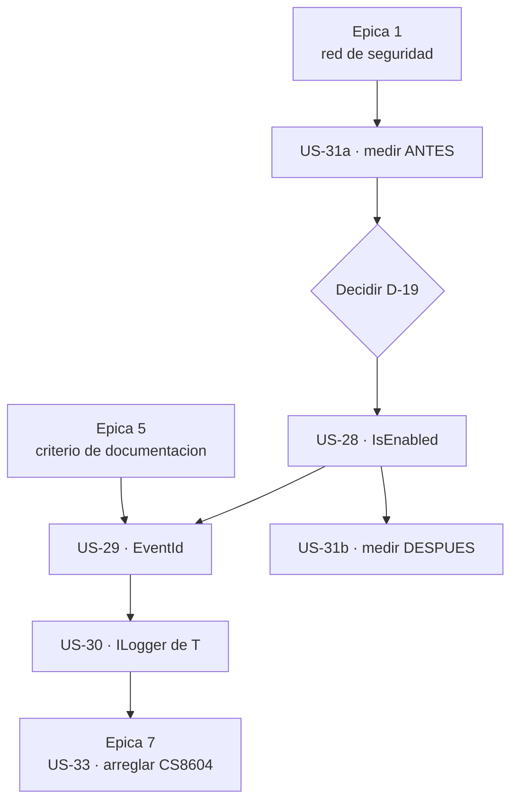

# Épica 6 · Rendimiento y estándar de logging: el coste que se paga aunque el nivel esté apagado

> **Versión destino** · 2.2.0 (US-28 … US-31)
> **Origen** · [`Mejoras/Logging/README.md`](../../../Mejoras/Logging/README.md) · hallazgos `D1`, `D2`, `D4`
> **Plan del que se desgaja** · [`README.md`](README.md) de la versión 2.2.0
> **Proyecto** · `src/MoralesLarios.OOFP.Logging`
> **Estado** · ⬜ pendiente
> **Esfuerzo** · **L** (~2,0 jornadas)
> **Riesgo** · 🟡 medio · la US-28 **cambia cuándo se evalúan los constructores de mensaje**
>
> **Leyenda de esfuerzo:** XS (<2 h) · S (½ jornada) · M (1 jornada) · L (2 jornadas) · XL (3+ jornadas)
> **Leyenda de riesgo:** 🟢 bajo · 🟡 medio · 🟠 alto · 🔴 muy alto (rompe compatibilidad)

---

## Índice

1. [Contexto y problema](#1-contexto-y-problema)
   - [Punto 24 — El coste se paga aunque el nivel esté apagado](#punto-24--el-coste-se-paga-aunque-el-nivel-esté-apagado)
   - [Punto 25 — Mensaje no constante: el riesgo `CA2254`](#punto-25--mensaje-no-constante-el-riesgo-ca2254)
   - [Punto 26 — Cero `EventId` en toda la librería](#punto-26--cero-eventid-en-toda-la-librería)
   - [Punto 27 — Cero sobrecargas con `ILogger<T>`](#punto-27--cero-sobrecargas-con-iloggert)
   - [Punto 28 — La doble espera redundante](#punto-28--la-doble-espera-redundante)
2. [Alcance](#2-alcance)
3. [Historias de usuario](#3-historias-de-usuario)
4. [Orden de ejecución](#4-orden-de-ejecución)
5. [Decisiones abiertas](#5-decisiones-abiertas)
6. [Definición de terminado](#6-definición-de-terminado)
7. [Apéndice · código actual y propuesto](#7-apéndice--código-actual-y-propuesto)
8. [Ver también](#8-ver-también)

---

## 1. Contexto y problema

Las cinco épicas anteriores arreglan lo que está **mal**. Ésta añade lo que **falta**: la librería
funciona, pero ignora el estándar de `Microsoft.Extensions.Logging` que su propio consumidor espera.

Medido sobre los **6.619 líneas** del proyecto:

| Elemento del estándar | Ocurrencias |
|-----------------------|------------:|
| `ILogger.IsEnabled` | **0** |
| `LoggerMessage` (generación de código) | **0** |
| `EventId` | **0** |
| `BeginScope` | **0** |
| `ILogger<T>` | **0** |
| `ILoggerFactory` | **0** |

Cero en los seis. No es una omisión puntual: es que el diseño nunca contempló el estándar.

### Punto 24 — El coste se paga aunque el nivel esté apagado

Éste es el hallazgo central de la épica. Mírese el método base:

```csharp
// MoralesLarios.OOFP.Logging/MlResultLogExtensions.cs, L65-77
public static MlResult<T> LogMlResult<T>(this MlResult<T>                  source,
                                              ILogger                      logger,
                                              LogLevel                     logLevel,
                                              Func<T, string>              validBuilMessage = null!,
                                              Func<MlErrorDetails, string> failBuildMessage = null!)
{
    source.Match(
                    valid: x      => validBuilMessage != null ? logger.LogMlResult(logLevel, validBuilMessage(x))    : null!,
                    fail : errors => failBuildMessage != null ? logger.LogMlResult(logLevel, failBuildMessage(errors)) : null!
                );

    return source;
}
```

`validBuilMessage(x)` **se ejecuta siempre**. El `Func` del consumidor se invoca —con sus
interpolaciones, sus concatenaciones, sus `ToString()`, sus consultas— y sólo **después** se entrega
el `string` a `logger.Log(...)`, que lo descarta si el nivel está deshabilitado.

Es decir: en producción, con `Trace` y `Debug` apagados —lo normal—, **la aplicación paga el coste
completo de construir mensajes que nadie va a leer**. Y la librería tiene 6 niveles × 7 regiones = 42
regiones de métodos con este patrón.

El contrato de `Microsoft.Extensions.Logging` dice exactamente lo contrario: **preguntar primero**.

```csharp
if (logger.IsEnabled(logLevel))
    logger.Log(logLevel, validBuildMessage(x));
```

> **Importante · esto cambia un comportamiento observable.** Hoy, si el `Func` del consumidor tiene
> efectos colaterales —incrementa un contador, escribe en una caché, lanza una excepción— esos
> efectos **ocurren siempre**. Después de la US-28 **dejan de ocurrir** cuando el nivel está apagado.
> Es una **ruptura silenciosa** y hay que decidirla y registrarla, no deslizarla (ver
> [`D-19`](#5-decisiones-abiertas)).

### Punto 25 — Mensaje no constante: el riesgo `CA2254`

```csharp
// MoralesLarios.OOFP.Logging/MlResultLogExtensions.cs, L29-36
public static MlResult<ILogger> LogMlResult(this ILogger  logger,
                                                 LogLevel logLevel,
                                                 string   message)
{
    logger.Log(logLevel, message);

    return logger.ToMlResultValid();
}
```

`message` es una **variable**. El analizador `CA2254` —«la plantilla del mensaje de registro no debe
variar entre llamadas»— está diseñado precisamente para esto. Un consumidor con analizadores
habilitados y `TreatWarningsAsErrors` recibirá el aviso **en su propio código**, dentro de un método
de nuestra librería que él no puede corregir.

Hay una consecuencia funcional, además del aviso: pasando el mensaje ya interpolado, el registro
estructurado pierde los **campos**. Un `Serilog` o un `OpenTelemetry` detrás reciben una cadena
opaca, no `{ClienteId}` con su valor aparte.

### Punto 26 — Cero `EventId` en toda la librería

`EventId` es el mecanismo estándar para **filtrar y correlacionar** trazas. No hay ni una sobrecarga
que lo acepte, de modo que el consumidor de esta librería no puede filtrar por evento: sólo por
nivel. Con 339 firmas públicas, es una ausencia llamativa.

### Punto 27 — Cero sobrecargas con `ILogger<T>`

Todas las firmas piden `ILogger`. `ILogger<T>` **hereda** de `ILogger`, así que compila; pero el
consumidor que usa inyección de dependencias —es decir, prácticamente todos— tiene un `ILogger<Foo>`
y pierde la categoría: la traza sale con la categoría que el `ILogger<T>` traiga, sin que la
librería ofrezca nada para trabajar con ella.

Esto se nota ya en el propio `Sample`, que resuelve un `ILogger<Program>` y produce
**`CS8604`** al pasarlo (ver [épica 7](Epica-07-Saneamiento-del-Sample.md), US-33).

### Punto 28 — La doble espera redundante

```csharp
// MoralesLarios.OOFP.Logging/MlResultLogExtensions.cs, L226-236
public static async Task<MlResult<T>> LogMlResultAsync<T>(this Task<MlResult<T>> source,
                                                               ILogger           logger,
                                                               LogLevel          logLevel,
                                                               string            message)
{
    _ = await source;

    logger.Log(logLevel, message);

    return await source;
}
```

La misma `Task` se espera **dos veces**. En una `Task` ya completada el segundo `await` es casi
gratis, pero el `_ = await source;` no aporta **nada**: su único efecto es forzar el orden —esperar
antes de registrar—, y eso ya lo consigue el `return await source;` si se guarda el resultado.

El patrón correcto es esperar una vez:

```csharp
var result = await source;
// ... registrar ...
return result;
```

Es un defecto de **claridad**, no de corrección —el comportamiento observable no cambia—, y encaja
en esta épica porque se arregla en el mismo pase que el resto del cuerpo de los métodos.

> **Nota.** Hay más asincronía de adorno en el proyecto: métodos declarados `…Async` que no esperan
> nada y sólo envuelven el resultado con `.ToAsync()` (hallazgo `D5`, por ejemplo en `L89-94` y
> `L206-214`). Eso **no** entra aquí: rediseñar la asincronía es trabajo de la **3.0.0**.

---

## 2. Alcance

**Entra en esta épica:**

- Consultar `IsEnabled` antes de construir el mensaje, en los **42** bloques afectados.
- Sobrecargas nuevas con `EventId`.
- Sobrecargas nuevas con `ILogger<T>`.
- La medición del coste antes y después, que es lo que justifica la épica.
- La doble espera redundante del punto 28.

**No entra en esta épica:**

| Asunto | Dónde va |
|--------|----------|
| `D2` · mensaje no constante y registro estructurado | **3.0.0** · obliga a rediseñar la firma de los `Func` |
| `D5` · asincronía de adorno | **3.0.0** |
| `D6` · `LogMlResult` devolviendo `MlResult<ILogger>` | **3.0.0** |
| `D7` · `Match` devolviendo `null!` | **3.0.0** |
| `D3` · los 132 `null!` como valor por defecto | **3.0.0** |
| Validar los argumentos | [épica 3](Epica-03-Correccion-Funcional-y-Validacion.md) · US-12 |
| Documentar los miembros **nuevos** de esta épica | **aquí** · cada historia documenta lo que añade |

> **Por qué `D2` se queda fuera.** Arreglar `CA2254` de verdad exige que el consumidor entregue
> **plantilla + argumentos** en lugar de un `string` ya montado, y eso cambia la firma de los
> **339** métodos públicos. Es una ruptura de otro orden de magnitud: pertenece a la 3.0.0. En esta
> épica se **documenta** el riesgo y se deja anotado el camino.

---

## 3. Historias de usuario

### US-28 · Consultar `IsEnabled` antes de construir el mensaje

**Como** aplicación en producción con `Debug` y `Trace` apagados
**quiero** no pagar la construcción de mensajes que se van a descartar
**para** que el registro no me cueste nada cuando no registro nada.

- **Esfuerzo** · M · **Riesgo** · 🟡 · **Rompe** · **silenciosa** (efectos colaterales de los `Func`)

**Criterios de aceptación**

- [ ] **Resuelta [`D-19`](#5-decisiones-abiertas)**: se decide y se documenta si la evaluación
      perezosa es el comportamiento nuevo, o si se ofrece con sobrecargas aparte.
- [ ] Todo punto donde se invoca un constructor de mensaje queda precedido de
      `logger.IsEnabled(logLevel)`.
- [ ] Búsqueda de `logger.Log(` sin un `IsEnabled` que lo domine → **0 ocurrencias** en los métodos
      que construyen el mensaje con un `Func`.
- [ ] Recuento de `IsEnabled` en el proyecto → **> 0**, frente a los **0** de partida.
- [ ] Los métodos que reciben un **`string` ya montado** —`message`, `failMessage`— **no** se tocan:
      ahí el coste ya está pagado por el llamante y añadir `IsEnabled` no ahorraría nada.
- [ ] Hay un **test** que verifica que, con el nivel deshabilitado, el `Func` del consumidor
      **no se invoca** (contador a 0), y que con el nivel habilitado **se invoca una sola vez**.
- [ ] Hay un **test** que verifica que el resultado devuelto es **el mismo** con el nivel habilitado
      y deshabilitado: el registro nunca altera el `MlResult`.
- [ ] Se preserva la **paridad 47 + 17** de métodos por fichero de nivel.
- [ ] **Registrada como ruptura silenciosa en los 6 sitios** del prompt de migración, con el patrón
      de búsqueda que localiza los `Func` con efectos colaterales en el código del consumidor.

### US-29 · Sobrecargas con `EventId`

**Como** consumidor que explota sus trazas
**quiero** poder asignar un identificador de evento
**para** filtrar y correlacionar sin depender del texto del mensaje.

- **Esfuerzo** · M · **Riesgo** · 🟢 · **Rompe** · no

**Criterios de aceptación**

- [ ] **Resuelta [`D-20`](#5-decisiones-abiertas)**: se decide el alcance —¿sobrecargas para las 339
      firmas, o sólo para las familias principales?—.
- [ ] Las sobrecargas nuevas aceptan `EventId` y **se añaden**, sin modificar ninguna firma
      existente: la épica es **aditiva**, no rompe nada.
- [ ] El `EventId` se sitúa en una posición que **no** cree ambigüedad con las sobrecargas actuales;
      se verifica compilando una llamada de cada familia sin nombres de parámetro.
- [ ] Ningún parámetro nuevo se añade a un método existente, **ni opcional**: eso sería una ruptura
      binaria (regla de la §4 de `commits-conventional-y-registro.instructions.md`).
- [ ] Cada sobrecarga nueva lleva su documentación XML completa, con el criterio de la
      [épica 5](Epica-05-Documentacion-XML.md): `<summary>`, `<param>`, `<returns>`, `<exception>` y
      al menos un `<example>` por familia.
- [ ] Hay tests que verifican que el `EventId` llega al `ILogger` con el valor indicado.
- [ ] Build con **0 `CS1591`** y **sin avisos nuevos**.
- [ ] **Registrada como aditivo relevante** en el prompt de migración: no rompe, pero el consumidor
      debe saber que existe.

### US-30 · Sobrecargas con `ILogger<T>`

**Como** consumidor que usa inyección de dependencias
**quiero** sobrecargas que acepten `ILogger<TCategory>`
**para** no perder la categoría ni tropezar con avisos de nulabilidad.

- **Esfuerzo** · S · **Riesgo** · 🟢 · **Rompe** · no

**Criterios de aceptación**

- [ ] Hay sobrecargas que aceptan `ILogger<TCategory>` para las familias principales.
- [ ] Se comprueba que **no** generan ambigüedad con las sobrecargas de `ILogger`: `ILogger<T>`
      hereda de `ILogger`, y una resolución ambigua sería un error de compilación **en el código del
      consumidor**. Se verifica con un caso de prueba que pasa un `ILogger<Program>` sin casting.
- [ ] El `Sample` pasa a usar la sobrecarga nueva, y su **`CS8604` desaparece** —coordinado con la
      US-33 de la [épica 7](Epica-07-Saneamiento-del-Sample.md)—.
- [ ] Recuento de `ILogger<` en el proyecto → **> 0**, frente a **0**.
- [ ] Documentación XML completa en cada sobrecarga nueva, y tests que las cubren.
- [ ] **Registrada como aditivo relevante** en el prompt de migración.

### US-31 · Medir el coste antes y después

**Como** propietario de la librería
**quiero** una medición real del ahorro
**para** poder afirmar la mejora con un número en lugar de con una intuición.

- **Esfuerzo** · S · **Riesgo** · 🟢 · **Rompe** · no

**Criterios de aceptación**

- [ ] **Resuelta [`D-21`](#5-decisiones-abiertas)**: se decide la herramienta de medición.
- [ ] Se mide, con el nivel **deshabilitado**, el coste de `LogMlResult` con un `Func` que construya
      un mensaje realista: **antes** y **después** de la US-28.
- [ ] La medición reporta **tiempo** y **asignaciones de memoria**, porque el ahorro principal son
      las asignaciones de las cadenas que ya no se construyen.
- [ ] El resultado queda escrito en este documento, en la §7, con la versión del entorno
      —`net8.0`, configuración `Release`—.
- [ ] Si la medición **no** demuestra una mejora apreciable, se hace constar y se **reevalúa** si la
      ruptura silenciosa de la US-28 está justificada. Medir sirve para poder decir «no», también.
- [ ] El proyecto de medición, si se crea, **no** entra en el paquete publicado: queda fuera de los
      ensamblados que se distribuyen.

---

## 4. Orden de ejecución



**Justificación.**

1. **La épica 1 es prerrequisito absoluto.** La US-28 cambia **cuándo** se evalúan los `Func` en 42
    bloques. Sin la matriz de tests nivel × región no hay forma de saber si se ha roto algo.
2. **Medir antes de tocar.** La US-31 se **parte en dos**: la medición de partida se toma **antes**
    de la US-28, o se pierde la referencia para siempre.
3. **`D-19` bloquea la US-28**, porque de ella depende si hay ruptura silenciosa o si se añaden
    sobrecargas nuevas. Son dos implementaciones distintas.
4. **US-28 antes que US-29 y US-30**, para que las sobrecargas nuevas nazcan ya con el patrón
    `IsEnabled` y no haya que volver a pasar por ellas.
5. **La épica 5 va antes de las historias aditivas.** Toda sobrecarga nueva debe nacer documentada
    con el criterio ya fijado; si no, la épica 5 habría que repetirla.
6. **US-30 antes de la US-33 de la épica 7**: el `CS8604` del `Sample` se arregla **usando** la
    sobrecarga nueva.

---

## 5. Decisiones abiertas

| # | Decisión | Opciones | Estado |
|:-:|----------|----------|:------:|
| **D-19** | ¿Cómo se introduce la evaluación perezosa? | (a) cambiar el comportamiento de los métodos actuales · ruptura **silenciosa** registrada · (b) añadir sobrecargas nuevas «perezosas» y dejar las actuales intactas · (c) cambiarlo y documentarlo como corrección de un defecto, porque evaluar siempre contradice el contrato de `Microsoft.Extensions.Logging` | ⬜ abierta |
| **D-20** | Alcance de las sobrecargas con `EventId` | (a) las 339 firmas · duplica la superficie pública · (b) sólo `LogMlResult` y las 6 de nivel · (c) sólo las familias `…IfFail*`, que son las que interesa correlacionar | ⬜ abierta |
| **D-21** | Herramienta de medición | (a) `BenchmarkDotNet` en un proyecto aparte · (b) un test con `Stopwatch` y `GC.GetAllocatedBytesForCurrentThread()` · (c) medición manual puntual, sin proyecto nuevo | ⬜ abierta |
| **D-22** | ¿Se arregla la doble espera del punto 28? | (a) sí, en esta épica, junto al resto del cuerpo · (b) no, se agrupa con `D5` en la 3.0.0 | ⬜ abierta |

> **Recomendación sobre `D-19`.** La opción (b) **no rompe nada**, pero deja la librería con dos
> familias de métodos que hacen lo mismo con rendimientos distintos, y al consumidor con la carga de
> elegir. La opción (c) es la honesta: evaluar siempre el constructor del mensaje **contradice** el
> contrato del propio `ILogger`, y por tanto es un defecto, no una característica. Eso sí: aun
> tratándolo como defecto, la ruptura es silenciosa y hay que registrarla en los **6 sitios**.

> **Recomendación sobre `D-20`.** La opción (a) llevaría la superficie pública de 339 a ~680 firmas.
> Con 92 nombres y 3,7 sobrecargas de media ya es una API difícil de recorrer; duplicarla por un
> parámetro opcional no es un buen reparto. Empezar por (b) o (c) y crecer con la demanda real.

---

## 6. Definición de terminado

- [ ] Las **4 historias** (US-28 … US-31) tienen todos sus criterios de aceptación marcados.
- [ ] **`D-19`, `D-20`, `D-21` y `D-22` resueltas** y anotadas en la §5 de este documento.
- [ ] Recuentos en el proyecto: `IsEnabled` **> 0**, `EventId` **> 0**, `ILogger<` **> 0**, frente a
      **0 · 0 · 0** de partida.
- [ ] La medición de la US-31 está escrita en la §7.5 con sus dos columnas —antes y después— y el
      ahorro de asignaciones.
- [ ] Se preserva la **paridad 47 + 17** por fichero de nivel, y el recuento de firmas públicas
      queda documentado: **339 + N**, con N justificado por `D-20`.
- [ ] `dotnet build MoralesLarios.OOFP.sln -c Release --no-incremental` → **EXIT = 0**,
      **0 errores**, **0 `CS1591`**, **0 `CS0618`** y **no más de 236 avisos**.
- [ ] `dotnet test MoralesLarios.OOFP.sln -c Release --no-build` → **1.136 tests** en verde, más los
      de la épica 1, más los nuevos de esta épica.
- [ ] **Registro en el prompt de migración completado**:
      - la ruptura **silenciosa** de la US-28 —si `D-19` acaba en (a) o (c)— en los **6 sitios**, con
        su fila en la §3.3, su subsección `#### N`, su barrido de búsqueda en la Fase 5, su número en
        la Fase 6 y su entrada en la tabla del apéndice;
      - los **aditivos** de la US-29 y la US-30 marcados como «sin rupturas», para que el consumidor
        sepa que existen.
- [ ] **Sin renombrados** ⇒ nada que añadir a `oofp-upgrade-2.renames.md`. Se hace constar.
- [ ] Commits en castellano creados con `git commit -F` desde ficheros UTF-8 sin BOM:
      - `perf(logging)!: consultar IsEnabled antes de construir el mensaje (US-28)`
      - `feat(logging): sobrecargas con EventId (US-29)`
      - `feat(logging): sobrecargas con ILogger<T> (US-30)`
      - `test(logging): medir el coste del registro con el nivel apagado (US-31)`
      - `docs(copilot): registrar la ruptura silenciosa de IsEnabled (US-28)`
- [ ] Este documento queda marcado como `✅ completada` en su línea de **Estado** y en la tabla de
      [`README.md`](README.md#1-las-siete-épicas).

---

## 7. Apéndice · código actual y propuesto

### 7.1 Lo que falta, medido

| Elemento | Antes | Después (objetivo) |
|----------|------:|-------------------:|
| `ILogger.IsEnabled` | 0 | > 0 |
| `EventId` | 0 | > 0 |
| `ILogger<T>` | 0 | > 0 |
| `LoggerMessage` | 0 | 0 · **3.0.0** |
| `BeginScope` | 0 | 0 · **3.0.0** |
| `ILoggerFactory` | 0 | 0 · **3.0.0** |

### 7.2 El método base, antes y después

```csharp
// ANTES  ·  MlResultLogExtensions.cs, L65-77
public static MlResult<T> LogMlResult<T>(this MlResult<T>                  source,
                                              ILogger                      logger,
                                              LogLevel                     logLevel,
                                              Func<T, string>              validBuilMessage = null!,
                                              Func<MlErrorDetails, string> failBuildMessage = null!)
{
    source.Match(
                    valid: x      => validBuilMessage != null ? logger.LogMlResult(logLevel, validBuilMessage(x))    : null!,
                    fail : errors => failBuildMessage != null ? logger.LogMlResult(logLevel, failBuildMessage(errors)) : null!
                );

    return source;
}
```

```csharp
// DESPUES  ·  con D-19 = (c), nombres de la epica 4 y validacion de la epica 3
public static MlResult<T> LogMlResult<T>(this MlResult<T>                  source,
                                              ILogger                      logger,
                                              LogLevel                     logLevel,
                                              Func<T, string>?             validBuildMessage = null,
                                              Func<MlErrorDetails, string>? failBuildMessage = null)
{
    ArgumentNullException.ThrowIfNull(logger);

    if (!logger.IsEnabled(logLevel)) return source;

    source.ExecSelf(
                       valid: x      => { if (validBuildMessage is not null) logger.Log(logLevel, validBuildMessage(x));      },
                       fail : errors => { if (failBuildMessage  is not null) logger.Log(logLevel, failBuildMessage(errors)); }
                   );

    return source;
}
```

Tres cambios en seis líneas: la guarda `IsEnabled` que ahorra el coste (US-28), el
`ArgumentNullException.ThrowIfNull` de la [épica 3](Epica-03-Correccion-Funcional-y-Validacion.md), y
el `ExecSelf` en lugar del `Match` que devolvía `null!` —hallazgo `D7`, cuyo rediseño completo queda
para la 3.0.0, pero que aquí deja de hacer falta—.

> **Nota.** Los `null!` pasan a `null` con tipo anulable sólo si `D3` se resuelve en esa dirección;
> mientras `D3` siga aplazado a la 3.0.0, se conserva `null!` y el cambio se limita al `IsEnabled`.

### 7.3 La doble espera, antes y después

```csharp
// ANTES  ·  MlResultLogExtensions.cs, L226-236
{
    _ = await source;

    logger.Log(logLevel, message);

    return await source;
}
```

```csharp
// DESPUES  ·  si D-22 = (a)
{
    var result = await source;

    logger.Log(logLevel, message);

    return result;
}
```

### 7.4 Búsquedas de verificación

| Búsqueda | Antes | Esperado al cerrar |
|----------|------:|-------------------:|
| `IsEnabled` | 0 | > 0 |
| `EventId` | 0 | > 0 |
| `ILogger<` | 0 | > 0 |
| `_ = await` | ≥ 1 | 0 · si `D-22` = (a) |
| `logger.Log(` sin `IsEnabled` dominante en métodos con `Func` | todos | 0 |
| avisos de la solución | 236 | ≤ 236 |
| tests en verde | 1.136 | 1.136 + nuevos |

### 7.5 Resultado de la medición (US-31)

> Pendiente. Se rellena al ejecutar la US-31, con el entorno —`net8.0`, `Release`, herramienta
> elegida en `D-21`— y dos columnas: **antes** y **después** de la US-28, en tiempo y en bytes
> asignados, con el nivel **deshabilitado**.

| Escenario | Tiempo antes | Tiempo después | Bytes antes | Bytes después |
|-----------|-------------:|---------------:|------------:|--------------:|
| `LogMlResult` · nivel apagado | — | — | — | — |
| `LogMlResult` · nivel encendido | — | — | — | — |

---

## 8. Ver también

- [`README.md`](README.md) — plan de la versión 2.2.0.
- [`Epica-01-Red-de-Seguridad.md`](Epica-01-Red-de-Seguridad.md) — prerrequisito absoluto: sin tests no se toca el cuerpo de 42 bloques.
- [`Epica-03-Correccion-Funcional-y-Validacion.md`](Epica-03-Correccion-Funcional-y-Validacion.md) — aporta la validación de argumentos que aparece en el código propuesto.
- [`Epica-04-Nomenclatura-y-Firmas-Publicas.md`](Epica-04-Nomenclatura-y-Firmas-Publicas.md) — fija los nombres con los que nacen las sobrecargas nuevas.
- [`Epica-05-Documentacion-XML.md`](Epica-05-Documentacion-XML.md) — fija el criterio con el que se documentan los miembros nuevos.
- [`Epica-07-Saneamiento-del-Sample.md`](Epica-07-Saneamiento-del-Sample.md) — consume la sobrecarga `ILogger<T>` para resolver su `CS8604`.
- [`Mejoras/Logging/README.md`](../../../Mejoras/Logging/README.md) — catálogo de los 35 hallazgos.
