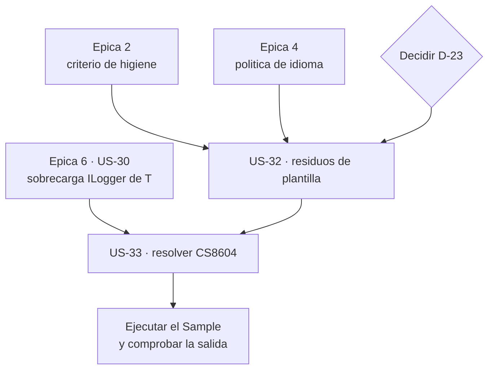

# Épica 7 · Saneamiento del `Sample`: el escaparate de la librería

> **Versión destino** · 2.2.0 (US-32 … US-33)
> **Origen** · [`Mejoras/Logging/README.md`](../../../Mejoras/Logging/README.md) · hallazgos `S1` … `S4`
> **Plan del que se desgaja** · [`README.md`](README.md) de la versión 2.2.0
> **Proyecto** · `src/MoralesLarios.OOFP.Logging.Sample`
> **Estado** · ⬜ pendiente
> **Esfuerzo** · **XS** (~0,25 jornadas)
> **Riesgo** · 🟢 bajo · el `Sample` **no se publica**: nada de lo que se toque aquí llega al consumidor
>
> **Leyenda de esfuerzo:** XS (<2 h) · S (½ jornada) · M (1 jornada) · L (2 jornadas) · XL (3+ jornadas)
> **Leyenda de riesgo:** 🟢 bajo · 🟡 medio · 🟠 alto · 🔴 muy alto (rompe compatibilidad)

---

## Índice

1. [Contexto y problema](#1-contexto-y-problema)
   - [Punto 29 — Residuos de plantilla](#punto-29--residuos-de-plantilla)
   - [Punto 30 — Un tercio del fichero está comentado](#punto-30--un-tercio-del-fichero-está-comentado)
   - [Punto 31 — El `CS8604`: el `Sample` tiene un aviso de nulabilidad](#punto-31--el-cs8604-el-sample-tiene-un-aviso-de-nulabilidad)
   - [Punto 32 — Mensajes que mienten y nombres mal escritos](#punto-32--mensajes-que-mienten-y-nombres-mal-escritos)
   - [Punto 33 — Interpolaciones sin interpolar y variable duplicada](#punto-33--interpolaciones-sin-interpolar-y-variable-duplicada)
2. [Alcance](#2-alcance)
3. [Historias de usuario](#3-historias-de-usuario)
4. [Orden de ejecución](#4-orden-de-ejecución)
5. [Decisiones abiertas](#5-decisiones-abiertas)
6. [Definición de terminado](#6-definición-de-terminado)
7. [Apéndice · código actual y propuesto](#7-apéndice--código-antes-y-después)
8. [Ver también](#8-ver-también)

---

## 1. Contexto y problema

`MoralesLarios.OOFP.Logging.Sample` es un único `Program.cs` de **174 líneas** y **un solo fichero
de código**. Es la primera cosa que abre quien quiere entender la librería, y lo que encuentra es un
banco de pruebas abandonado a medias.

Las cifras, medidas:

| Métrica | Valor |
|---------|------:|
| Líneas totales de `Program.cs` | **174** |
| Líneas comentadas | **59** · el **34 %** |
| Líneas en blanco | **68** · el **39 %** |
| Líneas «en blanco» con espacios residuales | **4** |
| Bloques de 3 o más líneas en blanco seguidas | **6** |
| Líneas con código vivo | **47** · el **27 %** |
| `logger.IsEnabled` | **0** |
| `GetRequiredService` | **0** · usa `GetService` |
| Avisos de compilación | **1** · `CS8604` |

**Dos de cada tres líneas no son código.** Y de lo que queda, el aviso `CS8604` es el único aviso de
nulabilidad que la solución tiene localizado en un fichero concreto y accionable.

> **Por qué merece una épica propia.** Es tentador meter esto en la épica 2 de higiene. Pero el
> `Sample` es un proyecto **distinto**, no se publica, y su US-33 **depende** de una sobrecarga que
> aporta la [épica 6](Epica-06-Rendimiento-y-Estandar-de-Logging.md). Separarlo permite ejecutarlo en
> paralelo, en un rato, sin tocar la librería.

### Punto 29 — Residuos de plantilla

```csharp
// MoralesLarios.OOFP.Logging.Sample/Program.cs, L1
// See https://aka.ms/new-console-template for more information
```

```csharp
// MoralesLarios.OOFP.Logging.Sample/Program.cs, L13
Console.WriteLine("Hello, World!");
```

El comentario que genera `dotnet new console` y el `Hello, World!` siguen ahí, intactos, en la línea
13. Es el equivalente, en el `Sample`, del `MyMethodFinalLog` que la
[épica 4](Epica-04-Nomenclatura-y-Firmas-Publicas.md) retira de la librería: una plantilla que nadie
terminó de rellenar.

Además, el `Hello, World!` escribe por `Console.WriteLine` **antes** de que exista el `host`, es
decir, fuera del sistema de registro que el `Sample` supuestamente demuestra. Da el mensaje
contrario al que pretende enseñar.

### Punto 30 — Un tercio del fichero está comentado

Los bloques `L40-80` y `L85-127` son dos baterías de pruebas enteras —`LogMlResultIfFailWithValue` y
`LogMlResultIfFailWithException`— comentadas línea a línea. Son **59 líneas**, el **34 %** del
fichero.

Es el mismo problema que las **530 líneas comentadas** de la librería (hallazgo `M1`, US-09 de la
[épica 2](Epica-02-Higiene-Interna-y-Codigo-Muerto.md)), con la misma respuesta: el control de
versiones ya guarda el histórico. Lo que está comentado está **muerto**, y además es engañoso,
porque esos bloques usan nombres de parámetro —`failBuildMessage`— que en algunas firmas de la
librería se llaman hoy `faildMessage`, de modo que **ni compilarían si se descomentasen**.

> **Importante.** Aquí hay una decisión de fondo: ¿se **borran** esas pruebas o se **recuperan**?
> Demuestran dos familias de métodos que el `Sample` ya no demuestra. Ver
> [`D-23`](#5-decisiones-abiertas).

### Punto 31 — El `CS8604`: el `Sample` tiene un aviso de nulabilidad

```csharp
// MoralesLarios.OOFP.Logging.Sample/Program.cs, L31
var logger = host.Services.GetService<ILogger<Program>>();

// L33
logger.LogInformation("Comenzando la ejecución");
```

`GetService<T>()` devuelve `T?`. El `Sample` tiene `<Nullable>enable</Nullable>`, así que `logger`
es un `ILogger<Program>?`, y al pasarlo a los métodos de la librería —que piden un `ILogger` no
anulable— el compilador emite:

```text
Program.cs(33,1): warning CS8604: Possible null reference argument
```

Hay **dos** defectos encadenados:

1. `GetService` en lugar de `GetRequiredService`. El `Sample` **necesita** el logger: si no está,
    debe fallar en el arranque con un mensaje claro, no arrastrar un nulo.
2. La librería no ofrece sobrecargas con `ILogger<T>` (hallazgo `D4`), que es lo que la
    [épica 6](Epica-06-Rendimiento-y-Estandar-de-Logging.md) resuelve en su US-30.

El arreglo de un `GetService` → `GetRequiredService` hace desaparecer el aviso por sí solo. La
sobrecarga de la épica 6 es lo que además hace el código **idiomático**.

### Punto 32 — Mensajes que mienten y nombres mal escritos

```csharp
// L18, L20 · nombres mal escritos
services.AddLogging(logginBuilder =>
{
    var loggerConfriguration = new LoggerConfiguration();
```

`logginBuilder` —falta la `g`— y `loggerConfriguration` —`fr` por `fi`—. Son variables locales: no
rompen nada, pero están en las primeras veinte líneas del único fichero que alguien va a leer para
aprender a usar la librería.

Y hay dos mensajes que **dicen lo contrario de lo que el código prueba**:

```csharp
// L142-144 · prueba WithoutException, el mensaje dice WithException
partialResultNoException.LogMlResultIfFailWithoutException(logger: logger,
                                                      logLevel: LogLevel.Information,
                                                      failBuildMessage: errorsDetails => "Correcto: La prueba de LogMlResultIfFailWithException ha sido buena");

// L166 · idem
logger.LogInformation($"************** LogMlResultIfFailWithException FINALIZADO ***************");
```

El bloque vivo prueba `LogMlResultIfFailWith**out**Exception` y los dos mensajes hablan de
`LogMlResultIfFailWithException`. Son copias del bloque comentado de arriba que nadie actualizó. En
un ejemplo didáctico, un mensaje que miente es peor que no tener mensaje.

### Punto 33 — Interpolaciones sin interpolar y variable duplicada

De las **11** cadenas con prefijo `$"` del fichero, **ninguna** de las que están vivas en `L130` y
`L166` tiene una sola llave: son interpolaciones **innecesarias**.

```csharp
// L130 · $"" sin ninguna {expresión}
logger.LogInformation($"**************  Probando el método LogMlResultIfFailWithoutException ***************");
```

Y la variable `partialResult1Exception` está declarada **dos veces**: comentada en `L87` y viva en
`L132`, con el mismo nombre y el mismo contenido. Residuo de copiar y pegar el bloque.

---

## 2. Alcance

**Entra en esta épica:**

- Retirar los residuos de plantilla: el comentario de `aka.ms` y el `Hello, World!`.
- Resolver los **59** líneas comentadas según `D-23`.
- Resolver el `CS8604`.
- Corregir los nombres mal escritos y los mensajes que mienten.
- Quitar las interpolaciones vacías y la variable duplicada.
- Normalizar las líneas en blanco: **6** bloques de 3 o más, y **4** líneas con espacios residuales.

**No entra en esta épica:**

| Asunto | Dónde va |
|--------|----------|
| Añadir `IsEnabled` a la **librería** | [épica 6](Epica-06-Rendimiento-y-Estandar-de-Logging.md) · US-28 |
| Crear las sobrecargas con `ILogger<T>` | [épica 6](Epica-06-Rendimiento-y-Estandar-de-Logging.md) · US-30 |
| Renombrar `faildMessage`/`validBuilMessage` | [épica 4](Epica-04-Nomenclatura-y-Firmas-Publicas.md) · US-15, US-16 |
| Borrar las 530 líneas comentadas de la **librería** | [épica 2](Epica-02-Higiene-Interna-y-Codigo-Muerto.md) · US-09 |
| Convertir el `Sample` en tests automatizados | [épica 1](Epica-01-Red-de-Seguridad.md) · es ahí donde van los tests |
| El `Scc*` del `.csproj` del `Sample` | ya **resuelto** · limpieza transversal `chore(build)` |

> **Por qué el `Sample` no sustituye a los tests.** Un `Sample` que se ejecuta a mano y escribe por
> consola no **verifica** nada: hay que leer la salida y confiar. Los tests de la épica 1 son la red
> de seguridad; el `Sample` es documentación ejecutable. Son dos cosas, y esta épica **no** convierte
> una en la otra.

---

## 3. Historias de usuario

### US-32 · Limpiar los residuos de plantilla del `Sample`

**Como** persona que abre el `Sample` para aprender a usar la librería
**quiero** encontrar un ejemplo que se lea de arriba abajo y diga la verdad
**para** entender la librería en lugar de descifrar un banco de pruebas abandonado.

- **Esfuerzo** · XS · **Riesgo** · 🟢 · **Rompe** · no · *(el `Sample` no se publica)*

**Criterios de aceptación**

- [ ] **Resuelta [`D-23`](#5-decisiones-abiertas)**: se decide si las 59 líneas comentadas se borran
      o se recuperan como código vivo.
- [ ] El comentario `// See https://aka.ms/new-console-template…` de `L1` **retirado**.
- [ ] `Console.WriteLine("Hello, World!");` de `L13` **retirado**.
- [ ] Recuento de líneas comentadas en `Program.cs` → **0**, frente a las **59** de partida
      *(o el valor que fije `D-23`, justificado en este documento)*.
- [ ] `logginBuilder` → `loggingBuilder` y `loggerConfriguration` → `loggerConfiguration`.
- [ ] Los **2** mensajes que dicen `LogMlResultIfFailWithException` en el bloque que prueba
      `LogMlResultIfFailWithoutException` —`L144` y `L166`— **corregidos**.
- [ ] Las interpolaciones `$"` **sin ninguna** `{expresión}` pasan a cadenas normales; búsqueda de
      `$"` sin `{` → **0 ocurrencias**.
- [ ] La declaración duplicada de `partialResult1Exception` resuelta: queda **una sola**.
- [ ] **0** bloques de 3 o más líneas en blanco seguidas —frente a **6**— y **0** líneas en blanco
      con espacios residuales —frente a **4**—, con el mismo criterio que la US-10 de la
      [épica 2](Epica-02-Higiene-Interna-y-Codigo-Muerto.md).
- [ ] Todos los mensajes del `Sample` en **castellano**, coherentes con la política que fija la
      US-19 de la [épica 4](Epica-04-Nomenclatura-y-Firmas-Publicas.md).
- [ ] **El `Sample` se ejecuta** y su salida se comprueba a mano: cada mensaje que dice «Correcto»
      aparece, y cada mensaje que dice «Esto no tendría que imprimirse» **no** aparece. Ese es el
      criterio real de que el ejemplo funciona.
- [ ] Build del `Sample` → **0 errores**.

### US-33 · Resolver el `CS8604` del `Sample`

**Como** propietario de la librería
**quiero** que el ejemplo compile sin avisos
**para** no estar enseñando al consumidor un patrón que su propio compilador le va a reprochar.

- **Esfuerzo** · XS · **Riesgo** · 🟢 · **Rompe** · no

**Criterios de aceptación**

- [ ] `host.Services.GetService<ILogger<Program>>()` → **`GetRequiredService`**.
- [ ] Recuento en `Program.cs`: `GetService` → **0**, `GetRequiredService` → **1**.
- [ ] **`CS8604` del `Sample` desaparece.** Se verifica con build completo
      `--no-incremental`, no incremental, buscando `Program.cs(33` en la salida → **0 coincidencias**.
- [ ] El `Sample` usa la sobrecarga con `ILogger<T>` que aporta la US-30 de la
      [épica 6](Epica-06-Rendimiento-y-Estandar-de-Logging.md), si esa sobrecarga existe al llegar
      aquí; si no, se deja anotado en este documento para la siguiente pasada.
- [ ] El `Sample` consulta `logger.IsEnabled(...)` al menos en un punto, para **enseñar** el patrón
      que la US-28 introduce en la librería; recuento de `IsEnabled` → **> 0**, frente a **0**.
- [ ] El recuento total de avisos de la solución **baja al menos en 1** respecto a los **236** de
      partida, o se justifica por qué no.

---

## 4. Orden de ejecución



**Justificación.**

1. **La épica 2 va antes** porque fija el criterio de higiene —qué se borra, cómo se normalizan las
    líneas en blanco— que la US-32 aplica al `Sample`. No tiene sentido inventar un criterio distinto
    para un proyecto de 174 líneas.
2. **La épica 4 va antes** porque fija la **política de idioma** (US-19). El `Sample` mezcla
    castellano e inglés; sin la política decidida, corregirlo sería arbitrario.
3. **`D-23` bloquea la US-32**: borrar 59 líneas o recuperarlas son dos trabajos distintos, uno de
    minutos y otro de una hora.
4. **US-32 antes de US-33**, para no andar arreglando un `CS8604` en un fichero que todavía va a
    cambiar de forma.
5. **La US-30 de la épica 6 va antes de la US-33**, porque es la que aporta la sobrecarga con
    `ILogger<T>` que hace el arreglo idiomático y no sólo silencioso.
6. **Ejecutar el `Sample` al final es parte del trabajo**, no un extra. Un ejemplo que no se ha
    ejecutado desde que se tocó no es un ejemplo: es código sin verificar.

> **Esta épica puede ir en paralelo.** Salvo las dependencias anteriores, no toca la librería, así
> que no bloquea ni es bloqueada por el resto del trabajo de la 2.2.0.

---

## 5. Decisiones abiertas

| # | Decisión | Opciones | Estado |
|:-:|----------|----------|:------:|
| **D-23** | ¿Qué se hace con las 59 líneas comentadas? | (a) **borrarlas**: el control de versiones ya las guarda · (b) **recuperarlas** como código vivo: demuestran `IfFailWithValue` e `IfFailWithException`, que hoy el `Sample` no demuestra · (c) borrarlas del `Sample` y convertirlas en **tests** de la épica 1 | ⬜ abierta |
| **D-24** | ¿Qué debe demostrar el `Sample` tras el saneamiento? | (a) sólo lo que ya demuestra · `IfFailWithoutException` · (b) una llamada representativa de **cada** una de las 7 regiones · (c) el camino feliz y el camino de error de las familias principales | ⬜ abierta |
| **D-25** | ¿Se mantiene el `Sample` como proyecto, o se sustituye por un `README` con fragmentos? | (a) mantenerlo: compila, y lo que compila no se queda obsoleto en silencio · (b) sustituirlo por documentación · (c) mantenerlo **y** extraer sus fragmentos al `README` de `Logging` | ⬜ abierta |

> **Recomendación sobre `D-23`.** La opción (c) es la que aprovecha el trabajo: esas 59 líneas son
> **casos de prueba ya pensados**, con su expectativa escrita en el propio mensaje —«Correcto: …» y
> «Esto no tendría que imprimirse»—. Trasladarlos a la matriz de la
> [épica 1](Epica-01-Red-de-Seguridad.md) los convierte en verificación automática, y el `Sample` se
> queda limpio. Es más trabajo que borrar, y es el único que no tira nada.

> **Recomendación sobre `D-25`.** La opción (a) o la (c). Un proyecto que **compila** es la única
> documentación que no puede quedarse obsoleta en silencio: si la épica 4 renombra
> `validBuilMessage`, el `Sample` deja de compilar y alguien se enterará. Un `README` con fragmentos
> habría seguido mintiendo. De hecho, eso es exactamente lo que ha pasado con los bloques
> comentados: al no compilar, han podido pudrirse sin que nadie lo note.

---

## 6. Definición de terminado

- [ ] Las **2 historias** (US-32 y US-33) tienen todos sus criterios de aceptación marcados.
- [ ] **`D-23`, `D-24` y `D-25` resueltas** y anotadas en la §5 de este documento.
- [ ] Recuentos en `Program.cs`: comentadas **0** *(o el valor de `D-23`)*, bloques de 3+ blancas
      **0**, blancas con espacios **0**, `$"` sin `{` **0**, `GetService` **0**,
      `GetRequiredService` **1**, `IsEnabled` **> 0**.
- [ ] `Hello, World!` → **0 ocurrencias**. `aka.ms/new-console-template` → **0 ocurrencias**.
- [ ] `logginBuilder` y `loggerConfriguration` → **0 ocurrencias**.
- [ ] `dotnet build MoralesLarios.OOFP.sln -c Release --no-incremental` → **EXIT = 0**,
      **0 errores**, **0 `CS1591`**, **0 `CS0618`**, **sin `CS8604` en `Program.cs`** y
      **≤ 235 avisos** —uno menos que los 236 de partida—.
- [ ] `dotnet test MoralesLarios.OOFP.sln -c Release --no-build` → **1.136 tests** en verde, más los
      de la épica 1.
- [ ] **El `Sample` se ha ejecutado** y su salida se ha revisado línea a línea: aparecen los mensajes
      «Correcto» y **no** aparece ninguno de los «Esto no tendría que imprimirse».
- [ ] **Sin rupturas que registrar**: el `Sample` **no se publica como paquete**, de modo que nada de
      esta épica es observable por el consumidor. Se hace constar explícitamente en el cuerpo del
      commit, conforme a la §6 de
      [`commits-conventional-y-registro.instructions.md`](../../../../.github/instructions/commits-conventional-y-registro.instructions.md).
- [ ] **Sin renombrados públicos** ⇒ nada que añadir a `oofp-upgrade-2.renames.md`. Se hace constar.
- [ ] Commits en castellano creados con `git commit -F` desde ficheros UTF-8 sin BOM:
      - `chore(logging): limpiar los residuos de plantilla del Sample (US-32)`
      - `fix(logging): resolver el CS8604 del Sample usando GetRequiredService (US-33)`
- [ ] Este documento queda marcado como `✅ completada` en su línea de **Estado** y en la tabla de
      [`README.md`](README.md#1-las-siete-épicas).

---

## 7. Apéndice · código antes y después

### 7.1 La cabecera del `Sample`

```csharp
// ANTES  ·  Program.cs, L1-33
// See https://aka.ms/new-console-template for more information
using Microsoft.Extensions.DependencyInjection;
// ...
Console.WriteLine("Hello, World!");

using var host = Host.CreateDefaultBuilder(args)
                    .ConfigureServices(services =>
                    {
                        services.AddLogging(logginBuilder =>
                        {
                            var loggerConfriguration = new LoggerConfiguration();

                            var logger = loggerConfriguration
                                            .WriteTo.Console()
                                            .CreateLogger();

                            logginBuilder.Services.AddSingleton<ILoggerFactory>(provider => new SerilogLoggerFactory(logger, dispose: false));
                        });
                    })
                    .Build();

var logger = host.Services.GetService<ILogger<Program>>();

logger.LogInformation("Comenzando la ejecución");
```

```csharp
// DESPUES
using Microsoft.Extensions.DependencyInjection;
// ...

using var host = Host.CreateDefaultBuilder(args)
                    .ConfigureServices(services =>
                    {
                        services.AddLogging(loggingBuilder =>
                        {
                            var serilogLogger = new LoggerConfiguration()
                                                    .WriteTo.Console()
                                                    .CreateLogger();

                            loggingBuilder.Services.AddSingleton<ILoggerFactory>(
                                _ => new SerilogLoggerFactory(serilogLogger, dispose: false));
                        });
                    })
                    .Build();

var logger = host.Services.GetRequiredService<ILogger<Program>>();

logger.LogInformation("Comenzando la ejecución");
```

Cuatro cambios: fuera el comentario de plantilla y el `Hello, World!`, los dos nombres bien
escritos, y `GetService` → `GetRequiredService`, que es lo que hace desaparecer el **`CS8604`**.

### 7.2 El mensaje que miente

```csharp
// ANTES  ·  L142-144 · prueba WithoutException, el mensaje dice WithException
partialResultNoException.LogMlResultIfFailWithoutException(logger: logger,
                                                      logLevel: LogLevel.Information,
                                                      failBuildMessage: errorsDetails => "Correcto: La prueba de LogMlResultIfFailWithException ha sido buena");
```

```csharp
// DESPUES
partialResultNoException.LogMlResultIfFailWithoutException(
                            logger          : logger,
                            logLevel        : LogLevel.Information,
                            failBuildMessage: errorsDetails => "Correcto · LogMlResultIfFailWithoutException ha registrado el error sin excepción");
```

### 7.3 La interpolación innecesaria

```csharp
// ANTES  ·  L130 y L166 · $"" sin ninguna {expresión}
logger.LogInformation($"**************  Probando el método LogMlResultIfFailWithoutException ***************");
logger.LogInformation($"************** LogMlResultIfFailWithException FINALIZADO ***************");
```

```csharp
// DESPUES  ·  sin $ y con el nombre correcto del metodo probado
logger.LogInformation("**** Probando LogMlResultIfFailWithoutException ****");
logger.LogInformation("**** LogMlResultIfFailWithoutException FINALIZADO ****");
```

> La `L173` **sí** necesita el `$`, porque interpola `{Environment.NewLine}`. No se toca.

### 7.4 Búsquedas de verificación

| Búsqueda en `Program.cs` | Antes | Esperado al cerrar |
|--------------------------|------:|-------------------:|
| líneas totales | 174 | menos · según `D-23` |
| líneas comentadas | 59 | 0 · o el valor de `D-23` |
| bloques de 3+ líneas en blanco | 6 | 0 |
| líneas en blanco con espacios | 4 | 0 |
| `Hello, World!` | 1 | 0 |
| `aka.ms/new-console-template` | 1 | 0 |
| `logginBuilder` | 2 | 0 |
| `loggerConfriguration` | 2 | 0 |
| `$"` sin ninguna `{` | 11 | 0 |
| `GetService` | 1 | 0 |
| `GetRequiredService` | 0 | 1 |
| `IsEnabled` | 0 | > 0 |
| `CS8604` en `Program.cs` | 1 | 0 |
| avisos de la solución | 236 | ≤ 235 |

---

## 8. Ver también

- [`README.md`](README.md) — plan de la versión 2.2.0.
- [`Epica-01-Red-de-Seguridad.md`](Epica-01-Red-de-Seguridad.md) — destino de los casos de prueba comentados, si `D-23` acaba en (c).
- [`Epica-02-Higiene-Interna-y-Codigo-Muerto.md`](Epica-02-Higiene-Interna-y-Codigo-Muerto.md) — fija el criterio de higiene que aquí se aplica.
- [`Epica-04-Nomenclatura-y-Firmas-Publicas.md`](Epica-04-Nomenclatura-y-Firmas-Publicas.md) — fija la política de idioma de los mensajes.
- [`Epica-06-Rendimiento-y-Estandar-de-Logging.md`](Epica-06-Rendimiento-y-Estandar-de-Logging.md) — aporta la sobrecarga `ILogger<T>` y el patrón `IsEnabled` que el `Sample` pasa a enseñar.
- [`Mejoras/Logging/README.md`](../../../Mejoras/Logging/README.md) — catálogo de los 35 hallazgos.
